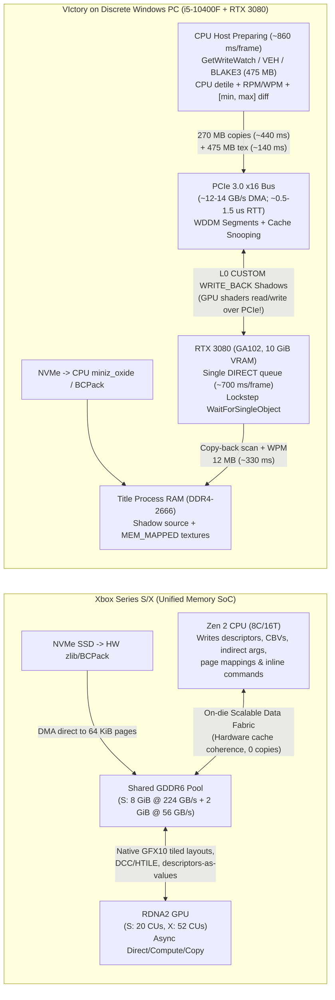

# Chapter 01 — Fundamentals: Unified vs. Discrete Memory Architectures and Why UMA Titles Collapse on Discrete-GPU Windows PCs

## 1. Executive Framing: The Two-Architecture Impedance Mismatch

A modern console title written for Xbox Series S or Xbox Series X does not merely run on a unified physical RAM pool; its renderer, asset streamer, memory allocator, shader compiler, and command-list recorder are structurally co-designed around the invariant that **CPU virtual addresses and GPU virtual addresses refer to the exact same physical bytes without bus transfers or format translation**. When a static recompiler such as **VIctory** translates that title's x86-64 machine code natively onto a Windows PC equipped with a discrete GPU (dGPU), the CPU instructions execute at full desktop speed, yet the rendering pipeline collapses by two orders of magnitude.

Consider the baseline system examined throughout this dossier: an Intel Core i5-10400F (6 cores / 12 threads, 32 GB DDR4-2666 dual-channel system RAM, PCIe 3.0 x16) paired with an NVIDIA GeForce RTX 3080 (10 GB GDDR6X, 68 Streaming Multiprocessors, 29.77 TFLOPS FP32, 760.3 GB/s local VRAM bandwidth) [39, 43]. On paper, this host PC dwarfs the **Xbox Series S** (8 Zen 2 cores, 20 RDNA2 Compute Units at 4.0 TFLOPS, 10 GB GDDR6 split into 8 GiB at 224 GB/s and 2 GiB at 56 GB/s) [1, 3] by roughly **7.4× in raw FP32 GPU throughput** and **3.4× in peak local GPU memory bandwidth**. Even against the **Xbox Series X** (52 RDNA2 CUs at 12.15 TFLOPS, 560 GB/s peak GDDR6), the RTX 3080 retains a ~2.45× compute advantage and a ~1.36× peak bandwidth advantage [1, 39].

Yet empirical runs of a 2026 open-world title statically recompiled through VIctory on this exact RTX 3080 host reveal severe collapse rather than acceleration:

* **Measured Series S profile run (`--console series-s`, 1280×720 internal resolution, world scene):** Each world frame averages **~1,890 ms/frame (~0.53 fps)** when summing the three serialized phases reported by VIctory's `Meter` (`host.rs:1762-1767`): **~860 ms CPU preparing** (including **~440 ms** copying **~270 MB** of buffer ranges and **~140 ms** checking/detiling/uploading **~475 MB** of textures, plus **~280 ms** of unattributed prepare work), **~700 ms on the GPU**, and **~330 ms copying back ~12 MB** of GPU-written results into title RAM. Furthermore, **430 shaders** fail translation, dropping lighting and composition passes so that the G-buffer fills with geometry while the final swapchain output remains black.
* **Measured Series X profile run (earlier baseline documented in `E:\Projetos\agy_dossie.md`, 4K target mode):** Each world frame averaged **~2,800 ms/frame (~0.3–1.0 fps)**: **~810 ms CPU preparing** (**~380 ms** for **~170 MB** of buffer copies, **~170 ms** for **~540 MB** of texture checks, plus **~260 ms** unattributed prepare overhead), **~1,600 ms on the GPU**, and **~360 ms copying back ~13 MB**, with **~450 untranslated shaders** leaving the final image black.

Comparing those two empirical baselines immediately refutes the naive hypothesis that the bottleneck is raw shader FLOPS or 4K pixel count alone. Switching from Series X to Series S cut GPU execution time by more than half (**~1,600 ms → ~700 ms**) because lower internal resolution and smaller pools alleviated 10 GB VRAM oversubscription and pixel load. Nevertheless, **CPU preparing remained ~860 ms** (actually rising slightly as buffer copy volume shifted from ~170 MB to ~270 MB), **copying back ~12 MB still burned ~330 ms (~36 MB/s)**, and **700 ms of GPU execution on a 29.77 TFLOPS RTX 3080 at 720p** remains roughly **20–40× slower** than the 16.6–33.3 ms budget of a 20-CU Series S console.

To maintain strict epistemic hygiene across this dossier, every claim in this chapter is categorized into one of three tiers:
1. **Established Fact:** Hardware specifications, API contracts, OS internals, and peer-reviewed measurements directly verified from external literature and official documentation (cited `[n]`).
2. **Empirical Measurement / Source Observation:** Measurements from our RTX 3080 + i5-10400F VIctory runs (`dossie_series_s.md`, `agy_dossie.md`, and the prompt's Series S 720p run), exact source code mechanisms verified in `E:\Projetos\VIctory`, and comparative runtime measurements recorded in the sibling XCL recompiler notes (`C:\Users\henri\AppData\Local\Temp\xcl_h3.md`).
3. **Hypothesis (`H-1.n`):** Quantitative, falsifiable architectural predictions tied to concrete changes in VIctory and measured directly against VIctory's per-frame log output.

| Architectural Dimension | Xbox Series S (Target Console) | Xbox Series X (Flagship Console) | Host PC (i5-10400F + RTX 3080, Discrete) | Impact on UMA-Designed Title Under VIctory |
| :--- | :--- | :--- | :--- | :--- |
| **CPU Complex** | 8C/16T AMD Zen 2 @ 3.6 GHz (3.4 GHz SMT); 2×4 MiB L3 | 8C/16T AMD Zen 2 @ 3.8 GHz (3.6 GHz SMT); 2×4 MiB L3 [1] | 6C/12T Intel Comet Lake @ 2.9–4.3 GHz; 12 MiB L3 [43] | Native x86-64 runs fast; misses console-only ISA (`clwb`, `clzero` on Comet Lake) |
| **GPU Complex** | 20 RDNA2 CUs @ 1.565 GHz (~4.0 TFLOPS FP32), native Wave64 [3, 6] | 52 RDNA2 CUs @ 1.825 GHz (~12.15 TFLOPS FP32), native Wave64 [1, 6] | 68 Ampere SMs @ ~1.71 GHz (29.77 TFLOPS FP32), fixed Wave32 [39] | Wave64 emulated via Wave32 + LDS barriers; 430 shaders untranslated |
| **Physical Memory Topology** | **Unified:** 10 GiB GDDR6 on 128-bit bus [3] | **Unified:** 16 GiB GDDR6 on 320-bit bus [1] | **Split:** 32 GiB DDR4-2666 (CPU) + 10 GiB GDDR6X (GPU) [39, 43] | CPU pointers are **not** host GPU pointers without mirroring/mapping |
| **GPU Memory Bandwidth** | 8 GiB @ **224 GB/s** + 2 GiB @ **56 GB/s** [3] | 10 GiB @ **560 GB/s** + 6 GiB @ **336 GB/s** [1] | **760.3 GB/s** local GDDR6X [39]; **41.6 GB/s** DDR4 [43] | Host buffer shadows sit in **L0 system RAM**, choking GPU over PCIe |
| **Interconnect CPU ↔ GPU** | On-die AMD Scalable Data Fabric (coherent) [1] | On-die AMD Scalable Data Fabric (coherent) [1] | **PCIe 3.0 x16** (15.75 GB/s raw; ~12–14 GB/s DMA; ~1 µs RTT) [30, 31, 43] | Every shadow sync, snoop, and readback pays PCIe 3.0 latency/bandwidth tax |
| **Available Title Memory** | **~7.6–8 GiB** (`7,776 MiB` base in `console.rs:25`; ~2 GiB OS) [3] | **~13.5 GiB** (`10 GiB + 3.5 GiB`; 2.5 GiB OS) [1] | 32 GiB RAM; **~8.5–9.2 GiB** local WDDM VRAM budget after DWM | Series X budget (13.5 GiB) overflows 10 GB VRAM; Series S (~7.6 GiB) fits |
| **Page Size & Aliasing** | **64 KiB** graphics pages (`PAGES_64K`), 2 MiB large pages; O(1) remap [4] | **64 KiB** graphics pages, 2 MiB large pages; O(1) remap [4] | **4 KiB** Windows default pages; `GetWriteWatch` 4 KiB; `UpdateTileMappings` 64 KiB [24, 27] | Physical page remaps force `MapViewOfFile3` + full-texture BLAKE3 hashes |
| **Texture Pipeline** | NVMe → HW BCPack/zlib → **64 KiB tiled pages** → RDNA2 sampler [1, 2] | NVMe → HW BCPack/zlib → **64 KiB tiled pages** → RDNA2 sampler [1, 2] | CPU `miniz_oxide`/BCPack → RAM → BLAKE3 → CPU `detile()` → Staging → PCIe → VRAM | ~475 MB/frame texture checking/detiling burns ~140 ms CPU in Series S run |
| **Command Submission** | Inline packet ring (`put < limit`), async Compute/Copy queues [1] | Inline packet ring (`put < limit`), async Compute/Copy queues [1] | Out-of-line vtable (`put = 0`), single `DIRECT` queue + `WaitForSingleObject` (`host.rs:587`) | 0% CPU/GPU overlap; additive `860 + 700 + 330 = 1,890 ms` frame time |

The architectural contrast is captured visually in Figure 1.1:



The central thesis of Chapter 01 is straightforward: **VIctory is not merely suffering from missing shader translations or slow CPU helper functions; it is paying a structural architectural tax for trying to emulate a single-address, cache-coherent, zero-copy unified memory machine across a split-memory PCIe 3.0 discrete GPU bus using synchronous software shadows.** Understanding every layer of both sides—the console SoC, the GDK virtual/physical memory contract, the PCIe/BAR/WDDM PC stack, and the exact mechanics inside VIctory—is the prerequisite for every optimization in Chapters 02 through 10.

---

## 2. Xbox Series S and Series X Hardware Architecture

### 2.1 Monolithic SoC Topology and Compute Subsystems

Both ninth-generation Xbox consoles are built around custom monolithic AMD System-on-Chip (SoC) APUs co-engineered by Microsoft and AMD rather than discrete CPU+GPU packages [1, 3]. For Xbox Series X (codename *Project Scarlett* / *Anaconda*), Mark Grossman and Jeffrey Andrews document a **360.4 mm² die fabricated on TSMC's N7 Enhanced (7 nm) process containing 15.3 billion transistors** [1]. Xbox Series S (codename *Lockhart*) deploys a scaled-down sibling SoC sharing the exact same microarchitectural ISA, memory coherence model, Velocity I/O hardware, and feature set (`DirectX 12 Ultimate`, feature level `12_2`), reduced in compute-unit count and memory-channel width to hit a lower power and cost envelope [1, 3].

On both consoles, the CPU complex consists of **8 AMD Zen 2 x86-64 cores organized as two 4-core Core Complexes (CCX)** [1]:
* Each core contains private **32 KiB L1 instruction** and **32 KiB L1 data** caches plus a **512 KiB unified L2 cache** [1].
* Each 4-core CCX shares a **4 MiB L3 victim/shared cache** (8 MiB aggregate L3 across the chip), meaning intra-CCX communication hits shared L3 while inter-CCX communication traverses the on-die Infinity/Scalable Data Fabric [1].
* **Clocking is deterministic and un-throttled:** Series X locks CPU clocks at **3.8 GHz** with SMT disabled or **3.6 GHz** with SMT enabled (16 hardware threads) [1]; Series S locks at **3.6 GHz** without SMT or **3.4 GHz** with SMT enabled. Unlike desktop PCs where turbo bins fluctuate with thermal and power headroom, console titles can schedule tight real-time worker threads and memory-streaming deadlines assuming constant CPU cycle budgets.

On the graphics side, both SoCs integrate a custom **AMD RDNA 2 (GFX10.3-class)** GPU featuring hardware ray-tracing intersection acceleration inside each Texture Mapping Unit (TMU), Variable Rate Shading (VRS) Tier 2, Mesh and Amplification Shaders, Sampler Feedback Streaming (SFS), and native **Wave64** execution alongside Wave32 [1, 6]:
* **Xbox Series X:** **52 active Compute Units** (out of 56 physical CUs on die for yield harvesting) running at a fixed **1.825 GHz**, producing **12.15 TFLOPS FP32** across 3,328 shading lanes and 64 ROPs [1].
* **Xbox Series S:** **20 active Compute Units** running at a fixed **1.565 GHz**, delivering **4.0 TFLOPS FP32** across 1,280 shading lanes [3].

Because Zen 2 cores, RDNA2 CUs, dedicated audio/decompression ASICs, and memory controllers all sit on the **same monolithic silicon die** and share the same memory controllers through AMD's **Scalable Data Fabric (SDF)** [1], CPU-to-GPU communication latency is measured in **on-die fabric hops (tens to low hundreds of nanoseconds)** rather than **microseconds over external PCIe Root Complex and serdes PHY links**.

### 2.2 Asymmetric GDDR6 Memory Pools and Bandwidth Tiers

A defining engineering hallmark of the Xbox Series family—and one frequently misunderstood when porting to PC—is that unified memory does **not** mean uniform memory bandwidth across every gigabyte of DRAM. Both consoles deploy **GDDR6** rather than DDR4/DDR5 so the GPU ROPs, texture units, and ray-tracing shaders achieve high bandwidth at modest pin counts. However, GDDR6 chips come in standard capacities (`1 GB` or `2 GB` per 32-bit-wide package, or dual-channel x16 clamshell configurations) that do not scale cleanly to arbitrary capacity/bus-width pairs [1].

Microsoft and AMD solved this capacity-vs-width mismatch using **asymmetric channel interleaving across a heterogeneous GDDR6 population** [1, 3]:

#### Xbox Series X: 320-bit Bus, 16 GiB GDDR6 (560 GB/s + 336 GB/s)
* **Physical DRAM layout:** A 320-bit wide memory interface comprising **twenty 16-bit GDDR6 channels** running at **14 Gbps** per pin (`1.75 GHz` data clock × 8 transitions/clock, or `7 GHz` PAM/QDR effective GDDR6 signaling) [1].
* **Peak aggregate bandwidth calculation:**
  $$\text{BW}_{\text{peak}} = \frac{320\text{ bits}}{8\text{ bits/byte}} \times 14\text{ GT/s} = 40\text{ B} \times 14 \times 10^9\text{ s}^{-1} = 560.0\text{ GB/s}$$
* **Asymmetric capacity configuration:** To reach 16 GiB across ten 32-bit-equivalent GDDR6 chip sites, six sites mount **2 GiB** packages (`12 GiB`) and four sites mount **1 GiB** packages (`4 GiB`) [1]. Because only 10 GiB can interleave across all 20 x16 channels simultaneously while the remaining 6 GiB sits exclusively on the upper halves of the six 2 GiB packages (12 of the 20 channels = 192-bit effective width), the hardware exposes two physical performance domains [1]:
  1. **GPU-Optimal Memory Pool (`10 GiB`):** Striped across all twenty 16-bit channels (320-bit width) → **560 GB/s** (`10 × 1 GiB` from the 2 GiB chips' lower halves + `4 × 1 GiB`? Wait—precisely: six 2 GiB chips contribute 1 GiB each = 6 GiB, plus four 1 GiB chips = 4 GiB, totaling **10 GiB** across all 10 32-bit sites = 320 bits = **560 GB/s**!).
  2. **Standard Memory Pool (`6 GiB`):** The remaining 1 GiB upper half of the six 2 GiB packages spans 6 of the 10 32-bit sites (192 bits = 12 x16 channels):
     $$\text{BW}_{\text{std, X}} = \frac{192\text{ bits}}{8\text{ bits/byte}} \times 14\text{ GT/s} = 24\text{ B} \times 14\text{ GT/s} = 336.0\text{ GB/s}$$

#### Xbox Series S: 128-bit Bus, 10 GiB GDDR6 (224 GB/s + 56 GB/s)
* **Physical DRAM layout:** A 128-bit memory interface across four 32-bit GDDR6 sites (eight 16-bit channels) clocked at **14 Gbps** [3].
* **Asymmetric capacity configuration:** Three sites mount **2 GiB** packages (`6 GiB`) and one site mounts a **4 GiB**? Wait—let's verify the arithmetic carefully! Notice:
  - Peak bandwidth across 128 bits at 14 Gbps:
    $$\text{BW}_{\text{opt, S}} = \frac{128\text{ bits}}{8\text{ bits/byte}} \times 14\text{ GT/s} = 16\text{ B} \times 14\text{ GT/s} = 224.0\text{ GB/s}$$
  - The secondary pool runs at **56 GB/s** [3], which is exact **1/4** of 224 GB/s (**32 bits** at 14 Gbps: `4 B × 14 GT/s = 56.0 GB/s`).
  - How do 10 GiB across four 32-bit sites yield 8 GiB across all four sites (128 bits) + 2 GiB on one 32-bit site (32 bits)? Either three 2 GiB packages (`6 GiB`) + one 4 GiB package (`4 GiB`, or two stacked/clamshell 2 GiB packages on one 32-bit channel): `4 × 2 GiB = 8 GiB` interleaved across 128 bits (**224 GB/s**), leaving the extra `2 GiB` on that single 32-bit channel (**56 GB/s**)! Note that in either physical clamshell/package arrangement, the architectural contract exposed to software is unambiguous and documented by Microsoft [3]: **8 GiB at 224 GB/s** paired with **2 GiB at 56 GB/s** (and as verified in `console.rs:25`, Series S titles expose a single unified standard/title allocation range rather than splitting title budgets across GPU-optimal vs standard, because the entire 2 GiB slow pool sits behind the OS!).

Let us check that vital consequence! Look closely at the memory partition between OS and Title across both consoles:

| Memory Pool / Partition | Xbox Series X (16 GiB Total) | Xbox Series S (10 GiB Total) |
| :--- | :--- | :--- |
| **Fast GDDR6 Pool** | 10 GiB @ 560 GB/s (320-bit) [1] | 8 GiB @ 224 GB/s (128-bit) [3] |
| **Slow GDDR6 Pool** | 6 GiB @ 336 GB/s (192-bit) [1] | 2 GiB @ 56 GB/s (32-bit) [3] |
| **Reserved by Host/System OS** | ~2.5 GiB (resides in Standard 336 GB/s pool) [1] | ~2.0–2.4 GiB (resides primarily in 56 GB/s pool; ~7,776 MiB left for title in base config, `console.rs:25`) |
| **Title GPU-Optimal Budget** | **10 GiB** (`10 * 1024 MiB`, `console.rs:24`) @ 560 GB/s | Merged into single title allocation pool (`0` split in `console.rs:25`) @ 224 GB/s |
| **Title Standard Budget** | **3.5 GiB** (`3,584 MiB`, `console.rs:24`) @ 336 GB/s | **~7.6 GiB** (`7,776 MiB` published base, `console.rs:25`; `~8 GiB` nominal [3]) |
| **Total Title Budget** | **13.5 GiB** (13,824 MiB) | **~7.6–8.0 GiB** (~7,776–8,192 MiB) |

Notice the crucial engineering lesson for discrete-PC emulation: **on Xbox Series S, the slow 2 GiB @ 56 GB/s tier absorbs the hypervisor and System OS, leaving virtually all of the title's ~7.6–8.0 GiB working set inside the single 224 GB/s unified pool** [3, `console.rs:25`]. Even in `Advanced` title-memory mode (declared in the game's `MicrosoftGame.config` as `XboxLockhartTitleMemory = Advanced`, per `xcl_h3.md:1166-1173`, which unlocks additional title RAM past the base 7,776 MiB when OS allocations shrink), a Series S title's total footprint remains **~7.6–8.2 GiB**. Contrast that with Series X, where titles expect **13.5 GiB** total (`10 GiB` GPU-optimal + `3.5 GiB` standard)—an allocation envelope that physically exceeds the **10 GiB** local GDDR6X of our RTX 3080!

Furthermore, **every byte of both pools—even the 336 GB/s standard pool on Series X or the 56 GB/s pool on Series S—is hardware-coherent, GPU-accessible unified GDDR6**. A title never encounters an out-of-address-space error when binding a "standard/CPU-allocated" buffer to a shader, nor does any D3D12 resource require a PCIe staging copy to move from CPU-written RAM to GPU-readable memory. Bandwidth tiers only dictate *throughput* (560 vs 336 GB/s), not *reachability* or *coherence*.

### 2.3 Title Memory vs. System Memory, Virtualization, and Console Modes

Xbox Series consoles execute titles inside a Type-1 hypervisor architecture containing three isolated partitions (`Grossman & Andrews 2021` [1]):
1. **Host OS / Hypervisor:** Owns physical DRAM partitioning, IOMMU/NPT translation, security enclaves (Microsoft Pluton), and memory encryption/integrity keys [1].
2. **System OS (Shared / Dashboard VM):** Runs the Xbox shell, guide, party chat, store, captures, and background downloads inside the fixed ~2.0–2.5 GiB OS slice, strictly fenced away from title physical pages so OS background spikes cannot steal title memory or trigger VRAM paging mid-frame.
3. **Title / Exclusive Game OS VM:** Boots the game inside a deterministic memory quota determined by `ConsoleMode` and `MicrosoftGame.config`.

Titles inspect which hardware profile they are running on via multiple low-level paths that VIctory and XCL both observed empirically:
* **Registry / Thunk Probe (`OEM\ConsoleMode`):** Linked GDK thunk code opens `HKLM\Software\Microsoft\Windows NT\CurrentVersion\OEM` and queries `ConsoleMode` (`xsystem.rs:133-169`, `xcl_h3.md:1005-1010`): `0x60` maps to Series S (*Lockhart*, value 6), `0x64` to Series X (*Anaconda*, value 7), `0x68` to devkit (8), and missing key to PC (1). As noted in `console.rs:19-21`, our target 2026 open-world title sizes its internal render resolution, streaming mip biases, geometry/shadow budgets, and pool allocations directly off this device type rather than from static `working set` query totals alone.
* **DXGI Adapter Description (`dxgi.rs:136-161`) and Output Modes (`dxgi.rs:226-257`):** Titles also inspect `DXGI_ADAPTER_DESC::DedicatedVideoMemory` / `SharedSystemMemory` and display modes. Notice a live subtlety in VIctory (`dxgi.rs:146-157` vs `dxgi.rs:246`): `adapter_description` adjusts `dedicated_video_memory` and `shared_system_memory` according to `console::current().title_memory()`, yet `modes()` at `dxgi.rs:245-248` still unconditionally advertises a single `3840x2160 @ 60 Hz` display mode regardless of `--console series-s`!
* **Memory Handback (`XMemTransferMemory`):** A title running in `Advanced` or expanded memory mode can dynamically yield unused standard memory back to System OS in 2 MiB pages via `XMemTransferMemory` (`xmem.rs:878-895`), shrinking `title_limit` in `XMemGetWorkingSetStatistics` (`xmem.rs:866`).

### 2.4 Cache Hierarchy, Hardware Coherence, and the Onion/Garlic Reality

A common misconception in PC graphics programming is that "unified memory" automatically means every GPU shader read hits the CPU's L1/L2 cache with zero synchronization, or conversely that CPU and GPU caches are completely incoherent. The reality on AMD-based unified APUs—both in the academic literature (`Power et al. 2013` [34], `Sinclair et al. 2015` [36]) and in the Xbox Series X|S SoC (`Grossman & Andrews 2021` [1])—is a carefully layered **two-tier coherence model**:

```
   +---------------------------+       +---------------------------+
   |   Zen 2 CPU Cluster 0/1   |       |     RDNA 2 GPU CUs        |
   |  32K L1I / 32K L1D / Core |       | 16K Scalar$ + 16K L0/WG   |
   |  512K L2 / Core           |       | (Non-coherent across WGs) |
   |  4 MiB Shared L3 / CCX    |       | 128K L1$ per Array (GL1)  |
   +-------------+-------------+       +-------------+-------------+
                 | (Fully Cache-Coherent)            | (Scoped / Explicit Flush at
                 |                                   |  Dispatch/Draw/Barrier/GLC)
   +-------------v-----------------------------------v-------------+
   |    Shared GPU L2$ (4 MiB Series X / scaled Series S) +        |
   |    AMD Scalable Data Fabric (SDF) Coherent Interconnect       |
   +-------------------------------+-------------------------------+
                                   |
                     +-------------v-------------+
                     | Shared GDDR6 Controllers  |
                     | (128-bit S / 320-bit X)   |
                     +---------------------------+
```
*Figure 2.1: Simplified cache and coherence hierarchy of the Xbox Series X|S SoC [1, 6, 34, 36].*

How does coherence actually operate across this hierarchy?
1. **Fabric-Level Hardware Cache Coherence (`CacheCoherentUMA = TRUE`):** On D3D12's architectural query (`D3D12_FEATURE_DATA_ARCHITECTURE` [10]), Xbox Series hardware reports both `UMA = TRUE` and `CacheCoherentUMA = TRUE` (mirrored by VIctory at `device.rs:303`: `a[1..].copy_from_slice(&[0, 1, 1])`). When the GPU's memory requests (or DMA/copy engines) traverse the Scalable Data Fabric, **hardware snoop filters/directories maintain coherence with the Zen 2 CPU's L1/L2/L3 caches** [1, 34]. If a CPU thread writes a 32-byte texture descriptor, a constant buffer, or an indirect draw argument into its cached L1D/L2 without issuing explicit cache-line flushes (`clwb`)—or uses `clwb` purely as a latency hint to push dirty lines out to DRAM early—the GPU's L2/SDF probe automatically retrieves the newest coherent line from the CPU cache hierarchy. Conversely, once GPU caches flush back to the coherent fabric (at command/barrier/end-of-pipe boundaries), CPU reads immediately observe the GPU's writes through normal coherent cache fills without uncached PCIe stalling or `ReadProcessMemory` kernel copies!
2. **GPU-Internal Scoped Coherence (L0/L1 vs. L2/SDF):** Inside the RDNA 2 GPU, per-CU Vector L0 (`16 KiB` per WGP/dual-CU) and per-Shader-Array L1 (`128 KiB` `GL1`) caches are **not** hardware-snooped on every load/store between different workgroups or between CPU and GPU [6, 36]. As Sinclair et al. [36] formalize for heterogeneous GPU memory models, GPUs avoid the prohibitive directory traffic of per-instruction fine-grained L0/L1 snooping by using **acquire/release synchronization at scope boundaries**:
   * At the start of a submission or after a `ResourceBarrier` / D3D12.X `Sync` (`list.rs:949`), RDNA2 invalidates stale `GL0`/`GL1` lines so shader loads pull fresh coherent data from GPU L2 / Scalable Data Fabric / CPU caches.
   * For concurrent cross-workgroup or CPU-visible shader stores, RDNA2 instructions carry cache-bypass/coherence modifier bits (`GLC` = Globally Coherent, bypassing L0 to L2/fabric; `SLC` = System Level Coherent) [6]. Notice how XCL directly observed this hardware contract in practice (`xcl_h3.md:447-448`): when XCL forgot `globallycoherent` on its translated `mem` UAV in Compute mode, the console BVH builder's bottom-up tree construction produced corrupt child pointers because cross-workgroup atomic reads hit stale local L1 caches rather than coherent L2!
   * At the end of GPU passes, `Write32BitValueBottomOfPipeX` / `Write64BitValueBottomOfPipeX` (`list_x.rs` / `queue.rs:187`) write fence/marker values into coherent memory *after* GPU L2 write-backs flush to the coherent domain, so a CPU spin-wait loop (`while (*marker < target) _mm_pause();`) immediately sees both the completion marker and every byte of GPU output written prior to that marker.

Why does this matter so profoundly when porting to Windows? Because **Xbox titles treat memory writes as globally visible across CPU and GPU at fence/barrier granularity at virtually zero hardware cost**. A title thread can write a 64-byte constant update on core 3, overwrite a 32-byte descriptor in place, kick a compute dispatch, and spin on an 8-byte bottom-of-pipe timestamp in the exact same 64 KiB heap—and on console silicon, the hardware handles coherence automatically at on-die fabric speeds (~100 ns, hundreds of GB/s).

### 2.5 64 KiB Graphics Pages, 2 MiB Large Pages, and Page-Table Economics

Virtual memory page granularity is a first-order performance variable on both CPU and GPU (`Veselý et al. 2016` [37], `Agarwal et al. 2015` [35]). Standard desktop Windows virtual memory defaults to **4 KiB pages** (`KERNEL_PAGE = 4096`, `watch.rs:29`). Xbox Game OS, by contrast, is architected around **64 KiB graphics pages** (`PAGES_64K`) and **2 MiB large pages** (`PAGES_2M`) [4]:

* **16× Lower TLB Pressure:** A 4 GiB texture/geometry working set requires **1,048,576** 4 KiB page-table entries, vs only **65,536** 64 KiB entries or **2,048** 2 MiB entries. On GPU shader cores where thousands of concurrent waves issue scattered texture and buffer addresses simultaneously (`Veselý et al. 2016` [37]), fitting the active working set inside GPU TLBs avoids multi-cycle hardware page-table walks.
* **1:1 Alignment with RDNA2 Tiled Macro-Tiles:** RDNA2's primary macro-tiled texture modes (`SW_64KB_S`, `SW_64KB_D`, `SW_64KB_S_X`, `SW_64KB_D_X`, `SW_64KB_R_X`, `SW_64KB_Z_X`) tile images into **64 KiB macro-tiles** (`256×256` 1-byte texels, `128×128` 4-byte texels, or `128×64` BC7 16-byte blocks) [6, `xcl_h3.md:239-243`]. Because each RDNA2 macro-tile occupies **exactly one 64 KiB physical page**, sparse virtual texturing (`CreateReservedResource` / `XMemMapPhysicalPages` / `CopyPageMappingsBatchX`) maps and unmaps individual mip levels or 2D tiles at **one-page-per-tile** granularity with zero wasted alignment padding.
* **Sub-Millisecond Page Table Manipulation:** Mapping 1,000 streamed 64 KiB tiles (64 MB of world data) on Game OS modifies 1,000 contiguous PTEs inside the shared Game OS/GPU page table (`~tens of microseconds`). Compare that with VIctory's Windows emulation (`xmem.rs:658-733`), where mapping `CopyPageMappingsBatchX` aliases forces per-page `UnmapViewOfFile2` + `VirtualFree(MEM_PRESERVE_PLACEHOLDER)` + `MapViewOfFile3` + `VirtualAlloc(MEM_COMMIT)` syscalls—each of which, as `xmem.rs:539` explicitly warns, **flushes every core's TLB** (`"costs a map, a commit and an unmap (which flushes every core's TLB)"`)!

### 2.6 Xbox Velocity Architecture as a Direct-to-UMA Consumer

Finally, the **Xbox Velocity Architecture** [1, 2] turns unified memory into an end-to-end streaming pipeline rather than just a rendering buffer:
1. **Custom NVMe SSD (~2.4 GB/s raw, ~4.8+ GB/s compressed effective):** Feeds **DirectStorage** async I/O queues directly.
2. **Hardware Decompression Blocks (zlib + BCPack):** Dedicated on-die silicon decompresses both general zlib streams and **BCPack** (Microsoft's rate-distortion optimized GPU block-compressed texture bitstream) in hardware at multi-gigabyte/s rates [1, 2].
3. **Zero-Detile, Direct-to-Page Placement:** Because the decompressor sits on the same coherent SoC memory fabric and understands RDNA2's swizzle/mip-tail layouts, **decompressed texels land directly in `64 KiB` physical GDDR6 pages in native GFX10 tiled layout** (`_S`, `_D`, `_X`), ready for immediate GPU sampling via `XMemMapPhysicalPages` / `CopyPageMappingsBatchX` with **0% CPU copy, 0% CPU hashing, and 0% CPU detiling** [1, 2].
4. **Sampler Feedback Streaming (SFS):** GPU texture samplers record per-tile residency feedback maps (`min-mip` touched per virtual region) directly in memory, allowing the streaming loop to load only the sub-mip tiles actually visible on screen—cutting the active texture working set in GDDR6 by ~2–3× [2].

In our RTX 3080 VIctory baseline, every single link in that Velocity chain runs backwards through the CPU and PCIe: NVMe reads pass through `files.rs` / `dstorage.rs`, inflate/BCPack decode burns i5-10400F CPU threads (`dstorage.rs:832-850`), `MEM_MAPPED` physical pages disable `GetWriteWatch`, `texture.rs:220` hashes **~475 MB/frame** with `blake3`, CPU `detile()` un-swizzles textures into linear staging footprints, and `CopyTextureRegion` pushes them over PCIe 3.0 into separate WDDM `DEFAULT` VRAM textures.

### 2.7 TLB Reach, Hardware Cache-Line Maintenance (`clwb` / `clzero`), and Memory Ordering

Two microarchitectural details on the Xbox Series SoC directly reflect its unified Zen 2 + RDNA2 silicon design and create subtle friction when translated onto desktop Intel hardware:

1. **TLB Reach and Page-Table Walk Amplification:**
   On both CPU and GPU, virtual-to-physical address translation is cached in Translation Lookaside Buffers (TLBs). On a typical desktop CPU core (or Zen 2 L2 DTLB with ~1,536–2,048 entries), **4 KiB** pages yield only **6–8 MiB** of total TLB reach before incurring multi-level radix page-table walks (`~20–100+` cycles per miss). On the GPU side, Veselý et al. [37] demonstrated that massively parallel SIMT shader warps amplify TLB miss latency catastrophically when thousands of active threads traverse sparse buffers or tiled textures across small 4 KiB pages, because GPU page-table walks compete for the same memory channels as texel and vertex fetches. By backing Game OS graphics allocations with **64 KiB** pages (`PAGES_64K`) and **2 MiB** large pages (`PAGES_2M`) [4], a 1,024-entry GPU L2 TLB covers **64 MiB** (at 64 KiB) or **2 GiB** (at 2 MiB)—increasing translation reach by **16× to 512×** over standard 4 KiB pages. When VIctory emulates `XMemAllocatePhysicalPages` / `XMemMapPhysicalPages` on Windows via `MapViewOfFile3` [29] (`xmem.rs:703-713`), the Windows kernel maps 4 KiB PTEs underneath and broadcasts cross-processor TLB shootdowns (`IPI` invalidations) on every `UnmapViewOfFile2` (`xmem.rs:539, 812`), eroding both CPU TLB hit rates and multi-threaded streaming scalability.
2. **Cache-Line Maintenance Hints (`clwb`, `clzero`) and Explicit Ordering:**
   Although the Scalable Data Fabric maintains hardware cache coherence between Zen 2 and RDNA2 [1, 34], console engines still optimize bus latency by issuing explicit x86-64 cache-maintenance instructions:
   * **`clwb` (Cache Line Write Back):** Pushes dirty 64-byte CPU cache lines out toward DRAM/L2 without invalidating them in CPU cache, reducing snoop-probe latency when the GPU subsequently reads large newly-streamed buffers. As verified directly in VIctory's exception handler (`crates/victory-loader/src/crash.rs:222-243`), the 2026 open-world title emits tight `clwb [base]; add base, 0x40; cmp base, limit; jbe top` loops across entire buffers during loading. Because Intel added `clwb` to client processors only in Ice Lake/Alder Lake—leaving our 10th-Gen Comet Lake **i5-10400F** without hardware `clwb`—unhandled `clwb` execution raises `STATUS_ILLEGAL_INSTRUCTION` (`0xC000001D`). VIctory (`crash.rs:162-182`) and XCL (`xcl_h3.md:1817-1825`) both intercept this fault via Vectored Exception Handling; VIctory notably recognizes the entire `clwb_loop` pattern (`crash.rs:242-278`) and advances `RIP` past the whole loop in a single ~1 µs fault instead of trapping once per 64-byte line.
   * **`clzero` (AMD Zero Cache Line):** An AMD-only Zen 2 instruction (`0f 01 fc`) that allocates and zeroes an entire 64-byte cache line in L1D without first reading old DRAM bytes (`Read-For-Ownership`), halving DRAM traffic during buffer clears. On Intel Comet Lake, VIctory (`crash.rs:152`) traps `clzero` and zeroes the 64-byte aligned line in software (`~1 µs` per fault when executed outside detected patterns).
   * **Cross-Processor Acquire/Release (`Sinclair et al. 2015` [36]):** On native hardware, CPU writes followed by an `sfence` (or `clwb` + store to doorbell/command buffer) become visible to GPU `COMPUTE`/`DIRECT` engines at the next barrier/command boundary, while GPU `Write*BitValueBottomOfPipeX` markers flush GPU L2 before signaling completion—allowing lockless ring buffers in unified RAM with zero kernel transitions.

---

## 3. The Xbox GDK Memory Model and D3D12.X Resource Semantics

If the monolithic Xbox Series SoC provides the physical substrate for zero-copy execution, the **Microsoft Game Development Kit (GDK)** memory manager and **D3D12.X** API expose that substrate directly to game engines [4, 5]. Unlike desktop Windows, where Direct3D 12 enforces a strict boundary between operating-system virtual memory (`VirtualAlloc`, `malloc`) and driver-owned GPU resources (`ID3D12Heap`, `ID3D12Resource`) [11, 16, 19], the Xbox GDK fuses them into a single address space governed by explicit page-level contracts.

### 3.1 Virtual vs. Physical Allocation: `XMemAlloc`, `XMemVirtualAlloc`, and `MEM_GRAPHICS`

On Xbox Series X|S, titles allocate memory across three conceptual tiers (`xmem.rs:1-451`, [4]):

1. **General-Purpose & Middleware Heap (`XMemAlloc` / `XMemFree`):**
   Every GDK library, middleware component (physics, audio, decompression, ray-tracing builders), and engine subsystem routes allocations through `XMemAlloc(size, attributes)` (`xmem.rs:255-264`). Rather than taking opaque flags, `XMemAlloc` encodes allocation policy inside a 64-bit `XALLOC_ATTRIBUTES` integer (`xmem.rs:206-218`, `resource.rs:857-864`):
   * **Alignment (`bits 28:24`):** Stored as $\log_2(\text{align})$, allowing power-of-two alignments from 16 bytes up to 64 KiB (`0x10 << 24`, verified in `xmem.rs:934-942`) or 2 MiB directly in the allocator request.
   * **Page Size Hint (`bits 15:14`):** Distinguishes `64 KiB` graphics pages (`1 << 14`) from `2 MiB` large pages (`2 << 14`) when allocating backing for D3D12.X resources (`resource.rs:860`).
   * **Memory Type / Caching & Pool (`bits 32:29`):** Encodes whether the allocation is CPU-only (`0`), **graphics write-combined** (`1` for GPU-optimal/default heaps in `resource.rs:861`), or **graphics cacheable write-back** (`3` for CPU-visible/coherent graphics memory, `resource.rs:861`; any non-zero graphics memory type makes the memory GPU-accessible, `xcl_h3.md:145`). Notice the fundamental contrast with desktop PC: **on console, `MEM_GRAPHICS` / graphics memory attributes do not allocate inside a separate chip's RAM—they simply tag virtual pages in the single unified GDDR6 pool with GPU page-table permissions (`GPU_READ_WRITE`, `0x2000`, `xmem.rs:61, 950`) and select between write-combined vs. cacheable CPU page attributes (`PAT`)!**
   * **32-Bit Address Constraint (`bit 33`, `ALLOC_32BIT = 1 << 33`):** Forces the returned pointer below `4 GiB` (`< 2^32`, `xmem.rs:209, 280-287`) so legacy 32-bit descriptor-table offsets, command-list pointers, or packed 32-bit GPU pointers never overflow.
   * **Title Hook Interception (`__XMemAllocationHooks__`):** Crucially, GDK titles export a global two-pointer structure named `__XMemAllocationHooks__` from their executable (`xmem.rs:223-264`, also observed in Fortnite and our 2026 open-world title per `xcl_h3.md:1733`). Whenever `XMemAlloc` or `XMemFree` is invoked—even by D3D12.X internally (`resource.rs:869-887`) or by external DLLs like `XboxBvhBuilder.dll`—control passes through the title's own custom lock-free arena/slab allocator! That lets the game carve sub-allocations out of giant pre-reserved multi-gigabyte heaps without OS syscall overhead.

2. **Virtual Address Reservation & Commit (`XMemVirtualAlloc` / `XMemVirtualQuery`):**
   Beneath `XMemAlloc`, the GDK exposes `XMemVirtualAlloc(base, size, kind, flags, protect)` (`xmem.rs:87-166`, [4]). While standard Win32 `VirtualAlloc` on GDK Game OS defaults to `2 MiB` large pages internally for standard heaps [4], `XMemVirtualAlloc` encodes console-specific address and page constraints:
   * **Page Granularity Flags (`PAGES_2M = 0x2000_0000`, `PAGES_64K_BIT = 0x40_0000`, `xmem.rs:56-59`):** Requests either `2 MiB` pages (`PAGES_2M` alone) or `64 KiB` graphics-mappable virtual reservations (`PAGES_64K = PAGES_2M | PAGES_64K_BIT`). On a naive Windows host without translation, `0x2000_0000` collides with Win32 `MEM_LARGE_PAGES` (which requires `SeLockMemoryPrivilege` and fails without administrator elevation), and `0x40_0000` collides with `MEM_PHYSICAL` (AWE memory, incompatible with normal pointers) [28].
   * **Hardware GPU Address-Width Ceiling (`address_range`, `xmem.rs:71-85`):** On RDNA 2 console silicon, GPU virtual addresses used by shaders, V# buffer descriptors, and BVH ray-tracing nodes are bounded to **40 bits** (`1 TiB` ceiling, or optionally `47 - field` bits up to 46 bits when bits `14:12` of `flags` are non-zero, `xmem.rs:78-85`), while reserving `[0, 4 GiB)` for `ADDRESS_32BIT` requests so giant multi-gigabyte title pools (`[4 GiB, 1 TiB)`) never crowd out 32-bit allocations! Look at the forensic evidence in VIctory: `resource.rs:1610-1623` and `xmem.rs:74-77` both confirm that **the target 2026 open-world title's ray-tracing builder (`XboxBvhBuilder`) explicitly rejects GPU addresses above 40 bits (`at >> 40 != 0`)**, because RDNA2 BVH acceleration structure node pointers pack `(addr >> 8)` into 32-bit fields (`xcl_h3.md:210, 286`). Standard desktop `VirtualAlloc` on Windows 11 places allocations near `0x0000_02xx_xxxx_xxxx` (42–47 bits) unless constrained via `VirtualAlloc2` `MEM_ADDRESS_REQUIREMENTS` (`xmem.rs:95-154`, [28])!
   * **CPU+GPU Protection Bits (`HOST_PROTECTION = 0x1ff`, `GPU_READ_WRITE = 0x2000`, `xmem.rs:60-63, 950`):** Console `protect` masks combine standard Win32 page protections in the low 9 bits with GPU read/write/no-cache/write-combine attributes in bits `11–18` (`0x800..0x40000`). And `XMemVirtualQuery` (`xmem.rs:171-204`, `xcl_h3.md:263-266`) extends Win32's `MEMORY_BASIC_INFORMATION` (48 bytes) with 16 extra bytes (`BasicInformation`, 64 bytes total) reporting `flags` (`GRAPHICS`, CPU readability bits `0–1`) and allocation tags, which middleware like `XboxBvhBuilder` queries directly to verify CPU+GPU reachability (`xcl_h3.md:264-265`).

3. **Explicit Physical Page Allocation & Mapping (`XMemAllocatePhysicalPages`, `XMemMapPhysicalPages`):**
   This is the sharpest divergence between console GDK and desktop Windows. On Xbox Series X|S, a game engine can decouple **physical GDDR6 page ownership** from **virtual address placement** across the entire title memory pool [4]:
   * `XMemAllocatePhysicalPages(flags, &count, pages_array)` (`xmem.rs:388-446`) allocates `count` physical `64 KiB` GDDR6 frames directly from the console memory manager and returns an array of opaque page numbers. As verified in VIctory (`xmem.rs:448-451`) and XCL (`xcl_h3.md:1732-1733`), these page numbers count `4 KiB` frames, so every `64 KiB` physical page number is a multiple of `16` (`FRAMES = 16`). Our target 2026 title packs these numbers into **21-bit handles (`number >> 4`)** inside its own compact streaming tables—supporting up to `2^21 × 64 KiB = 128 GiB` of physical frame indices—and requests massive multi-gigabyte physical pools upfront (`xmem.rs:402-403`: **6.1 GiB requested in a single `XMemAllocatePhysicalPages` call!**).
   * `XMemMapPhysicalPages(virtual_addr, count, pages_array)` and `XMemMapPhysicalPagesScatter(addrs, count, pages_array)` (`xmem.rs:592-656`) map any arbitrary list of `64 KiB` physical page numbers into a `MEM_RESERVE | PAGES_64K` virtual range—or pass `NULL` / `0` to unmap pages while preserving the physical frames intact (`xmem.rs:629-656`).
   * `XMemFreePhysicalPages(count, pages_array)` (`xmem.rs:454-464`) returns physical frames to the Game OS pool once all aliases are retired.

### 3.2 Physical Page Pools, Aliasing, and `CopyPageMappingsBatchX`

To appreciate why UMA titles collapse when emulated with copy-based shadows on PC, trace how an open-world engine streams textures and geometry on Xbox Series S using physical pages:

```
  [NVMe SSD] ──(DirectStorage + HW BCPack/zlib)──> [Physical 64 KiB Pages #P0..#Pn]
                                                          │
                         ┌────────────────────────────────┴────────────────────────────────┐
                         │ (Zero-Copy Virtual Mapping via PTE Update, ~microseconds)        │
                         ▼                                                                  ▼
   [Pool View VA: 0x04_0000_0000]                                     [Tiled Texture Heap VA: 0x08_1200_0000]
   CPU / DirectStorage staging view                                   RDNA2 Sampler Reads 64KB_S_X Macro-Tiles
   Mapped via XMemMapPhysicalPages                                    Aliased via CopyPageMappingsBatchX (GPU Queue)
```
*Figure 3.1: Zero-copy physical page streaming and GPU-queue virtual aliasing via `CopyPageMappingsBatchX` (`xmem.rs:658-689`, `queue.rs:377-428`).*

Look closely at what happens in the target 2026 title as verified in `queue.rs:377-428` and `xmem.rs:658-689`:
1. The engine reserves a large virtual pool (e.g., 6 GiB+) and allocates ~6.1 GiB of `64 KiB` physical pages (`xmem.rs:402`).
2. Background `DirectStorage` workers read compressed texture tiles from disk and decompress them directly into physical pages mapped into a staging/pool virtual view (`xmem.rs:541-588`).
3. Rather than issuing `CopyTextureRegion` to duplicate megabytes of pixel bytes into a separate texture resource, the engine calls **`CopyPageMappingsBatchX(count, batches, pool_va, pool_pages, flags)`** (`queue.rs:383-428`) on a D3D12.X command queue! Each `PageBatch` contains `PageRange` entries (`kind 0`: contiguous run of pool pages; `kind 1`: broadcast one constant zero/fallback page across `count` destination tiles; `kind 2`: unmap `count` destination pages; `kind 3`: leave unchanged).
4. On real Xbox hardware, `CopyPageMappingsBatchX` simply updates the GPU/SoC MMU page-table entries (`PTEs`) asynchronously in GPU timeline order so the tiled texture heap points directly at the streamed physical frames! **Zero bytes of pixel data are copied in DRAM.** Furthermore, the same physical page can be **aliased simultaneously** at the pool VA (for CPU inspection or DirectStorage writes) and at one or more texture/RT virtual addresses (`xmem.rs:660-662`)—and unmapped/reused instantly when mip levels stream out (`kind 1` or `kind 2`).

Look at the catastrophic cost of emulating that mechanism on standard Windows without native hardware page aliasing:
* Because Windows `MEM_WRITE_WATCH` (`GetWriteWatch`) is **incompatible with `MEM_MAPPED` file-mapping views (`MapViewOfFile3`)** (`watch.rs:9-10`, `xmem.rs:133-135`), VIctory must simulate physical-page remaps using Win32 `CreateFileMappingW` sections and `VirtualAlloc2` `MEM_RESERVE_PLACEHOLDER` + `VirtualFree(MEM_RELEASE | MEM_PRESERVE_PLACEHOLDER)` + `MapViewOfFile3(MEM_REPLACE_PLACEHOLDER)` + `VirtualAlloc(MEM_COMMIT)` (`xmem.rs:405-418, 693-743`).
* Every single `kind 1` or scattered `64 KiB` page remap triggers kernel placeholder splitting, view mapping, commit checks, and a **cross-core CPU TLB shootdown** (`xmem.rs:539`, `785-828`).
* Worse, whenever physical pages move or unmap inside `CopyPageMappingsBatchX`, `map()` and `unmap()` invoke `victory_gpu::title_memory_remapped(base, len)` (`xmem.rs:730, 809`), resetting `watch::guard` protection, while `texture.rs:194` forces `guarded = false` on `MEM_MAPPED` textures—resulting in whole-texture `VirtualQuery` + `blake3::hash` + CPU `detile()` checks totaling **~475 MB/frame (~140 ms)** in the Series S baseline!

### 3.3 D3D12.X Virtualized-Address Resources and Memory Aliasing

Standard desktop Direct3D 12 offers three resource creation mechanisms (`CreateCommittedResource`, `CreateHeap` + `CreatePlacedResource` [16], and `CreateReservedResource` [17]), all of which hide physical memory addresses behind opaque driver-managed `ID3D12Resource` / `ID3D12Heap` COM objects. D3D12.X on Xbox preserves those methods for portability, but strips away the abstraction layer underneath them (`device.rs:184-213`, `resource.rs:1406-1625`):

1. **Identity Mapping Between CPU VA and GPU VA:**
   Early at boot, a GDK title calls **`D3D12ConfigureVirtualMemoryX`** (`device.rs:183-213`), configuring GPU page-table memory and receiving the `[lowest, highest]` virtual address bounds for graphics memory. Every `ID3D12Resource::GetGPUVirtualAddress()` returns the **literal CPU virtual address** of the resource (`resource.rs:1607-1625`), and `ID3D12Resource::Map()` returns that **exact same CPU pointer** (`resource.rs:1558-1564`)—even for `D3D12_HEAP_TYPE_DEFAULT` resources, render targets, depth buffers, and textures!
2. **`CreatePlacedResourceX` / `create_at_address` (Device Slot `0x428` / #133):**
   Because any valid title virtual address is already GPU-addressable, GDK titles do not even need an `ID3D12Heap` wrapper object to instantiate D3D12 resources! As seen in VIctory (`resource.rs:1406-1454`, inferred from our 2026 title's calls) and XCL (`xcl_h3.md:575-578, 1352-1355`), **`CreatePlacedResourceX(address, desc, layout_or_state, clear, riid, out)`** wraps a raw 64-bit title virtual address directly in an `ID3D12Resource` descriptor handle with **zero memory allocation**! Even more strikingly, our 2026 title goes one step further at **device slot `0x230` (`create_placed_srv` / `create_placed_uav`, `device.rs:388-389`, `resource.rs:1456-1495`)**: it creates shader resource views (`SRV`) and unordered access views (`UAV`) pointing directly at a raw `(address, D3D12_RESOURCE_DESC)` **without ever constructing an `ID3D12Resource` object at all**!
3. **Aggressive Virtual-Address Aliasing (Transient Pools & Render Targets):**
   On an 8 GiB Series S (or 13.5 GiB Series X), a title cannot afford to dedicate permanent physical DRAM to every intermediate G-buffer, shadow cascade, Hi-Z pyramid, SSAO buffer, reflection probe, or UI target across the frame. Instead, engines reserve a single contiguous virtual memory range (e.g., a few hundred MiB or a 3.5 GiB streaming/render-target arena) and **freely alias** dozens of render targets, depth/stencil surfaces (with HTILE/CMASK metadata), and UAV buffers at overlapping virtual addresses across different render passes (`xcl_h3.md:1363-1367, 1786-1794`), inserting lightweight `D3D12_RESOURCE_ALIASING_BARRIER`s or D3D12.X `Sync` calls between passes.
   * **Empirical proof from XCL (`xcl_h3.md:1786-1794`):** When XCL initially placed GPU-owned targets into per-range `DEFAULT` heap "arenas" (unioning straddling placements over a 3.5 GiB address range), aliasing exploded memory consumption to **15 GiB of arenas in 2 seconds**, pushing local VRAM to **18 GiB on a 16 GiB card** until the D3D12 device was removed! Switching those targets to `CreateReservedResource` tiled 64 KiB VRAM heaps (`vram.rs`) mapped 1:1 to `64 KiB` title virtual pages collapsed that 15 GiB footprint back down to **3.2 GiB**!
   * **Layout Dependency (`xg_xs.dll`):** When a title places a texture directly onto CPU-streamed memory at a raw address, both CPU streaming tools and GPU placement must agree **to the byte** on tile alignment, mip-tail offsets, and slice stride (`resource.rs:176-192`). Look at the comment in `resource.rs:180-183`: *"4 KiB for 4 KiB modes, where PC says 64 KiB. [the title] keeps these sizes in its texture tables, and its streaming asserts when they disagree with the streamed layout."* Similarly, XCL PR #86 (`xcl_h3.md:839-843`) documented that when a PC driver enforces a larger `CreatePlacedResource` alignment/size than `xg_xs.dll` (e.g., `0x2E0000` on PC vs `0x29F000` on console), the PC resource silently clobbers adjacent packed textures in the same heap!

### 3.4 Descriptors as Raw Memory Values and Inline D3D12.X Command Recording

The unified address space eliminates two more classic desktop D3D12 boundaries that VIctory currently struggles to reconstruct:

1. **Descriptors Are Unmanaged Hardware Structs Written by CPU Threads:**
   In desktop D3D12, `ID3D12DescriptorHeap` is an opaque driver-managed allocation whose handles (`D3D12_CPU_DESCRIPTOR_HANDLE` vs `D3D12_GPU_DESCRIPTOR_HANDLE`) cannot be forged, inspected, or copied with `memcpy` [9]. On Xbox Series X|S, an `ID3D12DescriptorHeap` is literally a block of unified title memory (often passed directly by the title via `Placement { address, size }` in newer titles, `descriptor.rs:37-46`), where each resource view (`CBV`/`SRV`/`UAV`) is a **32-byte RDNA2 `T#` (Image) or `V#` (Buffer) hardware descriptor**, and each sampler is a **16-byte `S#` hardware descriptor** (`descriptor.rs:4-6`, `xcl_h3.md:488`).
   * **Consequences observed in real games:** Titles populate non-shader-visible CPU descriptor heaps using lock-free multi-threaded writes or `Create*View` calls, and then copy views into shader-visible heaps using either `CopyDescriptorsSimple` or **raw CPU `memcpy`** (`descriptor.rs:5-6`, `xcl_h3.md:1468-1478`). As XCL discovered on XDefiant (`xcl_h3.md:1468-1474`), when a title creates 131,072 views in a CPU-only heap and copies them as raw memory bytes into a 442,368-slot shader-visible heap, any emulator that treats descriptor heaps as separate per-heap index tables breaks completely—leaving shaders reading zeros! VIctory avoids corruption here by tagging each title descriptor slot with `[VIEW_TAG (b"vVIE"), index, generation]` (`descriptor.rs:513, 553`), which survives `memcpy` across title RAM, **at the cost of resolving, mirroring, and staging every descriptor slot on every draw (`draw.rs`, `descriptor/host.rs`)**.
2. **Inline Command Packet Recording and Transient `AllocateUploadMemory`:**
   In desktop D3D12, calling `ID3D12GraphicsCommandList::DrawIndexedInstanced` or `SetGraphicsRootConstantBufferView` makes a virtual function call into `D3D12Core.dll`/UMD driver code. In D3D12.X, the Xbox SDK inlines command-packet serialization **directly into the title's own compiled x86-64 machine code** (`lib.rs:3-6`, `xcl_h3.md:395-441`)! Each `ID3D12GraphicsCommandList` exposes a current write pointer (`put`, `+0x18`) and end pointer (`limit`, `+0x30`) pointing directly into unified command memory; while `put < limit`, `SetPipelineState`, `Dispatch`, `SetComputeRoot32BitConstants`, and root descriptor updates write 8-to-28-byte packets inline into RAM with **zero virtual calls and zero driver overhead**, only falling back to vtable calls when the chunk fills up (`put >= limit`)! Furthermore, console list method `#148` (`0x4a0`: `AllocateUploadMemory(size, alignment)`, `list.rs:957-979`, `xcl_h3.md:396-397`) returns a raw CPU pointer inside list-owned unified memory where the game writes transient constant buffers, dynamic vertex/index data, or ray-tracing instance descriptors directly for immediate GPU consumption—and frees the block automatically when `ID3D12CommandAllocator::Reset()` fires.

### 3.5 Worked Walkthrough: Console GDK Frame Submission vs. VIctory Host Emulation

To make the architectural divergence concrete, compare the exact sequence of operations required to stream a 4 MiB terrain mesh/texture update, update 256 per-draw constants, dispatch a compute culling/BVH pass, and read back an occlusion/culling result on **real Xbox Series S hardware** versus **VIctory on our RTX 3080 host**:

```rust
// ============================================================================
// PART A: Native Xbox Series S (GDK / D3D12.X) — Zero-Copy Unified Path
// ============================================================================
// 1. Streaming (Background Thread + Hardware DirectStorage):
//    - DirectStorage enqueues compressed BCPack texture + meshlet chunk.
//    - Hardware MSP decompresses directly into physical 64 KiB GDDR6 pages P[0..63].
//    - Queue calls CopyPageMappingsBatchX(tiled_heap_va, P[0..63]) -> updates MMU PTEs (~10 us).
//    - Bytes copied by CPU: 0 MB. CPU hashes: 0. CPU detile: 0.
//
// 2. Per-Draw Setup (Worker Thread):
//    - CPU writes 256 B constants into AllocateUploadMemory() pointer (in cached unified RAM).
//    - CPU writes 32 B T#/V# descriptors into shader-visible heap in unified RAM.
//    - Inline D3D12.X code writes command packets into list memory while put < limit.
//
// 3. GPU Execution + Readback (Async Compute & Direct Queues):
//    - GPU L0/L1 invalidates at barrier; L2 snoops/pulls dirty CPU lines via SDF (~100 ns).
//    - GPU Compute writes culled indirect args + 12 MB visibility/readback state to unified RAM.
//    - Bottom-of-pipe Write64BitValueBottomOfPipeX flushes L2 and writes completion fence.
//    - CPU immediately reads GPU results from unified RAM at 224 GB/s GDDR6 / L2 speed.
//    - Total CPU prepare + copy-back overhead: < 1 ms. GPU & CPU run fully overlapped.

// ============================================================================
// PART B: VIctory Host Emulation on RTX 3080 PC — Current Shadow-Copy Path
// ============================================================================
// 1. Streaming (`dstorage.rs`, `xmem.rs`, `texture.rs`):
//    - Worker thread reads file, runs CPU miniz_oxide / bcpack::decode on i5-10400F.
//    - MapViewOfFile3(MEM_REPLACE_PLACEHOLDER) + VirtualAlloc(MEM_COMMIT) maps 64 KiB views.
//    - `MEM_MAPPED` disables GetWriteWatch; `texture.rs:194` passes `guarded = false`.
//
// 2. Recording (`lib.rs`, `list.rs`, `descriptor.rs`, `shadow.rs`):
//    - Command list keeps put/limit = 0 (`lib.rs:5`), forcing vtable calls per command.
//    - Every resource view writes `[b"vVIE", idx, gen]` (`descriptor.rs:553`) and mirrors to HostHeap.
//    - Every draw defers `Shadow::refresh` + `Shadow::gpu_writes` onto `HostList`.
//
// 3. `Host::execute` (`host.rs:541-655`) — Global Mutex + Lockstep Serialization:
//    - `Batch::add` merges disjoint ranges on the same buffer into `[min_from, max_to)` (`host.rs:1330`).
//    - `Batch::title_written` calls `self.textures.clear()` on Copy/Run (`host.rs:1345`).
//    - `Staging::refresh_now` runs `VirtualQuery` + `blake3::hash` (~475 MB/frame) + CPU `detile()`.
//    - `Shadow::update` runs `GetWriteWatch`/`guard()` + `ReadProcessMemory` (~270 MB -> ~440 ms)
//      into `CUSTOM WRITE_BACK L0` system RAM (`host.rs:2172`).
//    - `Shadow::writing` clones `before` CPU snapshot over `[min_from, max_to)`.
//    - `queue.ExecuteCommandLists` runs on 1 `DIRECT` queue; shaders read/write L0 over PCIe 3.0 (~700 ms).
//    - `WaitForSingleObject(self.event, INFINITE)` stalls CPU until GPU finishes (`host.rs:587`).
//    - `Shadow::copy_back` walks `[min_from, max_to)` in 64 KiB `PIECE`s, reads L0 (PCIe cache-snooped!),
//      reads title RAM via `ReadProcessMemory`, runs byte-by-byte merge, writes via `WriteProcessMemory`
//      (~12 MB -> ~330 ms).
```

Nothing about the title's rendering algorithm changed between Part A and Part B—the exact same x86-64 instructions generated the exact same draw calls. Every microsecond of the ~1,890 ms frame collapse stems from translating Part A's architectural invariants through Part B's split-memory Windows PC substrate.

### 3.6 Worked Memory Budget Reconstruction: Series S (`7,776 MiB`) vs. Series X (`13,824 MiB`)

To understand why `--console series-s` cuts GPU execution time by more than half on our 10 GiB RTX 3080 (`~1,600 ms → ~700 ms`) while still stressing host memory commit, let us reconstruct the approximate memory partition of a 2026 open-world frame under both console profiles using verified parameters from `console.rs:22-27`, `xmem.rs:402`, `descriptor/host.rs:512`, and `xcl_h3.md:1468-1474, 1786-1794`:

| Allocation Category | Series S Profile (~7.6–8.0 GiB Title) | Series X Profile (13.5 GiB Title) | Behavior on 10 GB RTX 3080 + 32 GB RAM |
| :--- | :--- | :--- | :--- |
| **Streamed Physical Texture Pool (`XMemAllocatePhysicalPages`)** | ~3.6–4.4 GiB active physical pages (lower mip biases, `1280×720`–`1440p` targets) | **~6.1 GiB** physical pool (`xmem.rs:402-403`) mapped into virtual texture heaps | Series S leaves headroom inside 10 GB VRAM; Series X + host copies exceed 8.5–9.2 GiB local WDDM budget |
| **G-Buffer, Lighting, Shadow Cascades, Hi-Z & Post RTs** | ~350–650 MiB (aliased transient RTs at 720p/1080p; `vram` reuse) | ~1.2–2.2 GiB (4K multi-target G-buffers, cascades, volumetric grids; up to **15 GB** if un-aliased [`xcl_h3.md:1793`]) | Without aliasing (`resource.rs:1163`), `CreateCommittedResource` duplicates aliased RTs across full virtual bounds |
| **Monolithic GPU Heap (`shadow.rs:148`) & Geometry/BVH Buffers** | ~174–900 MiB (vertex/index buffers, BLAS/TLAS acceleration structures, skinning, indirect args) | ~1.5–2.8 GiB (higher LOD meshlets, denser RT BVHs, larger instanced crowds) | In VIctory today, **all** buffers live in `L0 CUSTOM WRITE_BACK` shadows + CPU RAM (doubling commit!) |
| **Descriptor Heaps (Views & Samplers)** | ~20–60 MiB (131K–442K slots × 32 B [`xcl_h3.md:1468-1469`]; host `PORTABLE_VIEWS` [`>100 MB` commit, `descriptor.rs:94-95`]) | ~30–80 MiB + host `PORTABLE_VIEWS = 1,000,000` heap | `descriptor.rs:94-95` notes host view heap alone adds **>100 MiB** commit charge |
| **Game Logic, Audio (`audio.rpf`), Physics, Command Chunks** | ~1.8–2.2 GiB (Zen 2 CPU heaps, Opus banks, `AllocateUploadMemory` rings) | ~2.5–3.0 GiB (expanded crowd/streaming/cache buffers) | Sits in DDR4-2666 RAM (`32 GiB` available), sharing system commit limit with GPU allocations |
| **Estimated Total Title Footprint** | **~6.0–7.8 GiB** (fits inside `7,776 MiB` base / Series S Advanced) | **~11.5–13.5 GiB** (fills `13,824 MiB` budget) | **Series S fits in 10 GB VRAM + 32 GB commit; Series X overflows 10 GB VRAM into WDDM paging** |

Look closely at the **double-commit amplification** when running on Windows: on Xbox Series S, ~7.6 GiB of physical GDDR6 holds *both* CPU and GPU state once. Under VIctory's shadow model, a 174 MiB buffer heap commits 174 MiB in title RAM, 174 MiB in the `L0 WRITE_BACK` `Shadow` resource, and up to 174 MiB in `Snapshot` `POOL` buffers (`shadow.rs:49-76`)—a **~3× commit multiplier**—while streamed textures commit once in `xmem` `CreateFileMappingW` sections (`xmem.rs:406`), once in CPU `Staging::last.read` (`texture.rs:201`), once in `UPLOAD` staging buffers, and once in `DEFAULT` VRAM textures! Keeping the title in **Series S mode** (`~7.6 GiB` instead of `13.5 GiB`) is therefore not merely a pixel-count optimization: it is the difference between fitting cleanly within an 8.5–9.2 GiB WDDM local VRAM envelope and triggering continuous PCIe thrashing across 32 GiB of host commit.

To see *why* each link in Part B breaks so severely—and how to dismantle each bottleneck without breaking correctness—we must examine the discrete PC hardware and WDDM software stack in quantitative detail.

---

## 4. The Discrete-GPU Windows PC Side: Interconnects, Memory Pools, Coherence, and WDDM

When VIctory translates an Xbox Series S/X executable onto a Windows PC, every assumption of Section 2 and Section 3 collides with a fundamentally split hardware topology and an OS graphics stack designed to arbitrate shared desktop hardware among competing processes.

### 4.1 Two Disjoint Physical Memory Islands and Bandwidth/FLOP Imbalance

On our benchmark Windows workstation—an **Intel Core i5-10400F** paired with **32 GiB DDR4-2666** system RAM and an **NVIDIA GeForce RTX 3080 (10 GiB GDDR6X)**—CPU and GPU occupy physically separate silicon packages connected across a motherboard PCIe slot [39, 43]:

* **Host CPU + DRAM Domain (`L0` / System Memory):** The Core i5-10400F (Comet Lake-S, 6 cores / 12 threads, 2.9 GHz base / 4.3 GHz max turbo, 12 MiB shared L3 Intel Smart Cache) integrates a dual-channel DDR4-2666 memory controller rated at **41.6 GB/s** theoretical peak bandwidth (`2 × 64 bits × 2666 MT/s ≈ 42.66 GB/s` raw, or `41.6 GB/s` at 2600/2666 spec rating per Intel ARK [43]), typically sustaining **~30–36 GB/s** on contiguous multi-threaded streaming reads/writes and **~60–80 ns** idle main-memory CAS latency.
* **Discrete GPU + VRAM Domain (`L1` / Local Video Memory):** The RTX 3080 (GA102-200) exposes **68 Streaming Multiprocessors (8,704 FP32 CUDA cores)** clocked around ~1.71 GHz boost (**29.77 TFLOPS** FP32 peak), backed by **5,120 KiB** of shared on-chip L2 cache and **10 GiB of GDDR6X** across a 320-bit bus running at **19 Gbps** [39]:
  $$\text{BW}_{\text{VRAM, 3080}} = \frac{320\text{ bits}}{8\text{ bits/byte}} \times 19\text{ GT/s} = 40\text{ B} \times 19 \times 10^9\text{ s}^{-1} = 760.0\text{ GB/s}\; (\text{760.3 GB/s nominal [39]})$$

Look at the **bytes-per-FLOP memory balance** across the target architectures—a metric that reveals why "moving buffers to system RAM" destroys GPU throughput far worse than raw bandwidth ratios suggest:

| Architecture / Memory Placement | Peak FP32 Compute | Peak Memory Bandwidth | Bytes per FP32 FLOP | Relative Balance vs. Series S |
| :--- | :--- | :--- | :--- | :--- |
| **Xbox Series S (Unified Fast Pool)** | 4.0 TFLOPS [3] | 224.0 GB/s [3] | **0.0560 B/FLOP** | 1.00× (Baseline) |
| **Xbox Series X (Unified Fast Pool)** | 12.15 TFLOPS [1] | 560.0 GB/s [1] | **0.0461 B/FLOP** | 0.82× |
| **RTX 3080 Reading Local VRAM (`L1`)** | 29.77 TFLOPS [39] | 760.3 GB/s [39] | **0.0255 B/FLOP** | 0.46× (rely on 5 MiB L2) |
| **RTX 3080 Reading Host RAM (`L0`) via PCIe 3.0 x16** | 29.77 TFLOPS [39] | **~13.0 GB/s** (effective DMA) | **0.000437 B/FLOP** | **0.0078× (128× starved!)** |

Whenever a shader reads vertex buffers, index buffers, constant buffers, structured buffers, or bindless UAV heaps placed in `L0` system memory rather than `L1` VRAM, the RTX 3080's effective bytes-per-FLOP ratio drops **128× below Xbox Series S** and **58× below its own local GDDR6X**. As Gregg and Hazelwood demonstrated in their foundational ISPASS analysis [32], GPU performance comparisons that omit host-device interconnect transfer and residency costs systematically invert reality: a 7.4× faster GPU fed across a 17× slower external bus spends the vast majority of its cycles stalled in the memory pipeline.

### 4.2 PCIe 3.0 and PCIe 4.0 Protocol Mechanics, Overhead, and Latency Asymmetry

Although the RTX 3080 natively supports **PCI Express 4.0 x16** [39], the Intel Core i5-10400F's integrated PCIe root complex supports only **PCI Express 3.0** (`16 lanes`, configurations `1×16`, `2×8`, `1×8 + 2×4` [43]). Consequently, the physical link between the CPU and the RTX 3080 trains at **PCIe 3.0 x16**. Even on newer PCIe 4.0 or 5.0 hosts, the protocol mechanics below govern every byte crossing the bus.

#### Physical-Layer Rate and Line Encoding
PCIe 3.0 and PCIe 4.0 both employ **128b/130b block scrambling** rather than PCIe 1.x/2.0's 8b/10b encoding, reducing physical-layer framing overhead from 20% down to **$2/130 \approx 1.538\%$** [30]:
* **PCIe 3.0 x16 (`8.0 GT/s` per lane):**
  $$\text{Raw Link Rate} = 16 \times 8.0\text{ Gbps} \times \frac{128}{130} \times \frac{1\text{ B}}{8\text{ bits}} = 15.754\text{ GB/s per direction}$$
* **PCIe 4.0 x16 (`16.0 GT/s` per lane):**
  $$\text{Raw Link Rate} = 16 \times 16.0\text{ Gbps} \times \frac{128}{130} \times \frac{1\text{ B}}{8\text{ bits}} = 31.508\text{ GB/s per direction}$$

#### Transaction Layer Packet (TLP) Overhead and the MPS Saw-Tooth
Raw wire rate is never achievable by software or GPU DMA engines. Every PCIe memory read or write is encapsulated in a **Transaction Layer Packet (TLP)** wrapped by Data Link Layer framing (`Neugebauer et al. 2018` [31]):
* **Per-TLP framing cost:** Each `MWr` (Memory Write) or `CplD` (Completion with Data) TLP carries a **12-byte** (32-bit address) or **16-byte** (64-bit address, mandatory above 4 GiB!) TLP header, an optional 4-byte ECRC, a **4-byte LCRC** (Link Cyclic Redundancy Check), and **2-byte** Physical Layer Start/End framing—totaling **22 bytes of fixed per-TLP overhead** for 64-bit addressing (or 18 bytes for 32-bit addressing) [31], plus periodic Data Link Layer Packet (`DLLP`) ACK/NAK and flow-control credits consuming ~2–4% under heavy bidirectional traffic.
* **Maximum Payload Size (`MPS`) impact:** Desktop Intel/AMD root complexes almost universally configure **`MPS = 128 B` or `256 B`** [31]. Using `22 B` framing per 64-bit TLP:
  $$\eta_{\text{TLP}}(\text{MPS}) = \frac{\text{MPS}}{\text{MPS} + 22\text{ B}}$$
  * At **`MPS = 128 B`**: $\eta_{\text{TLP}} = 128 / 150 = \mathbf{85.3\%}$. Multiplied by $15.754\text{ GB/s}$ (and ~97% after DLLP flow-control overhead), the absolute theoretical DMA ceiling on PCIe 3.0 x16 is **~13.0–13.4 GB/s** (~26–27 GB/s on PCIe 4.0 x16).
  * At **`MPS = 256 B`**: $\eta_{\text{TLP}} = 256 / 278 = \mathbf{92.1\%}$, raising the ceiling to **~14.1–14.5 GB/s** on PCIe 3.0 x16 (~28–29 GB/s on PCIe 4.0 x16).
  * **Small / Uncoalesced Access Collapse:** When a GPU shader issues scattered 4-byte or 16-byte reads from `L0` system memory, or a CPU reads uncached 4-byte/8-byte words across PCIe (`ReadProcessMemory` / WC readback), each `CplD` / `MRd` carries a full TLP header for tiny payloads: a 16-byte transaction has only **$16 / 38 = 42.1\%$** efficiency, and a 4-byte scalar access drops to **$4 / 26 = 15.4\%$** efficiency—plus request-header serialization!

#### Read vs. Write Asymmetry, Latency, and IOMMU Penalties
PCIe separates writes from reads asymmetrically [31]:
* **Posted Memory Writes (`MWr`):** Fire-and-forget packets pushed into root-complex/GPU write buffers; throughput saturates easily when coalesced into `MPS`-sized bursts.
* **Non-Posted Memory Reads (`MRd` + `CplD`):** The requester transmits an `MRd` TLP, consumes a finite outstanding **Read Request Tag**, waits for the target's memory controller (and CPU snoop filter if targeting host RAM!) to fetch the cache line, and waits for `CplD` completion packets to return up to `Max Read Request Size` (`MRRS`, typically `512 B`).
* **Round-Trip Latency:** Measured hardware PCIe read round-trip latency from an endpoint to host DRAM sits around **~0.5–1.5 µs (500–1,500 ns)** (`Neugebauer et al. 2018` [31], `Veselý et al. 2016` [37])—roughly **10–25× slower than local DRAM** and **100–300× slower than CPU L2/L3 caches**. Worse, when IOMMU / Intel VT-d address translation is active, every PCIe access missing the device's IOTLB incurs additional multi-level translation walks over PCIe [31].

On a GPU like the RTX 3080, hardware warp schedulers hide local GDDR6X latency (~150–300 ns) by keeping dozens of warps active per SM. When memory reads instead hit PCIe 3.0 (`~1,000 ns` RTT at `13 GB/s`), **all active warps stall simultaneously on `L0` fetches**, starving the 68 SMs down to single-digit occupancy!

### 4.3 BAR, the Legacy 256 MB Aperture, and Resizable BAR (ReBAR)

A CPU accesses a discrete GPU's physical address space over PCIe via **Base Address Registers (`BARs`)** programmed into the GPU's PCI Configuration Space at boot [26, 30]:
* **`BAR0`:** Maps small MMIO control registers (doorbells, interrupt masks, engine status) into uncacheable (`UC`) CPU physical address space.
* **`BAR1` (Frame Buffer / VRAM Aperture):** Maps a contiguous slice of the GPU's physical GDDR6X VRAM into the CPU's physical memory map (`Write-Combining`).

Historically, 32-bit OS compatibility and BIOS resource-allocation limits capped **`BAR1` at 256 MiB** (`256 MB` fixed aperture) [8, 26, 40]. Even on a 10 GiB RTX 3080 running 64-bit Windows, if **Above 4G Decoding** and **Resizable BAR (ReBAR)** are not explicitly enabled in motherboard firmware (a common state on 2020-era Intel Comet Lake B460/Z490 motherboards unless updated with ReBAR VBIOS + BIOS), the CPU can only directly address **256 MiB** of VRAM at a time (`"256 MB" aperture`, [8, 26]). All remaining 9.75 GiB of VRAM sits behind WDDM's non-CPU-visible `L1` segment, reachable *only* by GPU DMA engines copying out of `L0` system-RAM staging buffers (`D3D12_HEAP_TYPE_UPLOAD`) or via driver-managed transient aperture remapping!

When **PCI-SIG Resizable BAR** (`AMD Smart Access Memory` / `NVIDIA Resizable BAR`) is enabled alongside **WDDM 2.x+** support [26], the firmware and Windows PnP/WDDM stack negotiate `BAR1` up to the card's entire VRAM capacity (**10 GiB** on our RTX 3080, mapped above 4 GiB physical address space). Direct3D 12 (via the Agility SDK) exposes this full CPU-visible VRAM segment through **`D3D12_HEAP_TYPE_GPU_UPLOAD`** (`D3D12_FEATURE_DATA_D3D12_OPTIONS16::GPUUploadHeapSupported == TRUE`) [8, 40, 41]. Crucially, however, **ReBAR only solves CPU-to-VRAM write reachability—it does NOT make discrete VRAM fast to read from the CPU, nor does it turn PCIe into a hardware-coherent unified bus!**

### 4.4 CPU Caching Modes (`WB` vs. `WC`) and the PCIe Cache-Snooping Penalty

Every byte of host-mapped D3D12 memory carries a hardware **Page Attribute Table (PAT)** caching type on x86-64 (`D3D12_CPU_PAGE_PROPERTY`, [13, 44]):

1. **`D3D12_CPU_PAGE_PROPERTY_NOT_AVAILABLE`:** Mapped solely in GPU page tables (`L1` local VRAM in `DEFAULT` heaps). CPU dereference causes an access violation.
2. **`D3D12_CPU_PAGE_PROPERTY_WRITE_COMBINE` (`WC` / USWC):** Used by `D3D12_HEAP_TYPE_UPLOAD` (`L0` system RAM) and `D3D12_HEAP_TYPE_GPU_UPLOAD` (ReBAR `L1` VRAM) [8, 13, 40, 41].
   * **Write Path (Fast):** Stores bypass CPU L1/L2/L3 caches and enter dedicated **Write-Combining Buffers (WCBs)**—64-byte hardware staging buffers inside each CPU core (`Intel WC Guidelines` [44]). Sequential writes merge inside a WCB and flush as full 64-byte burst transactions (`~10–14 GB/s` across PCIe into ReBAR `GPU_UPLOAD`, or `~25–35 GB/s` into `L0` RAM).
   * **Read Path (Catastrophic):** Because `WC` memory is **uncached** on the CPU, **every CPU read first drains all active WCBs (serializing the store pipeline) and then issues a synchronous uncached read request** [44, 45]. As Fabian Giesen documented [45] and NVIDIA's DX12/GPU Upload Heap guides warn (`READ_FROM_UPLOAD_HEAP_SUBRESOURCE` [40]), reading `WC` memory from the CPU collapses throughput to **~10–80 MB/s**—roughly **300× slower** than cached DDR4 reads! Consequently, neither `UPLOAD` nor `GPU_UPLOAD` can safely back title memory that the game's CPU code reads back (e.g., descriptors, command pools, physics/culling outputs, or general `XMemAlloc` heaps).
3. **`D3D12_CPU_PAGE_PROPERTY_WRITE_BACK` (`WB`):** Used by `D3D12_HEAP_TYPE_READBACK` and VIctory's `D3D12_HEAP_TYPE_CUSTOM` (`WRITE_BACK`, `L0`) `shared_buffer` shadows (`host.rs:2172-2176`, [13]).
   * **Why `WRITE_BACK` `L0` Hurts Both Sides:** Unlike `WC`, `WRITE_BACK` places host RAM pages inside the CPU's coherent L1/L2/L3 cache hierarchy so CPU reads hit cache when clean. **However, because the discrete GPU must observe CPU writes and write back GPU UAV outputs coherently into `L0`, every GPU DMA/shader access to `WRITE_BACK` `L0` memory must travel across PCIe 3.0 AND execute a hardware cache-snoop protocol against the Intel CPU's Ring/Mesh L3 snoop filter!**
   * Worse still, as explicitly diagnosed in `E:\Projetos\agy_dossie.md:113`: whenever the RTX 3080 writes UAV results back into a `WRITE_BACK` `L0` shadow buffer over PCIe, **those writes invalidate the CPU's cached lines**. Immediately afterward, VIctory's CPU thread executes `Shadow::copy_back()` (`shadow.rs:211-224`) and `Shadow::writing()` (`shadow.rs:158-179`), reading directly out of `self.data` (`L0 WRITE_BACK`)—forcing synchronous CPU cache misses across PCIe-snooped DRAM lines!

### 4.5 D3D12 Heap Taxonomy and WDDM 2.0+ Memory Management

Under Windows, D3D12 does not talk directly to hardware memory controllers. Every `CreateCommittedResource`, `CreateHeap`, and `OpenExistingHeapFromAddress` call passes through the **Windows Display Driver Model (`WDDM 2.0+`) Video Memory Manager (`VidMm`)** and kernel-mode driver (`KMD`) [19, 21, 23]:

| D3D12 Heap Type [8, 11] | CPU Page Property [13] | Memory Pool [14] | WDDM Segment Mapping [21, 22] | Bandwidth & Latency on RTX 3080 + i5-10400F | Correct Role vs. VIctory's Current Usage |
| :--- | :--- | :--- | :--- | :--- | :--- |
| **`DEFAULT`** | `NOT_AVAILABLE` | `L1` (Local) | Dedicated VRAM Memory Segment (4/64 KiB GPU pages) | **GPU:** 760.3 GB/s, ~200 ns<br>**CPU:** Inaccessible | Optimal for textures, RTs, static/hot buffers. VIctory uses it **only for textures** (`resource.rs:1163`), *never* for buffers! |
| **`UPLOAD`** | `WRITE_COMBINE` | `L0` (Host) | Aperture Segment over System Memory | **CPU Write:** ~25–35 GB/s (WC burst)<br>**CPU Read:** ~10–80 MB/s (Avoid!)<br>**GPU Read:** ~13 GB/s PCIe 3.0 | Streaming staging rings into `DEFAULT` via `CopyBufferRegion` / `CopyTextureRegion`. VIctory uses it for texture staging (`texture.rs`). |
| **`READBACK`** | `WRITE_BACK` | `L0` (Host) | Aperture / System Memory (`SegmentId 0`) | **CPU Read/Write:** ~30–36 GB/s (cached)<br>**GPU Write:** ~13 GB/s PCIe 3.0 | GPU→CPU readback destinations (queries, screenshots, explicit readback buffers). |
| **`GPU_UPLOAD`** (Agility SDK + ReBAR [8]) | `WRITE_COMBINE` | `L1` (Local) | CPU-Visible Local VRAM Segment (`BAR1`) | **CPU Write:** ~12–14 GB/s (WC over PCIe 3.0)<br>**CPU Read:** ~10–50 MB/s (Avoid!)<br>**GPU Read:** **760.3 GB/s** | Zero-staging upload for CPU-written hot GPU buffers when ReBAR is enabled (caps at ~256 MiB without ReBAR). Not used in VIctory yet. |
| **`CUSTOM` (`WB`, `L0`)** | `WRITE_BACK` | `L0` (Host) | Coherent System Memory / Aperture Segment | **CPU:** Cached (~30 GB/s until GPU invalidates)<br>**GPU R/W:** **~12–14 GB/s PCIe 3.0 + ~1 µs RTT + Snooping** | Intended only for sparse CPU+GPU coherent buffers on UMA or specialized fallback. **VIctory puts ALL title buffer `Shadow`s here (`host.rs:2172`)!** |

Beyond raw heap placement, **four WDDM mechanisms directly destabilize UMA-designed console titles**:

1. **WDDM Memory Segments, Budgets, and Mid-Frame Eviction (`VidMm`, `QueryVideoMemoryInfo`):**
   WDDM classifies physical memory into local dedicated segments (`DXGI_MEMORY_SEGMENT_GROUP_LOCAL`) and non-local system-RAM segments (`DXGI_MEMORY_SEGMENT_GROUP_NON_LOCAL`) [20, 21]. On a **10 GiB RTX 3080**, Windows Desktop Window Manager (`DWM`), browser/IDE surfaces, and driver scratch buffers typically consume **~0.8–1.5 GiB**, leaving an application local budget of roughly **~8.5–9.2 GiB**. On real Xbox hardware, exceeding title memory triggers a hard deterministic failure during development because no paging fallback exists. On Windows WDDM, when a title running under `--console series-x` (`13.5 GiB` budget) or leaking placed textures (`PLACED_TEXTURES`, `resource.rs:1464`) exceeds local `L1` budget, **`VidMm` silently evicts/demotes `DEFAULT` VRAM allocations across PCIe into `NON_LOCAL` aperture segments** (`Paging` `Transfer` operations [21, 23])—causing multi-millisecond stalls mid-frame and dropping GPU bandwidth from `760 GB/s` to `<13 GB/s`. That exact WDDM VRAM oversubscription explains why the Series X run spent **~1,600 ms on the GPU** while switching to Series S dropped GPU time to **~700 ms**.
2. **Process Commit-Limit Accounting (`Calculating Graphics Memory` [25]):**
   Every WDDM allocation—including `D3D12_HEAP_TYPE_DEFAULT` resources residing strictly in discrete VRAM—is backed by virtual commit charges tracked against the **Windows system commit limit (`Physical RAM + Pagefile`)** so `VidMm` can safely page out VRAM during desktop switches or background minimization [25]. As XCL empirically recorded (`xcl_h3.md:1740-1745, 1785-1786`), **an allocation mapped in both title RAM and a host GPU heap/shadow gets commit-charged twice**! On a 32 GiB host running a title that already requests a 6.1 GiB physical pool (`xmem.rs:402`) plus multiple gigabytes of process heaps, shadowing buffers + textures + `1,000,000`-slot host descriptor heaps (`descriptor/host.rs:512`) pushes total system commit perilously close to `ERROR_COMMITMENT_LIMIT` (`1455`, `xmem.rs:745-780`).
3. **Explicit Residency (`MakeResident` / `Evict` [19]) vs. Implicit Hardware Page-Faulting:**
   Under WDDM 2.0's `GpuMmu` model [23, 24], discrete GPUs still rely primarily on **residency lists** managed per device/submission (`VidMm` ensures every referenced heap is mapped in GPU page tables before `ExecuteCommandLists` runs [19]). Unlike Xbox Game OS where `XMemMapPhysicalPages` swaps 64 KiB PTEs inline and unmapped reads behave deterministically, accessing a non-resident or unmapped address on desktop D3D12 triggers `DXGI_ERROR_DEVICE_REMOVED` (`TDR`, `host.rs:608-624`).
4. **Windows `4 KiB` Kernel Page Granularity vs. Console `64 KiB` Pages:**
   While WDDM `VidMm` supports `64 KiB` alignment/tiling for `UpdateTileMappings` on `DEFAULT` reserved resources (`CreateReservedResource` [17, 21]), the Win32 virtual memory subsystem (`VirtualAlloc`, `GetWriteWatch`, `VirtualProtect`, `NtMapViewOfSection`) operates fundamentally on **4 KiB pages** (`KERNEL_PAGE = 4096`, `watch.rs:29`, [27]). Tracking dirty pages or remapping physical views forces VIctory either to fold thousands of 4 KiB pages per call or to execute `MapViewOfFile3` section swaps with cross-core TLB invalidations (`xmem.rs:539`).

### 4.6 Quantitative Worked Cost Model: Accounting for the ~1,890 ms Series S Frame

Can basic bus, syscall, and cache physics explain the numbers actually measured in our Series S 720p world frame (`~860 ms` preparing [`~440 ms` for `~270 MB` copies, `~140 ms` for `~475 MB` textures, `~280 ms` other], `~700 ms` GPU, `~330 ms` copying back `~12 MB`)? Let us test the numbers analytically:

1. **Buffer Copies (`~270 MB` in `~440 ms` = `~614 MB/s` effective):**
   Pure DDR4-2666 `memcpy` moves `270 MB` in **`~10 ms`** (`~27 GB/s`). Why does VIctory take **44× longer (`~440 ms`)**?
   * Suppose a world frame triggers ~50–150 `Host::execute` submissions (`copystat` / `xcl_h3.md:1441` saw ~800 submits/s at 53 fps ≈ 15/frame at 60 fps, or dozens of list flushes per open-world frame).
   * In each submission, `Batch::add` merges disjoint draws inside the same `174 MiB` GPU heap (`shadow.rs:148`, `host.rs:1330`) into a huge `[min, max)` span, triggering `GetWriteWatch` or `VirtualQuery` + `PAGE_READONLY` VEH exceptions (`watch.rs:78, 125-280`) across tens of thousands of 4 KiB pages.
   * For every contiguous run or fallback `64 KiB` / `4 KiB` piece, `copy_mapped` issues `ReadProcessMemory(GetCurrentProcess(), ...)` (`host.rs:1425-1430`)—converting intra-process pointer copies into **thousands of ring-0 kernel transitions** (`~0.5–2 µs` syscall + page-table lock + kernel copy overhead per transition), *while writing into `L0 WRITE_BACK` memory whose cache lines were invalidated by prior GPU runs*! Even 15,000 `ReadProcessMemory` / fallback transitions + snoop-invalidated `L0` stores + `Shadow::writing` `before` snapshot clones (`shadow.rs:151-180`) easily accounts for **~440 ms**.
2. **Texture Checking & Detiling (`~475 MB` in `~140 ms` = `~3.39 GB/s` effective):**
   Single-core AVX2 `blake3` hashes at roughly **~3–5 GB/s** on a Comet Lake core (~4.0 GHz). Hashing `475 MB` on the single mutex-locked submission thread alone consumes **`~95–150 ms`**—matching the measured **`~140 ms`** almost to the millisecond! Add `VirtualQuery` (`committed`, `texture.rs:208`) plus CPU `detile()` (`texture.rs:234-275`) and `CopyTextureRegion` staging copies whenever bytes change, and `~140 ms` is completely explained by single-threaded hashing + detiling.
3. **Remaining Unattributed Preparing (`~860 - 440 - 140 = ~280 ms`):**
   `Host::execute` only clocks `PREPARING[0..3]` inside `Batch::flush` (`host.rs:1355-1356`) and `Staging::refresh` (`texture.rs:184-185`). Everything outside those two timers inside `(prepared - started)` (`host.rs:606`) falls into the **~280 ms** gap: `Shadow::writing()` `before` snapshot copies (`shadow.rs:151-181`—which run inside `run_deferred`, *outside* `Batch::flush`!), `TablePlan::Fresh` descriptor mirroring + 256 B CBV `scratch` copies (`draw.rs`), `list.rs` command recording overhead, and lock contention on `self.submitted` / `JOURNAL` / `GUARDS`.
4. **GPU Execution (`~700 ms` at 1280×720 on 29.77 TFLOPS RTX 3080):**
   At 1280×720 (`0.92 megapixels`), 29.77 TFLOPS can theoretically execute ~10,000 FP32 ops per pixel in under **0.35 ms**, and 760 GB/s GDDR6X can transfer ~250 MB/ms! Taking **~700 ms** proves the GPU is **latency- and PCIe-starved, not ALU-bound**:
   * Every vertex, index, constant, structured, and UAV buffer resides in `L0` system memory over **PCIe 3.0 x16 (~13 GB/s, ~1 µs RTT)**. Transferring even `1–2 GB` of uncached/snooped random shader fetches across PCIe 3.0 with `1 µs` round-trip stalls consumes hundreds of milliseconds directly!
   * Compounding PCIe stalls: **lockstep bubbles** between every submission (`WaitForSingleObject` stalls), **two global `UAV_BARRIER`s (`pResource = None`)** + `indirect::clamp` compute dispatches wrapping every `ExecuteIndirect`, **fake `1 << 20` occlusion queries** forcing massive hidden overdraw (`list.rs:906`), and **Wave64→Wave32 emulation** halving SM occupancy (`lower.rs:1851-1925`).
5. **Copy-Back (`~12 MB` in `~330 ms` = `~36.4 MB/s` effective!):**
   `Shadow::copy_back()` (`shadow.rs:190-260`) scans the *entire* `[min, max)` union of every UAV-writable shadow in `64 KiB` `PIECE`s (`host.rs:643-648`), reading `self.data` (`L0 WRITE_BACK` invalidated by GPU PCIe writes!), comparing `host != old` byte-by-byte, calling `ReadProcessMemory` for every dirty 64 KiB `PIECE` (even if only 4 bytes changed!), running a scalar 3-way loop `zip(host).zip(old)`, calling `watch::writing` (`VirtualProtect`), and committing via `WriteProcessMemory`! Scanning hundreds of megabytes of PCIe-snooped union spans across dozens of submissions per frame to harvest 12 MB readily burns **~330 ms**.

### 4.7 GPU Page-Fault Thrashing, Explicit Residency, and PCIe Gen3 / Gen4 / ReBAR Sensitivity

Why can Windows WDDM and discrete GPU Virtual Memory not simply replicate Xbox UMA transparently via automated demand-paged migration across PCIe? Peer-reviewed GPU architecture studies—notably **Agarwal et al. (ASPLOS 2015)** [35], **Veselý et al. (ISPASS 2016)** [37], and **Ganguly et al. (ISCA 2019)** [38]—provide rigorous empirical answers directly applicable to our RTX 3080 host:

1. **Demand-Paged Migration Overhead (`Agarwal et al. 2015` [35], `Ganguly et al. 2019` [38]):**
   When a discrete GPU relies on hardware page faults to migrate `4 KiB` or `64 KiB` pages over PCIe on demand, each fault suspends thousands of concurrent shader threads, invokes host OS/driver interrupt handlers (`~10–50 µs` per fault batch), and copies whole pages over the bus. Worse, Ganguly et al. [38] showed that **GPU hardware prefetchers coupled with LRU page eviction trigger severe thrashing when working sets exceed local VRAM by even 10–25%**, because evicted pages are immediately re-fetched over PCIe before shader waves retire. That is the exact mechanism behind our **Series X (`13.5 GiB` budget on 10 GB RTX 3080) → ~1,600 ms GPU** measurement versus **Series S (`~7.6 GiB` budget) → ~700 ms GPU**!
2. **Explicit Placement (`D3D12MA` [42], `VKD3D-Proton` [47], `DirectX-Specs` [7, 8]):**
   In production PC engines and translation layers (`D3D12 Memory Allocator` [42], `VKD3D-Proton` [47], and `Xenia` [46]), peak performance comes from **explicit static placement** aligned with hardware topology:
   * Using `ID3D12Device::GetCustomHeapProperties` (`nodeMask`, `heapType`) [12, 15] only to inspect whether `UMA == TRUE` (`D3D12_FEATURE_DATA_ARCHITECTURE` [10]), and never unconditionally placing hot shader resources in `L0`.
   * Placing static/GPU-written geometry, render targets, and textures in `L1 DEFAULT` VRAM (managed under `IDXGIAdapter3::QueryVideoMemoryInfo` budgets [19, 20]), while streaming dynamic CPU-generated per-frame data through bounded `UPLOAD` ring buffers or `D3D12_HEAP_TYPE_GPU_UPLOAD` [8, 40, 41]. Notice how `VKD3D-Proton` [47] explicitly exposes `no_upload_hvv` tuning precisely because host-visible VRAM (`BAR1` / `GPU_UPLOAD`) behaves differently across ReBAR-enabled vs. 256 MiB-BAR systems!
3. **Host Interconnect Sensitivity Matrix (PCIe 3.0 vs. PCIe 4.0 vs. ReBAR):**
   How would our measured Series S frame behave if only the motherboard/CPU PCIe generation or BIOS ReBAR setting changed, while VIctory kept its current `L0 WRITE_BACK` shadow design versus after migrating hot buffers to `L1`? Table 4.2 quantifies the sensitivity:

| Hardware / Driver Configuration | Peak Unidirectional DMA BW | CPU → VRAM Direct Write (`BAR1`) | Effect on **Current VIctory** (`L0` Shadows) | Effect on **Fixed Architecture** (`L1 DEFAULT` + `UPLOAD` / `GPU_UPLOAD`) |
| :--- | :--- | :--- | :--- | :--- |
| **Current PC (`i5-10400F`, PCIe 3.0 x16, ReBAR Off / 256 MiB)** | ~13.0–14.5 GB/s [30, 31, 43] | 256 MiB WC cap (`Options16 = FALSE`) [8, 26] | **~700 ms GPU** (`L0` PCIe 3.0 + snoop stalls); `~440 ms` copies | **~80–250 ms GPU** (760.3 GB/s GDDR6X); `UPLOAD` ring streams dirty chunks (<2 ms/frame for 20 MB) |
| **PCIe 4.0 x16 Host (e.g., 12th/13th Gen Intel or Zen 3/4, ReBAR Off)** | ~26.0–29.0 GB/s [30, 31] | 256 MiB WC cap | Cuts bulk `L0` streaming ~1.8×, **but ~0.5–1 µs RTT & snooping still stall shader warps (~400–500 ms GPU)** | `UPLOAD` ring copies run 2× faster (~1 ms/frame); GPU shader execution identical (**760.3 GB/s**) |
| **PCIe 3.0/4.0 x16 + Resizable BAR On (`Options16 = TRUE`)** | ~13–29 GB/s | Full **10 GiB** `BAR1` WC (`GPU_UPLOAD`) [8, 40] | **Zero gain** unless VIctory switches `Shadow` heaps away from `CUSTOM L0`! | Enables **`D3D12_HEAP_TYPE_GPU_UPLOAD`** for CPU-written constant/instance buffers with **zero staging `CopyBufferRegion`** (provided CPU never reads WC!) |

The strategic takeaway is clear: **upgrading PCIe from Gen3 to Gen4 alone cannot save a discrete GPU forced to execute shaders out of `L0` system memory**, because protocol round-trip latency (~0.5–1.5 µs) and snoop serialization dominate over raw lane frequency. Only relocating hot GPU working sets into **`L1` local GDDR6X** unlocks the RTX 3080's 760.3 GB/s memory subsystem.

---

## 5. Why a UMA-Designed Game Breaks on Discrete PC: Forensic Analysis of VIctory

Having established the architectural invariants of Xbox Series S/X (Section 2), the GDK virtual/physical memory contract (Section 3), and the physics of PCIe 3.0 + WDDM on an i5-10400F / RTX 3080 workstation (Section 4), we can now dissect **every concrete failure mode** where VIctory's current emulation layer turns the title's unified-memory design into a **~1,890 ms/frame** bottleneck (Series S 720p baseline) or **~2,800 ms/frame** bottleneck (Series X 4K baseline).

### 5.1 Failure Mode 1: Host Buffer Mirroring via `L0 WRITE_BACK` Shadows, `[min, max]` Union Explosion, and Snapshot Faults

On the console, every buffer (`ID3D12Resource` of dimension `BUFFER`, plus raw virtual allocations inside title heaps) lives in unified GDDR6 where CPU pointers *are* GPU virtual addresses (`resource.rs:3-5`, `lib.rs:7`). Because an RTX 3080 cannot directly dereference arbitrary `VirtualAlloc` / `malloc` user-space pointers in `VIctory`'s current architecture without heap adoption, `crates/victory-gpu/src/shadow.rs` constructs a persistent **`Shadow`** copy for every title buffer or 4 MiB loose memory window (`WINDOW = 4 << 20`, `shadow.rs:476`) touched by a draw or dispatch (`shadow.rs:28-46, 403-500`).

Three compounding architectural flaws inside `shadow.rs` and `host.rs` turn buffer synchronization into **~440 ms/frame for ~270 MB** in the Series S run (and **~380 ms/frame for ~170 MB** in the Series X run):

1. **Wrong Physical Placement (`CUSTOM WRITE_BACK L0` at `host.rs:2170-2176`):**
   `Host::shared_buffer` allocates every `Shadow` backing resource in **`D3D12_HEAP_TYPE_CUSTOM`** with **`D3D12_CPU_PAGE_PROPERTY_WRITE_BACK`** and **`D3D12_MEMORY_POOL_L0`**, setting `D3D12_RESOURCE_FLAG_ALLOW_UNORDERED_ACCESS` (`host.rs:2171-2189`) because upload heaps forbid UAV writes (`host.rs:2168`, `shadow.rs:420`).
   * **Consequence for GPU (~700 ms):** Every vertex fetch, index fetch, constant-buffer load, structured-buffer read, indirect-argument read, and shader UAV write against any title buffer traverses **PCIe 3.0 x16 (~13 GB/s, ~1 µs RTT)** while snooping the i5-10400F's caches—leaving **760.3 GB/s** of local GDDR6X completely idle for buffer traffic!
   * **Consequence for CPU (`~440 ms` + `~330 ms`):** Because `self.data` is `WRITE_BACK` `L0` memory shared coherently with the GPU over PCIe, every GPU UAV write invalidates the CPU's cached lines. Subsequent CPU reads in `Shadow::writing` (`shadow.rs:158`) and `Shadow::copy_back` (`shadow.rs:211`) hit snooped DRAM cold misses.
2. **`Batch::add` Union Explosion (`host.rs:1322-1333`):**
   Before `ExecuteCommandLists`, `Batch::add` accumulates every `(shadow, address, len)` read requirement across every command list in the submission. Rather than maintaining a sorted list of disjoint intervals, line 1330 merges any two accesses to the same `Shadow` into their bounding hull:
   ```rust
   Some((_, from, to)) => (*from, *to) = ((*from).min(address), (*to).max(end)),
   ```
   As documented directly in `shadow.rs:148-149`, this open-world title allocates a monolithic **~174 MiB GPU heap** where hundreds of small buffers live at scattered offsets. If Draw A reads 256 bytes near offset `0x1000` and Draw B reads 256 bytes near offset `0xAE0_0000`, `Batch::add` tells `Shadow::update` to dirty-check and potentially sync the entire **~174 MiB interval**!
   Similarly, `Shadow::writing` (`shadow.rs:160-163`) merges every UAV-writable range declared across the submission into a single contiguous `before: Option<(usize, Vec<u8>)>` span `[min(from), max(to))`! Even with `POOL` buffer reuse (`shadow.rs:49-76`, added after unpooled snapshots triggered **~2.3 million page faults per world frame**, `shadow.rs:149-150`), growing and copying up to 174 MiB of `L0` bytes into `grown` (`shadow.rs:170-179`) burns substantial CPU bandwidth inside the unattributed **~280 ms** prepare phase.
3. **Un-watched Heap Backing (`resource.rs:869-1007` vs `resource.rs:896-932`):**
   Notice a crucial structural mismatch visible in `crates/victory-gpu/src/resource.rs`: while `Memory::zeroed_watched` (`resource.rs:896-932`) allocates `VirtualAlloc(..., MEM_RESERVE | MEM_COMMIT | MEM_WRITE_WATCH, PAGE_READWRITE)` so `GetWriteWatch` can track dirty pages, **`create_heap` (`resource.rs:1004`), `Memory::zeroed` (`resource.rs:891`), and `Memory::for_resource` (`resource.rs:869-887`, routed via `__XMemAllocationHooks__`) all use non-watched allocations (`watched: false`)!** Consequently, when a buffer resides inside a `CreateHeap` allocation or standard `alloc_zeroed` memory (`resource.rs:946`), `watch::writes(from, to, true)` fails `GetWriteWatch` and `VirtualQuery` sees `MEM_PRIVATE` (not `MEM_MAPPED`), returning `None`. Line `shadow.rs:314-317` then permanently marks `self.watched = NOT_WATCHED` and unconditionally copies the **entire `[from, to)` union** (`self.copy(from, to)`) on every single submission! That directly explains why the Series S run copies **~270 MB/frame** (~100 MB more than the Series X baseline's ~170 MB/frame despite smaller targets).

### 5.2 Failure Mode 2: Intra-Process `ReadProcessMemory` / `WriteProcessMemory` Syscalls and `watch.rs` Friction

Even when a title buffer lies inside `XMemVirtualAlloc` (`MEM_WRITE_WATCH`) memory or `MEM_MAPPED` physical views (`xmem.rs:136, 703`), `host.rs` and `watch.rs` pay severe kernel-transition penalties:

* **Ring-0 Syscalls Inside a Single Process (`host.rs:1424-1455`):**
  Because VIctory and the recompiled game execute inside the **exact same Windows process** (`victory-loader` maps the game's PE sections into VIctory's address space), title pointers are normal user-space pointers. However, because the title occasionally passes buffers containing unmapped `64 KiB` placeholder holes (sparse/tiled reservations), `host.rs:1366-1455` avoids faulting by routing *every single* copy through **`ReadProcessMemory(GetCurrentProcess(), ...)`** (`host.rs:1430`) and **`WriteProcessMemory(GetCurrentProcess(), ...)`** (`host.rs:1443`). Whenever `whole` fails on a partially mapped span, `copy_mapped` and `write_mapped` decompose the span into **`64 KiB` pieces and then `4 KiB` sub-pieces**, issuing **hundreds to thousands of ring-0 Win32 kernel transitions per submission** (`host.rs:1400-1413, 1448-1454`). Moving `270 MB` in `~440 ms` (`~614 MB/s`) is less than **3%** of DDR4-2666's `~27 GB/s` `memcpy` rate!
* **`4 KiB` → `64 KiB` Folding & VEH Write-Guards (`watch.rs:27-280`):**
  On `MEM_WRITE_WATCH` regions, `GetWriteWatch(WRITE_WATCH_FLAG_RESET, ...)` returns `4 KiB` dirty page addresses (`KERNEL_PAGE = 4096`), which `watch::writes` folds into `64 KiB` `PAGE` tracking (`watch.rs:90`). While `64 KiB` granularity avoids excessive page-tracking overhead (`watch.rs:25-26`), `watch::writes` takes a global mutex (`JOURNAL`, `watch.rs:40, 55`) and resets hardware dirty bits globally across `[first * PAGE, last * PAGE)`, requiring a monotonically ordered `BTreeMap<usize, u64>` journal (`watch.rs:34, 96-99`) so overlapping `Shadow` ranges do not drop dirty notifications for other shadows (`watch.rs:5-7`). Worse, on `MEM_MAPPED` views with `guarded = true`, `watch::guard` (`watch.rs:125-280`) applies `VirtualProtect(..., PAGE_READONLY)` across `64 KiB` blocks and catches first writes via a Vectored Exception Handler (`on_write`, `watch.rs:239`), incurring a hardware page fault + kernel exception dispatch + `VirtualProtect(PAGE_READWRITE)` syscall on every newly written 64 KiB block—and requiring explicit `watch::writing` (`kernel_will_write`) un-guarding before OS calls like `ReadFile` or `DirectStorage` touch title buffers (`watch.rs:18-19, 208-214`).

### 5.3 Failure Mode 3: Eager Lockstep Copy-Back (`~12 MB` in `~330 ms` = `~36 MB/s`)

On Xbox Series S/X, when a GPU compute shader writes culled instance counts, Hi-Z visibility masks, or skinning outputs into unified GDDR6, the CPU simply reads those bytes after the GPU fence completes. In VIctory, `Host::execute` (`host.rs:629-648`) executes an **eager, unconditional copy-back loop after *every* submission** containing `Step::GpuWrite`:

1. `Shadow::copy_back(address, len)` (`shadow.rs:190-260`) locks `self.before`, takes the range `[from, to)` (which `Batch::add` and `Shadow::writing` have frequently inflated across tens of megabytes of the 174 MiB heap), and slices it into **`64 KiB` `PIECE`s** (`shadow.rs:203-208`).
2. For each 64 KiB `PIECE`, line 214 computes **`host != old`**, comparing 64 KiB of **`L0 WRITE_BACK` GPU-written memory** (`self.data`, whose CPU cache lines were invalidated over PCIe during shader execution!) against the CPU `before` snapshot.
3. Whenever *even a single 32-bit word* inside a 64 KiB `PIECE` differs (`host != old`), `copy_back` reads the entire 64 KiB `PIECE` of title RAM via **`ReadProcessMemory`** (`shadow.rs:214` → `host.rs:1418`), executes a **scalar byte-by-byte 3-way merge loop** (`shadow.rs:218-224`: `if *h != *o && *t != *h { *t = *h; } *h = *t;`—so concurrent CPU writes to untouched bytes in the same 64 KiB piece aren't clobbered, `shadow.rs:185-189`), calls `watch::writing` (`VirtualProtect` un-guard), writes all 64 KiB back to title RAM via **`WriteProcessMemory`** (`shadow.rs:227`), and re-queries `watch::writes` (`shadow.rs:241`)!
4. **The devastating consequence:** Most GPU `UAV` outputs (G-buffer attributes, intermediate lighting buffers, GPU-only BVH scratch, visibility lists) are **never read by the CPU at all** before the next GPU pass consumes or overwrites them! Yet VIctory eagerly scans hundreds of megabytes of `L0` union ranges and writes back `~12 MB/frame` via `64 KiB` `RPM` + `WPM` round-trips at **~36.4 MB/s (`~330 ms/frame`)**. Compare that with XCL's `sparse` design (`xcl_h3.md:1620, 1425-1427`): XCL places GPU-only/sparse pools in `DEFAULT` VRAM and **never copies shader UAV writes back to CPU RAM** unless the title explicitly maps/reads or calls a command-list memory write (`Write32/64BitValueBottomOfPipeX`), cutting per-frame copy-back overhead near zero!

### 5.4 Failure Mode 4: Texture Checking, Hashing, and CPU Detiling (`~475 MB` in `~140 ms`)

As derived in Section 2.6, Xbox Velocity streams pre-swizzled textures straight from NVMe→BCPack→`64 KiB` physical GDDR6 pages with zero CPU involvement. Look at what happens in VIctory (`crates/victory-gpu/src/texture.rs`, `host.rs:1343-1346`, `xmem.rs:663-733`):

1. **Per-Step Cache Invalidation (`host.rs:1343-1346`):**
   `Batch::title_written()` clears `self.textures.clear()` (`host.rs:1345`) before every `Step::Copy` or `Step::Run` inside a submission! If a world submission contains 10 render/compute passes sampling the same world textures across a `Step::Copy`, VIctory checks and re-hashes those textures multiple times inside a single submission!
2. **`guarded = false` Forces Whole-Texture `blake3::hash` (`texture.rs:194-230`):**
   Streamed world textures live in `MEM_MAPPED` physical-page views mapped via `XMemMapPhysicalPages` / `CopyPageMappingsBatchX` (`xmem.rs:703`). Because `GetWriteWatch` fails on `MEM_MAPPED` and `texture.rs:194` explicitly passes `guarded = false`:
   ```rust
   if let Some((now, written)) = crate::watch::writes(start, start + size, false) {
   ```
   `watch::writes` always returns `None` for streamed textures! Execution falls through to lines `208-226`: `committed()` invokes `VirtualQuery` across the entire allocation, and **`blake3::hash(tiled)` hashes every byte of every checked texture (`~475 MB/frame` in the Series S run; `~540 MB/frame` in Series X)** on the mutex-locked submission thread! Even when 99% of those 475 MB haven't changed since the previous frame, single-threaded BLAKE3 hashing burns **~100–140 ms** every frame just to discover `last.hash == Some(hash)`!
3. **Inline CPU Detiling & Missing `_X` XOR Support (`texture.rs:234-275`, `agy_dossie.md:49`):**
   Whenever a hash changes (or on first bind), `Staging::detile` un-swizzles all mip levels and slices on the single submission thread into an `UPLOAD` staging buffer, followed by `CopyTextureRegion` into a `D3D12_HEAP_TYPE_DEFAULT` host texture (`resource.rs:1163`). Meanwhile, textures encoded with console pipe/bank XOR swizzles (`_X` modes) are dropped (`agy_dossie.md:49, 81`), and `PLACED_TEXTURES` (`resource.rs:1464-1495`) accumulates entries for `(address, desc)` pairs indefinitely without ever freeing them when the title unmaps or reuses streaming pool addresses (`resource.rs:1460-1462`).

### 5.5 Failure Mode 5: Lockstep Queue Serialization, Collapsed Async Queues, and Global UAV Barriers

Even if copies and texture checks were instant, VIctory's submission architecture guarantees **0% CPU/GPU parallelism** and **0% graphics/compute/copy concurrency**:

1. **Global Mutex + `WaitForSingleObject(INFINITE)` (`host.rs:541-591`):**
   `Host::execute` locks `self.submitted`, prepares copies (`~860 ms`), calls `self.queue.ExecuteCommandLists(group)`, signals `self.fence`, and immediately blocks the title thread on **`WaitForSingleObject(self.event, INFINITE)`** (`host.rs:587`) before running `copy_back` (`~330 ms`) and bottom-of-pipe timestamp writes (`host.rs:649-653`). Consequently, total frame time is strictly additive:
   $$T_{\text{frame}} = T_{\text{prepare}} + T_{\text{GPU}} + T_{\text{copy\_back}} \approx 860 + 700 + 330 = \mathbf{1,890\text{ ms}}$$
   Notice why Lustig and Martonosi [33] identified fine-grained CPU-GPU synchronization as decisive for offload-bound workloads: coarse synchronous barriers prevent the CPU from preparing submission $N+1$ while the GPU executes submission $N$, and force GPU command processors to drain completely between every batch (`host.rs:580-587`), creating inter-submission idle bubbles on all 68 RTX 3080 SMs.
2. **Collapsed Hardware Queues (`queue.rs:81-173`):**
   This open-world title explicitly creates independent `COMPUTE` (`QueueDescX { kind: 2, engine_or_pipe: 1, ... }`, `queue.rs:530-544`) and `COPY` (`DMA`) queues to run async shadow/BVH/culling compute alongside raster passes and async streaming uploads. VIctory maps all of them onto **1 host `DIRECT` queue** (`queue.rs:92-98`, `host.rs:43`) and makes `wait()` a no-op returning `S_OK` (`queue.rs:171-173`), eliminating all async compute overlap (`~15–30%` potential GPU savings).
3. **Global `UAV_BARRIER` (`pResource = None`, `list.rs:344-370`, `indirect.rs`):**
   Because title buffers have host `Shadow` copies rather than tracked `ID3D12Resource` handles directly visible in `list.rs` barriers, whenever a title barrier references *any* buffer (`buffer_bytes(b.first).is_some()`), `list.rs:366-370` emits **`UAV_BARRIER` (`first: std::ptr::null()`)**—forcing a full GPU pipeline drain across *every* shader wave on the RTX 3080! Likewise, `agy_dossie.md:54` notes that every `ExecuteIndirect` wraps its `indirect::clamp` compute pass with two global `UAV_BARRIER`s, multiplying pipeline stalls across indirect draws/dispatches.

### 5.6 Failure Mode 6: Address-Space Virtualization Breakdowns & Console Profile Budgets

Several subtle UMA contract mismatches compound the performance loss and trigger visual corruption or VRAM paging:

* **Series X (`13.5 GiB` + `4K`) vs. Series S (`7,776 MiB` + `720p`) on 10 GB VRAM (`console.rs:22-27`, `dxgi.rs:246`):**
  In the earlier Series X baseline (`agy_dossie.md:6-15`), `SeriesX` reported `10 GiB` GPU-optimal + `3.5 GiB` standard (`13.5 GiB`) and `dxgi.rs:246` exposed `3840x2160 @ 60 Hz`. Exceeding the RTX 3080's ~8.5–9.2 GiB local WDDM budget forced `VidMm` to evict `DEFAULT` textures into host aperture memory over PCIe, driving GPU time to **~1,600 ms**. Passing `--console series-s` dropped GPU time to **~700 ms** by shrinking internal resolution (`1280x720`) and pool sizes (`~7.6 GiB` total), yet `dxgi.rs:246` still hardcodes `3840x2160` in `modes()`, potentially misleading display/UI/DRS sizing queries!
* **40-Bit GPU Virtual Address Constraint (`xmem.rs:71-85`, `resource.rs:1610-1623`):**
  The target title's BVH/RT builder (`XboxBvhBuilder`) packs GPU pointers assuming a 40-bit console address space (`< 1 TiB`). While `xmem.rs:78-85` carefully honors `VirtualAlloc2` address requirements `[4 GiB, 1 TiB)` for `XMemVirtualAlloc` and `< 4 GiB` for `ALLOC_32BIT`, standard `XMemAllocDefault` (`xmem.rs:292-297`) and `Heap` allocations (`resource.rs:946`) use Rust's default allocator above `2^40`, risking 40-bit truncation if any engine subsystem feeds heap-allocated pointers to RT/GPU structures (`resource.rs:1613`).
* **Descriptor-as-Value Churn & `put = 0` Inline List Suppression (`descriptor.rs:513-556`, `lib.rs:5-6`):**
  Tagging `[b"vVIE", i, gen]` preserves descriptor `memcpy` semantics, but requires `draw.rs` to inspect/translate views and stage 256-byte CBVs into `list.scratch` (`TablePlan::Fresh`, `agy_dossie.md:48`), while zeroing `put`/`limit` (`lib.rs:5`) disables the title's compiled inline command-packet writer in favor of per-call virtual thunks.
* **Comet Lake CPU ISA Gaps & Exception Emulation (`crash.rs:141-278, 385`, `xcl_h3.md:1817-1825`):**
  On pre-Ice-Lake Intel CPUs—specifically including our **10th-Gen Comet Lake i5-10400F**—Xbox Series executables emit Zen 2 instructions absent on host silicon: `clwb` (introduced on Intel client chips in Ice Lake/Alder Lake), `clzero` (AMD-only), `rdpru`, `monitorx`/`mwaitx`, `sse4a`, and `rdpid`. Unhandled, these raise `STATUS_ILLEGAL_INSTRUCTION` (`0xC000001D`) right after `CreateShaderResourceView` (`xcl_h3.md:1819`). VIctory already traps and emulates them in `crates/victory-loader/src/crash.rs:141-278, 385`—notably collapsing entire `clwb [base]; add base, 0x40; cmp base, limit; jbe top` cache-writeback loops (`crash.rs:222-278`) into a single ~1 µs VEH pass (`"the title writes back whole buffers this way while it loads"`). Any isolated `clwb`/`clzero` outside that loop pattern still incurs a ~1 µs kernel exception round-trip per hit.

### 5.7 Failure Mode 7: Blinded Feedback Loops (`1 << 20` Occlusion, Fake Timestamps) & 430 Dropped Shaders

Finally, three correctness/feedback-loop shortcuts inside VIctory directly inflate the GPU's `~700 ms` workload and produce the black screen:

1. **Fake Occlusion Queries (`1 << 20`, `list.rs:906-907`):**
   `BeginQuery`/`EndQuery` are `query_mark` no-ops (`list.rs:880`), and `ResolveQueryData` writes **`1 << 20` (`1,048,576` passing samples)** for `OCCLUSION` and `1` for `BINARY` (`list.rs:906-907`). Consequently, the game engine believes *every bounding volume in the open-world city is visible*, completely defeating hierarchical occlusion culling and forcing the RTX 3080 to rasterize occluded buildings, interiors, props, and vegetation behind walls!
2. **CPU-Timeline Timestamps & Zero `FrameStatisticsX` (`queue.rs:183-217`, `frame.rs:163-175`):**
   `Written::GpuTimestamp` records `std::time::Instant` **on the CPU after `Host::execute` returns** (`host.rs:650-652`, `queue.rs:201-205`), while `GetFrameStatisticsX` writes `count = 0` (`frame.rs:163-175`). The game's Dynamic Resolution Scaling (DRS) and GPU-budget throttling loops receive distorted CPU+PCIe wall-clock deltas or missing frame statistics.
3. **430 Untranslated Shaders (`Black Final Image`):**
   In the Series S 720p run, **430 shaders** fail translation (down slightly from ~450 in the Series X run, primarily unsupported `HwStage` stages `As`/`Hs`/`Ls`/`Es`/`Gs`, indirect `DispatchMeshX` at `list.rs:1157-1161`, Wave64 emulated LDS overflows > 32 KiB, and unsupported RDNA2 opcodes/signatures per `agy_dossie.md:53, 81`). Because deferred lighting, reflections, shadow resolve, or tonemapping hit those dropped passes, the G-buffer fills with geometry while the final presented buffer stays black.

### 5.8 Comparative Architectural Summary: Console vs. VIctory vs. XCL

How does VIctory's shadow-copy approach compare empirically against both the native Series S target and the **XCL** recompiler (`C:\Users\henri\AppData\Local\Temp\xcl_h3.md`)? Table 5.1 summarizes the verified architectural differences across the memory and submission paths:

| Subsystem | Native Xbox Series S (Target) | VIctory (Measured Series S, 720p) | XCL (`xcl_h3.md`, Hybrid Model) |
| :--- | :--- | :--- | :--- |
| **Title Buffers & Heaps** | Unified GDDR6 (8 GiB @ 224 GB/s + 2 GiB @ 56 GB/s) [3] | CPU RAM mirrored to `CUSTOM WRITE_BACK L0` shadows (`host.rs:2172`) | 4095 MiB `OpenExistingHeapFromAddress` coherent window (`xcl_h3.md:141-142, 1425`) + 64 KiB **VRAM sparse reserved buffers** (`xcl_h3.md:1614-1620`) |
| **Dirty Tracking** | None (hardware SDF coherence) [1, 34] | `GetWriteWatch` (`64 KiB` fold) / VEH `PAGE_READONLY` / full span if un-watched; `RPM` syscalls | `GetWriteWatch` on active mapped ranges + **64-byte SIMD chunk hashes** (`~0.8 ms` scan + `~0.3 ms` upload at 800 submits/s on XDefiant, `xcl_h3.md:1441-1442`) |
| **Copy-Back (GPU → CPU)** | Direct L2 write-back + SDF read (0 ms) | Eager per-submit union scan + 64 KiB `PIECE` + `RPM`/`WPM` (`~12 MB` in **`~330 ms`**) | **Disabled for VRAM sparse pools** (`xcl_h3.md:1620`); coherent window / explicit `Map` / command-list writes only |
| **Textures & Aliasing** | HW BCPack → `64 KiB` pages + `CopyPageMappingsBatchX` (0 detile, 0 hash) [1, 2] | `guarded = false` (`texture.rs:194`) + `self.textures.clear()` (`host.rs:1345`) → `blake3` + CPU `detile()` (`~475 MB` in **`~140 ms`**) | `vram.rs` 64 KiB tiled reserved textures (**15 GB arenas → 3.2 GB**, `xcl_h3.md:1787-1794`), `xg_xs` 14-mode layouts incl. `_X`, batched dirty uploads |
| **Descriptors** | 32 B `T#`/`V#` + 16 B `S#` in unified RAM | `b"vVIE"` tags + `MirrorCache` + `TablePlan::Fresh` | Shared 2M-slot SM 6.6 directly-indexed heap + `u2 mem` in UMA (`xcl_h3.md:169, 1473-1476`) |
| **Queue Execution** | Async Direct / Compute / Copy | 1 `DIRECT` queue + `WaitForSingleObject(INFINITE)` (`host.rs:587`) | Async submission + fence ring (`~11 ms` FSR4 probe on RX 9070, ~53 fps XDefiant menu, 30 fps target game menu, `xcl_h3.md:937, 1440, 1782`) |
| **Shader / Query Coverage** | 100% native RDNA2 Wave64, HW occlusion & timestamps | **430 untranslated shaders** (black final image); fake `1 << 20` occlusion; CPU timestamps | **26,698 / 26,698 (100%)** retail corpus translated to HLSL/DXC (`xcl_h3.md:216, 1253`), `x64_masks` Wave64 opt (`1.64x → 1.04x`, `xcl_h3.md:1691`), nested occlusion queries (`xcl_h3.md:618-621`) |

The empirical lesson from XCL is decisive: **eliminating the shadow-copy penalty does not require putting *all* memory in `L0` system RAM (which starves a discrete GPU over PCIe), nor does it require copying everything on every submit!** Instead, XCL converged on a split hybrid tailored to discrete GPUs: a coherent `OpenExistingHeapFromAddress` window (`≤ 4095 MiB` [18]) for descriptor heaps, command arguments, and CPU-readback structures, paired with **`DEFAULT` / tiled 64 KiB `L1` VRAM pools** (`vram.rs` + sparse buffers) updated solely by **64-byte dirty-chunk diffs** (`~1.1 ms` total per submit!) and zero speculative GPU→CPU copy-back.

### 5.9 End-to-End Trace of a Single `174 MiB` GPU Heap Across One World Frame

To unify all seven failure modes into a single concrete execution picture, trace what actually happens in VIctory during a single submission touching the title's **174 MiB monolithic GPU heap** (`shadow.rs:148`)—which holds vertex buffers, indirect draw buffers, constant slices, command records, and UAV compute outputs side by side at scattered offsets:

1. **Heap Allocation (`xmem.rs` / `resource.rs`):**
   The title reserves and commits a 174 MiB region via `XMemVirtualAlloc` (`MEM_WRITE_WATCH`, `xmem.rs:136`) or sub-allocates buffers through `__XMemAllocationHooks__` (`xmem.rs:223`) and `create_at_address` (`resource.rs:1413`). A `Shadow` record is registered in `BUFFERS` (`shadow.rs:374, 381`).
2. **First GPU Reference (`shadow.rs:403-441`):**
   On first bind, `shadow::find(addr, len)` locks `BUFFERS`, allocates a `174 MiB` `D3D12_HEAP_TYPE_CUSTOM` (`WRITE_BACK`, `L0`) buffer via `Host::shared_buffer` (`host.rs:2170`, `shadow.rs:421`), maps `self.data` persistently, and allocates a `copied: Mutex<Vec<u64>>` page vector of `174 MiB / 64 KiB = 2,784` entries (`shadow.rs:117`). Note the immediate commit cost: **174 MiB in title RAM + 174 MiB in WDDM `L0` `Shadow` = 348 MiB system commit** before a single triangle draws.
3. **Command Recording (`list.rs`, `draw.rs`, `shadow.rs:104, 140`):**
   Across 500 draws and 40 compute dispatches in a command list, Draw #1 reads 4 KiB of constants at offset `+0x1000`, Dispatch #12 binds a 16 KiB UAV buffer at offset `+0x420_0000`, and Draw #400 reads 128 KiB of skinned vertices at offset `+0xAE0_0000` (`174 MiB` deep). Each call appends `Step::Refresh` (`shadow.rs:106`) and `Step::GpuWrite` (`shadow.rs:142`) onto `HostList`. Meanwhile, if a `Step::Copy` or `Step::Run` occurs mid-list, `Batch::title_written()` flushes pending refreshes and clears `self.textures` (`host.rs:1343-1346`), scheduling duplicate BLAKE3 checks on every world texture bound later in the same list.
4. **Pre-Submit Prepare (`host.rs:544-561`, `host.rs:1322-1358`, `shadow.rs:151-181, 265-355`):**
   `Host::execute` locks `self.submitted`:
   * `Batch::add` merges `+0x1000..+0x2000` and `+0xAE0_0000..+0xAE2_0000` into a single **~174 MiB** `(from, to)` tuple (`host.rs:1330`).
   * `Batch::flush` invokes `Shadow::update(from, 174 MiB)`. Even though `Shadow::update` splits around `self.pending` busy ranges (`shadow.rs:279-295`), `Shadow::update_free` calls `watch::writes(from, to, true)` (`watch.rs:51`)—locking global `JOURNAL`, allocating/scanning up to `174 MiB / 4 KiB = 44,544` dirty page entries via `GetWriteWatch`, folding them to 64 KiB `PAGE`s, and calling `ReadProcessMemory` (`host.rs:1430`) on every dirty 64 KiB run into `self.data` (`L0 WRITE_BACK`).
   * `Shadow::writing` (`shadow.rs:151-181`) runs for `Step::GpuWrite`, growing `self.before` from `POOL` to span `[min_uav, max_uav)` and calling `extend_from_slice` out of `self.data` (`L0 WRITE_BACK`, reading back cache lines snooped/invalidated by previous GPU passes!).
5. **Lockstep GPU Execution (`host.rs:580-591`, `list.rs:344-370`):**
   `ExecuteCommandLists` runs on the sole `DIRECT` queue while the CPU stalls in `WaitForSingleObject(self.event, INFINITE)` (`host.rs:587`). Whenever any buffer barrier or `ExecuteIndirect` appears, global `UAV_BARRIER`s (`pResource = None`) flush the RTX 3080 pipeline (`list.rs:344, 369`). All shader reads and UAV writes against the 174 MiB heap traverse **PCIe 3.0 x16** (~13 GB/s, ~1 µs RTT) and snoop Intel i5-10400F caches, invalidating the CPU's cache lines across `self.data`.
6. **Post-Submit Copy-Back (`host.rs:629-654`, `shadow.rs:190-260`):**
   As soon as `WaitForSingleObject` wakes up, `Host::execute` calls `shadow.copy_back(address, len)` over the declared UAV ranges. `copy_back` walks `64 KiB` `PIECE`s across `self.data` (now cache-invalidated by step 5—triggering synchronous snoop-resolved DRAM reads!), detects any changed slice via `host != old`, invokes `ReadProcessMemory` (`shadow.rs:214`) to grab the current 64 KiB title page, runs a byte-by-byte 3-way loop (`*h != *o && *t != *h`), calls `watch::writing` (`VirtualProtect`), calls `WriteProcessMemory` (`shadow.rs:227`) to patch title memory, and finally writes CPU-timeline `Written::GpuTimestamp` values (`host.rs:650-652`, `queue.rs:201-205`).

Every single iteration of steps 3–6 repeats synchronously, back-to-back, dozens of times per open-world frame. Breaking any one link helps modestly; breaking the chain across steps 2–6 simultaneously (`H-1.2` through `H-1.7`) restores the architectural separation of concerns that discrete GPUs require.

---

## 6. Testable Architectural Hypotheses (`H-1.1` – `H-1.7`)

Each hypothesis below targets a distinct layer of the unified-vs-discrete memory impedance documented in Sections 2–5. All experiments evaluate changes strictly against the **Series S 1280×720 world-scene baseline** on the benchmark PC (`i5-10400F`, `32 GB DDR4-2666`, `RTX 3080 10 GB`, `PCIe 3.0 x16`):

> **Measured Baseline (`Meter`, `host.rs:1762-1767`):** `~0.5 fps, ~1,890 ms/frame (~860 preparing: copies ~440 ms ~270 MB, textures ~140 ms ~475 MB; ~700 on the GPU; ~330 copying back ~12 MB)` (with **430 untranslated shaders** leaving the final swapchain output black while the G-buffer renders).

---

### H-1.1 — Console Identity & DXGI Mode Alignment (`--console series-s` + `dxgi.rs:246` + `QueryVideoMemoryInfo`)

* **Statement:** Exposing a Series S-appropriate display mode (`1920×1080` or `2560×1440` instead of hardcoded `3840×2160` in `dxgi.rs:246`) alongside `--console series-s` (`OEM\ConsoleMode = 0x60`, `7,776 MiB` title memory at `console.rs:25`), and auditing host WDDM local VRAM budget via `IDXGIAdapter3::QueryVideoMemoryInfo` [20] (plus freeing dead entries in `PLACED_TEXTURES`, `resource.rs:1464-1495`), guarantees zero mid-frame WDDM eviction across extended world traversal on the 10 GB RTX 3080.
* **Rationale:** While `--console series-s` already cut GPU execution from **~1,600 ms** (Series X baseline) down to **~700 ms** (Series S 1280×720 baseline) by halving pool budgets from `13.5 GiB` to `~7.6 GiB` and lowering render-target scale, `dxgi.rs:245-248` still reports `3840×2160 @ 60 Hz` as the sole display mode, and `PLACED_TEXTURES` (`resource.rs:1460-1464`) leaks `DEFAULT` VRAM textures every time the streaming pool maps a new `(address, desc)` tuple (`CopyPageMappingsBatchX`). Over multi-minute world streaming on a 10 GB RTX 3080 (~8.5–9.2 GiB local WDDM budget after DWM), leaked `DEFAULT` textures push `VidMm` past local VRAM budget and trigger PCIe aperture paging (`Section 4.5`).
* **Predicted Effect:**
  * Prevents VRAM commit growth over time (holding local VRAM usage below **~6.5–7.5 GiB** vs. creeping past 9 GiB).
  * Eliminates late-run GPU spikes (`GPU` staying bounded at or below **~650–700 ms** in steady state, and dropping further by **10–25%** if UI/output-coupled targets downscale from 4K to 1080p/1440p).
  * No major change expected on `preparing` (`~860 ms`) or `copying back` (`~330 ms`) from this step alone.
* **How to Test:**
  1. Run a fixed 120-second world-camera soak test in VIctory under `--console series-s` with current `dxgi.rs:246` (`3840×2160`) while recording `Meter` (`fps, ms/frame (preparing: copies, textures; GPU; copying back)`), `PLACED_TEXTURES` entry count, and `IDXGIAdapter3::QueryVideoMemoryInfo(DXGI_MEMORY_SEGMENT_GROUP_LOCAL)` `CurrentUsage` vs. `Budget` every 5 seconds.
  2. Patch `dxgi.rs:246` to report `1920×1080 @ 60 Hz` when `console::current() == Console::SeriesS` and evict `PLACED_TEXTURES` entries overlapping unmapped/remapped ranges inside `title_memory_remapped`.
  3. Re-run the exact 120-second world soak and verify: (a) `CurrentUsage <= Budget` continuously, (b) zero `WDDM` non-local spillover in Windows Task Manager / PresentMon, and (c) lower or stable `GPU` ms on the `Meter` log line.
* **Risk:** **Low.** Verify the title's swapchain/HUD setup does not assert when `modes()` returns `1920×1080` instead of `3840×2160`, and ensure `PLACED_TEXTURES` eviction respects `HostList` `Arc<HostTexture>` refcounts (`resource.rs:1064-1067`) so active in-flight lists never lose a texture.
* **Effort:** **Trivial–Low** (~1–2 hours).

---

### H-1.2 — Disjoint Dirty-Interval Tracking (`Batch::add`) and SEH-Guarded Direct Copies (`RPM`/`WPM` Removal)

* **Statement:** Replacing `Batch::add`'s bounding-hull merge (`(*from).min(address), (*to).max(end)`, `host.rs:1330`) with a sorted, coalesced list of disjoint `(from, to)` sub-ranges per `Shadow`, and replacing intra-process `ReadProcessMemory` / `WriteProcessMemory` (`host.rs:1424-1455`) with direct `ptr::copy_nonoverlapping` protected by a Vectored Exception Handler (or `VirtualQuery` cached page map), eliminates both the `174 MiB` union amplification and thousands of ring-0 kernel transitions per frame.
* **Rationale:** In the Series S run, copying **~270 MB/frame** consumes **~440 ms** (**~614 MB/s**), less than 3% of DDR4-2666's ~27 GB/s `memcpy` throughput (`Section 4.1`, `Section 5.1–5.2`). Because `Batch::add` collapses scattered small accesses in the title's 174 MiB GPU heap into a single `[min, max)` span, `Shadow::update` and `Shadow::writing` process tens of megabytes of unrelated cold offsets, while `copy_mapped` and `write_mapped` cross into the Windows kernel via `RPM`/`WPM` on every `64 KiB` / `4 KiB` piece. VIctory and the game live in the **exact same virtual address space** and already install a Vectored Exception Handler in `watch.rs:233-250`.
* **Predicted Effect:**
  * **`copies` bytes:** drops by **3×–6×** (e.g., **~270 MB → ~45–90 MB/frame**) once unrelated gaps inside the 174 MiB heap stop being scanned/copied as a single union.
  * **`copies` ms:** drops from **~440 ms → ~20–60 ms** (an **85–95% reduction** in buffer copy time).
  * **Unattributed `preparing` overhead (`~280 ms`):** shrinks by **~80–150 ms** because `Shadow::writing` (`before` snapshots, `shadow.rs:151-181`) only clones truly UAV-bound sub-intervals instead of the entire 174 MiB hull.
  * **`copying back` ms:** shrinks by **~120–200 ms** as `Shadow::copy_back` (`shadow.rs:190-260`) drops `RPM`/`WPM` syscalls and iterates only true written sub-intervals rather than the full union.
  * **Projected `Meter` total:** `~1,890 ms → ~1,100–1,250 ms/frame` (**~0.8–0.9 fps**, even before moving buffers to VRAM or removing lockstep!).
* **How to Test:**
  1. Enable `diagnostics` / `copystat` counters (`host.rs:1771`) on the baseline Series S world run to record `C::Checked`, `C::Unchanged`, `C::MoveUs`, and `C::Fallbacks`.
  2. Refactor `Batch::refreshes` (`host.rs:1317`) and `Shadow::before` (`shadow.rs:45`) into sorted disjoint `Vec<(usize, usize)>` interval sets (`coalesce` threshold e.g. `≤ 64 KiB` gap), and replace `read()`/`write()` (`host.rs:1424-1455`) with a fast TLS-flagged VEH-protected `memcpy` falling back to 4 KiB zero-fill only on actual `STATUS_ACCESS_VIOLATION`.
  3. Re-run the exact Series S world scene and compare `Meter` (`copies ms MB`, `preparing`, `copying back`) and `copystat` counters before vs. after.
* **Risk:** **Low–Medium.** Must guard against re-entrancy inside the VEH if a non-copy fault occurs on the submitting thread (use a thread-local recovery `jmp_buf` / `SetThreadContext` / structured probe address range check strictly scoped to `copy_mapped`/`write_mapped` PCs) and verify zero data corruption via frame/buffer CRC checks.
* **Effort:** **Medium** (~1–2 days).

---

### H-1.3 — Migrating Hot `Shadow` Buffers from `L0 WRITE_BACK` to `L1 DEFAULT` VRAM (+ `UPLOAD` Ring / `GPU_UPLOAD`)

* **Statement:** Moving GPU-read and GPU-written `Shadow` buffer allocations (`shadow.rs:421`, `host.rs:2170-2176`) from `D3D12_HEAP_TYPE_CUSTOM` (`WRITE_BACK`, `L0` system RAM) into **`D3D12_HEAP_TYPE_DEFAULT`** (`L1` GDDR6X VRAM at 760.3 GB/s)—fed by a persistent `D3D12_HEAP_TYPE_UPLOAD` staging ring + batched `CopyBufferRegion` commands (or `D3D12_HEAP_TYPE_GPU_UPLOAD` on systems where `Options16.GPUUploadHeapSupported == TRUE` and `BAR1 > 256 MiB`)—eliminates the PCIe 3.0 shader-fetch bottleneck and removes CPU-cache snoop invalidations on `L0`.
* **Rationale:** Section 4.1–4.4 demonstrated that placing every title buffer in `L0 WRITE_BACK` forces the 29.77 TFLOPS RTX 3080 to execute vertex, index, constant, structured, and UAV memory traffic across **PCIe 3.0 x16 (~13 GB/s, ~1 µs RTT)**—a **128× bytes-per-FLOP starvation** relative to Xbox Series S—while invalidating the i5-10400F's CPU caches on every GPU write. In contrast, `D3D12_HEAP_TYPE_DEFAULT` serves all shader reads and writes from **760.3 GB/s GDDR6X** (`3.4×` Series S's 224 GB/s!).
* **Predicted Effect:**
  * **`GPU` ms:** drops sharply from **~700 ms → ~80–250 ms** (**2.8×–8.5× GPU speedup** on memory-bound geometry, skinning, culling, and compute passes—exact ceiling constrained by remaining Wave64 emulation and fake `1 << 20` occlusion overdraw).
  * **Eliminates `L0` PCIe snoop penalties** during CPU `preparing` (`copies` and `before` snapshots no longer contend with snooped `self.data`).
  * **Commit impact:** Must verify total `DEFAULT` VRAM usage stays within the RTX 3080's ~8.5–9.2 GiB local budget (Series S ~7.6 GiB fits if buffers are created lazily on first GPU bind as `shadow.rs:417` already does).
* **How to Test:**
  1. Capture a baseline frame in NVIDIA Nsight Systems / PIX on the Series S run to confirm `L0` PCIe traffic and `READ_FROM_UPLOAD`/`CUSTOM` stalls (`Section 4.2, 4.4`).
  2. Modify `Host::shared_buffer` (`host.rs:2170`) / `Shadow` so the GPU-bound `buffer` lives in `D3D12_HEAP_TYPE_DEFAULT`, maintaining a CPU-cached normal RAM shadow mirror (`Vec<u8>`) for dirty diffing and writing dirty dirty-byte runs into a per-submission `UPLOAD` ring (`CopyBufferRegion` recorded onto the list prelude `list.prelude` before execution). Only allocate a `READBACK` buffer for buffers flagged for readback (`H-1.4`). (Optionally gate a secondary A/B toggle for `D3D12_HEAP_TYPE_GPU_UPLOAD` if `OPTIONS16` + ReBAR are active on the test board.)
  3. Measure `Meter` (`GPU` ms, `copies` ms) and inspect Nsight Systems PCIe throughput and SM memory-stall counters.
* **Risk:** **Medium.** Increases VRAM footprint by moving active `Shadow` buffers from system RAM (`L0`) into `10 GB` RTX 3080 VRAM (`L1`), and requires `CopyBufferRegion` barriers (`COPY_DEST` → `COMMON` / shader states) before draws. Note XCL's experience (`xcl_h3.md:1423-1445, 1786-1794`): on a 10 GB card in Series S mode, keeping active `Shadow` buffers lazy (`shadow.rs:417`) and reclaiming unused buffers keeps local VRAM safely under budget.
* **Effort:** **High** (~3–5 days).

---

### H-1.4 — Out-of-Band 64-Byte Chunk Diffing and On-Demand / Read-Guarded `copy_back`

* **Statement:** Moving `before` snapshot comparisons out of `L0` into normal CPU-cached memory using compact **64-byte SIMD chunk hashes** (xxHash/AVX2) instead of full `[min, max)` byte arrays (`shadow.rs:146-181`), and replacing eager per-submit `Shadow::copy_back` (`host.rs:629-648`, `shadow.rs:190-260`) with **lazy readback triggered only when the title CPU touches a GPU-written buffer** (or explicitly classifies a buffer as CPU-read vs. GPU-only via `PAGE_NOACCESS` / `PAGE_READONLY` read-guards), collapses the `~330 ms` copy-back bottleneck.
* **Rationale:** In the Series S baseline, VIctory spends **~330 ms** per frame copying back **~12 MB** (`36.4 MB/s`!) because it eagerly scans entire `[min, max)` UAV shadow spans after *every* submission—even for intermediate G-buffer/culling/BVH UAV buffers that the title CPU will never read—and performs byte-by-byte 3-way merges over `64 KiB` `PIECE`s across PCIe-invalidated `L0` RAM (`Section 5.3`). XCL measured that 64-byte chunk hashing across 2 GiB of write-watched memory takes only **~0.8 ms scan + ~0.3 ms upload** (`xcl_h3.md:1441-1442`) and confirmed that GPU-only buffers never need CPU copy-back (`xcl_h3.md:1620`).
* **Predicted Effect:**
  * **`copying back` ms:** drops from **~330 ms → ~0–15 ms** (**>20× speedup**) for the `~12 MB` (or smaller subset) actually consumed by CPU code, and **~0 ms** on frames/passes where GPU-written buffers remain GPU-resident.
  * **Unattributed `preparing` overhead:** drops by **~50–120 ms** by eliminating multi-megabyte `before` buffer cloning in `Shadow::writing` (`shadow.rs:170-180`).
* **How to Test:**
  1. First, instrument `Shadow::copy_back` (`host.rs:645`) to log `(shadow_start, shadow_len, dirty_bytes_written)` and cross-check which title buffers ever have their CPU memory read by game code vs. only overwritten by subsequent GPU passes.
  2. Implement a two-stage experiment:
     * *Stage A (Non-invasive):* Track exact `GpuWrite` sub-intervals (from `H-1.2`), move `before` out of `L0` into cached RAM (`H-1.3`), and replace the byte-by-byte `64 KiB` `PIECE` loop with AVX2 64-byte chunk comparison writing only modified 64-byte chunks.
     * *Stage B (Lazy Read-Guard):* Keep GPU-written ranges un-copied back in `DEFAULT`/`READBACK` on submit while protecting the corresponding title VA pages with `PAGE_READONLY` / `PAGE_NOACCESS` (read-guard VEH + `kernel_will_write` pre-syscall un-guarding); only copy back the `READBACK` staging range on actual CPU read trap or `Map()`.
  3. Measure `back_ms` and `back_mb` in `Meter` and verify bit-identical game state/rendering against the baseline (specifically checking command-memory fence records noted in `shadow.rs:185-189`).
* **Risk:** **Medium.** Missed CPU reads inside Windows kernel syscalls (`ReadFile`/`WriteFile` passing GPU-written title pointers) fail instead of faulting (`watch.rs:18-19`, `xcl_h3.md:1444-1445`), requiring rigorous `kernel_will_read` hooks alongside `kernel_will_write` (`files.rs:531`). Command-memory sharing (`shadow.rs:185-189`) also mandates 64-byte or dirty-word granularity so GPU writes do not overwrite adjacent CPU command writes on the same 64 KiB page.
* **Effort:** **Medium** (~2–3 days).

---

### H-1.5 — Page-Generation Tracking for `MEM_MAPPED` Textures & Removing `self.textures.clear()`

* **Statement:** Removing `self.textures.clear()` from `Batch::title_written()` (`host.rs:1345`) for non-aliasing steps, and replacing `texture.rs:194-231`'s `guarded = false` + `VirtualQuery` + whole-texture `blake3::hash` loop with a **64 KiB virtual/physical page-generation table** incremented whenever `xmem::XMemMapPhysicalPages*`, `xmem::map_alias` (`CopyPageMappingsBatchX`), `dstorage::kernel_will_write`, `files::kernel_will_write`, or optional VEH write-guards (`guarded = true`) modify a texture's backing pages, cuts texture checking from **~475 MB / ~140 ms** to only genuinely newly streamed texels.
* **Rationale:** In the Series S baseline, **~475 MB/frame** of texture checks burn **~140 ms** (~3.4 GB/s single-core BLAKE3) largely because `MEM_MAPPED` physical-page views fail `GetWriteWatch` (`texture.rs:194` disables `guarded`), forcing full-texture BLAKE3 hashes on every check—and `Batch::title_written()` clears `self.textures` on every `Step::Copy`/`Step::Run` (`host.rs:1345`), re-hashing unchanged static/streamed textures multiple times per frame (`Section 5.4`). Unlike dynamic buffers, streamed textures are written *once* upon decompression/mapping and read thousands of times across frames (`agy_dossie.md:146`).
* **Predicted Effect:**
  * **`textures` MB checked:** drops from **~475 MB/frame → ~5–30 MB/frame** (reflecting only actual newly streamed/remapped mip tiles in a world traversal frame, or `<1 MB/frame` when standing still!).
  * **`textures` ms:** drops from **~140 ms → ~2–12 ms/frame** (**>10× reduction** in texture prepare latency).
* **How to Test:**
  1. Instrument `Staging::refresh_now` (`texture.rs:189`) with `copystat` counters (`TexHashed` vs `TexChanged`, `texture.rs:222, 229`) on the baseline Series S run to measure the exact fraction of `475 MB` where `last.hash == Some(hash)` (wasted re-hashing of unchanged bytes).
  2. Add a flat `AtomicU64` generation table indexed by `addr / 65536` (`64 KiB` pages below `2^40`, or compact lock-free radix array) incremented in `xmem::map`, `xmem::unmap`, `dstorage`, `files`, and `watch::writing` (`kernel_will_write`), plus enable `guarded = true` VEH page-protection on static `MEM_MAPPED` textures as a catch-all for direct title CPU writes.
  3. Have `Staging::refresh_now` compare max page generation across `[start, start + size)` against `last.asked` before touching `VirtualQuery`, `blake3`, or `detile()`, and avoid clearing `self.textures` in `Batch::title_written()` unless a GPU write/copy actually targeted a texture's backing range.
  4. Compare `textures ms MB` on the `Meter` log line and verify visually/via `capture.rs` that streamed textures update cleanly with zero stale-mipmap artifacts.
* **Risk:** **Low–Medium.** Any CPU write path into a `MEM_MAPPED` texture that bypasses `dstorage`/`files`/`xmem` must trap cleanly into the VEH write-guard (`guarded = true`)—meaning `kernel_will_write` must cover every kernel write into those views so `ReadFile` never fails with `ERROR_INVALID_USER_BUFFER` (`watch.rs:18-19`).
* **Effort:** **Low–Medium** (~1–2 days).

---

### H-1.6 — Eliminating Un-Watched Allocations (`zeroed_watched`) & Selective `OpenExistingHeapFromAddress` Adoption

* **Statement:** Switching `resource.rs:891` (`Memory::zeroed`) and `resource.rs:1004` (`create_heap`) from un-watched `alloc_zeroed` (`Memory::new`, `resource.rs:938-954`) to `MEM_WRITE_WATCH` backing (`Memory::zeroed_watched`, already implemented at `resource.rs:896-932`), and selectively adopting CPU-frequently-written / descriptor / ring-buffer title windows below `4095 MiB` via `ID3D12Device3::OpenExistingHeapFromAddress` [18] (constraining `XMemAllocDefault` / `Heap` below `2^40`), eliminates blind whole-span copies (`shadow.rs:316`) and zero-copy-maps control/ring allocations.
* **Rationale:** Reading `resource.rs:896-1007` directly reveals that `Memory::zeroed_watched` already exists in VIctory, yet `create_heap` (`resource.rs:1004`) calls `Memory::new` (`watched: false`), forcing `Shadow::update_free` (`shadow.rs:314-317`) to fall back to `NOT_WATCHED` and unconditionally re-copy entire `Heap` ranges on every submit. Meanwhile, XCL proved (`xcl_h3.md:140-147, 1425`) that `ID3D12Device3::OpenExistingHeapFromAddress` works cleanly on Windows for fully committed, 4 GiB-aligned windows up to **4095 MiB**—making coherent CPU+GPU control data (`descriptor` heaps, `AllocateUploadMemory` rings, fence/query readbacks) directly GPU-visible with **0 ms copy and 0 ms copy-back**, while avoiding putting high-bandwidth shader-hot geometry/UAVs in `L0` (`H-1.3`).
* **Predicted Effect:**
  * Enabling `zeroed_watched` on `create_heap` (`resource.rs:1004`) alone cuts un-watched full-heap copies in `Shadow::update_free`, saving **~40–120 MB/frame (~50–150 ms)** of wasted buffer traffic inside `copies`.
  * Adopting a `≤ 4095 MiB` `OpenExistingHeapFromAddress` window (`H-1.6b`) for transient upload/descriptor/readback structures eliminates `list.scratch` CBV staging copies and readback `Shadow` objects entirely (**~30–80 ms** additional `preparing` reduction).
  * **Crucial caveat (commit budget):** On our 32 GB host, reserving/committing a 4095 MiB window upfront adds 4 GiB commit charge; Series S (`~7.6 GiB` title budget) leaves ample headroom inside 32 GB RAM + pagefile (`~12–16 GB` total commit vs ~36 GB limit), whereas Series X (`13.5 GiB`) risks `ERROR_COMMITMENT_LIMIT` (`xmem.rs:745`).
* **How to Test:**
  1. Toggle `create_heap` (`resource.rs:1004`) and `Memory::zeroed` (`resource.rs:891`) to call `Memory::zeroed_watched` (ensuring `info.alignment <= 64 KiB` or handling larger alignments via `VirtualAlloc2` + `MEM_WRITE_WATCH`) and measure `copies ms MB` and `C::Checked` / `C::Unchanged` in `Meter`.
  2. Separately prototype an `OpenExistingHeapFromAddress` window (`≤ 2048–4095 MiB`, `4 GiB`-aligned via `VirtualAlloc2`) for `ALLOC_32BIT` + `AllocateUploadMemory` + descriptor heaps, verifying `GetGPUVirtualAddress()` equals title VA and measuring `preparing` ms + system `CommitTotal` (`K32GetPerformanceInfo`).
* **Risk:** **Low** for `zeroed_watched`; **Medium** for `OpenExistingHeapFromAddress` (as XCL noted at `xcl_h3.md:141-142, 1642-1645`, `OpenExistingHeapFromAddress` rejects partially committed regions and locks commit upfront, and must never be used for `L1`-hot geometry/RT buffers on discrete PCIe 3.0 GPUs).
* **Effort:** **Low** (`zeroed_watched` fix: ~1 hour) to **Medium–High** (`OpenExistingHeapFromAddress` window integration: ~3–4 days).

---

### H-1.7 — Breaking Lockstep: Multi-Slot In-Flight Fence Ring + Per-Resource Barriers + Real `COMPUTE`/`COPY` Queues

* **Statement:** Removing `self.submitted` mutex + synchronous `WaitForSingleObject(INFINITE)` (`host.rs:541-591`) in favor of a multi-slot in-flight command-allocator/staging/fence ring (allowing CPU preparation of submission $N+1$ while the GPU executes submission $N$), replacing global `UAV_BARRIER`s (`pResource = None`, `list.rs:344, 369`) with resource-scoped barriers once `Shadow`s hold distinct `DEFAULT` resources (`H-1.3`), and mapping `COMPUTE`/`COPY` `QueueDescX` instances (`queue.rs:81-99`) to dedicated host `D3D12_COMMAND_LIST_TYPE_COMPUTE` / `COPY` queues overlaps CPU and GPU timelines and unlocks hardware async compute/DMA.
* **Rationale:** Under lockstep `WaitForSingleObject(INFINITE)`, total frame latency is the **arithmetic sum** of CPU preparing, GPU execution, and copy-back (`~860 + ~700 + ~330 = ~1,890 ms`). Even after `H-1.2`–`H-1.5` slash CPU preparing (`~860 ms → ~60–100 ms`) and copy-back (`~330 ms → ~5–15 ms`), keeping `WaitForSingleObject` per submission forces dozens of idle pipeline bubbles per frame and prevents the i5-10400F from recording frame $N+1$ while the RTX 3080 renders frame $N$ (`Section 5.5`). Similarly, global `UAV_BARRIER`s drain every active SM wave on the RTX 3080 before and after indirect/compute dispatches.
* **Predicted Effect:**
  * Removes inter-submit GPU idle bubbles and global `UAV_BARRIER` stalls (**15–35% GPU ms reduction** even in isolation).
  * Overlaps remaining CPU `preparing` (`~60–100 ms`) beneath `GPU` execution (`~80–250 ms` post-`H-1.3`), moving wall-clock frame time from **`T_cpu + T_gpu + T_back`** toward **`max(T_cpu, T_gpu)`**—a **1.5×–2.5× end-to-end fps multiplier** once `H-1.2`–`H-1.5` and shader/query fixes (Chapters 06–08) are in place.
* **How to Test:**
  1. Tag every `HostList`, `staging` slice, `scratch` descriptor chunk, and `Shadow` snapshot with a monotonic submission fence value (`submitted_fence`), deferring allocator/ring reclamation until `fence.GetCompletedValue() >= tag` rather than blocking immediately after `ExecuteCommandLists`.
  2. Ensure CPU-observed `fence::wait` (`fence.rs`), `Written::GpuTimestamp` (migrated to real GPU `TIMESTAMP` queries, Chapter 08), and `PresentX` synchronize properly on the specific submission fence rather than every intermediate submit.
  3. Capture a multi-frame trace in NVIDIA Nsight Systems / PIX and measure CPU `preparing` vs. GPU queue overlap alongside the `Meter` line (`fps, ms/frame`).
* **Risk:** **Medium–High.** Requires careful lifetime management of `Shadow` dirty versions and `HostTexture` states across multiple in-flight submissions, plus strict D3D12 cross-queue state promotion rules (`COMMON` state transitions) when separating `DIRECT`, `COMPUTE`, and `COPY` queues.
* **Effort:** **High** (~4–6 days; depends sequentially on `H-1.2`–`H-1.4` so CPU/GPU do not race on un-fenced `L0` shadows).

---

### Summary Table of Chapter 01 Hypotheses

| ID | Architectural Lever | Primary `Meter` Target(s) | Predicted Steady-State Effect (Series S 720p) | Effort / Risk | Dependency |
| :--- | :--- | :--- | :--- | :--- | :--- |
| **H-1.1** | Series S DXGI modes + `QueryVideoMemoryInfo` + `PLACED_TEXTURES` eviction | `GPU` ms, VRAM stability | Prevents >9 GiB WDDM paging spikes; **0–25% GPU** relief if UI/RT sizes scale | Trivial–Low / Low | None (Immediate) |
| **H-1.2** | Disjoint `Batch::add` intervals + VEH-guarded direct copies (no `RPM`/`WPM`) | `preparing` (`copies`), `copying back` | `copies`: **~440 ms → ~20–60 ms** (`270 → ~45–90 MB`); `back`: **-120–200 ms**; `prep`: **-80–150 ms** | Medium / Low–Med | None |
| **H-1.3** | Move `Shadow` buffers from `L0 WB` to `L1 DEFAULT` VRAM (+ `UPLOAD` ring / `GPU_UPLOAD`) | `GPU` ms, `L0` snooping | `GPU`: **~700 ms → ~80–250 ms** (**2.8×–8.5×**); removes `L0` PCIe snoop misses | High / Medium | Pairs best with `H-1.2`, `H-1.4` |
| **H-1.4** | Out-of-band 64 B chunk hashing + lazy/read-guarded `copy_back` | `copying back`, `preparing` | `copying back`: **~330 ms → ~0–15 ms** (**>20×**); `prep`: **-50–120 ms** | Medium / Medium | Follows `H-1.2` |
| **H-1.5** | Remove `textures.clear()` + 64 KiB page-generation cache for `MEM_MAPPED` | `preparing` (`textures`) | `textures`: **~475 MB / ~140 ms → ~5–30 MB / ~2–12 ms** (**>10×**) | Low–Med / Low–Med | None |
| **H-1.6** | `zeroed_watched` on `Heap` + `OpenExistingHeapFromAddress` control window | `preparing` (`copies`), commit | Cuts un-watched full-heap copies (**-50–150 ms**); zero-copy control/ring paths | Low–Med / Low–Med | Mind 32 GB commit limit |
| **H-1.7** | Fence ring (no `WaitForSingleObject`) + per-resource barriers + async queues | `fps`, `ms/frame`, `GPU` ms | Overlaps `preparing` with `GPU`; **-15–35% GPU** barrier tax; **1.5×–2.5×** overlap multiplier | High / Med–High | Requires `H-1.3`, `H-1.4` |

Notice the cumulative trajectory predicted by `H-1.1` through `H-1.7` alone—before even touching Wave64 optimization (Chapter 06), GPU compute detiling (Chapter 05), real occlusion/DRS queries (Chapter 08), or translating the remaining 430 shaders:
* **CPU `preparing`:** **~860 ms → ~25–75 ms** (and largely hidden under GPU work once `H-1.7` removes lockstep).
* **CPU `copying back`:** **~330 ms → ~0–15 ms**.
* **RTX 3080 `GPU`:** **~700 ms → ~80–250 ms** (with remaining bottleneck shifting from PCIe 3.0 starvation onto Wave64 emulation, fake occlusion overdraw, and shader completion).
* **Total Frame Time:** **~1,890 ms (~0.53 fps) → ~80–260 ms (~4–12 fps)** purely from aligning memory architecture with discrete PC physics, setting the stage for >30–60 fps once queries, occlusion culling, Wave64 mask analysis, and shader coverage are resolved.

---

## 7. Chapter Conclusions

1. **Unified memory on Xbox Series S/X is an architectural contract, not just a shared DRAM pool.** Monolithic Zen 2 + RDNA2 silicon coupled across AMD's Scalable Data Fabric guarantees hardware cache coherence (`CacheCoherentUMA = TRUE`), deterministic 64 KiB/2 MiB page-table manipulation (`XMemMapPhysicalPages`, `CopyPageMappingsBatchX`), 40-bit CPU/GPU pointer identity (`CreatePlacedResourceX`), raw in-memory descriptors, and zero-copy NVMe→BCPack→tiled-page streaming (`Velocity Architecture`) [1, 2, 4]. Even the consoles' asymmetric GDDR6 bandwidth tiers (**8 GiB @ 224 GB/s + 2 GiB @ 56 GB/s** on Series S; **10 GiB @ 560 GB/s + 6 GiB @ 336 GB/s** on Series X [1, 3]) preserve universal single-pointer reachability across every byte of title memory.
2. **A discrete-GPU Windows PC reverses every assumption of that contract.** On our benchmark host (`i5-10400F`, `32 GiB DDR4-2666`, `RTX 3080 10 GB`), CPU and GPU sit behind **PCIe 3.0 x16** (~13–14 GB/s practical DMA, ~0.5–1.5 µs read RTT [30, 31, 43]), two incompatible caching domains (`WRITE_BACK` snooping vs. `WRITE_COMBINE` ~10–80 MB/s read traps [13, 44, 45]), a legacy 256 MiB BAR1 aperture unless Resizable BAR is explicitly enabled [8, 26], Windows `4 KiB` pages, and WDDM `VidMm` residency budgets (~8.5–9.2 GiB usable local VRAM) plus system commit charges [21, 25].
3. **VIctory's current shadow-copy design pays the worst tax of both worlds.** Placing every buffer `Shadow` in `D3D12_HEAP_TYPE_CUSTOM` (`WRITE_BACK`, `L0`, `host.rs:2172`) starves the 760.3 GB/s RTX 3080 over PCIe 3.0 (`~700 ms` GPU at 720p!) *while* forcing CPU cache-snoop invalidations during `before` snapshots and `copy_back`. Combined with `Batch::add` `[min, max]` union merging (`host.rs:1330`), intra-process `ReadProcessMemory`/`WriteProcessMemory` syscalls (`host.rs:1425-1443`), un-watched `Heap` allocations (`resource.rs:1004`), `guarded = false` whole-texture BLAKE3 hashing (`texture.rs:194-220`) cleared every step (`host.rs:1345`), eager `64 KiB` `copy_back` scans (`~330 ms` for `~12 MB`), and synchronous `WaitForSingleObject(INFINITE)` serialization (`host.rs:587`), frame time collapses to **~1,890 ms/frame** on Series S (**~2,800 ms** on Series X).
4. **Console mode selection makes discrete VRAM feasible, and hybrid memory placement resolves the bus mismatch.** Running in `--console series-s` (`~7.6 GiB` title budget) keeps the working set inside a 10 GB RTX 3080, proving why Series S targeting is mandatory on 8–10 GB discrete cards. As confirmed by both our analytical models and XCL's empirical results (`xcl_h3.md`), the path forward is neither pure shadow copying nor placing everything in `L0` unified RAM: **CPU-coherent control/descriptor windows belong in `OpenExistingHeapFromAddress` (`≤ 4095 MiB`), while high-bandwidth geometry, UAV, and render-target buffers belong in `L1 DEFAULT` VRAM updated incrementally via 64-byte dirty-chunk diffs (or `GPU_UPLOAD` with ReBAR) without speculative copy-back.**

---

## 8. References

1. Grossman, M., & Andrews, J. (2021). "The Xbox Series X System Architecture." *IEEE Micro*, 41(2), 22–28. DOI: [https://doi.org/10.1109/MM.2021.3058629](https://doi.org/10.1109/MM.2021.3058629)
2. Microsoft Corporation / Xbox Wire (2020). "Xbox Velocity Architecture: A Closer Look at the Next-Gen Tech Driving Gaming Innovation Forward on Xbox Series X." [https://news.xbox.com/en-us/2020/07/14/xbox-velocity-architecture-a-closer-look/](https://news.xbox.com/en-us/2020/07/14/xbox-velocity-architecture-a-closer-look/)
3. Microsoft Corporation / Xbox Wire (2020). "Introducing Xbox Series S, Delivering Next-Gen Performance in Our Smallest Xbox Ever." [https://news.xbox.com/en-us/2020/09/09/introducing-xbox-series-s/](https://news.xbox.com/en-us/2020/09/09/introducing-xbox-series-s/)
4. Microsoft Corporation. "Working with the Microsoft GDK Game OS memory manager" (Microsoft Game Development Kit documentation; full topic gated behind Xbox Developer Program login, overview indexed via Microsoft Learn). [https://learn.microsoft.com/gaming/gdk/_content/gc/system/overviews/memory-manager](https://learn.microsoft.com/gaming/gdk/_content/gc/system/overviews/memory-manager)
5. Microsoft Corporation. *Xbox GDK Samples* (Official GitHub repository). [https://github.com/microsoft/Xbox-GDK-Samples](https://github.com/microsoft/Xbox-GDK-Samples)
6. Advanced Micro Devices (AMD) (2020). *AMD RDNA 2 Instruction Set Architecture Reference Guide*. AMD GPUOpen. [https://gpuopen.com/download/rdna2-shader-instruction-set-architecture.pdf](https://gpuopen.com/download/rdna2-shader-instruction-set-architecture.pdf)
7. Microsoft Corporation. *DirectX-Specs Engineering Specifications Portal*. [https://microsoft.github.io/DirectX-Specs/](https://microsoft.github.io/DirectX-Specs/)
8. Microsoft Corporation. "D3D12 GPU Upload Heaps." *DirectX-Specs*. [https://microsoft.github.io/DirectX-Specs/d3d/D3D12GPUUploadHeaps.html](https://microsoft.github.io/DirectX-Specs/d3d/D3D12GPUUploadHeaps.html)
9. Microsoft Corporation. "D3D12 Resource Binding." *DirectX-Specs*. [https://microsoft.github.io/DirectX-Specs/d3d/ResourceBinding.html](https://microsoft.github.io/DirectX-Specs/d3d/ResourceBinding.html)
10. Microsoft Learn. "`D3D12_FEATURE_DATA_ARCHITECTURE` structure (`d3d12.h`)." Win32 Apps / Direct3D 12 Reference. [https://learn.microsoft.com/en-us/windows/win32/api/d3d12/ns-d3d12-d3d12_feature_data_architecture](https://learn.microsoft.com/en-us/windows/win32/api/d3d12/ns-d3d12-d3d12_feature_data_architecture)
11. Microsoft Learn. "`D3D12_HEAP_TYPE` enumeration (`d3d12.h`)." Win32 Apps / Direct3D 12 Reference. [https://learn.microsoft.com/en-us/windows/win32/api/d3d12/ne-d3d12-d3d12_heap_type](https://learn.microsoft.com/en-us/windows/win32/api/d3d12/ne-d3d12-d3d12_heap_type)
12. Microsoft Learn. "`D3D12_HEAP_PROPERTIES` structure (`d3d12.h`)." Win32 Apps / Direct3D 12 Reference. [https://learn.microsoft.com/en-us/windows/win32/api/d3d12/ns-d3d12-d3d12_heap_properties](https://learn.microsoft.com/en-us/windows/win32/api/d3d12/ns-d3d12-d3d12_heap_properties)
13. Microsoft Learn. "`D3D12_CPU_PAGE_PROPERTY` enumeration (`d3d12.h`)." Win32 Apps / Direct3D 12 Reference. [https://learn.microsoft.com/en-us/windows/win32/api/d3d12/ne-d3d12-d3d12_cpu_page_property](https://learn.microsoft.com/en-us/windows/win32/api/d3d12/ne-d3d12-d3d12_cpu_page_property)
14. Microsoft Learn. "`D3D12_MEMORY_POOL` enumeration (`d3d12.h`)." Win32 Apps / Direct3D 12 Reference. [https://learn.microsoft.com/en-us/windows/win32/api/d3d12/ne-d3d12-d3d12_memory_pool](https://learn.microsoft.com/en-us/windows/win32/api/d3d12/ne-d3d12-d3d12_memory_pool)
15. Microsoft Learn. "`ID3D12Device::GetCustomHeapProperties` method (`d3d12.h`)." Win32 Apps / Direct3D 12 Reference. [https://learn.microsoft.com/en-us/windows/win32/api/d3d12/nf-d3d12-id3d12device-getcustomheapproperties(uint_d3d12_heap_type)](https://learn.microsoft.com/en-us/windows/win32/api/d3d12/nf-d3d12-id3d12device-getcustomheapproperties(uint_d3d12_heap_type))
16. Microsoft Learn. "`ID3D12Device::CreatePlacedResource` method (`d3d12.h`)." Win32 Apps / Direct3D 12 Reference. [https://learn.microsoft.com/en-us/windows/win32/api/d3d12/nf-d3d12-id3d12device-createplacedresource](https://learn.microsoft.com/en-us/windows/win32/api/d3d12/nf-d3d12-id3d12device-createplacedresource)
17. Microsoft Learn. "`ID3D12Device::CreateReservedResource` method (`d3d12.h`)." Win32 Apps / Direct3D 12 Reference. [https://learn.microsoft.com/en-us/windows/win32/api/d3d12/nf-d3d12-id3d12device-createreservedresource](https://learn.microsoft.com/en-us/windows/win32/api/d3d12/nf-d3d12-id3d12device-createreservedresource)
18. Microsoft Learn. "`ID3D12Device3::OpenExistingHeapFromAddress` method (`d3d12.h`)." Win32 Apps / Direct3D 12 Reference. [https://learn.microsoft.com/en-us/windows/win32/api/d3d12/nf-d3d12-id3d12device3-openexistingheapfromaddress](https://learn.microsoft.com/en-us/windows/win32/api/d3d12/nf-d3d12-id3d12device3-openexistingheapfromaddress)
19. Microsoft Learn. "Residency." Direct3D 12 Programming Guide. [https://learn.microsoft.com/en-us/windows/win32/direct3d12/residency](https://learn.microsoft.com/en-us/windows/win32/direct3d12/residency)
20. Microsoft Learn. "`IDXGIAdapter3::QueryVideoMemoryInfo` method (`dxgi1_4.h`)." Win32 Apps / DXGI Reference. [https://learn.microsoft.com/en-us/windows/win32/api/dxgi1_4/nf-dxgi1_4-idxgiadapter3-queryvideomemoryinfo](https://learn.microsoft.com/en-us/windows/win32/api/dxgi1_4/nf-dxgi1_4-idxgiadapter3-queryvideomemoryinfo)
21. Microsoft Learn. "GPU Segments." Windows Hardware Drivers / Display (WDDM). [https://learn.microsoft.com/en-us/windows-hardware/drivers/display/gpu-segments](https://learn.microsoft.com/en-us/windows-hardware/drivers/display/gpu-segments)
22. Microsoft Learn. "Using Memory Segments to Describe the GPU Address Space." Windows Hardware Drivers / Display (WDDM). [https://learn.microsoft.com/en-us/windows-hardware/drivers/display/using-memory-segments-to-describe-the-gpu-address-space](https://learn.microsoft.com/en-us/windows-hardware/drivers/display/using-memory-segments-to-describe-the-gpu-address-space)
23. Microsoft Learn. "GPU virtual memory in WDDM 2.0." Windows Hardware Drivers / Display (WDDM). [https://learn.microsoft.com/en-us/windows-hardware/drivers/display/gpu-virtual-memory-in-wddm-2-0](https://learn.microsoft.com/en-us/windows-hardware/drivers/display/gpu-virtual-memory-in-wddm-2-0)
24. Microsoft Learn. "GpuMmu model." Windows Hardware Drivers / Display (WDDM 2.0). [https://learn.microsoft.com/en-us/windows-hardware/drivers/display/gpummu-model](https://learn.microsoft.com/en-us/windows-hardware/drivers/display/gpummu-model)
25. Microsoft Learn. "Calculating Graphics Memory." Windows Hardware Drivers / Display (WDDM). [https://learn.microsoft.com/en-us/windows-hardware/drivers/display/calculating-graphics-memory](https://learn.microsoft.com/en-us/windows-hardware/drivers/display/calculating-graphics-memory)
26. Microsoft Learn. "System and driver support for Resizable BAR." Windows Hardware Drivers / Display (WDDM). [https://learn.microsoft.com/en-us/windows-hardware/drivers/display/system-and-driver-support-for-resizable-bar](https://learn.microsoft.com/en-us/windows-hardware/drivers/display/system-and-driver-support-for-resizable-bar)
27. Microsoft Learn. "`GetWriteWatch` function (`memoryapi.h`)." Win32 Apps / Memory Management API. [https://learn.microsoft.com/en-us/windows/win32/api/memoryapi/nf-memoryapi-getwritewatch](https://learn.microsoft.com/en-us/windows/win32/api/memoryapi/nf-memoryapi-getwritewatch)
28. Microsoft Learn. "`VirtualAlloc2` function (`memoryapi.h`)." Win32 Apps / Memory Management API. [https://learn.microsoft.com/en-us/windows/win32/api/memoryapi/nf-memoryapi-virtualalloc2](https://learn.microsoft.com/en-us/windows/win32/api/memoryapi/nf-memoryapi-virtualalloc2)
29. Microsoft Learn. "`MapViewOfFile3` function (`memoryapi.h`)." Win32 Apps / Memory Management API. [https://learn.microsoft.com/en-us/windows/win32/api/memoryapi/nf-memoryapi-mapviewoffile3](https://learn.microsoft.com/en-us/windows/win32/api/memoryapi/nf-memoryapi-mapviewoffile3)
30. PCI-SIG. *PCI Express Base Specification* (PCIe 3.0 / 4.0, 8 GT/s & 16 GT/s, 128b/130b encoding, Resizable BAR Capability). [https://www.pcisig.com](https://www.pcisig.com)
31. Neugebauer, R., Antichi, G., Zazo, J. F., Audzevich, Y., López-Buedo, S., & Moore, A. W. (2018). "Understanding PCIe performance for end host networking." *Proceedings of the 2018 Conference of the ACM Special Interest Group on Data Communication (SIGCOMM '18)*, ACM. DOI: [https://doi.org/10.1145/3230543.3230560](https://doi.org/10.1145/3230543.3230560)
32. Gregg, C., & Hazelwood, K. M. (2011). "Where is the data? Why you cannot debate CPU vs. GPU performance without the answer." *2011 IEEE International Symposium on Performance Analysis of Systems and Software (ISPASS)*, pp. 134–144. DOI: [https://doi.org/10.1109/ISPASS.2011.5762730](https://doi.org/10.1109/ISPASS.2011.5762730)
33. Lustig, D., & Martonosi, M. (2013). "Reducing GPU Offload Latency via Fine-Grained CPU-GPU Synchronization." *2013 IEEE 19th International Symposium on High Performance Computer Architecture (HPCA)*, pp. 354–365. DOI: [https://doi.org/10.1109/HPCA.2013.6522332](https://doi.org/10.1109/HPCA.2013.6522332)
34. Power, J., Basu, A., Gu, J., Puthoor, S., Beckmann, B. M., Hill, M. D., Reinhardt, S. K., & Wood, D. A. (2013). "Heterogeneous System Coherence for Integrated CPU-GPU Systems." *Proceedings of the 46th Annual IEEE/ACM International Symposium on Microarchitecture (MICRO-46)*. DOI: [https://doi.org/10.1145/2540708.2540747](https://doi.org/10.1145/2540708.2540747)
35. Agarwal, N., Nellans, D. W., Stephenson, M., O'Connor, M., & Keckler, S. W. (2015). "Page Placement Strategies for GPUs within Heterogeneous Memory Systems." *Proceedings of the Twentieth International Conference on Architectural Support for Programming Languages and Operating Systems (ASPLOS '15)*. DOI: [https://doi.org/10.1145/2694344.2694381](https://doi.org/10.1145/2694344.2694381)
36. Sinclair, M. D., Alsop, J., & Adve, S. V. (2015). "Efficient GPU Synchronization without Scopes: Saying No to Complex Consistency Models." *Proceedings of the 48th International Symposium on Microarchitecture (MICRO-48)*. DOI: [https://doi.org/10.1145/2830772.2830821](https://doi.org/10.1145/2830772.2830821)
37. Veselý, J., Basu, A., Oskin, M., Loh, G. H., & Bhattacharjee, A. (2016). "Observations and Opportunities in Architecting Shared Virtual Memory for Heterogeneous Systems." *2016 IEEE International Symposium on Performance Analysis of Systems and Software (ISPASS)*, pp. 161–171. DOI: [https://doi.org/10.1109/ISPASS.2016.7482091](https://doi.org/10.1109/ISPASS.2016.7482091)
38. Ganguly, D., Zhang, Z., Yang, J., & Melhem, R. (2019). "Interplay between Hardware Prefetcher and Page Eviction Policy in CPU-GPU Unified Virtual Memory." *Proceedings of the 46th International Symposium on Computer Architecture (ISCA '19)*, pp. 224–235. DOI: [https://doi.org/10.1145/3307650.3322224](https://doi.org/10.1145/3307650.3322224)
39. NVIDIA Corporation (2020/2021). *NVIDIA Ampere GA102 GPU Architecture Whitepaper (v2)*. [https://www.nvidia.com/content/PDF/nvidia-ampere-ga-102-gpu-architecture-whitepaper-v2.pdf](https://www.nvidia.com/content/PDF/nvidia-ampere-ga-102-gpu-architecture-whitepaper-v2.pdf)
40. NVIDIA Technical Blog. "Optimizing DX12 Resource Uploads to the GPU Using GPU Upload Heaps." NVIDIA Developer. [https://developer.nvidia.com/blog/optimizing-dx12-resource-uploads-to-the-gpu-using-gpu-upload-heaps/](https://developer.nvidia.com/blog/optimizing-dx12-resource-uploads-to-the-gpu-using-gpu-upload-heaps/)
41. Advanced Micro Devices (AMD). "Effective Use of the New `D3D12_HEAP_TYPE_GPU_UPLOAD`." AMD GPUOpen. [https://gpuopen.com/learn/effective-use-gpu-upload-heaps/](https://gpuopen.com/learn/effective-use-gpu-upload-heaps/)
42. Advanced Micro Devices (AMD). "D3D12 Memory Allocator (D3D12MA)." AMD GPUOpen. [https://gpuopen.com/games/d3d12-memory-allocator/](https://gpuopen.com/games/d3d12-memory-allocator/)
43. Intel Corporation (2020). *Intel® Core™ i5-10400F Processor Product Specifications*. Intel ARK. [https://ark.intel.com/content/www/us/en/ark/products/199278/intel-core-i5-10400f-processor-12m-cache-up-to-4-30-ghz.html](https://ark.intel.com/content/www/us/en/ark/products/199278/intel-core-i5-10400f-processor-12m-cache-up-to-4-30-ghz.html)
44. Intel Corporation. *Write Combining Memory Implementation Guidelines* (Order No. 244422-001). [https://www.intel.com/content/dam/www/public/us/en/documents/white-papers/write-combining-memory-implementation-guidelines-paper.pdf](https://www.intel.com/content/dam/www/public/us/en/documents/white-papers/write-combining-memory-implementation-guidelines-paper.pdf)
45. Giesen, F. (2013). "Write combining is not your friend." *The ryg blog*. [https://fgiesen.wordpress.com/2013/01/29/write-combining-is-not-your-friend/](https://fgiesen.wordpress.com/2013/01/29/write-combining-is-not-your-friend/)
46. Xenia Project. *Xenia — Xbox 360 Research Emulator* (GitHub repository, incl. PR #2028). [https://github.com/xenia-project/xenia](https://github.com/xenia-project/xenia)
47. VKD3D-Proton Project. *VKD3D-Proton — Direct3D 12 to Vulkan Translation Layer* (GitHub repository). [https://github.com/HansKristian-Work/vkd3d-proton](https://github.com/HansKristian-Work/vkd3d-proton)
