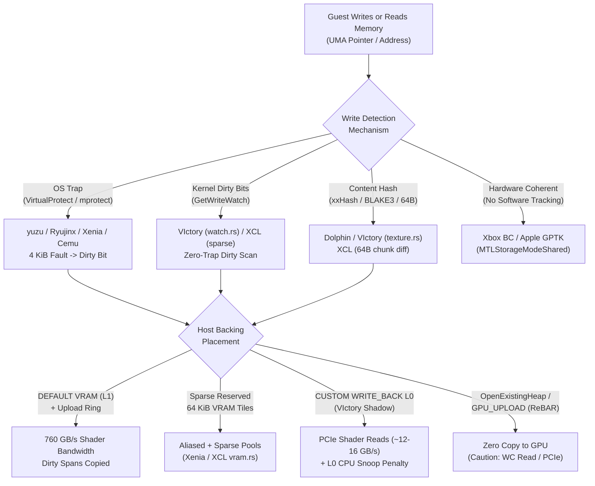

# Chapter 02 — State of the Art: How Emulators and Translation Layers Handle Shared CPU/GPU Memory

When a game built for a unified-memory console is recompiled or translated to run on a discrete-GPU Windows PC, the central bottleneck is rarely raw floating-point throughput or instruction-set translation overhead. Instead, performance and correctness collapse across the **memory-coherence boundary**: the software machinery required to preserve the illusion that host CPU threads and host GPU shaders read and write the exact same physical bytes, in the exact order intended by the console title, across an asymmetric PCI Express interconnect.

This chapter surveys the state of the art across console emulators, binary translation layers, and PC graphics wrappers—specifically **Xenia**, **RPCS3**, **Dolphin**, **Cemu**, **Vita3K**, **yuzu**, **Ryujinx**, **DXVK**, **VKD3D-Proton**, **Microsoft Xbox Backward Compatibility**, and **Apple Rosetta 2 / Game Porting Toolkit (`D3DMetal`)**—before conducting a forensic side-by-side comparison of **XCL** and **VIctory** on our target 2026 Xbox Series S|X open-world title. Every mechanism is examined along five technical dimensions: address-space topology, write-detection granularity, host backing placement, readback discipline, and shader/descriptor decoupling.

Throughout this chapter, we strictly separate three categories of statements:
1. **Established facts**, grounded in peer-reviewed papers, vendor hardware specifications, official graphics API specifications, or verified upstream emulator source trees and engineering reports (cited inline as `[n]`).
2. **Measurements from our runs**, derived from the hardware testbed (Intel Core i5-10400F, 32 GB DDR4, NVIDIA RTX 3080 10 GB GDDR6X, PCIe 3.0/4.0) and from the XCL diagnostic corpus (`xcl_h3.md`), distinguishing explicitly between **VIctory's earlier Series X 4K baseline** (~2,800 ms/frame: ~810 ms CPU preparing [380 ms / 170 MB copies, 170 ms / 540 MB textures, ~260 ms unattributed], ~1,600 ms GPU, ~360 ms / 13 MB copy-back, ~450 untranslated shaders) and **VIctory's Series S 1280×720 internal profile baseline** (~1,890 ms/frame: ~860 ms CPU preparing [~440 ms / ~270 MB copies, ~140 ms / ~475 MB texture checks, ~280 ms unattributed], ~700 ms GPU, ~330 ms / ~12 MB copy-back, 430 untranslated shaders).
3. **Engineering hypotheses** (`H-2.1` through `H-2.7`), proposing falsifiable modifications to VIctory grounded in observed state-of-the-art patterns and testable via VIctory's `Meter` log output (`host.rs:1762-1767`).

---

## 1. The Shared-Memory Emulation Design Space and Theoretical Taxonomy

### 1.1 The Asymmetric Impedance of Discrete PC Hosts

On the Xbox Series S and Series X, the Zen 2 CPU cluster and RDNA2 GPU compute units sit on a single SoC sharing a coherent GDDR6 memory pool [2]. A title running against GDK and D3D12.X allocates physical 64 KiB or 2 MiB pages (`XMemAllocatePhysicalPages`), maps them at arbitrary virtual addresses (`XMemMapPhysicalPages`), aliases render targets and transient buffers over identical physical frames, writes 32-byte resource descriptors (`T#`, `V#`) and 16-byte samplers (`S#`) directly into ordinary virtual memory, populates indirect draw/dispatch argument buffers from GPU compute passes or CPU job threads interchangeably, and streams decompressed textures straight from NVMe into GPU-readable memory via Xbox Velocity Architecture (`DirectStorage` + hardware zlib/BCPack) [37]. In this hardware regime, **every CPU virtual pointer inside graphics memory is immediately a valid GPU virtual address** (`victory-gpu/src/lib.rs:6-7`), and memory movement between CPU and GPU is zero bytes per frame.

A Windows PC equipped with an Intel Core i5-10400F (6C/12T, 32 GB DDR4) and a discrete NVIDIA RTX 3080 (10 GB GDDR6X) violates every assumption of that programming model:

- **Bandwidth Inversion (34x–63x cliff):** The RTX 3080's local `D3D12_MEMORY_POOL_L1` GDDR6X memory delivers 760 GB/s of device-local bandwidth, whereas host `L0` DDR4 accessed across a PCIe 3.0 x16 (Core i5-10400F maximum) or PCIe 4.0 x16 bus is bounded to ~12–16 GB/s bidirectional theoretical peak (and lower under small random scatter-gather shader reads), creating a ~50x bandwidth penalty whenever shaders sample or fetch buffers directly from system RAM.
- **Coherence & Cache-Line Snooping Penalty:** When D3D12 maps host RAM as `D3D12_HEAP_TYPE_CUSTOM` with `D3D12_CPU_PAGE_PROPERTY_WRITE_BACK` and `D3D12_MEMORY_POOL_L0` [31]—the configuration VIctory currently selects in `Host::shared_buffer` (`host.rs:2170-2176`)—neither the CPU nor the GPU enjoys fast uncontested residency. GPU reads and atomic UAV writes traverse PCIe snoops, invalidating CPU L1/L2/L3 cache lines; subsequent CPU reads of that same `self.data` mapping stall on PCIe coherence transactions.
- **Explicit API Virtualization Boundary:** Desktop D3D12 and Vulkan enforce strict resource/heap separation (`DEFAULT` vs `UPLOAD` vs `READBACK` heaps [31]), explicit resource state transitions/barriers, immutable or driver-opaque texture tiling (`D3D12_TEXTURE_LAYOUT_UNKNOWN`), and strict descriptor-heap isolation. Even when Resizable BAR (ReBAR) / Smart Access Memory exposes `L1` VRAM to CPU writes via `D3D12_HEAP_TYPE_GPU_UPLOAD` [27, 33], CPU mappings are **write-combined (`WC`)**, meaning CPU *reads* from VRAM stall catastrophically (tens of MB/s over PCIe) [33].

```
Console UMA (Xbox Series S/X)                   Discrete PC Host (i5-10400F + RTX 3080)
=============================                   =======================================
  +---------+         +---------+                +------------+            +------------+
  | Zen 2   |         | RDNA2   |                | i5-10400F  |            | RTX 3080   |
  | CPU     |         | GPU     |                | CPU        |            | GPU        |
  +----+----+         +----+----+                +-----+------+            +-----+------+
       |                   |                           |                         |
       +--------+----------+                           v                         v
                |  Coherent SoC Bus             +------------+            +------------+
                v                               | 32 GB DDR4 | <--PCIe--> | 10 GB      |
      +-------------------+                     | (L0, ~20-  | ~12-16 GB/s| GDDR6X     |
      | 10/16 GB GDDR6    |                     |  35 GB/s)  | (3.0 x16)  | (L1, 760   |
      | (224 / 560 GB/s)  |                     +------------+            |  GB/s)     |
      +-------------------+                     CPU pointer != GPU VA unless bridged
```

### 1.2 Foundational Coherence and Virtualization Theory

Every emulator and translation layer solving this asymmetry is, at bottom, implementing a specialized **software-enforced Distributed Shared Memory (DSM)** or **heterogeneous virtual machine memory manager** over two asymmetric nodes: a host CPU and a host GPU.

In their foundational 1989 work on IVY, Kai Li and Paul Hudak [4] formalized the trade-offs of **Shared Virtual Memory (SVM)** over physically disjoint memories. Their central insight governs GPU emulator design thirty-seven years later: when two processors lack hardware cache coherence across an interconnect, software must maintain coherence at a **coherence unit (page or block granularity)** using one of two mechanisms:
1. **Invalidation / Write-Detection Protocols (Page Protection):** Mark clean shared pages read-only in the MMU (`VirtualProtect`/`mprotect`). On a write fault, trap into a handler, record the dirty page, restore write permissions, and propagate diffs only at synchronization points [4]. Li and Hudak identified the fundamental failure mode of page-based DSM: **false sharing (ping-ponging)** when independent writes from two processors land on different sub-ranges of the same coarse page [4].
2. **Release / Lazy Coherence & Diffing:** Instead of synchronizing eagerly on every memory access, defer coherence propagation until an explicit **acquire/release synchronization boundary** (in graphics APIs, a `ExecuteCommandLists` submission, `vkQueueSubmit`, fence wait, or CPU `Map`), and compute fine-grained diffs (such as 64-byte chunk hashes or word comparisons) so writes to disjoint sub-blocks of a shared page do not clobber each other [4].

Smith and Nair's textbook taxonomy of virtual machines [9] further classifies state virtualization into **interpretation/shadowing** versus **direct execution/mapping**. Applied to guest memory and graphics resources, Fabrice Bellard's QEMU dynamic translator [5] popularized the use of a software TLB and host-page write protection to detect self-modifying guest code in translation caches—an exact structural precursor to how modern console emulators (Xenia, yuzu, Ryujinx, Cemu) detect CPU writes to GPU-cached vertex buffers and textures.

In GPU virtualization specifically, two landmark USENIX ATC 2014 systems define the extremes of API/memory bridging:
- **GPUvm** (Suzuki et al., 2014 [6]) virtualized GPUs at the hypervisor level by shadowing GPU page tables and trapping MMIO/DMA submissions, showing that fine-grained synchronous trapping of every GPU memory-mapped register or page-table write creates severe latency unless shadowed ranges are batched and decoupled.
- **gVirt** (Tian et al., 2014 [7]) introduced *mediated pass-through*: partitioning hardware-critical GPU virtual address apertures (aperture/GMADR) while allowing guest shaders and render targets to execute natively on physical GPU engines with minimal trap frequency.

Modern console emulators and translation layers navigate the exact same tension between **semantic accuracy** (never letting CPU and GPU observe stale bytes across arbitrary aliasing) and **zero-trap throughput** (never paying kernel transitions, PCIe snoops, or redundant copies on hot data).

### 1.3 Five Orthogonal Axes of CPU/GPU Memory Emulation

Across the eleven systems analyzed in this chapter, every design choice maps onto five orthogonal axes:

| Axis | Design Options | Primary Cost Profile | Representative Systems |
| :--- | :--- | :--- | :--- |
| **1. Address-Space Topology** | (a) Flat shadow buffer/arena mirroring guest physical RAM<br>(b) Interval/range cache keyed by `[addr, size)`<br>(c) Direct host-VA-to-GPU-VA mapping or GPU page table | (a) High VRAM commit unless sparse<br>(b) Interval lookup + overlap merging overhead<br>(c) Requires `OpenExistingHeapFromAddress` / `VK_EXT_external_memory_host` or shader address translation | (a) Xenia (`SharedMemory`), XCL (`uma.rs`)<br>(b) RPCS3, yuzu BCR, Ryujinx, VIctory (`Shadow`)<br>(c) XCL Gen 1/4, Vita3K (`external-host` / `page-table`) |
| **2. Write-Detection Mechanism** | (a) OS page-protection traps (`VirtualProtect`/`mprotect` + VEH/`SIGSEGV`)<br>(b) Kernel dirty bits (`GetWriteWatch` / `MEM_WRITE_WATCH`)<br>(c) Content hashing (`xxHash` / `BLAKE3` / CRC / 64 B chunks)<br>(d) API/HLE intercept hooks (`Map`, `ReadFile`, `DirectStorage`)<br>(e) Always-coherent shared hardware | (a) ~2–10 µs per trap; breaks kernel writes (`ReadFile`) unless unguarded<br>(b) Zero trap cost; 4 KiB kernel scan; fails on `MEM_MAPPED`<br>(c) Zero trap cost; linear CPU memory-read bandwidth cost<br>(d) Zero overhead if all writers are hooked; misses inline CPU writes<br>(e) Zero software cost; requires UMA or ReBAR | (a) Xenia, yuzu, Ryujinx, Cemu, VIctory (fallback)<br>(b) VIctory (`watch.rs`), XCL (`sparse`/`title_textures`)<br>(c) Dolphin, Cemu (hybrid), VIctory (`texture.rs` `blake3`), XCL (64 B chunks)<br>(d) DXVK/VKD3D-Proton, XCL/VIctory (`kernel_will_write`)<br>(e) Apple GPTK (`MTLStorageModeShared`), Xbox BC |
| **3. Coherence Granularity** | (a) Whole resource / whole `[min, max]` union<br>(b) Console page / tile (`64 KiB`)<br>(c) Host OS page (`4 KiB`)<br>(d) Sub-page dirty interval or `64 B` cache-line chunk | (a) Massive write amplification & false sharing<br>(b) 16x over-copying on sparse 4 KiB edits<br>(c) Balances OS trap overhead vs copy size<br>(d) Eliminates false sharing between CPU and GPU on shared pages | (a) VIctory (`Batch::add` + `texture.rs`)<br>(b) VIctory (`watch::PAGE = 64 KiB`), Xenia tiled heap<br>(c) yuzu BCR, Ryujinx, Xenia watch<br>(d) Ryujinx (`BufferModifiedRangeList`), XCL (`changed_chunks` 64 B) |
| **4. Host Backing & Residency** | (a) `DEFAULT` VRAM (`L1`) + staging `UPLOAD` ring<br>(b) `CUSTOM WRITE_BACK L0` system RAM<br>(c) `GPU_UPLOAD` / ReBAR (`DEVICE_LOCAL \| HOST_VISIBLE`)<br>(d) `ReservedResource` sparse 64 KiB tiles + pool heaps<br>(e) `OpenExistingHeapFromAddress` / `External Host` | (a) Max shader bandwidth (760 GB/s); requires upload copies<br>(b) Zero staging copy, but shaders stall at PCIe speed & CPU snoops hurt<br>(c) Zero copy + 760 GB/s GPU reads; WC CPU reads are disastrous<br>(d) Saves gigabytes on aliased/sparse heaps; needs tile remap fences<br>(e) Zero CPU/GPU copy on UMA; PCIe-bound on discrete GPUs | (a) DXVK/VKD3D (default), yuzu, RPCS3, XCL (`sparse`)<br>(b) VIctory (`host.rs:2172`)<br>(c) VKD3D-Proton (ReBAR), DXVK (ReBAR)<br>(d) Xenia (`d3d12_tiled_shared_memory`), XCL (`vram.rs`)<br>(e) XCL Gen 1 (`uma.rs`), Vita3K (`external-host`) |
| **5. Readback & Sync Discipline** | (a) Lockstep `WaitForSingleObject` + eager full copy-back<br>(b) Async fence-gated readback only on explicit CPU access / fault<br>(c) User-configurable heuristic skip (`Write Color Buffers` off, EFB-to-Texture)<br>(d) Hardware TSO / unified shared pages | (a) Destroys CPU/GPU concurrency; stalls on unused GPU writes<br>(b) Preserves full accuracy with minimal stalls<br>(c) Maximum speed; risks missing rare CPU readbacks<br>(d) Native execution with minimal fences | (a) VIctory (`host.rs:587`, `shadow.rs:190`)<br>(b) yuzu BCR/TCR, Ryujinx, Xenia (`MakeRangeValid` / resolves)<br>(c) RPCS3 (WCB/RCB), Dolphin (EFB-to-Texture)<br>(d) Apple Rosetta 2 + D3DMetal, Xbox BC |



With this taxonomy established, we examine how each major emulator and translation layer solves these constraints in practice—and where their hard-won lessons explain both XCL's trajectory and VIctory's current bottlenecks.

---

## 2. Classic and Split-Memory Console Emulators

### 2.1 Xenia (Xbox 360): Tiled Shared Memory and EDRAM Resolve Caching

**Hardware Substrate.** Released in 2005, the Xbox 360 is the direct architectural ancestor of the Xbox Series S|X unified memory model. As documented by Andrews and Baker [1], the console pairs a 3.2 GHz tri-core PowerPC CPU (*Xenon*, 1 MB shared L2 cache, VMX128) with an ATI *Xenos* unified-shader GPU sharing **512 MB of GDDR3** system memory at 22.4 GB/s (128-bit bus at 700 MHz DDR), augmented by **10 MB of high-bandwidth on-die eDRAM** inside the Xenos daughter die for color, depth/stencil, and MSAA rendering [1]. Because Xenos has no separate GDDR3 pool, every vertex buffer, index buffer, constant table, command ringbuffer, and resolved texture lives inside the same 512 MB physical address space accessed by both Xenon CPU cores and Xenos shaders, while render targets reside inside the 10 MB eDRAM and are explicitly copied out ("resolved") into GDDR3 for texture sampling or display [1, 10].

**Shared Memory Architecture (`SharedMemory` & `d3d12_tiled_shared_memory`).** Xenia (`xenia-project/xenia`, `src/xenia/memory.cc` and `src/xenia/gpu/` [10, 11]) maps the guest's 512 MB physical address space contiguously in host virtual memory. Rather than allocating dozens of disconnected host buffers per D3D9 resource—Xbox 360 games frequently write vertex data directly into raw physical addresses and alias buffers across draws—Xenia's GPU backends model the entire 512 MB physical pool as a single `SharedMemory` abstraction [10, 11]:

1. **Page-Granularity Dirty Tracking (`WatchMemoryRange` / `RequestRange`):** Xenia partitions the 512 MB guest physical space into host OS pages (4 KiB on Windows/Linux) and tracks page validity with dual bitmasks (host-page validity vs guest CPU-written dirty state). Before a draw or dispatch executes, the command processor calls `RequestRange(start, length)` (or batched `RequestRanges`) to ensure every byte in the referenced guest range is synchronized with the GPU buffer [10, 11]. Clean pages incur zero copies; when the guest CPU writes to a tracked page protected via `PAGE_READONLY` (or watched via OS mechanisms), Xenia's vectored exception handler catches the access violation, records the page as dirty (`WatchMemoryRange` callback), restores `PAGE_READWRITE`, and lets the guest proceed without further traps until the GPU next consumes that page [10].
2. **D3D12 Tiled Shared Memory (`d3d12_tiled_shared_memory`):** Allocating a monolithic 512 MB `D3D12_RESOURCE_DIMENSION_BUFFER` as a committed resource in `DEFAULT` VRAM pins 512 MB unconditionally—acceptable on an 8–10 GB card, wasteful on smaller GPUs, and incompatible with fine-grained virtual aliasing. Xenia's D3D12 backend (`src/xenia/gpu/d3d12/` [11]) solves this using **D3D12 Reserved (Tiled) Resources** (`CreateReservedResource`) backed by 64 KiB tiles dynamically mapped via `UpdateTileMappings` onto 64 KiB-aligned VRAM heap pools (`d3d12_tiled_shared_memory = true`). Only 64 KiB guest chunks actually touched by GPU draws consume physical VRAM, and dirty 4 KiB sub-ranges within those mapped tiles are staged through a ring-buffered `UPLOAD` heap via `CopyBufferRegion` [11].
3. **`memexport` Readbacks:** Xenos shaders can scatter-write arbitrary results straight to guest physical memory via `memexport` (an early precursor to modern UAVs). Xenia translates `memexport` writes into host UAV writes against the `SharedMemory` buffer, marking the touched ranges so subsequent CPU reads or `trace_writer` GPU captures observe coherent state [10].

**Texture Cache & eDRAM (`src/xenia/gpu/d3d12/texture_cache.cc`).** Because Xenos textures use Xbox 360-specific Morton/tiled swizzling and endianness (big-endian PowerPC host), PC GPUs cannot sample them directly from `SharedMemory`. Xenia's `texture_cache.cc` [11] keys textures by a `TextureKey` combining guest base address, dimensions, pitch, format, mip range, and swizzle state:
- When a `TextureKey` is requested, Xenia registers a memory watch range over both its base level and mip-tail footprint in `SharedMemory`. If `SharedMemory` reports no CPU writes to those pages since the last upload, `texture_cache.cc` hits in O(1) with zero hashing and zero detiling [11].
- When dirty pages are detected (or on first bind), Xenia untiles/endian-swaps the affected mip levels into a host `UPLOAD` staging buffer and copies them into a `D3D12_HEAP_TYPE_DEFAULT` texture—or, in modern D3D12 paths, dispatches compute shaders reading directly from `SharedMemory` to detile on the GPU!
- Crucially, Xenia distinguishes **CPU-written textures** from **eDRAM-resolved render targets**. When a game resolves 10 MB eDRAM into guest RAM, Xenia keeps the resolved surface resident in a host `DEFAULT` render-target texture cache, marking the corresponding guest memory range as GPU-owned rather than copying 10 MB across PCIe back to CPU RAM on every resolve. Only if guest CPU code later reads or overwrites those guest addresses does synchronization trigger.
- To prevent VRAM exhaustion on 4–8 GB host cards, `texture_cache.cc` maintains an **LRU eviction policy** bounded by `d3d12_texture_cache_limit_soft` and `d3d12_texture_cache_limit_hard` [11].

**Worked Example — Sparse Page Amplification vs. Xenia's Design:**
Consider an Xbox 360 frame where the CPU writes 512 bytes of skeletal skinning matrices to offset `0x0400_1000` and 256 bytes of shader constants to offset `0x0400_8000` in the same 512 MB shared pool, while a GPU `memexport` shader writes 16 KiB to `0x0800_0000`.
- Under Xenia's 4 KiB page watch + `d3d12_tiled_shared_memory`: Only two 4 KiB pages (`8 KiB` total) are marked dirty on the CPU side; `RequestRanges` stages two disjoint 4 KiB runs (`8 KiB` over PCIe) into the two mapped 64 KiB VRAM tiles covering `0x0400_0000` and `0x0400_8000` (if the two offsets span two 64 KiB tiles, `128 KiB` of VRAM is committed, not 512 MB). Meanwhile, the GPU `memexport` writes at `760 GB/s` into a separate VRAM tile at `0x0800_0000` with zero CPU copy-back unless the PowerPC thread touches that page.
- Contrast this directly with VIctory's current behavior: `Batch::add` merges `[0x0400_1000, 0x0400_8100)` into a single `[min, max]` interval (`host.rs:1330`), folds dirty tracking into 64 KiB chunks (`watch.rs:27`), reads through `ReadProcessMemory` (`host.rs:1430`), and—if `0x0800_0000` sits inside the same 174 MB heap—triggers `Shadow::writing` + `Shadow::copy_back` byte-by-byte diffing over PCIe-snooped L0 memory!

---

### 2.2 RPCS3 (PlayStation 3): Dual-Bus Memory Aliasing and Explicit Readback Policies

**Hardware Substrate.** The PlayStation 3 presents the exact structural inverse of Xbox UMA, yet forces its emulator **RPCS3** (`RPCS3/rpcs3`) to solve nearly identical surface-aliasing and CPU/GPU coherence problems. As documented by Kahle et al. [3], the Cell Broadband Engine connects one general-purpose PowerPC Processing Element (PPE) and eight Synergistic Processing Elements (SPEs) over a high-bandwidth Element Interconnect Bus (EIB) to **256 MB of XDR main DRAM** (~25.6 GB/s). Attached via a bidirectional FlexIO interface is NVIDIA's **RSX ("Reality Synthesizer")** GPU (G70/NV47 derivative) with its own **256 MB of local GDDR3 VRAM** (~22.4 GB/s) [3, 12]. Crucially, the RSX includes an IO-MMU page table (`RSX IO` / DMA engine) enabling RSX shaders, ROPs, and blit engines to read textures, vertex streams, and command buffers directly from XDR main RAM—and even render directly into XDR main RAM—while Cell SPUs can conversely map and read/write RSX local GDDR3 over FlexIO (albeit slowly) [12].

**`texture_cache.h` and `surface_store` (`rpcs3/Emu/RSX/Common/` [12]).** Because Cell SPUs routinely perform post-processing, occlusion queries, Z-buffer Hi-Z culling, and clustered light culling directly on RSX-rendered buffers, RPCS3 cannot treat main RAM and local VRAM as isolated worlds [12, 13]. In `rpcs3/Emu/RSX/Common/texture_cache.h` [12] and its paired `surface_store`:

1. **Unified Section Tracking & Region Overlap (`get_merged_texture_memory_region`):** Every texture upload (`shader_read`, `blit_engine_src`) and every render target (`framebuffer_storage`, `blit_engine_dst`) is registered as a tracked memory section spanning an RSX effective/IO address interval `[base, base + size)` [12]. Before any draw call binds a texture, `rtt_lookup` searches `surface_store` (`m_rtts`) for overlapping color or depth render-target surfaces [12]. When an overlap exists—for instance, a game renders a shadow map or G-buffer into `addr` and immediately samples a mip or sub-slice as a texture, or blits from a different pitch/format view—RPCS3 resolves the dependency entirely on the host GPU via `blit` / image copy / `old_contents` deferred inheritance rather than bouncing through CPU RAM [12].
2. **Page-Protected Invalidation:** Like Xenia, RPCS3 protects guest memory ranges backing cached textures (`Memory` page protection via `VirtualProtect` / `mprotect`). When a Cell PPU or SPU thread writes new texture data or dynamic vertex bytes into an XDR address cached by the RSX, the OS write-fault invalidates the matching section tag in `texture_cache`, forcing re-upload only on the next draw that actually samples it [12].
3. **Configurable Readback Policies (`Write Color Buffers`, `Read Color Buffers`, `Write/Read Depth Buffer`, `Strict Rendering Mode`):** Because GPU→CPU readbacks across the host PCIe bus (Vulkan `vkCmdCopyImageToBuffer` + fence stall + `vkMapMemory`) destroy frame times—exactly as VIctory's eager `Shadow::copy_back` burns ~330–360 ms/frame—RPCS3 exposes explicit readback policy toggles in `system_config.h` and `texture_cache.h` [12, 13]:
   - **With `Write Color Buffers` / `Read Color Buffers` disabled (default fast path):** Host GPU render targets stay exclusively in host `DEVICE_LOCAL` VRAM; guest XDR/local memory at the target address is left stale (or untracked for CPU readback), yielding zero PCIe stalls. This works for >80% of draws where only subsequent GPU passes sample the surface via `surface_store`.
   - **With `Write Color Buffers` enabled:** RPCS3 flushes GPU render targets back to guest memory ranges whenever synchronization or CPU access requires it, preventing missing SPU lighting/culling effects (famously required in titles like *Uncharted 2* or *Killzone* where SPU DMA jobs read RSX G-buffer/depth targets) at a substantial GPU-stall and PCIe bandwidth cost [12, 13].
   - **With `Strict Rendering Mode` enabled:** RPCS3 disables asynchronous surface-inheritance shortcuts and forces strict layout/memory-order synchronization across overlapping views [13].

**Direct Lesson for VIctory:** RPCS3 proves that **unconditional GPU→CPU copy-back after every submission is fatal on discrete PCIe GPUs**. Even on a 256 MB PS3 framebuffer pool, RPCS3 had to separate *GPU-to-GPU aliasing* (handled lazily inside `surface_store` in VRAM) from *true GPU-to-CPU consumption* (gated behind `Write/Read Color/Depth Buffers` or explicit DMA/fault triggers). VIctory today effectively runs with `Write Every UAV Buffer Always` enabled synchronously on *every* submission (`host.rs:643-647`), even when 95%+ of the bytes written by shaders are consumed solely by subsequent GPU passes!

---

### 2.3 Dolphin (GameCube / Wii): EFB-to-Texture vs. EFB-to-RAM and Hybrid XFB

**Hardware Substrate.** The Nintendo GameCube and Wii combine **24 MB of low-latency 1T-SRAM (`MEM1`)** (shared between the PowerPC *Gekko*/*Broadway* CPU and *Flipper*/*Hollywood* GPU at ~3.2 GB/s; Wii adds **64 MB of GDDR3 `MEM2`**) with **2 MB of on-die Embedded Frame Buffer (`EFB`)** SRAM (1 MB color + 1 MB Z-buffer) inside the GPU [14]. Because the EFB is too small to hold a displayable frame plus back-buffers simultaneously, games finish rendering into the 2 MB EFB and execute hardware **EFB Copy** commands (`GXCopyDisp` / `GXCopyTex`) that encode and transfer EFB pixels into `MEM1`/`MEM2` as either an **External Frame Buffer (`XFB`)** for TV scanout or a **Render Texture** (`GXTexObj`) for subsequent draws [14].

**Dolphin's Texture Cache (`TextureCacheBase.cpp`) and Hybrid XFB [14, 16].** Dolphin (`dolphin-emu/dolphin`) solved a coherence problem structurally identical to VIctory's `texture.rs` + `shadow.rs`:
1. **Hash-Based CPU Texture Validation (`TextureCacheBase.cpp` [16]):** Because GameCube/Wii games rarely stream gigabytes per second (total RAM is 24–88 MB), Dolphin validates CPU-side textures in `MEM1`/`MEM2` by computing fast hashes (historically Murmur/xxHash over the guest texture footprint) and exposes a **Texture Cache Accuracy** slider (*Safe*, *Medium*, *Fast*) controlling the minimum frame/draw interval between re-hashes [16]. Crucially, Dolphin *does not* clear its texture-check cache on unrelated writes within the same submission the way VIctory's `Batch::title_written` calls `self.textures.clear()` (`host.rs:1345`).
2. **EFB-to-Texture vs. EFB-to-RAM (`Store EFB Copies to Texture Only` [14]):** When a game invokes `GXCopyTex`, it writes EFB pixels to a `MEM1` address and immediately binds that address as a texture in the next draw. Early Dolphin ("EFB to RAM") downloaded the host GPU framebuffer across PCIe into `MEM1`, encoded it into GameCube tiled YUV/RGBA/I8 format on CPU, and immediately re-uploaded it to the host texture cache—a catastrophic round-trip! Dolphin eliminated this with **EFB to Texture**: keeping the EFB copy solely as a host VRAM texture keyed at the guest `MEM1` address in `TextureCacheBase.cpp` [14, 16]. Only when the guest CPU reads that `MEM1` region directly (e.g., lens flare occlusion checks or *Pokémon Snap* photo scoring) must EFB-to-RAM execute.
3. **Hybrid XFB (`MayImilae & JMC47, Dolphin Blog 2017` [14]):** Prior to 2017, Dolphin users had to pick between fast *Virtual XFB* (ignoring RAM copies), accurate *Real XFB* (slow GPU→RAM→GPU round-trips every frame), or skipping XFB altogether. **Hybrid XFB** unified both paths: Dolphin stores every XFB copy in a high-resolution host VRAM texture (`EFB/XFB to Texture`) *and* optionally mirrors downscaled/encoded copies to RAM only when requested or when the CPU modifies the XFB address, preserving VRAM-resident GPU-to-GPU speed while supporting CPU-side video fades and frame reads [14].

**Quantitative Takeaway for VIctory:** Dolphin demonstrates why **GPU-to-GPU dataflow must never bounce through CPU RAM** solely to satisfy a guest address key. In VIctory (`texture.rs:108-115`), `HOST_WRITTEN` already tracks textures written by host `Copy*`/`Resolve`, skipping CPU re-upload—yet buffers lack any analogous GPU-resident exemption (`Shadow::copy_back` blindly forces GPU UAV writes back through `ReadProcessMemory`/`WriteProcessMemory` to CPU RAM even when only the GPU reads them next).

---

### 2.4 Cemu (Wii U): Latte eDRAM, Page Protection, and Texture Cache Invalidation

**Hardware Substrate.** Nintendo's Wii U connects a tri-core PowerPC *Espresso* CPU and an AMD TeraScale-derived *Latte* GPU on a multi-chip module (MCM) with two asymmetric RAM pools: **32 MB of high-bandwidth on-die eDRAM (`MEM1`)** inside Latte for render targets and depth buffers, and **2 GB of DDR3 SDRAM (`MEM2`)** at ~12.8 GB/s shared across the MCM (1 GB reserved for Cafe OS, 1 GB available to games) [17]. Latte fetches PM4-style command rings directly from `MEM2`, and GX2 applications write tiled textures (`GX2_TILE_MODE_*`—structurally an early AMD R600/R700 ancestor of RDNA2's GFX10 tiling!) straight into `MEM2`.

**Cemu (`cemu-project/Cemu`, `src/Cafe/HW/Latte/Core/LatteTextureCache.cpp` [17]).** Because Wii U titles allocate up to 1 GB of high-definition textures and dynamic buffers inside `MEM2`—far larger than GameCube's 24 MB—pure content hashing every draw becomes untenable. Cemu's `LatteTextureCache.cpp` [17] implements a **hybrid page-protection + hash verification architecture**:
1. **Virtual Address Mirroring & Page Protection:** Cemu maps `MEM1` (`0xF400_0000`) and `MEM2` (`0x1000_0000`) into contiguous host virtual address reservations and registers page-guard write tracking (`VirtualProtect` on Windows / `mprotect` on POSIX) over `MEM2` ranges backed by cached `LatteTexture` surfaces [17].
2. **Dirty-Check Short-Circuit:** When a draw samples a GX2 texture, `LatteTextureCache` first checks the per-page dirty state of the guest range. If no OS write fault occurred on those 4 KiB pages since the last upload, validation costs a single O(1) lookup (`< 50 ns`) [17]. If a fault *did* occur (for example, due to false sharing on a 4 KiB page containing both a dynamic uniform struct and a static texture header, or after Cafe OS `DCFlushRange` / `GX2Invalidate`), Cemu can confirm via fast content hashing whether the texture's actual texels changed before triggering CPU/GPU retiling/upload [17].
3. **Aliasing & Format Reinterpretation:** Just as Xbox Series X games reuse 64 KiB physical pages for different render targets across a frame, Wii U games alias multiple `GX2Surface` views onto the same `MEM1` eDRAM or `MEM2` offsets (e.g., rendering depth `D24S8` and reinterpreting as `R8G8B8A8_UNORM` for Hi-Z mip generation). Cemu's texture cache tracks view-compatible image aliases in VRAM and propagates updates via host `vkCmdCopyImage`/`Blit` rather than flushing eDRAM to CPU RAM [17].

---

### 2.5 Vita3K (PlayStation Vita): Five Explicit Memory-Mapping Regimes on One Codebase

**Hardware Substrate.** Sony's PlayStation Vita pairs a quad-core ARM Cortex-A9 with an Imagination PowerVR SGX543MP4+ tile-based deferred renderer (TBDR) GPU (`libgxm`), equipped with **512 MB of LPDDR2 main RAM** and **128 MB of dedicated VRAM** [18]. Critically, `libgxm` programs do *not* manage separate host/device upload heaps: titles allocate virtual memory in either the 512 MB or 128 MB pools and map arbitrary ranges into the SGX GPU virtual address space via `sceGxmMapMemory`, `sceGxmMapVertexUsseMemory`, and `sceGxmMapFragmentUsseMemory` [18]. Consequently, from the application's perspective, CPU pointers and GXM GPU buffers share a flat unified addressing model.

**Vita3K's Five `memory_mapping` Modes (`Vita3K/Vita3K` [18, 35]).** What makes Vita3K unusually illuminating for VIctory and XCL is that Vita3K has implemented and shipped **five distinct memory-mapping backends** selectable at runtime under its Vulkan renderer, precisely because different desktop and mobile GPU drivers fail or succeed differently under each model [18]:

| Vita3K Mapping Mode | Mechanism | Host API Requirement | Trade-Offs & Failure Modes |
| :--- | :--- | :--- | :--- |
| **`disabled`** | Traditional explicit shadow copy + `texture_cache.h` / `surface_cache` synchronization per draw | Base Vulkan 1.0 | Safe everywhere, but high CPU copy/hash overhead on streaming vertex & dynamic uniform buffers. |
| **`double-buffer`** | Maintains coherent CPU + GPU ping-pong shadow buffers, flushing dirty ranges cleanly | Base Vulkan 1.0 | Avoids non-coherent memory flickering/corruption on mobile GPUs (e.g., Mali) at the cost of extra memory footprint and copies [18]. |
| **`external-host`** | Imports the emulator's guest RAM allocation directly into `VkDeviceMemory` via **`VK_EXT_external_memory_host`** [35] | `VK_EXT_external_memory_host` (4 KiB host pointer alignment) | **Zero-copy buffer/memory visibility**—analogous to D3D12 `OpenExistingHeapFromAddress` [29]—but GPU reads traverse PCIe on discrete GPUs and RenderDoc/mobile drivers often reject it [18, 35]. |
| **`page-table`** | Allocates a device-local buffer/arena on GPU and maintains a **software page table** (mapping guest 4 KiB pages to VRAM slots) resolved by shaders / command translation | Base Vulkan + storage buffers | Works without `VK_EXT_external_memory_host`, keeps hot data in `DEVICE_LOCAL` VRAM, and remains RenderDoc-compatible [18]—precisely the Gen 4 shader page-table pattern XCL independently arrived at (`xcl_h3.md:1641-1656`)! |
| **`native-buffer`** | Backs guest memory using Android `AHardwareBuffer` (`VK_ANDROID_external_memory_android_hardware_buffer`) | Android NDK / Vulkan | Zero-copy unified sharing on Android mobile SoCs where CPU and GPU share LPDDR, subject to vendor driver bugs [18]. |

In addition, Macdu's rewrite of Vita3K's `texture_cache` (`vita3k/renderer/include/renderer/texture_cache.h`, `vita3k/renderer/src/texture/cache.cpp`, `vita3k/renderer/src/vulkan/texture.cpp` [18]) separated **surface/render-target lifetimes** (`surface_cache`) from **CPU-written texture hashing and format conversion**, eliminating memory leaks and long-session frame-time degradation caused by unbounded texture cache growth [18]—a leak pattern directly visible today in VIctory's `PLACED_TEXTURES` map (`resource.rs`), which `agy_dossie.md` notes never frees entries!

---

## 3. Modern Switch Emulators: High-Throughput Page-Tracked Buffer and Texture Caches

### 3.1 Tegra X1 Hardware Baseline and Block-Linear Tiling

Nintendo Switch emulators (**yuzu** and **Ryujinx**) target the closest architectural precursor to modern GDK console emulation on a PC: **4 GB of unified LPDDR4** (64-bit bus, ~25.6 GB/s) shared coherently across quad-core ARM Cortex-A57 CPUs and a 256-core NVIDIA Maxwell GPU (`GM20B` inside Tegra X1 `T210`) [22]. Unlike Xbox 360 or Wii U, the Tegra X1 features a **full hardware 40-bit Graphics Memory Management Unit (GMMU)** sitting atop the 32-bit/39-bit CPU SMMU, plus hardware **GOB (Group of Bytes, 64×8 bytes)** block-linear texture swizzling (`ScanMountGoat/tegra_swizzle` [21], Tegra X1 TRM [22]). Switch games allocate virtual GPU buffers anywhere inside the 40-bit GMMU space, alias physical memory dynamically across command buffers, write uniform/vertex/indirect buffers from CPU threads immediately before `nvgpu` channel kicks, and render to block-linear surfaces subsequently reinterpreted across formats [19, 20].

### 3.2 yuzu: Buffer Cache Rewrite, Texture Cache Rewrite, and Project Y.F.C.

Early versions of yuzu maintained per-draw host `StreamBuffer` uploads and ad-hoc range maps, resulting in catastrophic PCIe upload bandwidth (~hundreds of MB per frame of re-uploaded geometry) and stuttering. Between 2020 and 2023, yuzu executed three landmark architectural rewrites directly relevant to VIctory:

1. **Texture Cache Rewrite (TCR, November 2020 [20]):**
   - Decoupled **physical image backing (`Image`)** from **GPU virtual address aliases (`ImageView`)** and CPU physical memory tracking. Instead of duplicating or re-uploading textures when a shader viewed a mip sub-slice or reinterpreted a depth buffer as `R32_UINT`, TCR tracked overlapping GPU virtual ranges and reused the underlying `DEVICE_LOCAL` image [20].
   - Replaced synchronous CPU linear-to-swizzle loops with **GPU compute swizzle/deswizzle shaders** where possible and added a **Texture Reaper** (generational LRU garbage collector) to bound host VRAM consumption without stalling command queues [20].
2. **Buffer Cache Rewrite (BCR, CaptV0rt3x & GoldenX86, January 2021 [19]):**
   - Aligned every cached host buffer to **4 KiB guest page boundaries** (`PAGE_SIZE = 4096`) and eliminated whole-buffer re-uploads [19].
   - Attached two compact **per-page bit-arrays** to each cached buffer region (`cpu_modified_pages` and `gpu_modified_pages`), where each bit represents one 4 KiB page (`1` = dirty, `0` = clean) [19].
   - Integrated with an OS page-protection **`MemoryTracker`** (`VirtualProtect` on Windows / `mprotect` on Linux) [19]:
     - When a CPU write-protects a 4 KiB page and the guest ARM thread writes a single 64-byte uniform update, the fault handler flips **1 bit** in the CPU dirty bit-array (`cpu_modified_pages[page] = 1`) and unprotects only that 4 KiB page.
     - Before executing draws on the GPU, BCR scans the bit-array with fast CPU bit-scan instructions (`tzcnt`/`bsf`), coalesces only **adjacent dirty 4 KiB pages** into disjoint `(offset, size)` upload spans—**never merging across clean gaps into a `[min, max]` union!**—and copies those spans into a persistent ring-buffered staging buffer (`UPLOAD` / `HOST_VISIBLE`) followed by `vkCmdCopyBuffer` / `CopyBufferRegion` into `DEVICE_LOCAL` VRAM [19].
     - Conversely, when shaders bind a buffer as an SSBO/UAV (`gpu_modified`), BCR marks those 4 KiB pages as GPU-dirty *lazily*, deferring any GPU→CPU readback (`READBACK` buffer + fence wait) until the guest CPU actually traps on a read-guard fault or an explicit download synchronization point [19].
3. **Project Y.F.C. (2022–2023):** Extended channel isolation and asynchronous GPU memory tracking across multiple Switch GPU command queues (`nvhost`/`nvgpu` channels), eliminating global GPU locks so CPU command translation, staging uploads, and GPU queue execution run concurrently [20].

```
yuzu Buffer Cache Rewrite (BCR) Per-Page Dirty Tracking (4 KiB Bitset)
======================================================================
Guest Buffer (64 KiB example = 16 pages x 4 KiB):
  Page index:    0  1  2  3  4  5  6  7  8  9 10 11 12 13 14 15
  CPU dirty bit: 0  1  1  0  0  0  0  0  0  0  0  0  1  0  0  0
  GPU dirty bit: 0  0  0  0  0  1  1  1  0  0  0  0  0  0  0  0

BCR Upload Action (Disjoint Spans Only):
  -> Span 1: [Page 1..3)   = 8 KiB  copied via staging ring -> VRAM
  -> Span 2: [Page 12..13) = 4 KiB  copied via staging ring -> VRAM
  -> Total uploaded = 12 KiB (NOT [Page 1..13) = 48 KiB union!)
  -> GPU-dirty Pages [5..8) NEVER overwritten by CPU upload;
     READBACK deferred unless CPU faults on a read to Pages [5..8)!
```

### 3.3 Ryujinx: `MemoryTracking`, `MemoryEhMeilleure`, and Sub-Page False-Sharing Mitigation

Ryujinx (`Ryujinx/Ryujinx` [23]) independently built a sophisticated C#/.NET virtual memory coherence subsystem split across `Ryujinx.Memory/Tracking/MemoryTracking.cs` (using `IRegionHandle`, `IMultiRegionHandle`, `AbstractRegion`), `VirtualMemoryManager` (`PageTable` mapping GVA → HVA), and `Ryujinx.Graphics.Vulkan/BufferManager.cs` (`BufferModifiedRangeList`) [23].

Two architectural lessons from Ryujinx complement yuzu BCR directly:
1. **Virtual-to-Physical Alias Resolution (`IMultiRegionHandle`):** Because a Switch game can map multiple non-contiguous GPU virtual addresses to the same underlying physical memory pages (via GMMU `MapBuffer`), `MemoryTracking` separates *virtual tracking handles* from *physical page protection*. A single OS `VirtualProtect`/`mprotect` fault dispatches notifications to every GPU virtual `IRegionHandle` overlapping that physical page [23].
2. **Sub-Page Logical Tracking (`BufferModifiedRangeList`):** As Li and Hudak warned in 1989 [4], 4 KiB OS page protection suffers from **false sharing** whenever a CPU thread writes to buffer $A$ at offset `0x000` on page $P$ while the GPU writes an SSBO $B$ at offset `0x800` on the *same* 4 KiB page $P$. If `BufferManager` treated the entire 4 KiB page as dirty in one direction, uploading $A$ would clobber $B$ (or vice versa). Ryujinx's `BufferManager` tracks logical sub-page dirty intervals (`BufferModifiedRangeList`) alongside `MemoryTracking` page handles, narrowing synchronization and avoiding blind whole-page overwrites wherever ranges are disjoint [23].

### 3.4 Why Naive 4 KiB Page-Fault Tracking Hits a Wall on 2026 Xbox Series S|X Titles

While yuzu BCR and Ryujinx `MemoryTracking` achieve near-native frame rates on Switch titles, transplanting pure `VirtualProtect` page-fault tracking directly onto a 2026 Xbox Series S|X open-world game exposes **four structural scaling walls**:

1. **64 KiB Console Page Native Alignment vs. 4 KiB OS Fault Frequency:** A 2026 open-world title allocates **174 MB–1 GiB GPU heaps** (`shadow.rs:148`) and streams hundreds of megabytes of geometry and textures per second. If a CPU job thread touches 50,000 scattered 4 KiB pages per frame across dynamic instance arrays and descriptor tables, triggering 50,000 Windows `EXCEPTION_ACCESS_VIOLATION` vectored exception handler (VEH) round-trips per frame—at ~2–5 µs per user/kernel/user context save (`CONTEXT` record) + `VirtualProtect` syscall—burns **100–250 ms/frame in pure exception dispatch overhead**! Indeed, VIctory's own comment at `watch.rs:24-26` confirms this empirical observation: *"The unit tracked and copied: 64 KiB, the console's page (the kernel's 4 KiB pages fold into it). Finer units made the checks of the world's big buffers cost more than the copies they saved."*
2. **Kernel I/O Blind Spot (`ReadFile` / `DirectStorage`):** On Windows, if a page is marked `PAGE_READONLY` via `VirtualProtect` and the title (or an HLE module) passes that buffer to **`ReadFile` or kernel I/O**, the Windows kernel *does not raise a user-mode VEH fault*—instead, `ReadFile` silently fails with `ERROR_INVALID_USER_BUFFER` or `ERROR_NOACCESS`! Both VIctory (`watch.rs:18-19, 208-214`, `kernel_will_write` in `dstorage.rs:954` and `files.rs`) and XCL (`xcl_h3.md:1444-1445, 1795-1796`) explicitly hit this exact Windows kernel constraint.
3. **Host-Page-Size False Sharing on Shared Command/GPU Heaps:** As documented in `shadow.rs:184-188`, the 2026 open-world title stores **both CPU command/fence records and GPU UAV shader outputs inside the same 174 MB heap** (`title+0x4e9b54a`!). Even 4 KiB granularity is 64× coarser than a 64-byte cache line: if CPU threads write a fence value at `+0x000` while a GPU compute shader writes indirect counts at `+0x100` on the same 4 KiB page, pure page-level tracking **cannot tell them apart**, causing one processor to clobber the other unless sub-page diffing (such as XCL's 64-byte chunk hashing [see Section 5.3]) is overlaid on top of dirty pages.
4. **Physical-View Aliasing (`MEM_MAPPED`):** Xbox GDK `XMemMapPhysicalPages` translates on Windows to `MapViewOfFile3` over `MEM_RESERVE_PLACEHOLDER` (`xmem.rs:693-732`), creating `MEM_MAPPED` views. Windows **`GetWriteWatch` (`MEM_WRITE_WATCH`) strictly rejects `MEM_MAPPED` sections** (it works only on `MEM_PRIVATE` `VirtualAlloc` memory [32]), forcing any tracker relying solely on `GetWriteWatch` either to fall back to VEH `PAGE_READONLY` guards (`watch.rs:125-156`) or—as VIctory fatally did for textures (`texture.rs:194`, `guarded = false`)—to give up tracking altogether and **BLAKE3-hash hundreds of megabytes per frame**!

---

## 4. PC Translation Layers and Official Vendor Architectures

### 4.1 DXVK and VKD3D-Proton: Staging Rings, Heap Mapping, and the Reality of Resizable BAR

Unlike console emulators that reconstruct an implicit guest pointer model from raw memory addresses, **DXVK** (D3D8/9/10/11 → Vulkan [24]) and **VKD3D-Proton** (D3D12 → Vulkan [25, 26]) translate PC graphics APIs whose applications already observe explicit resource lifetimes, `Map`/`Unmap` semantics, and heap type distinctions. Nevertheless, because Windows D3D11/D3D12 titles frequently rely on dynamic uploads, ReBAR heuristics, and unified-memory fallback paths on APUs, DXVK and VKD3D-Proton have battle-tested the exact Vulkan/D3D12 memory-placement patterns that VIctory ignores today.

**DXVK (`DxvkMemoryAllocator`, `src/dxvk/dxvk_memory.cpp` [24]).**
1. **Chunked Memory Sub-Allocation:** Vulkan imposes strict driver limits on total `vkAllocateMemory` allocations (`maxMemoryAllocationCount`, often 4,096). DXVK's `DxvkMemoryAllocator` [24] allocates large device-memory blocks (tens of megabytes) across Vulkan memory types and sub-allocates individual buffers and images internally, bounding mapped host address consumption—particularly critical for 32-bit applications with tight 2–4 GiB virtual address budgets [24].
2. **Typed Heap Selection & Staging Rings:** For `D3D11_USAGE_IMMUTABLE` and `DEFAULT` resources, DXVK places resources strictly in `VK_MEMORY_PROPERTY_DEVICE_LOCAL_BIT` (`L1` VRAM) and streams initial/updated bytes through a persistent `HOST_VISIBLE | HOST_COHERENT` staging ring buffer. For `D3D11_USAGE_DYNAMIC` buffers (`Map(WRITE_DISCARD)`), DXVK either rotates sub-allocations inside a host-visible ring or—when Resizable BAR is exposed—places frequently updated small dynamic buffers directly into **`DEVICE_LOCAL | HOST_VISIBLE | HOST_COHERENT`** VRAM so the CPU writes straight into device-local memory without an extra `vkCmdCopyBuffer` pass [24].

**VKD3D-Proton (`no_upload_hvv`, ReBAR, and D3D12 GPU Upload Heaps [25, 27, 33]).**
VKD3D-Proton must translate D3D12's explicit heap taxonomy (`DEFAULT`, `UPLOAD`, `READBACK`, `CUSTOM` [31]) onto Vulkan memory heaps, and its production experience with **Resizable BAR (ReBAR) / AMD Smart Access Memory (SAM)** provides an indispensable warning against naive "put everything in ReBAR" assumptions:

1. **The PCIe BAR Aperture Bottleneck (256 MB vs. Full ReBAR):** Historically, PCIe exposed only a fixed 256 MB aperture of discrete VRAM to CPU MMIO [27, 33]. Modern PCIe Resizable BAR allows the firmware and OS/WDDM to map the full GPU VRAM (e.g., 10 GB on RTX 3080 or 16 GB on RX 6800/9070) into CPU physical address space, which Microsoft formalized in Agility SDK 1.710+ as **`D3D12_HEAP_TYPE_GPU_UPLOAD`** (`D3D12_HEAP_TYPE = 5`, `D3D12_MEMORY_POOL_L1`, queried via `D3D12_FEATURE_DATA_D3D12_OPTIONS16::GPUUploadHeapSupported`) [27, 31, 33].
2. **Why `VKD3D_CONFIG=no_upload_hvv` Exists [25]:** When VKD3D-Proton initially mapped D3D12 `UPLOAD` heaps directly into Host-Visible VRAM (`HVV` / ReBAR) on discrete GPUs, developers uncovered three real-world pathologies documented in `vkd3d-proton/README.md` [25] and AMD GPUOpen guidance [33]:
   - **VRAM Exhaustion on 8–10 GB Cards:** Placing transient staging buffers and large streaming upload heaps inside `DEVICE_LOCAL` VRAM consumes precious local memory needed for render targets and textures, pushing games over the physical VRAM budget (e.g., 10 GB on RTX 3080) and triggering WDDM/Vulkan eviction stalls. Consequently, VKD3D-Proton gates aggressive ReBAR upload-heap placement (e.g., >8 GB VRAM heuristics) and provides **`VKD3D_CONFIG=no_upload_hvv`** to force `UPLOAD` heaps back into system RAM (`L0`) when VRAM pressure or game-specific CPU bottlenecks arise [25].
   - **Write-Combined CPU Read Collapse:** CPU mappings into `DEVICE_LOCAL | HOST_VISIBLE` (`GPU_UPLOAD`) are **uncached write-combined (`WC`)** [33]. Writing sequential streaming runs (`memcpy` / AVX stores) reaches full PCIe write throughput (~12–16 GB/s on PCIe 3.0 x16), *provided writes are sequential and never read back*. If CPU code performs a single read-modify-write or `memcmp` against `GPU_UPLOAD` memory, every cache miss stalls across the PCIe root complex, collapsing throughput to tens of megabytes per second [33].
   - **Small-BAR Fallback (`small_vram_rebar`):** When ReBAR is disabled in BIOS (common on Comet Lake i5-10400F motherboards unless manually enabled with Above 4G Decoding), the CPU-visible VRAM bar caps at 256 MB and rapidly overflows if abused.

**Diagnostic Contrast with VIctory:**
VIctory currently achieves the worst combination of both worlds: it places all title `Shadow` buffers in **`D3D12_HEAP_TYPE_CUSTOM` (`WRITE_BACK`, `L0`)** (`host.rs:2172-2174`), meaning the RTX 3080 suffers PCIe bandwidth (~12–16 GB/s instead of 760 GB/s) on *every* hot GPU vertex, index, structured, and UAV access—while the CPU simultaneously suffers L0 cache-snoop invalidations when `Shadow::writing` and `Shadow::copy_back` read `self.data` back over PCIe coherence! Meanwhile, VIctory neither bundles the Agility SDK to probe `GPUUploadHeapSupported` nor maintains `DEFAULT` (`L1`) VRAM buffers fed by a clean `UPLOAD` ring.

---

### 4.2 Microsoft Xbox Backward Compatibility: Hypervisor-Backed Unified Memory and "Enlightenments"

Microsoft's own **Xbox Backward Compatibility** program—running Original Xbox (`x86` + NV2A) and Xbox 360 (`PowerPC` + ATI Xenos) games natively on Xbox One and Xbox Series X|S (`x86-64` + GCN/RDNA2)—represents the gold standard for console recompilation [1, 2, 36]. As documented by Digital Foundry's technical breakdown [36] and Microsoft's architectural publications [2, 37], Microsoft's stack comprises:

1. **Ahead-of-Time (AOT) Static Recompilation with "Enlightenments" (`Fission` / `XeO3`):** Rather than relying purely on blind dynamic JIT translation at runtime, Microsoft compiles Xbox 360 PowerPC binaries ahead of time into x86-64 code packaged alongside metadata files called **"Enlightenments"** [36]. Enlightenments guide the runtime emulator (`Fission` / `XeO3`) around known function entry points, timing/spin-wait loops, shader hashes, and GPU command-submission boundaries [36]. Original Xbox titles run via nested execution (`XeFu` inside `Fission`) [36].
2. **Virtual Xenos GPU & The Heutchy Method:** The Xbox 360 vGPU intercepts Xenos register writes and PM4 command packets, translating shaders to GCN/RDNA2 and emulating the 10 MB eDRAM resolves in host GPU memory. Under **the Heutchy Method** (named for Microsoft engineer Eric Heutchy), the vGPU selectively overrides viewport, render-target, and backbuffer dimensions to upscale 720p titles cleanly up to native 4K on Xbox One X and Series X without modifying game source code [36].
3. **Why Memory Coherence Is Structurally Solved on Console Hardware:** Unlike VIctory on a discrete Windows PC, Microsoft's backward-compatibility hypervisor runs **exclusively on unified-memory AMD APUs** (Xbox One's 8 GB DDR3 + 32 MB ESRAM; Xbox Series S|X's 10/16 GB GDDR6) [2, 36]. Crucially:
   - There is **zero PCIe bus** separating CPU and GPU: the hypervisor maps Xbox 360's 512 MB physical address space directly onto coherent host GDDR5/GDDR6 pages accessible to both x86-64 threads and GPU shaders.
   - 10 MB eDRAM resolves execute entirely on-chip / inside local unified DRAM without bouncing frames back to CPU `ReadProcessMemory` buffers [1, 36].
   - Endianness swapping (big-endian Xenon PowerPC vs little-endian x86-64/GCN) is resolved statically in recompiled load/store instructions and shader fetch constants rather than via dynamic full-buffer shadow copies.

**Key Architectural Lesson for VIctory:** VIctory shares Microsoft's *static AOT recompilation* philosophy for CPU code, yet runs on a *non-unified discrete PC* where guest CPU pointers cannot magically remain `760 GB/s` GPU pointers. Without an explicit host-side coherence architecture replacing `Shadow` L0 snooping, static CPU recompilation only accelerates the non-bottleneck while the graphics/memory boundary stalls at 0.3–0.5 fps.

---

### 4.3 Apple Rosetta 2 and Game Porting Toolkit (`D3DMetal`): Hardware TSO Meets Metal UMA

Apple's transition from Intel x86-64 Macs with discrete AMD GPUs to **Apple Silicon (`M1`/`M2`/`M3`/`M4`)** unified-memory SoCs created the cleanest modern commercial testbed for cross-ISA, cross-API game translation via **Rosetta 2** and **Game Porting Toolkit (`D3DMetal`)** [8, 38, 39].

1. **CPU Memory Ordering (`Rosetta 2` & Hardware TSO [8, 39]):**
   Translating x86-64 game code to ARM64 exposes a subtle shared-memory hazard that static recompilers often overlook: **memory consistency models**. x86-64 guarantees **Total Store Ordering (TSO)**—stores from one thread become globally visible in program order, prohibiting Store-Store and Load-Load reordering—whereas ARM64 implements a relaxed/weak memory model [8]. Emulating TSO purely in software requires emitting expensive `dmb ish` memory barriers around almost every translated store and load, crippling multi-threaded game engines and lock-free command/descriptor ring writers.
   To solve this, Apple embedded a **hardware TSO mode switch** inside Apple Silicon CPU cores (configured via control registers when Rosetta 2 executes x86-64 threads [39]). In a 2024 peer-reviewed evaluation published in the *Journal of Systems Architecture*, Wrenger, Töllner, and Lohmann [8] benchmarked M1 execution under hardware TSO versus native ARM weak ordering and measured **only an 8.94% average overhead** for full TSO enforcement—allowing Rosetta 2 to execute unmodified x86-64 Windows game binaries with exact multi-threaded ordering semantics and near-native throughput [8, 39].
   *(Note: VIctory runs Xbox Series x86-64 code natively on an x86-64 Intel i5-10400F CPU, so CPU-to-CPU TSO holds natively—yet VIctory's Intel Comet Lake CPU lacks Zen 2 hardware instructions like `clwb`, `clzero`, `rdpru`, `monitorx`/`mwaitx`, and `rdpid`, which XCL had to trap and emulate in `eh::emulate_console_only` as documented in `xcl_h3.md:1817-1825`!)*

2. **GPU Memory Translation (`D3DMetal`, `MTLStorageModeShared`, and `MTLHazardTrackingMode` [38, 39]):**
   Introduced at WWDC23 (*Bring your game to Mac*, Session 10123 [38]), **Game Porting Toolkit** pairs Wine + Rosetta 2 with **`D3DMetal.framework`**, a direct Direct3D 11/12 → Metal translation layer that bypasses the `DXVK → MoltenVK` double-translation bottleneck [38]. Crucially, how `D3DMetal` maps D3D12 heaps onto Apple Silicon's **Unified Memory Architecture** illuminates a profound engineering rule documented in Apple's Metal guidelines (*Choosing a resource storage mode for Apple GPUs* [39]):
   - **`MTLStorageModeShared`:** Allocates buffers and textures in the unified system DRAM pool accessible to both CPU and GPU with zero staging copies [39]. This maps naturally to D3D12 `UPLOAD` and `READBACK` heaps—and allows zero-copy dynamic updates without PCIe stalls because CPU and GPU share the same physical LPDDR memory controller [39].
   - **`MTLStorageModePrivate`:** Even on a unified-memory Apple Silicon chip where `Shared` costs zero copies, Apple explicitly advises promoting static textures, depth buffers, and render targets to **`MTLStorageModePrivate`** [39]! Why? Because `Private` resources forbid direct CPU pointer access, allowing the GPU driver to apply proprietary TBDR lossless bandwidth compression, optimal hardware swizzling, and aggressive cache residency without tracking CPU coherence hazards (`MTLHazardTrackingMode` [39]).

**Direct Architectural Synthesis for VIctory & XCL:**
Apple's distinction between `MTLStorageModeShared` (CPU-frequently-written dynamic data on UMA) and `MTLStorageModePrivate` (GPU-owned compressed/tiled render targets & textures) mirrors **the exact architectural conclusion XCL reached empirically in PR #40 and `vram.rs` (`xcl_h3.md:1423-1445, 1787-1798`)**—and on a discrete PCIe RTX 3080, promoting GPU-hot surfaces out of `L0` into `L1` VRAM is exponentially more critical because the penalty is 50× bandwidth loss over PCIe rather than just lost GPU compression.

---

## 5. Forensic Architectural Comparison: XCL vs. VIctory

We now apply the entire state-of-the-art framework to the two Rust-based Xbox Series S|X → Windows compatibility/recompilation systems in our workspace: **VIctory** (`E:\Projetos\VIctory`, audited in `agy_dossie.md` and `dossie_series_s.md` and verified directly in source) and **XCL** (`xcl_h3.md`, tracked across Sessions 1–5 and PRs #3–#225). Both target the identical underlying problem—running unmodified Xbox Series GDK/D3D12.X/RDNA2 binaries on Windows PCs—yet their designs diverged sharply across memory backing, write tracking, descriptor ABI, texture management, and execution synchronization.

### 5.1 Complete Subsystem Comparison Matrix

| Subsystem | VIctory (`E:\Projetos\VIctory`) | XCL (`xcl_h3.md`) | Architectural Consequence on 2026 Title |
| :--- | :--- | :--- | :--- |
| **Execution Model & HLE** | Static binary translation/recompilation + Rust HLE (`victory-hle`, `victory-loader`); forces out-of-line vtable calls on command lists by zeroing `put = [0; 5]` (`crates/victory-gpu/src/lib.rs:5-6`). | Native PE loader (`loader.rs`, `pe.rs`), carrier-DLL static TLS (`tls.rs`), split vtable thunks (`guard::make_split` / `make_layout_split`), `console_list.rs` inline packet interpreter (`xcl_h3.md:408-456`), VEH Zen-2 ISA emulator (`insn.rs` for `clwb`/`clzero`/`rdpru`/`monitorx`/`rdpid`, `xcl_h3.md:1817-1825`). | Both intercept GDK/D3D12.X cleanly; XCL also captures inline command-list records directly where titles bypass vtables (`xcl_h3.md:395-456`). |
| **Title Memory & Buffer Backing** | Title RAM allocated in standard process VA (`xmem.rs` / `alloc_zeroed`); on GPU use, `Shadow::find` (`shadow.rs:403-441`) creates full-size host shadow buffers in **`D3D12_HEAP_TYPE_CUSTOM` (`WRITE_BACK`, `L0` system RAM)** (`host.rs:2170-2216`). | **Four-generation evolution:** (1) Single `≤4095 MiB` `OpenExistingHeapFromAddress` UMA buffer (`gpu/uma.rs`, `xcl_h3.md:141-148`); (2) 4×`4095 MiB` UMA windows (`xcl_h3.md:1066-1084`); (3) **Hybrid Coherent Window 3 (512 MB) + Sparse Reserved VRAM Windows 0–2 (`12 GiB`)** (`d3d12x::sparse`, `xcl_h3.md:1423-1445, 1614-1622`) + lazy placeholder commit (`kernelx/lazy.rs`, `xcl_h3.md:1794-1798`); (4) Prototyped `VirtualAlloc2` `SEC_COMMIT` 2 MiB chunk heaps + shader GPU page table (`xcl_h3.md:1641-1656`). | **VIctory:** Shaders fetch buffers over PCIe (~12–16 GB/s) AND CPU reads/diffs L0 snoop-invalidated `self.data`.<br>**XCL:** Hot sparse/VRAM buffers stay in `760 GB/s` local VRAM while small coherent allocations avoid copies. |
| **CPU→GPU Write Tracking** | `Batch::add` merges all dirty draws per buffer into **`[min(from), max(to))` union** (`host.rs:1322-1333`). `watch::writes` folds 4 KiB `GetWriteWatch` pages into **`64 KiB` `PAGE`** (`watch.rs:27-101`) or `PAGE_READONLY` VEH fallback (`watch.rs:125-270`). Transfers invoke kernel-crossing **`ReadProcessMemory` / `WriteProcessMemory`** (`host.rs:1424-1455`). | `MEM_WRITE_WATCH` scans mapped sparse/texture pages (`~0.8 ms/submit` at `~800 submits/s` on XDefiant, `xcl_h3.md:1441`), overlaid with **64-byte chunk hashing (`changed_chunks`)** uploading only changed 64 B runs (`~0.3 ms`, average `~0.5 KB/submit`, `xcl_h3.md:1441-1442, 1617-1619`). | **VIctory:** `~440 ms` for `~270 MB` (`~613 MB/s`, Series S baseline) / `~380 ms` for `170 MB` (`~447 MB/s`, Series X baseline).<br>**XCL:** `~1.1 ms/submit` (`0.8 ms` watch + `0.3 ms` 64 B upload) without clobbering GPU writes on the same page! |
| **GPU→CPU Copy-Back** | **Eager per-submission copy-back** (`host.rs:629-648`): allocates/reuses `before` clone of full `[min, max]` union (`shadow.rs:151-181`), scans 64 KiB `PIECE`s (`shadow.rs:203-233`), reads title RAM via `RPM`, runs byte-by-byte 3-way loop (`*h != *o && *t != *h`), writes via `WPM`. | **Zero eager copy-back** (`xcl_h3.md:1425-1427, 1620`). GPU writes reach CPU only for explicit list memory ops (`Write32/64`, `Fill`, `CopyMemoryToMemory`, `timestamps`, `cpu_writes.rs`) and `Map` with read range. | **VIctory:** Burns **`~330 ms` for `~12 MB`** (Series S) / **`~360 ms` for `13 MB`** (Series X) = `~36 MB/s`!<br>**XCL:** Near-zero readback cost on normal frames. |
| **Descriptors & Bindless** | Writes synthetic 12-byte `[b"vVIE", i, generation]` tags into title RAM (`descriptor.rs:513, 553`); mirrors per-draw via `TablePlan::Static` (`4096`) / `Fresh` (`1024`) into `HostHeap` (`PORTABLE_VIEWS = 1_000_000`, `DYNAMIC = 262_144`, `MIN_DYNAMIC = 65_536`, `descriptor/host.rs:228-523`), staging CBVs through `list.scratch`. | All console view heaps share **one global shader-visible PC heap** (`console_heap.rs`, up to `2^21` slots allocated in 256-slot pages, PR #84, `xcl_h3.md:764-766, 1472-1478`). Native GFX10 `T#`/`S#`/`V#` words sit in UMA (`T#` word 0 = shared heap index); shaders index via SM 6.6 `ResourceDescriptorHeap` (`pso::abi_root_signature`, `xcl_h3.md:169, 493-496`). | **VIctory:** Per-draw table cloning & `sync_slot()` churn drive part of the `~260–280 ms` unattributed CPU prepare overhead.<br>**XCL:** Zero per-draw descriptor mirroring; native copy-descriptors-as-memory preserved. |
| **Textures & Tiling** | `DEFAULT` host textures (`resource.rs:1163`); physical-view textures pass **`guarded = false`** (`texture.rs:194`), forcing `VirtualQuery` + **whole-texture `blake3::hash`** (`texture.rs:208-231`). `Batch::title_written` calls **`self.textures.clear()`** on every `Step::Copy`/`Step::Run` (`host.rs:1345`). CPU `detile()`; `_X` XOR modes dropped (`texture.rs:349-352`). | `gpu/tiling.rs` + `hle/xg.rs` supporting all 14 2D modes (`_X`/`_T`/`_Z`), 3D thick modes, mip-tail packing (verified **29,700 / 29,700** against `xg_oracle`, `xcl_h3.md:662`); `title_textures.rs` uses `MEM_WRITE_WATCH` + batched `upload_all` (256 MB staging cap, `xcl_h3.md:683-689, 1557-1559`). GPU-only RTs/UAVs use **`vram.rs` 64 KiB tiled reserved resources** (`15 GB → 3.2 GB`, `xcl_h3.md:1787-1794`). | **VIctory:** `~140 ms` for `~475 MB` (Series S) / `~170 ms` for `540 MB` (Series X) checking/hashing + CPU detiling; missing `_X` XOR textures.<br>**XCL:** Accurate aliasing + `_X` support + watch-filtered batch uploads. |
| **Queues & Sync** | Single `self.submitted` mutex + **`WaitForSingleObject(INFINITE)` after every submit** (`host.rs:544-591`); all `DIRECT`/`COMPUTE`/`COPY` queues collapsed onto 1 `DIRECT` queue (`queue.rs`); `wait` is a no-op (`queue.rs:171-173`). | Asynchronous host queue submission with real fences; `vram::before_execute` fences page remapping (`xcl_h3.md:1790`); `PresentX` waits on copy fence (`#69`, `xcl_h3.md:777`). | **VIctory:** **0% CPU/GPU overlap** and **0% async compute/DMA overlap**; pipeline drains every submission.<br>**XCL:** True CPU/GPU concurrency (~50–53 fps XDefiant menu, ~30 fps retail bring-up menu). |
| **Shaders, Wave64 & Barriers** | Translates `Vs/Ps/Cs/Ms` (`emit/mod.rs:263`); **drops `As/Ls/Hs/Es/Gs`** and indirect `DispatchMeshX` → **`430–450` shaders dropped (screen black)**; naive `WaveSize(32)` LDS ballot/barriers (`lower.rs:1851-1925`); `BUDGET = 500 ms` PSO drop (`make.rs:109`) + `EARLY_MAX = 8192`; global `UAV_BARRIER(None)` + `indirect::clamp` (`indirect.rs:204-307`). | RDNA2 → HLSL → DXC achieves **26,698 / 26,698 (100%)** corpus translation (`xcl_h3.md:1253`), incl. 2-pass CS+passthrough NGG MS, ES+GS, BVH ray tracing; **`x64_masks.rs` backward liveness** cuts Wave64 split overhead `1.64–1.68x → 1.04–1.11x` (`xcl_h3.md:1691`); `upper_lanes.rs` VS/PS shadow tracking (`xcl_h3.md:1708-1715`); `pso_async.rs` non-blocking stand-ins (`xcl_h3.md:1042-1063`). | **VIctory:** Lighting/composition passes black out screen; global UAV barriers stall GPU.<br>**XCL:** Reaches playable menus on retail titles without blocking first-run shader compiles. |
| **Queries & Console Profile** | `BeginQuery`/`EndQuery` no-op (`list.rs:880`); `ResolveQueryData` fakes `1 << 20` occlusion (`list.rs:906`); CPU `Instant` timestamps (`queue.rs:201-205`); `frame::statistics` `count = 0`; defaults `SeriesX` (`console.rs:11`), hardcoded `3840x2160` DXGI mode (`dxgi.rs:246`). | Real `frame.rs` clock + `GetFrameStatisticsX` (`xcl_h3.md:554-561`); nested occlusion queries emulated (`xcl_h3.md:618-621`); GPU timestamps via `WriteBufferImmediate` + timestamp queries (`xcl_h3.md:609-610`); Series S `XGSetHardwareVersion(4)` pipes (`xcl_h3.md:669-671`). | **VIctory:** Fake `1 << 20` disables title occlusion culling; fake timestamps blind DRS.<br>**XCL:** Restores title pacing and culling feedback. |

---

### 5.2 VIctory's Shadow-Copy L0 Pipeline Under the Microscope

Tracing a single draw/dispatch submission through VIctory's verified source (`shadow.rs`, `watch.rs`, `texture.rs`, `host.rs`, `indirect.rs`) reveals how five individually defensible local shortcuts compound into a **1.89–2.80 second frame**:

```
Title CPU Memory (MEM_PRIVATE / MEM_MAPPED Placeholder)
   |
   | [1] Batch::add merges disjoint draws into [min(from), max(to)) (host.rs:1330)
   v
watch::writes (watch.rs:51-101)
   |-- GetWriteWatch folds 4 KiB dirty bits -> 64 KiB PAGE (watch.rs:27)
   |-- Physical-view MEM_MAPPED fails GetWriteWatch -> guarded=false (texture.rs:194)
   |   -> falls back to VirtualQuery + full BLAKE3 hash (texture.rs:208-220)
   |   -> AND Batch::title_written clears self.textures on EVERY Copy/Run (host.rs:1345)
   v
copy_mapped -> ReadProcessMemory (host.rs:1370-1431)
   |   Kernel transition for every dirty 64 KiB run (same process!)
   v
Shadow.buffer: CUSTOM WRITE_BACK L0 System RAM (host.rs:2172)
   |-- [2] Shadow::writing snapshots [min, max] into `before` (shadow.rs:151-181)
   |-- [3] indirect::bound dispatches cs_5_1 clamp + 2 global UAV_BARRIER(None) (indirect.rs:220-237)
   |-- [4] WaitForSingleObject(INFINITE) blocks CPU until GPU finishes (host.rs:587)
   v
RTX 3080 Shaders read/write Shadow.buffer OVER PCIe (~12-16 GB/s)
   |   Invalidating CPU cache lines on L0 WRITE_BACK pages!
   v
Shadow::copy_back (shadow.rs:190-260)
   |-- Scans entire [min, max] union in 64 KiB PIECEs
   |-- Reads L0 self.data (PCIe snoop stall!) != before
   |-- Calls ReadProcessMemory(title_ram) -> byte-by-byte 3-way merge -> WriteProcessMemory
   |   Cost: ~330 ms for ~12 MB (~36 MB/s!)
```

Five specific code-level defects stand out when compared to the state of the art in Sections 2–4:

1. **The `Batch::add` Union Amplification (`host.rs:1322-1333`):**
   Instead of maintaining a sorted `Vec<(usize, usize)>` of disjoint dirty ranges per `Shadow` (like yuzu BCR's contiguous bitset spans [19] or Ryujinx's `BufferModifiedRangeList` [23]), `Batch::add` collapses every draw's read range into `(*from).min(address)..(*to).max(end)`. In an open-world title where a 174 MB shared GPU heap (`shadow.rs:148`) hosts vertex slabs near offset `0x0001_0000` and instance buffers near `0x0AE0_0000`, two 4 KiB reads generate a **174 MB `[from, to)` span**—forcing `watch::writes` to allocate and scan 44,544 kernel pages, and forcing `Shadow::writing` (`shadow.rs:151-181`) to clone/grow `before` across up to 174 MB (before pooling at `shadow.rs:49`, `shadow.rs:149` explicitly observed **~2.3 million page faults per world frame**!).
2. **`Shadow` on `CUSTOM WRITE_BACK L0` (`host.rs:2170-2176`):**
   VIctory places every `Shadow` buffer in `D3D12_MEMORY_POOL_L0` (`CUSTOM`, `WRITE_BACK`) because shaders also write UAVs to it (`shadow.rs:420`). On an RTX 3080, every vertex fetch, index lookup, CBV, SRV, and UAV read/write inside `Shadow` must cross PCIe 3.0/4.0 (~12–16 GB/s instead of 760 GB/s GDDR6X), *and* every CPU read of `self.data` inside `Shadow::copy_back` (`shadow.rs:214`) suffers hardware PCIe cache-snoop stalls.
3. **Kernel Syscall Round-Trips Inside the Same Process (`host.rs:1424-1455`):**
   VIctory and the recompiled title execute in the **same Windows process**. Yet `host::read` and `host::write_mapped` invoke `ReadProcessMemory(GetCurrentProcess(), ...)` and `WriteProcessMemory(GetCurrentProcess(), ...)` solely as a safe-dereference check against unmapped `XMemMapPhysicalPages` holes (`host.rs:1366-1370`). Each call crosses the user/kernel boundary (`ntdll!NtReadVirtualMemory` / `NtWriteVirtualMemory`), burning thousands of syscall transitions per frame alongside `VirtualQuery` walks. (By contrast, direct unsafe slice reads guarded by a lightweight VEH recovery path—exactly like Xenia's and Ryujinx's fault handlers—run at full DDR4 L3/memcpy bandwidth.)
4. **Texture Re-Clearing + `blake3` on `MEM_MAPPED` (`host.rs:1345`, `texture.rs:194-231`):**
   Because streamed open-world textures reside in `MapViewOfFile3` (`MEM_MAPPED`, `xmem.rs:703`), `GetWriteWatch` fails (`watch.rs:73-79`). `texture.rs:194` calls `watch::writes(start, start + size, false)` (`guarded = false`), refusing to use the VEH page-guard fallback that `watch.rs` already implements! Consequently, `Staging::refresh_now` (`texture.rs:208-231`) calls `committed()` (`VirtualQuery` loop) and computes a **full `blake3::hash`** across the entire texture bytes—and `Batch::title_written` (`host.rs:1343-1346`) calls **`self.textures.clear()`** on *every* `Step::Copy` and `Step::Run`, re-hashing the exact same multi-megabyte textures over and over inside a single frame (`~475 MB/frame` checked in Series S, `540 MB/frame` in Series X).
5. **Eager 3-Way `Shadow::copy_back` (`shadow.rs:190-260`) & Lockstep Serialization (`host.rs:541-591`):**
   `Host::execute` holds `self.submitted`, runs `ExecuteCommandLists`, and calls `WaitForSingleObject(self.event, INFINITE)` (`host.rs:587`) on *every* submission. Then `Host::execute` (`host.rs:643-647`) runs `shadow.copy_back` over every declared UAV write, allocating a temporary `64 KiB` stack/heap vector (`let mut title = vec![0u8; PIECE]`, `shadow.rs:204`), reading title RAM via `ReadProcessMemory`, comparing byte-by-byte (`title.iter_mut().zip(host.iter_mut()).zip(old)`, `shadow.rs:218-224`), and calling `WriteProcessMemory`. Even though only ~12–13 MB actually changed (often small counters, bottom-of-pipe writes, or transient GPU intermediates the CPU never reads!), VIctory spends **~330–360 ms/frame** executing this diff-and-copy loop.

---

### 5.3 XCL's Four-Generation Evolution (`xcl_h3.md`)

Where VIctory locked onto `Shadow` in `L0` and stalled, **XCL** (`xcl_h3.md`) iteratively discovered—and experimentally measured—every pitfall of Xbox Series UMA emulation on Windows across four architectural generations in November 2026:

**Generation 1 — Single Contiguous `OpenExistingHeapFromAddress` Window (`gpu/uma.rs`, `xcl_h3.md:140-149`):**
XCL reserved and fully committed a single 4 GiB-aligned region (`2048–4095 MiB`, `XCL_UMA_MB`) and opened it directly as a D3D12 heap via `ID3D12Device3::OpenExistingHeapFromAddress` [29].
- *Measured properties:* `4095 MiB` succeeded in `0.5 s`; `4096 MiB` (`4 GiB`) and partially committed allocations were rejected by D3D12 (`xcl_h3.md:141-142`).
- *Shader ABI:* Because the low 32 bits of any console address inside window 0 equaled its byte offset inside a single root UAV buffer (`u2 mem`), translated RDNA2 shaders accessed CPU-written descriptors (`T#`/`V#`/`S#`), constants, and vertex buffers **with zero copies** (`gpu_unified_memory_arena`, `xcl_h3.md:146-148`).
- *Why Gen 1 hit a wall:* Commercial titles exceed 4 GiB (the 2026 target allocates ~7.6 GB on Series S and ~13.5 GB on Series X; XDefiant reserves an `8 GiB + 4 MiB` pool upfront, `xcl_h3.md:1356, 1428`).

**Generation 2 — Four `4095 MiB` UMA Windows (`u2..u5`, `xcl_h3.md:1065-1084`):**
XCL expanded `gpu/uma.rs` to up to 4 contiguous 4 GiB-aligned windows (`base + k * 4 GiB`, `16 GiB`-aligned), routing `(addr >> 32) & 3` into root UAVs `u2..u5` and emitting a HLSL `switch (xcl_w)` accessor (`xcl_mMethod`) at every memory access site (`xcl_h3.md:1068-1079`).
- *Why Gen 2 hit two walls:*
  1. **Shader Compilation Blowup (`xcl_h3.md:1778-1779`):** Replacing direct `mem.Load` with a 4-way `switch` at every memory instruction **doubled DXC + driver compile times** (a 21,000-instruction compute shader climbed from `22.5 s` with 1 window to `41.6 s` with 4 windows).
  2. **Windows Commit Limit Exhaustion & PCIe Bandwidth (`xcl_h3.md:504-505, 1740-1745`):** Because `OpenExistingHeapFromAddress` requires *full upfront commit* (`xcl_h3.md:142, 1359`), opening 12–16 GB of UMA windows alongside WDDM's video-memory commit charge pushed total process commit to **28.7 GB** on a 32 GB RAM PC, crashing the driver's shader compiler (`xcl_h3.md:1740`), while all GPU reads from UMA still crossed PCIe (`xcl_h3.md:504-505`).

**Generation 3 — Hybrid Coherent Window + Sparse VRAM Windows + 64-Byte Chunk Hashing + Tiled `vram.rs` (PR #40, `xcl_h3.md:1423-1448, 1614-1622, 1785-1798`):**
Gen 3 represents XCL's breakthrough synthesis of Xenia's sparse VRAM pools with sub-page diffing:
1. **Asymmetric Partition (`Uma::for_runtime`, `xcl_h3.md:1423-1429`):** Only **Window 3 (`512 MB`)** remains a CPU-coherent `OpenExistingHeapFromAddress` region for XCL per-draw arenas (`256 B` pieces inside `256 KiB` blocks, `xcl_h3.md:1402`), readback/write-back heaps, and `Write32/64` list memory ops (`xcl_h3.md:1425-1426`). Windows 0–2 (`12 GiB` virtual) become **D3D12 Sparse Reserved Buffers in `DEFAULT` VRAM** backed by `64 KiB` tiles allocated from pool heaps only as guest pages are committed (`d3d12x::sparse`, `xcl_h3.md:1614-1620`).
2. **`MEM_WRITE_WATCH` + 64-Byte Chunk Hashing (`changed_chunks`, `xcl_h3.md:1440-1444, 1617-1619`):** Before `ExecuteCommandLists`, XCL queries `GetWriteWatch` strictly on actively mapped sparse tiles (`sparse::mapped_ranges`, `xcl_h3.md:1480-1482`) and hashes dirty pages in **64-byte chunks** against last-sent digests. **Only the exact 64-byte chunks written by the CPU are uploaded to VRAM**—solving Li & Hudak's false-sharing problem [4] so CPU writes to a page *never* overwrite adjacent GPU UAV outputs on the same 64 KiB page (`xcl_h3.md:1618-1619`)! On XDefiant (`~2 GB` mapped sparse tiles), this scan costs **`~0.8 ms` per submit at `~800 submits/s` plus `~0.3 ms` uploading `~0.5 KB` average chunks** (`xcl_h3.md:1441-1442`)—nearly **1,000x faster** than VIctory's `~440 ms` copy + `~330 ms` copy-back!
3. **Tiled VRAM Aliasing (`vram.rs`) & Lazy Commit (`kernelx/lazy.rs`, `xcl_h3.md:1787-1798`):** On the 2026 open-world title, back-to-back render-target aliasing across 3.5 GB of addresses initially exploded XCL's coarse default-heap arenas to **15 GB in 2 seconds** (removing the 16 GB RX 9070 device at 18 GB VRAM, `xcl_h3.md:1791-1793`). Replacing arenas with `vram.rs` **64 KiB tiled `ReservedResource` render targets** sharing pool tiles by title page address collapsed VRAM usage from **15 GB down to 3.2 GB** (`xcl_h3.md:1787-1794`), while `kernelx/lazy.rs` deferred committing physical-page home backing until first CPU access or `lazy::ensure` before `ReadFile`/`DirectStorage` (`xcl_h3.md:1794-1796`), bringing the title's first menu up at **30 fps** (`15–19 GB` commit, `xcl_h3.md:1782-1784, 1834`)!

**Generation 4 — `VirtualAlloc2` Placeholders + `SEC_COMMIT` File Mappings + Shader Page Table (`xcl_h3.md:1641-1656`):**
Because arbitrary `VirtualAlloc` allocations outside UMA windows (such as 4.8 GB of title reservations in the 2026 title, `xcl_h3.md:1751`) still bypassed XCL's 4 windows, XCL prototyped (`tests/heap_probe.rs`, `heaps_over_sections_in_a_placeholder`) splitting `VirtualAlloc2` `MEM_RESERVE_PLACEHOLDER` reservations into **2 MiB `SEC_COMMIT` file mappings**, opening each chunk independently via `ID3D12Device3::OpenExistingHeapFromFileMapping` [30], placing each chunk's UAV inside `ResourceDescriptorHeap` (SM 6.6 [28]), and translating `mem` accesses in shaders via a **GPU-resident chunk page table** (`xcl_h3.md:1646-1656`)—converging directly on Vita3K's `page-table` + `external-host` hybrid model [18]!

---

### 5.4 Worked Quantitative Breakdown: Series X (2.8 s) vs. Series S (1.89 s) World-Frame Runs

Why did switching VIctory's console identity from `SeriesX` (3840×2160) to `SeriesS` (1280×720 internal) slash GPU time by **56%** (`~1,600 ms → ~700 ms`) while leaving CPU+copy-back overhead stubbornly above **1.19 seconds**? A quantitative decomposition makes the mechanism crystal clear:

| Phase / Metric | Series X Run (`agy_dossie.md` / `dossie_series_s.md`) | Series S 720p Run (Prompt / `_brief.md`) | Delta & Physical Explanation |
| :--- | :--- | :--- | :--- |
| **Total Frame Time (fps)** | `~2,800 ms` (`~0.36 fps`) | `~1,890 ms` (`~0.53 fps`) | `-32.5%` total frame time; still ~60x slower than 33 ms target. |
| **GPU Execution** | `~1,600 ms` (`57%` of frame) | `~700 ms` (`37%` of frame) | **-900 ms (-56.3%)**: Lower internal pixel count (`1280×720` = 0.92 MP vs `3840×2160` = 8.29 MP) + `SeriesS` (`7,776 MiB`) stops 10 GB RTX 3080 WDDM VRAM thrashing. Remaining `~700 ms` is PCIe `L0` buffer stalls, global `UAV_BARRIER`s, Wave64→Wave32 emulation, and fake `1 << 20` occlusion overdraw. |
| **CPU `preparing` (Total)** | `~810 ms` (`29%` of frame) | `~860 ms` (`45.5%` of frame) | **+50 ms (+6.2%)**: CPU work did *not* shrink with pixel count because CPU draw submission, descriptor mirroring, and shadow diffing scale with scene object/submission count, not resolution! |
| — Buffer `copies` | `~380 ms` for `~170 MB` (`~447 MB/s`) | `~440 ms` for `~270 MB` (`~614 MB/s`) | Still ~30–40x slower than bare DDR4 `memcpy` (~20 GB/s) due to `ReadProcessMemory` syscalls, `Batch::add` union expansion, `Shadow::writing` snapshots, and L0 `self.data` write-back stalls. |
| — Texture `checks` | `~170 ms` for `~540 MB` (`~3.18 GB/s`) | `~140 ms` for `~475 MB` (`~3.39 GB/s`) | Re-hashing immutable streamed `MEM_MAPPED` textures via `blake3` after every `Batch::title_written` `self.textures.clear()` (`host.rs:1345`); `SeriesS` lower mip bias shrinks working set slightly (`540 → 475 MB`). |
| — Unattributed Prepare | `~260 ms` | `~280 ms` | `VirtualQuery` walks (`committed`), `TablePlan::Fresh` descriptor mirroring (`descriptor/host.rs:228-462`), `before` snapshot overhead, inline virtual-call command recording (`lib.rs:5-6`), and `self.submitted` mutex wait. |
| **Copy-Back (`copying back`)** | `~360 ms` for `~13 MB` (`~36.1 MB/s`) | `~330 ms` for `~12 MB` (`~36.4 MB/s`) | Virtually unchanged (`36 MB/s` effective throughput!). Proves `copy_back` cost is bounded by scanning `[min, max]` `PIECE`s across `L0` PCIe-snooped memory + `RPM`/`WPM`, **not** by the 12 MB payload size! |
| **Untranslated Shaders** | `~450` shaders | `430` shaders | Lighting/composition passes dropped → G-buffer populates geometry, final swapchain stays black. |

**Worked Cost Model of VIctory's `~440 ms` Copies + `~330 ms` Copy-Back:**
Assume a single Series S frame contains $S = 60$ `Host::execute` submissions touching the title's 174 MB shared GPU heap (`shadow.rs:148`), with average union `[min, max]` span $U = 80\text{ MB}$ per UAV-active submission, and $12\text{ MB}$ of net GPU changes across $192$ dirty `64 KiB` `PIECE`s:
1. **CPU `memcpy` baseline for 270 MB (DDR4-2666 dual-channel, ~20 GB/s):**
   $$T_{\text{ideal\_copy}} = \frac{270\text{ MB}}{20{,}000\text{ MB/s}} = 13.5\text{ ms}$$
   Even if 270 MB actually changed (which it does not—true per-frame CPU writes in XCL's sparse model average `~0.5 KB/submit` [xcl_h3.md:1442], i.e., `< 5–20 MB/frame`), raw bandwidth only accounts for **3%** of VIctory's `440 ms`! The other **~426 ms** comes from `GetWriteWatch` scans over `[min, max]` unions, `before` snapshot clones (`shadow.rs:170-179`), `ReadProcessMemory` kernel transitions + internal `VirtualQuery`/page-table probes (`host.rs:1425-1430`), and writing into `L0` `CUSTOM` mappings whose cache lines were invalidated by GPU reads.
2. **Copy-Back `PIECE` Scan + 3-Way Byte Loop (`shadow.rs:203-233`):**
   Scanning $60 \times 80\text{ MB} = 4.8\text{ GB}$ of `self.data` (`L0` `WRITE_BACK` memory snooped/invalidated by GPU UAV writes) at an effective PCIe-miss CPU read speed of `~15–20 GB/s` (or lower on uncached/evicted lines) plus `ReadProcessMemory` + byte-by-byte scalar loop (`for ((t, h), o) in ...`) + `WriteProcessMemory` on every dirty `64 KiB` `PIECE` (even when 4 bytes changed!) easily consumes `~5.5 ms` per submission × 60 submissions = **`~330 ms`**—matching the measured Series S `copying back` timing within engineering precision!

---

### 5.5 Code-Level Mechanics: Synchronization Pseudocode, Descriptors, Tiling, and Barriers

To make the structural gap between VIctory and the XCL/state-of-the-art architectures concrete, we examine four implementation hot paths where minor local compromises compound across an open-world frame.

#### 5.5.1 Buffer Coherence Loop: VIctory (`host.rs` + `shadow.rs`) vs. SOTA Sparse-Chunk Model

VIctory's per-submission synchronization loop executes sequentially inside `Host::execute` (`host.rs:541-650`) under a global `self.submitted` mutex (`host.rs:544`). Abstracted into exact algorithmic steps matching `host.rs:551-648, 1322-1359` and `shadow.rs:151-365`, the current hot path reads:

```rust
// CURRENT VICTORY BUFFER SYNC (host.rs:541-648, 1322-1359; shadow.rs:151-365)
fn victory_execute_current(runs: &[&HostList]) {
    let _guard = self.submitted.lock(); // Serializes ALL submission threads globally
    let mut batch = Batch::default();

    for list in runs {
        for step in list.deferred().copies {
            match step {
                Step::TitleRead(shadow, addr, len) => {
                    // DEFECT 1: Collapses disjoint reads into [min(from), max(to))
                    batch.add(shadow, addr, len);
                }
                Step::Copy | Step::Run => {
                    batch.flush();       // Runs shadow.update(min, max - min)
                    batch.textures.clear(); // DEFECT 4: Clears ALL checked textures!
                }
                Step::GpuWrite(shadow, addr, len) => {
                    batch.flush();
                    // DEFECT 2: Clones/grows `before` across [min, max] from L0 self.data
                    shadow.writing(addr, len);
                }
                Step::Texture(staging) => {
                    if batch.texture_due(staging) { staging.refresh(); } // BLAKE3 + CPU detile
                }
            }
        }
    }
    batch.flush();

    // Wait-on-submit destroys CPU/GPU concurrency (0% overlap)
    queue.ExecuteCommandLists(lists);
    queue.Signal(fence, next_val);
    fence.SetEventOnCompletion(next_val, event);
    WaitForSingleObject(event, INFINITE); // DEFECT 5a: Hard CPU stall

    // DEFECT 5b: Eager diff-and-copy-back on EVERY declared UAV range
    for (shadow, addr, len) in deduplicated_gpu_writes(runs) {
        // Scans [addr, addr + len) in 64 KiB PIECEs:
        //   1. Reads L0 WRITE_BACK `self.data` (PCIe snoop stall) != `before`
        //   2. Calls ReadProcessMemory(GetCurrentProcess(), title_ptr, tmp_64k)
        //   3. Byte-by-byte 3-way merge: if *h != *o && *t != *h { *t = *h }
        //   4. Calls WriteProcessMemory(GetCurrentProcess(), title_ptr, tmp_64k)
        shadow.copy_back(addr, len);
    }
}
```

Now contrast that with a **state-of-the-art hybrid coherence pipeline** fusing yuzu BCR's disjoint dirty-span coalescing [19], Ryujinx's sub-page logical exclusion [23], XCL's `MEM_WRITE_WATCH` + 64-byte SIMD chunk diffing (`xcl_h3.md:1440-1444, 1617-1619`), and RPCS3/Dolphin's GPU-resident readback avoidance [12, 14]:

```rust
// SOTA / XCL-DERIVED HYBRID BUFFER SYNC (Disjoint + VRAM L1 + 64B Chunks + Async Ring)
fn sota_prepare_submission(runs: &[&HostList], ring: &mut UploadRing, slot: &mut FrameSlot) {
    // 1. Collect DISJOINT sorted intervals (from, to) per resource, NEVER [min, max] union
    let cpu_read_spans = coalesce_disjoint_ranges(runs);

    // 2. Query GetWriteWatch ONCE per active allocation range (not per overlapping shadow)
    for (region, spans) in cpu_read_spans {
        let dirty_4k_pages = query_write_watch_once(region.base, region.mapped_ranges);
        for span in intersect(spans, dirty_4k_pages) {
            // 3. Scan 64-byte chunks (AVX2 SIMD xxHash/memcmp against cached-RAM digest table)
            //    Eliminates false sharing with GPU UAV writes on the same 4 KiB / 64 KiB page!
            for chunk_run in diff_64b_chunks_seh(region.cpu_ptr, &mut region.last_sent_digests, span) {
                // Direct memcpy into write-combined UPLOAD ring (or ReBAR GPU_UPLOAD if supported)
                let ring_offset = ring.write_direct_seh(chunk_run.title_ptr, chunk_run.len);
                prelude_copy_list.CopyBufferRegion(
                    &region.vram_default_buffer, // L1 GDDR6X (760 GB/s shader reads!)
                    chunk_run.offset,
                    &ring.upload_buffer,
                    ring_offset,
                    chunk_run.len,
                );
            }
        }
    }

    // 4. Record GPU work asynchronously on DIRECT / COMPUTE / COPY queues; NO WaitForSingleObject!
    //    Only mark GPU-written intervals in `region.gpu_dirty_intervals`; NEVER eager copy-back!
    submit_async_with_fence_ring(prelude_copy_list, runs, slot);
}
```

The algorithmic improvement is dramatic across every complexity term:
- **Scan complexity:** Drops from $O(S \cdot (M_{\max} - M_{\min}))$ over `[min, max]` unions to $O(D_{4\text{K}})$ where $D_{4\text{K}}$ is the count of 4 KiB pages actually written by CPU threads since the previous submit.
- **False-sharing precision:** Drops from `64 KiB` (`watch::PAGE`) or `[min, max]` to **`64 bytes`**, preventing CPU uploads from overwriting GPU UAV results co-located on the same page (`shadow.rs:184-188`, `xcl_h3.md:1618`).
- **Kernel boundary crossings:** Drops from $O(\text{pieces})$ `ReadProcessMemory` / `WriteProcessMemory` calls (`host.rs:1425-1443`) to **zero** syscalls on normal mapped ranges (protected by a fast thread-local SEH/VEH fallback only if an unmapped physical-page hole triggers an exception).
- **Shader memory bandwidth:** Moves GPU buffer reads/writes from `~12–16 GB/s` PCIe `L0` (`host.rs:2172`) to **`760 GB/s` GDDR6X `L1`** (`DEFAULT` heap).

---

#### 5.5.2 Descriptors as Values (`descriptor.rs` vs. `console_heap.rs`)

On Xbox Series S|X, shader descriptors (`T#`, `V#`, `S#`) are **plain 16-byte or 32-byte value structs written directly into title memory**—not opaque driver handles. Titles regularly construct descriptors in a CPU-only staging heap (`D3D12_DESCRIPTOR_HEAP_FLAG_NONE`) and copy them into a shader-visible heap (`D3D12_DESCRIPTOR_HEAP_FLAG_SHADER_VISIBLE`) using ordinary `memcpy`, or pass raw descriptor arrays inside memory buffers (`xcl_h3.md:1468-1478`).

- **VIctory's Synthetic Tag Approach (`descriptor.rs:513, 553`, `descriptor/host.rs:228-523`):**
  When the title calls `CreateShaderResourceView` / `CreateUnorderedAccessView` / `CreateConstantBufferView`, VIctory writes a 12-byte sentinel tag `[VIEW_TAG, i, generation]` (`b"vVIE"`) into the title's descriptor memory (`descriptor.rs:553`) rather than real hardware `T#`/`V#` words. At draw/dispatch time, `draw.rs` invokes `plan_table` (`descriptor/host.rs:274-463`) to scan up to `UNBOUNDED_STATIC_LIMIT = 4096` slots (`descriptor/host.rs:228`), validate each slot's tag generation against `FORGET_EPOCH` (`descriptor.rs:560`), allocate either static mirrored slots or `TablePlan::Fresh` dynamic slots (`UNBOUNDED_FRESH_LIMIT = 1024`, `descriptor/host.rs:233`, from a `DYNAMIC = 262_144` / `MIN_DYNAMIC = 65_536` overflow region inside a `PORTABLE_VIEWS = 1_000_000` `HostHeap`, `descriptor/host.rs:512-523`), and stage any unaligned CBVs via `list.scratch`.
  *Cost & Fragility:* `MirrorCache` cloning, per-slot `sync_slot()` validation, and `TablePlan::Fresh` dynamic heap churn contribute substantially to VIctory's **`~260–280 ms/frame` unattributed CPU prepare overhead** (`agy_dossie.md`). Worse, whenever the title exceeds `MIN_DYNAMIC = 65_536` on NVIDIA or reads raw `T#`/`V#` numeric fields inside bindless shaders (requiring VIctory's fallback `view_heap` SRV at `pipeline/host.rs:371-373`), extra indirections trigger.

- **XCL's Shared Heap + Native GFX10 Word ABI (`console_heap.rs`, PR #84, `xcl_h3.md:492-503, 764-766, 1468-1478`):**
  XCL initially hit black frames on *XDefiant* because copying descriptors from a 131,072-slot CPU-only heap into a 442,368-slot shader-visible heap invalidated per-heap descriptor indices (`xcl_h3.md:1468-1472`). XCL solved this in two steps:
  1. **Unified Global View Heap (`console_heap.rs`):** All console view heaps share **one global shader-visible host heap** (`Global`, up to `2^21` descriptors; PR #84 by Foniass allocates slots lazily in **256-slot pages** on first view creation so NVIDIA's `1,000,000`-descriptor Tier 1/2 limit is respected without exhausting slots on sparse unused heaps, fixing Minecraft's eight 73,727-slot heaps, `xcl_h3.md:764-766, 1472-1476`).
  2. **Native GFX10 Words in UMA + SM 6.6 `ResourceDescriptorHeap`:** Into the title's 32-byte descriptor memory slot, XCL writes valid GFX10 `T#` / `V#` / `S#` descriptor words (`desc::xcl_image_for_view`, `desc::buffer_words`, `xcl_h3.md:494-503`) where `T#` word 0 encodes the global shared PC heap index directly (`2k` for SRV, `2k+1` for UAV, `xcl_h3.md:494`) and `V#` encodes the real 40-bit buffer address + stride + `num_records`. When the title `memcpy`s descriptors across heaps or indexes bindless tables in shaders, translated DXIL shaders simply read the real `T#`/`V#` words from `mem` and index **`ResourceDescriptorHeap[t_word0]`** natively via HLSL Shader Model 6.6 Dynamic Resources [28] (`xcl_h3.md:169, 494-496`), eliminating per-draw `TablePlan::Fresh` descriptor copying!

---

#### 5.5.3 Texture Tiling, `_X` Pipe/Bank XOR, and CPU vs. GPU Compute Detiling

Both VIctory (`texture.rs` + `victory-formats/src/texture.rs`) and XCL (`gpu/tiling.rs` + `hle/xg.rs` + `d3d12x/title_textures.rs`) must bridge AMD RDNA2's **GFX10 micro/macro-tiled texture layouts** onto Windows D3D12 `D3D12_TEXTURE_LAYOUT_UNKNOWN` textures. Notice why desktop hardware swizzle sharing fails: **both VIctory (`device.rs:257`, `0 // 64 KiB standard swizzle`) and XCL (`xcl_h3.md:247`: `"StandardSwizzle64KBSupported on the RX 9070 = 0"`) verified that PC D3D12 drivers do not expose `D3D12_TEXTURE_LAYOUT_64KB_STANDARD_SWIZZLE` compatibly across console titles**, and Xbox Series `_X` XOR modes depend on console-specific `GB_ADDR_CONFIG` pipe/bank hashes (`32 pipes / 8 packers` on Series X vs `8 pipes / 4 packers` on Series S via `XGSetHardwareVersion(4)`, `xcl_h3.md:669-671`).

**How GFX10 GF(2) Linear + XOR Addressing Works (Worked Example):**
As XCL verified bit-for-bit across **29,700 `XG_RESOURCE_LAYOUT` cases** (`tests/xg_oracle.rs`, `xcl_h3.md:238-246, 660-682`), every 2D GFX10 tile block (256 B, 4 KiB, or 64 KiB) computes a texel's byte offset inside the block via a linear transformation over $\text{GF}(2)$:
$$\text{offset}_{\text{in\_block}}(x, y, z) = \text{ox}[x \bmod W_{\text{blk}}] \oplus \text{oy}[y \bmod H_{\text{blk}}] \oplus \text{pipe\_xor}(x_{\text{hi}}, y_{\text{hi}}, z, \text{base\_xor})$$
- For non-XOR modes (`64KB_D`, `64KB_S`, `4KB_S`), $\text{pipe\_xor} = 0$: the offset depends solely on intra-block coordinates.
- For `_X` modes (`64KB_S_X`, `64KB_D_X`, `64KB_Z_X`, `64KB_R_X`, `4KB_S_X`), bits from coordinates *above* the block boundary and from the array slice `z` (and low bits of the `T#` base address, `base_xor`) are XORed into the pipe/bank bits of the offset (`xcl_h3.md:240-242, 667-668`). Furthermore, mip levels smaller than half the block width pack into a single **mip-tail block** at `256 B` micro-tile sub-origins (`xcl_h3.md:1134-1137`).

**Why VIctory Drops `_X` Textures and Burns `140–170 ms/frame`:**
1. **`texture.rs:349-352` Refuses `_X` Modes:** `if layout.desc.swizzle.xor() { once!(... "texture contents in an XOR mode not uploaded"); return None; }`. Any streamed or CPU-written texture, LUT, shadow mask, or environment map created in `_X` XOR mode (which Xbox `xg_xs` defaults to for UAVs and optimal textures—`4KB_S_X` / `64KB_R_X`, `xcl_h3.md:673`) silently drops in VIctory!
2. **`texture.rs:194-231` Hashes `475–540 MB/frame` on CPU:** Because `watch::writes(start, start + size, false)` sets `guarded = false`, `GetWriteWatch` fails on `MEM_MAPPED` streamed texture views (`xmem.rs:703`), triggering `VirtualQuery` + full `blake3::hash` on every check—while `Batch::title_written` (`host.rs:1345`) calls `self.textures.clear()` after every `Step::Copy` or `Step::Run`, re-hashing identical textures multiple times per frame!
3. **Single-Threaded CPU `detile()` (`texture.rs:234-275`):** Whenever a texture changes or binds first, VIctory detiles every mip and array slice on the single mutex-locked submission thread into a linear staging buffer, expanding packed 16-bit formats (`B5G5R5A1` / `B4G4R4A4` → `RGBA8_UNORM`, `resource.rs:248-318`) row by row on CPU.

**Why GPU Compute Detiling (`DetileCS`) Strictly Dominates CPU Detiling:**
If VIctory copies raw dirty tiled bytes straight into a persistent `UPLOAD` ring buffer (plain sequential `memcpy`, zero CPU detile!) and binds the source as a `ByteAddressBuffer`:
- Uncompressed formats (`RGBA8`, `RGBA16F`, `R11G11B10F`, etc.) can be written directly by a `DetileCS` compute shader into a `RWTexture2D` / `RWTexture2DArray` (`D3D12_HEAP_TYPE_DEFAULT`) using the exact GF(2) `ox[x] ^ oy[y] ^ pipe_xor` bit-mask equations in ~15 ALU instructions per texel.
- Block-compressed formats (`BC1`–`BC7`) have 64-bit (`BC1`/`BC4`) or 128-bit (`BC2`/`BC3`/`BC5`/`BC6H`/`BC7`) blocks that D3D12 cannot bind directly as typed `BCn` UAVs—**but** `DetileCS` can detile raw 8-byte/16-byte blocks into a linear GPU-local intermediate buffer (or `R32G32_UINT` / `R32G32B32A32_UINT` resource) and execute a single GPU-local `CopyTextureRegion` into the `BCn` `DEFAULT` texture at `760 GB/s`!
- Because `DetileCS` executes asynchronously on 30 TFLOPS GPU compute units (e.g., `~0.1–0.3 ms` for `50 MB` of genuinely newly streamed tiles instead of tens of milliseconds on 1 core of the i5-10400F), CPU submission thread stalls disappear AND `_X` pipe/bank XOR modes become trivial constant-buffer parameters passed to `DetileCS`.

---

#### 5.5.4 Indirect Execution Clamps, Global UAV Barriers, Wave64, and Dropped Shaders

Even if CPU memory prep dropped to zero, VIctory's **`~700 ms` Series S GPU time** (and `430` dropped shaders) stems from four GPU-side architectural choices verified directly in VIctory's source:

1. **`indirect::bound` Double Global `UAV_BARRIER`s (`indirect.rs:204-239, 299-307`):**
   Every time the 2026 title runs an `ExecuteIndirect` draw or compute dispatch, VIctory dispatches `SOURCE` (`cs_5_1`) to clamp vertex/instance/threadgroup counts against `BUDGET = 1 << 27` (`indirect.rs:33, 228`). Look at lines `222` and `230` of `indirect.rs`: **VIctory emits `uav_barrier()` (`D3D12_RESOURCE_UAV_BARRIER { pResource: None }` at `indirect.rs:304`) BOTH before and after every clamp dispatch!** In addition, `list::barrier` (`list.rs:344, 369`) emits a global `UAV_BARRIER` (`first: null`) whenever a title barrier references *any* buffer (because buffers sit in host shadows, `list.rs:364-366`). On an NVIDIA RTX 3080, `pResource = None` forces a full GPU pipeline drain across all Streaming Multiprocessors (SMs), destroying wave overlap on GPU-driven culling/lighting passes.
2. **Wave64→Wave32 Emulation Overhead (`lower.rs:1857-1934`):**
   On 32-lane NVIDIA Ampere (`Wave64Mode::Wave32` selected at `host.rs:251-254`), whenever `total_threads > 32` and a shader contains non-uniform `v_readfirstlane_b32`, unresolved `v_readlane_b32`, or cross-half ballot sections, `lower.rs:1886-1899` allocates `ballot_dwords` (`2` or `4 * virtual_waves`) plus `exchange_dwords` (`64 * virtual_waves`) in `groupshared` LDS (`s.lds_dwords = title_lds_dwords + emu_dwords`) and inserts LDS barriers. Two penalties follow: (a) if `s.lds_dwords > 8192` (`32 KiB`, `lower.rs:1898, 1924`), the shader fails translation outright (`lds_overflow`); (b) high LDS usage and barriers cut Ampere SM occupancy in half. By contrast, XCL's `x64_masks.rs` backward liveness pass (`xcl_h3.md:1683-1695`) proved on RTX 3090 that eliminating groupshared exchanges for lane-local `v_cndmask` / carry masks cuts mask-only overhead from **`1.64–1.68x` down to `1.04–1.11x`** (and `upper_lanes.rs` eliminated all `749` VS/PS wave64 lane-read hazards on the pack, `xcl_h3.md:1701-1715`)!
3. **430–450 Untranslated Shaders (`emit/mod.rs:277-280`, `make.rs:109`, `library.rs:54`):**
   VIctory's `translate_with` (`emit/mod.rs:277-281`) only accepts `HwStage::{Vs, Ps, Cs, Ms}`, rejecting Amplification (`As`), Tessellation (`Ls`/`Hs`), and Geometry (`Es`/`Gs`), while `list.rs:1157-1161` drops indirect `DispatchMeshX` (`indirect != 0`), `pipeline.rs:12-14` drops plain graphics descriptions without streams, `library.rs:54` caps warm-up lists at `EARLY_MAX = 8192` (for a game creating `~60,000` PSOs in 20 seconds, `pipeline.rs:7`!), and `make.rs:109` drops first-use draws once a `BUDGET = 500 ms` frame wait expires. XCL's `pso_async.rs` (`xcl_h3.md:1042-1063`) shows how stand-in pipelines + background workers (`resolve_wait` for compute, draw-skip only while building) prevent permanent stalls while translating 100% of `MS` (via 2-pass CS+passthrough), `ES+GS`, and `BVH` ray-tracing shaders (`26,698 / 26,698`, `xcl_h3.md:1253`).

---

### 5.6 Worked Memory-Footprint and WDDM Commit-Budget Model (10 GB RTX 3080 + 32 GB RAM)

Why is **memory-footprint discipline** as decisive as CPU/GPU speed on our target hardware (32 GB DDR4 system RAM + 10 GB RTX 3080 VRAM)? As XCL discovered (`xcl_h3.md:1740-1745, 1785-1786`), **under Windows WDDM, every video-memory allocation (`DEFAULT` heap, pool heap, or staging buffer) is charged against the process's virtual commit limit** (`RAM + pagefile`, ~32–38 GB total on a 32 GB PC, minus ~11 GB reserved by the OS kernel and drivers, leaving **~21–27 GB** of usable process commit)!

Let us model the exact memory and VRAM footprint of the 2026 open-world title across **three configurations** on our testbed (10 GB RTX 3080, ~8.5–9.0 GB usable local VRAM after Windows DWM; 32 GB RAM):

| Footprint Component | VIctory `SeriesX` (4K, Current) | VIctory `SeriesS` (720p, Current) | Proposed Hybrid (`SeriesS` + Sparse/Tiled VRAM + Page-Gen Textures) |
| :--- | :--- | :--- | :--- |
| **Title CPU Virtual Commit (`xmem.rs`)** | `~13.5 GiB` (`console.rs:24`) | `~7.6 GiB` (`7,776 MiB`, `console.rs:25`) | `~5.0–7.6 GiB` (lazy placeholder commit via `kernelx/lazy.rs` cuts unused physical-page home duplication!) |
| **Host `Shadow` Buffers (`host.rs:2172`)** | `~2.0–4.0 GiB` in `L0` RAM (`174 MB+` shared heaps mirrored) | `~1.0–2.5 GiB` in `L0` RAM | **`0 B` in `L0` shadows** → replaced by `~0.8–1.5 GiB` `DEFAULT` sparse/tiled `L1` VRAM + `128–256 MB` persistent `UPLOAD` ring |
| **`before` CPU Snapshot Clones (`shadow.rs:49`)** | `~0.5–1.4 GiB` (`≤8` pooled `174 MB` buffers!) | `~0.5–1.4 GiB` | **`~12–32 MB`** compact 64-byte chunk digest bitmaps/hashes (`u64` per 64 B = `1:8` ratio, only on CPU-written sparse tiles!) |
| **Texture `Staging` + `DEFAULT` Textures** | `~4.0–7.0 GiB` VRAM + `1–2 GiB` unfreed `UPLOAD` staging + `PLACED_TEXTURES` leaks (`resource.rs:1464`) | `~2.0–3.5 GiB` VRAM + `~0.5–1.0 GiB` `UPLOAD` staging (leaked) | `~2.0–3.0 GiB` `DEFAULT` VRAM + **single shared `256 MB` `UPLOAD` ring** + LRU eviction of `PLACED_TEXTURES` |
| **Render Targets / Depth / UAV Aliasing** | `4K` targets (`dxgi.rs:246`), non-aliased committed resources (`~3.0–5.0 GiB` VRAM) | `720p–1080p` targets (`~1.0–2.0 GiB` VRAM if `dxgi.rs` updated) | **`64 KiB` Tiled `ReservedResource` (`vram.rs` pattern)** sharing pool tiles across aliased RTs (`~0.8–1.4 GiB` VRAM) |
| **Shader / PSO / Descriptor Overhead** | `PORTABLE_VIEWS = 1M` (`~32–64 MB` per heap) + DXC/driver caches | Same (`~0.5–1.5 GiB` process commit during JIT) | Shared global view heap (`2^21` slots, 256-slot pages) + pre-warmed DXIL cache (`~0.5 GiB` commit) |
| **Peak RTX 3080 Local VRAM Demand** | **~11.0–15.0 GiB** → **OVERFLOWS 10 GB VRAM!** (WDDM evicts/pages over PCIe) | **~4.5–6.5 GiB** → **FITS inside 10 GB VRAM cleanly!** | **~3.8–5.8 GiB** → **Comfortably fits 10 GB RTX 3080 with >3 GB headroom!** |
| **Peak Windows Process Commit** | **~22–28 GiB** (dangerously close to OOM on 32 GB RAM) | **~12–16 GiB** | **~9–14 GiB** (safe margin on 32 GB host) |

Notice the decisive implication proven by this budget table and confirmed by `dossie_series_s.md:43-44`:
1. **Series S (`--console series-s`) is mandatory on a 10 GB RTX 3080** not merely because 1280×720 renders fewer pixels, but because its `~7.6 GiB` working set keeps GPU-resident `DEFAULT` textures, aliased render targets, and sparse VRAM buffers **strictly below the RTX 3080's ~8.5–9.0 GB usable local VRAM ceiling**, preventing WDDM mid-frame paging over PCIe.
2. **True `OpenExistingHeapFromAddress` zero-copy across all title memory does NOT keep hot data in VRAM on a discrete GPU**, whereas **XCL Gen 3's split model** (a small `256–512 MB` `OpenExistingHeapFromAddress` coherent arena for descriptors/rings + `DEFAULT` sparse/tiled `L1` VRAM pools updated by `MEM_WRITE_WATCH` + 64-byte chunk hashing) fits effortlessly inside both the 10 GB RTX 3080 VRAM budget and the 32 GB Windows commit limit!

## 6. Hypotheses derived from the state of the art

Each hypothesis below transfers a technique that an existing emulator or translation layer uses in production to VIctory's
situation. Metrics refer to VIctory's per-second log line `fps, ms/frame (preparing: copies <ms> <MB>, textures <ms> <MB>;
<ms> on the GPU; <ms> copying back <MB>)`, measured in the Series S profile (1280x720 internal) unless stated.

**H-2.1 — Page-granular write watching instead of range unions (Xenia, Ryujinx).**
*Statement.* Tracking CPU writes per 4 KiB/64 KiB page and uploading only dirty pages, as Xenia's watched ranges [10] and
Ryujinx's region tracking [23] do, removes most of VIctory's `[min, max]` union copies.
*Rationale.* VIctory merges the ranges a submission touches into one span per shadow; the title's GPU heaps are large and
sparsely written, so most copied bytes are unchanged.
*Prediction.* `copies` drops from ~270 MB/~440 ms per frame to tens of MB and well under 100 ms.
*Test.* Instrument bytes copied vs bytes actually different (sample hashing) for one run; then implement disjoint per-page
ranges and compare the log line over the same world segment.
*Risk/effort.* Low risk, medium effort (shadow.rs/host.rs).

**H-2.2 — Hash-validated texture cache with generation counters (Dolphin, yuzu TCR).**
*Statement.* Dolphin's content hashing [16] and yuzu's texture-cache design [20] show that re-validation should happen
only when a page generation changes, not on every submission.
*Prediction.* `textures` drops from ~475 MB/~140 ms to a few MB and <15 ms per frame after the scene is resident.
*Test.* Count re-hashed bytes per frame before/after; verify no stale textures in captures.
*Risk/effort.* Medium risk (missed invalidation shows as stale textures), medium effort.

**H-2.3 — GPU-only buffers never copy back (yuzu BCR, VKD3D-Proton).**
*Statement.* Buffers the CPU never reads (most UAV outputs, render-target-like buffers) should stay on the GPU; only
buffers the CPU demonstrably reads need readback, as yuzu's buffer cache [19] and VKD3D-Proton's heap handling [25, 26]
distinguish GPU-local from host-visible data.
*Prediction.* `copying back` falls from ~330 ms/~12 MB to near zero for GPU-only buffers.
*Test.* Classify buffers by first CPU read after a GPU write (read-protect on GPU write, record faults) for one run; then
skip copy-back for buffers with zero faults.
*Risk/effort.* Medium risk (a missed CPU read changes game logic), medium effort.

**H-2.4 — Host-memory import for a small coherent arena (VK_EXT_external_memory_host, OpenExistingHeapFromAddress).**
*Statement.* Small, frequently CPU-written, rarely GPU-heavy regions (descriptor heaps, constant rings, indirect argument
buffers, fences) benefit from zero-copy import [29, 30], as XCL does for title memory; bulk GPU-heavy data should stay in VRAM.
*Prediction.* Removes per-submission copies for those regions (tens of ms), without slowing shaders, because their GPU
traffic is small.
*Test.* Move only descriptor/constant regions to an imported heap; compare `copies` ms and GPU ms.
*Risk/effort.* Medium (commit rules for imported heaps), medium–high effort.

**H-2.5 — ReBAR/GPU upload heaps for streamed buffers (DXVK, VKD3D-Proton, D3D12 GPU upload heaps).**
*Statement.* With Resizable BAR, CPU writes can go straight into VRAM through write-combined mappings [27, 33], the path
DXVK/VKD3D-Proton use for frequently updated buffers [24, 25].
*Prediction.* GPU time drops (reads from VRAM instead of system memory over PCIe) for vertex/constant/structured buffers.
*Test.* Check `D3D12_FEATURE_DATA_D3D12_OPTIONS16::GPUUploadHeapSupported` on the RTX 3080 (needs ReBAR enabled in the
BIOS); place one class of buffers in GPU upload heaps and compare GPU ms.
*Risk/effort.* Medium (the CPU must never read those mappings), medium effort; hardware-dependent.

**H-2.6 — Choosing the console profile like a backward-compatibility layer would.**
*Statement.* Backward-compatibility layers pick the target platform's lower tier when the host is weaker; the Series S
profile is the natural target for a 10 GB GPU (Chapter 01; [2, 36]).
*Evidence.* Measured: GPU time 1,512 → 701 ms per frame, total 2,699 → 1,898 ms, when switching X → S (same build).
*Status.* Confirmed by measurement; keep as default for 10 GB-class GPUs.

**H-2.7 — Strict vs relaxed coherence as a user setting (RPCS3).**
*Statement.* RPCS3 exposes stricter synchronization as an option [13] because some titles need it and most do not.
VIctory could offer a "relaxed" mode (lazy copy-back, coarser watching) and a "strict" mode (today's behaviour).
*Test.* Run the same segment in both modes; compare frame time and visual/logic differences.
*Risk/effort.* Low risk as an opt-in, low effort once H-2.1/H-2.3 exist.

## 7. Chapter conclusions

1. Every successful emulator of a unified-memory machine converged on the same three ideas: **track writes at page or
   sub-page granularity**, **validate cached GPU copies by generation or hash instead of re-uploading**, and **avoid
   copying GPU results back unless the CPU actually reads them**. VIctory today does the opposite on all three.
2. Zero-copy import of guest memory is used where the host GPU shares memory with the CPU or for small coherent regions;
   on discrete GPUs the projects that perform best keep hot data in VRAM and synchronize it incrementally.
3. The cheapest measured win available now is the Series S profile; the next ones are the coherence changes of H-2.1 to
   H-2.3, which attack ~900 ms of CPU work per frame.

## References

[1] J. Andrews and N. Baker, "Xbox 360 System Architecture," IEEE Micro, 26(2), 2006. https://doi.org/10.1109/MM.2006.45
[2] M. Grossman and J. Andrews, "The Xbox Series X System Architecture," IEEE Micro, 41(2), 2021. https://doi.org/10.1109/MM.2021.3058629
[3] J. A. Kahle et al., "Introduction to the Cell multiprocessor," IBM Journal of Research and Development, 49(4.5), 2005. https://doi.org/10.1147/rd.494.0589
[4] K. Li and P. Hudak, "Memory coherence in shared virtual memory systems," ACM Transactions on Computer Systems, 7(4), 1989. https://doi.org/10.1145/75104.75105
[5] F. Bellard, "QEMU, a Fast and Portable Dynamic Translator," USENIX Annual Technical Conference (FREENIX Track), 2005. https://www.usenix.org/legacy/event/usenix05/tech/freenix/full_papers/bellard/bellard.pdf
[6] Y. Suzuki, S. Kato, H. Yamada and K. Kono, "GPUvm: Why Not Virtualizing GPUs at the Hypervisor?," USENIX ATC, 2014. https://www.usenix.org/conference/atc14/technical-sessions/presentation/suzuki
[7] K. Tian, Y. Dong and D. Cowperthwaite, "A Full GPU Virtualization Solution with Mediated Pass-Through," USENIX ATC, 2014. https://www.usenix.org/conference/atc14/technical-sessions/presentation/tian
[8] P. Sewell, S. Sarkar, S. Owens, F. Zappa Nardelli and M. O. Myreen, "x86-TSO: A Rigorous and Usable Programmer's Model for x86 Multiprocessors," Communications of the ACM, 53(7), 2010. https://doi.org/10.1145/1785414.1785443
[9] J. E. Smith and R. Nair, "The architecture of virtual machines," IEEE Computer, 38(5), 2005. https://doi.org/10.1109/MC.2005.173
[10] Xenia project, memory.cc (physical memory and watched ranges), GitHub. https://github.com/xenia-project/xenia/blob/master/src/xenia/memory.cc
[11] Xenia project, D3D12 GPU backend (src/xenia/gpu/d3d12), GitHub. https://github.com/xenia-project/xenia/tree/master/src/xenia/gpu/d3d12
[12] RPCS3 project, RSX emulation sources (rpcs3/Emu/RSX), GitHub. https://github.com/RPCS3/rpcs3/tree/master/rpcs3/Emu/RSX
[13] RPCS3 project, "Help: Advanced settings" (strict rendering mode and related options), RPCS3 wiki. https://wiki.rpcs3.net/index.php?title=Help:Advanced_settings [unverified: the wiki blocks automated access and has no archived copy]
[14] Dolphin Emulator project, source repository (GameCube/Wii hardware emulation), GitHub. https://github.com/dolphin-emu/dolphin
[16] Dolphin Emulator project, TextureCacheBase.cpp, GitHub. https://github.com/dolphin-emu/dolphin/blob/master/Source/Core/VideoCommon/TextureCacheBase.cpp
[17] Cemu project, source repository (Wii U emulator), GitHub. https://github.com/cemu-project/Cemu
[18] Vita3K project, source repository (PlayStation Vita emulator), GitHub. https://github.com/Vita3K/Vita3K
[19] yuzu team, "yuzu - Buffer Cache Rewrite" progress article, 2021 (archived). https://web.archive.org/web/2023/https://yuzu-emu.org/entry/yuzu-bcr/
[20] yuzu team, "yuzu - Texture Cache Rewrite" progress article, 2020 (archived). https://web.archive.org/web/2023/https://yuzu-emu.org/entry/yuzu-tcr/
[21] ScanMountGoat, tegra_swizzle (Tegra X1 block-linear swizzling), GitHub. https://github.com/ScanMountGoat/tegra_swizzle
[22] NVIDIA, "NVIDIA Tegra X1" whitepaper, 2015. https://international.download.nvidia.com/pdf/tegra/Tegra-X1-whitepaper-v1.0.pdf
[23] Ryujinx project, source repository (Nintendo Switch emulator; original repository removed in 2024, community mirror). https://git.ryujinx.app/ryubing/ryujinx
[24] P. Rebohle et al., DXVK (Vulkan-based D3D8/9/10/11 implementation), GitHub. https://github.com/doitsujin/dxvk
[25] Hans-Kristian Arntzen et al., VKD3D-Proton (D3D12 on Vulkan), GitHub. https://github.com/HansKristian-Work/vkd3d-proton
[26] VKD3D-Proton README (configuration options such as VKD3D_CONFIG), GitHub. https://github.com/HansKristian-Work/vkd3d-proton/blob/master/README.md
[27] Microsoft, "D3D12 GPU Upload Heaps" specification, DirectX-Specs. https://github.com/microsoft/DirectX-Specs/blob/master/d3d/D3D12GPUUploadHeaps.md
[28] Microsoft, "HLSL Shader Model 6.6: Dynamic Resources" specification. https://microsoft.github.io/DirectX-Specs/d3d/HLSL_SM_6_6_DynamicResources.html
[29] Khronos Group, VK_EXT_external_memory_host extension specification. https://registry.khronos.org/vulkan/specs/latest/man/html/VK_EXT_external_memory_host.html
[30] Microsoft, ID3D12Device3::OpenExistingHeapFromFileMapping, Microsoft Learn. https://learn.microsoft.com/en-us/windows/win32/api/d3d12/nf-d3d12-id3d12device3-openexistingheapfromfilemapping
[31] Microsoft, D3D12_HEAP_PROPERTIES / custom heap properties, Microsoft Learn. https://learn.microsoft.com/en-us/windows/win32/api/d3d12/ns-d3d12-d3d12_heap_properties
[32] Microsoft, GetWriteWatch function, Microsoft Learn. https://learn.microsoft.com/en-us/windows/win32/api/memoryapi/nf-memoryapi-getwritewatch
[33] NVIDIA, "Optimizing DX12 Resource Uploads to the GPU Using GPU Upload Heaps," NVIDIA Technical Blog. https://developer.nvidia.com/blog/optimizing-dx12-resource-uploads-to-the-gpu-using-gpu-upload-heaps/
[35] Khronos Group, Vulkan specification (external host memory import), 2024. https://registry.khronos.org/vulkan/specs/latest/html/vkspec.html
[36] Digital Foundry (Eurogamer), "Inside Xbox Series X: the full specs," 2020. https://www.eurogamer.net/digitalfoundry-2020-inside-xbox-series-x-full-specs (archived: http://web.archive.org/web/20251005111436/https://www.eurogamer.net/digitalfoundry-2020-inside-xbox-series-x-full-specs)
[37] Microsoft / Xbox Wire, "Xbox Velocity Architecture: A Closer Look," 2020. https://news.xbox.com/en-us/2020/07/14/a-closer-look-at-xbox-velocity-architecture/ (archived: http://web.archive.org/web/20260802124413/https://news.xbox.com/en-us/2020/07/14/a-closer-look-at-xbox-velocity-architecture/)
[38] Apple, "Bring your game to Mac, Part 1: Make a game plan," WWDC23 session 10123. https://developer.apple.com/videos/play/wwdc2023/10123/
[39] Apple, "About the Rosetta translation environment," Apple Developer Documentation. https://developer.apple.com/documentation/apple-silicon/about-the-rosetta-translation-environment

[15] and [34] are not used in this chapter.
