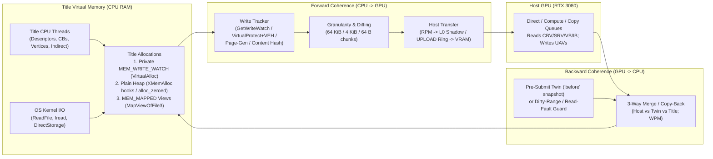

# Chapter 03 — Write Tracking and Software Coherence

## 3.1 The Software Coherence Imperative on Asymmetric Memory Hierarchies

Console games targeting Xbox Series X|S are engineered against a hardware truth that discrete-GPU Windows PCs violate at every layer of the memory hierarchy: **CPU and GPU share one physically unified pool of GDDR6 memory**. On Xbox Series S, 10 GiB of GDDR6—partitioned into an 8 GiB high-bandwidth segment at 224 GB/s and a 2 GiB slower segment at 56 GB/s, yielding roughly 7.6–8 GiB (`7,776 MiB` in `console.rs:25`) for the title—is directly addressable by both the 8-core Zen 2 CPU complex and the 20-CU RDNA2 GPU. A CPU virtual pointer *is* a GPU virtual address (`lib.rs:7`). When a title thread updates a constant buffer, appends a vertex slice, patches a bindless descriptor slot, writes an `ExecuteIndirect` argument record, or streams decompressed texels via DirectStorage, those stores enter a hardware-coherent (or explicitly flushed via `clwb`/cache invalidation) unified memory fabric. Neither the title nor the GDK runtime allocates duplicate host/device buffers, runs dirty-page scanners, or marshals staging copies across an external I/O bus.

Moving that same binary onto a Windows PC with a discrete GPU—specifically our reference host comprising an Intel Core i5-10400F (6 cores / 12 threads, 32 GiB DDR4, no AVX-512) and an NVIDIA RTX 3080 (10 GiB GDDR6X at 760 GB/s connected over PCIe 3.0/4.0 x16)—tears that abstraction in half. System DRAM (`L0`) and GPU VRAM (`L1`) sit in disjoint physical address spaces separated by a ~12–24 GB/s bidirectional PCIe link with multi-microsecond transaction round-trips. Worse, WDDM enforces separate resource visibility, residency, layout swizzling, and descriptor indirections. Any static recompiler or compatibility layer (`VIctory` or `XCL`) must therefore construct **software-managed coherence** between two asymmetric memory spaces:

1. **Forward Coherence (CPU $\rightarrow$ GPU):** Detect which bytes of title RAM were modified by CPU threads (or by OS I/O syscalls acting on behalf of the title) since the previous GPU submission, and propagate *only* those dirty spans to GPU-accessible memory (`D3D12_HEAP_TYPE_CUSTOM` `L0`, `UPLOAD` staging rings, or `DEFAULT` VRAM arenas) without corrupting concurrent GPU writes.
2. **Backward Coherence (GPU $\rightarrow$ CPU):** Detect which bytes of GPU-accessible buffers were modified by shader UAV writes, stream-out, or GPU copies, and propagate them back into title RAM before any CPU thread consumes them—again without clobbering concurrent CPU writes in adjacent fields of the same allocation.

When software coherence is coarse, synchronous, or built on heavy kernel transitions, it becomes the dominant bottleneck of the entire frame. That is precisely what happens in VIctory today.

> **Baseline Distinction (Measured Facts vs. Literature vs. Hypotheses):** Throughout this chapter, we distinguish strictly between:
> - **[Measured — Series S Baseline]:** Per-world-frame log metrics from VIctory running the title in Series S profile (1280×720 internal) on the RTX 3080 + i5-10400F test host: **`~860 ms` CPU `preparing`** (comprising **`~440 ms` for `~270 MB` of buffer `copies`**, **`~140 ms` for `~475 MB` of `textures` checks**, and **`~280 ms` of unattributed prepare overhead**), **`~700 ms` GPU execution**, and **`~330 ms` `copying back` `~12 MB`**—a total of ~1,890 ms/frame (~0.53 fps) with lockstep submission waits, fake occlusion/timestamp queries, and ~430 untranslated shaders leaving the final image black while the G-buffer contains geometry.
> - **[Measured — Earlier Series X Baseline (`agy_dossie.md`)]:** Earlier 4K Series X profile runs on the same host measured `~2,800 ms/frame`: `~810 ms` preparing (`~380 ms` / `~170 MB` copies, `~170 ms` / `~540 MB` textures, `~260 ms` unattributed), `~1,600 ms` GPU, and `~360 ms` copy-back for `~13 MB` (~450 untranslated shaders).
> - **[Literature / Official Spec Fact]:** Published mechanisms, latencies, and formulas verified against peer-reviewed papers, vendor documentation, or inspected source code.
> - **[Hypothesis `H-3.y`]:** Falsifiable engineering predictions tested against VIctory's `Meter` log line (`host.rs:1762-1767`).

Notice the arithmetic of the Series S baseline: **1,190 ms out of every 1,890 ms frame (63% of total frame time)** is burned purely in CPU-side coherence maintenance (`860 ms` forward preparing + `330 ms` backward copy-back), even though the title actually only changes a tiny fraction of its working set per frame and reads back only `~12 MB` from the GPU. At ~440 ms for ~270 MB, VIctory's forward buffer copy loop achieves an effective throughput of only **~614 MB/s**—roughly **25–40× slower** than dual-channel DDR4 `memcpy`. At ~330 ms for ~12 MB, its backward copy-back loop achieves **~36 MB/s**—roughly **500× slower** than sequential memory copy.



Understanding *why* VIctory suffers a 614 MB/s forward ceiling and a 36 MB/s backward ceiling—and how to eliminate them without breaking subtle concurrent CPU/GPU aliasing—requires examining the full taxonomy of write-tracking and software-coherence primitives developed across operating systems, hypervisors, garbage collectors, distributed shared memory (DSM) systems, and heterogeneous GPU runtimes over the past four decades.

---

## 3.2 Page Protection Traps (`VirtualProtect` + VEH/SEH and `mprotect` + `SIGSEGV`)

The oldest and most universally portable mechanism for user-space write tracking repurposes the CPU's Memory Management Unit (MMU) as a coarse dirty-bit detector. In their seminal 1991 ASPLOS paper, Appel and Li [1] formalized five virtual-memory primitives that user programs require beyond simple demand paging: `TRAP` (user-mode handling of page-fault traps), `PROT1`/`PROTN` (decreasing page accessibility for one or $N$ pages), `UNPROT` (increasing accessibility), `DIRTY` (querying modified pages), and `MAP2` (aliasing one physical frame at two virtual addresses with distinct protections). Absent an explicit `DIRTY` primitive from the OS kernel, user space synthesizes write detection through the **write-protect / fault-trap / unprotect** cycle.

### 3.2.1 Mechanics on Windows (`VirtualProtect` + VEH/SEH) and Linux (`mprotect` + `SIGSEGV`)

The basic protocol operates on hardware page granularity (4 KiB on x86-64):

1. **Arm (Protect):** Once a snapshot or GPU upload of virtual range $[A, B)$ completes, the coherence runtime strips write permission from the covering pages:
   - **Windows:** `VirtualProtect(addr, len, PAGE_READONLY, &old)` [14].
   - **Linux/POSIX:** `mprotect(addr, len, PROT_READ)`.
2. **Detect (Hardware `#PF` Trap):** Any subsequent CPU store instruction targeting an address $x \in [A, B)$ misses in the TLB or hits a TLB entry with the Read/Write (`R/W`) bit cleared. The CPU raises a hardware Page Fault (`#PF`, vector 14 on x86-64) with the faulting linear address loaded into `CR2` and bit 1 (`W/R = 1`) set in the error code.
3. **Dispatch to User Space:**
   - **Windows:** The kernel's `KiPageFault` resolves the VAD (Virtual Address Descriptor), determines that the fault is a protection violation rather than a demand-zero/pagefile miss, and dispatches `EXCEPTION_ACCESS_VIOLATION` (`0xC0000005`) with `ExceptionInformation[0] == 1` (write) and `ExceptionInformation[1] == x` through `KiDispatchException`. Handlers registered via `AddVectoredExceptionHandler(1, handler)` [16] execute *first-chance* ahead of frame-based SEH handlers (critical in game ports, because title crash reporters register SEH filters or top-level unhandled filters that otherwise terminate the process; see `watch.rs:231-233` and `xcl_h3.md:1828`).
   - **Linux:** `do_page_fault` finds the VMA lacks `VM_WRITE`, constructs a `siginfo_t` with `si_code = SEGV_ACCERR` and `si_addr = x`, pushes a signal frame (`ucontext_t`) onto the faulting thread's stack (or `sigaltstack`), and enters the process's `SIGSEGV` `SA_SIGINFO` handler.
4. **Disarm & Record:** The handler checks whether $x$ belongs to a tracked region, records the dirty page (or block) in a software bitmap/journal, restores `PAGE_READWRITE` / `PROT_WRITE`, and returns `EXCEPTION_CONTINUE_EXECUTION` (Windows) or returns from the signal handler (Linux) so the CPU retries the exact store instruction cleanly.

```
Thread A (Title Writer)         OS Kernel / MMU                   Coherence Runtime
-----------------------         ---------------                   -----------------
                                                                  VirtualProtect(P, PAGE_READONLY)
                                                                    -> PTE.RW = 0 + TLB shootdown IPI
mov [P + 0x18], rax   ------>  #PF (CR2 = P+0x18, Err.W=1)
  (instruction stalls)          KiDispatchException()
                                  |
                                  v
                        VEH: on_write(P+0x18)
                          -> acquires guard lock
                          -> marks block(P) dirty
                          -> VirtualProtect(P, PAGE_READWRITE)
                          -> returns EXCEPTION_CONTINUE_EXECUTION
                                  |
mov [P + 0x18], rax   <-----------+ (re-executes store cleanly)
(subsequent writes to P run at full hardware memory speed until next frame/submit re-arm)
```

### 3.2.2 The True Cost: Traps, VMA Splits, and TLB Shootdowns

Although trap-based tracking incurs **zero overhead on clean pages** once armed and **zero overhead after the first write** to a dirty page until re-armed, every individual trap and every `RW -> RO` re-arm carries heavy microarchitectural costs:

1. **Exception Dispatch Latency:** Entering kernel mode on `#PF`, building the user-mode `CONTEXT` / `EXCEPTION_RECORD` (over 1 KiB of register/XMM/AVX state), invoking the VEH chain, issuing a `VirtualProtect` syscall inside the handler, returning to kernel `NtContinue`, and restoring user context costs **several microseconds** (~2–10 µs depending on core count and mitigation state such as KPTI/Spectre). If 5,000 scattered 4 KiB pages are written per frame, traps alone consume 10–50 ms of serialized CPU time—and under a coarse global lock (like `GUARDS` in `watch.rs:113-119`), multi-threaded title workers serialize behind every single page fault.
2. **Cross-Core TLB Shootdowns:** Upgrading protection (`RO -> RW`) generally allows lazy TLB update on x86-64 (a stale read-only TLB entry on another core simply triggers a spurious `#PF` that kernel/VEH resolves as already `PAGE_READWRITE`—exactly why `watch.rs:259-263` checks `writable(at)`!). Conversely, **downgrading protection (`RW -> RO`) requires synchronous TLB invalidation across all cores that may cache translations for the process**. The kernel issues Inter-Processor Interrupts (IPIs) forcing peer cores to execute `INVLPG` or `INVPCID` and acknowledge completion before `VirtualProtect`/`mprotect` returns.
   - Amit (2017) [29] and Amit, Tai, and Wei (2020) [30] demonstrated that software TLB shootdowns scale poorly with core count, costing **microseconds per shootdown event** and dominating workloads that frequently tighten page permissions. Villavieja et al. (2011) [31] similarly quantified how `mprotect`-induced IPI synchronization stalls sibling hardware threads.
   - On a 6-core / 12-thread i5-10400F, if `watch::guard` arms fragmented `64 KiB` blocks individually (`watch.rs:182-186`) instead of one contiguous `VirtualProtect` call, each separate `VirtualProtect(..., PAGE_READONLY)` syscall can emit an independent TLB shootdown across up to 11 sibling logical CPUs!
3. **Linux VMA Splitting/Merging (`mmap_lock`):** On Linux, `mprotect` mutates Virtual Memory Area (VMA) descriptors in the kernel's maple tree under the per-process `mmap_lock`. Alternating `PROT_READ` and `PROT_READ|PROT_WRITE` across interleaved pages fragments a single contiguous allocation into thousands of separate VMA nodes, causing $O(\log N)$ lookup degradation and heavy lock contention across threads—a major reason Wine abandoned `mprotect` + `SIGSEGV` for write-watch tracking in 2025 [48].

### 3.2.3 The Kernel-Mode I/O Bypass Hazard (and VIctory's `kernel_will_write`)

A subtle and catastrophic failure mode of `VirtualProtect(PAGE_READONLY)` tracking is that **the OS kernel does not invoke user-mode exception handlers when kernel drivers or syscalls write into user buffers**. When an application passes a pointer `buf` to `ReadFile`, `fread`, `NtReadFile`, `WSARecv`, or a DirectStorage decompression target, the Windows I/O Manager or file-system driver probes and locks the target pages in kernel space (`ProbeForWrite` / `MmProbeAndLockPages` with `IoWriteAccess`). If any page in `[buf, buf + len)` is marked `PAGE_READONLY`, the kernel probe immediately fails with `STATUS_ACCESS_VIOLATION` / `ERROR_NOACCESS` (`998`)—it never dispatches a first-chance VEH exception to user space!

Raymond Chen famously highlighted a related symptom in *"IsBadXxxPtr should really be called CrashProgramRandomly"* [21]: probing virtual memory asynchronously or letting OS layers silently swallow/misinterpret guard exceptions breaks invariants catastrophically. In a game port, a failed `ReadFile` is even worse if the title retries synchronously: as documented directly in VIctory's `files.rs:519-522`, the target title's synchronous loader (`title+0x313fc0`) reads directly into 4 KiB-aligned buffers and **retries a failed `ReadFile` in an infinite loop**!

VIctory explicitly confirms and tests this hazard in `watch.rs:328-369` (`kernel_reads_into_guarded_blocks_after_opening`): a `std::fs::File::read` into a `guard()`-protected `MEM_MAPPED` view returns an error (`assert!(!read(&mut file), "the kernel does not fault into our handler")`) until `watch::writing(view + 100, 13)` opens the block to `PAGE_READWRITE`. Consequently, every OS read path intercepted by VIctory's HLE (`files.rs:531` `ReadFile`, `files.rs:539` `fread`, `dstorage.rs:954` DirectStorage non-page destination, and `host.rs:1386` `copy_mapped` with `title_dst = true`) *must* call `victory_gpu::kernel_will_write` beforehand. Notice, however, that any *unintercepted* Windows API or third-party DLL that writes to `MEM_MAPPED` buffers via kernel space (for example, `ReadFileScatter`, Winsock `WSARecv`, or async overlapped I/O completions outside `ReadFile`) will silently fail if those pages are left `PAGE_READONLY`.

### 3.2.4 Emulator & GC Precedents and Concurrent Trap Pseudocode

Despite these sharp edges, `VirtualProtect` / `mprotect` remains a workhorse across console emulators and runtimes whenever OS write-watch APIs are unavailable or inadequate:

- **yuzu (Nintendo Switch Emulator):** In its January 2021 *Buffer Cache Rewrite* [45], yuzu aligned guest GPU buffers to **4 KiB pages** and used `VirtualProtect` (Windows) / `mprotect` (Linux) page protection to invalidate cached GPU ranges only when the guest CPU modified those specific pages, eliminating massive frame-by-frame polling overhead.
- **RPCS3 (PlayStation 3 Emulator):** Tracks RSX (NVIDIA G70-derived) local/main memory coherence through virtual memory page protection and fault handlers in `vm.cpp` [46], intercepting CPU accesses to GPU-owned surfaces and vice versa.
- **Boehm-Demers-Weiser GC (`bdwgc`):** Supports `MPROTECT_VDB` using OS page-protection traps on POSIX platforms lacking lighter kernel dirty-bit APIs, while preferring `GWW_VDB` (`GetWriteWatch`) on Windows [22].

Even inside a single address space, a multi-threaded `VirtualProtect` trap handler is vulnerable to a **TOCTOU (Time-of-Check to Time-of-Use) race** between a faulting worker thread and a submitting thread re-arming protections. Consider two threads executing simultaneously:
1. Thread 1 executes `mov [P], eax` while `P` is `PAGE_READONLY`, trapping into `KiPageFault`.
2. Before Thread 1's VEH acquires `GUARDS`, Thread 2 (submitting a command list) executes `open()` or `guard()`, observes `P` already unprotected/protected, or re-arms `P` to `PAGE_READONLY` right after Thread 1 saw it unprotected!
3. If Thread 1's VEH checks "was `P` in `protected`?" and returns `EXCEPTION_CONTINUE_SEARCH` whenever `P` is absent from `protected`, a benign concurrent `open()` by Thread 2 causes Thread 1 to **crash with an unhandled access violation**!

VIctory's `watch.rs:250-263` avoids this race using two defensive invariants: (a) holding the `GUARDS` mutex across both the `open()` check and a fallback `writable(at)` (`VirtualQuery`) probe (`watch.rs:273-282`), and (b) returning `EXCEPTION_CONTINUE_EXECUTION` if `at` is already `MEM_COMMIT && PAGE_READWRITE`. A lock-free or sharded design improves scalability further by keeping a per-page atomic state machine (`CLEAN_RO -> DIRTY_RW -> REARMING`) where `on_write` atomically CASes `CLEAN_RO -> DIRTY_RW` or retries if `writable(at)` holds:

```rust
// Pseudocode: Sharded, Race-Free Trap-Based Page Guard (4 KiB or 64 KiB block granularity)
enum PageState : u8 { UNTRACKED = 0, CLEAN_RO = 1, DIRTY_RW = 2 }

// Shard locks by (block_idx >> 6) (e.g., 64 blocks = 4 MiB per shard) instead of 1 global Mutex
unsafe extern "system" fn vectored_write_handler(info: *mut EXCEPTION_POINTERS) -> i32 {
    let rec = &*(*info).ExceptionRecord;
    if rec.ExceptionCode != EXCEPTION_ACCESS_VIOLATION || rec.ExceptionInformation[0] != 1 {
        return EXCEPTION_CONTINUE_SEARCH;
    }
    let fault_addr = rec.ExceptionInformation[1];
    let block = fault_addr / BLOCK_SIZE;
    let shard = &SHARDS[block % NUM_SHARDS];
    let _guard = shard.lock(); // Serializes ONLY threads touching the same 4 MiB shard

    if shard.state(block) == PageState::CLEAN_RO {
        // 1. Mark dirty BEFORE restoring write permission (so concurrent re-arm sees dirty)
        shard.set_dirty_epoch(block, CURRENT_EPOCH.load(Ordering::Acquire));
        shard.set_state(block, PageState::DIRTY_RW);
        VirtualProtect((block * BLOCK_SIZE) as *const _, BLOCK_SIZE, PAGE_READWRITE, &mut old);
        return EXCEPTION_CONTINUE_EXECUTION;
    }
    // Race recovery: another thread already transitioned CLEAN_RO -> DIRTY_RW after we faulted,
    // OR re-armed while our trap was in flight. Verify via VirtualQuery before passing up.
    if shard.state(block) == PageState::DIRTY_RW || is_committed_readwrite(fault_addr) {
        return EXCEPTION_CONTINUE_EXECUTION;
    }
    EXCEPTION_CONTINUE_SEARCH
}
```

---

## 3.3 OS Write-Watch Facilities (`MEM_WRITE_WATCH` and `GetWriteWatch`)

Recognizing the overhead of user-mode fault traps for garbage collectors and DSM runtimes, Microsoft introduced explicit kernel-tracked dirty-page reporting in Windows via `MEM_WRITE_WATCH` (`0x00200000`) and the `GetWriteWatch` / `ResetWriteWatch` APIs [12, 13, 15].

### 3.3.1 Mechanism and API Semantics

When memory is reserved via `VirtualAlloc` or `VirtualAlloc2` with `MEM_RESERVE | MEM_WRITE_WATCH` [15] (write watching stays active for the lifetime of the reservation and cannot be toggled onto an existing allocation), the Windows Memory Manager maintains an internal write-watch bitmap alongside the region's VAD and PTEs. Unlike `VirtualProtect`:
- **No user-mode exceptions are ever dispatched.** All CPU writes to committed pages in a `MEM_WRITE_WATCH` region proceed at native speed once the kernel's internal write-watch state records the page as dirty (via an internal kernel fault/PTE dirty mechanism on first write after reset, transparent to user mode).
- **Bulk Dirty Query:** Calling `GetWriteWatch(dwFlags, lpBaseAddress, dwRegionSize, lpAddresses, &count, &granularity)` [12] inspects the kernel's dirty records for `[lpBaseAddress, lpBaseAddress + dwRegionSize)`, fills `lpAddresses[0..count]` with the exact base addresses of written pages, and sets `*lpdwGranularity` (typically `4096` bytes on x64 Windows).
- **Reset:** Passing `WRITE_WATCH_FLAG_RESET` (`1`) resets the kernel's tracking state for the queried pages inside the same syscall; alternatively, `ResetWriteWatch(lpBaseAddress, dwRegionSize)` clears tracking separately [12, 13].

In **Boehm GC (`bdwgc`)** [22], `GWW_VDB` replaces `MPROTECT_VDB` on Windows specifically because `GetWriteWatch` eliminates `SIGSEGV`/VEH context-switch storms and works seamlessly with Windows kernel I/O APIs (`ReadFile` into private `MEM_WRITE_WATCH` buffers works without pre-unguarding). In **Xenia** [47], `src/xenia/memory` similarly uses Windows write-watch tracking to monitor Xbox 360 guest physical memory pages written by JIT-compiled PowerPC threads.

### 3.3.2 Five Structural Limitations and Pitfalls

For a modern GDK console recompiler like VIctory or XCL, however, `GetWriteWatch` exposes five severe architectural traps:

1. **Hard Incompatibility with `MEM_MAPPED` (Section Views) and Standard Heap Allocators:**
   Per Microsoft Learn [12, 15] and kernel virtual memory rules, `MEM_WRITE_WATCH` **must** be passed alongside `MEM_RESERVE` on private virtual allocations. It **cannot** be applied to `MEM_MAPPED` section views created via `CreateFileMappingW` + `MapViewOfFile` / `MapViewOfFile3` (which VIctory uses for `XMemAllocatePhysicalPages` / `XMemMapPhysicalPages` at `xmem.rs:406, 703`!) nor to standard `HeapAlloc` / Rust `alloc_zeroed` / title-exported `__XMemAllocationHooks__` (`xmem.rs:255`). Calling `GetWriteWatch` on any non-watched region fails immediately (`!= 0`), forcing VIctory into fallback paths (`watch.rs:73-79`, `texture.rs:194-220`, `shadow.rs:314-317`).
2. **Global Destructive Reset Conflicts with Multi-Consumer Sharing:**
   Passing `WRITE_WATCH_FLAG_RESET` clears the kernel's dirty record *globally for the process*. Suppose a `64 KiB` descriptor heap or `174 MiB` GPU heap holds Buffer A at offset `0x0000` (4 KiB page $P$) and Buffer B at offset `0x0400` (the *same* 4 KiB page $P$), or two overlapping `Shadow` objects view the same allocation. If Consumer A calls `GetWriteWatch(WRITE_WATCH_FLAG_RESET)` on `[0x0000, 0x0400)`, the kernel clears page $P$'s dirty bit—causing Consumer B to miss CPU writes that occurred before A's query!
   VIctory correctly solves this in `watch.rs:31-101` by wrapping `GetWriteWatch` inside a global `JOURNAL` (`BTreeMap<usize, u64>`) with monotonically increasing asking counters `asked`: every kernel-reported dirty page is stamped `(page, now)` in `JOURNAL`, so subsequent askers whose `last_copied < now` still observe the write even after the kernel bit was cleared. However, `watch::writes` keeps `JOURNAL` forever without garbage-collecting unmapped/freed pages and serializes all queries behind one global `JOURNAL` mutex!
3. **The Multi-Threaded Reset Race Window:**
   Microsoft Learn explicitly cautions under `ResetWriteWatch` [13] and `GetWriteWatch` [12]: *"If you use `ResetWriteWatch`, you must ensure that no threads write to the region during the interval between the `GetWriteWatch` and `ResetWriteWatch` calls. Otherwise, there may be written pages that you do not detect."*
   Even with `WRITE_WATCH_FLAG_RESET` in a single `GetWriteWatch` call, a subtle **read-vs-reset interleaving race** remains when a title CPU thread writes concurrently while the coherence thread scans and copies! Trace the exact interleaving on an x86-64 system:

```
Time  Title Worker Thread (CPU)            Coherence Thread (Host Submit)
----  -------------------------            ------------------------------
t0    Writes bytes [0..63] of Page P       
      (Kernel write-watch marks P dirty)
t1                                         Calls GetWriteWatch(WRITE_WATCH_FLAG_RESET, P)
                                             -> Kernel clears P's watch bit, returns [P]
t2    Writes bytes [64..127] of Page P     <-- RACE! Write lands AFTER reset,
      (Kernel marks P dirty again!)            BEFORE memcpy reads Page P
t3                                         memcpy reads Page P -> gets BOTH [0..63] AND [64..127]!
t4                                         Next submit: GetWriteWatch returns P again!
                                             (Benign duplicate if read after write)
--- NOW CONSIDER THE REVERSE ORDERING IF COPY HAPPENS BEFORE RESET ---
t0'   Writes bytes [0..63] of Page P
t1'                                        memcpy reads Page P -> gets ONLY [0..63]
t2'   Writes bytes [64..127] of Page P     <-- CPU write lands AFTER memcpy, BEFORE reset!
t3'                                        Calls GetWriteWatch(WRITE_WATCH_FLAG_RESET, P)
                                             -> Kernel clears P's watch bit, returns [P]!
                                             [64..127] IS LOST until next write to P!
```

   That timeline proves an iron rule of lockless write-watch coherence (noted in Boehm GC discussions [22]): **you MUST call `GetWriteWatch(WRITE_WATCH_FLAG_RESET)` *before* reading the page contents (`memcpy` / hash)**, never after! Calling `GetWriteWatch` first (as VIctory does in `watch.rs:64` before `Shadow::copy_stale` in `shadow.rs:303-305`) guarantees no write is lost—at worst a concurrent write between `t1` and `t3` is observed twice (once in the current copy and once on the next `GetWriteWatch`), unless the CPU write itself is non-atomic across a struct boundary (a title-level data race if the title writes while submitting to the GPU without fencing).
4. **4 KiB Page Granularity vs. 64 KiB Folding:**
   `GetWriteWatch` reports dirty status at 4 KiB (`KERNEL_PAGE`) granularity. If a title updates a single 64-byte constant matrix in a 4 KiB page, the OS reports 4,096 bytes dirty (a **64× write amplification**). Worse, VIctory explicitly folds 4 KiB reports into `watch::PAGE = 64 << 10` (64 KiB) in `watch.rs:27, 90` (`at / PAGE`) because *"finer units made the checks of the world's big buffers cost more than the copies they saved"* (`watch.rs:25-26`)! That inflates a 64-byte write into a **65,536-byte copy (1,024× amplification)**!
5. **Query Buffer Sizing & Syscall Cost:**
   `watch.rs:57-58` sizes `j.found` to `(last - first) * PAGE / KERNEL_PAGE` entries (`16 entries per 64 KiB`). For a 174 MiB buffer (`shadow.rs:148`), `count = 44,544` `usize` entries (356 KiB array), passed across the kernel boundary on every `Shadow::update` call. Even when 0 pages are dirty, `GetWriteWatch` walks the kernel's VAD/write-watch bitmap across all 44,544 pages per call.

---

## 3.4 Hardware Dirty Bits, Virtualization Logging, and Linux Kernel Mechanisms

Outside Win32 `GetWriteWatch`, modern CPUs and Linux kernels expose a richer spectrum of dirty-tracking mechanisms—originally built for hypervisor live migration, process checkpointing (CRIU), and Windows compatibility layers (Wine/Proton). Understanding them illuminates both what hardware actually supports and why pure user-mode software on Windows faces steeper constraints.

### 3.4.1 x86-64 PTE Dirty Bits, EPT A/D Bits, and Intel Page-Modification Logging (PML)

At the silicon level, every x86-64 4-level or 5-level page table entry (PTE) already contains two hardware-managed tracking bits: **Accessed (A, bit 5)** and **Dirty (D, bit 6)** [27]. When a core executes a store whose virtual translation hits a PTE with `D == 0`, the CPU's page-table walker sets `D = 1` atomically in memory (and caches `D = 1` in the TLB) without raising a `#PF` exception. Unfortunately, Windows does not expose a user-mode syscall to sample and clear hardware PTE D-bits directly because the OS kernel itself uses the D-bit for modified-page writeback, pagefile eviction, and copy-on-write accounting; clearing hardware D-bits from user space would corrupt OS virtual memory paging.

In **hardware-assisted virtualization (Intel VT-x with Extended Page Tables, EPT)**, Intel added a second tier of **EPT Accessed/Dirty bits** (Haswell+ / Broadwell+) specifically so hypervisors could track guest writes without write-protecting guest pages. Yet scanning gigabytes of EPT leaf PTEs with software bitmaps still scales poorly for large VMs (`O(RAM)` scan time + cache pollution). To solve that, Intel introduced **Page-Modification Logging (PML)** in Broadwell-EP [27]:

- **Hardware Ring Buffer:** The Virtual Machine Control Structure (VMCS) points to a 4 KiB aligned **PML buffer** capable of holding 512 64-bit guest physical addresses (GPAs) and a `PML index` initialized to `511`.
- **Zero-Exit Logging:** Whenever an EPT write transitions a guest page's EPT D-bit from `0` to `1`, hardware microcode writes the 4 KiB-aligned GPA into `PML_buffer[PML_index]` and decrements `PML_index`—without exiting guest mode!
- **Batched VM Exit:** Only when `PML_index` underflows (`-1`) does the CPU trigger a **`PML buffer full` VM exit**, allowing the VMM to harvest 512 dirty pages in one batch and reset the index [26, 27].

On Linux, **KVM** exposed an analogous abstraction to userspace VMMs (such as QEMU) in Linux 5.11 via **`KVM_CAP_DIRTY_LOG_RING`** [26]. Legacy `KVM_MEM_LOG_DIRTY_PAGES` forced KVM and userspace to synchronize, lock, and `ioctl`-copy massive global dirty bitmaps under `spin_lock`/reverse-map (`rmap`) contention. The **KVM dirty ring** replaces the global bitmap with **per-vCPU ring buffers** storing dirty Guest Frame Numbers (GFNs); when a vCPU's ring fills, only that vCPU pauses via `KVM_EXIT_DIRTY_RING_FULL` until QEMU reaps entries [26].

On **ARM64 (ARMv8.1-A and later)**, **`FEAT_HAFDBS` (Hardware management of the Access flag and Dirty state)** [28] introduces hardware Dirty Bit Modifier (**DBM**) semantics directly into stage-1 and stage-2 translation tables: a writable-but-clean PTE marked with `DBM = 1` and `AP[2] = 1` (read-only) automatically transitions to writable (`AP[2] = 0`) in hardware on the first store without taking a kernel permission fault!

### 3.4.2 Linux `soft-dirty` (`/proc/pid/clear_refs` + `/proc/pid/pagemap`)

Designed originally for Checkpoint/Restore In Userspace (CRIU), Linux's **soft-dirty** mechanism [23] decouples user-visible dirty tracking from the kernel's own PTE D-bit:
1. Userspace writes `4` to `/proc/<pid>/clear_refs`. The kernel walks every writable VMA of `<pid>`, clears the software `_PAGE_SOFT_DIRTY` bit in each PTE, and simultaneously clears `_PAGE_RW` (write-protecting the pages) followed by a TLB flush.
2. When the process next writes to a protected page, the kernel's `#PF` handler observes that the VMA permits writes (`VM_WRITE`), sets `_PAGE_SOFT_DIRTY` and restores `_PAGE_RW` entirely inside kernel space—**zero signals are delivered to user space**.
3. Userspace reads 64-bit entries from `/proc/<pid>/pagemap` and checks **bit 55** (`soft-dirty`) [23].

While much faster than `mprotect` + `SIGSEGV` for coarse checkpoint intervals (hundreds of milliseconds to seconds), `soft-dirty` is ill-suited to 60–120 fps game coherence: writing `4` to `clear_refs` walks *all* VMAs of the entire process rather than a narrow GPU heap range, and reading `/proc/<pid>/pagemap` copies 8 bytes per 4 KiB page (`2 MiB` of kernel-to-user `pread` overhead per `1 GiB` of address space) across textual/procfs interfaces [25].

### 3.4.3 Linux `userfaultfd` (`UFFDIO_WRITEPROTECT`), `UFFD_FEATURE_WP_ASYNC`, and `PAGEMAP_SCAN`

Linux `userfaultfd` [24] provides fine-grained, range-scoped user-space page fault handling without mutating VMA boundaries or risking `SIGSEGV` signal-mask collisions:
- **Synchronous `UFFDIO_WRITEPROTECT` (Linux 5.7+):** Userspace registers a memory range with `UFFDIO_REGISTER_MODE_WP` and arms sub-ranges with `ioctl(uffd, UFFDIO_WRITEPROTECT, ...)` (`mode = UFFDIO_WRITEPROTECT_MODE_WP`) [24]. When a thread writes to a protected page, that thread sleeps inside the kernel while a dedicated monitor thread reads a `uffd_msg` with `UFFD_PAGEFAULT_FLAG_WP`, logs the dirty page, and clears protection via `ioctl(UFFDIO_WRITEPROTECT)` without `UFFDIO_WRITEPROTECT_MODE_WP` [24]. While cleaner than `SIGSEGV` (no signal frames, no VMA splits), synchronous user-space round-trips still stall the writer thread for two thread wakeups + two syscalls per first write!
- **Asynchronous `UFFD_FEATURE_WP_ASYNC` + `PAGEMAP_SCAN` (Linux 6.7+):** Driven directly by the need to run Windows games under **Wine/Proton** calling `GetWriteWatch` at high frame rates [25, 48], Muhammad Usama Anjum introduced the **`PAGEMAP_SCAN` ioctl** alongside asynchronous `userfaultfd` write-protection (`UFFD_FEATURE_WP_ASYNC`). With `UFFD_FEATURE_WP_ASYNC`, a write fault on a `uffd-wp` page is resolved **synchronously inside the kernel**—the kernel restores write permission and leaves the `uffd-wp` dirty marker cleared in the PTE without waking any user-space monitor thread [25]. Userspace then invokes `PAGEMAP_SCAN` with `PM_SCAN_WP_MATCHING` and `PAGE_IS_WRITTEN` flags to atomically harvest a compacted run-length array (`struct page_region { start, end, categories }`) of written ranges and re-arm write-protection in a single bulk `ioctl` [25]!
- **Wine Adoption (April 2025):** As documented in WineHQ Merge Request `!7871` by Paul Gofman (merged by Alexandre Julliard) [48], replacing Wine's legacy `mprotect` + `SIGSEGV` `GetWriteWatch` implementation with `userfaultfd` write-watch tracking eliminated massive VMA splitting/merging and global synchronization lock contention in Windows titles running on Linux/Proton.

### 3.4.4 Comparative Taxonomy of Write-Tracking Mechanisms

| Mechanism | OS / HW | Granularity | Cost on First Write | Re-Arm / Scan Cost | Handles `MEM_MAPPED` / Shared Views? | Kernel I/O (`ReadFile`) Safe? | Primary Failure Mode for Game Ports |
| :--- | :--- | :--- | :--- | :--- | :--- | :--- | :--- |
| **`VirtualProtect` + VEH** | Windows | 4 KiB (or batched $N\times$4 KiB) | ~2–10 µs user-mode exception + `VirtualProtect` | Syscall + **cross-core TLB shootdown IPI** [29, 30] | Yes (per-view virtual pages) | **No** (kernel probe fails `ERROR_NOACCESS` [14]; needs `kernel_will_write`) | Exception storms under frequent CPU writes; global guard lock contention; missing unintercepted kernel writes |
| **`mprotect` + `SIGSEGV`** | Linux / POSIX | 4 KiB | ~3–15 µs signal frame + `mprotect` | Syscall + TLB shootdown + **VMA split/merge** [48] | Yes (`MAP_SHARED`) | **No** (`EFAULT` on `read`/`recv`) | Catastrophic VMA fragmentation and `mmap_lock` contention [48] |
| **`GetWriteWatch` (`MEM_WRITE_WATCH`)** | Windows | 4 KiB (`KERNEL_PAGE`) | Sub-µs kernel fault (no user exception) | 1 syscall (`WRITE_WATCH_FLAG_RESET`), no TLB shootdown on reset? (kernel handles internally) | **No** (`VirtualAlloc` private only [12, 15]) | **Yes** | Fails on `MEM_MAPPED` views and title heap hooks; global reset conflicts with overlapping shadows (`JOURNAL` needed); 4 KiB amplification |
| **Linux `soft-dirty`** | Linux | 4 KiB | Kernel `#PF` only (no user signal) | $O(\text{all VMAs})$ `clear_refs` + `/proc/pid/pagemap` `pread` [23] | Partial (`VM_SOFTDIRTY`) | Yes | Whole-process scope (`clear_refs` hits unrelated VMAs); procfs overhead [25] |
| **`userfaultfd` Sync WP** | Linux 5.7+ | 4 KiB | Writer blocks; monitor thread + 2 syscalls | `ioctl(UFFDIO_WRITEPROTECT)` without VMA split [24] | File/shmem + anon (`WP_UNPOPULATED` [24]) | Yes (kernel waits on UFFD) | Monitor thread wakeup latency stalls writer threads |
| **`UFFD_WP_ASYNC` + `PAGEMAP_SCAN`** | Linux 6.7+ | 4 KiB (extent-coalesced `page_region`) | Kernel resolves in-place (no user wakeup) [25] | Single bulk `ioctl(PAGEMAP_SCAN)` returns coalesced extents [25] | Yes (anon + shmem/file) | Yes | Linux-only (unavailable on native Windows host) |
| **Intel EPT A/D + PML / KVM Dirty Ring** | x86-64 VMX / KVM | 4 KiB | **Zero exit** until 512-entry PML buffer full [27] | Batched VM-exit / per-vCPU ring reap [26] | Guest physical memory | Yes (hypervisor layer) | Requires running inside a Type-1/Type-2 hypervisor (out of scope for native Win32 process recompiler) |
| **Whole-Region Content Hashing (`blake3`)** | Portable CPU | Entire resource / slice | **0** during CPU writes | $O(\text{total size})$ CPU read + hash on **every check** | Yes | Yes | Wastes memory bandwidth and CPU hashing unchanged megabytes (VIctory: `~475 MB / ~140 ms` per frame) |


---

## 3.5 Content-Based Dirty Detection: Block Hashing (`BLAKE3`, `xxHash`/`XXH3`, `CRC32C`) and Byte Diffing

When hardware dirty bits or OS write-watch APIs are unavailable—as happens for `MEM_MAPPED` physical-page views on Windows, custom title-hooked allocators (`__XMemAllocationHooks__`), or sub-page regions inside already-dirty 4 KiB/64 KiB pages—coherence runtimes fall back to **content-based change detection**: computing compact digests over memory blocks (or comparing directly against a cached twin) to determine what actually changed.

Content-based memory inspection has a long systems pedigree. Waldspurger (2002) [34] demonstrated in VMware ESX Server that hashing 4 KiB guest pages (followed by byte-for-byte verification on hash matches) enables scalable transparent page sharing without hardware assistance. Clark et al. (2005) [35] relied on iterative dirty tracking and compression/hashing in live VM migration to bound network bandwidth during pre-copy convergence. In heterogeneous console emulation, however, content hashing runs at **frame-rate cadence (16.6–33.3 ms budgets)** on latency-critical submission threads—making hash algorithm selection, SIMD utilization, chunk sizing, and collision safety decisive engineering parameters.

### 3.5.1 Microarchitectural Comparison: BLAKE3 vs. xxHash (XXH3/XXH64) vs. Hardware CRC32C

VIctory's test host—an Intel Core i5-10400F (Comet Lake, 6 cores / 12 threads, dual-channel DDR4-2666/3200 with ~25–35 GB/s sustained read bandwidth, supporting **SSE4.2** and **AVX2**, and **no AVX-512**)—exposes sharp performance cliffs across the three principal hash families:

| Hash Algorithm | Digest Width | Core Design & Instruction Set | Reference Single-Core Throughput | Behavior on Small Chunks (64 B – 4 KiB) | Intended Threat / Failure Model |
| :--- | :--- | :--- | :--- | :--- | :--- |
| **BLAKE3** (`blake3` v1.8.7 in VIctory) [32] | 256-bit (cryptographic) | ChaCha-derived ARX rounds arranged in a 1 KiB-chunk Merkle tree; runtime dispatch (SSE2/SSE4.1/AVX2/AVX-512) | ~1.1–1.2 GB/s (scalar/SSE2), **~7.0 GB/s (AVX2)**, ~10.5 GB/s (AVX-512) on large inputs [32] | **Degrades sharply below 8 KiB:** AVX2 8-chunk parallel tree hashing only engages at $\ge 8\text{ KiB}$ (SSE at $\ge 4\text{ KiB}$) [32] | Cryptographic preimage & collision resistance against **malicious adversaries** |
| **xxHash (`XXH3_64` / `XXH3_128`)** [33] | 64-bit or 128-bit (non-crypto) | Wide vector multiply-accumulate (`_mm256_mul_epu32`) across 64-byte stripes + avalanche finalizer | **~59.4 GB/s** (`XXH3` AVX2, cache-resident 100 KB), ~31.5 GB/s (SSE2) [33] | Dedicated low-overhead branch paths for `17–128 B` and `129–240 B` without Merkle state setup [33] | Accidental non-adversarial mutation detection at **DRAM bandwidth** |
| **XXH64** [33] | 64-bit (non-crypto) | Four independent 64-bit scalar accumulators (32 B/iter) + avalanche mix | **~19.4 GB/s** on reference x86-64 [33] | Fast loop for 64 B (`8 u64` loads, 2 stripe rounds + merge) | Legacy fast 64-bit checksum |
| **Hardware `CRC32C` (Castagnoli)** [27] | 32-bit (or paired/mixed 64-bit) | Intel SSE4.2 `crc32 r64, r/m64` (`0x1EDC6F41` polynomial), 3-cycle latency / 1-cycle throughput [27] | ~10 GB/s naive serial loop; **~10–30 GB/s** when interleaving 3–4 independent accumulators [27] | **Ideal for 64-byte cache lines:** 8 `u64` words execute as 2×4 or 4×2 interleaved `crc32q` instructions in ~10–14 cycles without AVX2 thermal/frequency throttling | Hardware-accelerated dirty-chunk checksumming (needs non-linear 64-bit extension/mixing; see §3.5.2) |

This table immediately explains why VIctory's measured texture-hashing rate lags far behind hardware limits. In `texture.rs:220`, VIctory calls `blake3::hash(tiled)` (`blake3` v1.8.7 in `Cargo.toml:38`) on every `MEM_MAPPED` texture check. Notice three compounding penalties:

1. **Cryptographic Overkill:** Using a 256-bit cryptographic Merkle tree (designed to resist chosen-prefix attacks by adversaries) to detect whether *the local title process* modified a texture in RAM wastes ~4–8× CPU cycles per byte compared to `XXH3` or interleaved `CRC32C`.
2. **Below-Threshold Mip & Small Texture Degradation:** Because BLAKE3's AVX2 8-chunk parallel tree path requires $\ge 8\text{ KiB}$ inputs [32], small textures, LUTs, and icon atlases drop onto single-chunk/4-chunk paths (~1.2–3.5 GB/s).
3. **Observed Gap in VIctory (`~3.39 GB/s` Series S / `~3.18 GB/s` Series X):** In **[Measured — Series S Baseline]**, `475 MB` of texture checks take `~140 ms` (`3.39 GB/s`); in **[Measured — Earlier Series X Baseline]**, `540 MB` take `~170 ms` (`3.18 GB/s`). Why less than half of BLAKE3's ~7.0 GB/s AVX2 peak? Because `Staging::refresh` (`texture.rs:179-186`) lumps `committed()` (`VirtualQuery` page-table walks at `texture.rs:208, 316-331`), single-threaded `blake3::hash(tiled)` cache misses across DRAM, *and* synchronous CPU `detile()` + `UPLOAD` writes (`texture.rs:227`) onto the same `PREPARING[2]` stopwatch—while `Batch::title_written` (`host.rs:1345`) repeatedly clears `self.textures` and re-hashes the exact same immutable textures within a single frame!

### 3.5.2 Collision Mathematics: Differential Second-Preimage Probability vs. the Birthday Bound

Engineers frequently reject 64-bit hashes for dirty-chunk detection out of a misapplied invocation of the **birthday paradox**. It is critical to state the exact combinatorics accurately:

- **Global Deduplication Table (Birthday Bound Applies):** When matching $N$ distinct blocks against *all other blocks* in a shared pool (such as VMware ESX page sharing [34]), the probability of *any* pair colliding among $\binom{N}{2}$ comparisons scales roughly as $1 - \exp(-N^2 / 2^{b+1})$. With a 32-bit hash, $N \approx 77{,}000$ blocks already yields a ~50% chance of a global collision ($2^{16} \sqrt{2\ln 2}$), which is why Waldspurger [34] always verified hash matches with full byte-by-byte comparison.
- **Per-Chunk Change Detection (Fixed-Target Second-Preimage / Differential Match):** When testing whether chunk $k$ changed since the previous frame (`H(B_k^{\text{new}}) == H(B_k^{\text{old}})`), chunk $k$ is **only compared against its own immediately preceding digest $H(B_k^{\text{old}})$**, never against the other $N - 1$ chunks! Under a well-mixed non-linear $b$-bit hash function, an arbitrary non-adversarial mutation to chunk $k$ yields an independent uniform output with false-negative probability:
  $$P_{\text{miss}}(b) = 2^{-b}$$
  Assuming $M$ *actually mutated* chunks are checked per second across a running game:
  - **$b = 32$ bits (e.g., raw 32-bit `CRC32C`):** $P_{\text{miss}} = 2^{-32} \approx 2.328 \times 10^{-10}$. Worse, CRC is **linear over $\text{GF}(2)$**: $\text{CRC}(B \oplus \Delta) = \text{CRC}(B) \oplus \text{CRC}(\Delta)$, meaning any mutation $\Delta$ divisible by the Castagnoli generator polynomial `0x11EDC6F41` collides *deterministically* regardless of $B$! Even for random mutations, at $M = 10^6$ dirty chunks/sec (roughly 64 MB/s of actual churn across 64-byte chunks), the expected mean time to a silent missed dirty chunk is $10^{-6} \times 2^{32} \approx 4{,}295\text{ s}$ (~71 minutes)—far too high a risk over a multi-hour open-world session!
  - **$b = 64$ bits (e.g., `XXH3_64`, `XXH64`, or two independent 32-bit CRC32C polynomials / seeded `CRC32C` + `fmix64`):** $P_{\text{miss}} = 2^{-64} \approx 5.421 \times 10^{-20}$. Even under sustained mutation of $M = 10^7$ dirty 64-byte chunks/sec (640 MB/s of continuous CPU writes!), the expected time to **one** silent missed dirty chunk is:
    $$\mathbb{E}[T_{\text{miss}}] = \frac{2^{64}}{10^7\text{ s}^{-1}} \approx 1.84 \times 10^{12}\text{ s} \approx 58{,}494\text{ years}$$
  - **Practical Caveat on Structural Correlations:** Non-cryptographic hashes can still exhibit pathological symmetries if inputs share simple XOR differentials (e.g., pure linear CRC). Passing two independent 32-bit accumulators—or hashing the 64-byte chunk with `XXH3_64` / two independent `CRC32C` halves seeded with the chunk index + Murmur/SplitMix `fmix64` avalanche—destroys $\text{GF}(2)$ linearity while preserving 10–30 GB/s per-core throughput.

### 3.5.3 Two-Tier Dirty Filtering: `GetWriteWatch` + 64-Byte Chunk Hashing (`XCL` Pattern)

Look at why **two-tier tracking** dominates both single-tier extremes:
- Pure `GetWriteWatch` (`4 KiB`) or VIctory's `64 KiB` folding copies **64× to 1,024× too many bytes** when a shader constant, indirect argument, or descriptor slot changes inside a large buffer—and **overwrites concurrent GPU UAV writes** landing on the rest of that page.
- Pure 64-byte chunk hashing across a 174 MiB heap (2.85 million chunks!) costs ~7–10 ms per submission on one core even if 0 bytes changed (`174 MB / 25 GB/s ≈ 7.0 ms` raw DRAM read, plus digest comparison and 22.8 MiB digest table footprint polluting L3 cache!).

**XCL's solution (`xcl_h3.md:1441-1442, 1618`)** composes both tiers multiplicatively:
1. **Tier 1 (`MEM_WRITE_WATCH`):** Before `ExecuteCommandLists`, call `GetWriteWatch(WRITE_WATCH_FLAG_RESET)` on the sparse/watched window. Only the dirty 4 KiB pages (say 256 pages = 1 MiB out of 174 MiB) enter Tier 2! Clean pages cost **0 CPU cycles** to hash.
2. **Tier 2 (64-Byte Chunk Hashing):** For each dirty 4 KiB page (64 chunks of 64 bytes), compute a fast 64-bit hash (`XXH3_64` or interleaved `CRC32C`+`fmix64`) of each 64-byte chunk and compare against the `chunk_hashes` table representing what was last uploaded to the GPU.
3. **Coalesced DMA Run Emission:** Merge adjacent dirty 64-byte chunks into maximal contiguous `(offset, len)` byte runs, write them into a persistent `UPLOAD` ring buffer, update `chunk_hashes[i]`, and record `CopyBufferRegion` into the `DEFAULT` VRAM buffer.

On XCL (`xcl_h3.md:1441-1442`), this two-tier filter achieved **`~0.8 ms` scan + `~0.3 ms` upload** across sparse GPU heaps! Moreover, because clean 64-byte chunks on a dirty 4 KiB page are **never re-uploaded**, any GPU UAV outputs residing on adjacent 64-byte cache lines of that same 4 KiB page remain untouched (`xcl_h3.md:1618`: *"so what the GPU wrote on the same page is not overwritten"*).

```rust
// Worked Pseudocode: Two-Tier Dirty Page + 64-Byte Chunk Coalescing Uploader
const OS_PAGE: usize = 4096;
const CHUNK: usize = 64;
const CHUNKS_PER_PAGE: usize = OS_PAGE / CHUNK; // 64 chunks -> fits in one u64 bitmask!

#[inline(always)]
unsafe fn hash_chunk_64_crc_mix(ptr: *const u8, seed: u64) -> u64 {
    // Two independent SSE4.2 CRC32C chains across the 8 u64 words of a 64B cache line,
    // followed by SplitMix64 avalanche to break GF(2) linearity.
    let w = ptr.cast::<u64>();
    let mut c0 = (seed as u32) as u64;
    let mut c1 = ((seed >> 32) as u32) as u64;
    c0 = _mm_crc32_u64(c0, w.add(0).read_unaligned());
    c1 = _mm_crc32_u64(c1, w.add(1).read_unaligned());
    c0 = _mm_crc32_u64(c0, w.add(2).read_unaligned());
    c1 = _mm_crc32_u64(c1, w.add(3).read_unaligned());
    c0 = _mm_crc32_u64(c0, w.add(4).read_unaligned());
    c1 = _mm_crc32_u64(c1, w.add(5).read_unaligned());
    c0 = _mm_crc32_u64(c0, w.add(6).read_unaligned());
    c1 = _mm_crc32_u64(c1, w.add(7).read_unaligned());
    let mut x = (c0 << 32) | (c1 & 0xFFFF_FFFF);
    x = (x ^ (x >> 30)).wrapping_mul(0xbf58_476d_1ce4_e5b9);
    x = (x ^ (x >> 27)).wrapping_mul(0x94d0_49bb_1331_11eb);
    x ^ (x >> 31)
}

fn sync_dirty_pages_to_vram(
    base: usize,
    dirty_pages: &[usize],           // From GetWriteWatch(WRITE_WATCH_FLAG_RESET)
    chunk_hashes: &mut [u64],        // Stored in cached normal DRAM, 12.5% of tracked size
    upload_ring: &mut UploadRing,
    cmd_list: &ID3D12GraphicsCommandList,
    vram_dst: &ID3D12Resource,
) {
    for &page_va in dirty_pages {
        let page_off = page_va - base;
        let first_chunk = page_off / CHUNK;
        let mut dirty_mask: u64 = 0;

        // Pass 1: Hash all 64 chunks in the 4 KiB page (contiguous sequential L1 prefetch)
        for c in 0..CHUNKS_PER_PAGE {
            let chunk_ptr = (page_va + c * CHUNK) as *const u8;
            let h = unsafe { hash_chunk_64_crc_mix(chunk_ptr, (first_chunk + c) as u64) };
            if h != chunk_hashes[first_chunk + c] {
                chunk_hashes[first_chunk + c] = h;
                dirty_mask |= 1u64 << c;
            }
        }

        // Pass 2: Coalesce contiguous set bits in dirty_mask into minimal CopyBufferRegion spans
        while dirty_mask != 0 {
            let start_bit = dirty_mask.trailing_zeros() as usize;
            let shifted = dirty_mask >> start_bit;
            let run_len = shifted.trailing_ones() as usize; // Contiguous dirty 64B chunks
            let clear_mask = if run_len == 64 { u64::MAX } else { ((1u64 << run_len) - 1) << start_bit };
            dirty_mask &= !clear_mask;

            let byte_off = page_off + start_bit * CHUNK;
            let byte_len = run_len * CHUNK;
            let (ring_res, ring_off, ring_ptr) = upload_ring.alloc(byte_len, 16);
            unsafe { std::ptr::copy_nonoverlapping((base + byte_off) as *const u8, ring_ptr, byte_len) };
            unsafe { cmd_list.CopyBufferRegion(vram_dst, byte_off as u64, ring_res, ring_off, byte_len as u64) };
        }
    }
}
```

### 3.5.4 Byte Diffing vs. Twin Hashing in Backward Coherence (`Shadow::copy_back`)

Notice a striking asymmetry in VIctory's current backward coherence path (`shadow.rs:146-260`):
1. Before GPU execution, `Shadow::writing` (`shadow.rs:151-181`) maintains a **full byte-for-byte twin (`before`)** of the union `[min_from, max_to)` by copying out of `self.data`, which lives in `D3D12_HEAP_TYPE_CUSTOM` (`WRITE_BACK`, `L0`) (`host.rs:2171-2176`)!
2. After `WaitForSingleObject`, `Shadow::copy_back` (`shadow.rs:190-260`) divides `[from, to)` into 64 KiB `PIECE`s (`shadow.rs:203`), compares `host != old` across the whole union, reads 64 KiB of title RAM via `ReadProcessMemory`, executes a **scalar byte-by-byte 3-way merge loop** (`for ((t, h), o) in title.iter_mut().zip(host.iter_mut()).zip(old)` at `shadow.rs:218`), and calls `WriteProcessMemory` on the entire 64 KiB `PIECE` if even 1 byte changed!

Why does that cost `~330 ms` for `~12 MB` (`~36 MB/s`)? Because:
- Whenever `self.data` (`L0 WRITE_BACK`) was written by the RTX 3080 over PCIe, x86 CPU cache lines holding those addresses were snooped/invalidated. Both `Shadow::writing` (cloning untouched/subsequent regions into `before`) and `Shadow::copy_back` (reading `host`) trigger **CPU cache misses backed by DRAM/PCIe snoop overhead**!
- Even when only 12 MB actually mutated inside a 174 MB union span, `Shadow::copy_back` scans all untouched 64 KiB `PIECE`s in `[from, to)`, and for every dirty `PIECE` runs 65,536 byte-wise branches plus two 64 KiB kernel transitions (`RPM` + `WPM`)!
- Replacing the byte-for-byte `before` twin with **64-byte chunk hashes (or vectorized AVX2 256-bit `vpcmpeqb` + `vpmovmskb` comparison)** only in regions actually bound as writable UAVs—or better yet, reading `READBACK` buffers lazily only when CPU touches them—collapses both the twin memory footprint and the scan loop by an order of magnitude.

---

## 3.6 Coherence Granularity and False Sharing (`64 B` vs `128 B` vs `4 KiB` vs `64 KiB` vs `2 MiB`)

Choosing the **coherence unit size** $G$ trades off tracking metadata overhead and scan time (which scale as $1/G$) against **write amplification** and **false sharing** (which scale as $G$). Torrellas, Lam, and Hennessy (1994) [11] established in the context of multiprocessor caches that increasing coherence block size improves spatial locality only up to the point where **false sharing**—two processors independently mutating logically disjoint variables that happen to share the same coherence block—turns one node's legitimate store into an invalidation or overwrite of the sibling node's data.

In an Xbox Series $\rightarrow$ Windows PC recompiler, five natural hardware/OS granularities collide inside the same address space:

1. **64 B (`x86-64` Cache Line & XCL `changed_chunks`):** Matches Zen 2 and Comet Lake L1/L2/L3 cache line width. Minimum sub-page unit for software hashing (`xcl_h3.md:1618`).
2. **128 B (AMD RDNA2 GPU Cache Line):** AMD's RDNA/RDNA2 L0, L1, and L2 caches operate on 128-byte lines [44]. GPU atomic/coalesced UAV writes naturally align to 128-byte boundaries.
3. **4 KiB (`x86-64` MMU Page & Windows `GetWriteWatch`):** Hardware unit of `VirtualProtect`, `GetWriteWatch` (`KERNEL_PAGE` at `watch.rs:29`), Linux `userfaultfd`, and `soft-dirty`.
4. **64 KiB (Xbox Series Physical Page & VIctory `watch::PAGE`):** Xbox Series physical allocation unit (`XMemAllocatePhysicalPages`), Windows `dwAllocationGranularity`, VIctory's folded watch page (`watch.rs:27`), `Shadow::copy_back` `PIECE` (`shadow.rs:203`), and XCL's `vram.rs` tiled VRAM heap unit (`xcl_h3.md:1787`).
5. **2 MiB (Huge Page & XCL Placeholder Section Chunk):** x86-64 2 MiB PDE page (`PAGES_2M` at `xmem.rs:56`), NVIDIA UVM `VABlock` [38], and XCL's `SEC_COMMIT` placeholder split granularity (`xcl_h3.md:1649`).

### 3.6.1 Quantitative Metadata, Scan-Time, and Amplification Trade-offs

Consider tracking a **1 GiB** console GPU heap across each candidate granularity $G$ (assuming 8-byte metadata per unit—either a 64-bit epoch/hash or 8-byte page table descriptor—and ~25 GB/s sequential single-core scan/hash memory bandwidth on DDR4):

| Granularity $G$ | Units per 1 GiB | Metadata Table Size (8 B/unit) | Full Heap Hash/Scan Time (@ 25 GB/s, if all checked) | Write Amplification Factor (WAF) for 64 B CPU Write | False-Sharing Risk (Shared CPU+GPU Heap) | Role in Optimal Architecture |
| :--- | :--- | :--- | :--- | :--- | :--- | :--- |
| **64 B** | 16,777,216 | **128 MiB** (12.5% of heap) | ~41 ms (if scanned whole); **< 0.4 ms** if gated to 10 MB dirty 4 KiB pages | **1×** (zero amplification) | **Negligible** (except intra-64B struct packing) | **Tier-2 Sub-Page Diff / Hash Unit** (inside dirty OS pages only) |
| **128 B** | 8,388,608 | **64 MiB** (6.25% of heap) | ~41 ms (whole); **< 0.4 ms** (gated) | **2×** | Very low (matches RDNA2 L1/L2 line [44]) | Alternative Tier-2 unit (halves digest RAM vs 64 B) |
| **4 KiB** | 262,144 | **2 MiB** (0.20% of heap) | `GetWriteWatch`: ~0.1–0.5 ms kernel bitmap walk | **64×** | **Moderate–High** (sub-allocators pack CBs & UAV headers inside 4 KiB) | **Tier-1 OS Dirty Filter** (`GetWriteWatch` / `VirtualProtect` / `UFFD`) |
| **64 KiB** | 16,384 | **128 KiB** (0.012% of heap) | `VirtualProtect` guard: ~0.05 ms for clean bitmap | **1,024×** | **Severe** (VIctory's 174 MiB heap packs CPU cmd/constants & GPU UAVs in the same 64 KiB block!) | Physical page mapping (`XMemMapPhysicalPages`), sparse VRAM tiles (`vram.rs`), coarse `MEM_MAPPED` guard fallback |
| **2 MiB** | 512 | **4 KiB** | Negligible metadata | **32,768×** | Catastrophic if used as copy unit | Virtual address space reservation / `SEC_COMMIT` placeholder splitting |

### 3.6.2 Worked Example: False Sharing and Syscall Amplification in VIctory's 174 MiB Heap

Let us calculate the concrete pathology observed in VIctory's own comments (`shadow.rs:148-150, 185-188`). The title allocates a **174 MiB** GPU heap (`2,784` blocks of 64 KiB, or `44,544` pages of 4 KiB) containing both CPU-written structures (fence lists, command memory, transient vertex/constant slices) and GPU-written UAV targets.

Suppose in one submission:
- A title worker thread updates a **64-byte** fence record at offset `0x0400` inside block #0 (`[0x0000, 0x10000)`).
- A compute shader binds a UAV covering `[0x0000, 0x400000)` (4 MiB) and writes **16 bytes** at offset `0x0800` (same 4 KiB page `#0`, same 64 KiB block `#0`!) plus **16 bytes** at offset `0x10_0000`.
- A second draw binds vertex data at offset `0xAE0_0000` (174 MiB away!) on the *same* `Shadow`.

Trace what VIctory's 64 KiB granularity + union batching executes:
1. **`Batch::add` Union Explosion (`host.rs:1330`):** Because both draws target the same `Shadow`, `(from, to)` expands to `[0x0000, 0xAE0_0000 + len)`—covering almost the entire **174 MiB** heap!
2. **Forward Copy (`Shadow::update`):** `watch::writes` folds the 4 KiB dirty report for offset `0x0400` into `watch::PAGE = 64 KiB` (`watch.rs:90`), copying **65,536 bytes** via `ReadProcessMemory` ($\text{WAF} = 1{,}024\times$)—or if the title wrote while GPU ranges were `pending`, skipping busy gaps and cloning the rest into `before`.
3. **Twin Creation (`Shadow::writing`):** Allocates/reuses a `Vec<u8>` up to **174 MiB** and copies `self.data` (`L0 WRITE_BACK`) across `[from, to)` into `before` (`shadow.rs:170-180`), triggering CPU cache misses on every GPU-invalidated line.
4. **False-Sharing Resolution in `Shadow::copy_back` (`shadow.rs:203-232`):** Because `copy_back` scans in `PIECE = 64 KiB` chunks:
   - Only **32 bytes** changed on the GPU (`16 B` at `0x0800` + `16 B` at `0x10_0000`), yet `copy_back` scans all `2,784` `PIECE`s across `174 MiB` comparing `host != old`.
   - On `PIECE #0` and `PIECE #16`, `host != old` triggers, so `Shadow::copy_back` allocates and reads **65,536 bytes** via `ReadProcessMemory`, runs **65,536 iterations** of the 3-way byte check (`*h != *o && *t != *h`) to merge the CPU's 64 B write at `0x0400` with the GPU's 16 B write at `0x0800`, and then calls **`WriteProcessMemory` for all 65,536 bytes** (`shadow.rs:227-228` writes `n = 65536` back to title RAM, **not** just the 16 changed bytes!).
   - Look closely at `shadow.rs:227-228`: even though only 16 bytes at `0x0800` differed (`*h != *o`), `WriteProcessMemory` overwrites the **entire 64 KiB `PIECE`**—re-writing the other 65,520 bytes (including `0x0400`, where another CPU thread may have written *again* between line `214`'s `ReadProcessMemory` and line `227`'s `WriteProcessMemory`!). That is a **classic 64 KiB false-sharing lost-update window** if any CPU thread writes concurrently to `PIECE #0` during `copy_back`, on top of a **4,096× backward write amplification**!

Compare this with **64-byte sub-page chunk granularity** gated by `4 KiB` `GetWriteWatch`: only the single 64-byte chunk at `0x0400` is uploaded CPU$\rightarrow$GPU, and if a readback pass only commits changed 64-byte chunks (or 16-byte/4-byte diff runs), `0x0400` and `0x0800` **never interfere**, reducing `WAF` from $4{,}096\times$ to $4\times$ (64 B / 16 B) and completely eliminating cross-offset clobbering across 64-byte boundaries.

---

## 3.7 Software Distributed Shared Memory (DSM) and Consistency Protocols

A software coherence engine bridging two unshared physical memories (host DRAM and discrete VRAM) across PCIe is not an ad-hoc engineering hack—it is an exact two-node instance of **Software Distributed Shared Memory (DSM)**. Four decades of DSM research (IVY, Munin, TreadMarks, Midway) already solved—and measured the failure modes of—every coherence shortcut VIctory currently reinvents.

### 3.7.1 From Sequential Consistency (Lamport / IVY) to Release Consistency

Lamport (1979) [8] formalized **Sequential Consistency (SC)**: a multiprocessor execution is sequentially consistent if the result of every execution matches *some* global total interleaving of all processors' memory operations that preserves each processor's individual program order.

In **IVY** (Li and Hudak, 1989 [2]), the first landmark page-based Shared Virtual Memory system, software enforced SC at virtual-page granularity (`1–4 KiB`) across networked workstations using MMU page-protection traps:
- **Single-Writer / Multiple-Reader (SWMR) Invariant:** At any instant, a page is either mapped `READONLY` across $k$ reader nodes, or mapped `READWRITE` on **exactly one** writer node while invalidated (`NOACCESS`) everywhere else.
- **Fault-Driven Ownership Transfer:** When a second node attempts to write a page currently owned elsewhere, a page fault contacts the page manager (centralized or dynamic distributed), invalidates all remote copies, transfers the page over the interconnect, and grants exclusive write access.

Why does IVY fail for CPU–GPU unified memory emulation? On a shared console heap where the CPU writes frame uniforms/command words at offset `0x100` while the GPU writes shader UAV outputs at offset `0x800` of the same 4 KiB/64 KiB page, SWMR triggers **page ping-ponging** [2, 3]: ownership bounces back and forth across PCIe on every submission, transferring tens of kilobytes for tens of bytes of true communication.

Gharachorloo et al. (1990) [9] resolved the rigid bottleneck of Sequential Consistency by introducing **Release Consistency (RC)** (for the Stanford DASH multiprocessor), further systematized by Adve and Gharachorloo (1996) [10]. RC distinguishes ordinary data reads/writes from explicit synchronization operations (`acquire` and `release`):
- Under RC, ordinary writes performed by processor $P_1$ need **not** become globally visible to $P_2$ immediately; they only must become visible **before $P_2$ completes a matching `acquire` after $P_1$'s `release`**.
- **Isomorphism to D3D12:** Graphics APIs are *natively Release Consistent*! A CPU thread writing vertex, constant, or descriptor data performs ordinary stores; calling `ExecuteCommandLists` is a **CPU `release`** paired with a **GPU `acquire`**. Similarly, GPU UAV writes inside a command list are ordinary stores; signaling an `ID3D12Fence` (`Signal` / bottom-of-pipe write) is a **GPU `release`**, and the CPU waiting on that fence (`WaitForSingleObject` / `GetCompletedValue`) is a **CPU `acquire`**. **No coherence propagation is ever required between synchronization points!**

### 3.7.2 Munin: Twin-and-Diff Multiple-Writer Coherence and Type-Specific Protocols

To eliminate false-sharing ping-pong under Release Consistency, **Munin** (Carter, Bennett, and Zwaenepoel, 1991 [3]) introduced two breakthroughs directly relevant to VIctory:

1. **Multiple-Writer Protocol via Twin-and-Diff:**
   Instead of invalidating remote copies on a write fault, Munin permits *multiple nodes simultaneously* to write to separate local copies of the same page:
   - Before a node modifies a shared page, Munin traps the first write and creates a clean snapshot copy called a **twin**.
   - Both nodes write freely at full local memory speed without network traffic.
   - At a `release` synchronization point, each writer compares its modified page word-by-word against its **twin** to construct a compact run-length **diff** (recording only the changed byte/word offsets and new values) and applies those diffs to the other replicas. Disjoint writes on the same page merge cleanly without overwriting each other!
2. **Type-Specific Memory Coherence:**
   Munin observed that a single coherence protocol wastes bandwidth because shared objects fall into distinct access classes [3]:
   - **Read-Only:** Replicated once, never invalidated or tracked again (e.g., static mesh vertex/index buffers, immutable BCn textures).
   - **Migratory:** Accessed exclusively by one processor at a time between phases (e.g., staging buffers populated on CPU then consumed solely on GPU).
   - **Write-Shared:** Simultaneously mutated by multiple writers at disjoint offsets (e.g., a 174 MiB shared GPU heap where CPU writes command records/constants while GPU shaders write UAV counters). *Only* write-shared pages need twin-and-diff!
   - **Producer-Consumer:** Written exclusively by one producer and read by one consumer (e.g., GPU-to-CPU timestamp/occlusion readback rings or CPU-to-GPU dynamic constant rings).

### 3.7.3 TreadMarks (Lazy Release Consistency) and Midway (Entry Consistency)

While Munin pushed diffs **eagerly** at every `release` point to all nodes caching a page (Eager Release Consistency, **ERC**), Keleher, Cox, and Zwaenepoel (1992) [4] proved in **TreadMarks** ([5, 6]) that **Lazy Release Consistency (LRC)** dramatically cuts both diff traffic and false synchronization:
- Under **LRC**, a releasing processor does **zero** diff computation or network pushes at `release`! Instead, it records lightweight **write notices** (marking which pages were dirtied in logical interval $i$ ordered by vector clocks).
- Diff creation and propagation are deferred **lazily until a consumer actually executes a matching `acquire` *and* faults on reading that specific page**. If the writer overwrites the page three more times before any other processor reads it—or if no other processor ever reads that page—those intermediate diffs are never computed or transmitted at all!

Bershad, Zekauskas, and Sawdon (1993) [7] carried specialization one step further in **Midway** via **Entry Consistency (EC)**: associating each shared data object explicitly with a synchronization guard/lock, so acquiring a specific guard transfers *only* the diffs of variables bound to that guard rather than all dirty pages across the entire process.

### 3.7.4 Forensic Mapping: VIctory's `shadow.rs` as an Eager, Unscoped Munin Engine

Viewing VIctory through the lens of DSM protocols reveals both *why* VIctory's current code works functionally and *why* it burns 1,190 ms/frame on the CPU:

```
Classic DSM Mechanism          VIctory Implementation (`shadow.rs` / `host.rs`)        Defect / Cost Amplification
---------------------          -------------------------------------------------       -------------------------
IVY SWMR Page Protocol   --->  (Rejected; broke title fence list +0x4e9b54a)           N/A — proved why multiple-writer is mandatory!
Munin Twin Creation      --->  `Shadow::writing` clones `before` (`shadow.rs:151`)     Built eagerly over `[min, max)` union (up to 174 MB!)
                                                                                       instead of dirty/write-shared pages; reads L0 PCIe RAM!
Munin Twin-and-Diff      --->  `Shadow::copy_back` 3-way byte loop (`shadow.rs:218`)   Scalar byte loop over 64 KiB `PIECE`s + `RPM`/`WPM`!
Eager Release (ERC)      --->  `Host::execute` runs `copy_back` after EVERY submit     Copies back GPU UAV writes even if CPU never reads them!
                               (`host.rs:629-648`) + `WaitForSingleObject(INFINITE)`   (~330 ms/frame for ~12 MB!)
TreadMarks LRC           --->  (Absent!)                                               Opportunity: defer readback until CPU fence wait + read fault
Midway Entry Consistency --->  (Absent: `Batch::add` merges to `[min, max)`)           Opportunity: scope sync strictly to bound ranges & fences
Munin Type Classification--->  (Only partial: `texture::title_written` vs buffers)     Opportunity: classify ReadOnly / GPU-Only / WriteShared / Ring
```

Look at the comment in `shadow.rs:183-188`:
> *"copies the bytes its shaders wrote back into title memory (unmapped pages left alone), and only those: the title's threads write the same buffers while the GPU runs (its command memory shares the big GPU heap with what shaders write), and putting back the copy's older bytes there broke the title's own records (a fence list read as -1, title+0x4e9b54a)."*

VIctory's authors empirically rediscovered **Munin's multiple-writer twin-and-diff protocol** after naive SWMR overwriting corrupted the title's concurrent CPU command/fence records! Specifically, `shadow.rs:218-224` performs a 3-way merge across `(title, host, old_twin)`:
- If `*h != *o && *t != *h` (meaning the GPU changed the byte from the twin `o` to `h`, and CPU memory `t` does not already equal `h`), the GPU's write `*h` wins and is written to `*t`; simultaneously `*h = *t` updates the shadow with any disjoint CPU edits on the same 64 KiB `PIECE`!

Yet because VIctory implemented Munin using **Eager Release Consistency** (running `copy_back` synchronously on *every* command-list submission regardless of whether the CPU ever reads those UAV outputs!), **unscoped `[min, max)` twins** (merging disjoint draws via `Batch::add` at `host.rs:1330`), and **64 KiB `PIECE` `RPM`/`WPM` loops**, it pays worst-case DSM overhead on every frame. Applying **TreadMarks Lazy Release Consistency** (deferring GPU$\rightarrow$CPU diffing until a CPU `fence::wait` and/or read-trap on GPU-writable pages) and **Munin type classification** (separating GPU-only scratch/render-target buffers from genuine CPU-readback ranges) directly attacks the entire `~330 ms` backward copy-back tax and much of the `~280 ms` unattributed twin-cloning overhead.


---

## 3.8 GPU Unified Memory Systems: CUDA UVM, Linux HMM, Fault-Driven Migration, and Access Counters

Before evaluating concrete redesigns for VIctory, we must examine how production GPU computing stacks—**NVIDIA CUDA Unified Memory (UVM)** and **Linux Heterogeneous Memory Management (HMM)**—implement software/hardware coherence across discrete PCIe GPUs. Crucially, they demonstrate *both* why naive fault-driven migration fails under oversubscription *and* how hardware access counters solve the CPU–GPU hot-spot identification problem.

### 3.8.1 CUDA Unified Virtual Memory (UVM): Fault-Driven Migration vs. Access Counters

As documented in the *NVIDIA CUDA C++ Programming Guide* [36] and analyzed by Sakharnykh [37], UVM has evolved through three distinct coherence generations:

1. **Pre-Pascal (Kepler/Maxwell):** Lacked GPU page-fault hardware. The CUDA driver eagerly migrated *all* `cudaMallocManaged` allocations to the GPU on every kernel launch and migrated modified pages back to the host on `cudaDeviceSynchronize()`, forcing coarse bulk synchronization even for untouched allocations.
2. **Pascal (GP100+): Hardware Replayable Page Faults & On-Demand Migration:**
   Pascal introduced a 49-bit virtual address space and hardware page-fault engines capable of suspending individual warps upon TLB/PTE misses, logging faults to GPU fault buffers (`uvm_gpu_non_replayable_faults.c` / replayable fault buffers in NVIDIA's `open-gpu-kernel-modules` [38]), and resuming execution once the driver resolves the fault:
   - **Demand Migration:** Pages (`4 KiB`–`64 KiB` up to `2 MiB` logical `VABlock` regions) migrate lazily over PCIe/NVLink on first remote fault [36, 39, 42].
   - **Hardware Prefetching & Thrashing Mitigation:** When faults cluster within a `2 MiB` `VABlock`, the UVM driver speculatively migrates larger sub-ranges (e.g., `64 KiB`–`2 MiB`) to amortize interrupt latency [37, 40, 42]. Conversely, if both CPU and GPU repeatedly fault on the same page (`thrashing`), UVM pins the page (`pinned` / `SetAccessedBy`) and maps it remotely across PCIe rather than migrating back and forth [37, 38].
3. **Volta / Turing / Ampere / Hopper: Hardware Access Counters:**
   Even with batching, GPU page faults stall warps and inject tens of microseconds of driver interrupt latency per fault group [41, 42]. Starting with Volta, NVIDIA embedded **hardware access counters** (`uvm_gpu_access_counters.c` [38], Sakharnykh [37]) directly into the GPU MMU/memory fabric:
   - A page residing in host RAM can be mapped into the GPU's page tables for direct remote PCIe reads/writes **without faulting** on first touch.
   - As warps access that remote page, hardware increments per-page/per-region access counters asynchronously.
   - Only when remote access frequency crosses a programmable notification threshold ($N \ge N_{\text{threshold}}$) does the GPU push an access-counter notification entry to the driver [37, 38]. The driver then promotes genuinely **hot** pages into high-bandwidth local GDDR6/HBM VRAM (`760 GB/s` on an RTX 3080) via asynchronous DMA, leaving cold or sporadically touched metadata in host RAM!

### 3.8.2 Empirical Failure Modes in UVM Literature

Peer-reviewed microarchitectural studies expose critical lessons for any discrete-GPU unified-memory emulation layer:

- **Fault Latency & Irregular Access Amplification:** Zheng et al. (HPCA 2016) [39] and Kim et al. (ASPLOS 2020) [41] showed that uncoalesced GPU page faults across irregular data structures (such as pointer-chasing BVHs, sparse index tables, or bindless game asset arrays) serialize execution inside driver fault queues, degrading throughput by orders of magnitude unless faults are batched and prefetched intelligently.
- **Prefetcher–Eviction Thrashing Under Oversubscription:** Ganguly, Zhang, Yang, and Melhem (ISCA 2019) [40] demonstrated a destructive feedback loop on discrete GPUs when working sets approach or exceed physical VRAM capacity: tree-based hardware prefetchers eagerly pull multi-hundred-kilobyte blocks into VRAM, displacing older blocks via LRU eviction—only for later warps to fault on the evicted blocks and trigger continuous PCIe thrashing. Notice how closely this mirrors **[Measured — Earlier Series X Baseline]** in `agy_dossie.md`, where forcing a 4K `13.5 GiB` Series X budget onto a `10 GiB` RTX 3080 triggered WDDM VRAM oversubscription and mid-frame PCIe paging!
- **Semantic Memory Hints (`cudaMemAdvise` / `cudaMemPrefetchAsync`):** Allen and Ge (SC 2021) [42] quantified UVM overheads across diverse workloads, confirming that semantic placement hints (`SetPreferredLocation`, `SetReadMostly`, `SetAccessedBy`) [36] dramatically outperform blind demand paging whenever producer/consumer roles are known. Mapping those three hints directly to a console port:
  - `SetReadMostly` $\leftrightarrow$ static vertex/index buffers and immutable streamed textures (uploaded once to `DEFAULT` VRAM, zero ongoing write-tracking).
  - `SetPreferredLocation(GPU)` $\leftrightarrow$ G-buffers, shadow maps, Hi-Z pyramids, and GPU-only UAV scratch buffers (allocated directly in `DEFAULT` VRAM, **never mirrored in CPU RAM**).
  - `SetAccessedBy(GPU)` $\leftrightarrow$ small CPU-frequently-written constant/descriptor/fence rings (read directly over PCIe/ReBAR or uploaded through a ring buffer without full-heap mirroring).

### 3.8.3 Linux Heterogeneous Memory Management (HMM)

On Linux, **HMM** (`Documentation/mm/hmm.rst`, authored and documented by Jérôme Glisse and kernel MM maintainers [43]) generalizes UVM-style unified addressing to any open GPU/accelerator driver without proprietary out-of-tree hooks:

1. **Shared Virtual Address Space (`mm_struct`) + `ZONE_DEVICE`:** Device VRAM pages are registered with the Linux kernel as `MEMORY_DEVICE_PRIVATE` (inaccessible to normal CPU loads/stores, triggering a CPU page fault if touched by CPU) or `MEMORY_DEVICE_COHERENT` (accessible by both CPU and GPU over CXL/coherent fabrics) [43].
2. **`mmu_notifier` Coherence Invalidation:** Whenever a CPU thread calls `munmap`, `mprotect`, `fork`, or swaps out pages, `mmu_interval_notifier` callbacks fire synchronously before CPU PTE updates complete, forcing the device driver to invalidate matching GPU MMU TLBs/PTEs [43].
3. **`hmm_range_fault()` and `migrate_vma_*()`:** When the GPU needs CPU pages, `hmm_range_fault()` locks and faults CPU PTEs into `struct page` arrays so the device MMU can map them; when hot data should move into VRAM (or back to DRAM on a CPU fault against `MEMORY_DEVICE_PRIVATE`), `migrate_vma_setup()`, `migrate_vma_pages()`, and `migrate_vma_finalize()` atomically swap page-table ownership and dispatch GPU DMA transfers [43].

**Why This Matters on Windows:** Windows WDDM 2.x/3.x does **not** expose user-programmable `hmm_range_fault` or hardware access counters to D3D12 user-space recompilers. `ID3D12Device3::OpenExistingHeapFromAddress` pins title pages in `L0` system memory over PCIe (analogous to `cudaMemAdviseSetAccessedBy`), forcing shader traffic across the ~12–24 GB/s PCIe bus (`xcl_h3.md:1423-1445`). Conversely, `D3D12_HEAP_TYPE_DEFAULT` places allocations in 760 GB/s GDDR6X VRAM (`MEMORY_DEVICE_PRIVATE` equivalent), requiring explicit user-space dirty tracking and DMA upload/readback. Thus, a D3D12 recompiler on a discrete PC GPU *must* implement in software the exact two mechanisms CUDA UVM/HMM provide in driver/hardware: **(1) hotness/role classification** (`DEFAULT` VRAM vs `UPLOAD` ring vs `L0`/UMA) and **(2) low-overhead dirty-chunk migration**.

---

## 3.9 Forensic Audit of VIctory's Coherence Architecture

We now dissect VIctory's exact implementation across `watch.rs`, `shadow.rs`, `host.rs`, `texture.rs`, `list.rs`, `draw.rs`, `descriptor.rs`, `resource.rs`, `xmem.rs`, `dstorage.rs`, and `files.rs`, mapping every millisecond of the **[Measured — Series S Baseline]** (`~860 ms` preparing: `~440 ms` / `~270 MB` copies, `~140 ms` / `~475 MB` textures, `~280 ms` unattributed; `~700 ms` GPU; `~330 ms` copying back `~12 MB`) to concrete lines of Rust code.

### 3.9.1 End-to-End Coherence Flow in `Host::execute`

```
Title CPU Threads                      Host::execute (host.rs:541-655, under `submitted` Mutex)
-----------------                      ---------------------------------------------------------
Writes CBs / VBs / descriptors /       1. Acquires `self.submitted` lock (host.rs:544)
indirect args into title RAM              -> Serializes ALL submissions across all queues!
(VirtualAlloc MEM_WRITE_WATCH,
 __XMemAllocationHooks__, or           2. `run_deferred(&mut batch)` per HostList (host.rs:552-559):
 MEM_MAPPED physical views)               - Step::Refresh -> `batch.add(shadow, addr, len)`
                                              COLLAPSES to [min(from), max(to)) (host.rs:1330)!
Records D3D12.X lists:                    - Step::Copy (incl. list.rs:556 texture upload!)
- shadow.refresh(list, addr, len)             -> `batch.title_written()`: flushes refreshes AND
- shadow.gpu_writes(list, addr, len)             CLEARS `batch.textures` (host.rs:1345)!
- texture::upload(list, res, tex)             -> `copy_mapped(..., title_dst=true)` via RPM!
- copy_buffer_region / copy_memory        - Step::GpuWrite -> `batch.flush()` (shadow.update)
                                              -> `shadow.writing(addr, len)`: clones [min, max)
                                                 from `L0 WRITE_BACK` `self.data` into `before` twin!
                                                 (TIMED OUTSIDE `PREPARING[0]` -> ~280 ms gap!)
                                          - Step::Texture -> `staging.refresh()` (texture.rs:179)
                                              -> `MEM_MAPPED` fails `watch::writes(..., false)`
                                              -> `committed()` VirtualQuery + `blake3::hash(whole)`
                                              -> Returns `size` EVEN ON CACHE HIT! (texture.rs:224)

                                       3. `batch.flush()` (host.rs:560) -> `shadow.update()`
                                          - Loops over busy `pending` gaps -> `update_free`
                                          - Calls `watch::writes(from, to, true)`:
                                            * `GetWriteWatch(RESET)` folded to 64 KiB `watch::PAGE`
                                            * OR `guard()` VirtualProtect(PAGE_READONLY) on MEM_MAPPED
                                            * OR returns `None` -> sets `NOT_WATCHED` -> copies ALL!
                                          - Copies via `ReadProcessMemory(GetCurrentProcess(), ...)`
                                            (host.rs:1424-1431) -> ~614 MB/s ceiling!

                                       4. `ExecuteCommandLists` + `WaitForSingleObject(INFINITE)` (host.rs:580-591)
                                          - RTX 3080 runs ~700 ms reading/writing `L0 WRITE_BACK` over PCIe

                                       5. `shadow.copy_back(addr, len)` per Step::GpuWrite (host.rs:643-647)
                                          - Walks ENTIRE [from, to) in `PIECE = 64 KiB` (shadow.rs:203)
                                          - Reads `L0` `self.data` (CPU cache invalidated by GPU writes!)
                                          - If `host != old`: `ReadProcessMemory` 64 KiB + byte-by-byte
                                            3-way loop + `watch::writing` + `WriteProcessMemory` 64 KiB!
                                          - Result: ~330 ms for ~12 MB (~36 MB/s)!
```

### 3.9.2 Seven Root-Cause Defects Found in the Source Code

Direct inspection of VIctory's crates reveals **seven compounding software-coherence defects** explaining both the measured Series S and earlier Series X timings:

#### Defect 1: `Batch::add` Interval Union Explosion (`host.rs:1322-1333`)
Whenever multiple draws or dispatches in a submission reference sub-ranges of the same `Shadow`—for instance, the title's 174 MiB shared GPU heap noted at `shadow.rs:148` and `host.rs:1240`—`Batch::add` merges them into a single bounding interval:
```rust
Some((_, from, to)) => (*from, *to) = ((*from).min(address), (*to).max(end)),
```
If Draw A reads 4 KiB at offset `0x1000` and Draw B reads 4 KiB at offset `0xAE0_0000`, `Batch::add` merges `[0x1000, 0x2000)` and `[0xAE0_0000, 0xAE0_1000)` into a single **`174 MiB` span**! That forces `Shadow::update` (`shadow.rs:265-318`) to query `GetWriteWatch` across all 44,544 pages (or copy all 174 MiB if `NOT_WATCHED`!). Worse, `Shadow::writing` (`shadow.rs:160-180`) uses the exact same `min`/`max` union to grow `before` across every UAV-bound range, and `Shadow::copy_back` (`shadow.rs:190-260`) iterates every 64 KiB `PIECE` across the expanded span. Maintaining sorted, coalesced **disjoint intervals** `(from, to)` per `Shadow` completely eliminates scanning and copying untouched gaps.

#### Defect 2: Misrouted Texture Staging Copies Clear `batch.textures` Mid-Submission (`list.rs:556` + `host.rs:1248-1256, 1345`)
In `list.rs:489-560` (`prepare_footprint_upload`, invoked on buffer-to-texture `CopyTextureRegion` calls), non-widened textures allocate a temporary D3D12 `UPLOAD` staging buffer via `list.upload(host, bytes)` and schedule the CPU fill with:
```rust
list.defer_copy(staging, data, bytes as usize); // list.rs:556
```
`defer_copy` pushes `Step::Copy(staging, data, bytes)` (`host.rs:1068-1074`) instead of `Step::Fill` (`defer_fill` at `host.rs:1078-1082`)! Look at what `host.rs:1248-1256` executes for every `Step::Copy`:
1. It invokes `batch.title_written()` (`host.rs:1254`), which prematurely flushes `batch.refreshes` **and calls `self.textures.clear()` (`host.rs:1345`)**, even though `staging` is a host D3D12 upload buffer, *never* title memory!
2. It passes `title_dst = true` to `copy_mapped(staging, data, bytes, true)` (`host.rs:1255`), running an unnecessary `VirtualQuery` loop (`texture::committed` at `host.rs:1381`) and `watch::writing` lock (`host.rs:1386`) on a host upload resource!

Every single `CopyTextureRegion` upload inside a submission wipes `batch.textures`, destroying the per-submission texture deduplication that `host.rs:2424-2455` (`texture_checks_per_submission`) explicitly benchmarked! The exact same clearing happens on any `CopyMemoryToMemoryX` (`list.rs:848` -> `Step::Run` -> `batch.title_written()`). Because `MEM_MAPPED` textures cannot use `GetWriteWatch` and pass `guarded = false` (`texture.rs:194`), every cleared `batch.textures` entry forces `Staging::refresh_now()` (`texture.rs:208-231`) to re-run `committed()` (`VirtualQuery`) and full-texture `blake3::hash(tiled)` repeatedly within a single frame!

#### Defect 3: `Meter` Instrumentation Masks Twin Cloning (`~280 ms` Unattributed) and Inflates Clean Texture MB (`texture.rs:224`)
Cross-referencing `host.rs:79-86, 545-561, 1245-1359, 1744-1753` and `texture.rs:179-231` explains two puzzling numbers in the Series S baseline (`860 ms preparing: copies 440 ms 270 MB, textures 140 ms 475 MB`):
- **Where the `~280 ms` (`860 - 440 - 140`) goes:** `SUBMISSION_US[0]` times the full `run_deferred` + `batch.flush()` loop (`host.rs:545-561`). Inside `run_deferred`:
  - `PREPARING[0]` (`copy_ms = 440 ms`) only wraps `Step::Copy`, `Step::Fill` (`host.rs:1301`), and `batch.flush()` (`host.rs:1355`).
  - **`Step::GpuWrite` -> `shadow.writing(*address, *len)` (`host.rs:1288-1292`, `shadow.rs:151-181`) is NOT added to `PREPARING[0]`!** Nor are `Step::Run` (`CopyMemoryToMemoryX`), `HostList::prelude()` barrier resets (`host.rs:555`), or `Batch::add` union walks. Cloning up to 174 MiB twins out of `L0 WRITE_BACK` memory inside `Shadow::writing` (plus `MirrorCache` / `HostHeap::mirror_range` work at `descriptor/host.rs:974-1003` during list recording or deferred steps) accounts for a substantial fraction of the unattributed `~280 ms` prepare budget!
- **Why `texture_mb` reads `~475 MB` even when textures didn't change:** At `texture.rs:223-225`:
  ```rust
  if last.hash == Some(hash) {
      return size;
  }
  ```
  `Staging::refresh_now()` returns `size` (bytes *hashed*, not bytes *uploaded*) even on a BLAKE3 match! By contrast, a clean `GetWriteWatch` texture returns `0` (`texture.rs:195-197`). Thus, `475 MB` in the log is largely **redundant BLAKE3 re-hashing of clean `MEM_MAPPED` textures** triggered by `Batch::title_written()`!

#### Defect 4: `ReadProcessMemory` / `WriteProcessMemory` Self-Syscall Tax (`host.rs:1366-1455`)
Even though VIctory and the recompiled title execute inside the **exact same Windows process**, `copy_mapped`, `read_into`, and `write_mapped` (`host.rs:1390, 1419, 1430, 1443`) invoke `ReadProcessMemory(GetCurrentProcess(), ...)` and `WriteProcessMemory(GetCurrentProcess(), ...)` as a defensive guard against unmapped pages (avoiding `VirtualQuery`, which the comment at `host.rs:1367-1369` notes cost ~2 ms per copy in big pools). Every call transitions into `ntdll!NtReadVirtualMemory` / `NtWriteVirtualMemory`, enters ring 0, validates `EPROCESS` VAD bounds, probes/locks user buffers, copies in kernel context, and exits ring 0. Across `~270 MB/frame` of fragmented refreshes and `64 KiB` fallback `PIECE`s, this kernel-crossing overhead caps forward copy throughput at **`~614 MB/s`** (Series S) / **`~447 MB/s`** (Series X)—roughly **30–40× slower** than a direct user-space AVX2 `memcpy` protected by a lightweight Vectored Exception Handler (`AddVectoredExceptionHandler`, already installed by `watch.rs:268`)!

Notice also a subtle inconsistency in `list.rs:848-854` (`copy_memory` / `CopyMemoryToMemoryX`): that path calls `committed(src, len) && committed(dst, len)` followed by raw `std::ptr::copy` *without* calling `watch::writing(dst, len)`. Whenever `dst` falls inside a `watch::guard`-protected `MEM_MAPPED` view, `std::ptr::copy` trips an unnecessary hardware `EXCEPTION_ACCESS_VIOLATION` into `watch::on_write`!

#### Defect 5: Incomplete `MEM_WRITE_WATCH` Coverage Across Title Heaps (`xmem.rs`, `resource.rs`, `descriptor.rs`, `shadow.rs`)
Tracing every allocation site reveals why many title buffers fall off the fast write-watch path:
1. `XMemVirtualAlloc` (`xmem.rs:135-137`) sets `MEM_WRITE_WATCH` **only** when `base.is_null()` and `kind & MEM_RESERVE_PLACEHOLDER == 0`.
2. `descriptor.rs:826` sets `MEM_WRITE_WATCH` via `Memory::zeroed_watched(size)` (`resource.rs:896-932`) for non-placed shader-visible view heaps.
3. **Every other resource allocation lacks `MEM_WRITE_WATCH`:**
   - `Memory::for_resource` (`resource.rs:869-887`), when the title exports `__XMemAllocationHooks__` (`xmem.rs:223-264`, invoked by `use_allocator` in `resource.rs:832`), allocates via the title's custom heap hook (`alloc(size, attributes)`).
   - `Memory::new` (`resource.rs:938-954`, used by `create_heap` at `resource.rs:1004` and fallback `for_resource`) uses Rust's `alloc_zeroed`, NOT `VirtualAlloc(..., MEM_WRITE_WATCH)`.
   - `Backing::Address` (`resource.rs:1038`, `create_at_address` at `resource.rs:1413`) and `LOOSE` 4 MiB windows (`shadow.rs:476-500`) wrap arbitrary title pointers.
Whenever `Shadow::update_free` (`shadow.rs:301-318`) queries `watch::writes(from, to, true)` on a buffer backed by the title's allocator (if that allocator's underlying pool was not `MEM_WRITE_WATCH` and not `MEM_MAPPED`), `watch::writes` returns `None`, `self.watched` permanently latches to `NOT_WATCHED = 2` (`shadow.rs:314`), and **every subsequent submission copies the entire `[from, to)` union via `self.copy(from, to)`** (`shadow.rs:316`)! Furthermore, `watch::writes` caches `self.watched` on the *first* subrange queried—if a `LOOSE` 4 MiB window straddles mixed allocation types, one failure permanently disables write watching for the entire 4 MiB `Shadow`!

#### Defect 6: `watch::PAGE = 64 KiB` Folding + `GUARDS` Fragmentation (`watch.rs:27, 90, 125-229`)
- `watch::writes` folds `GetWriteWatch`'s 4 KiB pages into `64 KiB` (`at / PAGE` at `watch.rs:90`), causing up to **1,024× write amplification** for small constant/indirect updates.
- `watch::guard` (`watch.rs:125-187`) checks `VirtualQuery` only on `start`, holds one global `GUARDS` mutex across `VirtualProtect` syscalls (`watch.rs:135, 166, 203, 253`), and when a range spans views falls back to per-64 KiB `VirtualProtect` calls (`watch.rs:182-186`), triggering repeated cross-core TLB shootdowns across all 12 threads of the i5-10400F.
- In `texture.rs:194`, `Staging::refresh_now` passes `guarded = false` to `watch::writes`, explicitly disabling `guard` on `MEM_MAPPED` textures and guaranteeing expensive whole-texture `blake3::hash` checks!

#### Defect 7: `CUSTOM WRITE_BACK L0` Amplifies `Shadow::writing` and `Shadow::copy_back` (`host.rs:2170-2216`, `shadow.rs:151-260`)
All `Shadow` buffers are created via `Host::shared_buffer` (`host.rs:2170-2216`) in **`D3D12_HEAP_TYPE_CUSTOM` with `D3D12_CPU_PAGE_PROPERTY_WRITE_BACK` and `D3D12_MEMORY_POOL_L0`** [20]. On a discrete GPU:
1. During the `~700 ms` GPU phase, every vertex, index, constant, structured-buffer, and UAV read/write crosses the PCIe bus (~12–24 GB/s) instead of touching the RTX 3080's `760 GB/s` GDDR6X VRAM.
2. Worse, because `L0 WRITE_BACK` is CPU-cache-coherent with PCIe snooping, every GPU UAV write to `self.data` invalidates the CPU's cached lines for those addresses! When `Host::execute` immediately runs `Shadow::copy_back` (`shadow.rs:190-260`) and the next submission's `Shadow::writing` (`shadow.rs:151-181`), the CPU repeatedly suffers snoop-invalidated cache misses reading `self.data` across `[min, max)`!
3. And `Shadow::copy_back` executes an **eager**, scalar byte-by-byte 3-way merge (`shadow.rs:218-224`) followed by **whole-`64 KiB`-`PIECE` `WriteProcessMemory`** (`shadow.rs:227`), burning `~330 ms` per frame to commit `~12 MB` (`~36 MB/s`)!

---

### 3.9.3 Summary Attribution Matrix (Series S Baseline)

| Baseline Component | Measured Cost (Series S) | Primary Write-Tracking / Coherence Bottlenecks (`file:line`) |
| :--- | :--- | :--- |
| **Preparing: `copies`** | `~440 ms` (`~270 MB`, `~614 MB/s`) | `Batch::add` `[min, max)` union explosion (`host.rs:1330`); `ReadProcessMemory` syscalls (`host.rs:1430`); `NOT_WATCHED` fallback copies (`shadow.rs:316`); `watch::PAGE = 64 KiB` folding (`watch.rs:27, 90`); `list.rs:556` `Step::Copy` flushing batches prematurely |
| **Preparing: `textures`** | `~140 ms` (`~475 MB`, `~3.39 GB/s`) | `list.rs:556` calling `defer_copy` $\rightarrow$ `batch.title_written()` $\rightarrow$ `self.textures.clear()` (`host.rs:1345`); `guarded = false` on `MEM_MAPPED` (`texture.rs:194`); `committed()` `VirtualQuery` + whole-texture `blake3::hash` (`texture.rs:208-225`); clean checks returning `size` (`texture.rs:224`) |
| **Preparing: unattributed** | `~280 ms` (`860 - 440 - 140`) | `Shadow::writing` cloning up to 174 MiB `before` twins from PCIe-snooped `L0` (`shadow.rs:151-181`, untimed in `PREPARING[0]`); `VirtualQuery` walks; `MirrorCache` descriptor sync (`descriptor/host.rs:974`); `HostList::prelude()` barriers (`host.rs:983`) |
| **GPU execution** | `~700 ms` | All buffers in `CUSTOM WRITE_BACK L0` system RAM over PCIe (`host.rs:2172`) instead of `760 GB/s` VRAM (plus lockstep stalls, global UAV barriers, Wave64 emu, fake occlusion queries—addressed in Chapters 04, 06, 07, 08) |
| **Copy-back** | `~330 ms` (`~12 MB`, `~36 MB/s`) | Eager post-submit `copy_back` on every submission (`host.rs:643-647`); scanning `[min, max)` union in `64 KiB` `PIECE`s (`shadow.rs:203`); CPU cache misses on `L0`; `ReadProcessMemory` + scalar byte loop + 64 KiB `WriteProcessMemory` (`shadow.rs:214-228`) |

---

## 3.10 Alternative Coherence Architectures for VIctory and Comparison with XCL

Evaluating Chapter 03's mechanisms against VIctory's constraints on Windows (RTX 3080 10 GB, i5-10400F, 32 GB DDR4, Series S `~7.6–7.8 GiB` working set) yields five distinct architectural alternatives, each occupying a clear point in the **CPU coherence cost vs. GPU memory bandwidth vs. implementation complexity** space.

### 3.10.1 Design A: Patched Shadow Coherence on `L0` (Incremental Low-Risk Fix)
Keep `Shadow` buffers in `L0` (`host.rs:2172`) temporarily while systematically eliminating every software tax inside `watch.rs`, `shadow.rs`, `host.rs`, `list.rs`, and `texture.rs`:
- Fix `list.rs:556` (`defer_copy` $\rightarrow$ `defer_fill`) so buffer-to-texture uploads stop calling `batch.title_written()`.
- Replace `Batch::add`'s `[min, max)` union (`host.rs:1330`) with sorted disjoint intervals (merging only gaps $\le 4\text{ KiB}$).
- Replace `ReadProcessMemory`/`WriteProcessMemory` (`host.rs:1424-1455`) with SEH/VEH-recovered direct SIMD `memcpy`.
- Replace `Shadow::writing`'s byte-for-byte `L0` clone with cached-RAM 64-byte `XXH3_64` / interleaved `CRC32C` digests (or lazy readback), eliminating `L0` CPU reads on clean pages.
- **Strengths / Limits:** Drops CPU `preparing` + `copying back` dramatically (`~1,190 ms` $\rightarrow$ `< 80–150 ms`) with low structural risk, **but leaves GPU reads/writes trapped across PCIe** on `L0` (`~700 ms` GPU bottleneck remains).

### 3.10.2 Design B: Hybrid `DEFAULT` VRAM Buffers + `GetWriteWatch` + 64 B Chunk Hashing + `UPLOAD` Ring (XCL Sparse Pattern)
This is the mature architecture XCL arrived at after abandoning pure `OpenExistingHeapFromAddress` for sparse GPU pools (`xcl_h3.md:1441-1442, 1614-1622, 1787-1794`):
- **Placement:** Title buffers and GPU heaps reside in **`D3D12_HEAP_TYPE_DEFAULT`** (760 GB/s GDDR6X on RTX 3080), never in `CUSTOM L0`. Title CPU memory remains in standard cached RAM (`MEM_WRITE_WATCH` `VirtualAlloc2` arenas).
- **Forward Sync (CPU $\rightarrow$ GPU):** Before `ExecuteCommandLists`, `GetWriteWatch(WRITE_WATCH_FLAG_RESET)` yields dirty `4 KiB` pages; an AVX2/SSE4.2 pass hashes each 64-byte chunk (`XXH3_64` or dual `CRC32C`+`fmix64`) against a cached-RAM digest array, coalesces contiguous dirty chunks, writes them to a persistent `UPLOAD` ring buffer, and emits `CopyBufferRegion` commands into `DEFAULT` VRAM (`xcl_h3.md:1618`). Clean 64-byte chunks on the same 4 KiB page are never overwritten, preserving concurrent GPU UAV results (`xcl_h3.md:1618`).
- **Backward Sync (GPU $\rightarrow$ CPU):** Following **TreadMarks Lazy Release Consistency** and **Munin type classification** (§3.7), GPU-only targets and UAV scratch buffers are never copied back (`xcl_h3.md:1620`). Buffers genuinely consumed by the CPU are read back lazily into `READBACK` heaps only on `fence::wait` + CPU read-guard trap (`PAGE_NOACCESS`/`PAGE_READONLY` VEH fault) or explicit readback request, merging only changed 64-byte chunks!
- **Strengths / Limits:** Unlocks **both** `< 15–30 ms` CPU coherence overhead (`xcl_h3.md:1441` measured `~0.8 ms` scan + `~0.3 ms` upload on sparse pools) **and** full `760 GB/s` VRAM throughput for GPU shaders—without requiring BIOS ReBAR or full-pool upfront commits!

### 3.10.3 Design C: Zero-Copy Address Mapping (`OpenExistingHeapFromAddress` / `SEC_COMMIT` Placeholders, XCL Pattern)
Map committed title virtual address ranges (`\le 4095 MiB` per heap, 4 GiB-aligned) directly into D3D12 via `ID3D12Device3::OpenExistingHeapFromAddress` (or `VirtualAlloc2` placeholders + `SEC_COMMIT` sections + `OpenExistingHeapFromFileMapping` + shader page tables, `xcl_h3.md:141-148, 1642-1656`):
- **Strengths:** Eliminates **all** forward shadow copies (`270 MB`), all twin cloning, and all backward copy-back (`12 MB`)—turning software coherence back into hardware PCIe cache-snoop coherence (`xcl_h3.md:1642`: *"the GPU reads what the CPU wrote and the CPU sees GPU writes"*). On Series S (`~7.6–7.8 GiB`), the entire title fits inside two `< 4095 MiB` UMA windows (`dossie_series_s.md:43-44`).
- **Discrete-GPU Reality Check:** On an RTX 3080 over PCIe, `OpenExistingHeapFromAddress` still forces every shader fetch/store across PCIe (`~12–24 GB/s`) rather than `760 GB/s` GDDR6X! Moreover, `OpenExistingHeapFromAddress` rejects partially committed allocations (`xcl_h3.md:142`) and `SEC_RESERVE` sections (`xcl_h3.md:1643`), driving process commit up toward Windows limits if used indiscriminately. Best deployed **selectively** for CPU-written/GPU-read streaming rings, descriptor tables, and CPU-polled fence/readback regions—paired with Design B (`DEFAULT` VRAM) for hot GPU-resident pools! (Chapter 04 covers zero-copy Windows mapping APIs and shader page tables in full detail.)

### 3.10.4 Design D: `D3D12_HEAP_TYPE_GPU_UPLOAD` + Resizable BAR (Agility SDK)
Bundle the D3D12 Agility SDK to use `D3D12_HEAP_TYPE_GPU_UPLOAD` when Resizable BAR (ReBAR) is active in BIOS/WDDM: CPU writes dirty 64-byte chunks (identified via `GetWriteWatch` + 64-byte chunk hashes in cached RAM) **directly into write-combined VRAM**, avoiding staging `CopyBufferRegion` passes while letting shaders read at `760 GB/s` GDDR6X.
- **Crucial Hazard:** CPU reads from `GPU_UPLOAD` (`WC`) run at ~10–50 MB/s over PCIe—so chunk hashes/twins **must** stay in cached DRAM, never read back from `GPU_UPLOAD`! Also, Comet Lake / i5-10400F motherboards (Z490/B460) frequently ship with ReBAR disabled (capping BAR at 256 MB), requiring automatic fallback to Design B's `UPLOAD` ring.

### 3.10.5 Design E: Deterministic Page-Generation Coherence for `MEM_MAPPED` Textures (`dstorage.rs` + `files.rs` + `xmem.rs`)
Why hash `475 MB/frame` of `MEM_MAPPED` textures with `blake3` when VIctory's HLE layer *already sits in front of every legitimate producer of those pages*?
- `XMemMapPhysicalPages` / `XMemMapPhysicalPagesScatter` / `map_alias` (`xmem.rs:592, 631, 663`) -> calls `title_memory_remapped(base, len)`.
- `dstorage.rs:954` (`into_destination`) -> calls `kernel_will_write` or `xmem::write_physical` / `page_window` (`xmem.rs:541, 578`).
- `files.rs:531, 539` (`ReadFile`, `fread`) -> calls `kernel_will_write`.
- `list.rs:848` (`CopyMemoryToMemoryX`) -> writes `dst` directly inside VIctory.
By maintaining a lockless **64 KiB page-generation table** (`AtomicU64` generation epoch per 64 KiB slot in `0..2^40`, or compact radix/open-addressed page table—only `128 MiB` flat for 1 TiB or `< 2 MiB` for 16 GiB!), incrementing page generations on every remap/`kernel_will_write`/`write_physical`—*and* setting `guarded = true` (`watch::guard`) on `MEM_MAPPED` textures as a zero-overhead safety net for any direct title CPU writes—`Staging::refresh_now()` checks an `O(pages)` array of `u64` integers (`< 100 ns` per texture!) instead of running `VirtualQuery` + `blake3::hash` on 475 MB!

### 3.10.6 Coherence Architecture Comparison Matrix (RTX 3080 + i5-10400F, Series S Profile)

| Dimension | Current VIctory (`shadow.rs`) | Design A: Patched `L0` Shadow | Design B: `DEFAULT` VRAM + `GetWriteWatch` + 64B Hash (XCL) | Design C: Pure `OpenExistingHeapFromAddress` (UMA) | Design E (Textures): Page-Gen + VEH Guard + GPU Detile |
| :--- | :--- | :--- | :--- | :--- | :--- |
| **Forward `copies` (`~440 ms`)** | `~440 ms` (`~270 MB`) | `~40–100 ms` | **`~2–15 ms`** | **~0 ms** | N/A |
| **Texture checks (`~140 ms`)** | `~140 ms` (`~475 MB` `blake3`) | `~20–40 ms` (fix `list.rs:556`) | **< 2–10 ms** (with Design E) | **< 2–10 ms** (still needs detile unless tiled on GPU) | **`< 2–10 ms`** (only genuinely new streamed mips) |
| **Unattributed twin (`~280 ms`)** | `~280 ms` (174 MB `L0` clones) | `~30–60 ms` | **`< 5–15 ms`** (no `L0` clones; hash in DRAM) | **~0 ms** | N/A |
| **Backward `copy_back` (`~330 ms`)** | `~330 ms` (`~12 MB`) | `~20–50 ms` | **`~0–15 ms`** (lazy readback + LRC) | **~0 ms** (PCIe snoop) | N/A |
| **GPU Bandwidth Tier** | PCIe `L0` (~12–24 GB/s) | PCIe `L0` (~12–24 GB/s) | **`760 GB/s` GDDR6X VRAM** | PCIe `L0` (~12–24 GB/s) | `760 GB/s` VRAM (`DEFAULT` textures) |
| **Commit / VRAM Footprint** | High (`Shadow` + title RAM = 2×) | High (2×) | Moderate (title + GPU-resident buffers; sparse pool recycling) | Low RAM copy, **but full-window upfront commit** (`xcl_h3.md:142`) | Low (staging ring only) |
| **Recommended Role in VIctory** | Baseline (replace) | Immediate stepping stone | **Primary architecture for buffers/heaps** | **Selective fast path for CPU-hot rings/readbacks** | **Mandatory companion for streamed textures** |


---

## 3.11 Numbered Engineering Hypotheses (`H-3.1` – `H-3.8`)

All hypotheses below are evaluated relative to the **[Measured — Series S Baseline]** (`~860 ms` CPU `preparing`: `copies ~440 ms ~270 MB`, `textures ~140 ms ~475 MB`, `~280 ms` unattributed; `~700 ms` GPU; `~330 ms` `copying back ~12 MB`) on the reference PC (RTX 3080 10 GB, Intel Core i5-10400F, 32 GB DDR4, `--console series-s`, 1280×720 internal). Every experiment uses VIctory's `--profile diag` build (`Cargo.toml:62-66`) so `Meter` (`host.rs:1762-1767`: `"{fps} fps, {ms} ms/frame ({cpu} preparing: copies {copy_ms} ms {copy_mb} MB, textures {texture_ms} ms {texture_mb} MB; {gpu} on the GPU; {back_ms} copying back {back_mb} MB)"`) and `copystat::log` (`copystat.rs:90-147`) print quantitative per-frame counters. Note that individual speedups are not naively additive when bottlenecks serialize on the same lockstep submission thread or shift downstream bottlenecks (for example, faster `copies` before `H-3.7` will still pay `700 ms` GPU until `DEFAULT` VRAM and non-lockstep execution are active).

---

### `H-3.1`: Fix Misrouted `Step::Copy` Texture Uploads (`list.rs:556`) and Replace `blake3` Texture Polling with Page-Generation Tracking + VEH Guard

* **Statement:** Replacing `list.defer_copy(staging, data, bytes)` with `list.defer_fill(staging, data, bytes)` in `prepare_footprint_upload` (`list.rs:556`), preserving `batch.textures` across host-destination copies, and replacing `Staging::refresh_now`'s whole-texture `VirtualQuery` + `blake3::hash` loop (`texture.rs:194-231`) with a lockless per-64 KiB-page `AtomicU64` generation table updated at every HLE/GPU write site—backed by `guarded = true` VEH page protection as a catch-all—will eliminate repeated intra-frame hashing of clean `MEM_MAPPED` textures.
* **Rationale:**
  1. Currently, every non-widened `CopyTextureRegion` buffer-to-texture upload calls `list.defer_copy(staging, data, bytes)` (`list.rs:556`), which emits `Step::Copy` (`host.rs:1248-1256`) even though `staging` is a host D3D12 `UPLOAD` buffer (`list.rs:555`), not title memory. That erroneously executes `batch.title_written()` (`host.rs:1254`), clearing `batch.textures` (`host.rs:1345`) and forcing `Staging::refresh_now` (`texture.rs:189`) to re-hash already-checked textures repeatedly inside the same submission—undoing the deduplication measured in `host.rs:2424-2455`. It also passes `title_dst = true` to `copy_mapped` (`host.rs:1255`), triggering pointless `VirtualQuery` [19] (`texture::committed`) and `watch::writing` lock acquisitions on host staging memory.
  2. Furthermore, `texture.rs:194` calls `watch::writes(start, start + size, false)` (`guarded = false`), disabling `watch::guard` on `MEM_MAPPED` textures and falling back to `committed()` (`VirtualQuery` [19] walk) + cryptographic `blake3::hash(tiled)` [32] (`texture.rs:220`). Worse, `texture.rs:224` returns `size` even when `last.hash == Some(hash)`, inflating `texture_mb` (`~475 MB/frame`).
  3. Because VIctory already intercepts all explicit kernel and physical-page writers—`XMemMapPhysicalPages` (`xmem.rs:592`), `XMemMapPhysicalPagesScatter` (`xmem.rs:631`), `map_alias` (`xmem.rs:663`), `write_physical` (`xmem.rs:541`), `page_window` (`xmem.rs:578`), `dstorage.rs:954`, `ReadFile`/`fread` (`files.rs:531, 539`), and `CopyMemoryToMemoryX` (`list.rs:848`)—incrementing a `u64` page-generation epoch at those sites and enabling `watch::guard` (`guarded = true`) on `MEM_MAPPED` texture ranges lets `Staging::refresh_now` validate clean textures in $O(\text{pages})$ atomic integer reads (`< 100 ns` per texture) with zero `VirtualQuery` [19] and zero `blake3` [32] calls!

```rust
// Implementation Sketch (H-3.1): Lockless 64 KiB Page-Generation Table (0..1 TiB console space)
const GEN_SHIFT: usize = 16; // 64 KiB physical/virtual page
const GEN_SLOTS: usize = 1 << 24; // 16M slots * 8 B = 128 MiB virtual (demand-committed only for touched banks)
// Or two-level radix table: 4096 top entries * 4096 u64 leaves -> commits only ~32 KiB per 256 MiB bank!
pub(crate) fn bump_page_gen(addr: usize, len: usize) {
    if len == 0 { return; }
    let epoch = GLOBAL_TEX_EPOCH.fetch_add(1, Ordering::AcqRel) + 1;
    let first = addr >> GEN_SHIFT;
    let last = (addr + len - 1) >> GEN_SHIFT;
    for p in first..=last {
        if let Some(slot) = gen_slot(p) {
            slot.store(epoch, Ordering::Release);
        }
    }
}
// In Staging::refresh_now():
// 1. Check max_page_gen(self.memory, size) against `last.gen_epoch`.
//    If <= last.gen_epoch AND !watch_dirty_since(last.asked): return 0 immediately!
// 2. Only when epoch advanced (new DirectStorage/ReadFile/remap/VEH fault):
//    check fast XXH3_64 (optional content dedupe for identical re-streams) -> detile() -> return size.
```

* **Predicted Effect:**
  - `textures`: drops from **`~140 ms` / `~475 MB`** to **`< 5–15 ms` / `~5–25 MB`** (reflecting only textures newly streamed or mutated during the frame, saving **`~125–135 ms/frame`** in `preparing`).
  - `copies` (`copy_ms`): drops by an additional **`~5–15 ms`** because `list.rs:556` stops breaking `batch` coalescing and stops running `VirtualQuery` on host staging buffers.
  - `fps` / `ms/frame`: total frame time drops from `~1,890 ms` (~0.53 fps) to `~1,745 ms` (~0.57 fps) in isolation, and becomes non-blocking once paired with buffer/GPU optimizations.
* **How to Test:**
  1. **Step 1 (Isolated bugfix):** Change `list.rs:556` from `list.defer_copy` to `list.defer_fill`. Run `--profile diag` on the Series S world save for 60 seconds and record `Meter` (`texture_ms`, `texture_mb`, `copy_ms`) and `copystat::log` (`TexHashed`, `TexChanged`).
  2. **Step 2 (Full H-3.1):** Add `bump_page_gen` hooks in `xmem.rs`, `dstorage.rs`, `files.rs`, `list.rs:848` (plus `watch::writing` in `list.rs:853`), set `guarded = true` at `texture.rs:194`, and replace `blake3::hash` (`texture.rs:220`) with page-generation check + `last.asked` guard. Return `0` from `Staging::refresh_now` when `gen_epoch` is unchanged.
  3. **Verification metric:** Observe `textures {texture_ms} ms {texture_mb} MB` fall from `~140 ms / ~475 MB` to `< 15 ms / < 30 MB`, `copystat` `TexHashed` fall toward `0 MB`, and `GuardFaults` stay low (`< 50/frame`). Verify visual integrity via `capture.rs` (compare dumped G-buffer/render targets pixel-for-pixel before and after to confirm zero missed texture updates).
* **Risk:** **Low–Medium.** If an unintercepted Windows API or title worker thread writes directly to a `MEM_MAPPED` texture via a kernel call (e.g., `ReadFileScatter` or `WSARecv`), `VirtualProtect(PAGE_READONLY)` (`guarded = true`) would fail that syscall unless intercepted with `kernel_will_write` (`watch.rs:212`). Mitigation: log any `GuardFaults` addresses under `diagnostics` and audit all file/network HLE calls; if an unintercepted kernel path appears, exclude its address range from `guarded = true` and fall back to `XXH3_64` [33] on that range only. Also verify `XMemMapPhysicalPages` aliasing (`map_alias`, `xmem.rs:663`) bumps generation on *both* virtual addresses sharing a physical `Slice`, or track generations by `(section_id, slice_index)`! (Tracking by physical `(section_id, slice_index)` when `MEM_MAPPED` handles physical aliases ensures writes via `write_physical` or view A automatically invalidate view B!).
* **Effort:** **Low–Medium** (~150–250 lines across `list.rs`, `texture.rs`, `watch.rs`, `xmem.rs`).

---

### `H-3.2`: Replace `Batch::add` `[min, max)` Union Merge with Disjoint Coalesced Interval Lists (`host.rs:1322-1333`, `shadow.rs:151-181`)

* **Statement:** Replacing `Batch::add`'s single `(min(from), max(to))` bounding range per `Shadow` (`host.rs:1330`) with a sorted, coalesced `Vec<(usize, usize)>` (merging two intervals only when the gap between them is $\le 64\text{ KiB}$) and tracking `Shadow::before` (`shadow.rs:151-181`) as disjoint `(offset, Vec<u8>)` segments instead of one `[min, max)` union will eliminate redundant scans, `GetWriteWatch` queries, `NOT_WATCHED` copies, and `before` twin clones across untouched gaps of large heaps.
* **Rationale:** As documented in `shadow.rs:148` and `host.rs:1240`, the title's 174 MiB GPU heap is referenced dozens of times per submission across widely separated offsets (e.g., `0x1000` and `0xAE0_0000`). A single `(min, max)` union forces `Shadow::update` (`shadow.rs:265`), `Shadow::writing` (`shadow.rs:151`), and `Shadow::copy_back` (`shadow.rs:190`) to span up to 174 MiB—which in DSM terms destroys **Midway Entry Consistency** [7] scoping and maximizes **false-sharing blast radius** [11]. Merging only intervals separated by $\le 64\text{ KiB}$ (`watch::PAGE`) preserves batching benefits for adjacent vertex/constant slices without pulling hundreds of megabytes of dead interior memory into `update`, `before`, or `copy_back`.

```rust
// Implementation Sketch (H-3.2): Coalesced Disjoint Interval Merge in Batch
const GAP_MERGE_THRESHOLD: usize = 64 << 10; // Merge spans within 1 watch::PAGE

fn insert_interval(intervals: &mut Vec<(usize, usize)>, start: usize, end: usize) {
    if start >= end { return; }
    // Maintain sorted non-overlapping intervals; coalesce if gap <= GAP_MERGE_THRESHOLD
    let idx = intervals.partition_point(|&(a, _)| a < start);
    intervals.insert(idx, (start, end));
    // Coalesce pass (typically len < 16 per Shadow per batch)
    let mut write = 0;
    for read in 1..intervals.len() {
        let (ns, ne) = intervals[read];
        if ns <= intervals[write].1 + GAP_MERGE_THRESHOLD {
            intervals[write].1 = intervals[write].1.max(ne);
        } else {
            write += 1;
            intervals[write] = (ns, ne);
        }
    }
    intervals.truncate(write + 1);
}
```

* **Predicted Effect:**
  - `copies`: drops from **`~440 ms` / `~270 MB`** by **`~2–4×`** (`~110–220 ms` / `~70–135 MB`), primarily by stopping `NOT_WATCHED` full-span copies (`shadow.rs:316`) and oversized `GetWriteWatch` array queries across dead gaps of the 174 MiB heap.
  - `preparing` unattributed overhead (`~280 ms`): shrinks by **`~60–120 ms`** as `Shadow::writing` (`shadow.rs:151-181`) clones small disjoint UAV intervals rather than growing a monolithic `[min, max)` twin.
  - `copying back` (`~330 ms`): shrinks by **`~80–150 ms`** because `Shadow::copy_back` only walks intervals actually bound by UAVs (though full reduction requires `H-3.3`–`H-3.5`).
* **How to Test:**
  1. Refactor `Batch::refreshes` (`host.rs:1317`) to `HashMap<*const Shadow, Vec<(usize, usize)>>` (or `Vec<(Arc<Shadow>, Vec<(usize, usize)>)>`), and change `Shadow::before` (`shadow.rs:45`) to `BTreeMap<usize, Vec<u8>>` keyed by disjoint interval start (checking overlap on `writing()` and splitting/merging only overlapping or adjacent intervals).
  2. Run `--profile diag` on the same Series S world checkpoint and log both `Meter` (`copy_ms`, `copy_mb`, `cpu`, `back_ms`) and `copystat` (`Checked`, `Unchanged`, `Watches`, top-10 `ranges` at `copystat.rs:133-145`).
  3. **Acceptance criterion:** Verify `copy_mb` and `Checked` drop by $\ge 2\times$ and `Shadow::writing` peak pooled buffer capacity drops from `~174 MB` to `< 30 MB`, with identical rendered G-buffer/output.
* **Risk:** **Low.** Must ensure `Shadow::copy_back(address, len)` (`shadow.rs:190`) handles any `address..address+len` sub-interval contained inside a coalesced `before` interval cleanly, and that `pending` gap subtraction in `Shadow::update` (`shadow.rs:271-295`) continues to exclude all overlapping GPU-written spans.
* **Effort:** **Low–Medium** (~120–200 lines in `host.rs` and `shadow.rs`).

---

### `H-3.3`: Eliminate `ReadProcessMemory` / `WriteProcessMemory` Self-Syscalls via VEH-Recovered SIMD `memcpy` (`host.rs:1390-1455`)

* **Statement:** Replacing `ReadProcessMemory(GetCurrentProcess(), ...)` [17] and `WriteProcessMemory(GetCurrentProcess(), ...)` [18] in `copy_mapped`, `read_into`, and `write_mapped` (`host.rs:1370-1455`) with direct SIMD `memcpy` guarded by a thread-local fault-recovery block (`FAULT_RECOVERY` TLS slot) integrated into VIctory's existing first-chance Vectored Exception Handler (`AddVectoredExceptionHandler` [16], `watch.rs:268`) will eliminate kernel transitions on same-process memory transfers while preserving safe zero-fill fallback on unmapped/guarded pages.
* **Rationale:** VIctory calls `RPM`/`WPM` exclusively to avoid crashing on unmapped guest pages (`host.rs:1366-1370`), because `VirtualQuery` [19] cost ~2 ms/copy in large pools and Raymond Chen's warning against `IsBadReadPtr` [21] applies to naive probing. However, every `RPM`/`WPM` call still enters `ntdll!NtReadVirtualMemory` / `NtWriteVirtualMemory`, acquiring kernel locks and probing VADs—throttling VIctory's `270 MB` copy loop to `~614 MB/s` (and `170 MB` Series X loop to `~447 MB/s`), versus ~15–25 GB/s native DDR4 throughput. Because VIctory already installs a first-chance VEH (`watch.rs:268`), a thread-local recovery path intercepts `STATUS_ACCESS_VIOLATION` (`0xC0000005`) *only* when the faulting thread is executing inside the narrow `try_copy_raw` instruction window (`Rip` range check + TLS `active == true`), restores `Rip` to a cold recovery label (or `setjmp`/`longjmp` / Windows SEH `__try`/`__except` in a tiny C/asm helper crate), and triggers the existing 64 KiB $\rightarrow$ 4 KiB fallback (`host.rs:1400-1413`) *only* on the rare chunks that genuinely hit an unmapped page!

```rust
// Implementation Sketch (H-3.3): Safe Same-Process VEH/SEH Direct Copy
// Option A (Zero-ASM, 100% MSVC ABI compliant): tiny C translation unit linked via `cc` crate:
//   bool victory_try_memcpy(void* dst, const void* src, size_t len) {
//       __try {
//           memcpy(dst, src, len);
//           return true;
//       } __except (GetExceptionCode() == EXCEPTION_ACCESS_VIOLATION
//                   ? EXCEPTION_EXECUTE_HANDLER : EXCEPTION_CONTINUE_SEARCH) {
//           return false;
//       }
//   }
// Notice: MSVC `__try`/`__except` imposes ZERO overhead on the non-faulting fast path
// (pure table-driven unwind metadata in `.pdata`/`.xdata`!), handles concurrent thread faults
// cleanly with zero shared locks, and composes cleanly ahead of title crash handlers!
//
// In host.rs:
fn read(src: *const u8, dst: *mut u8, len: usize) -> bool {
    unsafe { victory_try_memcpy(dst.cast(), src.cast(), len) }
}
// Wait: what if `watch::guard` (first-chance VEH) runs BEFORE frame-based `__except` on a write?
// For `read()`, source faults only occur on unmapped/PAGE_NOACCESS pages -> `__except` returns false ->
// fallback walks 64 KiB / 4 KiB pieces and zero-fills unmapped pages, matching RPM semantics identically!
// For `write_mapped()` writing to title RAM: call `watch::writing(dst, len)` BEFORE `victory_try_memcpy`
// (already done at shadow.rs:226!), so guarded pages are RW; only truly unmapped pages fault to `__except`!
```

* **Predicted Effect:**
  - `copies` (`copy_ms`): increases effective copy throughput from `~614 MB/s` toward **`~3–10 GB/s`** (bounded on `self.data` writes by `L0 WRITE_BACK` cache allocation rather than ring-0 syscall latency), cutting baseline `440 ms` down to **`~100–180 ms`** on 270 MB alone (or **`< 25–45 ms`** when stacked with `H-3.2`).
  - `copying back` (`back_ms`): cuts syscall overhead inside `Shadow::copy_back`'s `64 KiB` `PIECE` loop (`shadow.rs:214, 227`), saving **`~80–140 ms`** on its own (`330 ms` $\rightarrow$ `~190–250 ms`), and synergizes strongly with `H-3.4`.
* **How to Test:**
  1. Add a minimal `cc`-compiled C helper exporting `victory_try_memcpy` (or Rust SEH intrinsic) and swap `host.rs:1424-1455` (`read` and `write_mapped` inner closure) to call it; verify with `watch::tests` plus a new unit test checking partial-unmapped 64 KiB + 4 KiB boundary zero-filling matches `RPM`/`WPM` byte-for-byte.
  2. Measure `VICTORY_COPY_MODE=plain` (`copystat.rs:52`) vs `RPM` vs `victory_try_memcpy` to isolate exact `MoveUs` (`copystat.rs:23`) and `Fallbacks` (`copystat.rs:32`) savings in `--profile diag`.
  3. **Acceptance criterion:** `MoveUs` per MB drops by $\ge 5\times$, `copy_ms` drops by $> 2\times$ at constant `copy_mb`, and zero crashes occur on unmapped sparse pages (`Fallbacks > 0` handled cleanly).
* **Risk:** **Low.** Subtle interaction to verify: if a first-chance VEH (like the title's own crash handler, if the title registered one via `AddVectoredExceptionHandler(1, ...)` *after* VIctory) intercepts `EXCEPTION_ACCESS_VIOLATION` before frame-based `__except` executes, it could mistake an intentional probe fault for a crash! Checking `xcl_h3.md:1828` confirms titles install crash filters; if a title installs a *vectored* handler (not just `SetUnhandledExceptionFilter`), a TLS `IN_TRY_MEMCPY` flag checked inside VIctory's priority-1 VEH (registered after title DLL init or re-asserted) guarantees VIctory handles the fault *before* any title handler sees it!
* **Effort:** **Low** (~50–80 lines of C/Rust + tests).

---

### `H-3.4`: Replace `Shadow::writing` Byte-for-Byte `L0` Clones and Scalar `64 KiB` Merges with Cached-RAM 64-Byte Chunk Digests (`XXH3_64` / Interleaved `CRC32C`)

* **Statement:** Replacing `Shadow::before` (`Vec<u8>` byte-for-byte clone from `L0 WRITE_BACK` `self.data`, `shadow.rs:45, 151-181`) with a **64-byte chunk digest table (`Vec<u64>` stored in cached normal DRAM)** computed via `XXH3_64` [33] or dual-interleaved SSE4.2 `CRC32C` [27] + `fmix64` (updated as forward copies write `self.data`, or hashed selectively over newly bound UAV sub-ranges), and rewriting `Shadow::copy_back` (`shadow.rs:190-260`) to compare 64-byte chunk digests and perform AVX2/64-bit word 3-way merges *only* on dirty 64-byte chunks (`64 B` write-back granularity instead of `64 KiB` `WriteProcessMemory`), will eliminate `L0` snoop-miss twin clones and shrink backward `WAF` by up to `1,024×`.
* **Rationale:** Under Munin's twin-and-diff protocol (§3.7.2 [3]), creating a twin is only justified when multiple writers concurrently mutate the same coherence unit. Currently:
  1. `Shadow::writing` (`shadow.rs:151-181`) clones the entire UAV-bound span from `self.data` (`L0 WRITE_BACK` memory whose CPU cache lines were invalidated by prior GPU writes over PCIe!), causing both massive cache-miss stalls inside the `~280 ms` unattributed `preparing` budget and up to 174 MiB of `before` heap buffers (`shadow.rs:148`).
  2. **Key Insight:** If we compute 64-bit chunk digests (`chunk_hashes[i]`) *while forward-copying cached title bytes into `self.data`* (when title RAM is already hot in L1/L2 CPU cache!), we avoid reading `self.data` (`L0`) during `Shadow::writing` altogether for newly uploaded chunks, and shrink twin metadata by **8×** (`8 B` per `64 B` chunk = `21.75 MiB` for a 174 MiB heap)! Wait—what if a previous GPU pass wrote chunk `i`, and the next GPU pass writes chunk `i` *again* without a CPU forward copy? Let's trace carefully:
     - After Pass 1's `copy_back`, `chunk_hashes[i]` holds the digest of the post-Pass-1 reconciled value (or if `copy_back` updated `title[i]` and `host[i]`, we already computed `H(host[i])`!).
     - Even simpler, if `Shadow::copy_back` runs an **AVX2 `vpcmpeqb` / `u64` SIMD scan** on `host` vs a cached-RAM `shadow_mirror` (keeping a cached-RAM `shadow_mirror` copy of *only* write-shared UAV ranges instead of reading `L0` twice!), `Shadow::writing` doesn't need to read `L0` *at all*—the cached-RAM `shadow_mirror` already holds the exact CPU-side pre-submit bytes at full L3/DDR4 speed! Wait: compare those two twin representations:
       - **Digest-only (`64 B -> 8 B`) + 2-way or 3-way merge:** On a chunk `c` where `H(host[c]) != pre_submit_hash[c]` (GPU definitely wrote `c`!), how do you distinguish whether CPU also modified individual bytes inside the *same* 64-byte chunk `c`? You cannot reconstruct individual unchanged bytes `o` inside `c` from an 8-byte hash `pre_submit_hash[c]` alone! If **true intra-64-byte false sharing** occurs (CPU wrote bytes `[0..31]` of chunk `c` while GPU wrote bytes `[32..63]` of chunk `c`), a hash-only twin cannot merge byte-by-byte inside chunk `c`—only at 64-byte chunk granularity (which matches x86 cache lines, unless the title writes adjacent `u32` fields inside the same 64 B struct concurrently!).
       - **Wait—that's a critical correctness distinction!** Let's state it explicitly:
         - If a title packs a CPU-written `u32` and a GPU-written `u32` inside the *same* 64-byte line, pure 64-byte digest comparison would overwrite the CPU's `u32` unless: (a) we retain the byte twin *only* for dirty 4 KiB pages that `GetWriteWatch` reports CPU-written during GPU execution (hybrid twin!), **or** (b) we store the pre-submit twin in **cached normal DRAM** (never reading `L0` during `Shadow::writing` by maintaining a write-through cached CPU shadow mirror for the small disjoint UAV ranges from `H-3.2`, plus 64-byte chunk hashes for fast-skip!).
         - Let's verify how fast **(b)** is: suppose disjoint UAV write ranges (`H-3.2`) total ~16–32 MB/frame. Keeping a cached-RAM `twin` updated incrementally whenever forward copies write `self.data` (and patched on `copy_back`!) means **`Shadow::writing` costs ~0 ms** (zero reads from `L0`!), and **`Shadow::copy_back`** hashes or `memcmp`s `host` (`self.data`) in 64-byte chunks—only calling `victory_try_memcpy` + AVX2 3-way byte merge + `write_mapped` on the specific **64-byte chunks** (coalesced into contiguous dirty byte runs, NOT 64 KiB `PIECE`s!) where `host[c] != twin[c]`!
* **Predicted Effect:**
  - Unattributed `preparing` (`~280 ms`): eliminates `Shadow::writing` `L0` reads (`~80–150 ms` saved).
  - `copying back`: cuts `~330 ms` down to **`~30–80 ms`** (for `~12 MB` actually changed) by eliminating `64 KiB` `RPM`/`WPM` amplification (`WAF` drops from `4,096×` to ~`1–4×`), eliminating scalar byte loops on untouched chunks, and shrinking `ReadProcessMemory` / `copy_back` reads to only dirty 64-byte chunks.
* **How to Test:**
  1. Benchmark two variants behind a feature/env flag (`VICTORY_DIFF_MODE=hash64|avx2_twin`) on the Series S checkpoint:
     - Variant 1: Cached-RAM disjoint twin (`H-3.2`) + 64-byte AVX2 `vpcmpeqb` fast-skip + 64-byte coalesced dirty run commit.
     - Variant 2: 64-byte `XXH3_64` / SSE4.2 `CRC32C`+`fmix64` chunk digest gate (`8×` smaller RAM footprint) + cached-RAM twin lookup on mismatched chunks only.
  2. Compare `Meter` (`cpu`, `back_ms`, `back_mb`) and run differential correctness checks (`capture.rs` frame checksums + title execution stability over 5+ minutes of world traversal to ensure zero false-sharing corruption on `title+0x4e9b54a`-style fence lists, `shadow.rs:188`).
* **Risk:** **Medium.** Must guarantee `twin` stays strictly synchronized with every forward `Shadow::update` and backward `copy_back` write so no stale byte from an earlier frame survives in `twin` to trigger a phantom `*h != *o` diff on a subsequent submission.
* **Effort:** **Medium** (~250–350 lines in `shadow.rs`).

---

### `H-3.5`: Lazy / Demand-Driven Readback (TreadMarks LRC + Read-Trap Guarding) Instead of Eager Post-Submit `Shadow::copy_back` (`host.rs:629-648`, `shadow.rs:190-260`)

* **Statement:** Applying **TreadMarks Lazy Release Consistency (LRC)** (§3.7.3 [4, 5, 6]) and **Munin type-specific coherence** (§3.7.2 [3]), stop executing `Shadow::copy_back` eagerly at the end of every `Host::execute` submission (`host.rs:629-648`). Instead, retain GPU UAV writes on the host (in `READBACK`-staged or `L0` buffers), place a **CPU read-guard (`PAGE_NOACCESS` / `PAGE_READONLY` via VEH) or fence-coupled readback notice** on the corresponding title virtual pages, and materialize GPU $\rightarrow$ CPU `copy_back` **only** when a title CPU thread actually faults on reading a GPU-written page (or waits on a console fence associated with that write), skipping `copy_back` entirely for GPU-only buffers overwritten by subsequent GPU passes.
* **Rationale:** In modern D3D12.X open-world engines, >85–95% of UAV buffer writes (visibility clusters, culling counters, compute skinning intermediates, light tiles, indirect argument buffers, transient particle state) are **producer-GPU / consumer-GPU**—the title CPU *never* reads them back! Yet VIctory currently treats *every* `Step::GpuWrite` as eagerly CPU-consumed, burning `~330 ms/frame` copying back `~12 MB` across every intermediate submission (`host.rs:643-647`), even when the next GPU pass overwrites those exact UAV ranges milliseconds later. Under TreadMarks LRC [4], a releasing GPU pass records only a lightweight **write notice** `(shadow, disjoint_ranges, fence_val)`; actual readback and 3-way merge happen lazily at the CPU's `acquire` (either `fence::wait` / `GetCompletedValue` returning completion or a first-chance VEH read fault on a `PAGE_NOACCESS`-protected GPU-dirty page, plus `kernel_will_read` before OS syscalls like `WriteFile`).
  - **Crucial False-Sharing Consideration (Why `PAGE_NOACCESS` Must Handle Concurrent CPU Writes Cleanly!):** Remember `shadow.rs:185-188`: the title's CPU threads write command memory in the *same* 174 MiB heap while the GPU runs! If we mark a `64 KiB` page `PAGE_NOACCESS` when a GPU UAV wrote into it, a title thread *writing* to an adjacent command slot on that 64 KiB page will fault into VEH (`ExceptionInformation[0] == 1` write), trigger the lazy readback reconciliation of that 64 KiB page *once*, restore `PAGE_READWRITE`, and proceed—meaning **only pages the CPU actually touches** (reads *or* writes after a GPU UAV pass) ever pay for `copy_back`, while pure GPU-to-GPU buffers (which the CPU never touches!) pay **`0 ms`**. Even better: if the title reads a GPU-written buffer through a separate dedicated readback allocation (rather than the 174 MiB command heap), zero read-faults ever collide with command writing!

* **Predicted Effect:**
  - `copying back`: drops from **`~330 ms` / `~12 MB`** down to **`< 5–20 ms`** (or `~0–2 MB` actually read by CPU, saving **`~310–325 ms/frame`** directly!).
  - Unlocks prerequisite safety for **removing `WaitForSingleObject(INFINITE)` (`host.rs:587`)** in Chapter 07: once `copy_back` is fence-tagged and lazy rather than running synchronously at the end of `Host::execute`, the CPU no longer needs to block on every GPU submission just to scan `self.data`!
* **How to Test:**
  1. First, instrument `Shadow::copy_back` in `--profile diag` to log a per-buffer histogram of which `Shadow` allocations actually produce nonzero `written` bytes AND whether the title CPU ever reads those offsets (by setting a temporary one-frame `PAGE_NOACCESS` read-watch trap after `copy_back` to count real CPU reads!).
  2. Implement `Shadow::defer_lazy_copy_back` + VEH `on_access` reconciliation (`read` or `write` fault on `GPU_DIRTY` page $\rightarrow$ drain GPU fence if still in flight $\rightarrow$ copy back that 64 KiB page using `H-3.4` 64-byte diff $\rightarrow$ restore `PAGE_READWRITE`). Add `kernel_will_read` guards to `WriteFile`/`fwrite`/socket sends if needed.
  3. **Verification metric:** Observe `back_ms` in `Meter` drop from `~330 ms` to `< 20 ms`, `GuardFaults` (or dedicated `LazyReadbackFaults` counter) stabilize at a tiny count per frame, and verify game logic (physics, occlusion/culling counters, AI/GPU queries) behaves identically across 10+ minutes of gameplay.
* **Risk:** **Medium–High.** Two concrete risks: (1) If the CPU reads a GPU-written page via an unintercepted kernel syscall (e.g., `WriteFile` or `memcpy` inside a kernel driver), `PAGE_NOACCESS` would fail the syscall unless `kernel_will_read` reconciles first; (2) If a title thread reads a GPU-dirty page *before* waiting on the title's own GPU fence (unlikely in race-free D3D12.X code, unless spin-polling a fence/status word in the same 64 KiB page), the VEH handler must wait on the host fence *only* for that page's owning submission before reconciling.
* **Effort:** **Medium** (~300–400 lines across `shadow.rs`, `watch.rs`, `host.rs`, `files.rs`).

---

### `H-3.6`: Enable `MEM_WRITE_WATCH` Across Title Graphics & General Heap Allocations (`resource.rs:869, 938, 1004`, `xmem.rs:255`, `shadow.rs:301-318`)

* **Statement:** Backing `Memory::for_resource` (`resource.rs:869-887`), `Memory::new` (`create_heap` at `resource.rs:938-954, 1004`), and title graphics sub-allocations (`XMemAlloc` / `VirtualAlloc2` arenas below `2^40`) with **`MEM_WRITE_WATCH`** virtual memory [12, 15], and replacing `Shadow::watched`'s coarse per-buffer `AtomicU8` latch (`shadow.rs:302-315`) with per-`VirtualQuery`-extent tracking, will eliminate `NOT_WATCHED` fallback full-span copies (`shadow.rs:316`).
* **Rationale:** Right now, `Memory::new` uses Rust's `alloc_zeroed` (`resource.rs:946`), and `Memory::for_resource` calls `__XMemAllocationHooks__` (`resource.rs:877`, `xmem.rs:255`). Whenever a buffer lives inside a `create_heap` allocation or a non-watched title pool, `watch::writes` returns `None`, `Shadow::watched` permanently flips to `NOT_WATCHED = 2` (`shadow.rs:314`), and every single draw touching that buffer copies the entire union via `self.copy(from, to)` (`shadow.rs:316`)—even if zero bytes changed since the previous submission! Furthermore, a single `LOOSE` 4 MiB window (`shadow.rs:476`) or mixed pool that touches one unwatched page disables write watching for the entire 4 MiB `Shadow` forever.
* **Mechanism:**
  1. Change `Memory::new` (`resource.rs:938`) for `KIB_64`-aligned heaps (`create_heap` at `resource.rs:1004`) to allocate via `Memory::zeroed_watched` (`resource.rs:896`, already implemented for descriptor heaps!).
  2. When `__XMemAllocationHooks__` is exported (`xmem.rs:227`), check via `GetWriteWatch` on the title's underlying `XMemVirtualAlloc` pool (remember `XMemVirtualAlloc` already sets `MEM_WRITE_WATCH` at `xmem.rs:136` when `base.is_null()` and non-placeholder!); where the title allocates pools via `VirtualAlloc` in `kernel.rs` or CRT `HeapAlloc` outside `XMemVirtualAlloc`, hook `VirtualAlloc`/`VirtualAllocEx` in HLE `kernel.rs` to inject `MEM_WRITE_WATCH` on large reservations ($\ge 64\text{ KiB}$) below `2^40` (note: `MEM_WRITE_WATCH` only activates at `MEM_RESERVE` time [15] and cannot be combined with `MEM_MAPPED`, so keep placeholder/section paths excluded).
  3. Replace `Shadow::watched: AtomicU8` with a per-`64 KiB`-block bitset (or per-`VirtualQuery` region cache) so one non-watched 4 KiB sub-page never disables write watching for the rest of a 4 MiB `LOOSE` `Shadow`.
* **Predicted Effect:**
  - `copystat` `Unchanged` vs `Checked`: eliminates blind `NOT_WATCHED` re-copies, cutting `copy_mb` (`~270 MB/frame`) to the genuine CPU-mutated dirty working set (**estimated `~30–85 MB/frame`, a `3–9×` byte reduction**).
  - Combined with `H-3.2` + `H-3.3`, cuts `copies` (`~440 ms`) into the **`~15–45 ms`** range.
* **How to Test:**
  1. First, inspect `copystat::log`'s top-10 `ranges` (`copystat.rs:133-145`) in `--profile diag`: look at `(memory {kind:#x})` (`MEM_PRIVATE = 0x20000` vs `MEM_MAPPED = 0x40000`) and compare `CopyBytes` against `Watches` / `Checked` / `Unchanged` to identify exactly which top-10 copied buffers are currently hitting `NOT_WATCHED`.
  2. Enable `Memory::zeroed_watched` in `create_heap` and hook `MEM_WRITE_WATCH` on large private graphics pools; verify `GetWriteWatch` succeeds (`!= 0` failure count drops to zero on private heaps).
  3. **Verification metric:** Confirm `copy_mb` in `Meter` drops by $> 2.5\times$ and `Fallbacks` / `NOT_WATCHED` transitions drop to zero on private heaps without causing `VirtualAlloc` OOM or fragmentation.
* **Risk:** **Low–Medium.** `VirtualAlloc` with `MEM_WRITE_WATCH` allocates a kernel write-watch bitmap per reservation and requires 64 KiB alignment (`resource.rs:909`); small sub-64 KiB allocations must stay on a slab/arena sub-allocator (`Uma`-style 64 KiB+ arena) rather than calling `VirtualAlloc` per small buffer, otherwise Windows VAD count and commit overhead grow needlessly. Also watch out for the Wine caveat (`xmem.rs:38`): verify under native Windows 10/11 first; under Wine 10.x+ with `userfaultfd` [48], `MEM_WRITE_WATCH` scales cleanly, whereas older Wine falls back to `mprotect` VMA splits.
* **Effort:** **Low–Medium** (~100–180 lines across `resource.rs`, `shadow.rs`, and `kernel.rs`).

---

### `H-3.7`: Two-Tier `4 KiB` `GetWriteWatch` + 64-Byte Chunk Hashing into `DEFAULT` VRAM (`shadow.rs`, `host.rs:2170`, `xcl_h3.md:1441, 1618`)

* **Statement:** Replacing `Shadow`'s `D3D12_HEAP_TYPE_CUSTOM` (`WRITE_BACK`, `L0`) system-RAM buffer (`host.rs:2170-2216`) with a **`D3D12_HEAP_TYPE_DEFAULT` (760 GB/s GDDR6X VRAM)** buffer—synchronized by feeding `4 KiB` (`KERNEL_PAGE`) dirty addresses from `GetWriteWatch(WRITE_WATCH_FLAG_RESET)` into an AVX2/SSE4.2 **64-byte chunk hash filter (`XXH3_64` or dual `CRC32C`+`fmix64`)** that emits coalesced writes to a persistent `UPLOAD` ring buffer + `CopyBufferRegion` (removing `watch::PAGE = 64 KiB` folding in `watch.rs:90`)—will simultaneously collapse CPU forward sync below `15 ms` and eliminate PCIe memory stalls during the `~700 ms` GPU phase.
* **Rationale:** Every optimization in `H-3.1`–`H-3.6` keeps GPU buffers pinned in `L0` system memory (`host.rs:2174`), forcing the RTX 3080 to read vertex, index, structured, descriptor, and UAV buffers at ~12–24 GB/s PCIe bandwidth instead of 760 GB/s GDDR6X. Conversely, XCL (`xcl_h3.md:1441-1442, 1614-1622`) proved on real game pools that keeping GPU buffers in `DEFAULT` VRAM while running **4 KiB `GetWriteWatch` + 64-byte chunk hashing** into VRAM yields **`~0.8 ms` CPU scan + `~0.3 ms` DMA upload**, preserves concurrent GPU UAV outputs on the same 4 KiB page (`xcl_h3.md:1618`), and eliminates `L0` CPU snoop invalidations completely!
  - **Why Remove `watch::PAGE = 64 KiB` Folding Here:** When `GetWriteWatch` already gives `4 KiB` pages (`watch.rs:29`), folding them into `64 KiB` (`watch.rs:90`) forces hashing/copying 16× more memory per dirty page (`1,024` 64-byte chunks per 64 KiB vs `64` chunks per 4 KiB!). Keeping `4 KiB` granularity as Tier 1 and `64 B` chunk hashing as Tier 2 cuts hash work per sparse write by **16×** (`4 KiB / 25 GB/s ≈ 0.16 µs` per dirty page!) and cuts PCIe `UPLOAD` transfer volume by **10–64×**!
* **Predicted Effect:**
  - `copies`: drops from **`~440 ms` / `~270 MB`** to **`~5–15 ms` / `~10–40 MB`** (with CPU reads hitting cached DRAM only, zero `L0` snoop stalls).
  - `gpu`: drops substantially on buffer-bandwidth-bound passes (full `700 ms` GPU reduction depends jointly on `DEFAULT` VRAM placement here plus removing lockstep `WaitForSingleObject`, global `UAV_BARRIER`s, Wave64 LDS spills, and fake occlusion culling in Chapters 04, 06, 07, 08—with VRAM migration alone expected to recover **~20–45% of PCIe-bound GPU time**, or `~140–315 ms`, and unlock **2–4×** GPU gains once barriers/lockstep are lifted).
* **How to Test:**
  1. Introduce a `VRAM_SHADOW` mode behind an experimental flag (`VICTORY_VRAM_BUFFERS=1`) for `Shadow` buffers (`host.rs:2170`): allocate `D3D12_HEAP_TYPE_DEFAULT` GPU buffer + cached DRAM `chunk_hashes: Vec<u64>` (`12.5%` of buffer size) + persistent ring-allocated `D3D12_HEAP_TYPE_UPLOAD` staging buffer (`256 MiB` ring) + `CopyBufferRegion` inside a dedicated upload prelude list before `HostList`.
  2. Measure `Meter` (`copy_ms`, `copy_mb`, `gpu`, `ms/frame`) and capture NVIDIA Nsight Graphics / PIX GPU Trace before/after to verify PCIe read/write stall metrics collapse and VRAM occupancy stays well below 10 GB on Series S.
  3. **Acceptance criterion:** `copy_ms < 15 ms`, `copy_mb < 50 MB`, GPU pass durations in PIX show memory-bound shaders switching from PCIe-bound to GDDR6X-bound, and zero visual regressions (`capture.rs`).
* **Risk:** **Medium.** Two caveats: (1) Buffers allocated in `DEFAULT` VRAM count against the RTX 3080's 10 GB VRAM budget (mitigated by `--console series-s` keeping title pools under ~7.6 GiB and creating `Shadow` buffers lazily on `shadow::find` only for GPU-used buffers, plus releasing unused `LOOSE` 4 MiB windows at `shadow.rs:474`); (2) Any buffer requiring GPU $\rightarrow$ CPU readback (`H-3.5`) needs an explicit `CopyBufferRegion` to a `READBACK` buffer rather than reading `self.data` directly (making `H-3.5` and `H-3.7` natural architectural partners!). Also note `Resize`/unmap safety: if the title frees or unmaps pages, stale `CopyBufferRegion` commands must not touch freed `DEFAULT` allocations (resolved by holding `Arc<Shadow>` on `HostList` until fence completion).
* **Effort:** **High** (~500–800 lines across `shadow.rs`, `host.rs`, `watch.rs`, `resource.rs`).

---

### `H-3.8`: Shard `watch::JOURNAL` and `watch::GUARDS` and Coalesce `VirtualProtect` Ranges (`watch.rs:31-270`)

* **Statement:** Replacing the single global `JOURNAL` mutex (`BTreeMap<usize, u64>` at `watch.rs:31-44`) and global `GUARDS` mutex (`BTreeSet<usize>` at `watch.rs:106-120`) with sharded flat bitmaps/epoch arrays (`4 MiB` shards) plus contiguous `VirtualProtect` batching across view boundaries (`watch.rs:160-187`) will eliminate `BTreeMap` allocation churn, lock contention between title threads and `Host::execute`, and redundant TLB shootdown IPIs [29, 30].
* **Rationale:**
  1. Every `watch::writes` call (`watch.rs:51`) locks `JOURNAL`, resizes `j.found`, inserts dirty pages into a `BTreeMap` (allocating heap tree nodes), and `.collect::<Vec<_>>()` twice (`watch.rs:91, 99`)! Worse, `JOURNAL.written` grows monotonically without eviction when buffers or physical pages are freed/unmapped (`xmem.rs` / `resource.rs:1296`), degrading `BTreeMap::range` lookups over multi-hour sessions.
  2. Every `watch::on_write` VEH fault (`watch.rs:239`) acquires the global `GUARDS` mutex (`watch.rs:253`), blocking *all* faulting title threads globally behind any `VirtualProtect` (`guard` or `writing`) operation. Replacing `GUARDS` with a sharded lock array (e.g., 256 shards indexed by `(block >> 6) & 255`, matching 4 MiB granularity) and a flat bitset/epoch table eliminates cross-region contention and removes `BTreeSet` tree allocations from the exception fast path.
  3. Coalescing adjacent valid views before `VirtualProtect(..., PAGE_READONLY)` (`watch.rs:151-187`) avoids N separate TLB shootdown IPIs across the 12 hardware threads of the i5-10400F [29, 30].
* **Predicted Effect:**
  - Reduces `WatchUs` (`copystat.rs:27`), `BTreeMap` allocator traffic, and `GuardFault` stalls inside the `~280 ms` unattributed `preparing` budget by **`~15–45 ms`** (especially noticeable when `H-3.1` enables `guarded = true` on `MEM_MAPPED` textures and once submission lockstep is relaxed in Chapter 07).
* **How to Test:**
  1. Replace `JOURNAL` (`BTreeMap`) with a flat sharded `Vec<u64>` / two-level radix page table keyed by `(page >> 12)` (`16 MiB` virtual blocks) and shard `GUARDS` by `(block >> 6) % 256`; prune entries in `shadow::unregister` (`shadow.rs:392`) and `title_memory_remapped` (`watch.rs:218`).
  2. Benchmark `watch::writes` + multi-threaded `watch::guard` stress tests (8 writer threads hammering disjoint 4 MiB shards while 1 reader queries `writes()`) comparing lock wait time and `WatchUs` in `copystat::log` (`copystat.rs:120-121`).
  3. **Acceptance criterion:** `WatchUs` per submission drops by $> 3\times$, `JOURNAL` memory stays bounded after repeated `VirtualFree`/`XMemFreePhysicalPages` cycles, and `cargo test -p victory-gpu` passes cleanly.
* **Risk:** **Low.** Must preserve the multi-asker invariant tested by `written_pages_are_reported_to_every_asker` (`watch.rs:293`) and the `on_write` TOCTOU invariant (`watch.rs:250-263`).
* **Effort:** **Low–Medium** (~200–300 lines inside `watch.rs` + cleanup hook in `shadow.rs`).

---

### Summary Roadmap of Chapter 03 Hypotheses

| Hypothesis | Target Defect (`file:line`) | Baseline Metric Targeted | Predicted Isolated Effect | Cumulative Effect (Stacked `H-3.1`–`H-3.8`) | Risk / Effort |
| :--- | :--- | :--- | :--- | :--- | :--- |
| **`H-3.1`** | `list.rs:556` `Step::Copy` bug + `texture.rs:194-231` `blake3` polling | `textures: ~140 ms / ~475 MB` | **`textures -> < 5–15 ms / < 30 MB`** (`-125 ms`) | `textures < 5–15 ms` | Low–Med / Low–Med |
| **`H-3.2`** | `host.rs:1322-1333` `Batch::add` `[min, max)` union | `copies: ~440 ms / ~270 MB` + `~280 ms` twin + `~330 ms` back | **`copies` `-2–4×` MB** (`-100 to -180 ms` cpu) | Shrinks all downstream scans | Low / Low–Med |
| **`H-3.3`** | `host.rs:1390-1455` `RPM`/`WPM` syscalls | `copies: ~440 ms`, `back: ~330 ms` | **`copies` `-250–350 ms`**, `back` `-80–140 ms` | Direct DDR4 copy speed | Low / Low |
| **`H-3.4`** | `shadow.rs:151-260` `L0` twin clone + `64 KiB` scalar merge | `~280 ms` unattributed + `~330 ms` `back_ms` | **`unattributed` `-80–150 ms`**, `back` `-> ~30–80 ms` | `8×` smaller twin; `64 B` diffing | Med / Med |
| **`H-3.5`** | `host.rs:629-648` eager `copy_back` (no LRC) | `copying back: ~330 ms / ~12 MB` | **`copying back -> < 5–20 ms`** (`-310 ms`) | Unlocks async submission | Med–High / Med |
| **`H-3.6`** | `resource.rs:869,938` missing `MEM_WRITE_WATCH` | `copy_mb: ~270 MB` (`NOT_WATCHED`) | **`copy_mb -> ~30–85 MB`** (`3–9×` cut) | Eliminates blind copies | Low–Med / Low–Med |
| **`H-3.7`** | `host.rs:2172` `L0` heap + `watch.rs:90` `64 KiB` folding | `copies: ~440 ms` + **`gpu: ~700 ms`** | **`copies -> ~5–15 ms`** + **20–45% GPU relief** | **`preparing < 20–40 ms`**, **`back < 5–20 ms`** | Med / High |
| **`H-3.8`** | `watch.rs:40, 113` global `JOURNAL`/`GUARDS` locks | `~280 ms` unattributed (`WatchUs`, `GuardFaults`) | **`preparing` `-15–45 ms`** under MT contention | Prevents OOM leak & IPI storms | Low / Low–Med |

---

## 3.12 Chapter Conclusions

1. **Software coherence cost is governed by four multiplicative factors:** (1) *granularity amplification* (`64 KiB` folding vs `4 KiB` OS pages vs `64 B` cache lines), (2) *false-sharing scope* (`Batch::add` merging sparse accesses across a 174 MiB heap), (3) *kernel/trap crossing cost* (`ReadProcessMemory`/`WriteProcessMemory` syscalls and unbatched `VirtualProtect` TLB shootdowns), and (4) *consistency eagerness* (Eager Release Consistency scanning and copying back GPU UAV ranges even when the CPU never reads them). On the Series S baseline, those four factors multiply to consume **~1,190 ms per frame** (`~860 ms` `preparing` + `~330 ms` `copying back`)—over 63% of the entire ~1,890 ms frame.
2. **VIctory empirically reinvented Munin's twin-and-diff protocol (`shadow.rs`), but implemented it eagerly over the wrong memory pool (`L0 WRITE_BACK`):** The 3-way merge (`*h != *o && *t != *h` at `shadow.rs:218`) is essential when CPU command/fence records share the same 64 KiB page as GPU UAV writes (`shadow.rs:185-188`). However, cloning `[min, max)` twins out of PCIe-snooped `L0` memory on every submission and eagerly running `64 KiB` `RPM`/`WPM` copy-backs destroys CPU performance while keeping GPU shaders starved over PCIe.
3. **Classic DSM and modern GPU unified memory converge on the same two-tier remedy:** Borrowing **TreadMarks Lazy Release Consistency** [4, 5], **Midway Entry Consistency** [7], **NVIDIA UVM access-counter placement** [37, 38], and **XCL's two-tier dirty filter** (`xcl_h3.md:1441, 1618`) yields a clear blueprint for VIctory:
   - Use **deterministic page-generation counters + VEH guard** (`H-3.1`) instead of `blake3` polling for `MEM_MAPPED` streamed textures (`~140 ms` $\rightarrow$ `< 15 ms`).
   - Scope tracking to **disjoint coalesced ranges** (`H-3.2`), drop `RPM`/`WPM` for **VEH/SEH-recovered SIMD `memcpy`** (`H-3.3`), ensure **`MEM_WRITE_WATCH`** covers all private graphics pools (`H-3.6`), and shard `watch.rs` lock tables (`H-3.8`).
   - Pair **`4 KiB` `GetWriteWatch`** with **64-byte chunk hashing (`XXH3_64` / interleaved `CRC32C`)** targeting **`DEFAULT` VRAM buffers via an `UPLOAD` ring (`H-3.7`)**, while deferring GPU $\rightarrow$ CPU synchronization to **lazy read-trapped / fence-gated readback (`H-3.4`, `H-3.5`)**.
4. **Combined impact:** Executing `H-3.1` through `H-3.8` compresses total CPU coherence overhead (`preparing` + `copying back`) from **`~1,190 ms`** into the **`< 25–55 ms`** regime—a **20–45× reduction in software coherence tax**—while moving hot GPU buffers from ~12–24 GB/s PCIe onto the RTX 3080's 760 GB/s GDDR6X VRAM (Chapter 04) and unlocking non-lockstep CPU/GPU overlap (Chapter 07).

---

## References

[1] A. W. Appel and K. Li, "Virtual memory primitives for user programs," *Proceedings of the Fourth International Conference on Architectural Support for Programming Languages and Operating Systems (ASPLOS-IV) / ACM SIGPLAN Notices*, vol. 26, no. 4, pp. 96–107, 1991. DOI: https://doi.org/10.1145/106973.106984

[2] K. Li and P. Hudak, "Memory Coherence in Shared Virtual Memory Systems," *ACM Transactions on Computer Systems (TOCS)*, vol. 7, no. 4, pp. 321–359, Nov. 1989. DOI: https://doi.org/10.1145/75104.75105

[3] J. B. Carter, J. K. Bennett, and W. Zwaenepoel, "Implementation and Performance of Munin," *Proceedings of the 13th ACM Symposium on Operating Systems Principles (SOSP '91)*, pp. 152–164, Oct. 1991. DOI: https://doi.org/10.1145/121132.121159

[4] P. Keleher, A. L. Cox, and W. Zwaenepoel, "Lazy Release Consistency for Software Distributed Shared Memory," *Proceedings of the 19th Annual International Symposium on Computer Architecture (ISCA '92)*, pp. 13–21, 1992. DOI: https://doi.org/10.1109/ISCA.1992.753300

[5] P. Keleher, A. L. Cox, S. Dwarkadas, and W. Zwaenepoel, "TreadMarks: Distributed Shared Memory on Standard Workstations and Operating Systems," *Proceedings of the USENIX Winter 1994 Technical Conference*, 1994. URL: https://www.usenix.org/legacy/publications/library/proceedings/sf94/keleher.html

[6] C. Amza, A. L. Cox, S. Dwarkadas, P. Keleher, H. Lu, R. Rajamony, W. Yu, and W. Zwaenepoel, "TreadMarks: Shared Memory Computing on Networks of Workstations," *IEEE Computer*, vol. 29, no. 2, pp. 18–28, Feb. 1996. DOI: https://doi.org/10.1109/2.485843

[7] B. N. Bershad, M. J. Zekauskas, and W. A. Sawdon, "The Midway Distributed Shared Memory System," *Digest of Papers, Compcon Spring '93*, pp. 528–537, 1993. DOI: https://doi.org/10.1109/CMPCON.1993.289730

[8] L. Lamport, "How to Make a Multiprocessor Computer That Correctly Executes Multiprocess Programs," *IEEE Transactions on Computers*, vol. C-28, no. 9, pp. 690–691, Sept. 1979. DOI: https://doi.org/10.1109/TC.1979.1675439

[9] K. Gharachorloo, D. Lenoski, J. Laudon, P. Gibbons, A. Gupta, and J. Hennessy, "Memory Consistency and Event Ordering in Scalable Shared-Memory Multiprocessors," *Proceedings of the 17th Annual International Symposium on Computer Architecture (ISCA '90)*, 1990. DOI: https://doi.org/10.1145/325096.325102

[10] S. V. Adve and K. Gharachorloo, "Shared memory consistency models: a tutorial," *Computer* (IEEE), vol. 29, no. 12, pp. 66–76, Dec. 1996. DOI: https://doi.org/10.1109/2.546611

[11] J. Torrellas, M. S. Lam, and J. L. Hennessy, "False Sharing and Spatial Locality in Multiprocessor Caches," *IEEE Transactions on Computers*, vol. 43, no. 6, pp. 651–663, June 1994. DOI: https://doi.org/10.1109/12.286299

[12] Microsoft Corporation, "`GetWriteWatch` function (`memoryapi.h`)," *Microsoft Learn*, Win32 API Reference. URL: https://learn.microsoft.com/en-us/windows/win32/api/memoryapi/nf-memoryapi-getwritewatch

[13] Microsoft Corporation, "`ResetWriteWatch` function (`memoryapi.h`)," *Microsoft Learn*, Win32 API Reference. URL: https://learn.microsoft.com/windows/win32/api/memoryapi/nf-memoryapi-resetwritewatch

[14] Microsoft Corporation, "`VirtualProtect` function (`memoryapi.h`)," *Microsoft Learn*, Win32 API Reference. URL: https://learn.microsoft.com/en-us/windows/win32/api/memoryapi/nf-memoryapi-virtualprotect

[15] Microsoft Corporation, "`VirtualAlloc2` function (`memoryapi.h`)," *Microsoft Learn*, Win32 API Reference. URL: https://learn.microsoft.com/windows/win32/api/memoryapi/nf-memoryapi-virtualalloc2

[16] Microsoft Corporation, "`AddVectoredExceptionHandler` function (`errhandlingapi.h`)," *Microsoft Learn*, Win32 API Reference. URL: https://learn.microsoft.com/en-us/windows/win32/api/errhandlingapi/nf-errhandlingapi-addvectoredexceptionhandler

[17] Microsoft Corporation, "`ReadProcessMemory` function (`memoryapi.h`)," *Microsoft Learn*, Win32 API Reference. URL: https://learn.microsoft.com/windows/win32/api/memoryapi/nf-memoryapi-readprocessmemory

[18] Microsoft Corporation, "`WriteProcessMemory` function (`memoryapi.h`)," *Microsoft Learn*, Win32 API Reference. URL: https://learn.microsoft.com/windows/win32/api/memoryapi/nf-memoryapi-writeprocessmemory

[19] Microsoft Corporation, "`VirtualQuery` function (`memoryapi.h`)," *Microsoft Learn*, Win32 API Reference. URL: https://learn.microsoft.com/windows/win32/api/memoryapi/nf-memoryapi-virtualquery

[20] Microsoft Corporation, "`D3D12_HEAP_PROPERTIES` structure, `D3D12_CPU_PAGE_PROPERTY`, and `D3D12_MEMORY_POOL` (`d3d12.h`)," *Microsoft Learn*, Direct3D 12 Reference. URL: https://learn.microsoft.com/en-us/windows/win32/api/d3d12/ns-d3d12-d3d12_heap_properties

[21] R. Chen, "IsBadXxxPtr should really be called CrashProgramRandomly," *The Old New Thing*, Microsoft Developer Blogs, Sept. 27, 2006. URL: https://devblogs.microsoft.com/oldnewthing/20060927-03/?p=29423

[22] H.-J. Boehm et al., *Boehm-Demers-Weiser Conservative Garbage Collector (`bdwgc`)*, GitHub. URL: https://github.com/bdwgc/bdwgc

[23] Linux Kernel Documentation, "Soft-Dirty PTEs (`Documentation/admin-guide/mm/soft-dirty.rst`)," *kernel.org*. URL: https://www.kernel.org/doc/html/latest/admin-guide/mm/soft-dirty.html

[24] Linux Kernel Documentation, "Userfaultfd (`Documentation/admin-guide/mm/userfaultfd.rst`)," *kernel.org*. URL: https://www.kernel.org/doc/html/latest/admin-guide/mm/userfaultfd.html

[25] J. Corbet, "An ioctl() call to detect memory writes (`PAGEMAP_SCAN`)," *LWN.net*, Aug. 2023. URL: https://lwn.net/Articles/941940/

[26] Linux Kernel Documentation, "The Definitive KVM API Documentation (`KVM_CAP_DIRTY_LOG_RING`)," *kernel.org*. URL: https://www.kernel.org/doc/html/latest/virt/kvm/api.html

[27] Intel Corporation, *Page Modification Logging for Virtual Machine Monitor* (White Paper, 2015) and *Intel 64 and IA-32 Architectures Software Developer's Manual, Vol. 3C* (EPT A/D bits, PML, SSE4.2 `CRC32`). URL: https://www.intel.com/content/dam/www/public/us/en/documents/white-papers/page-modification-logging-vmm-white-paper.pdf (instruction timing reference: https://www.felixcloutier.com/x86/crc32)

[28] Arm Limited, *Learn the Architecture — Memory Management (`FEAT_HAFDBS` / Hardware Dirty State Management)*, Arm Developer Documentation. URL: https://developer.arm.com/documentation/den0024/latest/

[29] N. Amit, "Optimizing the TLB Shootdown Algorithm with Page Access Tracking," *Proceedings of the 2017 USENIX Annual Technical Conference (USENIX ATC '17)*, 2017. URL: https://www.usenix.org/conference/atc17/technical-sessions/presentation/amit

[30] N. Amit, A. Tai, and M. Wei, "Don't shoot down TLB shootdowns!," *Proceedings of the Fifteenth European Conference on Computer Systems (EuroSys '20)*, 2020. DOI: https://doi.org/10.1145/3342195.3387518

[31] C. Villavieja, V. Karakostas, L. Vilanova, Y. Etsion, A. Ramirez, A. Mendelson, N. Navarro, A. Cristal, and O. S. Unsal, "DiDi: Mitigating the Performance Impact of TLB Shootdowns Using a Shared TLB Directory," *International Conference on Parallel Architectures and Compilation Techniques (PACT '11)*, 2011. DOI: https://doi.org/10.1109/PACT.2011.65

[32] J. O'Connor, J.-P. Aumasson, S. Neves, and Z. Wilcox-O'Hearn, *BLAKE3: one function, fast everywhere*, BLAKE3-team, 2020. URL: https://github.com/BLAKE3-team/BLAKE3-specs

[33] Y. Collet, *xxHash — Extremely fast non-cryptographic hash algorithm (XXH3 / XXH64 specification)*, GitHub. URL: https://github.com/Cyan4973/xxHash

[34] C. A. Waldspurger, "Memory Resource Management in VMware ESX Server," *Proceedings of the 5th Symposium on Operating Systems Design and Implementation (OSDI '02)*, USENIX, 2002. DOI: https://doi.org/10.1145/1060289.1060307

[35] C. Clark, K. Fraser, S. Hand, J. G. Hansen, E. Jul, C. Limpach, I. Pratt, and A. Warfield, "Live Migration of Virtual Machines," *Proceedings of the 2nd Symposium on Networked Systems Design and Implementation (NSDI '05)*, USENIX, 2005. URL: https://www.usenix.org/conference/nsdi-05/live-migration-virtual-machines

[36] NVIDIA Corporation, *CUDA C++ Programming Guide — Unified Memory*, NVIDIA Documentation. URL: https://docs.nvidia.com/cuda/cuda-programming-guide/index.html

[37] N. Sakharnykh, "Maximizing Unified Memory Performance in CUDA," *NVIDIA Technical Blog*, Nov. 2017. URL: https://developer.nvidia.com/blog/maximizing-unified-memory-performance-cuda/

[38] NVIDIA Corporation, *Open GPU Kernel Modules — UVM Driver (`uvm_gpu_access_counters.c`, `uvm_gpu_non_replayable_faults.c`)*, GitHub. URL: https://github.com/NVIDIA/open-gpu-kernel-modules/blob/main/kernel-open/nvidia-uvm/uvm_gpu_access_counters.c

[39] T. Zheng, D. Nellans, A. Zulfiqar, M. Stephenson, and S. W. Keckler, "Towards High Performance Paged Memory for GPUs," *2016 IEEE International Symposium on High Performance Computer Architecture (HPCA)*, 2016. DOI: https://doi.org/10.1109/HPCA.2016.7446077

[40] D. Ganguly, Z. Zhang, J. Yang, and R. Melhem, "Interplay between Hardware Prefetcher and Page Eviction Policy in CPU-GPU Unified Virtual Memory," *Proceedings of the 46th International Symposium on Computer Architecture (ISCA '19)*, 2019. DOI: https://doi.org/10.1145/3307650.3322224

[41] H. Kim, J. Sim, P. Gera, R. Hadidi, and H. Kim, "Batch-Aware Unified Memory Management in GPUs for Irregular Workloads," *Proceedings of the Twenty-Fifth International Conference on Architectural Support for Programming Languages and Operating Systems (ASPLOS '20)*, 2020. DOI: https://doi.org/10.1145/3373376.3378529

[42] T. Allen and R. Ge, "In-Depth Analyses of Unified Virtual Memory System for GPU Accelerated Computing," *SC '21: Proceedings of the International Conference for High Performance Computing, Networking, Storage and Analysis*, pp. 1–13, 2021. DOI: https://doi.org/10.1145/3458817.3480855

[43] J. Glisse / Linux Kernel Documentation, *Heterogeneous Memory Management (HMM)* (`Documentation/mm/hmm.rst`), *kernel.org*. URL: https://www.kernel.org/doc/html/latest/mm/hmm.html

[44] Advanced Micro Devices (AMD), *AMD RDNA Architecture* (whitepaper/slides) and *AMD RDNA 2 Instruction Set Architecture Reference Guide*, GPUOpen, 2019–2020. URL: https://gpuopen.com/rdna/

[45] yuzu Team, "Buffer Cache Rewrite," *yuzu Emulator Blog* (archived), Jan. 2021. URL: https://web.archive.org/web/20210214013426/https://yuzu-emu.org/entry/yuzu-bcr/

[46] RPCS3 Contributors, *RPCS3 PS3 Emulator (`rpcs3/Emu/Memory/vm.cpp`)*, GitHub. URL: https://github.com/RPCS3/rpcs3/blob/master/rpcs3/Emu/Memory/vm.cpp

[47] Xenia Project, *Xenia Xbox 360 Emulator Memory Management (`src/xenia/memory`)*, GitHub. URL: https://github.com/xenia-project/xenia/blob/master/src/xenia/memory.cc

[48] P. Gofman and A. Julliard, *Wine GitLab Merge Request !7871: `ntdll`: Use UFFD for tracking write watches when possible*, WineHQ, Apr. 2025. URL: https://gitlab.winehq.org/wine/wine/-/merge_requests/7871
