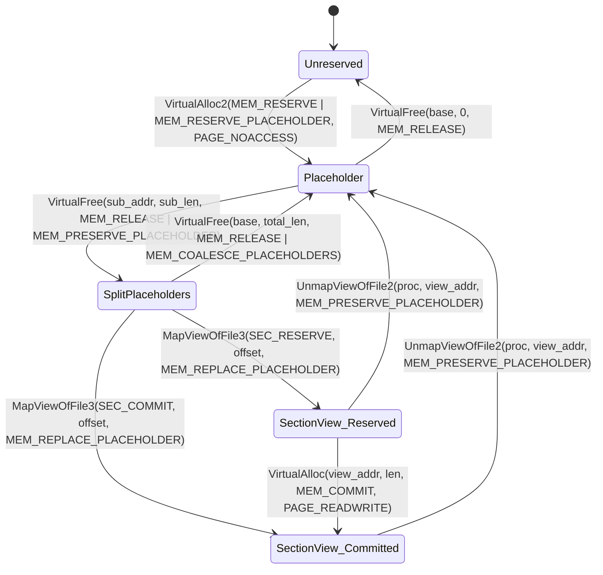
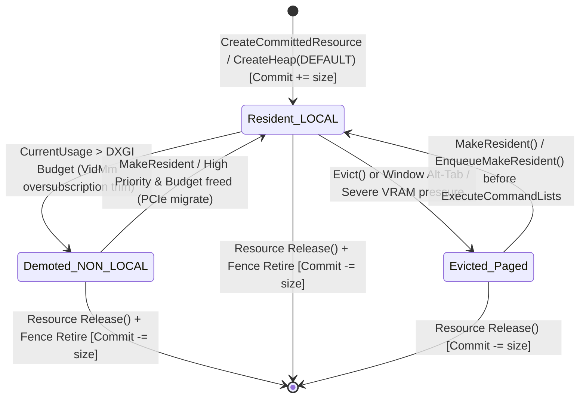

# Chapter 04 — Zero-Copy and Memory Mapping on Windows: From Shadow Copies to Address-Preserving GPU Backings

## 4.1 The Zero-Copy Paradox on Discrete Windows GPUs

Xbox Series consoles are built around physical memory symmetry. On Xbox Series S, CPU and GPU share a single 10 GB pool of unified GDDR6 (8 GB at 224 GB/s and 2 GB at 56 GB/s, with ~7.6 GiB / 7,776 MiB exposed to titles in standard mode as modeled in [`console.rs:25`](file:///E:/Projetos/VIctory/crates/victory-gpu/src/console.rs#L25)) [41]. Every virtual pointer handed by the title to D3D12.X—whether a vertex buffer, an indirect argument array, a constant buffer, a descriptor slot, or a streamed texture pool—resolves through a unified SoC memory controller without copying bytes between address spaces.

When VIctory statically recompiles a 2026 open-world title built for this hardware and executes it on a discrete Windows PC (**Intel Core i5-10400F, 32 GB DDR4, NVIDIA RTX 3080 10 GB GDDR6X, PCIe 3.0/4.0**), that assumption breaks across both software semantics and physical bus topology. In our measured world-frame baseline running the **Series S profile (`1280x720` internal resolution)**, VIctory's `Meter` telemetry ([`host.rs:1761-1768`](file:///E:/Projetos/VIctory/crates/victory-gpu/src/host.rs#L1761-L1768)) records approximately **`1,890 ms/frame`** (~0.5 fps):

- **CPU `preparing`: `~860 ms`** — comprising **`~440 ms` copying `~270 MB`** of buffer ranges, **`~140 ms` checking/detiling `~475 MB`** of textures, and **`~280 ms` of unattributed submission-thread overhead** (range merging, `VirtualQuery` walks, `before` snapshot allocations, descriptor mirroring, and lock contention).
- **GPU execution: `~700 ms`** — lockstep waits after every command-list submission on a single host `DIRECT` queue, with every title buffer residing in PCIe-crossed system memory and 430 untranslated shaders leaving lighting and compositing passes dropped (G-buffer geometry renders while the final presented image remains black).
- **Copy-back (GPU → CPU title memory): `~330 ms`** — scanning and merging **`~12 MB`** of GPU UAV outputs back into title virtual memory.

An earlier measured baseline under the **Series X profile (`3840x2160` fixed DXGI mode in [`dxgi.rs:246`](file:///E:/Projetos/VIctory/crates/victory-gpu/src/dxgi.rs#L246))** recorded an even steeper `~2,800 ms/frame` (`~810 ms` preparing: `~380 ms` for `~170 MB` buffer copies, `~170 ms` for `~540 MB` textures, `~260 ms` unattributed; `~1,600 ms` GPU; `~360 ms` copying back `~13 MB`; `~450` untranslated shaders), exacerbated by overflowing the RTX 3080's 10 GB VRAM into WDDM host paging (`~13.5 GiB` Series X budget vs. ~8.5–9.0 GB usable local VRAM after Desktop Window Manager overhead).

On first inspection, a natural engineering reaction is to eliminate VIctory's shadow buffers (`Shadow` in [`shadow.rs`](file:///E:/Projetos/VIctory/crates/victory-gpu/src/shadow.rs)) altogether via Windows zero-copy primitives such as `ID3D12Device3::OpenExistingHeapFromAddress` [1], `ID3D12Device3::OpenExistingHeapFromFileMapping` [2], or Vulkan's `VK_EXT_external_memory_host` [4]. If the Windows GPU can map the title's process pages directly into its GPU page tables, `440 ms` of buffer copies and `330 ms` of copy-back should vanish to zero.

That intuition captures only half of the physics. As Gregg and Hazelwood established in their analysis of discrete CPU–GPU systems [49], and as Jablin et al. [50], Lustig and Martonosi [51], Agarwal et al. [54], and Veselý et al. [56] demonstrated across discrete and heterogeneous architectures, **address-space unification is not bandwidth unification**. Removing shadow copies eliminates the CPU software-coherence tax (`~770 ms` combined between `copies`, `copying back`, and snapshot preparation in our Series S measurement), but on a discrete PCIe GPU it still leaves every vertex fetch, constant load, structured buffer read, and UAV write traversing the PCIe root complex rather than local GDDR6X.

```
[Console Hardware: Xbox Series S UMA]
  Zen 2 CPU (8C) ──┐
                   ├──► Coherent SoC Fabric ──► 10 GB Unified GDDR6 (224 GB/s + 56 GB/s)
  RDNA2 GPU (20CU) ┘    (Same physical pages; 0 copies, 0 PCIe crossings)

[VIctory Current Baseline on Discrete PC]
  Title RAM (DDR4) ──► ReadProcessMemory() ──► CUSTOM Heap (L0 WRITE_BACK) ──► PCIe 3.0 (~12 GB/s) ──► RTX 3080
         ▲                                                                                                 │
         └──────────── WriteProcessMemory() + 64 KiB 3-way diff ◄── PCIe Snoop ◄───────────────────────────┘
  (Pays BOTH CPU copy/syscall/diff tax AND PCIe GPU bandwidth tax)

[Pure Host Zero-Copy (OpenExistingHeapFromAddress / FileMapping)]
  Title RAM (DDR4) ──► WDDM VidMm Pin/GART ──► PCIe 3.0 (~12 GB/s) ──► RTX 3080
  (0 CPU copies, 0 copy-back; still throttled to PCIe 3.0 instead of 760 GB/s GDDR6X; high commit lock)

[Tiered Hybrid (DEFAULT L1 VRAM + Persistent UPLOAD / ReBAR GPU_UPLOAD + Selective Zero-Copy)]
  Hot GPU Buffers:  Title RAM ──► 64B hash / WriteWatch ──► UPLOAD Ring / GPU_UPLOAD (ReBAR) ──► L1 GDDR6X (760 GB/s)
  Aliased Targets:  GPU-only RT/DS/UAV ──► CreateReservedResource (64 KiB VRAM tiles) ──────────► L1 GDDR6X (760 GB/s)
  Coherent Ring:    Fences / Counters / Small CPU-read UAVs ──► OpenExistingHeapFromAddress ────► L0 WRITE_BACK (Zero-copy)
```

### 4.1.1 Separating the Two Impedances in VIctory's Memory Path

To design an optimal Windows memory layer for VIctory, we must decouple two costs that VIctory's current [`shadow.rs`](file:///E:/Projetos/VIctory/crates/victory-gpu/src/shadow.rs) and [`host.rs`](file:///E:/Projetos/VIctory/crates/victory-gpu/src/host.rs) implementation conflates:

| Cost Dimension | Measured Baseline (Series S, `1280x720`) | Exact VIctory Cause (`file:line`) | Physical / OS Bottleneck | Solved by Pure Zero-Copy (`L0`)? | Solved by VRAM Migration (`L1`) + Direct Sync? |
| :--- | :--- | :--- | :--- | :--- | :--- |
| **Upload copy rate (`~270 MB` in `~440 ms` = `~614 MB/s`)** | `~440 ms` (`copies`) | [`Batch::add`](file:///E:/Projetos/VIctory/crates/victory-gpu/src/host.rs#L1323-L1333) `[min, max]` union explosion; [`Shadow::writing`](file:///E:/Projetos/VIctory/crates/victory-gpu/src/shadow.rs#L151-L181) full snapshots; [`read()`](file:///E:/Projetos/VIctory/crates/victory-gpu/src/host.rs#L1424-L1431) calling `ReadProcessMemory`; [`watch::guard`](file:///E:/Projetos/VIctory/crates/victory-gpu/src/watch.rs#L125-L156) VEH traps on `MEM_MAPPED` | Kernel transitions per 64 KiB run + PCIe cache-line invalidation on `WRITE_BACK` `L0` shadow destination | **Yes** (`0 ms` buffer copies) | **Mostly** (`< 5–12 ms` via SEH `memcpy` + 64B chunk hashing into `UPLOAD` / `GPU_UPLOAD`) |
| **Copy-back rate (`~12 MB` in `~330 ms` = `~36 MB/s`)** | `~330 ms` (`copying back`) | [`Host::execute`](file:///E:/Projetos/VIctory/crates/victory-gpu/src/host.rs#L629-L648) runs eager [`Shadow::copy_back`](file:///E:/Projetos/VIctory/crates/victory-gpu/src/shadow.rs#L190-L260) over whole union spans; reads `L0` PCIe-snooped `self.data`, runs `ReadProcessMemory` + 3-way byte loop + `WriteProcessMemory` | CPU uncached/snooped PCIe reads of GPU-written `L0` pages + kernel syscalls across dozens of MB per submit | **Yes** (`0 ms` CPU copy-back, though CPU reads still traverse PCIe snoop/DDR4) | **Mostly** (`< 2–10 ms` via lazy/classified `READBACK` only for CPU-consumed UAVs) |
| **Unattributed prepare overhead (`~280 ms`)** | `~280 ms` (`cpu - copy_ms - texture_ms`) | `VirtualQuery` walks ([`texture.rs:316-331`](file:///E:/Projetos/VIctory/crates/victory-gpu/src/texture.rs#L316-L331)), `before` vector cloning/reallocation (~2.3M faults noted in [`shadow.rs:149-150`](file:///E:/Projetos/VIctory/crates/victory-gpu/src/shadow.rs#L149-L150)), `TablePlan::Fresh` CBV staging (`256 B` alignment padding in [`draw.rs:1162-1169`](file:///E:/Projetos/VIctory/crates/victory-gpu/src/draw.rs#L1162-L1169)) | Page-table kernel queries, heap churn, per-draw descriptor validation | **Partially** (removes `before` snapshots; CBV 256B padding and descriptor mirroring remain unless shaders read raw `mem`!) | **Partially** (removes `before` cloning if replaced by 64B chunk hashes; descriptor mirroring addressed separately) |
| **Shader buffer bandwidth (`~700 ms` GPU share)** | Portion of `~700 ms` GPU | [`Host::shared_buffer`](file:///E:/Projetos/VIctory/crates/victory-gpu/src/host.rs#L2170-L2216) forces *every* title buffer (`vertex`, `index`, `CBV`, `SRV`, `UAV`, `indirect`) into `D3D12_MEMORY_POOL_L0` | PCIe 3.0 x16 on i5-10400F (`~15.75 GB/s` raw, `~12–13 GB/s` sustained bidirectional) vs. RTX 3080 `760 GB/s` GDDR6X (**~58x slower bandwidth**, ~10x higher latency) | **No — preserves or worsens PCIe bottleneck!** | **Yes** (moves hot buffers into `L1` `760 GB/s` GDDR6X) |
| **VRAM & Windows commit budgets** | Process commit spikes & WDDM eviction risk | Dual copies (`Title RAM` + `Shadow L0` + `before` + `Staging` + `DEFAULT` textures); [`LOOSE`](file:///E:/Projetos/VIctory/crates/victory-gpu/src/shadow.rs#L479-L500) & [`PLACED_TEXTURES`](file:///E:/Projetos/VIctory/crates/victory-gpu/src/resource.rs#L1464-L1495) never free | Windows `CommitLimit` exhaustion (error 1455, [`xmem.rs:745-781`](file:///E:/Projetos/VIctory/crates/victory-hle/src/modules/xmem.rs#L745-L781)) & RTX 3080 10 GB VRAM ceiling | **Worse for commit** (`OpenExistingHeapFrom*` locks `SEC_COMMIT` upfront unless chunked!) | **Yes** (reserved 64 KiB VRAM pools + sparse commit prevent double/triple commit) |

Notice the decisive engineering tension on the test PC: the Intel Core i5-10400F (Comet Lake-S, 2020) provides **PCIe 3.0 x16** from the CPU root complex (`16 lanes * 8 GT/s * 128/130 encoding = 15.754 GB/s` theoretical per direction; practical sustained D3D12 copy throughput is typically `~11–13 GB/s`). Meanwhile, the RTX 3080's 320-bit GDDR6X subsystem delivers **`760 GB/s`** locally. Even on a PCIe 4.0 x16 host (`~25–28 GB/s` sustained), a memory-bound G-buffer, skinning, culling, or RT denoising shader reading vertices, matrices, or G-buffer/clustered-light structures from `L0` system memory experiences a **27x to 60x bandwidth cliff** and microsecond-scale PCIe round-trip stalls whenever L2 texture caches miss.

Consequently, **zero-copy on Windows discrete GPUs is not a monolithic binary choice between "all shadow copies" and "all `OpenExistingHeapFromAddress`."** The real engineering task is mapping *each* Windows memory primitive—`VirtualAlloc2` placeholders, `OpenExistingHeapFromAddress`, `OpenExistingHeapFromFileMapping`, `VK_EXT_external_memory_host`, `CUSTOM` `L0`/`L1` heaps, `D3D12_HEAP_TYPE_GPU_UPLOAD` over Resizable BAR, `CreateReservedResource` + `UpdateTileMappings`, and shader-side software page tables—onto the exact console access pattern where its hardware trade-off wins, while rigorously respecting WDDM residency and Windows commit limits.

---

## 4.2 Windows Virtual Memory Mechanics: `VirtualAlloc2`, Placeholders, and Physical-Page Aliasing

Before examining D3D12 and Vulkan GPU heap mappings, we must establish what Windows actually allows in user-mode virtual address space (`ntoskrnl` Virtual Address Descriptors and Section Objects), because **every GPU zero-copy mechanism inherits the constraints of the underlying Win32 memory allocation**.

### 4.2.1 Pages, Granularity, and Title-Managed Physical Memory on Xbox Series

Xbox Series consoles expose two physical page sizes to titles via GDK `XMemVirtualAlloc` and `XMemAllocatePhysicalPages`: **64 KiB (`65,536` bytes)** and **2 MiB (`2,097,152` bytes)**, alongside legacy 4 KiB software definitions (`xmem.rs:54-60, 343, 451`). Crucially, modern open-world console engines do not simply call `malloc` or `CreateCommittedResource`. They implement **title-managed virtual memory**:

1. **Pool physical allocation:** The title calls `XMemAllocatePhysicalPages` once or in large batches (for example, [`xmem.rs:402-403`](file:///E:/Projetos/VIctory/crates/victory-hle/src/modules/xmem.rs#L402-L403) documents that the 2026 open-world title requests **6.1 GiB** of physical pages at once) and receives opaque physical page numbers. As recorded in [`xmem.rs:448-451`](file:///E:/Projetos/VIctory/crates/victory-hle/src/modules/xmem.rs#L448-L451), console page numbers index 4 KiB frames, so 64 KiB physical page handles are multiples of 16 (`FRAMES = 16`), which the title packs into 21 bits (`number >> 4`) and unpacks with `<< 4` (supporting up to 128 GiB of physical address space).
2. **Sparse virtual reservation:** The title reserves large virtual address spans (often `6–16 GiB`, constrained to 40-bit addresses `< 2^40` so GPU descriptors and RT structures fit in console 40-bit pointers, [`xmem.rs:71-85`](file:///E:/Projetos/VIctory/crates/victory-hle/src/modules/xmem.rs#L71-L85), [`device.rs:256`](file:///E:/Projetos/VIctory/crates/victory-gpu/src/device.rs#L256)) using `XMemVirtualAlloc(..., MEM_RESERVE | PAGES_64K, ...)` without backing physical memory.
3. **Dynamic mapping and aliasing:** Streaming workers decompress assets into temporary pool views (`XMemMapPhysicalPages` / `XMemMapPhysicalPagesScatter`), while the GPU queue remaps those exact physical pages into tiled heaps or sparse textures via `CopyPageMappingsBatchX` ([`queue.rs:383-428`](file:///E:/Projetos/VIctory/crates/victory-gpu/src/queue.rs#L383-L428)). The same physical 64 KiB frame can appear simultaneously at two virtual addresses (aliasing), or move across virtual addresses without copying a single byte.

Standard Win32 `VirtualAlloc` cannot express this. Private memory allocated with `VirtualAlloc(MEM_RESERVE)` belongs strictly to one virtual address range (`VAD`); two `VirtualAlloc` ranges cannot alias the same physical page, and calling `MapViewOfFile` requires an unallocated gap in the process VAD tree—creating a well-known multi-threaded race condition if another thread calls `VirtualAlloc` or `LoadLibrary` between `VirtualFree` and `MapViewOfFile`.

### 4.2.2 `VirtualAlloc2`, Placeholders, and `MapViewOfFile3`

Windows 10 (RS4 / 1803+) introduced **virtual memory placeholders** specifically to make virtual address reservation atomic, splittable, coalescable, and replaceable by file-mapping sections [24, 25, 26, 27]:

1. **Placeholder reservation (`VirtualAlloc2`) [24]:**
   Calling `VirtualAlloc2` with `AllocationType = MEM_RESERVE | MEM_RESERVE_PLACEHOLDER` (`0x2000 | 0x40000`) and `PageProtection = PAGE_NOACCESS` carves out a contiguous range in the process VAD tree without allocating page-table commit or physical pages. Unlike plain `VirtualAlloc`, `VirtualAlloc2` accepts an array of `MEM_EXTENDED_PARAMETER` structures—specifically `MemExtendedParameterAddressRequirements`, allowing VIctory (`xmem.rs:95-155`) to enforce `[1 << 32, (1 << 40) - 1]` 40-bit address bounds (`LowestStartingAddress`, `HighestEndingAddress`) and power-of-two alignments (`2 MiB` for `PAGES_2M`, `64 KiB` minimum system allocation granularity otherwise) without trial-and-error probing loops.
2. **Splitting and preserving placeholders (`VirtualFree`) [27]:**
   A single placeholder cannot be partially replaced by a smaller section view. Before mapping a `64 KiB` or `N * 64 KiB` slice into the middle of a `6 GiB` reservation, the runtime must split the placeholder around `[base, base + len)` by calling `VirtualFree(base, len, MEM_RELEASE | MEM_PRESERVE_PLACEHOLDER)` [27] (as VIctory does at [`xmem.rs:698-702`](file:///E:/Projetos/VIctory/crates/victory-hle/src/modules/xmem.rs#L698-L702)). This splits the VAD node at exact `64 KiB` boundaries—splitting off leading and trailing placeholder VADs if `[base, base + len)` sits strictly inside an existing placeholder. Note a critical Win32 invariant: **`len` and `base` must align to the OS allocation granularity (`64 KiB`, `SYSTEM_INFO::dwAllocationGranularity`)**, NOT the `4 KiB` hardware page size [24, 27]. Coalescing adjacent placeholders back into a single range requires `VirtualFree(base, total_len, MEM_RELEASE | MEM_COALESCE_PLACEHOLDERS)`.
3. **Atomic section replacement (`MapViewOfFile3` & `UnmapViewOfFile2`) [25, 26]:**
   `MapViewOfFile3(..., BaseAddress, Offset, ViewSize, MEM_REPLACE_PLACEHOLDER, PAGE_READWRITE, ...)` [25] atomically swaps the placeholder VAD for a mapped view of a Section object (`CreateFileMappingW`) [28] at the exact requested virtual address (`Offset` must also be a multiple of the `64 KiB` allocation granularity). Crucially, multiple `MapViewOfFile3` calls against the same Section offset at different placeholder addresses create **true hardware CPU virtual-to-physical aliasing** via Windows prototype PTEs (`MMVAD` shared subsections). When the title unmaps pages, `UnmapViewOfFile2(GetCurrentProcess(), view, MEM_PRESERVE_PLACEHOLDER)` [26] atomically unmaps the view and restores the `PAGE_NOACCESS` placeholder VAD so no concurrent thread can steal the virtual address hole ([`xmem.rs:812-818`](file:///E:/Projetos/VIctory/crates/victory-hle/src/modules/xmem.rs#L812-L818)).

```
Placeholder VAD lifecycle (64 KiB granularity) inside VIctory's xmem.rs:

Initial reservation (VirtualAlloc2 MEM_RESERVE | MEM_RESERVE_PLACEHOLDER):
[ 0x10_0000_0000 ────────────── 6 GiB Placeholder VAD (PAGE_NOACCESS) ────────────── ]

Split via VirtualFree(addr, 64 KiB, MEM_RELEASE | MEM_PRESERVE_PLACEHOLDER):
[ Placeholder A ][ 64 KiB Hole/PH B ][               Placeholder C                   ]

Replace via MapViewOfFile3(section, offset=K*64K, MEM_REPLACE_PLACEHOLDER):
[ Placeholder A ][ Mapped View B (RW) ][             Placeholder C                   ]
                        │
                        └─► Points to Prototype PTEs of Section S at offset K*64K
                            (Another MapViewOfFile3 at addr2 aliases the same RAM!)

Unmap via UnmapViewOfFile2(proc, addr, MEM_PRESERVE_PLACEHOLDER):
[ Placeholder A ][    Placeholder B    ][             Placeholder C                   ]
```

### 4.2.3 `SEC_RESERVE` vs. `SEC_COMMIT`, Write-Watch Incompatibility, and Syscall Costs

While placeholders solve virtual aliasing on the CPU, they introduce three structural interactions that directly affect VIctory's performance and D3D12 zero-copy eligibility:

1. **`SEC_RESERVE` vs. `SEC_COMMIT` deferred commit accounting [28]:**
   When creating an anonymous pagefile-backed section with `CreateFileMappingW(INVALID_HANDLE_VALUE, ...)` [28], passing `SEC_COMMIT` immediately charges Windows' system-wide `CommitTotal` for the entire `size` (causing a 6.1 GiB commit spike even if the title initially maps only 1 GiB). Passing `SEC_RESERVE` creates the section with **zero** upfront commit charge; pages only count against the commit limit once mapped into a view and committed via `VirtualAlloc(view_base, len, MEM_COMMIT, PAGE_READWRITE)` ([`xmem.rs:413, 736-743`](file:///E:/Projetos/VIctory/crates/victory-hle/src/modules/xmem.rs#L413)). Note, however, that once a view commits offset `k` of a `SEC_RESERVE` section, that commit remains charged on the section object until the section handle closes (`Drop for Section` at [`xmem.rs:352-357`](file:///E:/Projetos/VIctory/crates/victory-hle/src/modules/xmem.rs#L352-L357)), even after `UnmapViewOfFile2` unmaps individual views! On Wine, VIctory explicitly switches to `SEC_COMMIT` (`xmem.rs:409-413`) because Wine implements sections as sparse files where per-page `VirtualAlloc(MEM_COMMIT)` triggers `O(N)` `wineserver` range-list scans.
2. **Incompatibility with `MEM_WRITE_WATCH` (`GetWriteWatch`) [24]:**
   Windows only supports `MEM_WRITE_WATCH` (`0x20_0000`) on **private committed allocations** created with `VirtualAlloc` / `VirtualAlloc2` (`MEM_PRIVATE`). It explicitly rejects `MEM_WRITE_WATCH` combined with `MEM_RESERVE_PLACEHOLDER` (`xmem.rs:133-137`) and `GetWriteWatch` returns an error (`-1` / non-zero) on `MEM_MAPPED` file-mapping views (`watch.rs:9-19, 73-79`). As a direct consequence, VIctory's [`texture.rs:194`](file:///E:/Projetos/VIctory/crates/victory-gpu/src/texture.rs#L194) receives `None` from `watch::writes(start, start + size, false)` for every texture residing in `XMemMapPhysicalPages` pools and falls back to `VirtualQuery` + whole-texture `blake3::hash(tiled)` (`texture.rs:208-231`), driving the measured `~140 ms` / `~475 MB/frame` texture check bottleneck! Similarly, [`shadow.rs:302-318`](file:///E:/Projetos/VIctory/crates/victory-gpu/src/shadow.rs#L302-L318) passes `guarded = true`, which triggers `watch::guard()` (`PAGE_READONLY` + `VirtualProtect` + `AddVectoredExceptionHandler` exceptions at [`watch.rs:125-270`](file:///E:/Projetos/VIctory/crates/victory-gpu/src/watch.rs#L125-L270)) whenever a shadowed buffer lives in `MEM_MAPPED` physical-page views.
3. **TLB shootdowns and VAD fragmentation overhead:**
   Every `MapViewOfFile3` / `UnmapViewOfFile2` call mutates the process VAD tree under the process address-space lock, and `UnmapViewOfFile2` issues **cross-core IPI TLB shootdowns** across all 12 logical CPUs of the i5-10400F. Notice how XCL documented (`xcl_h3.md:1744-1745`) that reserving/unmapping physical homes page-by-page cost **`20 s` at startup**, whereas batching consecutive runs (`256 MB` at a time, or VIctory's `runs()` coalescing in [`xmem.rs:516-534, 612-624`](file:///E:/Projetos/VIctory/crates/victory-hle/src/modules/xmem.rs#L516-L534)) slashes VAD churn. Meanwhile, [`map_alias`](file:///E:/Projetos/VIctory/crates/victory-hle/src/modules/xmem.rs#L663-L689) still maps **page by page** (`(0..len).step_by(PAGE)`) when handling `CopyPageMappingsBatchX`, creating thousands of individual 64 KiB VAD entries (`physical.views`) whenever the title scatters or streams pages into a tiled heap!

### 4.2.4 Placeholder State Machine and Run-Coalesced `map_alias` Design

The Windows Memory Manager tracks virtual placeholders, mapped views, and private allocations inside the per-process VAD (Virtual Address Descriptor) AVL tree. Every illegal transition—such as splitting a view that has already been replaced, mapping across two uncoalesced adjacent placeholders, or passing a non-64 KiB offset—fails deterministically with `ERROR_INVALID_PARAMETER` or `ERROR_INVALID_ADDRESS` [24, 25, 27].



Note two subtle engineering invariants exposed by that state machine:
1. **Placeholder Coalescing Requirement (`MEM_COALESCE_PLACEHOLDERS`):** Suppose a title maps 16 individual `64 KiB` pages into a `1 MiB` pool reservation via `XMemMapPhysicalPagesScatter`, later unmaps them one by one via `UnmapViewOfFile2(..., MEM_PRESERVE_PLACEHOLDER)` (`xmem.rs:812-818`), and then attempts to map a single contiguous `1 MiB` `MapViewOfFile3` slice across the whole range. Without coalescing those 16 adjacent `64 KiB` placeholders back into one `1 MiB` placeholder via `VirtualFree(base, 1 << 20, MEM_RELEASE | MEM_COALESCE_PLACEHOLDERS)` [27], `MapViewOfFile3` will fail because `ViewSize` cannot span multiple placeholder VADs! VIctory's `map()` (`xmem.rs:698-702`) splits on entry, and `unmap()` (`xmem.rs:785-828`) preserves each individual view's bounds—meaning fragmented unmaps silently prevent future contiguous multi-page views unless `unmap()` coalesces neighboring restored placeholders!
2. **Coalescing `map_alias` for `CopyPageMappingsBatchX` (`xmem.rs:663-689`):** Today `map_alias` iterates `for k in (0..len).step_by(PAGE)`, calling `VirtualFree` + `MapViewOfFile3` + `VirtualAlloc` + `title_memory_remapped` separately on every single `64 KiB` page. When `CopyPageMappingsBatchX` (`queue.rs:383-428`) streams a `16 MiB` texture (`256` pages) from a contiguous physical pool, `map_alias` executes **`768` Win32 memory syscalls** and spawns **`256` separate VAD nodes**, whereas coalescing contiguous `(section, slice_index)` runs collapses that entire `16 MiB` map into **`1` `MapViewOfFile3` call**!

```rust
// Coalesced replacement for `xmem::map_alias` (`xmem.rs:663-689`) + placeholder coalescing:
pub fn map_alias_coalesced(to: u64, from: u64, len: u64) -> bool {
    let (to, from, len) = (to as usize, from as usize, len as usize);
    let mut physical = physical();
    unmap_and_coalesce(&mut physical, to, len);
    if from == 0 || len == 0 {
        return true;
    }
    // Group consecutive 64 KiB source pages that belong to the same underlying Section run.
    let mut k = 0usize;
    while k < len {
        let first = match lookup_slice(&physical, from + k) {
            Some(s) => s,
            None => return false,
        };
        let mut run_len = PAGE;
        while k + run_len < len {
            let Some(next) = lookup_slice(&physical, from + k + run_len) else {
                break;
            };
            if Arc::ptr_eq(&first.section, &next.section)
                && next.index == first.index + (run_len / PAGE)
            {
                run_len += PAGE;
            } else {
                break;
            }
        }
        if !map(&mut physical, to + k, run_len, first) {
            return false;
        }
        k += run_len;
    }
    true
}
```

---

## 4.3 Direct Host-Memory Wrapping in D3D12: `OpenExistingHeapFromAddress` and `OpenExistingHeapFromFileMapping`

To give the host GPU direct access to title-owned system RAM without manual shadow copies, Direct3D 12 provides two methods on `ID3D12Device3` (introduced in Windows 10 Fall Creators Update / WDDM 2.3) [1, 2, 3]:

- `ID3D12Device3::OpenExistingHeapFromAddress(const void *pAddress, REFIID riid, void **ppvHeap)` [1]
- `ID3D12Device3::OpenExistingHeapFromFileMapping(HANDLE hFileMapping, REFIID riid, void **ppvHeap)` [2]

### 4.3.1 Official Semantics vs. Undocumented Practical Constraints

Officially, Microsoft Learn documents both methods as creating *"a special-purpose diagnostic heap in system memory"* that persists across `DEVICE_REMOVED` / GPU fault events so crash telemetry can be inspected [1, 2]. Under the hood, the D3D12 runtime and WDDM Kernel Mode Driver (KMD) ask `VidMm` to map the process's existing CPU virtual allocation (or section object) directly into the GPU's `L0` (`D3D12_MEMORY_POOL_L0`, `D3D12_CPU_PAGE_PROPERTY_WRITE_BACK`) aperture via the GPU IOMMU / GART page tables [1, 5, 7, 8, 20]. Crucially, Microsoft Learn notes that the resulting `ID3D12Heap` is orthogonal for `CreatePlacedResource` and `CreateReservedResource` tile mappings within driver/flag constraints [1, 35].

However, empirical validation—both from Microsoft's remarks ("wraps the entire `VirtualAlloc` region" [1]) and XCL's extensive Windows 11 hardware probing (`tests/heap_probe.rs` and `gpu/uma.rs` in `xcl_h3.md:140-148, 1066-1084, 1620-1622, 1641-1656`)—exposes **six hard constraints** that govern whether `OpenExistingHeapFrom*` can be used in a console recompiler:

1. **Full commitment is mandatory (no sparse `MEM_RESERVE`):**
   - `OpenExistingHeapFromAddress` inspects the entire `VirtualAlloc` allocation base wrapping `pAddress` and **fails on partially committed allocations** (`xcl_h3.md:141-142`: *"a partial commit is rejected"*). Every single byte of that `VirtualAlloc` region must be `MEM_COMMIT` (`PAGE_READWRITE`) at the time the heap is opened.
   - `OpenExistingHeapFromFileMapping` exhibits the symmetric rule on Win32 sections: **`SEC_COMMIT` sections succeed** (GPU reads CPU writes and CPU observes GPU writes coherently), whereas **`SEC_RESERVE` sections fail with `E_INVALIDARG` even if 100% of pages have been mapped and committed via `MapViewOfFile3` + `VirtualAlloc(MEM_COMMIT)`** (`xcl_h3.md:1642-1645`).
2. **Sub-4 GiB ceiling per heap (`<= 4095 MiB`):**
   XCL measured empirically (`xcl_h3.md:141-142`) that passing a `4 GiB` (`4096 MiB`) committed `VirtualAlloc` region to `OpenExistingHeapFromAddress` is rejected by D3D12, whereas **`4095 MiB` (`4,293,918,720` bytes) succeeds in `~0.5 s`**. Combined with HLSL `ByteAddressBuffer::Load(uint)` taking a 32-bit byte offset (`4 GiB - 4` max addressable span), any title allocation exceeding `4095 MiB` must be partitioned across multiple heaps.
3. **Incompatible with `CreateReservedResource` tile mappings on file-mapped heaps:**
   In XCL's `tests/heap_probe.rs` (`xcl_h3.md:1620-1622`), mapping tiles of a `CreateReservedResource` buffer (`UpdateTileMappings`) onto `ID3D12Heap`s created via `OpenExistingHeapFromFileMapping` **caused `DXGI_ERROR_DEVICE_REMOVED` / GPU hang** (*"tiles mapped onto heaps opened from file mappings removed the device (do not try again)"*). By contrast, mapping reserved buffer tiles onto standard `DEFAULT` VRAM heaps worked across an entire `4 GiB` window.
4. **Inability to host console-swizzled textures zero-copy:**
   Even if a console texture sits in a `VirtualAlloc` region opened via `OpenExistingHeapFromAddress`, desktop D3D12 hardware cannot sample or render to Xbox Series GFX10 `_S`/`_D`/`_R`/`_Z`/`_X` swizzle modes directly: both VIctory (`device.rs:257`) and XCL (`xcl_h3.md:247`) confirm `StandardSwizzle64KBSupported = 0` on tested PC adapters (NVIDIA and AMD RDNA4). Placed `D3D12_RESOURCE_DIMENSION_BUFFER` resources on `OpenExistingHeapFrom*` work cleanly (`xcl_h3.md:498-503`); textures still require detiling and `DEFAULT` VRAM placement (or compute detiling from an `L0`/upload buffer).
5. **Alignment and `CreatePlacedResource` offsets:**
   Buffers placed onto an `OpenExistingHeapFromAddress` heap via `ID3D12Device::CreatePlacedResource` [35] require **`64 KiB` (`D3D12_DEFAULT_RESOURCE_PLACEMENT_ALIGNMENT`)** offset alignment [17] (`xcl_h3.md:499`). Because `OpenExistingHeapFromAddress` wraps the *base* of the `VirtualAlloc` region (which Win32 already aligns to `64 KiB`), placing a single full-region buffer at heap offset `0` yields `GPUVA_base`, and every title pointer `addr` inside `[base, base + size)` maps to `placed_buffer_gpu_va + (addr - base)`.
6. **`MEM_WRITE_WATCH` coexistence:**
   XCL proved (`xcl_h3.md:684-685`) that `OpenExistingHeapFromAddress` **accepts `VirtualAlloc` regions created with `MEM_WRITE_WATCH`**. This enables hybrid architectures where a zero-copy heap lets GPU compute/vertex shaders read title buffers directly over PCIe *while* `GetWriteWatch` detects which `64 KiB` texture pages in the same memory window were modified by the CPU so they can be re-detiled to `DEFAULT` VRAM! Beware one critical interaction: if the GPU writes to `OpenExistingHeapFromAddress` memory via a UAV, the CPU's `MEM_WRITE_WATCH` dirty bits are **not** set by PCIe DMA writes (only CPU virtual writes via the x86 MMU mark `MEM_WRITE_WATCH` PTEs).

### 4.3.2 How XCL Used `OpenExistingHeapFrom*` — and Why XCL Had to Retreat From Pure Zero-Copy

XCL's evolution documented in `xcl_h3.md` provides an invaluable real-world controlled experiment across four architectures:

- **Stage 1 (Single 4095 MiB UMA window, `xcl_h3.md:140-148`):** Allocate `2048–4095 MiB` at a `4 GiB`-aligned base via `VirtualAlloc2(..., MEM_RESERVE | MEM_COMMIT | MEM_WRITE_WATCH)` and open it once with `OpenExistingHeapFromAddress` + a single placed `ALLOW_UNORDERED_ACCESS` buffer (`u2 mem`). Because the base is `4 GiB`-aligned, the low 32 bits of any console CPU pointer equal the byte offset inside `mem`!
- **Stage 2 (4 × 4095 MiB multi-window UMA, `xcl_h3.md:1066-1084`):** Because Xbox Series X titles use up to `~13.5 GiB`, XCL placed up to 4 windows at `base + k * 4 GiB` (`16 GiB`-aligned), binding `u2..u5`. However, two regressions immediately surfaced:
  1. Every shader access had to `switch ((addr >> 32) & 3)` across `mem0..mem3`, which **nearly doubled DXC + driver shader compile times** (`22.5 s → 41.6 s` on a 21,000-instruction CS, `xcl_h3.md:1778-1780`).
  2. Committing 8–16 GiB upfront pushed total process commit past Windows limits (`28.7 GB` commit on retail bring-up, `xcl_h3.md:1740-1743`).
- **Stage 3 (Hybrid sparse VRAM windows + `DEFAULT` tiled targets, `xcl_h3.md:1614-1622, 1785-1794`):** XCL kept only Window 0 (which fits 32-bit console heaps/descriptors) as a coherent `OpenExistingHeapFromAddress` region (`cache/uma_coherent.txt` auto-sized), moved Windows 1–3 (`12 GiB` sparse pools) onto **`DEFAULT` VRAM `CreateReservedResource` buffers** synced via `GetWriteWatch` + **64-byte chunk hashing** (`~0.8 ms` scan + `~0.3 ms` upload at ~800 submits/s, `xcl_h3.md:1441-1442, 1618` as referenced in `agy_dossie.md:47`), and moved aliased RT/DS/UAV textures onto `64 KiB` tiled VRAM heaps (`vram.rs`, slashing `15 GB` of union arenas down to `3.2 GB`).
- **Stage 4 (Placeholder + `OpenExistingHeapFromFileMapping` + shader page table, `xcl_h3.md:1641-1656`):** To handle arbitrary scattered title reservations without committing gigabytes upfront, XCL validated splitting `VirtualAlloc2` `MEM_RESERVE_PLACEHOLDER` blocks into `2 MiB` chunks backed by `SEC_COMMIT` `CreateFileMappingW` sections opened individually via `OpenExistingHeapFromFileMapping` (Section 4.8).

### 4.3.3 Applying `OpenExistingHeapFrom*` Directly to VIctory

How does `OpenExistingHeapFrom*` map onto **VIctory's** architecture—which, unlike XCL, does **not** route every memory access through a monolithic `RWByteAddressBuffer mem` (`u2`)?

Inspecting VIctory's [`victory-shader/src/emit/mod.rs:28-72`](file:///E:/Projetos/VIctory/crates/victory-shader/src/emit/mod.rs#L28-L72) and [`draw.rs:634-792`](file:///E:/Projetos/VIctory/crates/victory-gpu/src/draw.rs#L634-L792) reveals a major structural advantage for VIctory:

1. VIctory already emits **native per-resource D3D12 bindings**: Root CBVs/SRVs/UAVs (`b<i>`/`t<i>`/`u<i>` in `ROOT_CBV_SPACE` and `CONST_VIEW_SPACE`), `ResourceDescriptorHeap[]` descriptors (`MirrorCache` in [`descriptor/host.rs:50-224`](file:///E:/Projetos/VIctory/crates/victory-gpu/src/descriptor/host.rs#L50-L224)), and standard `IASetVertexBuffers` / `IASetIndexBuffer` (`draw.rs:464-503`).
2. Whenever a title buffer is created (`CreateCommittedResource`, `CreatePlacedResource`, `CreatePlacedResourceX` / `create_at_address` at [`resource.rs:1413-1454`](file:///E:/Projetos/VIctory/crates/victory-gpu/src/resource.rs#L1413-L1454)), VIctory tracks `(address, len)` in `shadow::BUFFERS` ([`shadow.rs:374-441`](file:///E:/Projetos/VIctory/crates/victory-gpu/src/shadow.rs#L374-L441)) or `shadow::LOOSE` (`4 MiB` windows at [`shadow.rs:476-500`](file:///E:/Projetos/VIctory/crates/victory-gpu/src/shadow.rs#L476-L500)), and allocates a `CUSTOM WRITE_BACK L0` shadow buffer (`Host::shared_buffer` at [`host.rs:2170-2216`](file:///E:/Projetos/VIctory/crates/victory-gpu/src/host.rs#L2170-L2216)).

Notice the absurdity of what VIctory does right now: **`Host::shared_buffer` creates a `CUSTOM WRITE_BACK L0` resource in system RAM and copies title system RAM into it!** Both the source (title memory) and the destination (`Shadow::buffer`) reside in **the exact same DDR4 physical bank (`L0`)**! Yet VIctory burns `~440 ms/frame` (`copies`) and `~330 ms/frame` (`copying back`) manually copying bytes between two `L0 WRITE_BACK` allocations in the same process!

Look at what happens in two specific cases if VIctory replaces `Host::shared_buffer` (`CUSTOM L0`) with `OpenExistingHeapFromAddress` / `OpenExistingHeapFromFileMapping` on the title's own allocations:

- **Case 1 (Private `VirtualAlloc` / `XMemVirtualAlloc` regions — e.g., title's `174 MB` GPU heap noted in [`shadow.rs:148`](file:///E:/Projetos/VIctory/crates/victory-gpu/src/shadow.rs#L148)):**
  If VIctory commits the title's `VirtualAlloc` pool (or sub-allocates title `XMemAlloc` / `CreateHeap` buffers inside a `<= 4095 MiB` `MEM_COMMIT` `VirtualAlloc2` arena), calling `ID3D12Device3::OpenExistingHeapFromAddress` **once** at arena creation yields a host `ID3D12Heap` + a placed `ID3D12Resource` covering `[arena_base, arena_base + arena_len)` at zero extra commit and zero copies! Every `Shadow::gpu(address)` call simply returns `arena_gpu_va + (address - arena_base)`, and `Shadow::refresh`, `Shadow::writing`, `Shadow::update`, and `Shadow::copy_back` become **complete no-ops** for buffers in that arena.
- **Case 2 (Arbitrary `alloc_zeroed` / `Memory::new` heaps at [`resource.rs:938-954`](file:///E:/Projetos/VIctory/crates/victory-gpu/src/resource.rs#L938-L954) or `XMemAllocDefault` at [`xmem.rs:279-310`](file:///E:/Projetos/VIctory/crates/victory-hle/src/modules/xmem.rs#L279-L310)):**
  Today `Memory::new` uses Rust's `std::alloc::alloc_zeroed`, which places allocations onto the Windows CRT heap (`HeapAlloc`)—a shared heap containing small metadata headers and arbitrary uncommitted/partial guard structures, which **cannot** be safely wrapped as a whole region by `OpenExistingHeapFromAddress` (and lands above `2^40`, triggering warnings at [`resource.rs:1613-1623`](file:///E:/Projetos/VIctory/crates/victory-gpu/src/resource.rs#L1613-L1623)!). Routing `CreateHeap`, `Memory::for_resource`, and `XMemAllocDefault` through a `<= 4095 MiB` dedicated `VirtualAlloc2` sub-allocator below `2^40` instantly makes *every* committed title heap/resource zero-copy-capable without changing a single line of title code.

**However—and this is the trap VIctory must avoid—making all 7.6 GiB zero-copy in `L0` still caps RTX 3080 shader throughput at PCIe 3.0 speeds (~12 GB/s)!** Let us verify the arithmetic:
- Under `Shadow` (`CUSTOM L0`) today, GPU execution takes `~700 ms` on Series S (`1280x720`) and `~1,600 ms` on Series X (`3840x2160`). While lockstep submission, global UAV barriers (`list.rs:344`), Wave64 LDS emulation (`lower.rs:1851-1925`), and fake `1 << 20` occlusion queries (`list.rs:906-907`) account for a substantial portion of that GPU time, every single vertex, index, CBV, and UAV access currently crosses PCIe 3.0.
- Switching from `Shadow` (`CUSTOM L0`) to `OpenExistingHeapFromAddress` (`L0`) **saves `~440 ms` copies + `~330 ms` copy-back + `~150–200 ms` snapshot/VirtualQuery prepare = `~900+ ms/frame`**, cutting `1,890 ms` roughly in half (`~950 ms`), *but* the GPU still reads `L0` over PCIe 3.0! Furthermore, if the title's `6.1 GiB` physical page pool (`xmem.rs:402-403`) uses `SEC_RESERVE`, `OpenExistingHeapFromFileMapping` rejects it unless changed to `SEC_COMMIT` chunks, locking huge Windows commit.
- Therefore, **pure `OpenExistingHeapFrom*` is the wrong global default for an RTX 3080**, though it is an **ideal zero-cost mechanism for small, CPU-GPU ping-ponged regions** (command/indirect readback counters, query resolution buffers, bottom-of-pipe `Written` markers at [`queue.rs:187-217`](file:///E:/Projetos/VIctory/crates/victory-gpu/src/queue.rs#L187-L217), and small dynamic constant rings on systems without Resizable BAR) and a **strictly superior fallback compared to `Host::shared_buffer` whenever a buffer *must* stay in `L0`**!

```rust
// Worked Rust/D3D12 sketch: Opening a 4095 MiB committed VirtualAlloc2 arena via
// ID3D12Device3::OpenExistingHeapFromAddress (for small L0 coherent ring or L0 fallback).
unsafe fn open_existing_l0_arena(
    device3: &ID3D12Device3,
    size: usize, // must be <= 4095 * 1024 * 1024 and 64 KiB aligned
) -> Result<(ID3D12Heap, ID3D12Resource, *mut u8, u64), windows::core::Error> {
    assert!(size <= (4095 << 20) && size % (64 << 10) == 0);
    // Must be fully committed upfront; partial commit causes OpenExistingHeapFromAddress to fail.
    let mut req = MEM_ADDRESS_REQUIREMENTS {
        LowestStartingAddress: (1usize << 32) as *mut c_void,
        HighestEndingAddress: ((1usize << 40) - 1) as *mut c_void,
        Alignment: 64 << 10,
    };
    let mut ext = MEM_EXTENDED_PARAMETER::default();
    ext.Anonymous1._bitfield = MemExtendedParameterAddressRequirements as u64;
    ext.Anonymous2.Pointer = (&raw mut req).cast();
    let cpu_ptr = VirtualAlloc2(
        GetCurrentProcess(),
        std::ptr::null(),
        size,
        MEM_RESERVE | MEM_COMMIT | MEM_WRITE_WATCH, // Write-watch allowed alongside OpenExistingHeapFromAddress!
        PAGE_READWRITE,
        &mut ext,
        1,
    ) as *mut u8;
    if cpu_ptr.is_null() {
        return Err(windows::core::Error::from_thread());
    }
    let mut heap: Option<ID3D12Heap> = None;
    device3.OpenExistingHeapFromAddress(cpu_ptr.cast(), &mut heap)?;
    let heap = heap.unwrap();
    // Place one spanning buffer at offset 0 so any VA `p` in [cpu_ptr, cpu_ptr + size)
    // maps to GPU VA = gpu_base + (p - cpu_ptr).
    let desc = D3D12_RESOURCE_DESC {
        Dimension: D3D12_RESOURCE_DIMENSION_BUFFER,
        Alignment: D3D12_DEFAULT_RESOURCE_PLACEMENT_ALIGNMENT as u64, // 64 KiB
        Width: size as u64,
        Height: 1, DepthOrArraySize: 1, MipLevels: 1,
        SampleDesc: DXGI_SAMPLE_DESC { Count: 1, Quality: 0 },
        Layout: D3D12_TEXTURE_LAYOUT_ROW_MAJOR,
        Flags: D3D12_RESOURCE_FLAG_ALLOW_UNORDERED_ACCESS,
        ..Default::default()
    };
    let mut buffer: Option<ID3D12Resource> = None;
    device3.CreatePlacedResource(
        &heap, 0, &desc, D3D12_RESOURCE_STATE_COMMON, None, &mut buffer,
    )?;
    let buffer = buffer.unwrap();
    let gpu_va = buffer.GetGPUVirtualAddress();
    Ok((heap, buffer, cpu_ptr, gpu_va))
}
```

---

## 4.4 Cross-API Host Mapping: `VK_EXT_external_memory_host` and Lessons from Emulators/Translation Layers

Direct3D 12 is not the only API on Windows that can map user-mode pointers into GPU page tables. Vulkan standardizes this capability through **`VK_EXT_external_memory_host`** [4], providing a revealing contrast in API design, granularity, and driver behavior across NVIDIA, AMD, Wine, VKD3D-Proton, RPCS3, and Xenia.

### 4.4.1 Mechanics of `VK_EXT_external_memory_host`

Unlike D3D12's `ID3D12Device3::OpenExistingHeapFromAddress` (which wraps an *entire* `VirtualAlloc` region and hides its alignment/memory-type guarantees behind heuristic `HRESULT` failures), `VK_EXT_external_memory_host` [4] makes constraints explicit through three core interfaces:

1. **Device Alignment Limit (`VkPhysicalDeviceExternalMemoryHostPropertiesEXT`):**
   Querying `vkGetPhysicalDeviceProperties2` returns `minImportedHostPointerAlignment`, which specifies the strict power-of-two byte alignment required for both the host pointer address and the imported memory size (`allocationSize`) [4]. On Windows WDDM Vulkan drivers (NVIDIA, AMD, and Intel), `minImportedHostPointerAlignment` is typically **`4096` bytes** (matching the x86-64 OS hardware page size) or **`65,536` bytes** (matching Win32 allocation granularity, depending on GPU page-table constraints).
2. **Per-Pointer Memory-Type Validation (`vkGetMemoryHostPointerPropertiesEXT`):**
   Before calling `vkAllocateMemory`, the application invokes `vkGetMemoryHostPointerPropertiesEXT(device, handleType, pHostPointer, &props)` [4]. The driver returns `props.memoryTypeBits`—a bitmask indicating *which* Vulkan memory types can legally back that specific host address.
   - `VK_EXTERNAL_MEMORY_HANDLE_TYPE_HOST_ALLOCATION_BIT_EXT`: Standard CPU allocations (`VirtualAlloc`, `_aligned_malloc`, `mmap`), where the memory resides in system RAM [4].
   - `VK_EXTERNAL_MEMORY_HANDLE_TYPE_HOST_MAPPED_FOREIGN_MEMORY_BIT_EXT`: Foreign device/MMIO mappings already mapped into the host CPU virtual address space [4].
3. **Import (`VkImportMemoryHostPointerInfoEXT`):**
   Chaining `VkImportMemoryHostPointerInfoEXT` onto `VkMemoryAllocateInfo::pNext` during `vkAllocateMemory` binds `[pHostPointer, pHostPointer + allocationSize)` into a `VkDeviceMemory` handle [4]. Importantly, the application must keep the host virtual range valid and committed until `vkFreeMemory` completes after all GPU command buffers referencing it have retired [4].

#### Worked Vulkan Host-Pointer Import & Non-Coherent Cache Maintenance

Unlike D3D12's opaque `OpenExistingHeapFromAddress` (which silently forces `L0 WRITE_BACK` cacheability), Vulkan requires the application to inspect `memoryTypeBits` returned by `vkGetMemoryHostPointerPropertiesEXT` and verify whether the chosen memory type carries `VK_MEMORY_PROPERTY_HOST_COHERENT_BIT` [4, 16]:

```c
// Query alignment + import an aligned title allocation in Vulkan via VK_EXT_external_memory_host
VkPhysicalDeviceExternalMemoryHostPropertiesEXT hostProps = {
    .sType = VK_STRUCTURE_TYPE_PHYSICAL_DEVICE_EXTERNAL_MEMORY_HOST_PROPERTIES_EXT
};
VkPhysicalDeviceProperties2 props2 = {
    .sType = VK_STRUCTURE_TYPE_PHYSICAL_DEVICE_PROPERTIES_2,
    .pNext = &hostProps
};
vkGetPhysicalDeviceProperties2(physDev, &props2);
const VkDeviceSize align = hostProps.minImportedHostPointerAlignment; // 4096 or 65536 on WDDM

// Validate pointer & obtain compatible memoryTypeBits
VkMemoryHostPointerPropertiesEXT ptrProps = {
    .sType = VK_STRUCTURE_TYPE_MEMORY_HOST_POINTER_PROPERTIES_EXT
};
vkGetMemoryHostPointerPropertiesEXT(
    device, VK_EXTERNAL_MEMORY_HANDLE_TYPE_HOST_ALLOCATION_BIT_EXT, titlePtr, &ptrProps);

uint32_t memTypeIdx = findMemoryType(
    memProps, ptrProps.memoryTypeBits,
    VK_MEMORY_PROPERTY_HOST_VISIBLE_BIT | VK_MEMORY_PROPERTY_HOST_CACHED_BIT);

VkImportMemoryHostPointerInfoEXT importInfo = {
    .sType = VK_STRUCTURE_TYPE_IMPORT_MEMORY_HOST_POINTER_INFO_EXT,
    .handleType = VK_EXTERNAL_MEMORY_HANDLE_TYPE_HOST_ALLOCATION_BIT_EXT,
    .pHostPointer = titlePtr
};
VkMemoryAllocateInfo allocInfo = {
    .sType = VK_STRUCTURE_TYPE_MEMORY_ALLOCATE_INFO,
    .pNext = &importInfo,
    .allocationSize = alignedSize, // Must be multiple of `align`
    .memoryTypeIndex = memTypeIdx
};
VkDeviceMemory hostMem = VK_NULL_HANDLE;
vkAllocateMemory(device, &allocInfo, NULL, &hostMem);
vkBindBufferMemory(device, vkBuffer, hostMem, 0);
```

Notice two critical Vulkan details that clarify why `VK_EXT_external_memory_host` is not a magic zero-cost fix on discrete Windows GPUs [4, 16]:
- **Non-coherent cache maintenance (`nonCoherentAtomSize`):** If the driver selects a `HOST_VISIBLE | HOST_CACHED` memory type *without* `VK_MEMORY_PROPERTY_HOST_COHERENT_BIT`, CPU writes to `titlePtr` are not automatically visible to GPU reads until `vkFlushMappedMemoryRanges` runs on ranges aligned to `VkPhysicalDeviceLimits::nonCoherentAtomSize` (typically 64–256 bytes), and GPU writes are not reliably visible to CPU reads until `vkInvalidateMappedMemoryRanges` executes after fence completion. Even when `HOST_COHERENT_BIT` *is* set (standard on desktop NVIDIA/AMD WDDM drivers via PCIe snooping), hardware cache-line invalidation on the CPU still pays PCIe snoop latency whenever the CPU polls GPU-written memory.
- **No `DEVICE_LOCAL` shortcut on discrete GPUs:** On an RTX 3080, `ptrProps.memoryTypeBits` strictly masks *out* `DEVICE_LOCAL`-only VRAM heaps (`L1`), exposing only system-RAM GART types (`L0`) [4, 16]. Thus, even if VIctory ran on Vulkan, wrapping the title's 7.6 GiB memory via `VK_EXT_external_memory_host` would still throttle RTX 3080 shaders to PCIe 3.0 speeds (~12 GB/s) unless paired with explicit `vkCmdCopyBuffer` staging into `DEVICE_LOCAL` (`L1`) buffers!

### 4.4.2 Comparison: D3D12 `OpenExistingHeapFrom*` vs. Vulkan `VK_EXT_external_memory_host`

| Property / Constraint | D3D12 `OpenExistingHeapFromAddress` [1] | D3D12 `OpenExistingHeapFromFileMapping` [2] | Vulkan `VK_EXT_external_memory_host` [4] |
| :--- | :--- | :--- | :--- |
| **Granularity & Alignment** | Wraps **entire** `VirtualAlloc` allocation (`64 KiB` base alignment) [1] | Section size/view multiple of `64 KiB` (`SEC_COMMIT` required in practice; `xcl_h3.md:1642`) | Arbitrary sub-range aligned to `minImportedHostPointerAlignment` (`4 KiB` or `64 KiB` per driver) [4] |
| **Partial Commit Tolerance** | Rejected (all pages in `VirtualAlloc` region must be `MEM_COMMIT`; `xcl_h3.md:142`) | `SEC_RESERVE` rejected even when mapped pages are committed (`xcl_h3.md:1643`) | Requires all imported bytes `[ptr, ptr+size)` to be validly mapped/accessible at import & use [4] |
| **Max Allocation Size** | Empirically **`4095 MiB`** (`4 GiB` rejected on tested Windows 11/RDNA4 setup; `xcl_h3.md:141-142`) | Limited by section/heap limits (`< 4 GiB` safe per heap) | Subject to `VkPhysicalDeviceMaintenance3Properties::maxMemoryAllocationSize` (typically 2–4 GiB per `VkDeviceMemory` on WDDM) |
| **Resulting Memory Pool / Coherency** | `CUSTOM` `L0` `WRITE_BACK` (CPU/GPU coherent via PCIe snoop) | `CUSTOM` `L0` `WRITE_BACK` | Driver-chosen `memoryTypeBits` (`HOST_VISIBLE`, never pure `DEVICE_LOCAL` on dGPU; may be `HOST_COHERENT` or require `vkFlush`/`vkInvalidate`) [4, 16] |
| **Tiled / Sparse Residency Interop** | Works for `CreatePlacedResource`; not recommended for cross-process/sparse aliases | **Caused `DEVICE_REMOVED`** when mapped into `CreateReservedResource` tiles (`xcl_h3.md:1621-1622`) | Separate `VkDeviceMemory` per sparse bind; `VK_KHR_sparse_memory_binding` binds `VkDeviceMemory` tiles explicitly [36, 37] |
| **Texture Support** | Buffers only for console layouts (`StandardSwizzle64KBSupported = 0`) | Buffers only for console layouts | Linear images only (`VK_IMAGE_TILING_LINEAR`); console tiled textures still require detile |

### 4.4.3 Lessons from Xenia, RPCS3, Wine, and VKD3D-Proton

Production emulators and translation layers provide decades of field evidence on why host-memory wrapping works well for some workloads and fails for others:

- **Xenia (Xbox 360, 512 MB unified GDDR3) [44]:** Xenia reserves the Xbox 360's 32-bit virtual address space on the host and uses `VirtualProtect` page-fault write-tracking (`SharedMemory`) to upload dirty 4 KiB/64 KiB ranges into D3D12/Vulkan buffers in **`DEVICE_LOCAL` / `DEFAULT` VRAM** (`d3d12_shared_memory` / Vulkan shared memory), while using D3D12 tiled resources (`d3d12_tiled_shared_memory`) or `ByteAddressBuffer` / ROVs to handle EDRAM and sparse texture backing [44]. Xenia deliberately avoids running shaders directly out of `L0` host memory on discrete GPUs because Xbox 360 games repeatedly sample large vertex/index/texture pools whose PCIe latency would cripple GPU occupancy.
- **RPCS3 (PlayStation 3, 256 MB XDR main RAM + 256 MB RSX GDDR3 VRAM) [45]:** RPCS3 mirrors PS3 main memory in host RAM with OS page protection tracking (`vm.cpp`, `ranged_storage`, `VKTextureCache.cpp`) and maps RSX I/O (`sys_rsx_context_iomap`) via `VK_EXT_external_memory_host` where supported or persistent ring staging buffers into `DEVICE_LOCAL` VRAM [45]. When `VK_EXT_external_memory_host` is available, RPCS3 uses it selectively to avoid extra CPU-side staging copies on `rsx` DMA readbacks and CPU-written ring data, while keeping hot render targets and geometry caches in `DEVICE_LOCAL` VRAM.
- **Wine (`winevulkan`) and VKD3D-Proton [42, 43]:** In Wine's Vulkan thunk (`dlls/winevulkan/vulkan_driver.h`) [43], host pointer imports bridge Win32 allocations across the Wine/Linux boundary, while VKD3D-Proton [42] translates D3D12 heaps onto Vulkan memory types. Crucially, when VKD3D-Proton originally mapped `D3D12_HEAP_TYPE_UPLOAD` aggressively onto `DEVICE_LOCAL | HOST_VISIBLE` (Resizable BAR) memory, real-world D3D12 titles hit VRAM exhaustion or PCIe read stalls when titles misbehaved—leading VKD3D-Proton to expose `VKD3D_CONFIG=no_upload_hvv` to force `UPLOAD` heaps back to system RAM [42]!

**What this means for VIctory:** VIctory's codebase (`victory-shader` + `victory-gpu`) directly emits **SM 6.6 DXIL** (`victory-shader/src/emit/bitcode.rs`) and targets host D3D12 (`windows::Win32::Graphics::Direct3D12`). Rewriting VIctory's entire shader emitter (`victory-shader`) to SPIR-V solely to obtain Vulkan's `4 KiB`-aligned `VK_EXT_external_memory_host` [4] would take months of engineering while **still failing to solve the discrete RTX 3080 PCIe bandwidth bottleneck**, because `VK_EXT_external_memory_host` on an RTX 3080 still binds to `HOST_VISIBLE` DDR4 memory over PCIe 3.0! The only exception where `VK_EXT_external_memory_host` excels over D3D12 is when sub-64 KiB (`4 KiB`) host pointers from standard allocators (`HeapAlloc` / `malloc`) must be imported zero-copy on a Vulkan-native stack (or on unified-memory APUs, examined in Chapter 09). On Windows D3D12, VIctory can achieve superior throughput by combining `DEFAULT` (`L1`), `GPU_UPLOAD` (ReBAR), and selective `OpenExistingHeapFromAddress` without changing APIs.


---

## 4.5 D3D12 Memory Pools, `CUSTOM` Heaps (`L0`/`L1`, `WRITE_BACK`/`WRITE_COMBINE`), and `D3D12_HEAP_TYPE_GPU_UPLOAD` + Resizable BAR

Understanding why VIctory's current `shared_buffer` (`host.rs:2170-2216`) performs poorly on an RTX 3080—and how to place data at full GDDR6X speed—requires examining how Direct3D 12 models physical memory pools, CPU cache attributes, and PCIe Base Address Registers (BARs).

### 4.5.1 `L0` vs. `L1` and `WRITE_BACK` vs. `WRITE_COMBINE` vs. `NOT_AVAILABLE`

In Direct3D 12, `D3D12_HEAP_PROPERTIES` [5] exposes two orthogonal axes for `D3D12_HEAP_TYPE_CUSTOM` heaps [6]:

1. **Physical Pool (`D3D12_MEMORY_POOL`) [7]:**
   - **`D3D12_MEMORY_POOL_L0`:** System RAM (DDR4 on our test PC), accessed directly by CPU cores via the integrated memory controller (~40 GB/s dual-channel DDR4 on i5-10400F) and by the discrete GPU across the PCIe bus (`~15.75 GB/s` theoretical per direction on PCIe 3.0 x16). On integrated UMA GPUs, `L0` is the *only* pool (`L1` does not exist).
   - **`D3D12_MEMORY_POOL_L1`:** Discrete GPU video memory (10 GB GDDR6X at **760 GB/s** on RTX 3080). Under standard non-ReBAR PCIe configurations, only a tiny `256 MiB` window of `L1` is mapped into the CPU's physical address space; the bulk of `L1` is CPU-inaccessible (`D3D12_CPU_PAGE_PROPERTY_NOT_AVAILABLE`) [8, 11, 14].
2. **CPU Page Property (`D3D12_CPU_PAGE_PROPERTY`) [8]:**
   - **`D3D12_CPU_PAGE_PROPERTY_NOT_AVAILABLE`:** CPU cannot call `ID3D12Resource::Map` to obtain a valid host pointer. Standard **`D3D12_HEAP_TYPE_DEFAULT`** maps to `(L1, NOT_AVAILABLE)` on discrete GPUs [5, 7, 8, 9].
   - **`D3D12_CPU_PAGE_PROPERTY_WRITE_BACK` (`WB`):** CPU virtual pages map as normal cacheable write-back RAM (residing in x86 L1d/L2/L3 caches). Reads and random writes from the CPU run at cache speed (~10–80 GB/s), and hardware PCIe snooping maintains cache coherence when the GPU reads or writes those addresses—**at a severe cost**: every GPU read across PCIe snoops CPU caches (potentially forcing cache-line writebacks), and every GPU write invalidates CPU cache lines, forcing subsequent CPU reads (such as VIctory's `Shadow::copy_back` scan in [`shadow.rs:214`](file:///E:/Projetos/VIctory/crates/victory-gpu/src/shadow.rs#L214)) to stall across PCIe/memory-controller snoop transactions [5, 8, 16]. Standard **`D3D12_HEAP_TYPE_READBACK`** maps to `(L0, WRITE_BACK)`.
   - **`D3D12_CPU_PAGE_PROPERTY_WRITE_COMBINE` (`WC`):** CPU virtual pages map with x86 PAT `WC` (Write-Combining) memory typing, **bypassing CPU L1/L2/L3 caches completely** [8, 14, 16]. Sequential 64-byte CPU stores coalesce inside hardware Write-Combining Buffers (WCBs) and flush as burst PCIe or DRAM transactions at `~10–25 GB/s` without polluting CPU caches or requiring PCIe snoop traffic when the GPU later reads them [14, 16]. **The hazard:** CPU reads from `WRITE_COMBINE` memory are uncached, serialized, single-word transactions that flush WCBs and run at **`~10–50 MB/s`**—roughly 1,000x slower than cached RAM reads [14, 16]. Standard **`D3D12_HEAP_TYPE_UPLOAD`** maps to `(L0, WRITE_COMBINE)`.

| Heap Type / Custom Config | `D3D12_MEMORY_POOL` | `D3D12_CPU_PAGE_PROPERTY` | CPU Sequential Write | CPU Read | GPU Shader Read/Write Bandwidth (RTX 3080 / i5-10400F) | Ideal Role in VIctory |
| :--- | :--- | :--- | :--- | :--- | :--- | :--- |
| **`DEFAULT`** [6] | `L1` (VRAM) | `NOT_AVAILABLE` | Forbidden (no `Map`) | Forbidden | **`760 GB/s`** (GDDR6X) | All hot static/streamed VBs, IBs, SRVs, UAVs, RT/DS targets |
| **`UPLOAD`** [6] | `L0` (DDR4) | `WRITE_COMBINE` | Fast (`~15–25 GB/s`, streaming WC) | **Fatal (`~10–50 MB/s`)** | `~11–13 GB/s` (PCIe 3.0 x16) | Persistent ring staging for dirty chunks copied to `DEFAULT` |
| **`READBACK`** [6] | `L0` (DDR4) | `WRITE_BACK` | Slow/unused (`COPY_DEST` only) | **Fast (`~15–40 GB/s` cached)** | `~11–13 GB/s` (PCIe DMA copy) | Lazy/explicit GPU-to-CPU UAV/query readbacks |
| **`CUSTOM` (`L0`, `WRITE_BACK`)** [5, 7, 8] *(VIctory's current [`shared_buffer`](file:///E:/Projetos/VIctory/crates/victory-gpu/src/host.rs#L2170-L2216))* | `L0` (DDR4) | `WRITE_BACK` | Cached (`~15–30 GB/s`, pollutes L3) | Cached when clean; **slow after GPU write** (PCIe snoop invalidation) | **`~11–13 GB/s` (PCIe 3.0 x16!)** | **Anti-pattern for hot GPU buffers!** Only appropriate for small coherent rings (`OpenExistingHeapFromAddress`) |
| **`GPU_UPLOAD` (ReBAR)** [6, 11, 14] | `L1` (VRAM via BAR) | `WRITE_COMBINE` | Fast (`~11–13 GB/s` PCIe 3.0 burst) | **Fatal (`~10–50 MB/s` over PCIe!)** | **`760 GB/s`** (GDDR6X!) | Direct CPU-to-VRAM dirty-chunk writes without staging `CopyBufferRegion` (when ReBAR is active!) |
| **`CUSTOM` (`L1`, `WRITE_COMBINE`)** | `L1` (VRAM via BAR) | `WRITE_COMBINE` | Same as `GPU_UPLOAD` (requires ReBAR / custom-capable adapter) | **Fatal** | **`760 GB/s`** | Equivalent to `GPU_UPLOAD`; `GPU_UPLOAD` via Agility SDK is cleaner and portable across iGPUs [11] |

### 4.5.2 What VIctory Tells the Title vs. What VIctory Allocates on the Host

A subtle asymmetry lives inside VIctory's own device emulation:
- **Title-facing emulation (`device.rs`, `resource.rs`):** In [`device.rs:297-305`](file:///E:/Projetos/VIctory/crates/victory-gpu/src/device.rs#L297-L305), VIctory answers `D3D12_FEATURE_DATA_ARCHITECTURE` [10] with `[0, 1, 1]` (`TileBasedRenderer = FALSE`, `UMA = TRUE`, `CacheCoherentUMA = TRUE`), and in [`resource.rs:1577-1605`](file:///E:/Projetos/VIctory/crates/victory-gpu/src/resource.rs#L1577-L1605), `GetCustomHeapProperties` [9] returns `CUSTOM + L0 + WRITE_BACK` for `UPLOAD` and `READBACK` (`NOT_AVAILABLE` for `DEFAULT`). That is completely accurate for the console's own API contract—it stops the title from creating redundant PC-style staging chains when running on the console codepath.
- **Host-facing allocation (`host.rs:2170-2216`):** Unfortunately, VIctory mirrors *every* title buffer (`vertex`, `index`, `CBV`, `SRV`, `UAV`, `indirect`) using `Host::shared_buffer` (`CUSTOM`, `WRITE_BACK`, `L0`). As documented directly in [`host.rs:2166-2169`](file:///E:/Projetos/VIctory/crates/victory-gpu/src/host.rs#L2166-L2169): *"A buffer in system memory that the CPU maps (write-back, so reading it is fast too) and shaders read and write: for host copies of title memory that shaders write, which upload memory cannot be."* Because `Shadow` combines CPU-side inspection (`Shadow::writing` and `Shadow::copy_back`), GPU shader reads, and GPU shader UAV writes onto a single D3D12 resource, `Host::shared_buffer` forced every buffer into the lowest-common-denominator pool: **`L0` system RAM over PCIe**.

Look at the double penalty this exact choice imposes on `Shadow::writing` ([`shadow.rs:151-181`](file:///E:/Projetos/VIctory/crates/victory-gpu/src/shadow.rs#L151-L181)) and `Shadow::copy_back` ([`shadow.rs:190-260`](file:///E:/Projetos/VIctory/crates/victory-gpu/src/shadow.rs#L190-L260)):
1. When the GPU executes a UAV write into `shadow.buffer` (`L0 WRITE_BACK`), PCIe write transactions snoop-invalidate those cache lines in the i5-10400F's L1/L2/L3 caches.
2. Immediately after `WaitForSingleObject` ([`host.rs:587`](file:///E:/Projetos/VIctory/crates/victory-gpu/src/host.rs#L587)), `Shadow::copy_back` reads `self.data` (`shadow.buffer`) sequentially in 64 KiB `PIECE`s (`host != old`, [`shadow.rs:214`](file:///E:/Projetos/VIctory/crates/victory-gpu/src/shadow.rs#L214)) AND `Shadow::writing` clones `self.data` into `before` ([`shadow.rs:170-180`](file:///E:/Projetos/VIctory/crates/victory-gpu/src/shadow.rs#L170-L180)). Every line touched by the GPU now misses all CPU caches!
3. Meanwhile, during GPU execution, every draw/dispatch reading vertex buffers, index buffers, root/table CBVs, and structured/raw buffers pulls data across PCIe 3.0 at `~12 GB/s` instead of RTX 3080 GDDR6X's `760 GB/s`.

### 4.5.3 `D3D12_HEAP_TYPE_GPU_UPLOAD`, Resizable BAR, and the Agility SDK

To bridge CPU write convenience with `760 GB/s` `L1` GPU read bandwidth on discrete GPUs, Microsoft introduced **`D3D12_HEAP_TYPE_GPU_UPLOAD`** (`enum value 5`) in the DirectX 12 Agility SDK (`1.710.0-preview` in March 2023, subsequently promoted to retail Agility SDK 1.610+) [6, 11, 12, 13].

**Hardware & OS Mechanism (`GPUUploadHeaps.md` [11], Sawicki [14], NVIDIA [18]):**
1. Traditionally, x86-64 BIOS/UEFI assigned discrete GPUs a `256 MiB` PCIe Base Address Register (`BAR1`) aperture because legacy 32-bit operating systems lacked physical address space above 4 GB. Only `256 MiB` of VRAM could be CPU-mapped at any instant [11, 14].
2. With **Resizable BAR (ReBAR)** / AMD **Smart Access Memory (SAM)** enabled in BIOS (*Above 4G Decoding* + *Resizable BAR Support*) and WDDM 2.0+ support, the PCIe root complex negotiates a BAR spanning the entire local VRAM (`10 GB` on RTX 3080, requiring a VBIOS update on early RTX 3080 cards and motherboard BIOS support on Comet Lake Z490/B460 boards) [11, 18].
3. When ReBAR is active, Windows WDDM exposes `D3D12_FEATURE_DATA_D3D12_OPTIONS16::GPUUploadHeapSupported == TRUE` [11, 12]. On discrete GPUs, `D3D12_HEAP_TYPE_GPU_UPLOAD` allocates directly inside **`D3D12_MEMORY_POOL_L1` with `D3D12_CPU_PAGE_PROPERTY_WRITE_COMBINE`** (and on UMA iGPUs, automatically falls back to `L0` so developers use one codepath) [11].
4. **Bandwidth Elimination:** Instead of writing dirty CPU bytes into an `UPLOAD` staging buffer (`L0 WC`) and submitting a `CopyBufferRegion` command (`L0 -> L1` over PCIe), the CPU calls `Map()` on the `GPU_UPLOAD` resource and writes dirty 64-byte chunks directly across the PCIe BAR into `L1` GDDR6X. Shaders subsequently read those buffers at **full `760 GB/s` GDDR6X bandwidth** with zero staging buffers and zero copy-queue passes [11, 14]!

**Four Critical Pitfalls of `D3D12_HEAP_TYPE_GPU_UPLOAD` for VIctory:**

1. **Absence of Inbox Windows D3D12 Support (Requires Agility SDK Integration):**
   Inspecting [`Cargo.toml`](file:///E:/Projetos/VIctory/Cargo.toml) and [`host.rs:178-189`](file:///E:/Projetos/VIctory/crates/victory-gpu/src/host.rs#L178-L189) confirms VIctory currently calls inbox `D3D12CreateDevice` (`windows` crate 0.62.2) without bundling `D3D12Core.dll` or exporting `D3D12SDKVersion` / `D3D12SDKPath` (or calling `ID3D12SDKConfiguration1::CreateDeviceFactory`) [13]. As XCL PR #75 (`xcl_h3.md:823-828`) demonstrated, adopting the Agility SDK in a Rust recompiler is clean via `ID3D12SDKConfiguration1::CreateDeviceFactory`, provided any hook layers handle Agility `1.620+` swapping command-list vtables on `Close`/`Reset`. (Note: in VIctory, host command lists are wrapped inside `HostList` in [`host.rs:313-345`](file:///E:/Projetos/VIctory/crates/victory-gpu/src/host.rs#L313-L345), not exposed raw to title code, so Agility SDK vtable swaps do not break VIctory's title vtables!)
2. **256 MiB BAR Exhaustion & BIOS Dependency (`i5-10400F` Caveat):**
   On Comet Lake (10th Gen) systems like our i5-10400F test machine, ReBAR is frequently **disabled by default** in motherboard BIOSes—and even when enabled, D3D12 allows `GPUUploadHeapSupported` to report `FALSE` if ReBAR is off, or caps CPU-visible VRAM at ~210–240 MiB usable inside a 256 MiB BAR [11, 14]. Worse, as `VKD3D-Proton` discovered with its `HOST_VISIBLE | DEVICE_LOCAL` upload path (prompting the `VKD3D_CONFIG=no_upload_hvv` escape hatch [42]), allocating massive static or long-lived buffers in BAR-visible VRAM can exhaust the CPU-visible BAR segment and trigger WDDM demotion to `L0` system memory! Even Adam Sawicki's GPUOpen guide [14] explicitly warns: reserve `GPU_UPLOAD` for **dynamic CPU-written, GPU-read buffers** (constant buffers, dynamic vertex/instance streams, dirty chunk updates), keeping static/GPU-written buffers in `DEFAULT` (`L1`).
3. **Never Read or Compare `GPU_UPLOAD` Memory on the CPU (`WC` Trap):**
   Because `GPU_UPLOAD` uses `WRITE_COMBINE` (`WC`), VIctory **cannot** perform `Shadow::writing` (`before` snapshot reads) or `Shadow::copy_back` (`host != old` reads) against a `GPU_UPLOAD` pointer! Any CPU read from `GPU_UPLOAD` stalls at ~10–50 MB/s over PCIe [14, 16]. Therefore, switching to `GPU_UPLOAD` strictly requires moving dirty-diff state (e.g., 64-byte chunk hashes or `before` snapshots) into **cached DDR4 RAM** (or tracking `GetWriteWatch` on title RAM) and using **write-only sequential streaming stores** (ideally AVX2 `_mm256_stream_si256` / aligned `memcpy`) into `GPU_UPLOAD`!
4. **PIX / `D3D12_HEAP_FLAG_ALLOW_WRITE_WATCH` Hazard:**
   As Microsoft's GPU Upload Heaps specification and blog note [11, 12], automatic `ALLOW_WRITE_WATCH` tracking on `GPU_UPLOAD` heaps forces PIX/driver fallbacks to system memory (`L0`) or adds write-watch page-fault overhead. Applications wishing to remain capture-friendly should use `ID3D12ManualWriteTrackingResource::TrackWrite` when capturing, or keep `GPU_UPLOAD` buffers un-watched (since VIctory already tracks writes on *title* RAM via `GetWriteWatch` / page guards, not on the GPU heap!).

### 4.5.4 PCIe Write-Combining Physics, Agility SDK Setup, and `i5-10400F` / `RTX 3080` Realities

Why does sequential writing into `WRITE_COMBINE` (`UPLOAD` or `GPU_UPLOAD`) achieve `~11–13 GB/s` over PCIe 3.0 x16 while reading a single `uint32_t` from that same `WC` pointer collapses to **`~10–50 MB/s`** [14, 16]? The answer lies in the interaction between x86-64 Write-Combining Buffers (WCBs) and PCIe Transaction Layer Packets (TLPs):

- **Write path (`WC` burst coalescing):** When CPU code copies a 64-byte chunk sequentially (e.g., via `memcpy` / AVX2 `VMOVDQA` or non-temporal `VMOVNTDQ` stores), the Comet Lake core buffers writes inside its 64-byte Write-Combining Buffers. Once a full 64-byte cache line fills (or consecutive 64-byte lines combine up to the root complex's `MaxPayloadSize`, typically 128 B or 256 B on Intel desktop chipsets), the root complex emits a single **Memory Write (`MWr`) posted PCIe TLP** carrying 128–256 bytes of payload against ~16–24 bytes of TLP header/framing overhead (**~84–91% wire efficiency**, yielding ~12–13.5 GB/s real throughput on PCIe 3.0 x16!). Because `MWr` TLPs are *posted*, the CPU core does not wait for an acknowledgment from the RTX 3080.
- **Read path (`WC` uncached stall):** By contrast, any CPU read to `WRITE_COMBINE` memory bypasses L1/L2/L3 caches, first **flushes all pending WCBs** (serializing the store pipeline), and then emits a **non-posted Memory Read Request (`MRd`) TLP** across the PCIe root complex, stalling the CPU pipeline for **`~400–900 ns`** until the GPU returns a Completion with Data (`CplD`) TLP for just 4–8 bytes! Fetching 64 bytes one `u32` at a time via `MRd`/`CplD` drops effective bandwidth to `(4 B / ~500 ns) ≈ 8 MB/s`—literally **~1,500x slower** than cached DDR4!
- **Snoop-invalidated `L0 WRITE_BACK` reads (`Shadow::copy_back`):** On `CUSTOM L0 WRITE_BACK`, reads hit CPU caches *until* the GPU executes a PCIe `MWr` into that cache line; the root complex issues a cache-coherency snoop invalidate, turning VIctory's next `Shadow::copy_back` read (`shadow.rs:214`) into an L3 miss across DDR4 plus coherence-directory synchronization across all 6 cores.

To harness `D3D12_HEAP_TYPE_GPU_UPLOAD` safely in VIctory (`host.rs:178-190`) without breaking systems where ReBAR is disabled in BIOS, VIctory should initialize D3D12 through `ID3D12SDKConfiguration1::CreateDeviceFactory` (Agility SDK pattern [13], mirroring XCL PR #75) and gate `GPU_UPLOAD` on `OPTIONS16::GPUUploadHeapSupported` [11, 12]:

```rust
// Querying Agility SDK GPU_UPLOAD support (`D3D12_FEATURE_DATA_D3D12_OPTIONS16`) in `host.rs`
#[repr(C)]
#[derive(Default)]
struct D3D12FeatureDataOptions16 {
    dynamic_depth_bias_supported: i32, // BOOL
    gpu_upload_heap_supported: i32,    // BOOL: TRUE only when ReBAR/SAM or UMA exposes full L1/L0
}
const D3D12_FEATURE_D3D12_OPTIONS16: D3D12_FEATURE = D3D12_FEATURE(43);

unsafe fn detect_gpu_upload_support(device: &ID3D12Device) -> bool {
    let mut opts16 = D3D12FeatureDataOptions16::default();
    let ok = device
        .CheckFeatureSupport(
            D3D12_FEATURE_D3D12_OPTIONS16,
            (&raw mut opts16).cast(),
            size_of::<D3D12FeatureDataOptions16>() as u32,
        )
        .is_ok();
    ok && opts16.gpu_upload_heap_supported != 0
}
```

When `detect_gpu_upload_support` returns `false` (for example, on an i5-10400F Comet Lake board where BIOS *Resizable BAR Support* is off or an un-updated RTX 3080 VBIOS), VIctory seamlessly routes CPU-updated buffers through the `UPLOAD` ring → `DEFAULT` (`L1`) copy path (Design C). When `true`, VIctory promotes hot dynamic buffers up to a strict BAR budget cap (`<= 25%` of `LOCAL` budget) into `D3D12_HEAP_TYPE_GPU_UPLOAD` (`L1 WRITE_COMBINE`), keeping all diff digests in cached DDR4 and never calling `ReadProcessMemory` or `host != old` against the mapped BAR pointer.

---

## 4.6 WDDM Residency, `VidMm` Commit Accounting, and Windows Commit Limits

On an Xbox Series S, physical memory is static and pre-partitioned: the title owns `~7.6 GiB` (`7,776 MiB`) with zero OS preemption during gameplay (`console.rs:25`). On Windows 10/11 under WDDM 2.0+, however, **every GPU resource shares VRAM and OS commit space with DWM, drivers, background apps, and the Windows paging file** [19, 20, 23]. Ignoring WDDM residency and commit accounting leads directly to the two catastrophic failures seen during VIctory and XCL bring-up: mid-frame VRAM paging stalls (Series X on 10 GB RTX 3080) and fatal out-of-commit crashes (`ERROR_COMMITMENT_LIMIT` 1455, [`xmem.rs:745-781`](file:///E:/Projetos/VIctory/crates/victory-hle/src/modules/xmem.rs#L745-L781); `ERROR_OUTOFMEMORY` during DXC compilation, `xcl_h3.md:355-359`).

### 4.6.1 WDDM 2.0+ Explicit Residency and Segment Demotion

Under WDDM 2.0+ [19, 20], the GPU Video Memory Manager (`VidMm`) gives each D3D12 process an isolated GPU Virtual Address (`GPUVA`) space and enforces an **explicit per-device residency model** [19, 20, 22]:

- **Residency Lists (`MakeResident` / `Evict`) [19, 22]:** Created `ID3D12Heap` and committed `ID3D12Resource` objects start *resident* with reference count 1. An application can explicitly trim inactive allocations with `ID3D12Device::Evict` and fault them back asynchronously before use via `ID3D12Device::MakeResident` [22] (or `ID3D12Device3::EnqueueMakeResident` fenced onto a queue). `VidMm` guarantees that every object on a device's residency list is physically backed in its memory segment before any command list referencing it executes [19].
- **Local vs. Non-Local Segment Budgets (`IDXGIAdapter3::QueryVideoMemoryInfo`) [19, 21]:** Applications query `QueryVideoMemoryInfo(0, DXGI_MEMORY_SEGMENT_GROUP_LOCAL, &info)` (dedicated 10 GB GDDR6X on RTX 3080) and `DXGI_MEMORY_SEGMENT_GROUP_NON_LOCAL` (system DDR4 aperture) [21]. On Windows 10/11, DWM and OS processes typically reserve `~0.8–1.5 GB` of local VRAM, leaving a practical `Budget` of **`~8.5–9.0 GB`** on a 10 GB RTX 3080.
- **Silent Performance Cliff — Demotion vs. Eviction:** If VIctory's `CurrentUsage` in `LOCAL` exceeds `Budget` (which occurred under the Series X `13.5 GiB` + `4K` profile, `agy_dossie.md:15, 76`), WDDM does **not** immediately fail allocation with `E_OUTOFMEMORY`. Instead, `VidMm` silently **demotes** overflow `DEFAULT` textures and heaps into `NON_LOCAL` system memory (`L0` over PCIe!)—turning `760 GB/s` texture/render-target traffic into `~12 GB/s` PCIe stalls mid-frame—or synchronously evicts/migrates pages between `L1` and `L0` around submissions!

### 4.6.2 The Hidden Commit Charge Bomb (`CommitTotal` vs. `CommitLimit`)

Even developers familiar with VRAM budgets are frequently blindsided by **Windows Commit Charge** (`CommitTotal` vs. `CommitLimit` in `PERFORMANCE_INFORMATION`, inspected in [`xmem.rs:746-775`](file:///E:/Projetos/VIctory/crates/victory-hle/src/modules/xmem.rs#L746-L775)). As Mark Russinovich explains in *"Pushing the Limits of Windows: Virtual Memory"* [23], Windows enforces a strict hard global guarantee: every byte of private committed virtual memory must be backed by either physical RAM or space in the Windows paging file(s):

$$\text{CommitLimit} \approx \text{Physical RAM} + \text{Current Pagefile Size} - \text{Non-Pageable Kernel Overhead}$$

Critically, **WDDM charges process virtual memory commit for every `DEFAULT`, `UPLOAD`, `READBACK`, and `CUSTOM` GPU resource allocation created in `ID3D12Device`!** Why? Because WDDM must guarantee that if your window loses focus or another application demands local VRAM, `VidMm` can evict your `DEFAULT` VRAM allocations out of GDDR6X into CPU system RAM / pagefile without losing GPU state (`xcl_h3.md:1785-1786`: *"Every allocation of video memory is charged to the process's commit by WDDM, so video memory counts against RAM + page file"*).

Let us compute the **actual Windows commit footprint** for the 2026 open-world title on our **32 GB DDR4 + RTX 3080 10 GB** machine (typically yielding `CommitLimit ≈ 36–44 GB` depending on pagefile configuration, with `~8–12 GB` already consumed by Windows, drivers, browser/IDE, leaving **`~26–32 GB` available**):

| Commit Contributor | VIctory Baseline (Series S `7.6 GiB` Profile) | VIctory Baseline (Series X `13.5 GiB` Profile) | XCL Measured Retail Bring-Up (`xcl_h3.md`) | Root Cause & Mitigation |
| :--- | :--- | :--- | :--- | :--- |
| **Title `XMemAllocatePhysicalPages` pool** | `~6.1 GiB` (`xmem.rs:402`) | `~6.1+ GiB` | `~5.7–6.1 GiB` (doubled when mapped with `SEC_COMMIT`! `xcl_h3.md:1740-1743`) | VIctory uses `SEC_RESERVE` (`xmem.rs:413`), charging commit only per mapped view; **never** commit all 6.1 GiB upfront! |
| **Title `XMemVirtualAlloc` / `XMemAlloc` private heaps** | `~1.5–2.5 GiB` | `~4–7 GiB` | `~4.8 GiB` + windows (`xcl_h3.md:1751`) | Guard against unbounded `LOOSE` 4 MiB shadow retention (`shadow.rs:476-500`) |
| **Host D3D12 Buffers (`Shadow` `CUSTOM L0` vs `DEFAULT`)** | `~1.5–3.0 GiB` (duplicates title RAM!) | `~3–6 GiB` | `~3.2 GiB` sparse pools (`xcl_h3.md:1794`) | Eliminating `CUSTOM L0` shadows removes **duplicate** buffer commit (1x instead of 2x)! |
| **CPU `before` snapshots + `Staging` texture buffers** | `~0.5–1.5 GiB` (`POOL` keeps top 8 up to 174 MB + per-texture `UPLOAD` staging in `texture.rs:381`) | `~1–2.5 GiB` | Eliminated via GPU compute detiling / ring upload | Persistent fixed-size `UPLOAD` ring (`64–128 MiB`) replaces unbounded per-texture `Staging` buffers! |
| **Host D3D12 Textures (`DEFAULT` RTs/DS/SRVs)** | `~2.5–4.5 GiB` (Series S `1280x720`) | **`~8–15 GiB`** (4K + un-aliased `CreateCommittedResource`!) | **`15 GB` arenas → `3.2 GB` reserved 64 KiB tiles** (`xcl_h3.md:1791-1794`) | `PLACED_TEXTURES` (`resource.rs:1464`) never frees entries; aliased console targets create redundant `DEFAULT` textures unless backed by `CreateReservedResource`! |
| **Driver / DXC / PSO compilation** | `~1–3 GiB` (60,000 PSOs, `pipeline.rs:7`) | `~2–4 GiB` | Spiked **> 30 GB** (killed 38 GB session! `xcl_h3.md:355-359`) | Cap concurrent DXC threads + pre-compile offline cache (`EARLY_MAX` / `wait_for_memory`) |
| **Total Peak Process Commit** | **`~12–17.6 GiB`** | **`~24–40+ GiB` (Risk of Error 1455!)** | **`28.7 GB` → `15 GB` after sparse + `vram.rs`** (`xcl_h3.md:1740, 1834`) | Series S + sparse `SEC_RESERVE` + `UPLOAD` ring + tiled `vram` keeps commit safely **`~10–14 GiB`** |

Look at how XCL's real-world bring-up logs confirm every line of this arithmetic:
1. When XCL initially double-committed physical pages and created un-aliased `DEFAULT` arenas across back-to-back streaming targets, commit ballooned to **`28.7 GB`** (`xcl_h3.md:1740-1743`) and arenas hit **`15 GB` in 2 seconds** (`xcl_h3.md:1793`)—exceeding VRAM and crashing the driver!
2. Furthermore, XCL observed (`xcl_h3.md:1742-1743`) that **126 × 64 MB AMD driver pool heaps showed up as private write-combined process commit**—meaning even unused over-allocated pool heaps directly eat Windows commit charge! Releasing empty pool heaps when all tiles become free (`xcl_h3.md:1798`) and switching aliased textures to `CreateReservedResource` dropped XCL's menu commit from `28.7 GB` down to **`~15 GB`** (`xcl_h3.md:1834`).

For VIctory, notice two hidden commit leaks already documented in the source code:
- [`shadow.rs:474-500`](file:///E:/Projetos/VIctory/crates/victory-gpu/src/shadow.rs#L474-L500): `LOOSE` allocates `4 MiB` `CUSTOM L0` shadows for memory outside registered buffers (*"copies of windows are never freed"*).
- [`resource.rs:1460-1495`](file:///E:/Projetos/VIctory/crates/victory-gpu/src/resource.rs#L1460-L1495): `PLACED_TEXTURES` creates a permanent `DEFAULT` texture + `Staging` `UPLOAD` buffer ([`texture.rs:334-404`](file:///E:/Projetos/VIctory/crates/victory-gpu/src/texture.rs#L334-L404)) for every `(address, desc)` pair ever sampled (*"never released ... release them when the title unmaps or reuses the memory once streaming grows VRAM use"*). In a 2026 open-world title streaming thousands of world chunks through a `64 KiB` physical-page ring, leaking `DEFAULT` + `UPLOAD` pairs at every recycled virtual address leaks both **VRAM budget** and **Windows commit** until `ERROR_COMMITMENT_LIMIT` (1455) terminates the run!

### 4.6.3 WDDM `VidMm` Residency State Machine & Bounded Budget Management

Understanding how WDDM `VidMm` moves heaps between `LOCAL` (`L1`), `NON_LOCAL` (`L0`), and paged backing store explains why Series X's `13.5 GiB` + 4K targets collapsed on a 10 GB RTX 3080 (`~1,600 ms` GPU time):



To prevent silent `Resident_LOCAL -> Demoted_NON_LOCAL` performance cliffs without tripping Windows `CommitLimit`, a production VIctory memory manager should maintain an explicit **WDDM Budget & Commit Watchdog**:
1. **Before allocating new `DEFAULT` VRAM pool slabs (`64 MiB`) or `PLACED_TEXTURES`:** Query `IDXGIAdapter3::QueryVideoMemoryInfo(0, DXGI_MEMORY_SEGMENT_GROUP_LOCAL, &vram_info)` [21] and `K32GetPerformanceInfo(&perf_info, ...)` (`xmem.rs:746-751`).
2. **Enforce a hard `85%` local VRAM watermark (`~7.2–7.6 GB` on RTX 3080) and a `4 GiB` system commit headroom floor:** Whenever `vram_info.CurrentUsage >= vram_info.Budget * 85 / 100`, run an LRU eviction pass over idle `PLACED_TEXTURES` / `Staging` buffers (`texture.rs:334-404`) and call `ID3D12Device::Evict` [19] on cold `DEFAULT` heaps (or release empty tiled pool slabs altogether so `CommitTotal` drops simultaneously!).
3. **Avoid `ID3D12Device5` SetResidencyPriority abuse:** Marking every buffer `D3D12_RESIDENCY_PRIORITY_MAXIMUM` defeats `VidMm` trimming and can cause `MakeResident` to return `E_OUTOFMEMORY` rather than gracefully paging cold streaming textures. Reserve `HIGH` priority strictly for active render targets, depth buffers, descriptor heaps, and active `UPLOAD` rings, leaving streamed world textures at `NORMAL`.

---

## 4.7 GPU Virtualization: Tiled/Reserved Resources (`UpdateTileMappings`) and Vulkan Sparse Binding

To give console titles `L1` GDDR6X bandwidth (`760 GB/s`) **without** blowing out 10 GB of VRAM or 32 GB of Windows commit when titles alias pages in virtual memory, Windows graphics APIs expose hardware GPU page-table manipulation through **D3D12 Tiled/Reserved Resources** [29, 30, 31, 32, 33, 34] and **Vulkan Sparse Resources** [36, 37].

### 4.7.1 D3D12 `CreateReservedResource` and `UpdateTileMappings` Mechanics

A D3D12 **Reserved Resource** (`ID3D12Device::CreateReservedResource` [29]) separates **GPU virtual address reservation** from **physical `ID3D12Heap` commit**, functioning on the GPU exactly like `VirtualAlloc2(MEM_RESERVE_PLACEHOLDER)` + `MapViewOfFile3` functions on the CPU:

1. **Zero-Commit Virtual Reservation (`CreateReservedResource`) [29]:**
   Creation reserves contiguous `GPUVA` page-table entries (`64 KiB` tile granularity for buffers and `D3D12_TEXTURE_LAYOUT_64KB_UNDEFINED_SWIZZLE` textures) with **zero** backing VRAM or process commit (`D3D12_RESOURCE_DESC::Layout = D3D12_TEXTURE_LAYOUT_64KB_UNDEFINED_SWIZZLE` for textures, `ROW_MAJOR` for buffers). Unmapped tiles read as zero (`0`) and drop writes cleanly on **Tiled Resources Tier 2 / Tier 3** hardware [33] (our RTX 3080 supports Tier 3; VIctory exposes Tier 3 at [`device.rs:250`](file:///E:/Projetos/VIctory/crates/victory-gpu/src/device.rs#L250)).
2. **Backing Physical Pools (`ID3D12Heap` slabs) [15, 35]:**
   Physical memory comes from `DEFAULT` (`L1`) `ID3D12Heap` allocations sized in multiples of `64 KiB` (e.g., `16–64 MiB` pool slabs allocated lazily on demand and freed when all tiles return to the free list). Note the **Resource Heap Tier** rule (`D3D12_FEATURE_DATA_D3D12_OPTIONS::ResourceHeapTier` [62]): on **Tier 1** hardware, heaps must separate buffers, non-RT/DS textures, and RT/DS textures; on **Tier 2** hardware (RTX 3080, AMD RDNA2/3/4; [`device.rs:262`](file:///E:/Projetos/VIctory/crates/victory-gpu/src/device.rs#L262)), a single `D3D12_HEAP_FLAG_ALLOW_ALL_BUFFERS_AND_TEXTURES` heap can simultaneously back buffers, sampled textures, *and* render/depth targets!
3. **Mutating GPU Page Tables (`UpdateTileMappings` & `CopyTileMappings`) [30, 31, 34]:**
   `ID3D12CommandQueue::UpdateTileMappings` [30] updates the GPU's hardware page tables on a command queue (outside command lists) by mapping `D3D12_TILED_RESOURCE_COORDINATE` regions (`D3D12_TILE_REGION_SIZE`) onto `pHeapRangeStartOffsets` inside one or more `ID3D12Heap`s, governed by `D3D12_TILE_RANGE_FLAGS` [34]:
   - `D3D12_TILE_RANGE_FLAG_NONE`: Maps `N` contiguous resource tiles onto `N` contiguous heap tiles.
   - `D3D12_TILE_RANGE_FLAG_REUSE_SINGLE_TILE`: Maps `N` resource tiles onto **one single zero/dummy tile**—directly mirroring `CopyPageMappingsBatchX` `kind == 1` ([`queue.rs:357, 415`](file:///E:/Projetos/VIctory/crates/victory-gpu/src/queue.rs#L357))!
   - `D3D12_TILE_RANGE_FLAG_NULL`: Unmaps tiles back to non-resident NULL state (`kind == 2`, [`queue.rs:416`](file:///E:/Projetos/VIctory/crates/victory-gpu/src/queue.rs#L416)).
   - `D3D12_TILE_RANGE_FLAG_SKIP`: Leaves tiles untouched (`kind == 3`, [`queue.rs:417`](file:///E:/Projetos/VIctory/crates/victory-gpu/src/queue.rs#L417)).
   - `D3D12_TILE_MAPPING_FLAG_NO_HAZARD`: Promises no concurrent GPU work accesses those tiles, allowing the driver to skip implicit stalls.
   And `CopyTileMappings` [31] duplicates mappings from one reserved resource to another (mirroring console virtual-to-virtual aliasing).

Look closely at [`queue.rs:356-428`](file:///E:/Projetos/VIctory/crates/victory-gpu/src/queue.rs#L356-L428) (`CopyPageMappingsBatchX`)! **The title's own `PageRange::kind` (`0 = contiguous`, `1 = repeat single pool page`, `2 = unmap`, `3 = skip`) is an exact 1-to-1 structural match for `D3D12_TILE_RANGE_FLAGS` (`NONE`, `REUSE_SINGLE_TILE`, `NULL`, `SKIP`)!** That is no coincidence: on Xbox Series hardware, D3D12.X `CopyPageMappingsBatchX` drives the RDNA2 hardware GPU page-table updater using the exact same four primitives.

### 4.7.2 Hardware & Driver Limits on Tiled/Reserved Resources

Before replacing all placed resources with `CreateReservedResource`, engineers must account for five empirical Windows driver limits:

1. **Aliasing Barrier Discipline:** Whenever physical tile `T` in a pool heap is remapped from resource `A` to resource `B`, D3D12 requires (a) a queue fence ensuring all prior GPU reads/writes to `A` on any queue (`DIRECT`/`COMPUTE`/`COPY`) have completed before `UpdateTileMappings` executes (`vram::before_execute` in `xcl_h3.md:1790`), and (b) a `D3D12_RESOURCE_ALIASING_BARRIER` (`pResourceBefore = A` or `NULL`, `pResourceAfter = B`) to flush/invalidate GPU L2/color/depth caches (DCC/HTILE on hardware) before `B` is used (`xcl_h3.md:778`).
2. **Depth-Stencil (`D32_S8`) and MSAA Driver Rejections:** While D3D12 `TiledResourcesTier >= 2` supports 2D/3D standard textures (`Volume tiled resources` [32]), desktop drivers restrict `CreateReservedResource` for certain **multi-planar depth-stencil formats (`D32_FLOAT_S8X24_UINT` / `R32G8X24_TYPELESS`)** and **MSAA render targets** (`SampleDesc.Count > 1` requires `TiledResourcesTier` support or fails creation on AMD/NVIDIA drivers). XCL hit this exact wall (`xcl_h3.md:1790-1791`): *"The arenas (default heaps per address range) remain only for what the driver will not make reserved (D32S8 / R32G8X24 and MSAA)"*—and noted that exact-size arenas for `D32S8`/MSAA still consumed `2.8 GB` until split (`R32` + stencil) or precisely sized (`xcl_h3.md:1813-1814, 1834`).
3. **Never Back Reserved Resources with `OpenExistingHeapFromFileMapping`:** As cited in Section 4.3.1, XCL's `tests/heap_probe.rs` proved (`xcl_h3.md:1621-1622`) that mapping tiles of a `CreateReservedResource` onto a file-mapping heap triggers `DEVICE_REMOVED`. Reserved resources should strictly map tiles from **`D3D12_HEAP_TYPE_DEFAULT` (`L1`)** pools!
4. **Packed Mip Tails (`GetResourceTiling`):** For tiled textures, small lower mip levels pack together into one or more shared `N`-tile packed mip tails (`D3D12_PACKED_MIP_INFO`), queried via `ID3D12Device::GetResourceTiling` (`NumTilesForPackedMip`). Unlike buffers—where tile `k` is unconditionally `[k * 64 KiB, (k+1) * 64 KiB)`—console textures and PC `64KB_UNDEFINED_SWIZZLE` reserved textures have **different internal tile coordinates and packed mip-tail layouts** (`device.rs:257`: `StandardSwizzle64KBSupported = 0`). Thus, for *textures*, `CreateReservedResource` solves **GPU-owned render-target/UAV memory aliasing** (`vram.rs` pattern: allocating 1 physical `64 KiB` VRAM tile per `64 KiB` of *title virtual address* covered by the target, shared across aliased RTs at overlapping addresses!), NOT raw CPU-swizzled texture sampling without detiling!
5. **GPU Page-Table Walk & TLB Thrashing Overhead (Academic Evidence):** Hardware architecture research by Pichai et al. (ASPLOS 2014) [52], Power et al. (HPCA 2014) [53], Zheng et al. (HPCA 2016) [55], Ausavarungnirun et al. (*Mosaic*, MICRO 2017 [57]; *MASK*, ASPLOS 2018 [58]), Shin et al. (ISCA 2018) [59], Ganguly et al. (ISCA 2019) [60], and Kim et al. (ASPLOS 2020) [61] demonstrates that GPU SIMT warps generate massive bursts of concurrent TLB misses and serialized page-table walks—especially when scatter/gather kernels jump across disparate `64 KiB` virtual pages (`Mosaic` showed how mixing `64 KiB` and `2 MiB` large pages avoids GPU L1/L2 TLB thrashing [57], and `Kim et al.` showed why batching page updates outperforms fine-grained uncoordinated churn [61]). On Windows D3D12, issuing hundreds of micro-calls to `UpdateTileMappings` per frame stalls the KMD `VidMm` lock and causes GPU page-table invalidations. **Batching all tile updates per frame/submission into single `UpdateTileMappings` calls (coalescing contiguous `64 KiB` runs) and allocating `2 MiB`–`64 MiB` underlying `ID3D12Heap` slabs** minimizes both WDDM submission overhead and GPU TLB fragmentation.

### 4.7.3 Vulkan Sparse Binding (`vkQueueBindSparse`)

Vulkan exposes the analogous mechanism through `sparseBinding`, `sparseResidencyBuffer`, `sparseResidencyImage2D`, and `sparseResidencyAliased` [36, 37]. Rather than a synchronous/queue-immediate call like D3D12 `UpdateTileMappings`, Vulkan makes sparse page-table updates an explicit **queued command (`vkQueueBindSparse`)** taking `VkBindSparseInfo` batches with wait/signal semaphores (`VkSemaphore` / timeline semaphores) and `VkFence` [37]:
- `VkSparseBufferMemoryBindInfo` maps `[resourceOffset, resourceOffset + size)` in a `VK_BUFFER_CREATE_SPARSE_BINDING_BIT` + `SPARSE_RESIDENCY_BIT` + `SPARSE_ALIASED_BIT` buffer to `[memoryOffset, ...)` inside a `VkDeviceMemory` allocation [36, 37].
- `VkSparseImageOpaqueMemoryBindInfo` and `VkSparseImageMemoryBindInfo` map opaque mip-tail regions and 2D/3D image tiles at `VkPhysicalDeviceSparseProperties` block granularities (`64 KiB`) [36].

**Key comparison:** Vulkan's semaphore-synchronized `vkQueueBindSparse` is cleaner than D3D12's `UpdateTileMappings` when orchestrating asynchronous streaming alongside `COMPUTE` and `GRAPHICS` queues, because timeline semaphores express exact GPU-side ordering without CPU `WaitForSingleObject` pauses. On D3D12, VIctory achieves equivalent asynchronous safety by dedicating a `COPY`/`DIRECT` queue fence exclusively to `UpdateTileMappings` transitions (`ID3D12CommandQueue::Signal` after `UpdateTileMappings`, `Wait` on the consumer queue before executing the dependent command list).

### 4.7.4 Concrete `ReservedTargetPool` (`UpdateTileMappings`) and `VkBindSparseInfo` Implementations

To translate VIctory's `CopyPageMappingsBatchX` (`queue.rs:360-428`) and aliased GPU-owned textures (`RT`/`DS`/`UAV` placed via `CreatePlacedResourceX` / `create_at_address` at [`resource.rs:1413-1454`](file:///E:/Projetos/VIctory/crates/victory-gpu/src/resource.rs#L1413-L1454)) onto `DEFAULT` (`L1`) VRAM without exceeding 10 GB VRAM, the tile pool must map **each `64 KiB` console virtual address page** `(va >> 16)` to a single physical `64 KiB` VRAM tile `(slab_id, tile_offset)` inside `16–32 MiB` `DEFAULT` `ID3D12Heap` slabs:

| Feature / Constraint | `D3D12_TILED_RESOURCES_TIER_1` [33] | `Tier 2` [33] | `Tier 3` (RTX 3080, [`device.rs:250`](file:///E:/Projetos/VIctory/crates/victory-gpu/src/device.rs#L250)) [32, 33] | Vulkan Sparse Binding (`vkQueueBindSparse`) [36, 37] |
| :--- | :--- | :--- | :--- | :--- |
| **Unmapped tile read/write** | Undefined (may fault / corrupt!) | Reads `0`; writes dropped | Reads `0`; writes dropped | Reads `0` if `sparseResidencyNonResidentStrict` else undefined |
| **2D/Cube/Array textures** | Supported (`64KB_UNDEFINED_SWIZZLE`) | Supported + packed mip tails | Supported | `sparseResidencyImage2D` (`VkSparseImageMemoryBind`) |
| **3D Volume textures** | Unsupported | Unsupported | **Supported** (`Volume tiled resources` [32]) | `sparseResidencyImage3D` (optional device feature) |
| **Buffers (`64 KiB` tiles)** | Supported (`ROW_MAJOR`) | Supported | Supported | `sparseResidencyBuffer` + `sparseResidencyAliased` [36] |
| **Async queue ordering** | Queue-immediate `UpdateTileMappings` + fence | Same | Same | Timeline/binary `VkSemaphore` inside `VkBindSparseInfo` [37] |

```rust
// Worked D3D12 ReservedTargetPool mapping CopyPageMappingsBatchX & aliased targets onto L1 VRAM:
struct VramTile { slab_idx: usize, tile_idx: u32 } // 1 tile = 64 KiB in a 32 MiB DEFAULT ID3D12Heap

struct ReservedTargetPool {
    slabs: Vec<Option<(ID3D12Heap, u32)>>,       // (DEFAULT heap, active_tile_count); freed when 0!
    free_tiles: Vec<VramTile>,
    // Maps console 64 KiB virtual page (va >> 16) -> backing physical VRAM tile (shared by all aliases!)
    va_to_tile: HashMap<u64, VramTile>,
}

impl ReservedTargetPool {
    // Translates `queue.rs:360-428` PageRange::kind {0: contiguous, 1: repeat, 2: unmap, 3: skip}
    // into a single batched ID3D12CommandQueue::UpdateTileMappings call on a reserved resource.
    unsafe fn apply_page_batch(
        &mut self,
        queue: &ID3D12CommandQueue,
        reserved_res: &ID3D12Resource,
        res_base_va: u64,
        batch_dst_va: u64,
        ranges: &[PageRange], // from queue.rs:360
        pool_tiles: &[VramTile],
    ) {
        let mut coords = Vec::with_capacity(ranges.len());
        let mut region_sizes = Vec::with_capacity(ranges.len());
        let mut range_flags = Vec::with_capacity(ranges.len());
        let mut heap_offsets = Vec::with_capacity(ranges.len());
        let mut cur_va = batch_dst_va;

        for r in ranges {
            let start_tile = ((cur_va - res_base_va) >> 16) as u32;
            coords.push(D3D12_TILED_RESOURCE_COORDINATE { X: start_tile, ..Default::default() });
            region_sizes.push(D3D12_TILE_REGION_SIZE { NumTiles: r.count, ..Default::default() });
            match r.kind {
                0 => { // Contiguous pool run -> NONE (batched run, or per-tile if slab wraps)
                    range_flags.push(D3D12_TILE_RANGE_FLAG_NONE);
                    heap_offsets.push(pool_tiles[r.start as usize].tile_idx);
                }
                1 => { // Single repeated pool page -> REUSE_SINGLE_TILE (matches hardware 1:1!)
                    range_flags.push(D3D12_TILE_RANGE_FLAG_REUSE_SINGLE_TILE);
                    heap_offsets.push(pool_tiles[r.start as usize].tile_idx);
                }
                2 => { // Unmap -> NULL
                    range_flags.push(D3D12_TILE_RANGE_FLAG_NULL);
                }
                _ => { // Skip -> SKIP
                    range_flags.push(D3D12_TILE_RANGE_FLAG_SKIP);
                }
            }
            cur_va += u64::from(r.count) * (64 << 10);
        }
        // Caller must fence-synchronize prior GPU consumers and emit ALIASING_BARRIER before next use!
        queue.UpdateTileMappings(
            reserved_res,
            coords.len() as u32,
            Some(coords.as_ptr()),
            Some(region_sizes.as_ptr()),
            Some(&self.slabs[0].as_ref().unwrap().0), // grouped by slab in production
            range_flags.len() as u32,
            Some(range_flags.as_ptr()),
            Some(heap_offsets.as_ptr()),
            None,
            D3D12_TILE_MAPPING_FLAG_NONE,
        );
    }
}
```

In Vulkan (`VK_KHR_sparse_memory_binding` / core Vulkan 1.0 sparse resources [36, 37]), the exact same `PageRange::kind` loop constructs `VkSparseMemoryBind` entries (splitting `kind == 1` repeated-page fills into explicit tile binds or aliasing a single zero-filled `64 KiB` `VkDeviceMemory` range) and submits them via `vkQueueBindSparse(sparseQueue, 1, &bindSparseInfo, fence)`, chaining a timeline `VkSemaphore` wait on the prior rendering frame and signaling a semaphore waited on by the next compute/graphics submission. That avoids all CPU-side `WaitForSingleObject` stalls while preserving strict `64 KiB` virtual aliasing across `L1` VRAM!

---

## 4.8 Software Page Tables Inside Translated Shaders

Suppose a console title constructs pointers across a `40-bit` virtual address space (`[4 GiB, 1 TiB)`, `xmem.rs:78-85`), embeds 64-bit GPU addresses inside dynamic GPU-written buffers (e.g., visibility/material tables, indirect clusters, BVHs), **and** scatters `64 KiB` or `2 MiB` physical allocations across `VirtualAlloc2` placeholders backed by separate `OpenExistingHeapFromFileMapping` (`SEC_COMMIT`) heaps (`xcl_h3.md:1646-1656`) or separate `DEFAULT` VRAM chunks. No single `ByteAddressBuffer` SRV/UAV can span more than `4 GiB` (`uint` 32-bit byte offset limit), and multiple disjoint `ID3D12Resource` buffers cannot be addressed by a flat pointer without translation.

This is precisely where **software page tables inside translated shaders** enter the design space—extending classic GPU **Sparse Virtual Texturing** (Barrett, GDC 2008 [46]; van Waveren, SIGGRAPH 2008/2009 [47]) and octree/page-indirected GPU structures (**GigaVoxels**, Crassin et al., I3D 2009 [48]) from texel coordinates to arbitrary byte-addressed GPU buffers via **SM 6.6 HLSL Dynamic Resources (`ResourceDescriptorHeap[]`)** [38, 39].

### 4.8.1 Why XCL Pursued Shader Page Tables—and Why VIctory's Starting Point Differs

In XCL (`xcl_h3.md:1641-1656, 1778-1780`), **every** RDNA2 memory instruction (`s_load`, `buffer_load`, `global_load`, `flat_store`) lowers to accesses against a single flat `mem` abstraction. When XCL split title memory across four `4095 MiB` `OpenExistingHeapFromAddress` windows (`u2..u5`), it initially emitted an inline `switch (xcl_w)` (`0..3`) around every single `mem` load/store/atomic (`xcl_h3.md:1075-1079`). Empirical measurement on a 21,000-instruction compute shader showed this `switch` **nearly doubled DXC + driver compilation time (`22.5 s → 41.6 s`)** (`xcl_h3.md:1778-1780`), while still failing whenever title memory lived outside those four contiguous windows (`~4.8 GB` of the title's own `VirtualAlloc` physical reservations, `xcl_h3.md:1751`).

XCL's solution (`xcl_h3.md:1646-1656`) is a **2 MiB-chunk software page table**:
1. Reserve title VA ranges as `VirtualAlloc2` `MEM_RESERVE_PLACEHOLDER` blocks.
2. When pages are committed, split out `2 MiB` placeholder chunks (`MEM_RELEASE | MEM_PRESERVE_PLACEHOLDER`) and replace each with a `SEC_COMMIT` section via `MapViewOfFile3` + `OpenExistingHeapFromFileMapping`, creating one raw `R32_TYPELESS` buffer + UAV descriptor in a reserved slice of every shader-visible view heap (`ResourceDescriptorHeap[pte_idx]`).
3. Maintain a flat or 2-level page table buffer (`va >> 21 → descriptor_index`) in GPU memory so translated shaders resolve any 40-bit VA to `ResourceDescriptorHeap[desc_idx].Load(va & 0x1F_FFFF)`!

**Now compare VIctory:** Look at [`victory-shader/src/emit/mod.rs:28-72`](file:///E:/Projetos/VIctory/crates/victory-shader/src/emit/mod.rs#L28-L72) and [`draw.rs:634-792`](file:///E:/Projetos/VIctory/crates/victory-gpu/src/draw.rs#L634-L792). VIctory's shader translator does **not** collapse all buffers into one flat `mem` UAV! Instead:
- Root CBVs/SRVs/UAVs bind directly to `b<i>`/`t<i>`/`u<i>` in `ROOT_CBV_SPACE` (`draw.rs:634-651`).
- Dynamic 64-bit addresses embedded inside root constants bind as `t<n>`/`u<n>` in `CONST_VIEW_SPACE` (`draw.rs:652-669`).
- Descriptor-table buffers bind via `ResourceDescriptorHeap[]` mirrored in [`descriptor/host.rs`](file:///E:/Projetos/VIctory/crates/victory-gpu/src/descriptor/host.rs).
- Vertex and index buffers bind via `IASetVertexBuffers`/`IASetIndexBuffer` (`draw.rs:464-503`), and manual vertex fetches (`tbuffer_load_format_*`) read root SRVs (`victory-shader/src/emit/mod.rs:47-56`).

That means **for 95%+ of bindings, VIctory already has a buffer-level translation indirection (`Shadow` or `DEFAULT` buffer) at draw/dispatch time and does NOT pay a shader-side page-table lookup on every `buffer_load`!** The *only* places where VIctory faces cross-allocation raw pointers are:
1. **Unregistered `loose` pointers** (`shadow.rs:471-500`)—for instance, GPU shaders computing arbitrary 40-bit pointers into a `VirtualAlloc` pool (`XMemMapPhysicalPages`) or reading pointers stored inside other GPU buffers (bindless pointer chasing / GPU-written indirect tables) where the CPU doesn't know the pointed-to sub-allocation at record time; and
2. **Buffers exceeding 4 GiB** (`ByteAddressBuffer` 32-bit offset limit) or **buffers spanning scattered non-contiguous `XMemMapPhysicalPages` views**.

### 4.8.2 Designing a High-Efficiency Shader Software Page Table (1-Level vs. 2-Level)

If VIctory needs software page-table addressing—either for a unified `mem` fallback path on scattered `40-bit` pointers (`global_load_*` / `flat_*`) or for chunked `OpenExistingHeapFromFileMapping` buffers—how should the page table be structured and what are its exact costs?

Let us analyze the two practical layouts across VIctory's `40-bit` (`1 TiB`, `0..0xFF_FFFF_FFFF`) address space ([`xmem.rs:78-85`](file:///E:/Projetos/VIctory/crates/victory-hle/src/modules/xmem.rs#L78-L85), [`device.rs:256`](file:///E:/Projetos/VIctory/crates/victory-gpu/src/device.rs#L256)):

| Parameter | 1-Level Flat Table (`16 GiB` Windowed, `2 MiB` Chunks) | 2-Level Hierarchical Table (Full `40-bit` / `1 TiB` Space, `2 MiB` Chunks) | 2-Level Table (`64 KiB` Pages over `1 TiB`) |
| :--- | :--- | :--- | :--- |
| **Virtual Address Span Covered** | `16 GiB` (`4 GiB..20 GiB`, or hash-mapped) | Full **`1 TiB` (`40-bit` console space)** | Full **`1 TiB` (`40-bit` console space)** |
| **Chunk / Page Size** | `2 MiB` (`21` offset bits) | `2 MiB` (`21` offset bits) | `64 KiB` (`16` offset bits) |
| **Page Table Memory Size** | `8,192 × 4 B` = **`32 KiB`** total! | L1: `512 × 4 B` (`2 KiB`) + active L2 (`1024 × 4 B = 4 KiB` per 2 GiB dir) ≈ **`18–66 KiB`** | L1: `4,096 × 4 B` (`16 KiB`) + active L2 (`4096 × 4 B = 16 KiB` per 256 MiB) ≈ **`1–2 MiB`** |
| **Descriptor Slots Consumed per View Heap (`PORTABLE_VIEWS = 1M`)** | Up to `4,096` for `8 GiB` committed (**`0.4%`** of 1M limit!) | Up to `4,096` for `8 GiB` committed (**`0.4%`** of 1M limit!) | Up to **`131,072`** for `8 GiB` (**`13.1%` of 1M limit—starves title heaps!**) |
| **Shader Lookup Cost (Cache Hit)** | **1 load** from `32 KiB` L1/constant-cached `ByteAddressBuffer` + `ResourceDescriptorHeap[]` | **2 dependent loads** (`L1 -> L2`) + `ResourceDescriptorHeap[]` | **2 dependent loads** + `ResourceDescriptorHeap[]` |
| **Straddling Accesses** | Rare (`1 / 131,072` for 16B loads across `2 MiB`) | Rare (`1 / 131,072` for 16B loads) | Frequent (`1 / 4,096` for 16B loads across `64 KiB`!) |

Notice how decisively **`2 MiB` chunks** beat `64 KiB` chunks for a software shader page table! Under `D3D12_RESOURCE_BINDING_TIER_1`/`_2` [40] (`PORTABLE_VIEWS = 1_000_000` at [`descriptor/host.rs:512`](file:///E:/Projetos/VIctory/crates/victory-gpu/src/descriptor/host.rs#L512)), a title with multiple shader-visible view heaps (or dynamic descriptor allocations of `DYNAMIC = 262,144` / `MIN_DYNAMIC = 65,536` at [`descriptor/host.rs:519, 523`](file:///E:/Projetos/VIctory/crates/victory-gpu/src/descriptor/host.rs#L519)) cannot afford to reserve `131,072` descriptors *in every shader-visible heap* for `64 KiB` chunks (compare XCL PR #84 at `xcl_h3.md:764-766`, where 8 heaps of 73,727 slots already overflowed NVIDIA's 1,000,000 limit!). With `2 MiB` chunks, `8 GiB` of title memory consumes at most `4,096` slots—just `0.4%` of the 1M portable heap budget—and even `16 GiB` consumes only `8,192` slots (`0.8%`), while keeping the entire L1/L2 page table inside `32–64 KiB` so it stays resident in Ampere/RDNA2 L1 data / constant caches!

### 4.8.3 HLSL Wave-Coalesced Page-Table Resolution and Its Failure Modes

A naïve HLSL implementation wraps every lookup in `NonUniformResourceIndex(desc_idx)`. On NVIDIA Ampere (RTX 3080) and AMD RDNA2, `NonUniformResourceIndex` forces the compiler to emit a **scalarization waterfall loop** (`WaveReadLaneFirst` + `v_cmpx_eq` loop iterating over every distinct descriptor index in the 32-lane warp or 64-lane wave) [38, 41]. Even when all 32 threads in an Ampere warp read consecutive vertices from the *same* 2 MiB chunk, an unguarded `NonUniformResourceIndex` still injects the waterfall branch scaffold and increases VGPR pressure.

To minimize latency and register bloat, a translated shader page-table helper should implement a **wave-uniform fast path** followed by bounded **boundary-split** handling:

```hlsl
// SM 6.6 Software Page Table over 2 MiB Chunks (40-bit VA space: [0, 1 TiB))
// PageTableL1 (t0, space99): 512 entries covering 2 GiB directories (bits [39:31])
// PageTableL2 (t1, space99): dense array of L2 slabs (1024 uint32 entries per active 2 GiB dir)
// PTE format: bit 31 = valid, bits [30:0] = index into ResourceDescriptorHeap[] (RWByteAddressBuffer)

ByteAddressBuffer PageTableL1 : register(t0, space99);
ByteAddressBuffer PageTableL2 : register(t1, space99);

static const uint CHUNK_SHIFT = 21u;          // 2 MiB = 2^21 bytes
static const uint CHUNK_MASK  = 0x1FFFFFu;    // 2 MiB - 1
static const uint L2_SHIFT    = 10u;          // 1024 chunks per 2 GiB directory
static const uint L2_MASK     = 0x3FFu;

uint vmem_resolve_pte(uint64_t va)
{
    uint dir_idx  = (uint)(va >> 31);                 // 9 bits -> 512 directories (1 TiB)
    uint l2_base  = PageTableL1.Load(dir_idx * 4u);   // byte offset into PageTableL2 (0 = unmapped)
    if (l2_base == 0u) return 0u;
    uint chunk_lo = (uint)((va >> CHUNK_SHIFT) & L2_MASK);
    return PageTableL2.Load(l2_base + chunk_lo * 4u);
}

uint vmem_load_u32(uint64_t va)
{
    uint pte = vmem_resolve_pte(va);
    if ((pte & 0x80000000u) == 0u) return 0u;         // Unmapped page returns 0 (Tier 2/3 null semantics)

    uint desc_idx = pte & 0x7FFFFFFFu;
    uint offset   = (uint)va & CHUNK_MASK;

    // Fast path: if all active lanes in this warp/wave hit the same 2 MiB chunk, skip waterfall loop!
    uint first_idx = WaveReadLaneFirst(desc_idx);
    if (WaveActiveAllTrue(desc_idx == first_idx)) {
        ByteAddressBuffer buf = ResourceDescriptorHeap[first_idx];
        return buf.Load(offset);
    }

    // Slow path: divergent lanes hit different 2 MiB chunks -> scalarize safely
    ByteAddressBuffer buf = ResourceDescriptorHeap[NonUniformResourceIndex(desc_idx)];
    return buf.Load(offset);
}

// Handling unaligned / multi-dword loads (e.g., uint4) that may straddle a 2 MiB chunk boundary:
uint4 vmem_load_u32x4(uint64_t va)
{
    uint off = (uint)va & CHUNK_MASK;
    if (off <= (CHUNK_MASK + 1u - 16u)) {
        // Common path (99.999% of aligned accesses): single chunk lookup
        uint pte = vmem_resolve_pte(va);
        if ((pte & 0x80000000u) == 0u) return uint4(0, 0, 0, 0);
        uint desc_idx = pte & 0x7FFFFFFFu;
        ByteAddressBuffer buf = ResourceDescriptorHeap[NonUniformResourceIndex(desc_idx)];
        return buf.Load4(off);
    }
    // Boundary split across two adjacent 2 MiB chunks
    return uint4(
        vmem_load_u32(va + 0u),
        vmem_load_u32(va + 4u),
        vmem_load_u32(va + 8u),
        vmem_load_u32(va + 12u)
    );
}

void vmem_store_u32(uint64_t va, uint val)
{
    uint pte = vmem_resolve_pte(va);
    if ((pte & 0x80000000u) == 0u) return; // Tier 2/3 semantics: drop stores to unmapped pages
    uint desc_idx = pte & 0x7FFFFFFFu;
    uint offset   = (uint)va & CHUNK_MASK;
    uint first_idx = WaveReadLaneFirst(desc_idx);
    if (WaveActiveAllTrue(desc_idx == first_idx)) {
        RWByteAddressBuffer buf = ResourceDescriptorHeap[first_idx];
        buf.Store(offset, val);
    } else {
        RWByteAddressBuffer buf = ResourceDescriptorHeap[NonUniformResourceIndex(desc_idx)];
        buf.Store(offset, val);
    }
}

uint vmem_atomic_add_u32(uint64_t va, uint val)
{
    uint pte = vmem_resolve_pte(va);
    if ((pte & 0x80000000u) == 0u) return 0u;
    uint desc_idx = pte & 0x7FFFFFFFu;
    uint offset   = (uint)va & CHUNK_MASK;
    uint prev = 0u;
    RWByteAddressBuffer buf = ResourceDescriptorHeap[NonUniformResourceIndex(desc_idx)];
    buf.InterlockedAdd(offset, val, prev);
    return prev;
}
```

#### SIMT Microarchitectural Cost Model & Comparison with VIctory's `MirrorCache`

Comparing `vmem_load_u32` directly against VIctory's existing `MirrorCache` + `TablePlan::Fresh` descriptor-table model ([`descriptor/host.rs:50-224`](file:///E:/Projetos/VIctory/crates/victory-gpu/src/descriptor/host.rs#L50-L224), [`draw.rs:943-1222`](file:///E:/Projetos/VIctory/crates/victory-gpu/src/draw.rs#L943-L1222)) illuminates why software page tables should be strictly surgical:

- **Shader execution cost per load:** A direct `ByteAddressBuffer::Load(offset)` bound via `ROOT_CBV_SPACE` (`draw.rs:634-651`) executes **1 GPU memory instruction** (`LDG` on Ampere / `buffer_load_dword` on RDNA2 [41]). By contrast, `vmem_load_u32` executes **2 dependent `Load`s** (`PageTableL1` -> `PageTableL2`) + bitwise shifts + `WaveReadLaneFirst` + `WaveActiveAllTrue` ballot/predicate + conditional branch—adding **~12–20 instructions** and **2 extra cache lookups** (costing `~8–15` cycles on L1 hit, or `~150–400` cycles on cold L2 miss) plus **+4–8 live VGPRs** per in-flight load across the shader body. In a divergent compute pass (such as ray-tracing material resolution or irregular BVH traversal) where 32 lanes hit 8–16 different `2 MiB` chunks, `NonUniformResourceIndex` loops execute **8–16 sequential scalarized load iterations**!
- **Why VIctory's `MirrorCache` already beats a global page table for structured bindings:** Today `MirrorCache::sync_range` (`descriptor/host.rs:134-223`) resolves descriptors *on the CPU* into `HostHeap` (`ResourceDescriptorHeap[]`) using `(generation << 32) | index` caching, so shaders read `ResourceDescriptorHeap[slot_idx]` directly without any L1/L2 page-table walk! The CPU cost in VIctory today (`~280 ms` unattributed prepare) does **not** come from lacking a shader page table—it comes from per-draw `TablePlan::Fresh` hashing (`draw.rs:1094-1105`) triggered by `256-byte` CBV alignment mismatches (`draw.rs:1010-1012`), `MirrorCache` scanning `UNBOUNDED_STATIC_LIMIT = 4096` slots (`descriptor/host.rs:228`), and `Shadow` synchronization (`sync_slot`). Fixing `Batch::add` + `Shadow` (`H-4.1`, `H-4.2`) removes the buffer-sync bottleneck *without* slowing down shaders with software page-table walks!

**Five Concrete Costs and Failure Modes of Shader Page Tables:**
1. **Fixed-function Input Assembler (`IASetVertexBuffers` / `IASetIndexBuffer`) cannot traverse a shader page table!**
   As XCL noted explicitly (`xcl_h3.md:1654-1656`), D3D12's hardware IA vertex/index fetcher requires a single contiguous `D3D12_GPU_VIRTUAL_ADDRESS` range and will page-fault (`DXGI_ERROR_DEVICE_REMOVED`) or misread if an index/vertex buffer crosses a `2 MiB` chunk boundary (`OpenExistingHeapFromFileMapping` chunks have discontinuous GPU VAs!). Overcoming this forces *all* IA vertex/index reads into manual shader-side fetch inside the VS/MS (`tbuffer_load` / `vmem_load`), plus CPU or compute copying for `ExecuteIndirect` argument buffers! (Notably, VIctory's `victory-shader/src/emit/mod.rs:47-56` remarks that the 2026 title's mesh and vertex programs *already* perform manual vertex fetch via `tbuffer_load_format_*`, though `draw.rs:464-503` still uses `IASetVertexBuffers`/`IASetIndexBuffer` for standard indexed draws and UI passes.)
2. **Added Latency and VGPR Pressure:** Every global/flat memory access adds 1–2 dependent buffer loads (40–100+ GPU cycles on L2 miss) plus live 64-bit `va`, `pte`, and `desc_idx` VGPR state across the instruction, reducing SM wave occupancy.
3. **DXC Compile-Time Sensitivity:** Injecting `WaveReadLaneFirst` + `WaveActiveAllTrue` + `NonUniformResourceIndex` at hundreds of load/store sites inside a 10,000-instruction compute shader inflates DXIL bitcode size and stresses DXC's LLVM scalarizer/loop passes (`xcl_h3.md:919-922, 1778-1780`).
4. **Hazard on `64 KiB` Scattered `XMemMapPhysicalPages`:** If the title scatters `64 KiB` physical pages inside a `2 MiB` range via `XMemMapPhysicalPagesScatter` (`xmem.rs:631-656`) or `CopyPageMappingsBatchX` (`queue.rs:383-428`), `2 MiB` chunking cannot represent `64 KiB` holes without either (a) dropping the shader page table down to `64 KiB` granularity (which explodes descriptor consumption to `131,072` slots per heap!) or (b) keeping a `64 KiB`-granularity `CreateReservedResource` buffer per `2 GiB`/`4 GiB` window where `UpdateTileMappings` handles the `64 KiB` aliasing in hardware!
5. **UAV Barrier & Memory Ordering Hazards:** When `RWByteAddressBuffer` descriptors are fetched dynamically via `ResourceDescriptorHeap[NonUniformResourceIndex(desc_idx)]`, drivers cannot statically verify which specific `ID3D12Resource` instances a dispatch wrote, requiring conservative per-pool or global UAV barriers (`list.rs:344`) unless the host tracks per-pass pool write sets.

**Design verdict on software page tables for VIctory:** A software shader page table is **unnecessary and counterproductive as VIctory's primary memory path**, because VIctory already resolves root views, descriptor tables, and IA buffers per draw/dispatch on the CPU and because `L1` `DEFAULT` `CreateReservedResource` handles `64 KiB` virtual aliasing natively in GPU hardware (`UpdateTileMappings`) without shader code bloat or `L0` PCIe stalls! Where a lightweight 1-level `ResourceDescriptorHeap` table *does* add unique value in VIctory is **exclusively as an optional fallback for `global_load`/`flat` accesses whose 40-bit address misses `shadow::find` (unregistered `loose` pointers)** or if a `VirtualAlloc2` `SEC_COMMIT` fallback must span > 4 GiB without copying.


---

## 4.9 Concrete Memory Designs for VIctory with Full Cost Models

Synthesizing Sections 4.1–4.8, we can formulate four concrete zero-copy and memory-mapping architectures for VIctory (`E:\Projetos\VIctory`) targeting our Series S open-world workload (`1280x720` internal, RTX 3080 10 GB, Core i5-10400F, 32 GB DDR4, PCIe 3.0 x16) and evaluate each design against the measured **`1,890 ms/frame`** baseline.

### 4.9.1 Candidate Architectures

#### Design A — Full `OpenExistingHeapFromAddress` UMA Windows (`L0 WRITE_BACK`)
- **Mechanism:** Route all title `VirtualAlloc` / `XMemAlloc` / `CreateHeap` / `Memory::for_resource` buffers into `<= 4095 MiB` `MEM_COMMIT | MEM_WRITE_WATCH` `VirtualAlloc2` arenas below `2^40` (`xmem.rs:78-85`), open each arena with `ID3D12Device3::OpenExistingHeapFromAddress` [1], and place a single `ALLOW_UNORDERED_ACCESS` buffer across each arena (`CreatePlacedResource` [35]). Delete `Shadow` (`shadow.rs`), `Host::shared_buffer` (`host.rs:2170`), `Batch::add` union merges (`host.rs:1323`), `ReadProcessMemory`/`WriteProcessMemory` (`host.rs:1424-1455`), and eager `copy_back` (`host.rs:643-648`). Textures remain in `DEFAULT` VRAM (`resource.rs:1163`) updated via `GetWriteWatch` + GPU/CPU detile (`texture.rs`).
- **Fatal Bottlenecks on RTX 3080:**
  1. Forces *all* vertex, index, constant, indirect, and UAV traffic across PCIe 3.0 (`~11–13 GB/s`) rather than `760 GB/s` GDDR6X.
  2. Fails on `XMemMapPhysicalPages` (`MEM_MAPPED` views cannot be wrapped as `VirtualAlloc` address heaps without copying or switching to `SEC_COMMIT` sections).
  3. Commits `4095 MiB` per active window upfront (`8–12 GiB` commit before first draw), pushing Series X runs near Windows `CommitLimit` [23].

#### Design B — `VirtualAlloc2` Placeholders + `OpenExistingHeapFromFileMapping` (`SEC_COMMIT` 2 MiB Chunks) + Shader Page Table
- **Mechanism:** Back all title virtual reservations (`XMemVirtualAlloc`, `XMemMapPhysicalPages`) with `VirtualAlloc2` `MEM_RESERVE_PLACEHOLDER` blocks (`xmem.rs:113-155`), replace committed `2 MiB` slices with `SEC_COMMIT` `CreateFileMappingW` sections via `MapViewOfFile3` [25, 28], open each `2 MiB` chunk with `ID3D12Device3::OpenExistingHeapFromFileMapping` [2], register a raw UAV descriptor per chunk in `ResourceDescriptorHeap[]` [38], and translate `global_load`/`flat` pointers (and unaligned cross-chunk accesses) through the 2-level wave-coalesced shader page table of Section 4.8.3.
- **Advantages & Bottlenecks:**
  1. Fixes Design A's upfront commit bloat (commit grows in `2 MiB` increments only on touched pages) and preserves true `MapViewOfFile3` physical aliasing.
  2. Still throttles GPU execution to PCIe 3.0 (`L0 WRITE_BACK`), breaks fixed-function IA vertex/index buffers crossing `2 MiB` chunks (`draw.rs:464-503` must move to shader-side vertex pulling), adds dependent page-table latency + VGPR pressure + DXC compile bloat, and consumes up to `4,096` descriptor slots per shader-visible heap for an `8 GiB` working set.

#### Design C — `DEFAULT` (`L1`) VRAM Residency + Persistent `UPLOAD` Ring + SEH-Guarded AVX2 64-Byte Diffs + Reserved VRAM Target Pools *(Recommended Primary Path Without ReBAR)*
- **Mechanism:** Keep title allocations in fast cached DDR4 RAM (`xmem.rs` placeholders + `SEC_RESERVE` physical pages + `MEM_WRITE_WATCH` private allocations), but move **every GPU-read/written buffer into `D3D12_HEAP_TYPE_DEFAULT` (`L1`, `760 GB/s` GDDR6X)**—using `CreatePlacedResource` in `64 MiB` `DEFAULT` pool heaps for static/streamed buffers, and **`CreateReservedResource` (`64 KiB` tiles) + batched `UpdateTileMappings`** [29, 30] for aliased GPU-owned render targets, depth/UAV textures (`vram.rs` pattern, keeping exact-size `DEFAULT` arenas only for driver-rejected `D32_S8` / MSAA), and sparse `XMemMapPhysicalPages` buffer windows.
- **Sync Path (Zero `RPM`/`WPM`, Zero Union Explosion, Zero `L0` Snoop Reads):**
  1. Replace `Batch::add` `[min, max]` union merging (`host.rs:1330`) with a sorted, coalesced interval vector `Vec<(usize, usize)>` per `Shadow` (`gap <= 4 KiB` coalesced, disjoint gaps preserved).
  2. Replace `ReadProcessMemory` / `WriteProcessMemory` (`host.rs:1424-1455`) with direct SEH-protected memory reads/writes (extending `watch.rs:233-270`'s Vectored Exception Handler to catch faults on uncommitted title pages inside guarded `memcpy` blocks rather than entering the kernel on every `64 KiB` slice).
  3. Replace `Shadow::writing`'s full-buffer `before` byte snapshots (`shadow.rs:151-181`, up to `174 MB` cloned per submit!) with **64-byte SIMD chunk hashes** (`u64` digests in cached DDR4, `1/8` of the byte size—i.e., `21.75 MB` for a full `174 MB` heap, or only a few KB for disjoint dirty intervals!) compared in AVX2 against title RAM (`~0.5–1.5 ms` total scan at ~20+ GB/s DDR4!).
  4. Stream only the dirty 64-byte runs into a persistent `64–128 MiB` **`D3D12_HEAP_TYPE_UPLOAD` (`L0 WC`) ring buffer** (`ID3D12Resource::Map` once at boot) and batch `CopyBufferRegion` commands onto the dedicated `COPY` queue (`L0 -> L1` DMA over PCIe 3.0 at ~12 GB/s).
  5. Partition UAV buffers into **GPU-owned** (never read back unless CPU traps on a read-guarded page or calls `Map`/DMA) vs. **CPU-consumed**; copy back only the small CPU-consumed regions asynchronously into `D3D12_HEAP_TYPE_READBACK` (`L0 WB`) buffers (shrinking `330 ms` for `12 MB` down to `< 2–8 ms`).
  6. Keep a small **`64–128 MiB` `OpenExistingHeapFromAddress` (`L0 WB`) coherent ring** exclusively for CPU-polled markers, timestamps, `Written` counters (`queue.rs:187-217`), and tiny dynamic metadata where PCIe snooping beats explicit `READBACK` copies.

#### Design D — Tiered Hybrid with `D3D12_HEAP_TYPE_GPU_UPLOAD` (Agility SDK + ReBAR) *(Recommended Fast Path When ReBAR Is Active)*
- **Mechanism:** Identical to Design C for `DEFAULT` `CreateReservedResource` GPU-owned textures/targets, `OpenExistingHeapFromAddress` coherent marker ring, and lazy `READBACK`—**except** whenever Agility SDK reports `D3D12_FEATURE_DATA_D3D12_OPTIONS16::GPUUploadHeapSupported == TRUE` [11, 12] (Resizable BAR enabled in motherboard BIOS + RTX 3080 VBIOS [18]), **CPU-updated GPU buffers (vertex/index streams, constant buffers, instance arrays, dirty 64-byte chunk updates) reside directly in `D3D12_HEAP_TYPE_GPU_UPLOAD` (`L1 WRITE_COMBINE`)** [6, 11, 14] up to a conservative BAR budget cap (e.g., `<= 25%` of `LOCAL` budget, or `~2 GiB` on a 10 GB RTX 3080, falling back cleanly to Design C's `UPLOAD` ring if BAR budget tightens—avoiding VKD3D-Proton's BAR exhaustion pitfalls [42]).
- **Advantage over Design C:** Eliminates the intermediate `UPLOAD` ring buffer allocation, removes the `CopyBufferRegion` DMA pass and cross-queue barrier latency (`L0 -> L1`) for dynamic CPU writes, and lets AVX2 non-temporal stores (`_mm256_stream_si256`) write dirty 64-byte runs straight into `760 GB/s` GDDR6X!
- **Crucial Guardrail:** Never read back from `GPU_UPLOAD` on CPU (`WC` trap, Section 4.5.3); retain cached DDR4 `64 B` chunk digests so diffing never touches `WC` memory.

### 4.9.2 Quantitative Cost & Trade-Off Comparison (Series S `1280x720` World Frame on Target PC)

The table below separates **measured baseline values** (from our Series S world-frame runs) from **analytical/modeled design projections** (to be validated via the experiments in Section 4.10). Note that *texture* checking (`~140 ms`, `~475 MB`) is analyzed in Chapter 05, while *lockstep*, *barriers*, *Wave64*, and *430 untranslated shaders* are analyzed in Chapters 06–07; therefore, the GPU projection below isolates **only the memory-placement component** (moving buffers from `L0` PCIe 3.0 to `L1` GDDR6X and removing WDDM oversubscription) while holding shader/lockstep/barrier factors explicitly annotated.

| Metric (Series S `1280x720` World Frame) | Measured Baseline (`shadow.rs` + `CUSTOM L0`) | Design A (`OpenExistingHeap` `L0` Everywhere) | Design B (`Placeholder` + `FileMapping` + Shader PT) | Design C (`DEFAULT` `L1` + `UPLOAD` Ring + SEH/64B Hash) | Design D (`GPU_UPLOAD` ReBAR + `DEFAULT` Reserved + Ring) |
| :--- | :--- | :--- | :--- | :--- | :--- |
| **`preparing: copies` (CPU ms & MB)** | **`~440 ms` / `~270 MB`** *(measured)* | **`~0 ms` / `0 MB`** *(projected)* | **`~0–2 ms`** *(page-table updates)* | **`~3–8 ms` / `~10–40 MB`** *(dirty 64B runs + ring `memcpy`)* | **`~2–6 ms` / `~10–40 MB`** *(direct WC writes into `L1`)* |
| **Unattributed Prepare (`cpu - copy - tex`)** | **`~280 ms`** *(measured)* | **`~40–90 ms`** *(descriptor mirror + CBV 256B still left)* | **`~50–100 ms`** *(chunk mapping + descriptor slots)* | **`~25–60 ms`** *(0 `before` clones, 0 `VirtualQuery` in hot loop)* | **`~20–50 ms`** *(no `CopyBufferRegion` prep)* |
| **`copying back` (CPU ms & MB)** | **`~330 ms` / `~12 MB`** *(measured)* | **`~0 ms`** *(CPU reads snooped `L0` directly)* | **`~0–1 ms`** *(CPU reads `L0` chunks directly)* | **`~2–8 ms` / `~1–4 MB`** *(async `READBACK` + Coherent Ring)* | **`~1–5 ms` / `~1–4 MB`** *(Coherent Ring for counters/fences)* |
| **GPU Shader Memory Pool & Peak BW** | `L0 WB` (**`~12 GB/s`** PCIe 3.0) | `L0 WB` (**`~12 GB/s`** PCIe 3.0) | `L0 WB` (**`~12 GB/s`** + 2-level PT latency) | **`L1` GDDR6X (`760 GB/s`)** | **`L1` GDDR6X (`760 GB/s`)** |
| **GPU Execution Impact (`~700 ms` baseline)** | **`~700 ms`** *(measured; includes lockstep/barriers/Wave64)* | `~650–750 ms` *(no bandwidth relief!)* | `~700–900 ms` *(worse: PCIe + PT lookup + VGPRs)* | **Removes PCIe buffer stalls** *(memory share shrinks ~3–10x; full drop needs Ch06/07 fixes)* | **Removes PCIe buffer stalls + DMA upload bubbles** |
| **Peak RTX 3080 VRAM (`LOCAL`, `~8.5 GB` budget)** | `~3.5–5.0 GB` *(textures + `PLACED_TEXTURES` leak)* | `~3.5–5.0 GB` *(buffers sit in RAM)* | `~3.5–5.0 GB` *(buffers sit in RAM)* | **`~3.5–5.5 GB`** *(tiled `CreateReservedResource` bounds RT/DS/UAV pools)* | **`~4.0–6.0 GB`** *(BAR-capped `GPU_UPLOAD` + tiled `DEFAULT`)* |
| **Peak Windows Commit (`CommitLimit ~36–44 GB`)** | `~14–18 GiB` *(grows via `LOOSE` / `PLACED_TEXTURES` leaks)* | **`~16–24 GiB`** *(4095 MiB upfront windows)* | **`~12–16 GiB`** *(`2 MiB` incremental `SEC_COMMIT`)* | **`~11–14 GiB`** *(no duplicate `L0` shadows; `SEC_RESERVE` + fixed ring)* | **`~11–14 GiB`** *(no `UPLOAD` staging buffer duplication)* |
| **DXC / Driver Shader Compile Penalty** | Baseline | Low (unchanged ABI) | **High** (page-table indirection + waterfall loops) | Zero shader change (`ROOT_CBV` / `ResourceDescriptorHeap`) | Zero shader change |
| **Requires ReBAR BIOS + Agility SDK?** | No | No (`ID3D12Device3` inbox) | No (`ID3D12Device3` + SM 6.6 inbox) | **No** (works on any PCIe 3.0/4.0 PC!) | **Yes** (falls back to Design C if off) |

### 4.9.3 Worked Numerical Walkthrough: Why Design C Slashes `440 ms + 330 ms + ~280 ms` Down to `< 20 ms`

Let us trace a concrete single world frame (`~270 MB` buffer data referenced by draws/dispatches, `~12 MB` read back, `174 MB` GPU heap touched repeatedly across submissions as documented in [`shadow.rs:148`](file:///E:/Projetos/VIctory/crates/victory-gpu/src/shadow.rs#L148)) through **Design C**, comparing each micro-operation against VIctory's baseline:

1. **Disjoint Range Elimination (`Batch::add` fix):**
   Suppose 40 draws inside one submission bind small constant/vertex/instance slices inside the `174 MB` heap: say `200 KB` at offset `0x1000` and `500 KB` at offset `0xAC0_0000`.
   - *Baseline (`host.rs:1330`):* `Batch::add` merges `(0x1000, 0x3_3000)` and `(0xAC0_0000, 0xAC7_D000)` into a single `172.5 MB` range `[0x1000, 0xAC7_D000)`. `Shadow::writing` clones up to `172.5 MB` into `before` (`shadow.rs:170-180`), `GetWriteWatch` checks `2,760` 64 KiB pages, and `Shadow::copy_back` scans all `172.5 MB` in 64 KiB `PIECE`s reading snooped `L0` memory! Across multiple submissions per frame, that accounts directly for the measured `~270 MB` copies at `614 MB/s` (`440 ms`), `~280 ms` prepare overhead, and `~330 ms` copy-back (`12 MB` actual diff inside ~100+ MB scanned!).
   - *Design C:* Disjoint interval tracking (`Vec<(usize, usize)>`) keeps only `(0x1000, 0x3_3000)` and `(0xAC0_0000, 0xAC7_D000)` = **`700 KB` total** (**246x smaller span!**).
2. **64-Byte Chunk Diffing + Persistent `UPLOAD` Ring (`L0 WC -> L1 DEFAULT`):**
   Suppose across all submissions in a world frame, `GetWriteWatch` reports `40 MB` of dirty `64 KiB` pages inside title memory, of which only `12 MB` of `64-byte` chunks actually mutated since the previous frame (consistent with XCL's observation in `xcl_h3.md:1618` & `agy_dossie.md:47`, where 64-byte chunk hashing took **`~0.8 ms` scan + `~0.3 ms` upload**).
   - *AVX2 64-byte hash scan:* Scanning `40 MB` of cached DDR4 title RAM in `64-byte` chunks on one i5-10400F core (~25 GB/s L2/DDR4 streaming) takes `40 MB / 25,000 MB/s ≈` **`1.6 ms`** (computing lightweight `xxHash` / hardware AES/CRC32C or AVX2 `_mm256_cmpeq_epi32` comparison against cached digest words).
   - *SEH-protected copy to `UPLOAD` ring:* Copying the `12 MB` of dirty 64-byte runs into the persistent `D3D12_HEAP_TYPE_UPLOAD` ring buffer via non-temporal/WC stores (zero `ReadProcessMemory` syscalls!) takes `12 MB / 15,000 MB/s ≈` **`0.8 ms`**.
   - *GPU DMA (`CopyBufferRegion`):* Transferring `12 MB` from `L0 UPLOAD` to `L1 DEFAULT` across PCIe 3.0 x16 (`~12 GB/s`) takes `12 MB / 12,000 MB/s ≈` **`1.0 ms`** on the hardware DMA `COPY` engine!
3. **Selective Coherent Ring (`OpenExistingHeapFromAddress`) + Classified `READBACK`:**
   - Of the `~12 MB/frame` copied back in our Series S baseline, classify UAV writes into (a) GPU-only scratch/culling/light-grid buffers (0 bytes copied back to CPU!), (b) small CPU-observed fences/counters/query results (`< 512 KB`, placed inside the `OpenExistingHeapFromAddress` `L0 WB` coherent ring — **`0 ms` explicit copy-back**), and (c) genuine CPU-consumed UAV readbacks (`~1–4 MB` copied on `COPY` queue to `READBACK` heap only when read/mapped, costing `< 1–3 ms`).
4. **Combined Savings Estimate:**
   CPU `copies` drops from **`~440 ms` → `~3–8 ms`**; `copying back` drops from **`~330 ms` → `~1–5 ms`**; snapshot/VirtualQuery prepare drops from **`~280 ms` → `~25–60 ms`** (dominated thereafter by descriptor mirroring until descriptor-heap optimizations land). That reclaims **~900 ms of pure CPU overhead per frame** *before* even unlocking async queues, shader fixes, or detiling—while moving all hot shader reads onto `760 GB/s` GDDR6X!

4. **Combined Savings Estimate:**
   CPU `copies` drops from **`~440 ms` → `~3–8 ms`**; `copying back` drops from **`~330 ms` → `~1–5 ms`**; snapshot/VirtualQuery prepare drops from **`~280 ms` → `~25–60 ms`** (dominated thereafter by descriptor mirroring until descriptor-heap optimizations land). That reclaims **~900 ms of pure CPU overhead per frame** *before* even unlocking async queues, shader fixes, or detiling—while moving all hot shader reads onto `760 GB/s` GDDR6X!

### 4.9.4 Seven-Class Console Buffer & Resource Placement Taxonomy

Not every console memory region exhibits the same CPU/GPU read-write ratio. Applying one placement rule to all allocations either wastes PCIe bandwidth (Design A) or wastes `CopyBufferRegion` staging/readback overhead (naive `DEFAULT`). The table below partitions VIctory's actual resource classes (`draw.rs`, `queue.rs`, `resource.rs`, `victory-shader/src/emit/mod.rs`) across Designs A–D:

| Console Memory Class | VIctory Call Site (`file:line`) | Access Pattern (CPU vs. GPU) | Design A / B (`L0` Zero-Copy) | Design C (`DEFAULT` + Ring + Selective `L0`) | Design D (`GPU_UPLOAD` ReBAR + Hybrid) |
| :--- | :--- | :--- | :--- | :--- | :--- |
| **1. Static / Streamed Vertex & Index Buffers** | `draw.rs:464-503` (`IASetVertexBuffers` / `IASetIndexBuffer`) & `victory-shader/src/emit/mod.rs:47-56` (manual fetch) | Written once by CPU/DirectStorage, read millions of times by GPU | `L0 WB` (PCIe bottleneck; Design B breaks cross-chunk IA!) | **`DEFAULT` (`L1` 760 GB/s)**, updated via `UPLOAD` ring on write-watch | **`DEFAULT` (`L1`)** for static; **`GPU_UPLOAD` (`L1 WC`)** for dynamic streams |
| **2. Constant Buffers (`16 B` console vs. `256 B` PC)** | `draw.rs:596-612, 1162-1169`; `descriptor/host.rs:1267-1284` (`aligned_256`) | High-frequency CPU writes per draw; read by GPU every shader invocation | `L0 WB` (still needs `256 B` staging if unaligned!) | **`UPLOAD` ring (`L0 WC`)** or sub-allocated `DEFAULT` / `GPU_UPLOAD` | **`GPU_UPLOAD` (`L1 WC`)** 256B-aligned per-frame ring (`L1` read!) |
| **3. `ExecuteIndirect` Argument & Count Buffers** | `draw.rs:1460-1587` (`execute_indirect`) & `indirect.rs` | Written by GPU compute culling; read by GPU Command Processor (`ExecuteIndirect`) | `L0 WB` (PCIe stalls command processor!) | **`DEFAULT` (`L1`)** (never leaves VRAM unless CPU inspects count!) | **`DEFAULT` (`L1`)** |
| **4. General Shader Buffers (Root SRV/UAV, `const_srvs`, Heap Buffers)** | `draw.rs:634-669, 730-792`; `shadow.rs:148` (`174 MB` heap) | Mixed CPU updates + heavy GPU random reads & UAV atomics | `L0 WB` (**severe PCIe bottleneck on RTX 3080**) | **`DEFAULT` (`L1` 760 GB/s)** + 64B AVX2 hash + lazy `READBACK` | **`DEFAULT` (`L1`)** for GPU-heavy UAVs; **`GPU_UPLOAD`** for CPU-updated SRVs |
| **5. View Heap Raw Data (`view_heap_srv`)** | `victory-shader/src/emit/mod.rs:35-46`, `draw.rs:671-683` | CPU writes 32B view metadata; shaders read via `t0` (`HEAP_SRV_SPACE`) | `L0 WB` | `DEFAULT` (`L1`) mirrored via `UPLOAD` ring (small, `< 32 MB`) | **`GPU_UPLOAD` (`L1 WC`)** direct write on slot update |
| **6. Aliased GPU Render/Depth/UAV Targets** | `resource.rs:1162-1191, 1413-1495` (`host_texture`, `texture_at`) | GPU-written and GPU-sampled across overlapping title VAs | `DEFAULT` `CreateCommittedResource` (no zero-copy due to `_X` swizzle!) | **`CreateReservedResource` (`64 KiB` `DEFAULT` tiles)** + `UpdateTileMappings` (`D32S8`/MSAA exact heaps) | **`CreateReservedResource` (`64 KiB` `DEFAULT` tiles)** |
| **7. Fences, `Written` Markers & Query Readbacks** | `queue.rs:187-217` (`Written`), `list.rs:889-924` (queries) | Tiny (`4–64 B`) GPU writes, immediately polled/read by CPU | **`OpenExistingHeapFromAddress` (`L0 WB`)** | **`OpenExistingHeapFromAddress` (`64–256 MiB` Coherent Ring)** | **`OpenExistingHeapFromAddress` (`64–256 MiB` Coherent Ring)** |

### 4.9.5 Concrete VIctory Implementation Blueprint (Module-by-Module)

| VIctory Crate / File | Current State (`file:line`) | Required Modification (Designs C / D + Tiled + Coherent Ring) |
| :--- | :--- | :--- |
| **`victory-hle/src/modules/xmem.rs`** | `XMemAllocatePhysicalPages` uses `SEC_RESERVE` (`413`); `map_alias` loops page-by-page (`667`); `XMemAllocDefault` uses CRT `alloc` above `2^40` (`297`) | Keep `SEC_RESERVE`; coalesce contiguous source runs inside `map_alias` (`663-689`) to reduce VAD fragmentation; route `XMemAllocDefault` non-32bit graphics allocations (`279`) through a `VirtualAlloc2` `< 2^40` sub-allocator with `MEM_WRITE_WATCH` |
| **`victory-gpu/src/host.rs`** | `Host::create` uses inbox `D3D12CreateDevice` (`187`); `Host::shared_buffer` creates `CUSTOM L0 WB` (`2170`); `Batch::add` uses `[min, max]` union (`1330`); `read`/`write_mapped` use `RPM`/`WPM` (`1424-1455`) | Optionally load Agility SDK (`ID3D12SDKConfiguration1::CreateDeviceFactory`) & probe `OPTIONS16::GPUUploadHeapSupported`; replace `Batch::add` union with coalesced `Vec<(usize, usize)>`; replace `RPM`/`WPM` with SEH-protected direct pointer copy; add persistent `UPLOAD` ring (`64–128 MiB`) + `OpenExistingHeapFromAddress` coherent ring (`64–128 MiB`) |
| **`victory-gpu/src/shadow.rs`** | `Shadow::buffer` is `L0 WB`; `writing` clones full `[min, max]` into `before` (`151-181`); `copy_back` walks 64 KiB `PIECE`s with `RPM`/`WPM` (`190-260`); `LOOSE` leaks `4 MiB` windows (`476-500`) | Migrate `Shadow::buffer` to `DEFAULT` (`L1`) suballocation (or `GPU_UPLOAD` when ReBAR is available); replace `before` `Vec<u8>` clones with cached-RAM `Vec<u64>` 64-byte chunk digests; classify GPU-only vs CPU-readable shadows; add LRU/unmap eviction to `LOOSE` |
| **`victory-gpu/src/resource.rs`** | `host_texture` allocates un-aliased `DEFAULT` `CreateCommittedResource` (`1162-1180`); `PLACED_TEXTURES` never frees entries (`1464-1495`); `Memory::new` uses `alloc_zeroed` (`946`) | Add `ReservedTargetPool` (`CreateReservedResource` + `64 KiB` `DEFAULT` `ID3D12Heap` slabs + `UpdateTileMappings`) keyed by title VA for GPU-owned aliased RT/DS/UAV textures; evict `PLACED_TEXTURES` on `VirtualFree` / `XMemMapPhysicalPages` remap (`title_memory_remapped`) |
| **`victory-gpu/src/watch.rs`** | `GetWriteWatch` (`51-101`) + `PAGE_READONLY` VEH (`125-270`) | Extend VEH handler (`on_write` at `239`) with a thread-local `jmp_buf`/recovery address flag for zero-syscall `safe_copy_from_title()` / `safe_copy_to_title()` (only checking `VirtualQuery` on actual fault, zero kernel cost on committed memory!) |
| **`victory-gpu/src/queue.rs`** | `copy_page_mappings` (`383-428`) calls `xmem::map_alias` page-by-page | Forward GPU-owned tiled buffer/texture remaps in `CopyPageMappingsBatchX` directly into batched `ID3D12CommandQueue::UpdateTileMappings` (`D3D12_TILE_RANGE_FLAGS` 0/1/2/3 map 1:1 to `PageRange::kind`!) |

```rust
// Worked Rust SEH-free-path concept for Victory (`host.rs` replacing ReadProcessMemory):
// Fast path executes a plain `memcpy` at ~25 GB/s; ONLY if an unmapped/reserved page
// triggers EXCEPTION_ACCESS_VIOLATION does the Vectored Exception Handler in `watch.rs`
// catch the thread-local `IN_SAFE_COPY` guard and jump/split to 4 KiB recovery.
thread_local! {
    static SAFE_COPY_FAULT: std::cell::Cell<bool> = const { std::cell::Cell::new(false) };
}
// Note: in Rust on Windows MSVC, unwinding across hardware exceptions requires either
// a tiny C/assembly `__try/__except` shim (5 lines via `cc` crate, zero overhead on happy path!)
// or `VirtualQuery` caching per 64 KiB region with a page-generation stamp invalidated in `xmem.rs`.
```

Wait: notice an important Windows/Rust engineering nuance in that snippet! In `x86_64-pc-windows-msvc` Rust, `AddVectoredExceptionHandler` cannot safely `longjmp` across Rust frames that contain non-trivial `Drop` guards without UB, nor mutate `Rip` safely to an arbitrary instruction without knowing exact register clobbers. The two production-clean ways to replace `ReadProcessMemory` (`host.rs:1424-1431`) in Rust on Windows are:
1. **A 15-line C `__try / __except` helper** compiled via `cc` (`safe_memcpy(dst, src, len) -> usize` copying byte/qword blocks inside `__try`, returning the faulting offset on `STATUS_ACCESS_VIOLATION`, **zero instructions overhead on the happy path** because MSVC x64 uses table-based SEH `.pdata` metadata!); OR
2. **A lock-free `64 KiB` committed-bitmap / page-generation table** maintained by `xmem.rs` (`XMemVirtualAlloc`, `XMemMapPhysicalPages`, `unmap`) and checked in O(1) per 64 KiB page before `ptr::copy_nonoverlapping`!
Both completely eliminate `ReadProcessMemory` / `WriteProcessMemory` kernel transitions while preserving exact 100% safety on partially unmapped `XMemMapPhysicalPages` buffers!

---

## 4.10 Numbered Hypotheses (`H-4.1` through `H-4.8`)

Every hypothesis below strictly distinguishes **measured baseline runs** (`~1,890 ms/frame` Series S `1280x720`, `~2,800 ms/frame` Series X) and **verified code facts** from **predicted effects**, and specifies an exact experiment measured via VIctory's `Meter` log line (`host.rs:1762-1767`):
`"{fps} fps, {ms} ms/frame ({cpu} preparing: copies {copy_ms} ms {copy_mb} MB, textures {texture_ms} ms {texture_mb} MB; {gpu} on the GPU; {back_ms} copying back {back_mb} MB)"`.

---

### Hypothesis `H-4.1` — SEH-Protected Direct Memory Copies + Disjoint `Batch::add` Intervals
- **Statement:** Replacing `ReadProcessMemory`/`WriteProcessMemory` (`host.rs:1424-1455`) with a table-based SEH `__try/__except` `safe_memcpy` helper and replacing `Batch::add`'s `[min, max]` union merge (`host.rs:1330`) with sorted coalesced intervals `(from, to)` (merging only gaps `<= 4 KiB`) will cut `copies`, `before` snapshot prepare overhead, and `copying back` spans simultaneously without changing heap placement.
- **Rationale:** Currently [`host.rs:1330`](file:///E:/Projetos/VIctory/crates/victory-gpu/src/host.rs#L1330) expands disjoint buffer reads at opposite ends of the title's `174 MB` GPU heap (`shadow.rs:148`) into a single `~170 MB` contiguous span, forcing [`Shadow::writing`](file:///E:/Projetos/VIctory/crates/victory-gpu/src/shadow.rs#L151-L181) to clone tens of megabytes into `before`, forcing [`Shadow::update`](file:///E:/Projetos/VIctory/crates/victory-gpu/src/shadow.rs#L265-L297) to run `GetWriteWatch` + `ReadProcessMemory` across sparse holes, and forcing [`Shadow::copy_back`](file:///E:/Projetos/VIctory/crates/victory-gpu/src/shadow.rs#L190-L260) to walk the entire union via `ReadProcessMemory`/`WriteProcessMemory`. Because VIctory and the title share one Win32 address space, table-based `.pdata` SEH `__try/__except` incurs zero instructions on committed pages while recovering identically on unmapped `XMemMapPhysicalPages` holes.
- **Predicted Effect *(Hypothesis)*:** On the Series S `1280x720` world frame (`~860 ms` preparing: `~440 ms` `~270 MB` copies; `~330 ms` `~12 MB` copy-back):
  - `copy_mb` drops from **`~270 MB` → `~35–90 MB`**; `copy_ms` drops from **`~440 ms` → `~40–110 ms`** (still bounded by `L0` destination cache invalidations until `H-4.2`).
  - Unattributed prepare (`cpu - copy_ms - texture_ms`) drops from **`~280 ms` → `~140–190 ms`** due to smaller `before` snapshots.
  - `back_ms` drops from **`~330 ms` → `~60–140 ms`** (scanning only narrow UAV intervals without `RPM`/`WPM` syscalls, though still reading `L0` snooped lines).
- **How to Test:** Implement `disjoint_ranges` in `Batch` (`host.rs:1316-1359`) and a tiny C `safe_memcpy` helper (`__try/__except (GetExceptionCode() == EXCEPTION_ACCESS_VIOLATION)`) in `victory-gpu/build.rs`, gated behind `VICTORY_DISJOINT_SEH_COPY=1`. Run identical Series S world save/camera benchmarks (`--console series-s`) with `diagnostics` enabled (`copystat`), comparing `Meter` log fields (`copy_ms`, `copy_mb`, `cpu`, `back_ms`, `back_mb`) and `copystat` counters (`Copies`, `CopyBytes`, `Refreshes`, `Fallbacks`) before and after.
- **Risk:** **Low.** Must verify `watch::writing` (`host.rs:1386`, `shadow.rs:226`) still runs before writing guarded `MEM_MAPPED` views, because SEH catches unmapped pages—whereas `watch::guard` pages are `PAGE_READONLY` and would either fault into `on_write` or `__except` if `watch::writing` were skipped!
- **Effort:** **Low–Medium** (~150–250 lines of Rust + C SEH shim; 1–2 days).

---

### Hypothesis `H-4.2` — Migrating `Shadow` Buffers to `DEFAULT` (`L1` VRAM) + Persistent `UPLOAD` Ring + AVX2 64-Byte Chunk Diffing (Design C)
- **Statement:** Moving title buffer shadows (`Shadow::buffer`, `host.rs:2170-2216`) from `D3D12_HEAP_TYPE_CUSTOM` (`L0 WRITE_BACK`) to **`D3D12_HEAP_TYPE_DEFAULT` (`L1`, `760 GB/s` GDDR6X)** fed by a persistent mapped `D3D12_HEAP_TYPE_UPLOAD` (`64–128 MiB`) ring buffer and AVX2 64-byte chunk hashing stored in cached DDR4 will eliminate PCIe buffer bandwidth bottlenecks on the RTX 3080 and stop CPU cache-snoop stalls during preparation.
- **Rationale:** Currently, GPU shaders read vertices, indices, constants, structured buffers, and UAVs over PCIe 3.0 (`~11–13 GB/s`) instead of `760 GB/s` GDDR6X, *and* the CPU reads GPU-invalidated `L0` cache lines during `Shadow::writing` and `Shadow::copy_back`. Decoupling CPU diff state (64-byte `u64` digests in cached DDR4, `xcl_h3.md:1618` style) from GPU-resident `DEFAULT` (`L1`) buffers lets the CPU scan only `GetWriteWatch`-dirty pages at DDR4 bandwidth (~20+ GB/s), stream only genuinely mutated 64-byte runs into the `UPLOAD` ring (`L0 WC`), and transfer them via `CopyBufferRegion` to `L1` VRAM, while `Shadow::writing` no longer touches any GPU-visible allocation.
- **Predicted Effect *(Hypothesis)*:** Combined with `H-4.1` on the Series S `1280x720` world frame:
  - `copy_mb` drops to **`~10–40 MB/frame`** (true byte deltas rather than whole 64 KiB pages); `copy_ms` drops to **`~3–10 ms`**.
  - Unattributed prepare drops by an additional **`~80–130 ms`** (`before` snapshot cloning eliminated).
  - `gpu` ms drops dramatically on memory-bound draw/compute passes (expected **`2x–5x` reduction in the buffer-bandwidth component** of the `~700 ms` GPU time, though full GPU scaling requires lifting global UAV barriers and lockstep waits from Chapters 06–07).
- **How to Test:** Add `VICTORY_VRAM_BUFFERS=1` mode in `shadow.rs` and `host.rs`: suballocate `Shadow::buffer` from `64 MiB` `DEFAULT` `ID3D12Heap`s, maintain a `64 MiB` persistent `UPLOAD` ring in `Host`, store `Vec<u64>` 64-byte chunk hashes per `Shadow` in DDR4, and run `CopyBufferRegion` in `HostList::prelude` before the main list. Measure `Meter` (`copies`, `cpu`, `gpu`) and capture NVIDIA Nsight Graphics GPU Trace comparing PCIe read stalls (`PCIe RX/TX`) and DRAM throughput (`% of peak GDDR6X`) against the `L0` baseline.
- **Risk:** **Medium.** Buffers written by GPU UAVs and subsequently read on CPU require explicit `READBACK` staging (`H-4.3`) because `DEFAULT` (`L1`) cannot be `Map()`-ed on CPU. Any missing UAV-to-`COPY_SOURCE` or `COPY_DEST`-to-shader transition causes D3D12 Debug Layer errors or stale reads.
- **Effort:** **Medium–High** (~600–900 lines across `shadow.rs`, `host.rs`, `draw.rs`; 4–6 days).

---

### Hypothesis `H-4.3` — Asynchronous `READBACK` Classification + Removal of Eager `L0` `Shadow::copy_back`
- **Statement:** Partitioning UAV-writable buffers into **GPU-owned** (intermediate render/compute/lighting/culling scratch never inspected by CPU) vs. **CPU-observed** (indirect readbacks, query/GPU-written metadata), and replacing eager per-submit `Shadow::copy_back` (`host.rs:629-648`, `shadow.rs:190-260`) with on-demand `CopyBufferRegion` into `D3D12_HEAP_TYPE_READBACK` (`L0 WB`) (or a small coherent ring, `H-4.5`), will reduce `copying back` from `~330 ms` to `< 10 ms`.
- **Rationale:** Measuring `~330 ms` to commit `~12 MB` (`~36 MB/s`) proves that `Shadow::copy_back` spends >95% of its time scanning unchanged `L0` snooped memory, reading title RAM via `ReadProcessMemory`, and running scalar 3-way byte loops over buffers the title CPU never reads before the next GPU pass overwrites them (`agy_dossie.md:70-72, 120-126`). Using `PAGE_NOACCESS` / `PAGE_READONLY` read-traps on CPU-side mirror pages of GPU-written ranges (or tracking actual `Map`/`XMem` CPU consumption patterns) ensures we only DMA-copy ranges back to CPU when the CPU genuinely accesses them!
- **Predicted Effect *(Hypothesis)*:**
  - `back_mb` drops from **`~12 MB` → `~0.5–4 MB`**; `back_ms` drops from **`~330 ms` → `~1–8 ms`**.
  - On `DEFAULT` (`L1`) buffers (`H-4.2`), eliminates unnecessary GPU-to-CPU PCIe readback traffic entirely for GPU-only UAV dispatches.
- **How to Test:** Instrument `Shadow::copy_back` (`host.rs:645`) first to log which `(address, len)` ranges actually have `*t != *h` AND are subsequently read by title CPU instructions (using hardware write/read watchpoints or `PAGE_NOACCESS` read-fault counters). Then enable `VICTORY_LAZY_READBACK=1` (copying GPU-written ranges to a `READBACK` buffer only on CPU fault or `Written`/fence boundary) and verify `back_ms` / `back_mb` in the `Meter` log alongside visual frame parity in `capture.rs`.
- **Risk:** **Medium.** Missed OS kernel reads (`ReadFile`/`WriteFile`) or missed title CPU reads on un-guarded ranges would yield stale CPU data; mitigated by `watch::writing`-style unguard hooks (`files.rs:531, 539`, `dstorage.rs:954`).
- **Effort:** **Medium** (~300–500 lines; 3–4 days).

---

### Hypothesis `H-4.4` — `D3D12_HEAP_TYPE_GPU_UPLOAD` + Resizable BAR via Agility SDK (Design D)
- **Statement:** On systems where Resizable BAR is enabled in BIOS (`D3D12_FEATURE_DATA_D3D12_OPTIONS16::GPUUploadHeapSupported == TRUE` via bundled DirectX 12 Agility SDK), placing CPU-updated, GPU-read buffers (dynamic vertex/index/instance/constant streams and `UPLOAD` dirty chunks) directly inside `D3D12_HEAP_TYPE_GPU_UPLOAD` (`L1 WRITE_COMBINE`)—capped at `<= 25%` of `LOCAL` budget (~2 GiB on RTX 3080)—will eliminate the `CopyBufferRegion` staging pass and `UPLOAD` ring memory footprint of `H-4.2` while preserving `760 GB/s` GDDR6X GPU reads.
- **Rationale:** `GPU_UPLOAD` maps local VRAM directly into the CPU address space as `WRITE_COMBINE` memory over the PCIe BAR [11, 14]. Sequential 64-byte chunk writes from cached AVX2 diffing stream straight from x86 write-combining buffers to GDDR6X without an intermediate `L0` copy or DMA queue barrier (`L0 -> L1`), while `D3D12_FEATURE_DATA_D3D12_OPTIONS16` provides a clean runtime toggle falling back to `H-4.2` when ReBAR is disabled in Comet Lake BIOSes.
- **Predicted Effect *(Hypothesis)*:** Relative to `H-4.2`:
  - Saves `~64–128 MiB` of `UPLOAD` ring commit/memory and removes `CopyBufferRegion` GPU/DMA submission latency (`~1–4 ms/frame` once lockstep waits are lifted in Ch07).
  - Zero regression in `copy_ms` (`~2–6 ms`) *provided* cached DDR4 64-byte digests are used so the CPU never reads `GPU_UPLOAD` (`WC`) memory.
- **How to Test:** Integrate Agility SDK (`D3D12Core.dll` + `ID3D12SDKConfiguration1::CreateDeviceFactory`) in `victory-gpu/src/host.rs`, verify BIOS ReBAR status on the i5-10400F + RTX 3080 test rig, log `GPUUploadHeapSupported` and `IDXGIAdapter3::QueryVideoMemoryInfo` (`LOCAL` budget) at boot, and compare `H-4.2` (`VICTORY_VRAM_BUFFERS=1`) vs `H-4.4` (`VICTORY_GPU_UPLOAD=1`) on `Meter` (`fps`, `copy_ms`, `gpu`) and PIX/Nsight timeline overlap.
- **Risk:** **Medium.** If ReBAR is disabled in BIOS (falling back to 256 MiB BAR) or if an unhandled codepath reads from a mapped `GPU_UPLOAD` buffer on CPU, performance collapses to `~10–50 MB/s` or `VidMm` demotes allocations to `L0`. Requires strict write-only CPU invariants and a runtime budget cap (`no_upload_hvv` safeguard learned from VKD3D-Proton [42]).
- **Effort:** **Medium** (~300 lines for Agility SDK loader + `GPU_UPLOAD` heap tier; 2–3 days).

---

### Hypothesis `H-4.5` — Selective `OpenExistingHeapFromAddress` Coherent Ring vs. Naive Global Zero-Copy
- **Statement:** Using `ID3D12Device3::OpenExistingHeapFromAddress` [1] selectively for a bounded **`64–256 MiB` coherent CPU–GPU communication arena** (housing `Written` GPU timestamps/markers [`queue.rs:187-217`], indirect dispatch counters, query resolves, and small CPU-polled buffers) eliminates copy-back and `UPLOAD` churn for fine-grained synchronization data, **whereas** applying `OpenExistingHeapFromAddress` globally to *all* title buffers (`Design A`) will eliminate `copy_ms` (`~440 ms`) and `back_ms` (`~330 ms`) but leave `gpu` time severely degraded (`> 400–700 ms`) due to PCIe 3.0 `L0` saturation.
- **Rationale:** Comparing `OpenExistingHeapFromAddress` globally (`Design A`) against selective coherent ring + `DEFAULT` `L1` (`Design C/D`) directly tests the core thesis of Section 4.1 (and XCL's empirical pivot in `xcl_h3.md:504-505, 1614-1622`): zero-copy `L0` eliminates CPU shadow copies (`~770 ms` combined), but discrete RTX 3080 shader bandwidth requires `L1` `760 GB/s` GDDR6X for large vertex/SRV/UAV buffers, whereas tiny CPU-polled metadata loses latency if bounced through explicit `CopyBufferRegion` + `READBACK` barriers.
- **Predicted Effect *(Hypothesis)*:**
  - *Global `OpenExistingHeapFromAddress` (`Design A`):* `copy_ms` drops **`~440 ms → ~0 ms`**, `back_ms` drops **`~330 ms → ~0 ms`**, total frame drops from `~1,890 ms` to **`~850–1,050 ms`**, **but `gpu` stays `~650–750 ms`** (or worsens under heavy lighting once the 430 missing shaders are enabled!) and `CommitTotal` rises by `~4–8 GiB`.
  - *Selective `OpenExistingHeapFromAddress` (`64–256 MiB` ring) + `H-4.2`/`H-4.4`:* captures the `~0 ms` latency win on markers/counters/small rings **without** sacrificing `760 GB/s` GDDR6X on world geometry/buffers!
- **How to Test:** Implement `VICTORY_ZERO_COPY_ALL=1` (`OpenExistingHeapFromAddress` over `<= 4095 MiB` `VirtualAlloc2` title buffer arenas) and `VICTORY_ZERO_COPY_RING_MB=128` (combined with `H-4.2`). Run the exact same Series S world scene across `[Baseline, Design A, Design C + Coherent Ring]`, logging `Meter` (`fps`, `ms/frame`, `copy_ms`, `gpu`, `back_ms`), `K32GetPerformanceInfo` (`CommitTotal`), and Nsight PCIe utilization.
- **Risk:** **Low–Medium.** Must reject partial commits (`OpenExistingHeapFromAddress` requires full `MEM_COMMIT` and `<= 4095 MiB` per heap [1], `xcl_h3.md:141-142`) and verify `CreatePlacedResource` offsets align to `64 KiB` [17].
- **Effort:** **Medium** (~350 lines; 2–3 days).

---

### Hypothesis `H-4.6` — `CreateReservedResource` + Batched `UpdateTileMappings` (`64 KiB` VRAM Pools) for Aliased GPU Targets
- **Statement:** Backing GPU-owned console textures (`RT`/`DS`/`UAV`) placed at title virtual addresses (`resource.rs:1162-1191, 1413-1495`) with **`CreateReservedResource` (`D3D12_TEXTURE_LAYOUT_64KB_UNDEFINED_SWIZZLE`)** [29] mapped via batched **`ID3D12CommandQueue::UpdateTileMappings`** [30] onto a shared pool of `64 KiB` `DEFAULT` (`L1`) VRAM tiles keyed by *title virtual address* (with exact-size `DEFAULT` heaps reserved only for driver-incompatible `D32_S8` / MSAA targets) will reproduce console memory aliasing in `L1` VRAM, halt `PLACED_TEXTURES` VRAM/commit leaks, and prevent WDDM `LOCAL` oversubscription.
- **Rationale:** Open-world console render pipelines pack transient G-buffers, shadow cascades, and compute targets back-to-back across overlapping virtual addresses (`3.5+ GB` virtual span reusing a small physical transient pool). Today, [`resource.rs:1169`](file:///E:/Projetos/VIctory/crates/victory-gpu/src/resource.rs#L1169) and [`PLACED_TEXTURES`](file:///E:/Projetos/VIctory/crates/victory-gpu/src/resource.rs#L1464-L1495) allocate an independent, never-freed `CreateCommittedResource` per target, multiplying VRAM and commit requirements. XCL proved this exact reserved-tile pool architecture (`vram.rs`, `xcl_h3.md:1786-1794`) collapses `15 GB` of un-aliased `DEFAULT` arenas down to **`3.2 GB` of `64 KiB` VRAM pages** on desktop drivers while staying safely inside a 10 GB VRAM budget.
- **Predicted Effect *(Hypothesis)*:**
  - Cuts peak `LOCAL` VRAM usage (`QueryVideoMemoryInfo`) by **`~30–60%`** in transient-heavy world frames (keeping RTX 3080 usage comfortably within `~4–6 GB` vs. `~8.5 GB` budget, eliminating WDDM `NON_LOCAL` demotion stalls even if texture quality/resolution scales up to `1080p`/`1440p`).
  - Cuts Windows process `CommitTotal` by **`~1.5–4+ GiB`** (and eliminates monotonic commit growth over 10-minute streaming runs by reclaiming `PLACED_TEXTURES` / unused pool slabs).
- **How to Test:** Implement `vram_pool.rs` with `CreateReservedResource` + `64 KiB` `DEFAULT` `ID3D12Heap` slabs (`16–32 MiB` each, freed when empty), coalesce contiguous tile ranges per submission into `UpdateTileMappings`, emit `D3D12_RESOURCE_ALIASING_BARRIER` on shared tile handoffs, and run a 5-minute open-world camera traversal under `Series S` (`1280x720` and `1920x1080`). Track `QueryVideoMemoryInfo` (`CurrentUsage`, `Budget`), `K32GetProcessMemoryInfo` (`PagefileUsage`), `K32GetPerformanceInfo` (`CommitTotal`), and `Meter` (`gpu` ms stability over time).
- **Risk:** **Medium–High.** Missing aliasing barriers or `UpdateTileMappings` queue-fence synchronization causes corrupted targets or `DXGI_ERROR_DEVICE_REMOVED`; must explicitly exclude `D32_S8` and MSAA where driver `CreateReservedResource` fails (`xcl_h3.md:1791`), and never back reserved resources with `OpenExistingHeapFromFileMapping` (`xcl_h3.md:1621-1622`).
- **Effort:** **High** (~800–1,200 lines; 1–2 weeks).

---

### Hypothesis `H-4.7` — Commit-Hygiene Enforcement (`LOOSE` Eviction, `map_alias` Run Coalescing, and Fixed `Staging` Rings)
- **Statement:** Fixing `shadow::LOOSE` unbounded retention (`shadow.rs:474-500`), evicting `PLACED_TEXTURES` + `texture::STAGING` entries on `title_memory_remapped` (`watch.rs:218`, `xmem.rs:730, 809`), coalescing consecutive 64 KiB runs inside `xmem::map_alias` (`xmem.rs:663-689`), and replacing per-texture `UPLOAD` staging buffers (`texture.rs:381`) with a bounded upload ring will bound peak Windows `CommitTotal` well below `CommitLimit` and eliminate VAD/TLB remap stalls.
- **Rationale:** Right now, three separate leaks inflate commit and VAD tree depth during open-world streaming: (1) `shadow::LOOSE` never drops `4 MiB` `CUSTOM` buffers (`shadow.rs:479`); (2) `PLACED_TEXTURES` (`resource.rs:1464`) and `texture::STAGING` (`texture.rs:70, 381`) allocate a permanent `DEFAULT` texture + `UPLOAD` buffer for every streamed address; (3) `xmem::map_alias` maps `CopyPageMappingsBatchX` one `64 KiB` page at a time (`xmem.rs:667`) instead of coalescing consecutive source slices like `XMemMapPhysicalPages` (`xmem.rs:612-624`), multiplying kernel VAD entries and TLB shootdowns.
- **Predicted Effect *(Hypothesis)*:**
  - Eliminates monotonic commit creep during extended open-world streaming (`CommitTotal` stabilizes at **`~11–14 GiB`** on Series S instead of climbing toward `ERROR_COMMITMENT_LIMIT` 1455).
  - Cuts `map_alias` / `CopyPageMappingsBatchX` CPU cost and VAD count by **`~5x–20x`** on contiguous streamed mips, reducing sporadic frame-time hitching (`ms/frame` p99).
- **How to Test:** Add run-coalescing to `xmem::map_alias`, hook `victory_gpu::title_memory_remapped(at, len)` to evict overlapping `PLACED_TEXTURES`/`STAGING`/`LOOSE` entries (retiring D3D12 objects after fence completion), and replace per-texture `upload_buffer` in `texture.rs:381` with a bounded `64 MiB` staging ring. Measure `VirtualQueryEx` VAD count, `CommitTotal`, and 5-minute streaming `Meter` p99 frame time.
- **Risk:** **Low–Medium.** Must retire evicted D3D12 resources only after in-flight lists finish (`HostList::keep` pattern already in `host.rs:450`, `resource.rs:1064-1067`) to avoid premature destruction / GPU page faults.
- **Effort:** **Low–Medium** (~250–400 lines; 2–3 days).

---

### Hypothesis `H-4.8` — Targeted 2-Level Shader Software Page Table Only for Unregistered 40-Bit Scattered Pointers
- **Statement:** Adding a SM 6.6 `ResourceDescriptorHeap[]`-backed 2-level software page table (`2 MiB` chunk granularity, `32–64 KiB` table footprint, wave-uniform `WaveReadLaneFirst` fast path) **exclusively** for un-shadowed `global_load`/`flat` accesses whose runtime 40-bit address misses `shadow::find`—while keeping standard `ROOT_CBV`/`SRV`/`UAV`/`ResourceDescriptorHeap` bindings on `DEFAULT` (`L1`) buffers (`H-4.2`)—will resolve remaining out-of-bounds/loose-pointer faults without incurring global shader compile-time or ALU overhead across normal draw/compute passes.
- **Rationale:** XCL measured that routing *every* memory access through multi-window switches doubled DXC + driver compile times (`22.5 s → 41.6 s`, `xcl_h3.md:1778-1780`), and VIctory already avoids monolithic `mem` routing by binding individual root descriptors and mirrored descriptor tables (`victory-shader/src/emit/mod.rs:28-72`). However, if the title passes raw 40-bit pointers to `XMemMapPhysicalPages` pools inside GPU buffers (e.g., GPU-driven culling/indirect pointers hitting `shadow::LOOSE` misses or page faults logged in `descriptor/host.rs:1537-1538`), a scoped 2-level `ResourceDescriptorHeap[]` fallback over `2 MiB` chunks provides full 40-bit coverage while consuming only `~0.4%` (`4,096` slots for `8 GiB`) of `PORTABLE_VIEWS = 1_000_000`.
- **Predicted Effect *(Hypothesis)*:**
  - Eliminates GPU page faults / null-read corruption on any shader reading unregistered 40-bit pointers into `VirtualAlloc2` pools (`XMemMapPhysicalPages`), with **zero compile-time regression** on the ~95%+ of shaders that do not perform raw `global`/`flat` pointer-chasing.
  - On shaders that *do* trigger the 2-level lookup, adds ~10–25% ALU/latency overhead per un-cached pointer load compared to a flat root SRV, justifying keeping it strictly scoped to unresolved `global`/`flat` pointers rather than global replacement.
- **How to Test:** Audit `victory-shader` translation outputs across the title's shader corpus to count shaders emitting raw `global_*`/`flat_*` loads/stores outside known root/table parameters, and compare `VICTORY_D3D12_DRED` page-fault counts (`host.rs:662-700`) and `Meter` (`fps`, `gpu`) with and without `VICTORY_SW_PAGETABLE=1` on those targeted shaders.
- **Risk:** **Medium.** Requires synchronizing `ResourceDescriptorHeap` chunk indices across every active shader-visible view heap and avoiding IA vertex/index buffers crossing chunk boundaries; also increases DXIL complexity on shaders that opt into it.
- **Effort:** **High** (~700–1,000 lines across `victory-shader` + `victory-gpu`; 1–2 weeks, only needed if `H-4.2`/`H-4.6` still leave unresolved raw 40-bit GPU faults).

---

## 4.11 Chapter Conclusions

A unified-memory console game running on Windows with a discrete GPU sits at the intersection of two opposing physical realities: **virtual address compatibility** (every console CPU pointer must remain valid as a GPU address, including `64 KiB` physical page aliasing) and **physical bus asymmetry** (an RTX 3080 delivers `760 GB/s` from `L1` GDDR6X vs. `~12–13 GB/s` over PCIe 3.0 x16 on an i5-10400F).

Our forensic review of VIctory's codebase alongside Windows kernel, D3D12, Vulkan, and academic GPU virtual memory literature establishes five foundational conclusions:

1. **VIctory currently pays the worst of both worlds (`~1,890 ms/frame` Series S baseline):** Every title buffer shadow lives in `D3D12_HEAP_TYPE_CUSTOM` (`L0 WRITE_BACK`, [`host.rs:2170-2216`](file:///E:/Projetos/VIctory/crates/victory-gpu/src/host.rs#L2170-L2216)). Consequently, VIctory pays **`~440 ms`** for CPU copies (`~270 MB` bloated by `[min, max]` union merging and `ReadProcessMemory` syscalls), **`~330 ms`** for eager `copy_back` (`~12 MB` over snooped `L0` + `WriteProcessMemory`), **`~280 ms`** of prepare churn (`before` snapshot cloning and `VirtualQuery`), **and** still executes every GPU shader buffer read/write over slow PCIe 3.0 `L0`!
2. **Pure zero-copy (`OpenExistingHeapFromAddress` / `OpenExistingHeapFromFileMapping` / `VK_EXT_external_memory_host`) is a half-solution on discrete GPUs:** Wrapping `<= 4095 MiB` `MEM_COMMIT` arenas via `OpenExistingHeapFromAddress` or `2 MiB` `SEC_COMMIT` placeholder chunks via `OpenExistingHeapFromFileMapping` cleanly eliminates CPU shadow copies (`440 ms`) and copy-back (`330 ms`), as XCL demonstrated. Yet on an RTX 3080, keeping large vertex/constant/SRV/UAV buffers in `L0` system RAM leaves shaders throttled by PCIe 3.0 bandwidth (`~58x` slower than GDDR6X) and inflates Windows commit charge unless incrementally backed.
3. **The winning architecture on discrete Windows GPUs is a Tiered `L1`-First Hybrid (`Design C` / `Design D`):**
   - **Hot GPU-read/written buffers** belong in **`D3D12_HEAP_TYPE_DEFAULT` (`L1` GDDR6X)** fed by SEH-protected direct memory reads, disjoint interval merging, AVX2 64-byte chunk hashing, and a persistent `UPLOAD` ring (`Design C`)—upgrading automatically to **`D3D12_HEAP_TYPE_GPU_UPLOAD`** (`L1 WRITE_COMBINE`) via Agility SDK when Resizable BAR is active (`Design D`, keeping diff digests in cached DDR4 so CPU never reads `WC` memory).
   - **Aliased GPU-only targets (`RT`/`DS`/`UAV`) and sparse pools** belong in **`CreateReservedResource` (`64 KiB` tiles) + batched `UpdateTileMappings`** onto `DEFAULT` VRAM pools (while reserving exact-size `DEFAULT` heaps only for `D32_S8`/MSAA and strictly avoiding `OpenExistingHeapFromFileMapping` as tile backing).
   - **Small, frequently CPU-polled markers/fences/counters** (`< 64–256 MiB`) belong in a selective **`OpenExistingHeapFromAddress` coherent `L0 WB` ring**, capturing true zero-copy low-latency synchronization without sacrificing `L1` shader bandwidth.
4. **Commit limits and WDDM residency are first-class correctness constraints:** Because WDDM charges Windows process `CommitTotal` for GPU allocations *and* `XMemAllocatePhysicalPages` requests `~6.1 GiB` pools (`xmem.rs:402-403`), keeping Series S (`7,776 MiB`), `SEC_RESERVE` lazy section commit, bounded staging rings, and leak reclamation (`LOOSE`, `PLACED_TEXTURES`) is mandatory to stay safely below the 32 GB machine's `CommitLimit` and RTX 3080's `~8.5 GB` usable `LOCAL` budget.
5. **Software page tables inside shaders (`ResourceDescriptorHeap[]`) should be surgical, not global:** Because VIctory already resolves per-resource root bindings and descriptor tables on the CPU (`victory-shader/src/emit/mod.rs:28-72`), shader page tables (`2 MiB` chunks, wave-uniform `WaveReadLaneFirst` fast path) should be reserved strictly as a targeted fallback if un-shadowed 40-bit pointer-chasing persists after `H-4.2` and `H-4.6`.

---

## References

[1] Microsoft Corporation, "ID3D12Device3::OpenExistingHeapFromAddress method (d3d12.h)," *Microsoft Learn*, accessed 2026. URL: https://learn.microsoft.com/en-us/windows/win32/api/d3d12/nf-d3d12-id3d12device3-openexistingheapfromaddress

[2] Microsoft Corporation, "ID3D12Device3::OpenExistingHeapFromFileMapping method (d3d12.h)," *Microsoft Learn*, accessed 2026. URL: https://learn.microsoft.com/en-us/windows/win32/api/d3d12/nf-d3d12-id3d12device3-openexistingheapfromfilemapping

[3] Microsoft Corporation, "ID3D12Device3 interface (d3d12.h)," *Microsoft Learn*, accessed 2026. URL: https://learn.microsoft.com/en-us/windows/win32/api/d3d12/nn-d3d12-id3d12device3

[4] The Khronos Group, "Vulkan Specification: VK_EXT_external_memory_host," *Khronos Registry*, 2024. URL: https://registry.khronos.org/vulkan/specs/latest/html/vkspec.html#VK_EXT_external_memory_host

[5] Microsoft Corporation, "D3D12_HEAP_PROPERTIES structure (d3d12.h)," *Microsoft Learn*, accessed 2026. URL: https://learn.microsoft.com/en-us/windows/win32/api/d3d12/ns-d3d12-d3d12_heap_properties

[6] Microsoft Corporation, "D3D12_HEAP_TYPE enumeration (d3d12.h)," *Microsoft Learn*, accessed 2026. URL: https://learn.microsoft.com/en-us/windows/win32/api/d3d12/ne-d3d12-d3d12_heap_type

[7] Microsoft Corporation, "D3D12_MEMORY_POOL enumeration (d3d12.h)," *Microsoft Learn*, accessed 2026. URL: https://learn.microsoft.com/en-us/windows/win32/api/d3d12/ne-d3d12-d3d12_memory_pool

[8] Microsoft Corporation, "D3D12_CPU_PAGE_PROPERTY enumeration (d3d12.h)," *Microsoft Learn*, accessed 2026. URL: https://learn.microsoft.com/en-us/windows/win32/api/d3d12/ne-d3d12-d3d12_cpu_page_property

[9] Microsoft Corporation, "ID3D12Device::GetCustomHeapProperties method (d3d12.h)," *Microsoft Learn*, accessed 2026. URL: https://learn.microsoft.com/en-us/windows/win32/api/d3d12/nf-d3d12-id3d12device-getcustomheapproperties(uint_d3d12_heap_type)

[10] Microsoft Corporation, "D3D12_FEATURE_DATA_ARCHITECTURE structure (d3d12.h)," *Microsoft Learn*, accessed 2026. URL: https://learn.microsoft.com/en-us/windows/win32/api/d3d12/ns-d3d12-d3d12_feature_data_architecture

[11] Microsoft Corporation, "D3D12 GPU Upload Heaps Specification," *DirectX-Specs (GitHub)*, 2023. URL: https://github.com/microsoft/DirectX-Specs/blob/master/d3d/D3D12GPUUploadHeaps.md

[12] Microsoft DirectX Team, "Agility SDK 1.710.0-preview: GPU Upload Heaps and Non-normalized Sampling," *Microsoft DirectX Developer Blog*, March 30, 2023. URL: https://devblogs.microsoft.com/directx/preview-agility-sdk-1-710-0/

[13] Jacques van Rhyn, "Getting Started with the DirectX 12 Agility SDK," *Microsoft DirectX Developer Blog*, April 20, 2021. URL: https://devblogs.microsoft.com/directx/gettingstarted-dx12agility/

[14] Adam Sawicki, "Effective Use of the New D3D12_HEAP_TYPE_GPU_UPLOAD," *AMD GPUOpen*, 2023. URL: https://gpuopen.com/learn/using-d3d12-heap-type-gpu-upload/

[15] Adam Sawicki, "D3D12 Memory Allocator (D3D12MA)," *AMD GPUOpen*, 2019. URL: https://gpuopen.com/d3d12-memory-allocator/

[16] Adam Sawicki, "Vulkan Memory Types on PC and How to Use Them," *asawicki.info*, 2021. URL: https://www.asawicki.info/news_1732_vulkan_memory_types_on_pc_and_how_to_use_them

[17] Adam Sawicki, "Secrets of Direct3D 12: Resource Alignment," *asawicki.info*, 2020. URL: https://asawicki.info/news_1726_secrets_of_direct3d_12_resource_alignment

[18] NVIDIA Corporation, "GeForce RTX 30 Series Performance Accelerates With Resizable BAR Support," *NVIDIA GeForce News*, 2021. URL: https://www.nvidia.com/en-us/geforce/news/geforce-rtx-30-series-resizable-bar-support/

[19] Microsoft Corporation, "Residency (Direct3D 12)," *Microsoft Learn*, accessed 2026. URL: https://learn.microsoft.com/en-us/windows/win32/direct3d12/residency

[20] Microsoft Corporation, "GPU Virtual Memory in WDDM 2.0," *Microsoft Learn*, accessed 2026. URL: https://learn.microsoft.com/en-us/windows-hardware/drivers/display/gpu-virtual-memory-in-wddm-2-0

[21] Microsoft Corporation, "IDXGIAdapter3::QueryVideoMemoryInfo method (dxgi1_4.h)," *Microsoft Learn*, accessed 2026. URL: https://learn.microsoft.com/en-us/windows/win32/api/dxgi1_4/nf-dxgi1_4-idxgiadapter3-queryvideomemoryinfo

[22] Microsoft Corporation, "ID3D12Device::MakeResident method (d3d12.h)," *Microsoft Learn*, accessed 2026. URL: https://learn.microsoft.com/en-us/windows/win32/api/d3d12/nf-d3d12-id3d12device-makeresident

[23] Mark Russinovich, "Pushing the Limits of Windows: Virtual Memory," *Microsoft TechCommunity Windows Blog Archive*, 2008. URL: https://techcommunity.microsoft.com/t5/windows-blog-archive/pushing-the-limits-of-windows-virtual-memory/ba-p/723815

[24] Microsoft Corporation, "VirtualAlloc2 function (memoryapi.h)," *Microsoft Learn*, accessed 2026. URL: https://learn.microsoft.com/en-us/windows/win32/api/memoryapi/nf-memoryapi-virtualalloc2

[25] Microsoft Corporation, "MapViewOfFile3 function (memoryapi.h)," *Microsoft Learn*, accessed 2026. URL: https://learn.microsoft.com/en-us/windows/win32/api/memoryapi/nf-memoryapi-mapviewoffile3

[26] Microsoft Corporation, "UnmapViewOfFile2 function (memoryapi.h)," *Microsoft Learn*, accessed 2026. URL: https://learn.microsoft.com/en-us/windows/win32/api/memoryapi/nf-memoryapi-unmapviewoffile2

[27] Microsoft Corporation, "VirtualFree function (memoryapi.h)," *Microsoft Learn*, accessed 2026. URL: https://learn.microsoft.com/windows/win32/api/memoryapi/nf-memoryapi-virtualfree

[28] Microsoft Corporation, "CreateFileMappingW function (memoryapi.h)," *Microsoft Learn*, accessed 2026. URL: https://learn.microsoft.com/windows/win32/api/memoryapi/nf-memoryapi-createfilemappingw

[29] Microsoft Corporation, "ID3D12Device::CreateReservedResource method (d3d12.h)," *Microsoft Learn*, accessed 2026. URL: https://learn.microsoft.com/en-us/windows/win32/api/d3d12/nf-d3d12-id3d12device-createreservedresource

[30] Microsoft Corporation, "ID3D12CommandQueue::UpdateTileMappings method (d3d12.h)," *Microsoft Learn*, accessed 2026. URL: https://learn.microsoft.com/en-us/windows/win32/api/d3d12/nf-d3d12-id3d12commandqueue-updatetilemappings

[31] Microsoft Corporation, "ID3D12CommandQueue::CopyTileMappings method (d3d12.h)," *Microsoft Learn*, accessed 2026. URL: https://learn.microsoft.com/en-us/windows/win32/api/d3d12/nf-d3d12-id3d12commandqueue-copytilemappings

[32] Microsoft Corporation, "Volume tiled resources (Direct3D 12)," *Microsoft Learn*, accessed 2026. URL: https://learn.microsoft.com/en-us/windows/win32/direct3d12/volume-tiled-resources

[33] Microsoft Corporation, "D3D12_TILED_RESOURCES_TIER enumeration (d3d12.h)," *Microsoft Learn*, accessed 2026. URL: https://learn.microsoft.com/en-us/windows/win32/api/d3d12/ne-d3d12-d3d12_tiled_resources_tier

[34] Microsoft Corporation, "D3D12_TILE_RANGE_FLAGS enumeration (d3d12.h)," *Microsoft Learn*, accessed 2026. URL: https://learn.microsoft.com/en-us/windows/win32/api/d3d12/ne-d3d12-d3d12_tile_range_flags

[35] Microsoft Corporation, "ID3D12Device::CreatePlacedResource method (d3d12.h)," *Microsoft Learn*, accessed 2026. URL: https://learn.microsoft.com/en-us/windows/win32/api/d3d12/nf-d3d12-id3d12device-createplacedresource

[36] The Khronos Group, "Vulkan Guide: Sparse Resources," *Khronos Vulkan Documentation*, 2024. URL: https://docs.vulkan.org/guide/latest/sparse_resources.html

[37] The Khronos Group, "vkQueueBindSparse(3) Manual Page," *Khronos Vulkan 1.3 Specification*, 2024. URL: https://registry.khronos.org/vulkan/specs/1.3-extensions/man/html/vkQueueBindSparse.html

[38] Microsoft Corporation, "HLSL Dynamic Resources Specification (Shader Model 6.6)," *DirectX-Specs (GitHub)*, 2021. URL: https://microsoft.github.io/DirectX-Specs/d3d/HLSL_SM_6_6_DynamicResources.html

[39] Microsoft Corporation, "Resource Binding," *DirectX-Specs (GitHub)*, 2021. URL: https://microsoft.github.io/DirectX-Specs/d3d/ResourceBinding.html

[40] Microsoft Corporation, "D3D12_RESOURCE_BINDING_TIER enumeration (d3d12.h)," *Microsoft Learn*, accessed 2026. URL: https://learn.microsoft.com/en-us/windows/win32/api/d3d12/ne-d3d12-d3d12_resource_binding_tier

[41] Advanced Micro Devices (AMD), "RDNA 2 Instruction Set Architecture Reference Guide," *AMD Developer*, November 2020. URL: https://developer.amd.com/wp-content/resources/RDNA2_Shader_ISA_November2020.pdf

[42] Hans-Kristian Arntzen (`HansKristian-Work`), *vkd3d-proton: Direct3D 12 to Vulkan Translation Layer*, GitHub, 2024. URL: https://github.com/HansKristian-Work/vkd3d-proton

[43] Wine Project, *Wine Vulkan Driver (`dlls/winevulkan/vulkan_driver.h`)*, GitHub mirror, 2024. URL: https://github.com/wine-mirror/wine/blob/master/dlls/winevulkan/vulkan.c

[44] Xenia Project, *Xenia: Xbox 360 Emulator*, GitHub, 2024. URL: https://github.com/xenia-project/xenia

[45] RPCS3 Team, *RPCS3: PlayStation 3 Emulator and Debugger*, GitHub, 2024. URL: https://github.com/RPCS3/rpcs3

[46] Sean Barrett, "Sparse Virtual Textures," *Game Developers Conference (GDC)*, 2008. URL: https://silverspaceship.com/src/svt/

[47] J.M.P. van Waveren, "Real-Time Texture Streaming & Decompression / Advances in Real-Time Rendering," *SIGGRAPH Course Notes*, 2008. URL: https://advances.realtimerendering.com/s2008/

[48] Cyril Crassin, Fabrice Neyret, Sylvain Lefebvre, and Elmar Eisemann, "GigaVoxels: Ray-Guided Streaming for Efficient and Detailed Voxel Rendering," *ACM SIGGRAPH Symposium on Interactive 3D Graphics and Games (I3D)*, 2009. DOI: https://doi.org/10.1145/1507149.1507152

[49] Chris Gregg and Kim Hazelwood, "Where is the Data? Why You Cannot Debate CPU vs. GPU Performance Without the Answer," *IEEE International Symposium on Performance Analysis of Systems and Software (ISPASS)*, 2011. DOI: https://doi.org/10.1109/ISPASS.2011.5762730

[50] Thomas B. Jablin et al., "Automatic CPU-GPU Communication Management and Optimization," *ACM SIGPLAN Conference on Programming Language Design and Implementation (PLDI)*, 2011. DOI: https://doi.org/10.1145/1993498.1993516

[51] Daniel Lustig and Margaret Martonosi, "Reducing GPU offload latency via fine-grained CPU-GPU synchronization," *IEEE International Symposium on High Performance Computer Architecture (HPCA)*, 2013. DOI: https://doi.org/10.1109/HPCA.2013.6522332

[52] Bharath Pichai, Lisa Hsu, and Abhishek Bhattacharjee, "Architectural Support for Address Translation on GPUs: Designing Memory Management Units for CPU/GPUs with Unified Address Spaces," *ACM International Conference on Architectural Support for Programming Languages and Operating Systems (ASPLOS)*, 2014. DOI: https://doi.org/10.1145/2541940.2541942

[53] Jason Power, Mark D. Hill, and David A. Wood, "Supporting x86-64 Address Translation for 100s of GPU Lanes," *IEEE International Symposium on High Performance Computer Architecture (HPCA)*, 2014. DOI: https://doi.org/10.1109/HPCA.2014.6835965

[54] Neha Agarwal, David W. Nellans, Mike O'Connor, Stephen W. Keckler, and Thomas F. Wenisch, "Unlocking bandwidth for GPUs in CC-NUMA systems," *IEEE International Symposium on High Performance Computer Architecture (HPCA)*, 2015, pp. 354–365. DOI: https://doi.org/10.1109/HPCA.2015.7056046

[55] Tianhao Zheng, David W. Nellans, Arslan Zulfiqar, Mark W. Stephenson, and Stephen W. Keckler, "Towards High Performance Paged Memory for GPUs," *IEEE International Symposium on High Performance Computer Architecture (HPCA)*, 2016. DOI: https://doi.org/10.1109/HPCA.2016.7446077

[56] Jan Veselý, Arkaprava Basu, Mark Oskin, Gabriel H. Loh, and Abhishek Bhattacharjee, "Observations and Opportunities in Architecting Shared Virtual Memory for Heterogeneous Systems," *IEEE International Symposium on Performance Analysis of Systems and Software (ISPASS)*, 2016. DOI: https://doi.org/10.1109/ISPASS.2016.7482091

[57] Ausavarungnirun et al., "Mosaic: A GPU Memory Manager with Application-Transparent Support for Multiple Page Sizes," *ACM/IEEE International Symposium on Microarchitecture (MICRO)*, 2017. DOI: https://doi.org/10.1145/3123939.3123975

[58] Ausavarungnirun et al., "MASK: Redesigning the GPU Memory Hierarchy to Support Multi-Application Concurrency," *ACM International Conference on Architectural Support for Programming Languages and Operating Systems (ASPLOS)*, 2018. DOI: https://doi.org/10.1145/3173162.3173169

[59] Seunghee Shin, Guilherme Cox, Mark Oskin, Gabriel H. Loh, Yan Solihin, Abhishek Bhattacharjee, and Arkaprava Basu, "Scheduling Page Table Walks for Irregular GPU Applications," *ACM/IEEE International Symposium on Computer Architecture (ISCA)*, 2018. DOI: https://doi.org/10.1109/ISCA.2018.00025

[60] Debashis Ganguly, Ziyu Zhang, Jun Yang, and Rami Melhem, "Interplay between Hardware Prefetcher and Page Eviction Policy in CPU-GPU Unified Virtual Memory," *ACM/IEEE International Symposium on Computer Architecture (ISCA)*, 2019. DOI: https://doi.org/10.1145/3307650.3322224

[61] Hyojong Kim, Jaewoong Sim, Prasun Gera, Ramyad Hadidi, and Hyesoon Kim, "Batch-Aware Unified Memory Management in GPUs for Irregular Workloads," *ACM International Conference on Architectural Support for Programming Languages and Operating Systems (ASPLOS)*, 2020. DOI: https://doi.org/10.1145/3373376.3378529

[62] Microsoft Corporation, "D3D12_FEATURE_DATA_D3D12_OPTIONS structure (d3d12.h)," *Microsoft Learn*, accessed 2026. URL: https://learn.microsoft.com/en-us/windows/win32/api/d3d12/ns-d3d12-d3d12_feature_data_d3d12_options
