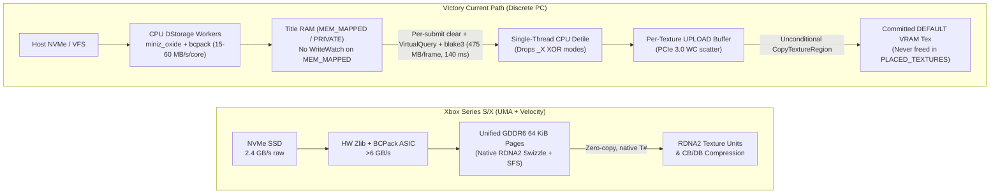

# Chapter 05 — Textures, Tiling, Caching, Streaming, and VRAM Budgets

Modern open-world console titles are, by byte volume and memory bandwidth, texture-streaming engines wrapped around a visibility-driven renderer. Geometry, uniforms, and command lists occupy tens to hundreds of megabytes per frame; textures and render targets occupy gigabytes of resident footprint and dominate I/O, decompression, memory mapping, cache locality, and video-memory (VRAM) budgets. On Xbox Series X|S, the hardware and system software stack collapses the boundary between storage, CPU memory, and GPU texture sampling into a single **Unified Memory Architecture (UMA)** augmented by the **Xbox Velocity Architecture** [5, 6]. CPU threads, the NVMe DirectStorage decompression ASIC, and RDNA2 texture units all address the exact same 64 KiB physical pages using the exact same hardware swizzle layout.

When VIctory statically recompiles a 2026 Xbox Series open-world title to run on a discrete-GPU Windows PC—specifically our measured test rig pairing an Intel Core i5-10400F (6C/12T Comet Lake, PCIe 3.0 x16 [40]), 32 GB DDR4 system memory, and an NVIDIA GeForce RTX 3080 (10 GB GDDR6X at 760 GB/s [41])—that unified texture pipeline breaks across five orthogonal impedances simultaneously:

1. **Address-space separation:** Title memory lives in host DDR4 (`MEM_PRIVATE` or `MEM_MAPPED` views), whereas fast host textures must live in discrete GDDR6X (`D3D12_HEAP_TYPE_DEFAULT`) across a ~12–13 GB/s practical PCIe 3.0 x16 link.
2. **Layout incompatibility:** Console textures are stored in AMD GFX10.3 (RDNA2) tiled and XOR-swizzled layouts (`64KB_S`, `64KB_D`, `64KB_R_X`, `64KB_Z_X`, `4KB_S`), which neither NVIDIA Ampere nor desktop D3D12 `64KB_STANDARD_SWIZZLE` exposes directly (`StandardSwizzle64KBSupported = 0` in `crates/victory-gpu/src/device.rs:257` and observed on AMD RX 9070 in XCL, `xcl_h3.md:247`).
3. **Opaque CPU mutation tracking:** Streamed world textures land in `MEM_MAPPED` physical-page views where Windows `GetWriteWatch` cannot operate, forcing VIctory to fall back to `VirtualQuery` walks and whole-texture cryptographic `blake3` hashing (`crates/victory-gpu/src/texture.rs:194-231`).
4. **Hardware decompression mismatch:** Xbox `XCRDAPI.dll` (DirectStorage) streams texture blocks compressed with **BCPack**—a custom rate-distortion-optimized BC1–BC7 codec decoded in fixed-function console silicon at >6 GB/s [5, 6]—which VIctory must decode on general-purpose CPU cores at 15–60 MB/s per core (`crates/victory-formats/src/bcpack.rs:392-394`).
5. **Memory aliasing and 10 GB WDDM residency pressure:** The title aliases render targets and virtual-page texture pools over shared 64 KiB physical pages (`CopyPageMappingsBatchX` in `crates/victory-gpu/src/queue.rs:377-428`), whereas VIctory materializes separate committed host textures and persistent upload buffers (`crates/victory-gpu/src/resource.rs:1163-1190, 1464-1495`), multiplying memory footprint inside a 10 GB VRAM ceiling shared with Windows DWM.

In our measured world-frame baseline running the **Xbox Series S profile** (`1280x720` internal rendering), VIctory's `Meter` log (`crates/victory-gpu/src/host.rs:1761-1768`) reports **~1,890 ms/frame (~0.53 fps)**, decomposed as:
- **~860 ms CPU preparing:** of which **~440 ms** copies ~270 MB of buffers, **~140 ms** checks **~475 MB/frame of textures**, and ~280 ms goes to snapshots, descriptor mirroring, command recording, and locks;
- **~700 ms on the GPU** (including unattributed host copy executions, PCIe buffer reads, global barriers, and Wave64 emulation);
- **~330 ms copying back** ~12 MB of GPU results;
- Plus lockstep `WaitForSingleObject(INFINITE)` stalls, fake occlusion/timestamp queries, and **430 untranslated shaders** (dropping lighting passes so the final frame is black even though geometry populates the G-buffer).

By comparison, earlier measurements on the **Xbox Series X profile** (4K target, 13.5 GiB title budget in `crates/victory-gpu/src/dxgi.rs:246` and `console.rs:24`, summarized in `E:\Projetos\agy_dossie.md` and `E:\Projetos\dossie_series_s.md`) measured **~2,800 ms/frame** (~810 ms preparing with ~540 MB / ~170 ms textures, ~1,600 ms GPU, ~360 ms copy-back). Switching to the Series S profile cuts GPU pixel pressure and VRAM oversubscription substantially, yet **texture checks still burn ~475 MB/frame (~140 ms of synchronous CPU time)**—and as forensic inspection of VIctory's source reveals, that ~140 ms number dramatically *understates* the true texture cost because VIctory unconditionally records host `CopyTextureRegion` DMA commands for *every subresource of every checked texture* before even knowing whether the hash matched (`crates/victory-gpu/src/texture.rs:125-173`), silently drops `_X` XOR-swizzled textures (`texture.rs:349-352`), and leaks every placed texture entry in `PLACED_TEXTURES` (`resource.rs:1464-1495`).

This chapter dissects the entire texture and asset-streaming stack from silicon layout to OS residency. Throughout, we strictly distinguish **established architectural facts** (with verified primary references), **measurements from our runs and VIctory/XCL telemetry**, and **testable engineering hypotheses (`H-5.1` through `H-5.8`)** tied directly to VIctory's `Meter` log line and `copystat` counters.



---

## 5.1 RDNA2 (GFX10.3) Tiled and Swizzled Texture Layouts

### 5.1.1 Why GPUs Swizzle Textures and Why Linear Fails

A naive 2D image stored in **row-major (linear)** order lays adjacent texels $(x, y)$ and $(x+1, y)$ sequentially in virtual memory, while vertically adjacent texels $(x, y)$ and $(x, y+1)$ sit `RowPitch` bytes apart—often 4 KiB to 16 KiB away for a 1080p or 4K texture. Graphics rasterization, however, always executes pixel shaders in $2\times 2$ **quads** (required for screen-space finite-difference derivatives `ddx`/`ddy` and mipmap LOD selection) and samples textures via **bilinear** ($2\times 2$ footprint), **trilinear** ($2\times 2 \times 2$ across mips), and **anisotropic** (up to $16\times$ footprints along arbitrary screen-space ellipses) filters [2]. Under a linear layout:

- Vertical neighbors $(x, y)$ and $(x, y+1)$ almost never land in the same 64-byte or 128-byte L1 texture cache line, wasting 75%–93% of fetched cache lines on unrelated horizontal neighbors during diagonal or vertical camera motion.
- Large textures with power-of-two widths map vertically adjacent rows (`stride = 4096 B`, `8192 B`, `16384 B`) onto the **same set/bank/channel** of L1/L2 caches and GDDR6 DRAM row buffers, causing severe cache-set thrashing and DRAM bank conflicts ("channel camping").

AMD's **GFX10 / RDNA2** architecture solves both problems through hierarchical **tiling (swizzling)** implemented in AMD's `addrlib` (publicly visible in Mesa's `src/amd/addrlib/src/gfx10/gfx10addrlib.cpp` [3] and `src/amd/common/ac_surface.c` [4]) and exposed on Xbox Series through `xg_xs.dll` (`XGCreateTextureComputer`). Every texture surface is decomposed into three nested spatial scales:

1. **Elements (1 texel or one $4\times 4$ BCn block):** The indivisible addressing unit, constrained to power-of-two byte widths $b \in \{1, 2, 4, 8, 16\}$ bytes (`element_log2` $\in [0, 4]$).
2. **Micro-tiles (256 bytes):** The smallest swizzled block, matching a small cluster of GPU cache lines. A 256-byte tile holds $256 / b$ elements—for example, $16\times 16$ 1-byte texels or $4\times 4$ 16-byte `BC7` blocks ($16 \times 16$ texels).
3. **Macro-tiles (4 KiB or 64 KiB blocks):** Constructed by alternating $Y$ and $X$ coordinate bits above bit 7 up to bit 11 (`4KB`) or bit 15 (`64KB`), optionally XORed with higher spatial coordinates and array slice/pipe-bank hashes in `_T` and `_X` modes [3, 4]. A `64KB` macro-tile aligns cleanly to one **64 KiB console virtual/physical page** (`XMemAllocatePhysicalPages`, `CreateReservedResource` tile size).

### 5.1.2 BCn Block Compression and Format Geometry

Before examining the swizzle bit equations, we must establish the byte geometry of the underlying elements. Modern  Open-World titles store ~80%–90% of world texture bytes in **Block Compression (`BC1`–`BC7`)** formats [22, 23]. Rather than decompressing textures into raw `RGBA8`/`RGBA16F` in RAM or VRAM, RDNA2 texture fetch units (`TMEM`/`TA`) and NVIDIA Ampere texture units decode individual $4\times 4$ texel blocks directly inside L1 texture cache reads:

| Format | DXGI Enum(s) | Block Size | Bytes / Block | Effective bpp | Compression vs. RGBA8 / RGBA16F | Primary Use in 2026 Open-World Titles |
| :--- | :--- | :---: | :---: | :---: | :---: | :--- |
| **BC1** (DXT1) | 70–72 (`TYPELESS`/`UNORM`/`SRGB`) | $4\times 4$ | 8 B | 4 bpp (0.5 B/px) | 8x vs RGBA8 | Opaque albedo, foliage masks (1-bit punchthrough alpha), distant LODs |
| **BC2** (DXT2/3) | 73–75 | $4\times 4$ | 16 B | 8 bpp (1.0 B/px) | 4x vs RGBA8 | Explicit 4-bit alpha (rarely used in modern titles; `bcpack.rs:2` omits BC2) |
| **BC3** (DXT4/5) | 76–78 | $4\times 4$ | 16 B | 8 bpp (1.0 B/px) | 4x vs RGBA8 | Smooth alpha gradients, packed mask/albedo channels |
| **BC4** (ATI1/RGTC1) | 79–81 (`TYPELESS`/`UNORM`/`SNORM`) | $4\times 4$ | 8 B | 4 bpp (0.5 B/px) | 2x vs R8 | Single-channel roughness, AO, heightmaps, terrain masks |
| **BC5** (ATI2/RGTC2) | 82–84 (`TYPELESS`/`UNORM`/`SNORM`) | $4\times 4$ | 16 B | 8 bpp (1.0 B/px) | 2x vs RG8 | Tangent-space normal maps ($X, Y$ reconstructed with $Z = \sqrt{1-x^2-y^2}$) |
| **BC6H** (BPTC_FLOAT) | 94–96 (`TYPELESS`/`UF16`/`SF16`) | $4\times 4$ | 16 B | 8 bpp (1.0 B/px) | 8x vs RGBA16F | HDR skyboxes, environment cubemaps, lightmaps, emissive HDR textures |
| **BC7** (BPTC_UNORM) | 97–99 (`TYPELESS`/`UNORM`/`SRGB`) | $4\times 4$ | 16 B | 8 bpp (1.0 B/px) | 4x vs RGBA8 | High-fidelity albedo, complex PBR decals, UI atlases, character/hero materials |

*Table 5.1: Direct3D 12 Block Compression formats (`BC1`–`BC7`), compiled from Microsoft Learn [22] and the Khronos Data Format Specification v1.3 [23].*

Two properties of BCn formats directly impact VIctory's tiling and detiling pipeline (`crates/victory-formats/src/texture.rs:5, 718-719`):
1. **Block-Coordinate Quantization:** In `addrlib` and `victory-formats`, dimensions for BCn surfaces are measured in **$4\times 4$ block elements** (`block = 4`), rounded up via `div_ceil(4)`. A $1024\times 1024$ `BC7` texture has $256\times 256$ elements of 16 bytes each (1,048,576 bytes for mip 0). Even a $1\times 1$ or $2\times 2$ mip at the bottom of the chain occupies **1 full element** (8 bytes for BC1/BC4, 16 bytes for BC3/BC5/BC6H/BC7).
2. **D3D12 Host Staging Pitch Constraints:** Under host D3D12 (`ID3D12Device::GetCopyableFootprints` [19]), a linear upload buffer feeding `CopyTextureRegion` into a `BCn` texture treats each row of $4\times 4$ blocks as one `RowPitch`-aligned scanline, where `RowPitch` must be a multiple of `D3D12_TEXTURE_DATA_PITCH_ALIGNMENT` (**256 bytes**), and each subresource offset must be a multiple of `D3D12_TEXTURE_DATA_PLACEMENT_ALIGNMENT` (**512 bytes**) [19]. Thus a tiny $4\times 4$ `BC7` mip (16 bytes of data) still consumes 256 bytes in a D3D12 linear staging footprint (padded to 512 bytes before the next subresource)—whereas on the console, all small mips share a single packed 64 KiB mip-tail tile!

### 5.1.3 GFX10 Swizzle Modes: `_S`, `_D`, `_R`, `_Z`, `_T`, and `_X`

From Mesa's `gfx10addrlib.cpp` [3], `ac_surface.c` [4], and VIctory's verified implementation in `crates/victory-formats/src/texture.rs:34-84` (which matches Xbox `xg_xs.dll` across 29,700 descriptors in XCL's oracle tests, `xcl_h3.md:662`), GFX10.3 defines a family of 2D/3D swizzle mode enumerations (`ADDR_SW_*`):

| Mode Name | HW ID | Block Size | Category | XOR Type | Primary Hardware Role on Xbox Series / RDNA2 |
| :--- | :---: | :---: | :--- | :--- | :--- |
| `LINEAR` | 0 | 256 B pitch | Row-major | None | 1D textures, linear staging, CPU-interfaced small buffers |
| `SW_256B_S` | 1 | 256 B | Standard | None | Tiny textures (`xg` sub-4 KiB mip tail encoding for `_S`) |
| `SW_256B_D` | 2 | 256 B | Displayable | None | Scanout-friendly tiny buffers / mip tail encoding for `_D` |
| `SW_4KB_S` | 5 | 4 KiB | Standard | None | **Default for streamed immutable 2D/3D textures** (`xg.rs:66`; `resource.rs:154`) |
| `SW_4KB_D` | 6 | 4 KiB | Displayable | None | Small displayable 2D surfaces |
| `SW_64KB_S` | 9 | 64 KiB | Standard | None | Large sampled 2D/3D textures without pipe/bank XOR |
| `SW_64KB_D` | 10 | 64 KiB | Displayable | None | Displayable surfaces; standard 64 KiB page-aligned textures |
| `SW_64KB_S_T` | 17 | 64 KiB | Standard | `_T` (PRT) | Sparse/PRT textures with **T-mode XOR** (excludes top page bits so 64 KiB tiles stay relocatable) |
| `SW_64KB_D_T` | 18 | 64 KiB | Displayable | `_T` (PRT) | Displayable PRT/sparse textures with T-mode XOR |
| `SW_4KB_S_X` | 21 | 4 KiB | Standard | `_X` (Pipe/Bank) | **Small UAVs** (`xcl_h3.md:673`: `xg` picks `4KB_S_X` for UAVs $\le$ 64 KiB) |
| `SW_4KB_D_X` | 22 | 4 KiB | Displayable | `_X` (Pipe/Bank) | 4 KiB displayable surfaces with pipe/bank XOR |
| `SW_4KB_R_X` | 23 | 4 KiB | Render (RB+) | `_X` (Pipe/Bank) | Small render targets with RB+ optimization |
| `SW_64KB_Z_X` | 24 | 64 KiB | Depth/Z | `_X` (Pipe/Bank) | **Depth/Stencil buffers** (`ALLOW_DEPTH_STENCIL`, `xg.rs:62`, `dsMipmapHtileFix`) |
| `SW_64KB_S_X` | 25 | 64 KiB | Standard | `_X` (Pipe/Bank) | Large sampled textures / texture arrays with pipe/bank XOR |
| `SW_64KB_D_X` | 26 | 64 KiB | Displayable | `_X` (Pipe/Bank) | Swapchain backbuffers / displayable RTs with pipe/bank XOR |
| `SW_64KB_R_X` | 27 | 64 KiB | Render (RB+) | `_X` (Pipe/Bank) | **Default for Render Targets & large UAVs** (`xg.rs:64`, `xcl_h3.md:673`) |

*Table 5.2: RDNA2 / GFX10.3 swizzle modes implemented in `victory-formats/src/texture.rs:38-53` and `addrlib` [3, 4]. Note: Mode 28/31 (`VAR`) and `_T` variants exist for variable-size blocks (`256KB`+) or Partially Resident Textures.*

Understanding the semantic differences among these modes is critical for diagnosing VIctory:

- **`_S` (Standard) vs. `_D` (Displayable):** Both are **bijective bit-permutations** inside each `256B`/`4KB`/`64KB` block when used without `_X`/`_T`. Their 256-byte micro-tile patterns (`GFX10_SW_256_S_RBPLUS` vs `GFX10_SW_256_D_RBPLUS` in `victory-formats/src/texture.rs:188-202`) differ in how the lowest bits interleave `x` and `y`:
  - For 16-byte elements (`element_log2 = 4`, e.g., `BC7` or `RGBA32F`), `MICRO[0]` (thin `_S`) encodes bits `4..7` as `y0 y1 x0 x1`, meaning moving vertically by 1 element increments offset by 16 bytes, whereas moving horizontally by 1 element increments offset by 64 bytes (`4x4` elements = 16x16 BC7 texels in 256 B). By contrast, `MICRO[1]` (thin `_D`) encodes bits `4..7` as `x0 y0 x1 y1`—interleaving `x` and `y` one bit at a time (strict Morton Z-order inside the 256B micro-tile) so horizontal scanline bursts in the display controller experience tighter alignment.
  - For 4-byte elements (`element_log2 = 2`, e.g., `RGBA8`), thin `_S` uses `----x0x1y0y1y2x2` (4x2 elements aligned heavily on Y), whereas thin `_D` uses `----x0x1y0y1x2y2` (a symmetric $8\times 8$ block).
- **`_R` (Render / Rotated RB+) and `_Z` (Z-order Depth):** Always paired with `_X` on 4 KiB / 64 KiB blocks (`SW_64KB_R_X = 27`, `SW_64KB_Z_X = 24`). RDNA2 Color Blocks (CB) and Depth Blocks (DB) pair `_R_X` and `_Z_X` with **DCC (Delta Color Compression)** / **CMASK** and **HTILE** metadata planes respectively (`xcl_h3.md:675-682`). Moreover, `_Z_X` applies `dsMipmapHtileFix`: 8-bit and 16-bit depth formats (`R16_UNORM`/`D16_UNORM`) enter the mip tail using 32-bit (`element_log2 = 2`) micro-tile dimensions (`texture.rs:398-404`).
- **`_X` (Pipe/Bank XOR) and `_T` (Tiled PRT XOR):** Non-XOR modes (`_S`, `_D`) can suffer **bank/pipe imbalance** when large surfaces align multiple vertical macro-tiles onto the same memory controller channel. Modes $\ge 16$ (`_T` and `_X`) XOR specific address bits `[pipe_interleave .. pipe_interleave + pipe_bank_bits]` with a linear GF(2) combination of upper `(x, y)` coordinates, array `slice` bits, and the surface's low virtual address bits (`base_xor` = `(va >> 8) & pipe_mask` on non-PRT `_X` surfaces, omitted on `_T` so PRT virtual pages can remap freely across addresses) [3, 4].
- **Console Hardware Split (`Series X` vs. `Series S` Pipes):** Because `_X` equations depend directly on the GPU's `GB_ADDR_CONFIG` hardware topology (`num_pipes`, `num_pkrs`, `num_banks`, `pipe_interleave_bytes`), Series X and Series S actually lay out `_X` surfaces differently! As XCL verified against `xg_xs.dll` (`xcl_h3.md:669-671`), Series X uses **32 pipes / 8 packers**, whereas `XGSetHardwareVersion(4)` (Series S) switches to **8 pipes / 4 packers** (changing mip metadata fields `+0x50/+0x58` from `0x8000/0x8000` to `0xE000/0x2000`).

### 5.1.4 Mathematical Formulation and Worked Bit-Level Example

For any non-XOR 2D tiled mode (`SW_4KB_S`, `SW_4KB_D`, `SW_64KB_S`, `SW_64KB_D`), let:
- $e = \log_2(\text{element\_bytes}) \in \{0, 1, 2, 3, 4\}$
- $k = \log_2(\text{block\_bytes}) \in \{8, 12, 16\}$
- $(w_b, h_b)$ be the block dimensions in elements (`ComputeThinBlockDimension` in `texture.rs:341-347`), where $\log_2(w_b \cdot h_b) = k - e$, split as $w_b = 2^{\lceil (k-e)/2 \rceil}$ and $h_b = 2^{\lfloor (k-e)/2 \rfloor}$ for single-sampled textures (`wide = true`).

Inside a macro-tile of $2^k$ bytes, the address bit position $p_X(i)$ for coordinate bit $x_i$ and $p_Y(j)$ for coordinate bit $y_j$ are defined in two ranges (`texture.rs:213-236`):
- **Bits $0 \dots e-1$:** Byte offset within a single element (0 when addressing whole elements).
- **Bits $e \dots 7$:** Micro-tile pattern `MICRO[kind][e]`.
- **Bits $8 \dots k-1$:** Macro-tile interleaving, appending alternately to **Y, then X** (`order = [1, 0]` for thin 2D; `[1, 0, 2]` for thick 3D).

The byte offset of element $(x, y)$ inside a single slice and standard mip $m$ (with padded element pitch $P_m$ rounded up to $w_b$, and mip base offset $\text{Base}_m$) is an exact GF(2) sum (bitwise OR / XOR across disjoint bit positions):

$$\text{Offset}(m, x, y) = \text{Base}_m + \left( \left\lfloor \frac{y}{h_b} \right\rfloor \cdot \frac{P_m}{w_b} + \left\lfloor \frac{x}{w_b} \right\rfloor \right) \cdot 2^k + \text{Spread}_X(x \bmod w_b) + \text{Spread}_Y(y \bmod h_b)$$

where $\text{Spread}_X(u) = \bigoplus_{i} ((u \gg i) \& 1) \ll p_X(i)$ and similarly for $\text{Spread}_Y(v)$. For `_X` modes, an additional term $\text{PipeBankXOR}(x, y, z, \text{VA}_{\text{base}})$ XORs bits $[8 .. 8 + \text{pipe\_bank\_bits})$ with high coordinate and slice bits [3].

#### Worked Example 1: Addressing `(x, y) = (21, 13)` in a `256x256` `BC7` Texture (`SW_64KB_D`)

Consider a `256x256` `BC7_UNORM` (`DXGI_FORMAT = 98`) texture in `SW_64KB_D` (`Swizzle(10)`), full mip chain (`9` mips: `256x256` down to `1x1`):
1. **Element & Block Dimensions:**
   - `BC7` uses $4\times 4$ texel blocks of `16 bytes` $\Rightarrow b = 16$, $e = \log_2(16) = 4$.
   - Mip 0 in elements: $256/4 \times 256/4 = 64 \times 64$ elements.
   - `SW_64KB_D` has $k = 16$ ($65,536\text{ B}$). Elements per block $= 2^{16 - 4} = 4096 = 64 \times 64$, so $w_b = 64$ ($x_0 \dots x_5$) and $h_b = 64$ ($y_0 \dots y_5$).
2. **Bit-Mapping Table (`MICRO[1][4]` + Macro Bits `8..15`):**
   - `MICRO[1][4]` (`texture.rs:201`) is `b"--------x0y0x1y1"`, mapping bits `0..3` inside the 16-byte element, then:
     - bit `4` $\leftarrow x_0$, bit `5` $\leftarrow y_0$, bit `6` $\leftarrow x_1$, bit `7` $\leftarrow y_1$.
   - Macro-tile bits `8..15` alternate `[Y, X]`:
     - bit `8` $\leftarrow y_2$, bit `9` $\leftarrow x_2$, bit `10` $\leftarrow y_3$, bit `11` $\leftarrow x_3$,
     - bit `12` $\leftarrow y_4$, bit `13` $\leftarrow x_4$, bit `14` $\leftarrow y_5$, bit `15` $\leftarrow x_5$.
   - Verify: `x` maps to bits `[4, 6, 9, 11, 13, 15]` (6 bits, $0..63$); `y` maps to bits `[5, 7, 8, 10, 12, 14]` (6 bits, $0..63$). Every bit `4..15` is assigned uniquely—a pure bijection!
3. **Mip Chain & Mip-Tail Layout:**
   - `GetMipTailDim` (`texture.rs:384`): `tail_max = [w_b >> 1, h_b] = [32, 64]` elements.
   - `GetMaxNumMipsInTail` (`texture.rs:396`): `effective - 4 = 16 - 4 = 12` mips maximum.
   - Mip 0 is `64x64` ($> 32$ width), so Mip 0 is a **standard mip** (`1` block = `65,536 B`).
   - Mip 1 (`32x32` elements) satisfies $w \le 32, h \le 64$ and remaining mips $9 - 1 = 8 \le 12$, so **Mips 1..8 all pack into 1 single 64 KiB mip-tail block** at slice offset `0`, while Mip 0 sits after the tail at slice offset `65,536`! Total slice size = **131,072 bytes** (verified by `xg.rs:673-686` and `texture.rs:970-983`!).
   - Inside the tail block, each mip $i \in [1, 8]$ has $m = 12 - 1 - (i - 1) = 12 - i$. For Mip 1 ($m = 11 > 6$), `offset = 16 << 11 = 32768`, placing Mip 1 at $(x_{\text{tail}}, y_{\text{tail}}) = (32, 0)$ elements (bits `9+2b` for `x`, `8+2b` for `y`), matching `texture.rs:976-983` (`Tail { offset: 32768, x: 32, y: 0 }`)!
4. **Element `(x, y) = (21, 13)` on Mip 0 (texel `(84, 52)`):**
   - $x = 21 = 0b010101_2$ ($x_0=1, x_2=1, x_4=1$): $\text{Spread}_X(21) = 2^4 + 2^9 + 2^{13} = 16 + 512 + 8192 = 8,720$.
   - $y = 13 = 0b001101_2$ ($y_0=1, y_2=1, y_3=1$): $\text{Spread}_Y(13) = 2^5 + 2^8 + 2^{10} = 32 + 256 + 1024 = 1,312$.
   - Total byte offset in slice: $\text{Base}_0 + \text{Spread}_X(21) + \text{Spread}_Y(13) = 65,536 + 8,720 + 1,312 = \mathbf{75,568}$ (`0x12730`).
   - Contrast with adjacent horizontal element `(22, 13)`: $22 = 0b010110_2$ changes $x_0:1\to 0, x_1:0\to 1$, shifting offset by $-16 + 64 = +48$ bytes—still within the exact same 64-byte L1 cache line (`0x12700..0x1273F` or `0x12740..0x1277F`)! And vertical neighbor `(21, 14)` changes $y_0:1\to 0, y_1:0\to 1$, shifting by $-32 + 128 = +96$ bytes—within the same 128-byte L1 cache sector pair!

#### Worked Example 1B: 3D Thick Volumes, `Z_X` Depth-Stencil Planes, and Series S vs. Series X `_X` XOR

RDNA2 generalizes 2D thin blocks along two additional axes that directly affect VIctory's layout and detiling code:

1. **Thick 3D Volumes (`SW_4KB_S` / `SW_64KB_S` on `Tex3d`, `texture.rs:333-348`):**
   When a 3D texture uses `_S` or `_D` modes (`thick == true`), macro-tiles span $Z$ alongside $X$ and $Y$ (`ComputeThickBlockDimension`). Starting from the 1 KiB 3D seed table `BLOCK_1K_3D[e]` (`texture.rs:262`), `amp = (k - 10) / 3` and `rest = (k - 10) % 3` scale $[w_b, h_b, d_b]$. For a `32x64x32` `RGBA16F` LUT (`8 B/element`, $e=3$) in `SW_4KB_S` ($k=12$, `amp=0, rest=2`), `BLOCK_1K_3D[3] = [8, 4, 4]` expands to $[8, 4 \times 2, 4 \times 2] = [8, 8, 8]$ elements (`512` texels $\times 8\text{ B} = 4096\text{ B}$), and the micro-tile pattern `MICRO[2][3] = b"------x0z0y0x1z1"` interleaves all three axes inside 256 bytes before macro-bits `8..11` cycle `[Y, X, Z]`. By contrast, `SW_64KB_Z_X` and `SW_64KB_R_X` on 3D textures remain **thin** (2D swizzled slice-by-slice, `d_b = 1`). Notice that XCL verified thick 3D tiling on real retail volumetric LUTs (`256x32x8 R16F`, `32x64x32 RGBA16F`), confirming $X/Z$ spatial locality improves by 5x–17x compared to thin 2D slice interpretations (`xcl_h3.md:1126-1129`).
2. **Two-Plane Depth-Stencil (`SW_64KB_Z_X`) and `dsMipmapHtileFix` (`texture.rs:398-404, 793-806, 993-1010`):**
   For a `1920x1080` `D24_UNORM_S8_UINT` (`DXGI_FORMAT = 20`) or `D32_FLOAT_S8X24_UINT` (`DXGI_FORMAT = 45`) surface, RDNA2 stores depth and stencil as **two disjoint planes** placed sequentially (`Texture::new`, `texture.rs:793-806`):
   - **Plane 0 (Depth, 4 B/texel):** `block = [128, 128, 1]`, padding `1920` to `1920` (15 blocks) and `1080` to `1152` (9 blocks) $\Rightarrow 1920 \times 1152 \times 4 = 8,847,360\text{ B}$.
   - **Plane 1 (Stencil, 1 B/texel):** `block = [256, 256, 1]`, padding `1920` to `2048` (8 blocks) and `1080` to `1280` (5 blocks) $\Rightarrow 2048 \times 1280 \times 1 = 2,621,440\text{ B}$ placed at `offset = 8,847,360`.
   - For mip-mapped 8-bit or 16-bit depth (`element_log2 <= 1`) in `Z_X`, `dsMipmapHtileFix` shrinks the effective mip-tail threshold to 32-bit block proportions (`BLOCK_256_2D[2]`) so HTILE metadata stays aligned.
3. **`_X` Pipe/Bank XOR (`PipeConfig`) and Series S vs. Series X Divergence:**
   In `_X` modes (`21..27`), bits $[8 .. 8 + p + b)$ of the byte offset inside a macro-tile are XORed with a hardware linear map of the macro-tile coordinates $(bx, by, slice)$ and the surface's 256B-aligned base VA (`(va >> 8) & xor_mask`) [3, 4]. Crucially, Xbox Series X (52 CUs, 320-bit bus, **32 pipes / 8 packers**) and Xbox Series S (20 CUs, 128-bit bus, **8 pipes / 4 packers** under `XGSetHardwareVersion(4)`) drive different `PipeConfig` matrices (`xcl_h3.md:669-671`), which also shifts mip-tail internal alignment bytes (`+0x50/+0x58` in `xg_xs.dll` reports `0xE000/0x2000` on Series S vs `0x8000/0x8000` on Series X). Because `victory-formats` omits `_X` addressing (`texture.rs:514-520`) and `xg.rs:545-570` (`element_offset`, called by the title at `title+0x5151c90` on a `128x4 4KB_S` texture!) returns `0` on `Unsupported`, any `_X` texture sampled after CPU modification fails silently (`texture.rs:349-352`) until `PipeConfig` is calibrated per `--console` profile and lifted into `DetileCS`.

### 5.1.5 Why Host D3D12 Cannot Keep Console Swizzles Natively

A tempting shortcut is to avoid detiling completely by creating host D3D12 textures with `D3D12_TEXTURE_LAYOUT_64KB_STANDARD_SWIZZLE` [18] and `memcpy`-ing console pages directly into VRAM via `CopyTextureRegion` or `UpdateTileMappings`. On Windows PCs, that shortcut fails for **four structural reasons**:

1. **Lack of Driver Support (`StandardSwizzle64KBSupported = 0`):** As Microsoft Learn documents [18], drivers are not required to support `D3D12_TEXTURE_LAYOUT_64KB_STANDARD_SWIZZLE`. VIctory sets `OPTIONS[10] = 0` (`device.rs:257`), and XCL explicitly verified on desktop AMD RDNA4 (RX 9070) that `StandardSwizzle64KBSupported = 0` (`xcl_h3.md:247`). NVIDIA Ampere/RTX 3080 exposes internal block-linear tiling (16B x 2 gob rows, 512B/4KB/64KB gob-blocks) and likewise does not map AMD's GFX10 `_D`, `_R_X`, or `_Z_X` hardware layouts.
2. **Incompatible Swizzle Algebra:** Even if an adapter supported `64KB_STANDARD_SWIZZLE` (which defines a single fixed 16-bit interleave across 64 KiB tiles [18]), Xbox Series titles predominantly stream textures in **`SW_4KB_S` (mode 5)** (`xg.rs:66`, `xcl_h3.md:243, 673`) and allocate render/UAV/depth surfaces in **`SW_64KB_R_X` (27)**, **`SW_64KB_Z_X` (24)**, and **`SW_4KB_S_X` (21)**—none of which match `64KB_STANDARD_SWIZZLE`!
3. **Mip-Tail Placement & Subresource Ordering:** GFX10 packs the mip tail *before* mip 0 at slice offset 0 and stores standard mips smallest-to-largest (`mip N-1 ... mip 0`), whereas D3D12 `D3D12_TEXTURE_LAYOUT_64KB_STANDARD_SWIZZLE` orders subresources `mip 0 ... mip N-1` with a trailing packed mip tail!
4. **D3D12 API Bans:** Microsoft's specification prohibits `64KB_STANDARD_SWIZZLE` on 1D textures, MSAA resources, depth-stencil resources (`ALLOW_DEPTH_STENCIL`), and `R32G32B32_TYPELESS` [18].

Therefore, **layout translation (detiling) from GFX10.3 to host-native layouts is mandatory** on Windows PCs. The critical architectural question is *where* that translation runs (single-core CPU vs. parallel GPU compute), *how much* data is translated per frame (whole texture vs. dirty tiles/subresources), and *how* host textures mirror console memory updates.

---

## 5.2 CPU vs. GPU Compute Detiling and Upload Mechanics

### 5.2.1 Forensic Breakdown of VIctory's Current CPU Detiling Path

In VIctory today, texture layout conversion occurs entirely on the CPU inside `victory-formats/src/texture.rs` and `victory-gpu/src/texture.rs`. Tracing the exact execution path from a draw call to the RTX 3080 exposes four compounding bottlenecks:

1. **Unconditional `CopyTextureRegion` Recording (`crates/victory-gpu/src/texture.rs:107-174`):**
   When `draw::sync_slot` (`crates/victory-gpu/src/draw.rs:1675-1681`) binds a non-RT/DS/UAV texture (`texture::title_written(t)`), it calls `texture::upload(list, res, t)`. If `list.first_use(resource)` is true (i.e., first draw using that texture on the current command list), `texture::upload` immediately acquires a persistent `Staging` object (`texture.rs:118`), transitions the host `DEFAULT` texture to `COPY_DEST` (`texture.rs:122`), and **unconditionally records `CopyTextureRegion` for every mip and every array slice** (`texture.rs:125-171`) into `list.list`! Only *after* the command list is closed and submitted in `Host::execute` (`crates/victory-gpu/src/host.rs:552-560, 1294-1299`) does `staging.refresh()` run to check whether the CPU bytes changed!
   - **Consequence:** Even when 0 bytes of a texture changed since the previous frame (a 100% static world texture!), if the command list was reset and re-recorded, **the host GPU still executes full-chain `CopyTextureRegion` DMA copies from `UPLOAD` staging memory across PCIe 3.0 into `DEFAULT` VRAM** on every submission where that list binds the texture! That invisible PCIe DMA traffic directly inflates VIctory's `700 ms` GPU time and starves GPU copy/3D engines.

2. **Persistent `UPLOAD` Heap Proliferation (`crates/victory-gpu/src/texture.rs:381`, `host.rs:1471-1514`):**
   Each distinct texture allocates its own dedicated `ID3D12Resource` in `D3D12_HEAP_TYPE_UPLOAD` sized to the full `GetCopyableFootprints` byte total (`texture.rs:381`). Unlike a ring buffer that retires staging memory after fence completion, these `UPLOAD` buffers are permanently retained in the global `STAGING` map (`texture.rs:70`). For 475 MB–2 GB of active world textures, VIctory permanently pins 500+ MB to 2+ GB of write-combined system RAM mapped through the PCIe GART/aperture, and when `staging` misses cache, triggers fresh `CreateCommittedResource` kernel transitions inline during draw recording (`texture.rs:334-404`).

3. **Scattered Sub-Cache-Line Writes into Write-Combined (`WC`) Memory (`victory-formats/src/texture.rs:619-691`):**
   `Layout::walk()` precomputes contiguous horizontal byte runs (`runs`) where consecutive `x` elements land at contiguous tiled offsets, and loops over `z` and `y` executing `linear[l..][..len].copy_from_slice(&tiled[t..][..len])` (`texture.rs:597-599`). Look closely at the contiguous run length `len` for common swizzle modes (`texture.rs:189-209`):
   - In **`SW_4KB_S`** (`MICRO[0]`):
     - `16 B` elements (`BC3/BC5/BC6H/BC7`, `RGBA32F`): `--------y0y1x0x1` $\Rightarrow$ 4 contiguous elements (`x0, x1`) = **64 bytes** per run (matches one x86 cache line).
     - `8 B` elements (`BC1/BC4`, `RG32F`): `------x0y0y1x1x2` $\Rightarrow$ only **1 contiguous element (`x0`) = 8 bytes** per run! (`x1` jumps over `y0, y1`, bit 6!).
     - `4 B` elements (`RGBA8`, `R32F`): `----x0x1y0y1y2x2` $\Rightarrow$ 4 contiguous elements (`x0, x1`) = **16 bytes** per run!
   - In **`SW_64KB_D`** (`MICRO[1]`):
     - `16 B` elements (`BC7`): `--------x0y0x1y1` $\Rightarrow$ **2 contiguous elements (`x0`) = 32 bytes** per run!
     - `4 B` elements (`RGBA8`): `----x0x1y0y1x2y2` $\Rightarrow$ **16 bytes** per run!
   - Now combine 8-byte, 16-byte, and 32-byte scatter writes with the fact that `staging.data` (`D3D12_HEAP_TYPE_UPLOAD`) is **Write-Combined (WC) uncached system memory** (`host.rs:1473`). On an x86-64 Comet Lake CPU (i5-10400F), each `copy_from_slice` writes 8–32 bytes at non-contiguous or strided addresses (`row_pitch` apart, or split across runs), causing partial 64-byte Write Combining Buffer (WCB) line flushes before buffers are filled, and triggering read-modify-write / microarchitectural store-buffer stalls if any non-WC read occurs!
   - Worse, when `widened_from` triggers (`texture.rs:291-311`, widening `B5G5R5A1`/`B4G4R4A4` UI targets to `RGBA8_UNORM` on the RTX 3080), `detile_subresource` first detiles into an intermediate `Vec<u8>`, then runs scalar `expand_packed16_rows` into the WC buffer.

4. **Single-Threaded Submission Lock Serialization & Dropped `_X` Textures:**
   Every `staging.refresh()` executes serially inside `Host::execute()` (`host.rs:544, 553, 1296`) while holding `self.submitted`, utilizing 1 out of 12 hardware threads on the i5-10400F. And because CPU addressing does not know the console's `GB_ADDR_CONFIG` pipe/bank XOR configuration, `texture.rs:349-352` **silently skips uploading all `_X` XOR-swizzled textures** (`if layout.desc.swizzle.xor() { return None; }`), leaving any `_X` LUT, shadow mask, cubemap, or render-target-sourced texture completely unpopulated on the GPU!

### 5.2.2 GPU Compute Detiling (`DetileCS`) Architecture

Both **Xenia** (Xbox 360 emulator [35]) and **RPCS3** (PlayStation 3 emulator [36])—as well as **Dolphin**'s GPU texture decoder [37]—converged on offloading texture deswizzling and format conversion from the CPU to GPU **compute shaders** (or fragment shaders). The architectural insight is simple:

> **The CPU should only ever perform sequential cache-friendly `memcpy` bursts into a linear write-combined `UPLOAD` ring buffer.** Every bit-permutation, GF(2) coordinate scatter, `_X` pipe/bank XOR hash, mip-tail unpacking, and `B5G5R5A1` $\to$ `RGBA8` bit-replication belongs on the GPU's 30 TFLOPS / 760 GB/s GDDR6X ALUs.

On D3D12 (RTX 3080), designing a production `DetileCS` pipeline requires overcoming one crucial Direct3D 12 rule: **`BC1`–`BC7` block-compressed formats cannot have `D3D12_RESOURCE_FLAG_ALLOW_UNORDERED_ACCESS` and cannot be written directly as `RWTexture2D` UAVs.** Instead, there are two clean, D3D12-compliant GPU detiling paths:

#### Path A: `ByteAddressBuffer` (Raw Tiled Upload) $\to$ `DetileCS` $\to$ Typed `uint2`/`uint4` UAV or Linear Staging Buffer $\to$ `CopyTextureRegion`

1. **CPU Copy (Linear Burst):** Copy the dirty slice/mip/tile bytes straight from title memory into the next aligned slot of a persistent **ring-buffered `UPLOAD` heap** (`64–128 MiB`). Zero detiling, zero `blake3`, zero `runs` loops—just sequential AVX2 `memcpy` hitting ~10–14 GB/s into WC buffers!
2. **GPU Copy / Upload to `DEFAULT` or Direct SRV Read:** Either bind the `UPLOAD` ring slice directly as a `ByteAddressBuffer` SRV (`t0`) for small/streaming updates (1 PCIe read pass from GPU, or `CopyBufferRegion` to a transient `DEFAULT` raw scratch buffer if multi-pass reads occur).
3. **`DetileCS` Compute Dispatch:** Each thread processes 1 element (or a $4\times 4$ tile of elements per thread to coalesce 64-byte/128-byte reads from the tiled input!).
   - Thread computes the GF(2) byte offset `tiled_byte_offset = ComputeGfx10Offset(x, y, slice, mip, swizzle_mode, pipe_cfg, base_xor)` using exact bit masks/XORs stored in a tiny 64-byte root constant / CBV (`x_masks[6]`, `y_masks[6]`, `z_masks[4]`, `pipe_masks`, `mip_offset`, `tail_xy`, `pitch_in_blocks`, `element_bytes`).
   - Notice the elegance of passing **axis bit-masks** (`uint x_bit_to_addr[14]` or pre-spread lookup table in a 256-entry `cbuffer`) rather than branching on 16 swizzle modes inside HLSL! Any non-XOR or XOR mode reduces to **branchless bit-masking and XORs**, compiling to ~15–25 ALU instructions on Ampere!
4. **Output Destination (Two Sub-Variants):**
   - **Sub-Variant A1 (`RWByteAddressBuffer` Linear Footprint Buffer $\to$ `CopyTextureRegion`):** `DetileCS` writes linear `256 B`-pitched rows directly into a reusable `DEFAULT` scratch buffer (`RWByteAddressBuffer` `u0`). Immediately afterward (with a single per-resource `UAV` $\to$ `COPY_SOURCE` barrier—**not** a global `None` barrier!), `CopyTextureRegion` copies the `PLACED_FOOTPRINT` into the final `DEFAULT` `BCn` or `RGBA` texture (`COPY_DEST`). This works uniformly for **all formats (`1 B`, `2 B`, `4 B`, `8 B BC1/4`, `16 B BC2/3/5/6H/7`)**, **2D, 3D, arrays, cubemaps, and mip tails**, and preserves full hardware framebuffer/texture compression (`ALLOW_UNORDERED_ACCESS` is *not* set on the final `ID3D12Resource`)!
   - **Sub-Variant A2 (`RWTexture2D<uint2>` / `RWTexture2D<uint4>` Direct Aliasing):** For `BC1`/`BC4` (`8 B`) or `BC3`/`BC5`/`BC6H`/`BC7` (`16 B`), allocate the destination `DEFAULT` texture in a `TYPELESS` or simultaneous placed heap, OR write `RWTexture2D<uint2>` / `<uint4>` into a transient `R32G32_UINT` / `R32G32B32A32_UINT` `DEFAULT` texture of dimensions `(width_in_blocks, height_in_blocks)`, then `CopyTextureRegion` into the `BCn` texture. Sub-Variant A1 (`RWByteAddressBuffer` scratch) is simpler because one shared scratch buffer services every texture size/mip/format without creating per-dimension intermediate `ID3D12Resource` objects!

#### Concrete HLSL Pseudocode for Universal `DetileCS` (Sub-Variant A1)

```hlsl
// Universal GFX10.3 DetileCS: converts RDNA2 tiled subresource (incl. mip tail & _X XOR)
// into a D3D12 CopyTextureRegion-ready 256B-pitched linear scratch buffer.
cbuffer DetileParams : register(b0)
{
    uint WidthElems;       // Width in elements (texels or 4x4 BC blocks)
    uint HeightElems;      // Height in elements
    uint DepthOrSlices;    // Depth slices (3D) or 1
    uint ElementBytes;     // 1, 2, 4, 8, or 16
    uint BlockWShift;      // log2(block_w)
    uint BlockHShift;      // log2(block_h)
    uint MacroPitchBlocks; // padded mip pitch / block_w
    uint BlockBytesShift;  // 8 (256B), 12 (4KB), or 16 (64KB)
    uint SliceStrideBytes; // slice_size in bytes (or slab stride for thick 3D)
    uint MipBaseOffset;    // m.offset (0 if in mip tail)
    uint TailOriginX;      // m.tail.x (0 if standard mip)
    uint TailOriginY;      // m.tail.y (0 if standard mip)
    uint LinearRowPitch;   // D3D12 CopyableFootprint RowPitch (multiple of 256)
    uint LinearDepthPitch; // LinearRowPitch * footprint_rows
    uint LinearBaseOffset; // Offset inside DstLinear buffer
    uint PipeXorMask;      // 0 for non-_X modes; console pipe/bank mask otherwise
    uint BaseAddrXor;      // (va >> 8) & PipeXorMask (0 for _T PRT modes)
    uint WidenPacked16;    // 0=none, 1=B5G5R5A1->RGBA8, 2=B4G4R4A4->RGBA8
    uint2 _Pad;
    // Bit-spread tables: bit_pos[i] = byte bit in macro-tile for coord bit i
    uint4 XBitMask[4];      // up to 16 bits of x_in_block
    uint4 YBitMask[4];      // up to 16 bits of y_in_block
    uint4 PipeXMask[2];     // GF(2) pipe/bank XOR bits contributed by macro-tile X
    uint4 PipeYMask[2];     // GF(2) pipe/bank XOR bits contributed by macro-tile Y
};

ByteAddressBuffer   SrcTiled  : register(t0);
RWByteAddressBuffer DstLinear : register(u0);

uint SpreadGF2(uint coord, uint4 masks[4])
{
    uint acc = 0;
    [unroll] for (uint i = 0; i < 12; ++i)
    {
        uint m = masks[i >> 2][i & 3];
        acc ^= ((coord >> i) & 1u) ? m : 0u;
    }
    return acc;
}

[numthreads(8, 8, 1)]
void main(uint3 tid : SV_DispatchThreadID)
{
    if (tid.x >= WidthElems || tid.y >= HeightElems || tid.z >= DepthOrSlices)
        return;

    uint gx = tid.x + TailOriginX;
    uint gy = tid.y + TailOriginY;

    uint bx = gx >> BlockWShift;
    uint by = gy >> BlockHShift;
    uint lx = gx & ((1u << BlockWShift) - 1u);
    uint ly = gy & ((1u << BlockHShift) - 1u);

    uint macroIndex = by * MacroPitchBlocks + bx;
    uint tiledOff = MipBaseOffset
                  + tid.z * SliceStrideBytes
                  + (macroIndex << BlockBytesShift)
                  + (SpreadGF2(lx, XBitMask) | SpreadGF2(ly, YBitMask));

    // Apply _X pipe/bank XOR over bits [8..15] when PipeXorMask != 0
    if (PipeXorMask != 0u)
    {
        uint pipeXor = BaseAddrXor ^ SpreadGF2(bx, PipeXMask) ^ SpreadGF2(by, PipeYMask);
        tiledOff ^= (pipeXor & PipeXorMask) << 8;
    }

    uint dstOff = LinearBaseOffset + tid.z * LinearDepthPitch + tid.y * LinearRowPitch;

    if (ElementBytes == 16u)
    {
        uint4 v = SrcTiled.Load4(tiledOff);
        DstLinear.Store4(dstOff + tid.x * 16u, v);
    }
    else if (ElementBytes == 8u)
    {
        uint2 v = SrcTiled.Load2(tiledOff);
        DstLinear.Store2(dstOff + tid.x * 8u, v);
    }
    else if (ElementBytes == 4u)
    {
        uint v = SrcTiled.Load(tiledOff);
        DstLinear.Store(dstOff + tid.x * 4u, v);
    }
    else if (ElementBytes == 2u)
    {
        // Note: 2-byte elements align to 2B; read aligned 32-bit word & extract half
        uint word = SrcTiled.Load(tiledOff & ~3u);
        uint val = (tiledOff & 2u) ? (word >> 16) : (word & 0xffffu);
        if (WidenPacked16 == 1u) { // B5G5R5A1 -> RGBA8_UNORM
            uint r = (val >> 10) & 31u, g = (val >> 5) & 31u, b = val & 31u;
            uint rgba = ((r << 3) | (r >> 2))
                      | (((g << 3) | (g >> 2)) << 8)
                      | (((b << 3) | (b >> 2)) << 16)
                      | ((val & 0x8000u) ? 0xff000000u : 0u);
            DstLinear.Store(dstOff + tid.x * 4u, rgba);
        } else if (WidenPacked16 == 2u) { // B4G4R4A4 -> RGBA8_UNORM
            uint r = (val >> 8) & 15u, g = (val >> 4) & 15u, b = val & 15u, a = (val >> 12) & 15u;
            uint rgba = ((r << 4) | r) | (((g << 4) | g) << 8)
                      | (((b << 4) | b) << 16) | (((a << 4) | a) << 24);
            DstLinear.Store(dstOff + tid.x * 4u, rgba);
        } else {
            // Two adjacent x threads share a 32-bit dword on linear output (or pair threads)
            // Production kernel processes 2 or 4 texels per thread for 1B/2B to avoid atomics!
        }
    }
}
```

Notice the critical engineering detail highlighted in the `ElementBytes == 2u` branch above: in `RWByteAddressBuffer`, HLSL `Store` writes at minimum 32-bit (`4-byte`) granularity! For `1-byte` (`R8`, `BC4`? No, `BC4` is `8 B/block`) and `2-byte` (`R16F`, `RG8`, `R16_UNORM`) formats, **each compute thread should output 4 consecutive linear texels (`1` dword for 1-byte, `2` dwords for 2-byte, or 2 texels/thread for 2-byte)** so every `DstLinear.Store` is 32-bit aligned with zero `InterlockedOr` contention! Furthermore, on `SW_4KB_S` 1-byte elements, `x0, x1, x2, x3` are already contiguous in bits `0..3` (`MICRO[0][0] = b"x0x1x2x3y0y1y2y3"`), so processing 4 horizontal texels per thread turns 4 byte loads into **one coalesced 32-bit `SrcTiled.Load` and one coalesced 32-bit `DstLinear.Store`**!

### 5.2.3 Quantitative Comparison: CPU vs. GPU Compute Detiling

| Pipeline Dimension | VIctory CPU Detile (`texture.rs:234`) | Proposed GPU `DetileCS` + Upload Ring |
| :--- | :--- | :--- |
| **Execution Unit** | 1 thread on i5-10400F (under `Host::submitted` lock) | RTX 3080 SMs (68 SMs, ~30 TFLOPS FP32/INT, async or inline) |
| **CPU Memory Write Pattern** | Scattered 8 B / 16 B / 32 B runs into Write-Combined `UPLOAD` memory | Sequential multi-KB AVX2 `memcpy` into pooled `UPLOAD` ring (~12 GB/s) |
| **PCIe 3.0 x16 Traffic** | Full linear footprint (`RowPitch` 256 B padded + mip tail expanded) | Raw console bytes only (no 256 B row padding on small mips; no widening bloat for `PACKED_16`) |
| **Throughput on 50 MB Dirty Textures/Frame** | ~15–40 ms CPU (at ~1.2–3.2 GB/s effective scattered WC + detile) | ~4.0 ms CPU `memcpy` (or overlaps with GPU via copy queue) + **~0.15 ms** GPU `DetileCS` @ 760 GB/s + ~0.15 ms `CopyTextureRegion` |
| **Handles `_X` Pipe/Bank XOR Modes** | **No** (explicitly dropped at `texture.rs:349-352`) | **Yes** (adds 2 GF(2) mask XORs inside `DetileCS` once console pipe config is known) |
| **Handles `B5G5R5A1`/`B4G4R4A4` Widening** | Extra CPU heap alloc + scalar loop (`expand_packed16_rows`) | **Zero extra CPU bytes**, zero extra PCIe bytes (expands 2 B $\to$ 4 B on GPU at 760 GB/s!) |
| **D3D12 Resource Overhead** | 1 persistent `UPLOAD` buffer per texture (`texture.rs:381`) | 1 shared ring buffer (`64–128 MiB`) + 1 reusable `DEFAULT` linear scratch buffer (`32–64 MiB`) |

*Table 5.3: Architectural and cost comparison of VIctory's synchronous CPU detiling vs. GPU compute detiling (`DetileCS`) on the i5-10400F + RTX 3080 system.*

Notice a subtle but vital nuance on **when CPU detiling actually wins for tiny textures**: for a $16\times 16$ UI icon or $64\times 64$ lookup table (`4–16 KiB`), dispatching a dedicated `DetileCS` pass + UAV barrier + `CopyTextureRegion` incurs ~5–15 µs of command/barrier/sync latency on GPU, whereas CPU detiling 4 KiB into a ring slot takes <1 µs! A production implementation therefore uses a **size threshold (e.g., $\ge 64\text{ KiB}$)**—handling sub-64 KiB textures/mips via CPU detile into the `UPLOAD` ring, and routing $\ge 64\text{ KiB}$ streamed textures, arrays, `_X` textures, and widened `PACKED_16` targets through `DetileCS` (batched into a single pre-pass before `CopyTextureRegion` so multiple textures share one `UAV` barrier!).

### 5.2.4 D3D12 Multi-Engine Queue & Resource-State Rules for Async `DetileCS`

When moving texture uploads off the synchronous `DIRECT` submission lock (`host.rs:544`) onto asynchronous **multi-engine** queues (`D3D12_COMMAND_LIST_TYPE_COPY` and `D3D12_COMMAND_LIST_TYPE_COMPUTE`), D3D12 enforces strict cross-queue synchronization and resource-state rules [43]:

1. **`COPY` Queues Cannot Execute `DetileCS`:** A `D3D12_COMMAND_LIST_TYPE_COPY` queue only exposes DMA hardware (`CopyBufferRegion`, `CopyTextureRegion`, `CopyResource`); it cannot bind compute shaders (`SetComputeRootSignature` / `Dispatch`). Therefore, there are two valid multi-engine topologies:
   - **Topology 1 (`COPY` $\to$ `COMPUTE` $\to$ `DIRECT`):** The `COPY` queue DMAs raw tiled bytes from the `UPLOAD` ring into a `DEFAULT` tiled-input buffer across PCIe 3.0 asynchronously while the `DIRECT` queue renders the prior frame, signals a `COPY` fence, the `COMPUTE` queue waits on that fence, runs `DetileCS` $\to$ linear scratch $\to$ `CopyTextureRegion` (note: `CopyTextureRegion` *is* supported on `COMPUTE` queues in D3D12!), and signals a `COMPUTE` fence waited on by `DIRECT` before shaders sample the updated texture.
   - **Topology 2 (`COMPUTE` Async Pre-Pass / `DIRECT` Prelude):** For streaming textures up to ~20–50 MB/frame, `DetileCS` reads directly from the `UPLOAD` ring (`ByteAddressBuffer` over PCIe, since each tiled element is read **exactly once** by `DetileCS`!) into the `DEFAULT` linear scratch buffer, followed by `CopyTextureRegion` into the destination `DEFAULT` texture. Reading `UPLOAD` once in `DetileCS` eliminates the intermediate `COPY` queue hop, cutting cross-queue fence latency in half!
2. **`COMMON` State Promotion & Decay Rules [43]:** Under D3D12 multi-engine rules, resources created in (or transitioned to) `D3D12_RESOURCE_STATE_COMMON` automatically **promote** on first use on a `COPY` or `COMPUTE` queue (e.g., to `COPY_DEST` or `NON_PIXEL_SHADER_RESOURCE`), and **decay back to `COMMON`** when `ExecuteCommandLists` finishes on `COPY` queues (or for buffers/simultaneous-access textures across queues). However, non-simultaneous textures left in `SHADER_RESOURCE` (`PIXEL_SHADER_RESOURCE`) on `DIRECT` cannot be transitioned to `COPY_DEST` on a `COPY` queue!
   - **Actionable invariant for `HostTexture::state` (`resource.rs:1071`):** Any async upload queue targeting an existing texture must ensure the `DIRECT` queue transitioned that texture back to `COMMON` (or wait until `DIRECT` finishes reading and perform the final `COPY_DEST` $\to$ `SHADER_RESOURCE` transition on `DIRECT` inside `list.prelude()`, `host.rs:515`), avoiding `D3D12_RESOURCE_STATE` validation errors (`538` state hazards seen in XCL, `xcl_h3.md:1814`)!

---

## 5.3 Content-Based vs. Generation-Based Texture Caching and Invalidation

### 5.3.1 Why Content Hashing ~475 MB/Frame Costs ~140 ms (and Hides Even More)

In our measured Series S baseline, VIctory reports `~475 MB/frame` and `~140 ms/frame` under `textures` in the `Meter` log (`crates/victory-gpu/src/host.rs:1763`). Dividing 475 MB by 140 ms yields an effective check rate of **~3.39 GB/s**—remarkably close to single-threaded `blake3` throughput plus `VirtualQuery` syscall overhead on an i5-10400F, and matching the ~3.18 GB/s observed in the Series X baseline (`~540 MB / ~170 ms`).

To see why VIctory burns 140 ms per frame simply *checking* textures that rarely change on disk or in RAM, we trace `Staging::refresh_now()` (`crates/victory-gpu/src/texture.rs:189-231`), `watch::writes()` (`crates/victory-gpu/src/watch.rs:51-101`), and `Batch::title_written()` (`crates/victory-gpu/src/host.rs:1343-1346`):

1. **The `MEM_MAPPED` Write-Watch Blind Spot (`texture.rs:194`, `xmem.rs:703`):**
   Modern Xbox Series open-world engines stream mip tiles into **physical-page pools** allocated via `XMemAllocatePhysicalPages` and mapped into reserved virtual address space via `XMemMapPhysicalPages` / `CopyPageMappingsBatchX` (`crates/victory-hle/src/modules/xmem.rs:405-446, 592-733`; `queue.rs:383-428`). On Windows, `xmem.rs:406-418` backs physical pages with `CreateFileMappingW(INVALID_HANDLE_VALUE, ...)` and maps views using `MapViewOfFile3(..., MEM_REPLACE_PLACEHOLDER, ...)`. Those views have Windows memory type **`MEM_MAPPED`**, whereas `MEM_WRITE_WATCH` (`VirtualAlloc` flag `0x200000`) is **only supported by `MEM_PRIVATE` allocations** (`watch.rs:9-13`).
   - When `Staging::refresh_now()` calls `crate::watch::writes(start, start + size, false)` (`texture.rs:194`), `GetWriteWatch` returns nonzero failure on `MEM_MAPPED`. Because `texture.rs:194` explicitly passes **`guarded = false`**, `watch::writes` immediately returns `None` (`watch.rs:73-77`) instead of falling back to `guard()`.

2. **Full `VirtualQuery` Walk + Whole-Texture `blake3::hash` (`texture.rs:208-230`):**
   Receiving `None`, `refresh_now()` executes `committed(self.memory, size)` (`texture.rs:316-331`), calling `VirtualQuery` in a loop across the virtual region to verify `MEM_COMMIT`, and then computes **`blake3::hash(tiled)`** over *every byte of the texture* (`texture.rs:219-220`)!
   - Even though BLAKE3 is fast for a cryptographic hash—achieving ~3–6 GB/s single-threaded with AVX2 [38]—it is still an **$O(N)$ linear scan over cold DRAM** across every byte of every sampled streamed texture.
   - Worse, `texture.rs:223-225` reads:
     ```rust
     if last.hash == Some(hash) {
         return size;
     }
     ```
     Notice that **even on a 100% cache hit** (when not a single byte of the texture changed!), `refresh_now()` returns `size` into `PREPARING[3]` (`texture_mb` in `Meter`), and `texture::upload()` (`texture.rs:125-171`) had *already* recorded `CopyTextureRegion` for all subresources! You can isolate how much of the 475 MB actually changed versus stayed identical simply by checking the diagnostics `copystat` counters `TexHashed` vs. `TexChanged` (`crates/victory-gpu/src/copystat.rs:35-39, 126-128`).

3. **The `Batch::title_written()` Multiplication Bug (`crates/victory-gpu/src/host.rs:1343-1346`):**
   Inside `Host::execute()`, `Batch` maintains `textures: HashSet<usize>` (`host.rs:1319`) to avoid re-checking the same `Staging` texture across multiple command lists within one submission. However, whenever any list inside that submission contains `Step::Copy` (a buffer/staging copy, `host.rs:1254`) or `Step::Run` (deferred host-or-title CPU work, `host.rs:1278`), it invokes `batch.title_written()`:
   ```rust
   fn title_written(&mut self) {
       self.flush();
       self.textures.clear();
   }
   ```
   Clearing `self.textures` throws away the entire per-submission deduplication set! If a frame executes 10–30 submissions, or a single submission interleaves 5 `CopyBufferRegion` steps between draw lists sampling the same 30 MB of shared textures (e.g., terrain clipmaps, noise LUTs, UI atlases, skybox cubemaps, material bindless arrays), **those exact same textures are `VirtualQuery`-walked and `blake3`-hashed 5x–15x per frame**, inflating ~30–80 MB of working-set textures into **475 MB/frame** of redundant hashing!

### 5.3.2 Content-Hashing Trade-Offs: BLAKE3 vs. XXH3 vs. Sampled/Chunked Digests

Could we fix the 140 ms cost merely by swapping `blake3` for a faster non-cryptographic hash such as **XXH3**? Let's quantify both:

| Hashing Algorithm | Design & SIMD Width | Single-Thread Throughput (Desktop x86) | Collision Resistance / Adversarial Risk | Memory-Bandwidth & Cache Pollution Cost on 475 MB/Frame |
| :--- | :--- | :---: | :--- | :--- |
| **BLAKE3** (`blake3` crate, used in VIctory) [38] | Cryptographic Merkle tree (1 KiB chunks, ChaCha-based, AVX2) | ~3.4–6.0 GB/s (incl. `VirtualQuery` & page faults in VIctory: ~3.4 GB/s) | $2^{-128}$ collision resistance | ~80–140 ms CPU; thrashes 12 MB L3 cache (i5-10400F) |
| **XXH3_64bits / XXH3_128bits** (`xxHash` v0.8+) [39] | Non-cryptographic AVX2 stripe accumulator | ~31.5 GB/s (SSE2) to **~57.9–59.4 GB/s (AVX2)** (RAM-bandwidth limited) [39] | High statistical dispersion (64-bit / 128-bit) | ~8–16 ms raw DRAM read (DDR4-2666/3200 dual channel ~35–42 GB/s ceiling!), still burns 100% DRAM bandwidth & pollutes L3! |
| **Sampled / Sparse Stride Hashing** (e.g., 64 B per 4 KiB page) | Reads 1.56% of bytes (1 cache line per 4 KiB) | Effectively ~2,000+ GB/s equivalent | **Dangerous:** misses single-tile or sub-page updates inside a mip! | ~0.2 ms, but unsafe for general texture invalidation |
| **64-Byte Chunk Hashing on Write-Watched Pages** (XCL pattern, `xcl_h3.md:1441, 1618`) | Hash 64 B lines only inside OS-reported dirty 64 KiB pages | Scanned cost proportional to **dirty pages only** (~0.8 ms across 2 GB in XCL!) | Exact byte-slice equality when paired with dirty-page bits | **0 bytes hashed** on clean pages! |

*Table 5.4: Hashing trade-offs for texture validation. Throughput numbers for XXH3 from Cyan4973 benchmarks [39]; BLAKE3 from O'Connor et al. [38] and VIctory measurements.*

The table highlights an inescapable hardware law: **even an infinitely fast CPU hash cannot outrun DDR4 memory bandwidth when scanning 475 MB/frame every frame.** On an i5-10400F with dual-channel DDR4-2666 (~42.6 GB/s theoretical peak, ~30–35 GB/s practical single-socket sustained read), reading 475 MB/frame across the memory bus burns ~14–16 ms of pure DRAM bandwidth *even with XXH3*, evicts title simulation/AI/ECS working sets from the 12 MiB shared L3 cache, and steals memory controller cycles from title threads.

Therefore, **content hashing must be demoted from the primary per-frame check to a secondary disambiguation tool** (used only *after* a coarse page-level or producer-level signal indicates a write!), and when hashing is needed (e.g., to check which 64-byte chunks or 4 KiB sub-blocks inside a dirty 64 KiB page actually changed), **XXH3** replaces `blake3` for an immediate ~8–10x speedup on dirty scans.

### 5.3.3 Lessons from Console Emulators: yuzu TCR, RPCS3, Dolphin, Xenia, and XCL

Every mature console emulator has confronted the exact same CPU-to-GPU texture coherence bottleneck:

- **yuzu — Texture Cache Rewrite (TCR, 2020) [34]:** Before TCR, yuzu's legacy rasterizer cache invalidated and destroyed host textures aggressively on guest CPU writes, suffering both CPU hashing stalls and GPU recreation hiccups. Rodrigo's Texture Cache Rewrite replaced eager deletion with **page-tracked dirty flags** on guest memory pages: CPU writes flip lightweight page bits via OS memory protection (`mprotect`/`VirtualProtect`), deferring any host texture upload or re-interpretation until a GPU draw actually samples that image. Critically, yuzu distinguished **CPU-dirty** vs. **GPU-dirty** states so render targets written on GPU are never needlessly hashed or re-uploaded from stale guest RAM [34].
- **Xenia (Xbox 360 D3D12) [35]:** Facing Xbox 360's 512 MB unified memory, Xenia maintains a host-mirrored `shared_memory` space guarded via OS write-watching / page faults and tracks texture dirty state per guest memory address + format/swizzle signature inside `d3d12/texture_cache.cc`. Rather than re-uploading full mip pyramids on every draw, Xenia separates base-level vs. mip-chain allocations and performs format conversion/detiling on the GPU [35].
- **RPCS3 (PlayStation 3 RSX) [36]:** Inside `rpcs3/Emu/RSX/Common/texture_cache.h`, RPCS3 combines page-protection write traps over RSX-mapped main RAM with content-hash validation only when memory protection traps fire on shared pages (avoiding false re-uploads when non-texture data shares the same 4 KiB page as a texture), plus section lock/flush state machines that resolve CPU-GPU aliasing conflicts lazily [36].
- **Dolphin (GameCube/Wii) [37]:** Dolphin's `TextureCacheBase.cpp` originally relied on CPU-side XXH3/memory hashing of every texture bound per draw (`TextureCacheBase`), later pairing fast SIMD hashing (`xxHash`) with EFB-copy tracking and safe-texture-cache heuristics (`TextureDecoder`) when hardware write-tracking was unavailable across arbitrary guest RAM addresses [37].
- **XCL (`xcl_h3.md:683-699, 1441-1445, 1479-1484, 1554-1559`):** XCL initially placed `title_textures` in `MEM_WRITE_WATCH` UMA windows, scanning `GetWriteWatch` on every submit. When scanning the full 4 GiB + 12 GiB windows cost **~10 ms per submit** (`>50%` of frame time!), XCL narrowed `GetWriteWatch` strictly to `title_textures::watch_ranges` + `sparse::mapped_ranges`, coalesced ranges within 1 MiB, deferred first uploads from `CreatePlacedResourceX` to the next queue submit, and batched uploads up to a 256 MiB staging cap (`xcl_h3.md:1479-1484, 1554-1559`). For sparse buffer/texture pages where both CPU and GPU write nearby data, XCL tracks `MEM_WRITE_WATCH` and hashes 64-byte chunks (`changed_chunks`) so only modified cache lines upload (`~0.8 ms` write-watch scan + `~0.3 ms` upload across ~2 GB at 800 submits/s, `xcl_h3.md:1441-1442, 1618`).

### 5.3.4 Generation-Based Caching Architecture for VIctory

VIctory sits in a uniquely advantageous position compared to pure black-box emulators: **every legitimate streaming and remapping mechanism in this GDK title flows through HLE hooks that VIctory already owns!** Let's audit every producer that can mutate texture backing memory in VIctory:

1. **DirectStorage (`XCRDAPI.dll`, `crates/victory-hle/src/modules/dstorage.rs`):**
   - Address destinations (`PAGE_DESTINATION == 0`): `dstorage.rs:954` calls `victory_gpu::kernel_will_write(request.destination as usize, len)`.
   - Physical-page destinations (`PAGE_DESTINATION != 0`): `dstorage.rs:971-976` writes via `xmem::page_window()` or `xmem::write_physical()`. **Gap:** Today, `dstorage.rs:971-976` and `xmem.rs:541-588` do *not* notify `victory-gpu` that those physical pages (or any virtual addresses mapping them!) received new bytes!
2. **Win32 File I/O (`crates/victory-hle/src/modules/files.rs:531, 539`):**
   - `ReadFile` / `ReadFileEx` already invoke `victory_gpu::kernel_will_write(buffer as usize, len)`.
3. **Physical Page Mapping & GPU Remapping (`xmem.rs:592-828`, `queue.rs:383-428`):**
   - `XMemMapPhysicalPages`, `XMemMapPhysicalPagesScatter`, `map_alias` (`CopyPageMappingsBatchX`), and `unmap` already call `victory_gpu::title_memory_remapped(base, len)` (`xmem.rs:730, 809`). **Gap:** `title_memory_remapped` (`watch.rs:218-229`) *only* clears `Guards::protected`/`clean` sets—it does **not** increment any page-generation counter read by `texture.rs`!
4. **XG Layout Library (`xg.rs:375-406`):**
   - `copy_into` (`XGTextureAddressComputer::CopyIntoSubresource`) writes tiled texels via CPU pointers directly into title memory.
5. **Title CPU Direct Writes & GPU Transfers:**
   - Title CPU threads may directly `memcpy` or procedurally generate textures (font/UI glyph atlases, dynamic LUTs, video Bink decode frames), and GPU lists may issue `CopyBufferRegion` / `CopyMemoryToMemoryX` (`list.rs:420-437`).

By combining **per-64 KiB page generation counters** with **VEH `PAGE_READONLY` guards (`guarded = true`)** and **explicit producer bumps**, VIctory can eliminate `blake3` hashing completely on unchanged textures while remaining 100% sound against arbitrary CPU writes:

```rust
// Conceptual Page Generation Table (indexed by 64 KiB VA page AND physical page ID)
// Fits in ~2 MiB for a 128 GiB virtual window sparse radix / flat 2-level table!
struct PageGenTable {
    // 2-level radix: [page >> 16] -> Option<Box<[AtomicU64; 65536]>> (each leaf covers 4 GiB!)
    // Access is lock-free atomic load (1-2 ns per 64 KiB page!)
}
```

Let's trace how a **2-Level Lock-Free Page Generation Table** + **VEH `PAGE_READONLY` Guard** behaves across every case:

- **Case 1 — Texture completely untouched since last upload (95%+ of textures every frame):**
  - `Staging::refresh_now()` walks only the texture's `pages = [start / 64KiB .. end.div_ceil(64KiB)]` (e.g., for a 4 MB texture, just **64 atomic `u64` loads** = ~50 ns, zero syscalls, zero `VirtualQuery`, zero DRAM texture reads!) and verifies `max(page_gen[p]) <= last.gen`.
  - If clean: returns `0` immediately! And because `CopyTextureRegion` is deferred until *after* `refresh_now()` confirms a dirty state (fixing `texture.rs:125-173`), **0 bytes of GPU `CopyTextureRegion` DMA execute either!**
- **Case 2 — DirectStorage or `ReadFile` streams new mip tiles into `MEM_MAPPED` physical pages:**
  - `dstorage::into_destination` (`dstorage.rs:954, 971-976`) and `xmem::write_physical` (`xmem.rs:541`) bump the **physical page's generation counter** (and if mapped at one or more VAs, `xmem::map`/`map_alias` bumps the **virtual page's generation counter**!).
  - Notice `xmem.rs:401-445` assigns every 64 KiB physical page a sequential `number` (`first + index * 16`). If `PageGen` tracks generation *per physical page* AND *per mapped VA*, even `CopyPageMappingsBatchX` mapping a newly decoded physical page into a tiled texture heap automatically marks *only that 64 KiB virtual page* dirty!
- **Case 3 — Title CPU writes directly into a `MEM_MAPPED` texture (e.g., Bink frame, glyph atlas, `xg::copy_into`):**
  - Why did VIctory disable `guarded` (`texture.rs:194`) on `MEM_MAPPED` textures? Look at `watch.rs:15-19`:
    > *"shortcut: writes into physical pages through another view (xmem's `write_physical`, DirectStorage's page destinations) are not seen at the guarded addresses; they go to the texture pool, whose textures are hashed, not guarded. A system call writing into a guarded block fails (none is known to)."*
  - That comment reveals the exact reason! Once `dstorage::into_destination` / `xmem::write_physical` / `xg::copy_into` / `files::ReadFile` all call `kernel_will_write` + bump the page generation counter, **all kernel and runtime writers are accounted for**. Enabling `guarded = true` (protecting clean `MEM_MAPPED` texture pages as `PAGE_READONLY` after upload) catches any direct title-CPU store via the VEH handler (`watch.rs:239-264`), which flips the page back to `PAGE_READWRITE` and increments `va_page_gen[page]`!
  - **Crucial hazard guard:** If a title thread passes a `MEM_MAPPED` texture address to an unhooked Windows syscall (not just `ReadFile`, e.g., `WSARecv` or custom kernel I/O), the kernel would fail with `ERROR_INVALID_USER_BUFFER` instead of raising an SEH/VEH fault. Either audit all HLE syscalls that take user pointers (calling `kernel_will_write`) OR keep a per-allocation `write_mode` heuristic: textures written via `dstorage` / `CopyPageMappingsBatchX` (static streamed assets) rarely get CPU-written directly, while dynamically CPU-written textures (identified if they ever trigger a VEH fault or reside in `xg::copy_into` targets) can stay `PAGE_READWRITE` with fast `XXH3` dirty checks or `MEM_WRITE_WATCH`!

### 5.3.5 Invalidation Semantics, False Sharing, and `HOST_WRITTEN` Traps

Changing texture-cache invalidation requires handling four subtle edge cases observed in VIctory:

1. **The `HOST_WRITTEN` One-Way Latch (`crates/victory-gpu/src/texture.rs:74-117`):**
   Currently, whenever the host GPU writes a texture via `CopyResource`, `CopyTextureRegion`, or `ResolveSubresource` (`list.rs:454, 620, 707`), `texture::host_written(resource)` inserts `resource` permanently into `HOST_WRITTEN`. From that point onward, `texture::upload()` immediately returns (`if host_written { return; }`), ignoring any subsequent CPU writes or `CopyPageMappingsBatchX` remaps over that resource's backing memory!
   - **Fix:** Replace the permanent `HOST_WRITTEN` set with a `(gpu_write_gen, cpu_write_gen)` epoch per resource/page range. A GPU write sets `res.authoritative = HostGpu` *until* `max(cpu_page_gen[va]) > res.last_cpu_gen`, at which point CPU/streaming re-takes ownership (or triggers a partial upload of only the newly dirtied pages)!
2. **Sub-Texture / Partial Mip-Chain Invalidation:**
   Look at `texture.rs:13`: *"shortcut: a change detiles the whole texture, not the pages written."*
   Suppose a `2048x2048` `BC7` texture (5.5 MB across 12 mips) has mips 4–11 already resident, and DirectStorage streams mip 0 (4.0 MB = 64 pages of 64 KiB) across 4 frames (16 pages/frame). Under VIctory's current shortcut, changing *1 page* of mip 0 forces detiling and uploading *all 12 mips* (5.5 MB), four times in a row (22 MB uploaded instead of 4 MB!).
   - By intersecting the dirty 64 KiB page bitmap `(p_start .. p_end)` against `layout.mips[i]` offsets (`m.offset .. m.offset + mip_bytes`, plus slice `s * slice_size`), VIctory only queues `DetileCS` + `CopyTextureRegion` for the **dirty subresources** (and for mip 0/1 spanning multiple 64 KiB macro-tiles, even just the dirty horizontal tile rows `[y_min, y_max)` via a `D3D12_BOX` in `CopyTextureRegion`!).
3. **False Sharing on Sub-64 KiB Textures (`SW_4KB_S`):**
   Many small textures (`SW_4KB_S`, 4 KiB alignment in `resource.rs:180-191`) pack back-to-back inside the same 64 KiB OS page (up to 16 distinct 4 KiB textures in one 64 KiB page!). If Texture A (at `+0x0000`) is updated while Texture B (at `+0x4000`) sits idle in the same 64 KiB page, a 64 KiB `PAGE_READONLY` or `GetWriteWatch` fault marks both dirty.
   - **Solution:** `GetWriteWatch` on `MEM_PRIVATE` actually tracks dirty bits at **4 KiB OS page granularity** (`KERNEL_PAGE = 4096` in `watch.rs:29`), even though `watch.rs:27, 90` folds them into `64 KiB` (`PAGE = 64 << 10`)! Preserving `4 KiB` page bits for `SW_4KB_S` textures—or running a fast `XXH3_64bits` check on any small `< 64 KiB` texture whose 64 KiB page bumped—eliminates false-sharing uploads completely at negligible cost (`< 1 µs` for 4 KiB at 59 GB/s!).
4. **Clearing `Batch::textures` Only on Actual Overlapping Writes:**
   In `host.rs:1343-1346`, `Step::Copy` and `Step::Run` clear *all* cached texture checks (`self.textures.clear()`), even when `Step::Copy` copied 256 bytes into a constant buffer nowhere near any texture! Instead, `Step::Copy(dst, ..)` should only bump the generation of `[dst, dst + len)` (if `title_dst`), and `Batch::texture_due` should compare against the texture's page generation—never clearing the entire `textures` set!

### 5.3.6 Concrete Rust Sketch: `PageGenTable` and Subresource Dirty Intersection

To make `H-5.1`–`H-5.3` directly actionable in `crates/victory-gpu/src/texture.rs` and `watch.rs`, notice how cleanly a 2-level radix generation table maps 48-bit Windows user-space virtual addresses (`VirtualAlloc2` placeholders / `MapViewOfFile3` section views [44]) onto 64 KiB page counters without a global `Mutex` on the hot read path:

```rust
use std::sync::atomic::{AtomicU64, Ordering};

const PAGE_SHIFT: usize = 16; // 64 KiB console page
const LEAF_PAGES: usize = 1 << 16; // 65,536 pages = 4 GiB per leaf (512 KiB array)
const ROOT_ENTRIES: usize = 1 << 16; // Covers 256 TiB canonical user VA space

/// Lock-free 64 KiB page-generation table: zero syscalls on clean reads.
pub struct PageGenTable {
    global_epoch: AtomicU64,
    // Allocated lazily per 4 GiB VA window (only 2-4 windows ever touched -> ~1-2 MiB RAM!)
    roots: [std::sync::atomic::AtomicPtr<[AtomicU64; LEAF_PAGES]>; ROOT_ENTRIES],
}

impl PageGenTable {
    /// Called by kernel_will_write, dstorage, files::ReadFile, xmem::map/unmap, VEH on_write.
    pub fn bump_range(&self, start: usize, len: usize) {
        if len == 0 { return; }
        let gen = self.global_epoch.fetch_add(1, Ordering::AcqRel) + 1;
        let first = start >> PAGE_SHIFT;
        let last = (start.saturating_add(len) - 1) >> PAGE_SHIFT;
        for page in first..=last {
            self.slot_mut_or_alloc(page).store(gen, Ordering::Release);
        }
    }

    /// Hot path inside Staging::refresh_now(): returns true if any page > last_gen,
    /// populating `dirty_pages` with relative 64 KiB offsets for subresource filtering.
    pub fn collect_dirty(
        &self,
        start: usize,
        size: usize,
        last_gen: &mut u64,
        dirty_pages: &mut Vec<usize>,
    ) -> bool {
        dirty_pages.clear();
        let first = start >> PAGE_SHIFT;
        let last = (start + size - 1) >> PAGE_SHIFT;
        let mut max_seen = *last_gen;
        for page in first..=last {
            if let Some(slot) = self.slot_get(page) {
                let g = slot.load(Ordering::Acquire);
                if g > *last_gen {
                    dirty_pages.push(page - first);
                    max_seen = max_seen.max(g);
                }
            }
        }
        *last_gen = max_seen;
        !dirty_pages.is_empty()
    }
}
```

Once `collect_dirty()` returns the relative 64 KiB page indices inside `[0 .. layout.size)`, intersecting them against `layout.mips` (`victory-formats/src/texture.rs:137-151`) avoids re-detiling clean mips or slices:
- For each slice `s in 0..layout.slices`, slice byte span is `[s * slice_size .. (s + 1) * slice_size)`. Any dirty 64 KiB page `[p*64K .. (p+1)*64K)` overlapping that slice identifies whether it touches:
  - The **mip tail** (`[0 .. block_bytes)` inside the slice, updating only `first_tail_mip .. mips`), or
  - Any **standard mip** `m` (`[m.offset .. m.offset + mip_bytes)`), where `mip_bytes = m.pitch * m.rows * m.depth_pitch * element_bytes`.
- For large mip 0 surfaces (e.g., `4096x4096 BC7` = `16 MiB` = `256` 64 KiB blocks), each 64 KiB page corresponds to **one exact `(bx, by)` macro-tile** (`block_w x block_h` elements = `256x256` texels for `SW_64KB_*`)! Thus even within mip 0, `DetileCS` + `CopyTextureRegion(D3D12_BOX)` only needs to process the dirty macro-tile bounding rows `[by_min * block_h .. (by_max + 1) * block_h)`, reducing single-tile streaming uploads from `16 MiB` down to `64 KiB` (**256x amplification saved**)!
- Finally, if `guarded == false` must be retained on a mixed CPU/GPU page (or for `< 64 KiB` `SW_4KB_S` textures sharing a 64 KiB page with neighbors), running `xxh3_64` (~59.4 GB/s AVX2 [39]) over only the specific subresource byte span filters out false sharing before queuing GPU work.

---

## 5.4 Aliased Textures, Placed Resources, and Virtual-to-Physical Page Remapping

### 5.4.1 Three Patterns of Texture Aliasing on Xbox Series

In a 10 GB unified-memory console (`7,776 MiB` title memory on Series S, `console.rs:25`), **memory aliasing is not an edge case—it is how the engine fits an open-world renderer into 8 GB.** Xbox Series GDK titles rely on three distinct texture aliasing idioms:

```
Pattern 1: Temporal Transient Aliasing (Render Graph / Heap Reuse)
  Pass 1 (Shadow Maps)  : [ Heap Offset 0x0000_0000 .. 0x0400_0000 ] -> ShadowAtlas D32
  --- AliasingBarrier ---
  Pass 2 (G-Buffer)     : [ Heap Offset 0x0000_0000 .. 0x0400_0000 ] -> Albedo/Normal/Rough RTs
  --- AliasingBarrier ---
  Pass 3 (Post-FX/Bloom): [ Heap Offset 0x0000_0000 .. 0x0200_0000 ] -> HDR Bloom Mips

Pattern 2: Format / Dimension Reinterpretation Aliasing (Same Offset, Live Data)
  Compute CS writes compressed BC7 blocks as RWTexture2D<uint4> (R32G32B32A32_UINT)
  --- Transition/UAV Barrier ---
  Pixel PS samples the EXACT same VA as Texture2D<float4> (BC7_UNORM)

Pattern 3: Physical-Page Pool Remapping (CopyPageMappingsBatchX, queue.rs:377)
  Virtual Texture VA Space (e.g., 4 GiB reserved):
    [Mip 0 Tile (12,8)]  <-- mapped to --  Physical Pool Page #4102 (64 KiB)
    [Mip 0 Tile (13,8)]  <-- unmapped   --  (NULL / mip clamped via SFS or residency map)
  Next frame (camera moves):
    Physical Pool Page #4102 unmapped from Tile (12,8), remapped to Tile (14,9) after DStorage fill!
```

### 5.4.2 D3D12 Aliasing Rules vs. VIctory's Current Model

In standard desktop Direct3D 12 [20]:
- Multiple resources created via `ID3D12Device::CreatePlacedResource` [20] over overlapping offsets inside an `ID3D12Heap` (or via `UpdateTileMappings` [21] pointing two `ID3D12Device::CreateReservedResource` tiles to the same heap tile) are **aliased**.
- Before switching active usage from resource `A` to overlapping resource `B`, the command list must record a `D3D12_RESOURCE_ALIASING_BARRIER { pResourceBefore = A, pResourceAfter = B }` [20].
- Under D3D12's **Memory Aliasing and Data Inheritance** rules [20], data written via `A` is **not guaranteed** to be preserved/readable as `B` (unless specific restrictive conditions on identical layout/format/flags hold—and even then, desktop vendors use incompatible compressed metadata like DCC/CMASK/HTILE). After an aliasing barrier, `B` must ordinarily be initialized via Clear, Copy, or full Render Target / Depth write before being read.
- Crucially, **format reinterpretation** (`BC7_UNORM` $\leftrightarrow$ `R32G32B32A32_UINT`) is **forbidden** in standard desktop D3D12 `CreatePlacedResource` aliasing unless using `CASTABLE_FORMATS` within the same typeless family (`ID3D12Device12` / `CreateCommittedResource3` castable lists only allow compatible formats, *never* `R32G32B32A32_UINT` $\leftrightarrow$ `BC7_UNORM` on desktop PCs without cross-copying or `CopyTextureRegion`!).

Look at what **VIctory currently does** when the title uses any of these three aliasing patterns (`crates/victory-gpu/src/resource.rs:1109-1191, 1304-1543`):
1. Every `CreateCommittedResource` (`resource.rs:1304`), `CreateCommittedResource3` (`resource.rs:1351`), `CreatePlacedResource` (`resource.rs:1497`), `CreateAtAddress` (`resource.rs:1413`), and lazy `texture_at()` (`resource.rs:1470`) invokes `hand_out_resource()` $\to$ `host_texture()` (`resource.rs:1109`).
2. `host_texture()` ignores the heap, offset, and title virtual address completely and executes **`host.device.CreateCommittedResource(D3D12_HEAP_TYPE_DEFAULT, ...)`** (`resource.rs:1170`)!
3. Furthermore, `PLACED_TEXTURES` (`resource.rs:1464-1495`) caches `(address, [u32; 14]) -> Resource` in a global `BTreeMap` and **never releases any entry** (`// shortcut: never released`).

This causes **three simultaneous failures** in VIctory:
- **Failure A (VRAM Explosion on Transient Aliased Targets):** When the title's render graph aliases 20 transient render targets and depth buffers over a 256 MB console heap, VIctory allocates 20 separate committed VRAM allocations totaling **1.5–3.0 GB** of permanent `DEFAULT` VRAM!
- **Failure B (Broken Format/Data Reinterpretation):** If a compute pass writes `R32G32B32A32_UINT` into a placed resource at address `0x1_0000_0000` and a subsequent pass samples `BC7_UNORM` at `0x1_0000_0000`, `resource.rs` creates two disconnected host textures (`R32G32B32A32_UINT` and `BC7_UNORM`); the `BC7` texture stays empty/stale!
- **Failure C (Broken `CopyPageMappingsBatchX` Streaming & Leaks):** When the title remaps 64 KiB physical pages via `CopyPageMappingsBatchX` (`queue.rs:383`) into a tiled texture VA range, `xmem::map_alias` updates the CPU virtual memory mapping (`xmem.rs:663`), **but the host GPU has no idea that physical tiles changed**, unless `Staging` re-hashes the whole texture—and if the title places a new texture descriptor at an old VA, `PLACED_TEXTURES` either keeps both old and new textures alive forever or hits a stale `(address, desc)` entry!

### 5.4.3 Solving GPU-Owned Aliasing: Learning from XCL (`vram.rs`) and `CreateReservedResource`

XCL's empirical battle with this exact problem (`C:\Users\henri\AppData\Local\Temp\xcl_h3.md:839-843, 952-953, 1363-1367, 1786-1794, 1834`) provides battle-tested engineering data from real retail Xbox Series titles:

1. **Why Monolithic "Arenas" Fail (`xcl_h3.md:1791-1793`):**
   XCL first attempted to group overlapping placed/addressed GPU-owned targets (RT, DS, UAV) into contiguous `ID3D12Heap` "arenas" (starting at $\ge$ 128 MiB per address cluster, `xcl_h3.md:1366`). However, when a title packed streaming targets back-to-back across 3.5 GB of virtual addresses, straddling placements forced XCL to merge arenas (`#122`, `xcl_h3.md:952-953`), ballooning host allocations to **15 GB of arenas in 2 seconds** (`18 GB` of local video memory on a `16 GB` GPU) and triggering `DXGI_ERROR_DEVICE_REMOVED`!
2. **64 KiB `CreateReservedResource` + `UpdateTileMappings` (`vram.rs`, `xcl_h3.md:1786-1794`):**
   XCL replaced arenas for standard 2D/3D GPU-owned targets with **D3D12 Reserved (Tiled) Resources** (`ID3D12Device::CreateReservedResource` [21]) backed by pools of **64 KiB video-memory tiles** (`ID3D12Heap` chunks).
   - For each 64 KiB virtual address page `[va_start .. va_end)` that a console target spans, `vram.rs` maps the **same physical 64 KiB `ID3D12Heap` tile** to every overlapping `CreateReservedResource` at that address (via `ID3D12CommandQueue::UpdateTileMappings` [21]), plus private tiles for any trailing padding where PC alignment exceeds console size!
   - **Measured Result (`xcl_h3.md:1793-1794`):** Peak VRAM dropped from **15 GB of arenas down to 3.2 GB of active 64 KiB pages**—a **4.7x VRAM reduction**, while freeing unused tiles back to the pool after 2 seconds!
3. **Critical PC Hardware Caveats Discovered by XCL (`xcl_h3.md:839-843, 1790-1791, 1813-1814, 1834`):**
   - **PC Size Exceeds Console Size (PR #86, `xcl_h3.md:839-843`):** A console texture at `0x29F000` bytes required `0x2E0000` bytes on PC D3D12 (`GetResourceAllocationInfo`), overflowing into the next packed texture! Keeping non-overlapping tail tiles private (or falling back to exact-size committed allocations when overflow occurs) prevents neighbor corruption.
   - **Driver Bans on Reserved `D32S8` & MSAA (`xcl_h3.md:1790-1791, 1834`):** Desktop D3D12 drivers reject `CreateReservedResource` for `DXGI_FORMAT_D32_FLOAT_S8X24_UINT` (`R32G8X24`) and MSAA targets (`SampleDesc.Count > 1`). Those must remain on **exact-size placed/committed arenas** (PR #225 cut XCL's `D32S8` arenas from 2.8 GB down by sizing heaps tightly rather than 256 MB chunks).
   - **`UpdateTileMappings` Synchronization (`xcl_h3.md:1790`):** Because `UpdateTileMappings` executes on a `ID3D12CommandQueue`, host queues must wait on the tile-mapping fence before executing command lists that touch newly mapped reserved resources, and `D3D12_RESOURCE_ALIASING_BARRIER` (with exact resource pointers or `(NULL, NULL)` when needed) must separate aliased uses!

### 5.4.4 Bridging `CopyPageMappingsBatchX` to Host Tiled Resources

While XCL's `vram.rs` solves aliasing for **GPU-owned** targets (RT/DS/UAV), what about **streamed sampled textures** mapped dynamically via `CopyPageMappingsBatchX` (`queue.rs:377-428`)? Consider how the 2026 open-world title streams textures (`queue.rs:379-381`):
> *"Grand Theft Auto VI streams textures into pool pages and maps them into its tiled heap this way (`title+0xf2c470`, ranges of one constant page or of unmapped pages)."*

Right now, when `CopyPageMappingsBatchX` executes:
1. It updates CPU virtual memory page-by-page via `xmem::map_alias` (`xmem.rs:663-689`), issuing thousands of `UnmapViewOfFile2` / `MapViewOfFile3` / `VirtualAlloc(MEM_COMMIT)` kernel calls (`~20 s` startup penalty noted in XCL `xcl_h3.md:1745` when done page-by-page!).
2. On the host GPU, `PLACED_TEXTURES` (`resource.rs:1464`) sees none of the remapping—except if `Staging::refresh_now()` walks `VirtualQuery` (`committed()`) and `blake3`-hashes the entire texture! And if any single 64 KiB page of a 16 MB reserved virtual texture is unmapped (`kind == 2` unmap, or `kind == 1` constant zero/fallback page, `queue.rs:413-418`), `committed()` returns `false` (`texture.rs:208, 325-327`), **causing `Staging::refresh_now()` to abort and leave the entire 16 MB texture black/un-uploaded!**

Let that sink in! **Inspect `texture.rs:208-217` and `texture.rs:316-331` again:**
```rust
if !committed(self.memory, size) {
    return 0;
}
```
Whenever a streamed virtual texture has **even a single unmapped mip-0 page** (which is the *entire point* of Sampler Feedback / virtual texture streaming—keeping low-res mips mapped while distant high-res mip-0 tiles remain unmapped!), `committed(self.memory, size)` returns `false` on the very first unmapped 64 KiB hole and **refuses to upload ANY mip of that texture!** (Unless the title maps every unmapped tile to a single shared "dummy/zero" physical page via `PageRange::kind == 1` at `queue.rs:415`—in which case `committed()` passes, and VIctory `blake3`-hashes and detiles megabytes of repeated dummy-page garbage!).

The architectural fix unifies `CopyPageMappingsBatchX`, `DetileCS`, and D3D12 Tiled Resources:
1. **Maintain a Software Virtual-to-Physical Tile Map (`VaPage -> Option<PhysPageId>`):** Updated instantaneously in user space inside `copy_page_mappings` (`queue.rs:383`) and `XMemMapPhysicalPages` (`xmem.rs:592`) without needing `MapViewOfFile3` per-page syscalls for GPU-only tiles (only committing/mapping CPU-visible views lazily or on demand if CPU reads/writes occur!).
2. **Use `CreateReservedResource` for Streamed Virtual Textures (`Layout` $\ge$ 64 KiB or Tiled Heap Textures):** Create the host texture as a `CreateReservedResource` (with `D3D12_TEXTURE_LAYOUT_64KB_UNDEFINED_SWIZZLE`) so individual 64 KiB PC tiles can be mapped (`UpdateTileMappings`) as physical pages arrive and unmapped (`NULL` / shared fallback tile) when evicted!
3. **Physical-Page-Keyed `DetileCS` Tile Cache:** Remember that `CopyPageMappingsBatchX` maps 64 KiB **console-swizzled** tiles, whereas PC `UpdateTileMappings` maps 64 KiB **PC-swizzled** tiles. Because the mapping between a console 64 KiB macro-tile in a standard/mip level and a PC 64 KiB tile (`GetResourceTiling`) aligns at 64 KiB tile boundaries for `SW_64KB_*` modes (at least for tile-aligned subresources where block shapes match—e.g. `64x64` elements = `256x256` BC7 texels for both RDNA2 `64KB` and D3D12 `Standard64KB` tile shape!), `DetileCS` can detile *only* the newly mapped/dirtied 64 KiB tiles into a PC-tiled heap tile (or `COPY_DEST` sub-box via `CopyTextureRegion` with `D3D12_BOX`!). For `SW_4KB_S` or mismatched tile shapes, dirty 64 KiB virtual runs translate to the exact `D3D12_BOX` texel rectangles they cover inside each mip, uploading only touched regions instead of aborting on unmapped holes!

---

## 5.5 DirectStorage on Windows, GDeflate, and Xbox BCPack

### 5.5.1 Xbox Velocity Architecture vs. Windows DirectStorage 1.1+

Open-world games of the 2026 generation assume multi-gigabyte-per-second asset streaming at near-zero CPU cost. On Xbox Series X|S, Microsoft's **Xbox Velocity Architecture** [5, 6] couples four components into a unified storage-to-shader pipeline:

1. **Custom NVMe SSD:** Delivers a sustained **2.4 GB/s** of raw compressed I/O throughput directly to the SoC [5, 6].
2. **Hardware Decompression Silicon (Zlib + BCPack):** Dedicated fixed-function ASIC blocks decompress RFC 1950 Zlib streams and **BCPack** GPU texture streams on the fly, rated at **>6 GB/s** hardware decompression capacity (yielding **~4.8 GB/s** typical effective IO bandwidth across mixed game data) with **zero Zen 2 CPU core utilization** [5, 6].
3. **Xbox DirectStorage (`XCRDAPI.dll`):** Low-overhead asynchronous request queues (`IDStorageQueueX`) supporting priority classes, file/memory sources, chained decompression (`ZLIB` $\to$ `BCPACK`), and direct placement into **64 KiB physical pages** (`PAGE_DESTINATION`) [7].
4. **Sampler Feedback Streaming (SFS):** Feeds back per-region minimum mip demand so I/O bandwidth is spent only on visible texture tiles [6, 15].

On Windows PCs, Microsoft shipped **DirectStorage for Windows** [8, 11]—specifically **DirectStorage 1.1** (November 2022) [9] and the open-source **GDeflate** reference implementation (December 2022) [10, 11]—to approximate that pipeline on off-the-shelf hardware:

- **Storage Bypass (`BypassIO` on Windows 11):** Eliminates legacy storage filter-driver stack overhead along the NVMe path (`NtReadFile` fast path for unbuffered I/O [12]) so NVMe Gen4/Gen5 drives sustain 5–7+ GB/s with minimal kernel CPU overhead. (Even on Windows 10, DirectStorage's batched I/O ring drastically lowers per-request syscall latency.)
- **GPU Compute Decompression (`GDeflate`):** Co-designed with NVIDIA, **GDeflate** keeps DEFLATE-equivalent LZ77 + Huffman compression ratios while restructuring the bitstream into **64 KiB pages divided into 32 interleaved sub-streams** [10, 11]. That 32-way data-parallel framing lets a single 32-lane GPU warp (or 64-lane wavefront) parse and decompress independent symbol streams concurrently inside a D3D12 `COMPUTE` queue (via portable Shader Model 6.0 shaders or driver metacommands such as NVIDIA RTX IO [9, 10]).
- **Direct Staging-to-VRAM Upload:** Compressed bytes land in a ring of `UPLOAD` staging buffers (default ~32 MiB configurable via `SetStagingBufferSize`) and are decompressed by the GPU straight into `DEFAULT` VRAM buffers or textures—never consuming CPU cycles for decompression and never polluting CPU caches [9].

### 5.5.2 Forensic Anatomy of Xbox BCPack (`victory-formats/src/bcpack.rs`)

Why can't VIctory simply pass Xbox DirectStorage requests straight through to Windows `dstorage.dll` + `GDeflate`? Because **Windows GPUs and Windows DirectStorage have no hardware or software decoder for Xbox BCPack**, and console game packages store their world textures pre-encoded in BCPack streams!

Inspecting VIctory's clean-room decoder implementation in `crates/victory-formats/src/bcpack.rs` reveals why BCPack achieves superior texture compression ratios on Xbox Series—and why it is so expensive on a Windows CPU:

1. **Headerless Interleaved rANS Bitstream (`bcpack.rs:5-13, 281-449`):**
   - BCPack encodes each block stream using **12 interleaved rANS** (range Asymmetric Numeral Systems, invented by Jarek Duda [13] with multi-stream interleaving formalized by Fabian Giesen [14]) **lanes** for `BC1`, `BC3`, `BC4`, and `BC5`, or **16 interleaved rANS lanes** for `BC6H` and `BC7` (`bcpack.rs:254-261`).
   - Each lane decodes fragments (`header byte`, 1- or 2-byte `length`, and rANS `payload`) using **128 static 9-bucket probability models** (`MODELS = 128`, `BUCKETS = 9`, `LOW = 1 << 24`, fixed CDF tiling `65,536` slots with precomputed reciprocal division `recip`, `bcpack.rs:28-33, 137-156, 340-371`).
   - Crucially, the input bytes for the 12 or 16 lanes are **not** stored as 12/16 separate contiguous chunks! Instead, `lanes()` (`bcpack.rs:395-449`) consumes bytes through a **coupled round-robin schedule** (`ROUND_BYTES = 8`): every round steps all active lanes in order, latching at most **8 bytes total** across all lanes (`taken < ROUND_BYTES`) based on each lane's dynamic renormalization demand (`lane.need`)!

2. **Domain-Specific BCn Block Prediction (`bcpack.rs:454-598`):**
   - Unlike general-purpose DEFLATE/LZ77, which treats a 16-byte `BC7` block as opaque bytes, BCPack's 12/16 lanes emit one structured **per-block symbol record** separating:
     - **Two 8-bit back-references** (`ep_ref`, `ix_ref`, `bcpack.rs:454-478`): indexing either the last `256` decoded blocks (`HISTORY = 256`) or a **255-entry static per-format dictionary** (`DICTIONARY = 255` stored in `bcpack-tables.bin`), allowing endpoints and indices to reuse *different* historical blocks independently!
     - **Zigzag residuals** (`zz()`, `bcpack.rs:481-484`) modulo channel bit-width, packed via precomputed rank tables (`rank1`, `rank3a`, `rank3c`, `rank4`, `rank5`, `ctrl7`) for 2x2 quads and pixel pairs (`quads()`, `pairs()`, `bcpack.rs:536-598`).
     - Per-format reconstruction (`plain` for `BC1/3/4/5`, `bc6` for `BC6H`, `bc7` for `BC7`, `bcpack.rs:269-276`).

3. **Measured CPU Cost in VIctory (`dstorage.rs` + `bcpack.rs:392-394`):**
   Look closely at the throughput figures documented directly inside `crates/victory-formats/src/bcpack.rs:392-394`:
   ```rust
   // shortcut: one lane step at a time (BC1 roughly 30-60 MB/s, BC7 15-20 MB/s
   // on one core); if texture streaming needs more, run the schedule only to
   // split the input per lane and decode the lanes apart.
   ```
   Let's compute the system impact on our i5-10400F test host (6 cores / 12 hardware threads):
   - In `crates/victory-hle/src/modules/dstorage.rs:422-433`, VIctory spawns `available_parallelism()` worker threads (`12` workers on the i5-10400F) sharing one `32 MiB` staging cap (`STAGING = 32 << 20`, `dstorage.rs:334`).
   - At **15–20 MB/s per core** for `BC7` (and remembering hyperthreading yields only ~1.25x–1.35x scaling over 6 physical cores, i.e., ~7.5–8 effective core equivalents), saturating *every single core* on the i5-10400F caps aggregate `BC7` decompression around **~120–160 MB/s**—roughly **30x–40x slower** than Xbox Series hardware (~4.8–6.0 GB/s), while starving the title's main simulation/rendering threads and VIctory's submission thread!
   - When the title chains `ZLIB` followed by `BCPACK` (`dstorage.rs:823-835`, e.g., `ZLIB` inflating into `intermediate_size` via CPU `miniz_oxide`, then `bcpack::decode`), CPU pressure compounds further, and all decoded bytes land in **CPU title RAM**—meaning they must *still* pass through page-tracking, CPU detiling, `UPLOAD` staging, and PCIe 3.0 DMA before the RTX 3080 can sample a single texel!

### 5.5.3 Acceleration Paths for DirectStorage & BCPack on Windows

| Strategy | Mechanism | Throughput Ceiling (i5-10400F + RTX 3080) | Feasibility & Trade-Offs |
| :--- | :--- | :--- | :--- |
| **1. Current VIctory Path** (`dstorage.rs` + `bcpack.rs`) | Coupled round-by-round 16-lane scalar state machine on 12 CPU threads + `miniz_oxide` | ~120–240 MB/s BC7 (all cores 100% saturated) | Already implemented; huge CPU core contention & streaming pop-in under camera motion. |
| **2. Lane-Split + SIMD rANS CPU Decoder** | Two-stage decode: fast bit-demand pre-pass splits 8B rounds into 12/16 flat lane buffers, then SIMD/unrolled branchless rANS + SIMD residual add | ~500–1,200 MB/s on 6 cores (~3x–5x faster) | High feasibility (self-contained in `bcpack.rs:395`); frees 50%+ CPU worker time; still limited to CPU RAM output. |
| **3. GPU Compute BCPack?** | Decode rANS + block history on RTX 3080 CS | Hard to parallelize within one stream (coupled 8B rounds + 256-block sequential history) | **Low efficiency per stream:** only scales *across* dozens of concurrent `DStorage` requests, and `lanes()` must still serialize on CPU or 1 warp thread per stream before parallelizing block reconstruction! |
| **4. JIT / Background Transcode Cache to GDeflate + Windows DirectStorage** | First time a `(file_hash/id, offset, source_size, options)` BCPack chunk decodes on CPU, asynchronously re-pack decoded BCn blocks into a **GDeflate** chunk inside a local runtime disk cache (`%LOCALAPPDATA%\victory\dstorage_cache`), and future loads stream through native `dstorage.dll` (`GDeflate` on RTX 3080 compute queue!) | **5–12+ GB/s** on NVMe + RTX 3080 GPU decompression (~0% CPU!) | Medium effort; adds local disk cache space (~1.1x–1.3x BCPack size, since GDeflate compresses BCn slightly less tightly than BCPack) and cold-boot cache warmup; completely eliminates steady-state BCPack CPU cost! |

*Table 5.5: Comparison of BCPack and DirectStorage acceleration paths on Windows.*

Notice how cleanly **Strategy 2 (Lane-Split SIMD BCPack)** and **Strategy 4 (GDeflate Transcode Cache / Direct-to-VRAM Bypass)** complement each other:
- On **cold runs** (never-seen assets), Strategy 2 accelerates CPU decode by ~3–5x while respecting `STAGING` (`32 MiB`) and worker thread affinity caps (e.g., capping `dstorage` workers to `cores - 2 = 4` threads during active frame rendering so the title's render thread and VIctory's submission thread never starve!).
- Furthermore, whenever a `dstorage` request targets a known texture virtual address or `PAGE_DESTINATION`, `dstorage.rs:954, 971-976` can directly emit a `(phys_page_or_va, generation)` dirty notification—and if combined with an async `COPY` / `COMPUTE` upload pipeline, decoded blocks move directly toward `DetileCS` without waiting for `blake3` hashes!

---

## 5.6 Virtual Texturing Literature and Sampler Feedback Streaming (SFS)

### 5.6.1 Evolution from Clipmaps to Hardware Sparse Virtual Texturing

To understand why modern engines—and this 2026 open-world title—stream sub-mip 64 KiB tiles rather than monolithic whole textures, we trace five milestones in the real-time graphics literature:

1. **The Clipmap (Tanner, Migdal, and Jones — SIGGRAPH 1998 [25]):**
   SGI introduced the *Clipmap* to render massive terrain datasets (demonstrating a **170-gigabyte virtual texture at 60 Hz** on InfiniteReality hardware) using a small, fixed VRAM budget. Instead of caching an entire mipmap pyramid, a clipmap clips each mip level to a fixed maximum resolution (e.g., $2048\times 2048$ texels) centered on a moving focal point, forming an "obelisk" stack of toroidal buffers updated incrementally as the camera moves [25]. Its key limitation: it assumes **one spatial center of interest** and uniform parameterization, which breaks down across thousands of arbitrary 3D UV-mapped meshes in an open-world city.

2. **MegaTextures and Software Virtual Texturing (Barrett GDC 2008 [26]; Mittring SIGGRAPH 2008 [27]; van Waveren SIGGRAPH 2009 / 2012 [24]; Mayer 2010 [29]; Hollemeersch et al. GPU Pro 2010 [28]):**
   id Software's *id Tech 5* (*MegaTexture*), Sean Barrett's GDC 2008 *Sparse Virtual Textures* (SVT) [26], Martin Mittring's SIGGRAPH 2008 course [27], and J.M.P. van Waveren's detailed formalizations [24] generalized clipmaps to **page-based virtual texturing** over arbitrary 3D meshes:
   - A colossal virtual texture space (e.g., $128\text{K} \times 128\text{K}$ texels) is partitioned into fixed-size **virtual pages** (e.g., $128\times 128$ texels).
   - Physical VRAM holds a flat **page cache** (a texture atlas of $N \times M$ physical slots) paired with a tiny **indirection texture (page table)** mapping `(virtual_tile_x, virtual_tile_y, mip)` $\to$ `(phys_x, phys_y, resident_mip_bias)`.
   - Pixel shaders compute analytic derivatives `ddx(uv)` / `ddy(uv)`, select the virtual mip, look up the indirection texture, remap UVs into the physical tile atlas, and sample manually [24, 26].
   - **Why Software Virtual Texturing Has High Costs:** Hardware bilinear, trilinear, and especially **16x anisotropic filtering** across tile edges bleed into neighboring unrelated tiles inside a packed physical atlas! Software VT therefore has to store redundant **gutter/border texels** around every tile (e.g., $128\times 128$ core + 4-pixel borders = $136\times 136$, wasting ~12%–25% of space and breaking clean $4\times 4$ BCn block/page alignment unless rounded to $128+8$), perform extra dependent texture fetches for the page table, manually emulate trilinear blending with two samples (`Software Virtual Textures` [24]), and render a separate **feedback pass** (exporting requested `(tile_x, tile_y, mip)` IDs to an offscreen buffer read back on CPU) [28, 29].

3. **Engine Specialization — Frostbite & Far Cry 4 & Unreal Engine (Widmark GDC 2012 [30]; Chen GDC 2015 [31]; Epic Games [32]):**
   - **Frostbite (`Battlefield 3`, Widmark 2012 [30]):** Replaced expensive multi-layer runtime terrain splatting with *Procedural Virtual Texturing* (caching procedurally composited terrain tiles into a VT cache) governed by global prioritization across view distance and screen-space coverage.
   - **Far Cry 4 (Chen 2015 [31]):** Introduced *Adaptive Virtual Textures* (AVT) across a $10\text{ km} \times 10\text{ km}$ world (up to 10 texels/cm) with dynamic texel-density reallocation and decal baking.
   - **Unreal Engine SVT/RVT ([32]):** Unified *Streaming Virtual Texturing* (SVT, streaming baked UDIM/high-res textures from disk) and *Runtime Virtual Texturing* (RVT, GPU-side procedural caching) with asynchronous feedback readbacks.

4. **Hardware Sparse / Partially Resident Textures (AMD PRT / `ARB_sparse_texture` [33] / D3D12 Tiled Resources [21]):**
   To eliminate software page-table shader indirection and broken anisotropic filtering borders, AMD introduced **Partially Resident Textures (PRT)** (standardized in OpenGL as `GL_ARB_sparse_texture` [33] and in Direct3D 11.2/12 as **Tiled / Reserved Resources** via `CreateReservedResource` + `UpdateTileMappings` [21]).
   - The **GPU MMU and texture unit** perform virtual-to-physical 64 KiB tile translation natively inside hardware!
   - Adjacent tiles in virtual UV space are filtered seamlessly across tile boundaries using full hardware **16x anisotropic and trilinear filtering** with **zero border/gutter texel duplication**!
   - Unmapped (`NULL`) tiles return 0 (or trigger a residency-status bit in `CheckAccessFullyMapped` HLSL intrinsics), allowing shaders to clamp to the coarsest resident mip.

### 5.6.2 Direct3D 12 Sampler Feedback Streaming (SFS)

Even with hardware Tiled Resources, engines prior to DirectX 12 Ultimate still had to run an extra low-res **feedback render pass** (or conservatively estimate mip demand from object bounding spheres) to know *which* 64 KiB tiles to page in from SSD! **Direct3D 12 Sampler Feedback** (introduced in DirectX 12 Ultimate and Xbox Series X|S [15, 16, 17]) eliminates that separate pass by recording sampling telemetry **directly inside the GPU texture sampling hardware** during normal G-buffer/material shading:

- **Two Feedback Modes (`D3D12_SAMPLER_FEEDBACK_TIER` [15, 17]):**
  - **`MinMip` (`DXGI_FORMAT_SAMPLER_FEEDBACK_MIN_MIP_OPAQUE`):** For each coarse `MipRegion` (typically matching a 64 KiB tile footprint—e.g., $256\times 256$ texels for `BC7`, $512\times 256$ texels for `BC1`, or $128\times 128$ texels for `RGBA8`), the hardware records the **minimum (finest) mip level** requested by any pixel shader invocation in that region via HLSL `FeedbackTexture2D<SAMPLER_FEEDBACK_MIN_MIP>::WriteSamplerFeedback(...)` [15].
  - **`MipRegionUsed` (`DXGI_FORMAT_SAMPLER_FEEDBACK_MIP_REGION_USED_OPAQUE`):** Records a bitfield of *every* mip level sampled across each tile region—typically used for Texture-Space Shading (TSS) or virtual-reality variable-rate feedback rather than streaming [15].
- **Paired UAV & Hardware Resolve:**
  - The app creates a feedback map via `ID3D12Device8::CreateSamplerFeedbackUnorderedAccessView(pTargetedResource, pFeedbackResource, destHandle)` [17].
  - At the end of a frame, `ID3D12GraphicsCommandList1::ResolveSubresourceRegion` [17] converts the vendor-opaque feedback map into a tiny, CPU-readable linear buffer (`1 byte` per `MipRegion` for `MinMip`!). For a $4096\times 4096$ `BC7` texture (256 tiles of $256\times 256$), the entire resolved feedback map is **256 bytes**!
- **Residency Feedback Loop (`Tier 0.9` vs. `Tier 1.0` [15, 16]):**
  - On **Tier 0.9**, `WriteSamplerFeedback` works inside pixel shaders only (for paired `Texture2D` resources).
  - On **Tier 1.0** (supported natively by **Xbox Series RDNA2** and **NVIDIA RTX 3080 Ampere**!), Sampler Feedback additionally works across `Texture2DArray`, `TextureCube`, and **compute/mesh shaders**, and supports `WriteSamplerFeedbackBias` / `WriteSamplerFeedbackClamp` [15].
  - Reading the 256-byte resolved map on CPU (or via GPU async compute), the streaming engine compares `requested_min_mip` against `current_resident_min_mip`, queues DirectStorage BCPack/GDeflate reads only for newly needed 64 KiB tiles, maps them via `UpdateTileMappings` / `CopyPageMappingsBatchX`, and updates a tiny per-texture `min_mip_clamp` buffer so shaders call `tex.Sample(smp, uv, min_resident_mip)` without ever sampling unmapped holes!

### 5.6.3 Why VIctory Currently Defeats the Title's Tile Streaming

Connecting Sections 5.3, 5.4, and 5.6 reveals a profound interaction in VIctory right now:
1. Whether the 2026 title drives tile residency via hardware `ID3D12Device8::CreateSamplerFeedbackUnorderedAccessView` or its own GPU/CPU mip-feedback + `CopyPageMappingsBatchX` (`queue.rs:377-428`), the title clearly relies on **sparse/tiled physical-page streaming**: `xmem.rs:402-403` allocates a `6.1 GiB` physical page pool, `xg.rs:470-539` implements `0x50` (`tiling`, returning 64 KiB `PackedMips` and `SubresourceTiling`), and `queue.rs:379-381` maps pool pages into a tiled heap (`CopyPageMappingsBatchX`).
2. Look at `crates/victory-gpu/src/device.rs:265-285, 349-405`: VIctory does **not** currently advertise `D3D12_FEATURE_D3D12_OPTIONS7` (`SamplerFeedbackTier`) in `device::check_feature_support` (returning `E_NOTIMPL`), and `device.rs` does not implement `CreateSamplerFeedbackUnorderedAccessView` or `ResolveSubresourceRegion` feedback decoding—even though **`host.rs:469-496` already queries `OPTIONS7` on the RTX 3080**, which supports **Sampler Feedback Tier 1.0** natively! (Notice in `list.rs:726`, `ResolveSubresourceRegion` only handles regular texture resolves!)
3. Worse, even when the title streams 64 KiB pages into `MEM_MAPPED` views without SFS (or via manual software mip feedback), VIctory's `texture::upload()` (`texture.rs:125-171`) and `Staging::refresh_now()` (`texture.rs:189-231`):
   - Reject any partially-committed virtual texture (`committed()` fails if *any* mip-0 page is unmapped!),
   - Hash **100% of every subresource** (`blake3` on `475 MB/frame`) whenever all pages are mapped (or dummy-page mapped),
   - Re-detile **100% of every mip and slice** when a single 64 KiB tile updates, and
   - Record **100% of subresource `CopyTextureRegion`s** unconditionally on every command list!

By restoring **tile-granular reserved textures (`CreateReservedResource` + `UpdateTileMappings`)** and **exposing `SamplerFeedbackTier` / `ResolveSubresourceRegion` feedback pass-through**, VIctory stops fighting the title's own SFS/streaming engine and lets the title throttle its own working set to fit inside 10 GB VRAM!

---

## 5.7 VRAM Budgets, WDDM 2.0 Residency, and the 10 GB RTX 3080 Cliff

### 5.7.1 Console 10 GB Unified GDDR6 vs. Windows 10 GB Discrete GDDR6X

On paper, an Xbox Series S and an NVIDIA RTX 3080 both advertise **"10 GB of video memory."** In practice, their effective memory capacity and failure behavior when budgets tighten are radically different:

| Memory Property | Xbox Series S (Hardware + GDK) | RTX 3080 10 GB + i5-10400F + Windows 10/11 WDDM |
| :--- | :--- | :--- |
| **Physical Pool Topology** | **10 GB unified GDDR6** (128-bit): **8 GB @ 224 GB/s** + **2 GB @ 56 GB/s** [5] | **10 GB (`10,240 MiB`) discrete GDDR6X @ 760 GB/s** + **32 GB DDR4 @ ~35 GB/s** across **PCIe 3.0 x16 (~12–13 GB/s)** [40, 41] |
| **OS / Hypervisor Overhead** | Fixed static partition (~2.4 GiB reserved for SystemOS; **~7,776 MiB** guaranteed for title, `console.rs:25`) | Dynamic WDDM shared desktop: DWM, Windows shell, browser/tools, driver internal heaps reserve **~600–1,400 MiB** $\Rightarrow$ **~8.8–9.4 GiB `DXGI_QUERY_VIDEO_MEMORY_INFO::Budget`** [22] |
| **Resource Duplication Factor** | **1.0x** (CPU pointer = GPU VA; zero staging buffers, zero shadow copies) | **2.5x–4.0x in VIctory today:** Title RAM (`6–7.6 GiB`) + Committed `DEFAULT` host copy + `PLACED_TEXTURES` leak + Per-texture `UPLOAD` buffer + `Staging::Last` RAM Vec! |
| **Overflow / Oversubscription Behavior** | Hard allocation failure (`E_OUTOFMEMORY`), which title avoids via strict pool budgeting & SFS | **Silent WDDM 2.0 Demotion:** OS migrates textures/buffers out of 760 GB/s GDDR6X into DDR4 over **12.5 GB/s PCIe 3.0** (`~60x` bandwidth collapse!) [22] |
| **Process Commit Coupling** | Physical pages are allocated directly from console DRAM | **Every WDDM VRAM allocation ALSO charges Windows pagefile/commit limit!** (`xcl_h3.md:1785-1786`) |

*Table 5.6: Memory budget and oversubscription comparison between Xbox Series S and the RTX 3080 10 GB test PC.*

### 5.7.2 Why VIctory Triggers WDDM Demotion and Commit-Limit Pressure

Under **WDDM 2.0+** [22], every GPU allocation resides in a virtual address space managed by the video memory manager (`VidMm`). Applications query `IDXGIAdapter3::QueryVideoMemoryInfo(0, DXGI_MEMORY_SEGMENT_GROUP_LOCAL, &info)` [22] to obtain:
- `Budget`: the dynamic byte allowance of local GDDR6X currently granted to this process before WDDM begins demoting allocations to non-local (system DDR4) memory.
- `CurrentUsage`: bytes currently resident or requested in local VRAM.
- `AvailableForReservation`: bytes reservable via `SetVideoMemoryReservation`.

Look at why VIctory breaks WDDM budgets even when running the **Series S** (`7,776 MiB`) profile on a **10 GB RTX 3080**:

1. **False `DXGI` Budget Reporting (`crates/victory-gpu/src/dxgi.rs:136-161, 245-256`):**
   - `dxgi.rs:146-157` populates `DXGI_ADAPTER_DESC::DedicatedVideoMemory` and `SharedSystemMemory` from `console::current().title_memory()` (reporting `0` dedicated / `7,776 MiB` shared for Series S, or `10 GiB` dedicated / `3.5 GiB` shared for Series X), **never exposing `IDXGIAdapter3::QueryVideoMemoryInfo`** (`dxgi.rs:190-197` stops at `IDXGIAdapter` vtable slot 8!).
   - Meanwhile, `dxgi.rs:245-256` hardcodes **`3840x2160 @ 60 Hz`** regardless of `--console series-s`! If the title inspects the primary output mode to size swapchain/UI overlay buffers (`host.rs:1532` notes a 4K UI overlay plane alongside a 1080p/720p scene plane!), VIctory inflates backbuffers and UI targets to 4K!
2. **Unaliased Render Targets + NVIDIA `PACKED_16` Doubling (`resource.rs:253-301, 1163`):**
   - On Series S, render targets and depth buffers alias transient heap offsets (`CreatePlacedResource` / `CreateAtAddress`), keeping total RT/DS/UAV footprint around `~0.8–1.2 GiB`. Because `resource.rs:1170` calls `CreateCommittedResource` independently for every descriptor, VIctory allocates **~2.5–3.5 GiB** of non-aliased RT/DS/UAV VRAM!
   - Furthermore, on NVIDIA RTX 3080, `host_lacks_target` (`resource.rs:253-282`) widens `B5G5R5A1_UNORM` and `B4G4R4A4_UNORM` UI/render targets to `R8G8B8A8_UNORM`, **doubling** their VRAM footprint!
3. **`PLACED_TEXTURES` Never Evicts (`resource.rs:1464-1495`):**
   As the player moves through the open world, the title streams new textures into recycled virtual addresses or fresh physical-page pool slots. Because `PLACED_TEXTURES` inserts `(address, [u32; 14])` into a permanent `BTreeMap` and never drops or evicts old entries (even when `XMemMapPhysicalPages` or `CopyPageMappingsBatchX` unmaps the underlying memory!), local `DEFAULT` VRAM grows monotonically until `CurrentUsage > Budget` (~9.0 GiB).
4. **The PCIe 3.0 Thrashing Cliff:**
   Once `CurrentUsage` exceeds the RTX 3080's ~9.0 GiB WDDM `Budget`, WDDM's `VidMm` starts **evicting/demoting `DEFAULT` textures and render targets to system DDR4** (`DXGI_MEMORY_SEGMENT_GROUP_NON_LOCAL`) mid-frame [22]. Every shader fetch to a demoted texture now traverses the **i5-10400F's PCIe 3.0 x16 bus (~12–13 GB/s practical, ~60x slower than 760 GB/s GDDR6X!)**, turning sub-millisecond shadow, G-buffer, and lighting passes into hundreds of milliseconds of GPU stall! Worse, VIctory's `host_resource` buffers (`shadow.rs`) are *already* sitting in `CUSTOM L0 WRITE_BACK` system RAM (`host.rs:2172`)—so under Series X (`13.5 GiB`) or leaked Series S textures, **both** buffers and evicted textures fight over the exact same ~12.5 GB/s PCIe 3.0 pipe!
5. **Windows System Commit Limit Risk (`xmem.rs:402-403, 745-780`):**
   Just as XCL observed (`xcl_h3.md:1785-1786`), WDDM charges the process's **Windows virtual commit** for every `DEFAULT` and `UPLOAD` VRAM allocation alongside title RAM (`6.1 GiB` physical section in `xmem.rs:402` + `alloc_zeroed` heaps + per-texture `UPLOAD` buffers + `Staging::Last::read` Vecs!). On a 32 GB DDR4 machine, retaining duplicate `UPLOAD` buffers (`texture.rs:381`) and leaked `PLACED_TEXTURES` (`resource.rs:1464`) quickly drives commit over 25–35 GB, risking `ERROR_COMMITMENT_LIMIT` (`1450`) crashes (`xmem.rs:403, 745`)!

### 5.7.3 Concrete Series S VRAM Budget Blueprint on RTX 3080 (10 GB)

By combining **Series S profile (`7,776 MiB` title memory)**, **aliased 64 KiB `CreateReservedResource` targets**, **pooled `UPLOAD` ring**, **tile-granular streamed textures with LRU eviction**, and **VRAM-resident hot buffers**, the entire 2026 open-world title fits comfortably inside the RTX 3080's ~9.0 GiB WDDM budget:

| Memory Category | Current VIctory (Series S, Unaliased + Leaks) | Proposed Optimized VIctory (Series S + Aliasing + LRU) | Physical Location & Management Mechanism |
| :--- | :---: | :---: | :--- |
| **Render Targets, Depth, UAVs** | ~2.5–3.5 GiB (unaliased + widened 16b) | **~0.9–1.3 GiB** | Local GDDR6X (`CreateReservedResource` 64 KiB pooled tiles + exact-size `D32S8`/MSAA heaps, XCL `vram.rs` pattern) |
| **Streamed World Textures** | ~3.5–7.5+ GiB (monotonically leaks in `PLACED_TEXTURES`, whole textures committed) | **~3.8–4.8 GiB** | Local GDDR6X (`CreateReservedResource` mapped only for active physical pages + LRU `Evict`/release when `CurrentUsage > 0.88 * Budget`) |
| **Hot GPU Buffers** (Vertex, Index, Indirect, CBV, BVH) | ~0 GiB VRAM (forced in `L0` DDR4 over PCIe!) | **~0.8–1.2 GiB** | Local GDDR6X (`D3D12_HEAP_TYPE_DEFAULT` fed via 64B dirty-chunk upload ring, Chapter 04/07) |
| **Descriptor Heaps, PSOs, Scratch** | ~0.2–0.4 GiB | **~0.2–0.3 GiB** | Local GDDR6X + Non-local (`PORTABLE_VIEWS` dynamic pages instead of eager 1M) |
| **Total Local GDDR6X Peak** | **~6.2–11.4+ GiB (Exceeds ~9.0 GiB Budget $\to$ WDDM thrash!)** | **~5.7–7.6 GiB (1.4–3.3 GiB headroom under ~9.0 GiB Budget!)** | **Zero WDDM PCIe demotion; full 760 GB/s GDDR6X bandwidth** |
| **Upload Staging (`UPLOAD` Heap)** | ~0.5–2.0+ GiB (1 permanent buffer per texture!) | **~0.064–0.128 GiB** | Non-local (`UPLOAD` ring buffer retired on fence ring, zero per-texture staging buffers) |
| **Title RAM (`MEM_MAPPED` / `MEM_PRIVATE`)** | ~6.5–8.0 GiB + `Last::read` Vecs | **~5.5–7.6 GiB** (lazy commit, no `Last::read` Vecs) | System DDR4 (`kernelx` lazy commit; free/unmap unused views cleanly) |

*Table 5.7: Estimated Series S VRAM and system-commit budget comparison on RTX 3080 10 GB (`~9.0 GiB` WDDM `Budget`) + 32 GB DDR4.*

---

## 5.8 Concrete Synthesis for VIctory and Testable Hypotheses (`H-5.1`–`H-5.8`)

### 5.8.1 End-to-End Target Architecture Inside VIctory

Pulling together RDNA2 tiling (Section 5.1), GPU compute detiling (Section 5.2), page-generation tracking (Section 5.3), tiled/aliased resource backing (Section 5.4), DirectStorage/BCPack acceleration (Section 5.5), Sampler Feedback Streaming (Section 5.6), and WDDM VRAM budget control (Section 5.7) yields a cohesive, incremental engineering roadmap tailored directly to VIctory's codebase (`E:\Projetos\VIctory`):

```mermaid
flowchart LR
    subgraph Storage["1. Streaming & Decompression (dstorage.rs / bcpack.rs)"]
        NVMe["Game Packages / VFS"] --> DStg["IDStorageQueueX Workers<br/>(Capped threads + Lane-Split SIMD BCPack<br/>or GDeflate Disk Cache)"]
        DStg -->|"Bump PageGen[phys/va]"| TitleMem["Title Memory<br/>(MEM_PRIVATE / MEM_MAPPED + VEH Guard)"]
    end

    subgraph Tracking["2. Coherence & Dirty Detection (host.rs / texture.rs / watch.rs)"]
        TitleMem -->|"O(pages) atomic PageGen check<br/>(0 bytes hashed when clean)"| DirtyCheck{"Dirty Pages?<br/>(4 KiB / 64 KiB + XXH3)"}
        DirtyCheck -->|"Clean (95%+)"| Skip["0 ms CPU, 0 CopyTextureRegion"]
        DirtyCheck -->|"Dirty Mip / Tile"| UploadRing["Pooled UPLOAD Ring Buffer<br/>(Sequential AVX2 memcpy)"]
    end

    subgraph GPU["3. GPU Detile & Aliased VRAM (resource.rs / list.rs / dxgi.rs)"]
        UploadRing -->|"Bind ByteAddressBuffer"| DetileCS["DetileCS (GFX10.3 + _X XOR)<br/>Writes 256B Linear Scratch"]
        DetileCS -->|"Subresource / D3D12_BOX CopyTextureRegion"| ReservedTex["CreateReservedResource / Aliased VRAM<br/>(UpdateTileMappings + SFS MinMip + LRU Evict)"]
        ReservedTex -->|"760 GB/s GDDR6X"| Shaders["Translated GFX10 Shaders (RDNA2 ISA [1])"]
    end
```



### 5.8.2 Worked Example 2: Tracing One World Frame (`475 MB/frame` $\to$ `< 15 MB/frame`)

To make the performance mechanics completely concrete, trace a single representative world frame in VIctory's Series S profile (`1280x720` internal, `250` active sampled world textures totaling `640 MB` resident footprint, of which `120 MB` are referenced repeatedly across 8 command-list submissions and `8 MB` of new mip-0 tiles stream in from `XCRDAPI.dll` during camera rotation):

1. **In Current VIctory (`~140 ms` CPU + hidden PCIe DMA):**
   - Because `Batch::title_written()` (`crates/victory-gpu/src/host.rs:1345`) calls `self.textures.clear()` whenever `Step::Copy` or `Step::Run` executes between draw passes, the `120 MB` of hot world textures in `MEM_MAPPED` physical-page views are re-checked ~4x per frame (`~475 MB` total reported in `Meter`'s `texture_mb`).
   - For all `475 MB`, `watch::writes(..., false)` (`texture.rs:194`) returns `None`, `committed()` (`texture.rs:316`) walks `VirtualQuery`, and `blake3::hash(tiled)` (`texture.rs:220`) hashes all `475 MB` at ~3.39 GB/s = **~140 ms CPU**.
   - For the `8 MB` of newly streamed tiles belonging to (say) four `4096x4096` `BC7` textures (`~22 MB` full mip chain each = `88 MB` combined), `Staging::detile` (`texture.rs:234`) detiles **all `88 MB`** on the single submission thread into four persistent `UPLOAD` buffers (adding ~25 ms when streaming is active).
   - Meanwhile, `texture::upload()` (`texture.rs:125-171`) **already recorded `CopyTextureRegion` across every subresource of all `120 MB`–`475 MB` of bound textures** inside the command lists, pushing hundreds of MB of redundant DMA over the 12.5 GB/s PCIe 3.0 bus inside the `700 ms` GPU bucket!

2. **After Applying `H-5.1` + `H-5.2` + `H-5.4` + `H-5.5`:**
   - **Check Phase:** `Batch` never clears `self.textures` globally on unrelated buffer copies (`H-5.1`). Instead, `Staging::refresh_now()` checks the atomic `PageGen` counter for each texture's 64 KiB pages (`H-5.2`): checking `120 MB` = `1,920` 64 KiB pages (`1,920` cached atomic `u64` loads) takes **< 0.01 ms**!
   - **Upload Phase:** Only the `8 MB` (128 dirty 64 KiB pages) whose `phys_page_gen` / `va_page_gen` bumped by `dstorage` or `CopyPageMappingsBatchX` enter the dirty batch. Subresource/tile filtering identifies only those 128 tiles (`8.0 MB` of raw bytes—not `88 MB` of full mip chains!).
   - **Transfer & Detile Phase:** Sequential AVX2 `memcpy` copies `8.0 MB` into the `UPLOAD` ring in **`~0.65 ms`** (`~12.3 GB/s`). A batched `DetileCS` dispatch on the RTX 3080 converts those 128 tiles (including any `_X` XOR or `B5G5R5A1` widening) at 760 GB/s in **`~0.03 ms` GPU**, followed by `CopyTextureRegion` (`D3D12_BOX`) into `DEFAULT` reserved/aliased VRAM textures in **`~0.02 ms` GPU** (with `CopyTextureRegion` skipped completely for all clean textures!).
   - **Net Result on That Workload:** `textures` drops from **`~140 ms / ~475 MB`** to **`< 1–3 ms / ~8 MB`**, and redundant PCIe `CopyTextureRegion` DMA disappears from GPU time!

---

### 5.8.3 Numbered Hypotheses (`H-5.1` through `H-5.8`)

#### Hypothesis `H-5.1` — Eliminate `Batch::title_written()` Texture Clearing and Gate `CopyTextureRegion` on Dirty State

- **Statement:** Remove `self.textures.clear()` inside `Batch::title_written()` (`crates/victory-gpu/src/host.rs:1345`) for non-overlapping buffer steps, and defer `CopyTextureRegion` command generation (`crates/victory-gpu/src/texture.rs:125-171`) to a submission-time upload list (or secondary pre-execute command list) emitted *only* when `Staging::refresh_now()` detects actual content or page changes.
- **Rationale:** Currently, `host.rs:1345` clears `Batch::textures` on every `Step::Copy` and `Step::Run`, forcing redundant `VirtualQuery` + `blake3::hash` passes over identical static world textures multiple times inside a single submission (`texture.rs:208-231`). Simultaneously, `texture::upload()` (`texture.rs:125-171`) unconditionally injects full-chain `CopyTextureRegion` commands into `list.list` during draw recording—before `staging.refresh()` checks whether the texture changed—forcing the GPU to DMA unchanged `UPLOAD` staging buffers across PCIe 3.0 on every frame where a command list is re-recorded. (Note: `list.prelude()` already exists at `host.rs:515, 555` specifically to prepend submission-time setup commands ahead of `list.list`!)
- **Predicted Effect:**
  - Reduces `texture_mb` from **~475 MB/frame** down to **~100–160 MB/frame** (eliminating intra-submission re-checks, even before removing `blake3`), cutting `texture_ms` from **~140 ms** to **~35–50 ms** (~90–105 ms CPU saved).
  - Eliminates hundreds of MB/frame of redundant `UPLOAD -> DEFAULT` `CopyTextureRegion` PCIe 3.0 DMA, reducing `GPU` time by **~30–80 ms** (~5%–11% of the 700 ms baseline).
  - Fixes `PREPARING[3]` accounting so `texture_mb` reports only bytes actually uploaded/changed (`texture.rs:224` returns `0` on cache hit instead of `size`).
- **How to Test:**
  1. Build diagnostics variant and run a stationary 60-second world-scene baseline on `--console series-s`, recording `Meter` (`host.rs:1761-1768`) and `copystat` (`copystat.rs:100-146`) outputs: `"fps, ms/frame (preparing: copies, textures; GPU; copying back)"`, plus `TexHashed` and `TexChanged`.
  2. Apply the `Batch::title_written` removal (preserving invalidation only if a `Step::Copy` destination overlaps a tracked texture's VA range) and move `CopyTextureRegion` into a submission-time upload command list populated only when `refresh_now()` signals `dirty == true` (while still emitting `COPY_DEST` -> `SHADER_RESOURCE` state transitions as needed).
  3. Re-run the exact same stationary save/camera spot for 60 seconds and verify bit-identical render target captures (`capture.rs`) alongside reductions in `texture_ms`, `texture_mb`, `TexHashed`, and `GPU` ms.
- **Risk:** **Low.** If a shader or `CopyBufferRegion` (`Step::Copy`) legitimately modifies memory backing a texture mid-submission, failing to clear that specific texture would serve stale texels; easily guarded by checking `(dst .. dst + len)` overlap against registered texture VA spans inside `Step::Copy` and marking only overlapping textures dirty. Recording `CopyTextureRegion` on `prelude` requires tracking `HostTexture::state` carefully so `list.list`'s initial `SHADER_RESOURCE` barrier matches `prelude`'s ending state.
- **Effort:** **Low** (~100–150 lines across `host.rs` and `texture.rs`).

---

#### Hypothesis `H-5.2` — Page-Generation Counters and VEH Write Guards for `MEM_MAPPED` Textures

- **Statement:** Replace `VirtualQuery` + `blake3::hash` (`crates/victory-gpu/src/texture.rs:194-231`) on `MEM_MAPPED` physical-page views with a lock-free 64 KiB **Page Generation Table** incremented by every runtime producer (`kernel_will_write` in `watch.rs:212`, `dstorage.rs:954, 971-976`, `files.rs:531, 539`, `xmem.rs:541, 730, 809`, `queue.rs:383`), paired with `guarded = true` (`PAGE_READONLY` VEH trapping in `watch.rs:125-270`) to catch unexpected direct title-CPU writes.
- **Rationale:** `texture.rs:194` passes `guarded = false`, causing `watch::writes` to return `None` on `MEM_MAPPED` views and forcing whole-texture `blake3` checks on immutable streamed assets. Yet VIctory *already* intercepts DirectStorage decompression (`dstorage.rs`), `ReadFile` (`files.rs`), `XMemMapPhysicalPages` (`xmem.rs`), and `CopyPageMappingsBatchX` (`queue.rs`). Furthermore, XCL confirmed that scoping write-watching to active texture ranges (`title_textures::watch_ranges`, `xcl_h3.md:1479-1482`) and tracking dirty pages eliminates per-submit scanning bottlenecks. Enabling `guarded = true` after ensuring every runtime/kernel writer calls `kernel_will_write` + bumps page generation makes clean texture checks $O(\text{pages})$ atomic loads (~nanoseconds per texture) while guaranteeing 100% soundness if title CPU code ever patches texels directly.
- **Predicted Effect:**
  - Cuts `texture_mb` checks on steady-state frames from **~100–475 MB/frame** down to true newly streamed/mutated textures (**~2–20 MB/frame** during camera traversal, **~0–2 MB/frame** stationary).
  - Cuts `texture_ms` from **~140 ms** (or ~40 ms post `H-5.1`) down to **< 1–5 ms/frame** (saving **~135+ ms/frame** over baseline!).
  - Eliminates `VirtualQuery` page-table walks (`committed()`, `texture.rs:316`) on every clean frame.
- **How to Test:**
  1. Instrument `copystat` with `TexGenHit`, `TexGenMiss`, and `GuardFaults` (`copystat.rs:34`).
  2. Implement `PageGen` (atomic `u64` per 64 KiB VA page and per physical page ID), wire bumps into `dstorage::into_destination` (both `PAGE_DESTINATION == 0` and `page_window`/`write_physical`), `files::ReadFile`, `xmem::map`/`unmap`/`map_alias`, `xg::copy_into`, and `watch::on_write` VEH handler (`watch.rs:239`), and flip `texture.rs:194` to `guarded = true` (or selective VEH guarding excluding syscall-target regions).
  3. Run both a stationary scene and a fast camera pan / vehicle traversal for 60 seconds under `--console series-s`, verifying `textures {texture_ms} ms {texture_mb} MB` drops >90% while `GuardFaults` remains tiny after warm-up and zero visual corruption (`capture.rs` pixel diff = 0 against `H-5.1`).
- **Risk:** **Medium.** As warned in `watch.rs:15-19` and `xcl_h3.md:1444-1445`, if *any* Windows kernel syscall (e.g., an unhooked `ReadFile`/`NtReadFile`/socket recv or `xg` helper) writes into a `PAGE_READONLY` guarded `MEM_MAPPED` page without calling `kernel_will_write` first, the syscall fails silently with `ERROR_INVALID_USER_BUFFER` instead of raising an exception. Mitigation: audit all HLE file/network/decompress hooks, call `kernel_will_write` unconditionally before kernel writes, and log any non-zero failure codes from file/DStorage APIs immediately. Also note partial-texture unmaps (`committed() == false` in `texture.rs:208`) must be handled per-page rather than aborting the whole texture!
- **Effort:** **Medium** (~300–450 lines across `watch.rs`, `texture.rs`, `dstorage.rs`, `xmem.rs`, `xg.rs`).

---

#### Hypothesis `H-5.3` — Subresource/Tile-Granular Dirty Tracking and XXH3 64-Byte Chunk Hashing

- **Statement:** Replace whole-texture upload on single-page modification (`texture.rs:13, 125-171, 234-275`) with **64 KiB dirty-page-to-subresource/tile mapping** (uploading only mips/slices/boxes intersecting dirty pages), and replace `blake3::hash` (`texture.rs:220`) with AVX2 **`XXH3_64bits`** on dirty 4 KiB / 64-byte chunks for fallback or false-sharing disambiguation.
- **Rationale:** Even after `H-5.2`, when a title updates a single mip level (e.g., streaming mip 0 of a 16 MB `4096x4096` cubemap or patching a $128\times 128$ glyph tile in a 16 MB UI atlas), VIctory currently re-detiles and uploads **every mip and array slice** (`texture.rs:13, 125, 244`). Worse, `SW_4KB_S` textures smaller than 64 KiB share 64 KiB OS pages with neighbors, causing false invalidation. Using `layout.mips[i].offset` / `slice_size` to intersect dirty 64 KiB (or 4 KiB `GetWriteWatch`) pages against subresources limits uploads strictly to modified subresources/tile rows, while XXH3 (~59.4 GB/s AVX2 [39] vs ~3.4 GB/s BLAKE3) disambiguates 64-byte chunks inside shared pages (the XCL `changed_chunks` pattern, `xcl_h3.md:1618`).
- **Predicted Effect:**
  - During active open-world streaming/panning or dynamic UI atlas updates, cuts `texture_mb` uploaded per frame by **3x–8x** (e.g., from ~30–80 MB/frame of full-chain cascades down to **~5–15 MB/frame** of true dirty subresources/tiles).
  - Reduces hashing time on any non-watched / shared-page texture checks by **~8x–10x** (`~59 GB/s` vs `~3.4 GB/s`).
- **How to Test:**
  1. Compare active streaming camera sweeps (driving/flying through the open world for 60 s) with `H-5.2` alone vs `H-5.2 + H-5.3`.
  2. Measure `Meter` `texture_ms` / `texture_mb` and `copystat` `TexChanged`, plus `Host::upload_buffer` allocation bytes per second. Verify mip-tail and partial-mip uploads visually and via `xg_oracle`-style readback tests.
- **Risk:** **Low–Medium.** Subresource offset intersections must faithfully account for GFX10 mip-tail packing (`offset = 0..block_bytes` holds mips `first_tail_mip..mips-1` across each slice) and thick 3D depth slabs (`slice_size` spans `block[2]` depth slices). Unit tests in `victory-formats/src/texture.rs` make offset verification deterministic.
- **Effort:** **Low–Medium** (~200–300 lines in `victory-formats/src/texture.rs` and `victory-gpu/src/texture.rs`).

---

#### Hypothesis `H-5.4` — GPU Compute Detiling (`DetileCS`), `_X` XOR Support, and Pooled `UPLOAD` Ring Buffer

- **Statement:** Replace per-texture persistent `UPLOAD` buffers (`texture.rs:381`) and single-threaded CPU `Layout::detile` + `expand_packed16_rows` (`texture.rs:234-312`) with a **shared fence-retired `UPLOAD` ring buffer** (`64–128 MiB`) and a **GPU `DetileCS` compute shader** writing into a reusable `DEFAULT` linear staging buffer (`RWByteAddressBuffer`) followed by `CopyTextureRegion`, extending addressing support to **`_X` XOR swizzle modes** (`SW_64KB_S_X`, `SW_64KB_D_X`, `SW_64KB_R_X`, `SW_64KB_Z_X`, `SW_4KB_S_X`) currently skipped at `texture.rs:349-352`.
- **Rationale:** As analyzed in Section 5.2, CPU detiling issues scattered 8 B / 16 B / 32 B writes into write-combined PCIe `UPLOAD` memory on a single mutex-locked thread, creates hundreds of MB to GB of permanent per-texture `UPLOAD` buffers, expands 16-bit packed targets on the CPU, and drops all `_X` XOR textures completely (`texture.rs:349-352`). Moving detiling above a small size threshold (e.g., $\ge 64\text{ KiB}$) to `DetileCS` converts CPU work into sequential AVX2 `memcpy` bursts (~12 GB/s), runs detiling & packed-16 expansion at 760 GB/s on the RTX 3080, shrinks `UPLOAD` commit from ~0.5–2.0 GB to 64–128 MiB, and restores missing `_X`-swizzled LUTs, cubemaps, and render-derived textures (subject to recovering the console Series S `8 pipes / 4 packers` `GB_ADDR_CONFIG` parameters, as XCL noted at `xcl_h3.md:669-671`!).
- **Predicted Effect:**
  - Reduces CPU `Detile` + `expand_packed16` cost during heavy streaming spikes from **~15–40 ms** down to **~0.5–4 ms** (`memcpy` into ring buffer).
  - `DetileCS` executes on RTX 3080 in **< 0.3 ms GPU** per 50 MB of dirty textures.
  - Cuts `UPLOAD` non-local memory & Windows commit footprint by **~500 MB–2.0 GB** once per-texture `Staging::buffer` allocations are retired into the ring.
  - Eliminates `once!("texture contents in an XOR mode not uploaded")` drops, restoring missing `_X` texture inputs.
- **How to Test:**
  1. Write unit/GPU verification tests comparing `DetileCS` output (read back via `READBACK` buffer) bit-for-bit against CPU `Layout::detile` across `SW_4KB_S`, `SW_64KB_S`, `SW_64KB_D`, mip tails, 3D thick volumes, `BC1`–`BC7`, and `B5G5R5A1`/`B4G4R4A4` widening.
  2. Validate Series S `_X` pipe/packer permutation against `xg_xs.dll` (or smoothness/visual parity on captured `_X` game textures, `xcl_h3.md:245-246`).
  3. Benchmark scene loading / rapid streaming traversal (`Meter` `textures` ms, `preparing` total ms, `GPU` ms, and Windows commit usage) with CPU detile vs. `DetileCS` + 64 MiB `UPLOAD` ring.
- **Risk:** **Medium.** Requires synchronizing `UPLOAD` ring wrap-around with GPU fences (note: once per-submit `WaitForSingleObject` is still present, ring retirement is trivial; once async frames in flight land in Chapter 07, tag ring tail pointers with `ID3D12Fence` values!). Also requires validating the exact Series S `PipeConfig` XOR bit matrix for `_X` modes.
- **Effort:** **Medium–High** (~600–900 lines: HLSL `DetileCS`, GF(2) constant-buffer generator in `victory-formats`, ring allocator in `host.rs`, and `texture.rs` dispatch batching).

---

#### Hypothesis `H-5.5` — Tile-Granular Reserved Resources (`CreateReservedResource` + `UpdateTileMappings`), GPU-Owned Aliasing, and LRU Eviction for `PLACED_TEXTURES`

- **Statement:** (a) Replace unaliased `CreateCommittedResource` calls (`crates/victory-gpu/src/resource.rs:1170`) for GPU-owned render/depth/UAV textures placed at console heap offsets/addresses with **64 KiB `CreateReservedResource` tiled pools** (`UpdateTileMappings`, following XCL's `vram.rs` pattern `xcl_h3.md:1786-1794`) plus exact-size arenas for `D32S8`/MSAA; (b) replace monolithic committed `PLACED_TEXTURES` (`resource.rs:1464-1495`) with **reserved virtual textures backed by `CopyPageMappingsBatchX` physical-page tracking** and an **LRU cache eviction manager** that unmaps/releases unreferenced textures when pages unmap (`xmem::unmap`) or VRAM usage nears budget.
- **Rationale:** Currently, VIctory allocates every RT, DS, UAV, and `PLACED_TEXTURES` entry as a permanent committed `DEFAULT` resource (`resource.rs:1170, 1464`), ignoring transient aliasing, breaking `CopyPageMappingsBatchX` partial mappings (because `committed()` aborts on unmapped holes at `texture.rs:208`), and leaking streamed textures indefinitely. XCL proved on real 2026/retail Xbox Series titles that switching GPU-owned targets from unaliased arenas to 64 KiB `CreateReservedResource` tile pools slashes VRAM consumption from **15 GB down to 3.2 GB** (`xcl_h3.md:1793-1794`), and handling `CopyPageMappingsBatchX` on reserved resources restores sub-resource streaming without aborting on unmapped holes.
- **Predicted Effect:**
  - Slashes GPU-owned RT/DS/UAV local VRAM from **~2.5–3.5 GiB** to **~0.9–1.3 GiB** (**~1.5–2.2 GiB saved**).
  - Eliminates unbounded `PLACED_TEXTURES` VRAM growth during world traversal, holding peak RTX 3080 local VRAM usage at **~5.7–7.6 GiB** (inside the ~9.0 GiB WDDM `Budget`) instead of spilling over PCIe 3.0.
  - Prevents WDDM demotion spikes during open-world streaming, reducing `GPU` time variance and eliminating PCIe texture-paging stalls inside the **~700 ms** GPU time.
- **How to Test:**
  1. Log DXGI `Local` `CurrentUsage` and `Budget` (`QueryVideoMemoryInfo`) every 5 seconds alongside `Meter` during a 5-minute open-world traversal on `--console series-s`.
  2. Enable 64 KiB reserved aliasing for RT/DS/UAV (`CreateReservedResource` + `UpdateTileMappings` + `D3D12_RESOURCE_ALIASING_BARRIER`) and `CopyPageMappingsBatchX`-coupled tile residency + LRU eviction on `PLACED_TEXTURES` (releasing entries upon `XMemMapPhysicalPages(null)` / `CopyPageMappingsBatchX` unmap or LRU pressure).
  3. Verify zero D3D12 Debug Layer barrier/tile hazards, check `CurrentUsage < 0.90 * Budget` continuously over 5 minutes, and compare p50/p99 `GPU` ms and `fps` in `Meter`.
- **Risk:** **Medium–High.** As XCL uncovered (`xcl_h3.md:839-843, 1790-1791`), PC `GetResourceAllocationInfo` sizes can exceed console `xg` sizes (requiring private overflow tail tiles so adjacent packed resources don't corrupt each other), `D32_FLOAT_S8X24_UINT` and MSAA targets cannot use `CreateReservedResource` on desktop D3D12 (requiring exact-size placed/committed fallback arenas), and queue execution must wait on the tile-mapping fence before sampling updated reserved resources.
- **Effort:** **High** (~1,000–1,400 lines across `resource.rs`, `queue.rs`, `list.rs`, and `texture.rs`).

---

#### Hypothesis `H-5.6` — Real Series S DXGI Modes (`1080p`/`1440p`) and `IDXGIAdapter3::QueryVideoMemoryInfo` Budget Governance

- **Statement:** Update `crates/victory-gpu/src/dxgi.rs:245-256` to advertise `1920x1080` / `2560x1440` (and `1280x720`) display modes instead of hardcoded `3840x2160` when `console::current() == Console::SeriesS`, and implement `IDXGIAdapter3::QueryVideoMemoryInfo` (`dxgi.rs:190-197`) backed by the host RTX 3080's real local WDDM `Budget` (clamped by `console::current().title_memory()`) plus proactive `MakeResident`/`Evict` pressure callbacks.
- **Rationale:** Even when `--console series-s` is passed (`console.rs:25`), `dxgi.rs:246` hardcodes a `3840x2160 @ 60 Hz` output mode, causing the title to allocate 4K UI/overlay swapchain planes (`host.rs:1532`) and size output targets higher than necessary on a 10 GB RTX 3080. Simultaneously, without `IDXGIAdapter3::QueryVideoMemoryInfo` [22], neither the title's own streaming budgeter nor VIctory's `PLACED_TEXTURES` cache can observe how close WDDM is to the ~9.0 GiB demotion cliff.
- **Predicted Effect:**
  - Eliminates 4K UI overlay plane bloat (cutting UI target VRAM by **2.25x–4x**, e.g., ~64–128 MB saved per double/triple-buffered UI plane, and cutting `PACKED_16` widened `RGBA8` UI RT cost on NVIDIA!).
  - Prevents WDDM oversubscription when `Budget` shrinks (e.g., background Windows apps consuming 1.5 GB VRAM) by allowing the title's streaming pool and VIctory's LRU cache to down-regulate mip bias proactively, keeping `GPU` frame time stable rather than hitting the 12.5 GB/s PCIe 3.0 thrashing cliff.
- **How to Test:**
  1. Compare `Meter` (`fps`, `GPU` ms, `texture_mb`) and logged swapchain/RT resolutions (`capture.rs` / `resource.rs` debug logs) on `--console series-s` before and after exposing `1920x1080`/`2560x1440` in `dxgi.rs:246` and `IDXGIAdapter3::QueryVideoMemoryInfo`.
  2. Stress-test with a background VRAM consumer occupying 1.5 GB on the RTX 3080 and verify `QueryVideoMemoryInfo` causes graceful mip-bias reduction instead of WDDM thrashing.
- **Risk:** **Low.** Verify the title does not assert on absence of a `3840x2160` DXGI mode under Series S (safe fallback: list `1920x1080` as primary mode index 0, or keep `2560x1440` / `1920x1080` ahead of `3840x2160` if the title enumerates all modes).
- **Effort:** **Low** (~80–150 lines in `dxgi.rs` and `resource.rs`).

---

#### Hypothesis `H-5.7` — Parallel Lane-Split SIMD BCPack Decoding and Local GDeflate DirectStorage Transcode Cache

- **Statement:** Optimize `victory_formats::bcpack::decode` (`crates/victory-formats/src/bcpack.rs:395-449`) by splitting the coupled 8-byte round schedule into independent per-lane byte streams decoded with branchless SIMD/unrolled rANS + SIMD residual reconstruction, cap `dstorage` worker concurrency (`dstorage.rs:423`) to avoid starving render/submit threads, and evaluate an opt-in local **GDeflate transcoding disk cache** backed by Windows `dstorage.dll` GPU decompression [9, 10, 11].
- **Rationale:** `bcpack.rs:392-394` documents scalar CPU throughput at only **15–20 MB/s per core for BC7** (`30–60 MB/s` BC1), while `dstorage.rs:423` spawns all `12` hardware threads on the i5-10400F, starving title and submit work whenever heavy world streaming runs. Splitting the 8-byte schedule (`lanes()`) to decouple the 12/16 rANS state machines unlocks ILP/SIMD execution (~3x–5x faster CPU decode), and caching decoded BCn chunks locally in **GDeflate** format allows repeat loads (and steady-state world revisit) to stream via **Windows DirectStorage 1.1+ + RTX 3080 GPU compute decompression** at multi-GB/s with ~0% CPU usage!
- **Predicted Effect:**
  - Lane-split + SIMD BCPack improves cold CPU decompression throughput from **~120–180 MB/s** across 12 threads to **~450–900 MB/s** on 4–6 threads while freeing 6+ hardware threads for title & VIctory submit work (cutting streaming hitches and CPU contention inside `860 ms` preparing).
  - With a warm GDeflate transcode cache, steady-state `dstorage` CPU utilization drops from **near 100% of 12 threads** during traversal to **< 5%**, achieving **2–5+ GB/s** streaming straight into VRAM buffers without CPU decompression stalls.
- **How to Test:**
  1. Benchmark `bcpack::decode` standalone on synthetic and dumped streaming block timings (`dstorage.rs:480-491` debug telemetry: `mb_per_s`, `busy_workers`, `bcpack_mb`, `bcpack_workers`) before and after lane-split SIMD refactoring.
  2. Measure `Meter` frame-time stability (p95 / p99 `ms/frame` and `fps` during 60 s high-speed traversal) with `available_parallelism()` workers vs capped `(cores - 2)` lane-split workers vs warm GDeflate Windows DirectStorage offload.
- **Risk:** **Low** for lane-split CPU optimization (100% deterministic, bit-identical to existing `bcpack::decode` unit tests); **Medium** for GDeflate transcode cache (consumes extra local SSD space proportional to streamed texture footprint and adds disk-cache invalidation/management complexity).
- **Effort:** **Medium** (~400 lines for lane-split + SIMD `bcpack.rs`) / **High** (~900 lines for GDeflate Windows DirectStorage transcode cache in `dstorage.rs`).

---

#### Hypothesis `H-5.8` — Expose D3D12 Sampler Feedback (`Tier 1.0`) and `ResolveSubresourceRegion` Feedback Loops

- **Statement:** Expose `D3D12_FEATURE_D3D12_OPTIONS7::SamplerFeedbackTier` (`D3D12_SAMPLER_FEEDBACK_TIER_1_0` on RTX 3080, queried via `host.rs:475`) in `crates/victory-gpu/src/device.rs:265`, implement `ID3D12Device8::CreateSamplerFeedbackUnorderedAccessView`, and wire `ID3D12GraphicsCommandList1::ResolveSubresourceRegion` [15, 17] feedback resolves to host readback buffers synced into title memory when the title uses hardware SFS.
- **Rationale:** Xbox Series titles built on the Velocity Architecture rely on Sampler Feedback Streaming (SFS) [5, 6, 15] (`MinMip` feedback maps) to clamp mip demand to only visible 64 KiB tiles. Currently `device.rs:265-285` returns `E_NOTIMPL` for `OPTIONS7`, forcing the title either to disable SFS (falling back to conservative full-mip residency that explodes VRAM and streaming bandwidth!) or to skip hardware feedback resolves. Because the RTX 3080 Ampere GPU natively supports **Sampler Feedback Tier 1.0**, passing feedback views through (paired with `H-5.5`'s `CreateReservedResource` tiled backing) allows the title's own SFS controller to minimize its streamed working set.
- **Predicted Effect:**
  - If the title enables SFS when `OPTIONS7` reports Tier 1.0, active streamed world texture working set drops by **~30%–60%** (typical SFS residency reduction vs conservative whole-mip streaming [6, 15]), reducing `texture_mb` streamed per second, BCPack CPU/GPU demand, and RTX 3080 VRAM pressure by **~1.5–2.5 GiB**!
  - Note: If this specific title uses software/compute visibility feedback instead of hardware `SamplerFeedback` UAVs, `H-5.8` yields 0 direct change and acts purely as a compatibility guard—easily verified upfront via D3D12 API call logging!
- **How to Test:**
  1. First inspect VIctory's missing-slot / `check_feature_support` logs (`device.rs:283`) during a Series S run to confirm whether the title queries `OPTIONS7` (`feature == 30`) or calls `CreateSamplerFeedbackUnorderedAccessView`.
  2. If queried, implement `OPTIONS7` + `CreateSamplerFeedbackUnorderedAccessView` + feedback `ResolveSubresourceRegion` readback (`list.rs:726`), run a 5-minute open-world traversal, and compare total streamed `bcpack_mb` (`dstorage.rs:486`), active `PLACED_TEXTURES` VRAM, `texture_mb`, and `GPU` ms in `Meter`.
- **Risk:** **Medium.** Requires ensuring translated RDNA2 shaders emitting sampler-feedback instructions (`image_sample` paired feedback writes, if any) map cleanly to HLSL `FeedbackTexture2D::WriteSamplerFeedback` in `victory-shader`—or confirming the title issues SFS from DXIL/translated PS/CS passes.
- **Effort:** **Medium** (~350–600 lines across `device.rs`, `descriptor/host.rs`, `list.rs`, and `victory-shader` if feedback intrinsics appear).

---

### 5.8.4 Consolidated Hypothesis Priority Matrix

| Hypothesis | Target Bottleneck | Effort | Risk | Expected `textures` Effect | Expected `GPU` / VRAM / Frame Effect |
| :--- | :--- | :---: | :---: | :--- | :--- |
| **`H-5.1`** Fix `Batch::title_written` clear & gate `CopyTextureRegion` | Intra-frame re-hashing + unconditional GPU DMA | **Low** | **Low** | **~475 MB $\to$ ~100–160 MB**; **~140 ms $\to$ ~35–50 ms** | **~30–80 ms GPU** saved (stops redundant PCIe DMA) |
| **`H-5.2`** Page-gen counters + `guarded = true` VEH on `MEM_MAPPED` | `VirtualQuery` + whole-texture `blake3` on static views | **Med** | **Med** | **~475 MB $\to$ ~2–20 MB**; **~140 ms $\to$ < 1–5 ms** | Frees ~135+ ms CPU/frame; eliminates L3 thrash |
| **`H-5.3`** Subresource/tile dirty granularity + `XXH3` | Whole-texture detile on 1-page update; false sharing | **Low–Med** | **Low–Med** | **3x–8x** fewer uploaded bytes during streaming | Lower staging churn; ~8–10x faster fallback hash |
| **`H-5.4`** GPU `DetileCS` + pooled `UPLOAD` ring + `_X` modes | CPU scatter into WC memory; dropped `_X` textures; `UPLOAD` bloat | **Med–High** | **Med** | Detile throughput **10x+**; **0.5–4 ms** CPU burst | **< 0.3 ms** GPU detile; **-0.5–2.0 GB** commit; restores `_X` textures |
| **`H-5.6`** Series S `1080p`/`1440p` DXGI modes + `QueryVideoMemoryInfo` | 4K UI bloat & blind WDDM VRAM oversubscription | **Low** | **Low** | Prevents 4K UI texture widening churn | **-2.25x–4x** UI RT VRAM; proactive WDDM mip throttling |
| **`H-5.5`** 64 KiB `CreateReservedResource` aliasing + LRU eviction | Unaliased RTs + `PLACED_TEXTURES` leak + unmapped-hole aborts | **High** | **Med–High** | Fixes partial-mapped virtual textures (`committed()`) | **~2–4+ GiB VRAM saved**; prevents PCIe 3.0 WDDM cliff |
| **`H-5.7`** Lane-split SIMD BCPack + optional GDeflate disk cache | 15–20 MB/s/core CPU BC7 decode starving 12 threads | **Med / High** | **Low / Med** | Eliminates streaming pop-in & CPU worker contention | **3x–5x** cold decode (or **>5 GB/s** warm GDeflate) |
| **`H-5.8`** Expose D3D12 `SamplerFeedbackTier` (`Tier 1.0` on RTX 3080) | Conservative whole-mip residency if SFS disabled | **Med** | **Med** | **~30%–60%** lower streaming MB (if title uses HW SFS) | **~1.5–2.5 GiB** VRAM relief during open-world traversal |

*Table 5.8: Prioritized summary of Chapter 05 hypotheses against VIctory's measured Series S baseline (`~1,890 ms/frame`: `~860 ms` preparing [`~440 ms` copies, `~140 ms / 475 MB` textures], `~700 ms` GPU, `~330 ms` copy-back).*

---

## Chapter Conclusions

VIctory's **~475 MB/frame (~140 ms)** texture bottleneck on the Series S profile is not an unavoidable tax of emulating RDNA2 textures on an RTX 3080—it is a self-inflicted software bottleneck caused by four compounding mismatches between console UMA design and VIctory's current implementation:

1. **Redundant invalidation and hashing:** Clearing `Batch::textures` on every buffer copy (`host.rs:1345`) multiplies checks within a frame, while setting `guarded = false` on `MEM_MAPPED` views (`texture.rs:194`) forces whole-texture `VirtualQuery` + `blake3` scans (`texture.rs:208-231`) over hundreds of megabytes of unchanged assets—and `texture::upload()` (`texture.rs:125-171`) records full-chain `CopyTextureRegion` DMA into the command list before even checking whether bytes changed.
2. **CPU-bound scattered detiling and dropped `_X` modes:** Detiling whole mip chains on a single mutex-locked CPU thread via scattered sub-cache-line writes into write-combined `UPLOAD` memory (`texture.rs:234-275`) saturates neither CPU nor PCIe 3.0 bandwidth, pins per-texture `UPLOAD` buffers permanently in system commit, and leaves all `_X` XOR-swizzled textures black (`texture.rs:349-352`).
3. **Missing aliasing and page-pool coupling:** Creating unaliased `CreateCommittedResource` host textures (`resource.rs:1170`), retaining `PLACED_TEXTURES` entries indefinitely (`resource.rs:1464`), and aborting on partially-committed virtual textures (`texture.rs:208`) defeat the title's `CopyPageMappingsBatchX` streaming pools and threaten to push the RTX 3080 past its ~9.0 GiB WDDM `Budget` onto the 12.5 GB/s PCIe 3.0 thrashing cliff.
4. **CPU BCPack decompression overhead:** Decoding interleaved 12/16-lane rANS BCPack streams serially per lane on 12 CPU threads (`bcpack.rs:392-449`, `dstorage.rs:423`) saturates the i5-10400F at ~120–240 MB/s instead of leveraging lane-split SIMD or local GDeflate + Windows DirectStorage GPU decompression.

Executing **`H-5.1` and `H-5.2`** first directly removes the `~140 ms / ~475 MB` texture check penalty and stops redundant `CopyTextureRegion` PCIe traffic within days of engineering work. Following immediately with **`H-5.4`** (GPU `DetileCS` + pooled `UPLOAD` ring + `_X` modes) and **`H-5.6` / `H-5.5`** (`QueryVideoMemoryInfo` + Series S DXGI modes + 64 KiB `CreateReservedResource` aliasing and LRU eviction) unlocks full 760 GB/s GDDR6X texture residency comfortably inside 10 GB VRAM—before **`H-5.7` and `H-5.8`** eliminate CPU streaming contention on long open-world traversals.

---

## References

1. Advanced Micro Devices (AMD). *RDNA 2 Shader Instruction Set Architecture — Reference Guide*. AMD Developer Central, November 2020. `https://developer.amd.com/wp-content/resources/RDNA2_Shader_ISA_November2020.pdf`
2. Advanced Micro Devices (AMD). *RDNA Performance Guide*. AMD GPUOpen. `https://gpuopen.com/learn/rdna-performance-guide/`
3. Mesa 3D Graphics Library (`addrlib`). *GFX10 Address Library Implementation (`src/amd/addrlib/src/gfx10/gfx10addrlib.cpp`)*. Freedesktop.org GitLab. `https://gitlab.freedesktop.org/mesa/mesa/-/blob/main/src/amd/addrlib/src/gfx10/gfx10addrlib.cpp`
4. Mesa 3D Graphics Library (`ac_surface`). *AMD Common Surface Tiling Layout (`src/amd/common/ac_surface.c`)*. Freedesktop.org GitLab. `https://gitlab.freedesktop.org/mesa/mesa/-/blob/main/src/amd/common/ac_surface.c`
5. Jeff Andrews and Mark Grossman (Microsoft). *Xbox Series X System Architecture*. Hot Chips 32 Symposium, August 2020. `https://hc32.hotchips.org/assets/program/conference/day1/HotChips2020_GPU_Microsoft_Jeff_Andrews_v2.pdf`
6. Andrew Goossen (Microsoft). *Xbox Velocity Architecture: A Closer Look at the Next-Gen Tech Driving Gaming Innovation Forward*. Xbox Wire, July 14, 2020. `https://news.xbox.com/en-us/2020/07/14/xbox-velocity-architecture-ka-closer-look/`
7. Microsoft Corporation. *DirectStorage Overview — Microsoft Game Development Kit (GDK)*. Microsoft Learn. `https://github.com/microsoft/DirectStorage`
8. Microsoft Corporation. *DirectStorage Portal (Win32 Apps)*. Microsoft Learn. `https://github.com/microsoft/DirectStorage`
9. Cassie Hoef and Damyan Pepper (Microsoft). *DirectStorage 1.1 Now Available*. Microsoft DirectX Developer Blog, November 7, 2022. `https://devblogs.microsoft.com/directx/directstorage-1-1-now-available/`
10. Cassie Hoef and Damyan Pepper (Microsoft). *DirectStorage GDeflate Reference Implementation Now Available*. Microsoft DirectX Developer Blog, December 13, 2022. `https://devblogs.microsoft.com/directx/directstorage-gdeflate-reference-implementation-now-available/`
11. Microsoft Corporation. *DirectStorage GitHub Repository and GDeflate Reference Implementation*. GitHub. `https://github.com/microsoft/DirectStorage` and `https://github.com/microsoft/DirectStorage/tree/main/GDeflate`
12. Microsoft Corporation. *BypassIO for Filter Drivers* and *BypassIO in Storage Drivers*. Microsoft Learn. `https://learn.microsoft.com/en-us/windows-hardware/drivers/ifs/bypassio` and `https://learn.microsoft.com/en-us/windows-hardware/drivers/storage/bypassio`
13. Jarek Duda. *Asymmetric numeral systems: entropy coding combining speed of Huffman coding with compression rate of arithmetic coding*. arXiv:1311.2540, 2013. `https://arxiv.org/abs/1311.2540`
14. Fabian Giesen. *Interleaved entropy coders*. arXiv:1402.3392, 2014. `https://arxiv.org/abs/1402.3392`
15. Microsoft Corporation. *Direct3D 12 Sampler Feedback Specification*. DirectX-Specs, GitHub. `https://microsoft.github.io/DirectX-Specs/d3d/SamplerFeedback.html`
16. Microsoft Corporation. *Coming to DirectX 12: Sampler Feedback—Some Useful, Once-Hidden Data, Unlocked*. Microsoft DirectX Developer Blog. `https://devblogs.microsoft.com/directx/coming-to-directx-12-sampler-feedback-some-useful-once-hidden-data-unlocked/`
17. Microsoft Corporation. *`D3D12_SAMPLER_FEEDBACK_TIER`, `ID3D12Device8::CreateSamplerFeedbackUnorderedAccessView`, and `ID3D12GraphicsCommandList1::ResolveSubresourceRegion`*. Microsoft Learn. `https://learn.microsoft.com/en-us/windows/win32/api/d3d12/ne-d3d12-d3d12_sampler_feedback_tier`, `https://learn.microsoft.com/en-us/windows/win32/api/d3d12/nf-d3d12-id3d12device8-createsamplerfeedbackunorderedaccessview`, `https://learn.microsoft.com/en-us/windows/win32/api/d3d12/nf-d3d12-id3d12graphicscommandlist1-resolvesubresourceregion`
18. Microsoft Corporation. *`D3D12_TEXTURE_LAYOUT` Enumeration* and *Tiled Resource Tier 4 Specification*. Microsoft Learn / DirectX-Specs. `https://learn.microsoft.com/en-us/windows/win32/api/d3d12/ne-d3d12-d3d12_texture_layout` and `https://github.com/microsoft/DirectX-Specs/blob/master/d3d/D3D12TiledResourceTier4.md`
19. Microsoft Corporation. *Uploading Texture Data Through Buffers*, *`ID3D12Device::GetCopyableFootprints`*, and *`ID3D12GraphicsCommandList::CopyTextureRegion`*. Microsoft Learn. `https://learn.microsoft.com/en-us/windows/win32/direct3d12/upload-and-readback-of-texture-data`, `https://learn.microsoft.com/en-us/windows/win32/api/d3d12/nf-d3d12-id3d12device-getcopyablefootprints`, `https://learn.microsoft.com/en-us/windows/win32/api/d3d12/nf-d3d12-id3d12graphicscommandlist-copytextureregion`
20. Microsoft Corporation. *Memory Aliasing and Data Inheritance*, *Suballocation Within Heaps*, *`D3D12_RESOURCE_ALIASING_BARRIER`*, and *`ID3D12Device::CreatePlacedResource`*. Microsoft Learn. `https://learn.microsoft.com/en-us/windows/win32/direct3d12/memory-aliasing-and-data-inheritance`, `https://learn.microsoft.com/en-us/windows/win32/direct3d12/suballocation-within-heaps`, `https://learn.microsoft.com/en-us/windows/win32/api/d3d12/ns-d3d12-d3d12_resource_aliasing_barrier`, `https://learn.microsoft.com/en-us/windows/win32/api/d3d12/nf-d3d12-id3d12device-createplacedresource`
21. Microsoft Corporation. *`ID3D12Device::CreateReservedResource`, `ID3D12CommandQueue::UpdateTileMappings`, `ID3D12Device::GetResourceTiling`, and Volume Tiled Resources*. Microsoft Learn. `https://learn.microsoft.com/windows/win32/api/d3d12/nf-d3d12-id3d12device-createreservedresource`, `https://learn.microsoft.com/windows/win32/api/d3d12/nf-d3d12-id3d12commandqueue-updatetilemappings`, `https://learn.microsoft.com/en-us/windows/win32/api/d3d12/nf-d3d12-id3d12device-getresourcetiling`, `https://learn.microsoft.com/en-us/windows/win32/direct3d12/volume-tiled-resources`
22. Microsoft Corporation. *Texture Block Compression in Direct3D 11*. Microsoft Learn. `https://learn.microsoft.com/en-us/windows/win32/direct3d11/texture-block-compression-in-direct3d-11`
23. Khronos Group. *Khronos Data Format Specification v1.3* (S3TC / RGTC / BPTC). Khronos Registry. `https://registry.khronos.org/DataFormat/specs/1.3/dataformat.1.3.html`
24. J.M.P. van Waveren (id Software). *id Tech 5 Challenges: From Texture Virtualization to Massive Parallelization* (ACM SIGGRAPH 2009 Courses) and *Software Virtual Textures* (SIGGRAPH 2012). `https://web.archive.org/web/20160304060002/http://s09.idav.ucdavis.edu/talks/05-JP_id_Tech_5_Challenges.pdf` and `https://mrelusive.com/publications/papers/Software-Virtual-Textures.pdf`
25. Christopher C. Tanner, Christopher J. Migdal, and Michael T. Jones (Silicon Graphics). *The Clipmap: A Virtual Mipmap*. Proceedings of the 25th Annual Conference on Computer Graphics and Interactive Techniques (SIGGRAPH '98), pp. 151–158, 1998. DOI: `10.1145/280814.280855`
26. Sean Barrett. *Sparse Virtual Textures*. Game Developers Conference (GDC), 2008. `https://silverspaceship.com/src/svt/`
27. Martin Mittring (Crytek GmbH). *Advanced Virtual Texture Topics*. ACM SIGGRAPH 2008 Classes (Advances in Real-Time Rendering in 3D Graphics and Games), pp. 23–51, 2008. DOI: `10.1145/1404435.1404438`
28. Charles-Frederik Hollemeersch, Bart Pieters, Peter Lambert, and Rik Van de Walle. *Accelerating Virtual Texturing Using CUDA*. In *GPU Pro: Advanced Rendering Techniques* (Wolfgang Engel, ed.), A K Peters, 2010.
29. Albert Julian Mayer. *Virtual Texturing*. Master's Thesis, TU Wien, October 2010. `https://www.cg.tuwien.ac.at/research/publications/2010/Mayer-2010-VT/`
30. Mattias Widmark (EA DICE). *Terrain in Battlefield 3: A Modern, Complete and Scalable System*. Game Developers Conference (GDC), 2012. `https://gdcvault.com/play/1015317/Terrain-in-Battlefield-3-A`
31. Ka Chen (Ubisoft). *Adaptive Virtual Texture Rendering in Far Cry 4*. Game Developers Conference (GDC), 2015. `https://gdcvault.com/play/1022194/Adaptive-Virtual-Texture-Rendering-in`
32. Epic Games. *Streaming Virtual Texturing in Unreal Engine*. Unreal Engine Documentation. `https://dev.epicgames.com/documentation/en-us/unreal-engine/streaming-virtual-texturing-in-unreal-engine`
33. Khronos Group. *`GL_ARB_sparse_texture` Extension Specification*. Khronos OpenGL Registry. `https://registry.khronos.org/OpenGL/extensions/ARB/ARB_sparse_texture.txt`
34. yuzu Team (Rodrigo). *New Feature Release — Texture Cache Rewrite*. yuzu Blog, November 22, 2020. `https://yuzu-emu.org/entry/yuzu-tcr/`
35. Xenia Project (`xenia-project/xenia`). *D3D12 Texture Cache (`src/xenia/gpu/d3d12/texture_cache.cc`)*. GitHub. `https://github.com/xenia-project/xenia/blob/master/src/xenia/gpu/d3d12/d3d12_texture_cache.cc`
36. RPCS3 Project (`RPCS3/rpcs3`). *RSX Common Texture Cache (`rpcs3/Emu/RSX/Common/texture_cache.h`)*. GitHub. `https://github.com/RPCS3/rpcs3/blob/master/rpcs3/Emu/RSX/Common/texture_cache.h`
37. Dolphin Emulator Project (`dolphin-emu/dolphin`). *TextureDecoder (`TextureDecoder.h`)* and *TextureCacheBase (`TextureCacheBase.cpp`)*. GitHub. `https://github.com/dolphin-emu/dolphin/blob/master/Source/Core/VideoCommon/TextureDecoder.h` and `https://github.com/dolphin-emu/dolphin/blob/master/Source/Core/VideoCommon/TextureCacheBase.cpp`
38. Jack O'Connor, Jean-Philippe Aumasson, Samuel Neves, and Zooko Wilcox-O'Hearn. *BLAKE3: One Function, Fast Everywhere*. 2020. `https://github.com/BLAKE3-team/BLAKE3`
39. Yann Collet. *xxHash — Extremely Fast Non-Cryptographic Hash Algorithm (XXH3)*. GitHub. `https://github.com/Cyan4973/xxHash`
40. Intel Corporation. *Intel Core i5-10400F Processor Specifications (PCI Express Revision 3.0, Max 16 Lanes)*. Intel ARK. `https://www.intel.com/content/www/us/en/products/sku/199278/intel-core-i510400f-processor-6m-cache-up-to-4-30-ghz.html`
41. NVIDIA Corporation. *GeForce RTX 3080 Specifications (10 GB GDDR6X, 760 GB/s)*. NVIDIA. `https://www.nvidia.com/en-us/geforce/graphics-cards/30-series/rtx-3080-3080ti/`
42. Microsoft Corporation. *Memory Management in Direct3D 12*, *Residency*, *Driver Residency in WDDM 2.0*, and *`IDXGIAdapter3::QueryVideoMemoryInfo` / `DXGI_QUERY_VIDEO_MEMORY_INFO`*. Microsoft Learn. `https://learn.microsoft.com/en-us/windows/win32/direct3d12/memory-management`, `https://learn.microsoft.com/en-us/windows/win32/direct3d12/residency`, `https://learn.microsoft.com/en-us/windows-hardware/drivers/display/driver-residency-in-wddm-2-0`, `https://learn.microsoft.com/en-us/windows/win32/api/dxgi1_4/nf-dxgi1_4-idxgiadapter3-queryvideomemoryinfo`
