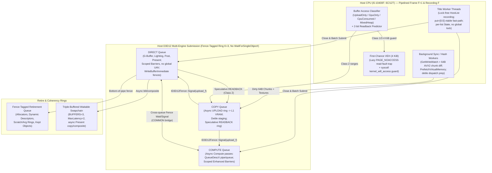

# Chapter 07 — CPU–GPU Pipeline, Synchronization, Command Emulation, and Queue Virtualization

> **Scope and Epistemic Conventions.** This chapter analyzes the temporal control plane between the recompiled CPU code and the host Windows GPU in **VIctory**: command recording, submission serialization, fences, multi-queue scheduling, double/triple buffering, `ExecuteIndirect`, resource barriers, lazy and speculative GPU→CPU readback, prefetching, and the relevant systems literature on GPU virtualization and API remoting.
>
> Throughout, every statement is partitioned strictly into three epistemic classes:
> 1. **Established Fact:** Hardware microarchitecture, D3D12/WDDM/DXGI semantics, and peer-reviewed measurements verified in external primary documentation or academic papers cited inline as `[n]`.
> 2. **Empirical Measurement / Codebase Observation:** Measurements from our test host (Intel Core i5-10400F, 6C/12T, 32 GB DDR4, PCIe 3.0 x16; NVIDIA GeForce RTX 3080 10 GB GDDR6X; Windows) running the statically recompiled 2026 open-world title under VIctory's **Series S profile (`--console series-s`, 1280×720 internal)**, alongside earlier **Series X profile** runs documented in `E:\Projetos\agy_dossie.md`, direct inspection of VIctory's Rust sources on `test15` (`E:\Projetos\VIctory`, read-only), and documented observations from the sibling **XCL** compatibility layer (`C:\Users\henri\AppData\Local\Temp\xcl_h3.md`).
> 3. **Testable Hypothesis (`H-7.1`–`H-7.10`):** Concrete architectural changes paired with quantitative predictions and exact verification protocols against VIctory's `Meter` log line (`host.rs:1761-1768`): `"{fps:.1} fps, {ms:.1} ms/frame ({cpu:.1} preparing: copies {copy_ms:.1} ms {copy_mb:.1} MB, textures {texture_ms:.1} ms {texture_mb:.1} MB; {gpu:.1} on the GPU; {back_ms:.1} copying back {back_mb:.1} MB)"`.

---

## Baseline Control-Plane Anatomy: Why Time Adds Instead of Overlapping

In our measured Series S world-frame run (`1280×720` internal resolution) on the RTX 3080 + i5-10400F host, VIctory's `Meter` reports **`~1,890 ms/frame` (~0.53 fps)**:

| Measured Phase (`Meter` field) | Series S Baseline (`1280×720`) | Earlier Series X Baseline (`agy_dossie.md`, `4K`) | Primary Cause Diagnosed in Chapters 01–06 vs. Chapter 07 Control Plane |
| :--- | :--- | :--- | :--- |
| **CPU `preparing` (total)** | **~860 ms** | ~810 ms | Total submission-thread CPU cost inside `Host::execute` (`host.rs:541-561`), completely blocking the submitting title thread and serialized globally across queues. |
| — `copies` (`copy_ms`, `copy_mb`) | **~440 ms (~270 MB)** | ~380 ms (~170 MB) | `Batch::add` union merges (`host.rs:1323-1333`), `Shadow::writing` snapshots (`shadow.rs:151-181`), `ReadProcessMemory` syscalls (`host.rs:1424-1431`), and `L0 WRITE_BACK` cache invalidations. |
| — `textures` (`texture_ms`, `texture_mb`) | **~140 ms (~475 MB)** | ~170 ms (~540 MB) | `Batch::title_written` clearing `self.textures` (`host.rs:1345`), `guarded = false` forcing `blake3` hashes (`texture.rs:194-231`), and CPU detiling. |
| — Unattributed prepare overhead | **~280 ms** | ~260 ms | Per-draw `List::state` / `Deferred` / `HostHeap` mutexes, `TablePlan::Fresh` hashing & dynamic slot linear scans, `HostList::prelude()` command-list creation, `VirtualQuery`, and lock contention. |
| **GPU execution (`gpu`)** | **~700 ms** | ~1,600 ms | PCIe `L0` buffer bandwidth (`host.rs:2172`), global `UAV_BARRIER`s (`list.rs:344, 1321`), double-barrier `indirect::clamp` (`indirect.rs:222, 230`), Wave64 emulation, fake `1 << 20` occlusion overdraw, and inter-submit idle bubbles (`host.rs:587`). |
| **Copy-back (`back_ms`, `back_mb`)** | **~330 ms (~12 MB)** | ~360 ms (~13 MB) | Eager post-wait `Shadow::copy_back` (`host.rs:629-648`, `shadow.rs:190-260`) scanning entire union spans of `L0` PCIe-snooped memory via `64 KiB` pieces, `RPM`/`WPM`, and bytewise 3-way diffs. |
| **Correctness & Scheduling Gaps** | 430 dropped shaders; lockstep | ~450 dropped shaders; lockstep | Lighting/post passes dropped (black final image despite populated G-buffer); all queues collapsed onto 1 `DIRECT` queue (`queue.rs:81-99`); `WaitForSingleObject(INFINITE)` after every submit (`host.rs:587`). |
| **Sum (Wall-Clock Frame Time)** | **~1,890 ms (~0.53 fps)** | **~2,800 ms (~0.36 fps)** | Strict additive serialization: $T_{\text{frame}} \ge T_{\text{title}} + T_{\text{prepare}} + T_{\text{gpu}} + T_{\text{back}} + T_{\text{present}}$. |

Look closely at the algebraic structure of that total: **`860 ms + 700 ms + 330 ms = 1,890 ms`**. Even if Chapters 03–06 reduce CPU memory-sync preparing from `860 ms` down to `30 ms`, reduce copy-back from `330 ms` down to `5 ms`, translate the remaining 430 shaders, and move hot buffers into `L1 DEFAULT` GDDR6X so GPU execution drops from `700 ms` toward `40–100 ms`, **two structural ceilings remain inside VIctory's control plane**:

1. **Additive timeline and zero concurrency:** As long as `Host::execute` holds a global mutex and calls `WaitForSingleObject(self.event, INFINITE)` (`host.rs:544, 587`) on every `ExecuteCommandLists` submission—and as long as `Host::present` executes its copy/composite synchronously (`host.rs:2055`)—CPU and GPU can never execute concurrently, multi-threaded command recording serializes on submission, and dedicated `COMPUTE`/`COPY` queues sit unused.
2. **Control-plane GPU stalls and eager GPU→CPU pulls:** Even during `GPU` execution itself, VIctory inserts global `UAV_BARRIER`s (`pResource = None`) on every Enhanced Barrier (`list.rs:1314-1326`), every buffer barrier (`list.rs:366-370`), and twice around every `ExecuteIndirect` (`indirect.rs:222, 230`), while executing `indirect::clamp`'s `InterlockedAdd` against a single `u32` in `L0` system RAM over PCIe (`host.rs:1168`, `indirect.rs:64`). And after every submit completes, `Host::execute` eagerly pulls back GPU UAV outputs (`330 ms`) even when no CPU thread ever reads them.

Solving the memory problem (Chapters 03–05) and shader coverage (Chapter 06) supplies the raw ingredients for playable frame rates; **Chapter 07 turns an additive, serialized, barrier-stalled pipeline into an asynchronous, overlapped, demand-driven execution engine.**

---

## 7.1 Lockstep Serialization vs. In-Flight Execution, Frame Pipelining, and Double/Triple Buffering

### 7.1.1 Hardware Execution Timelines: Console Overlap vs. VIctory's Lockstep

Modern real-time rendering engines—especially 60 fps and 30 fps open-world titles on Xbox Series X|S—are structured as **pipelined multi-stage producer-consumer assembly lines** spanning at least two to three concurrent frames in flight [21, 30, 34]. At any instant $t$, a well-pipelined console renderer runs three distinct stages concurrently across silicon domains:

* **Frame $F + 1$ (Simulation & Visibility on CPU):** Game logic, animation, physics, streaming job dispatch, and frustum/portal job preparation run on the Zen 2 CPU cores.
* **Frame $F$ (Command Recording on CPU Worker Threads):** Multiple job threads record D3D12.X graphics, compute, and copy command lists in parallel (`put < limit` inline packets), writing dynamic constants and descriptors into frame-indexed ring buffers.
* **Frame $F - 1$ (GPU Execution on RDNA2 GCE/ACE/SDMA Engines):** The console Command Processor consumes already-submitted command streams from frame $F - 1$ across Graphics, Async Compute, and Copy queues while the display controller scans out Frame $F - 2$ [21, 22, 30].

When frame latency is properly pipelined at $K$ frames in flight (typically $K = 2$ for minimum input latency or $K = 3$ for maximum throughput jitter absorption), steady-state frame interval $T_{\text{interval}}$ approaches the bottleneck stage rather than the sum of all stages:

$$T_{\text{pipelined}} \approx \max\!\left(T_{\text{CPU\_sim+record}}, \; T_{\text{CPU\_submit}}, \; T_{\text{GPU\_exec}}\right)$$

Contrast that with VIctory's current execution model in `crates/victory-gpu/src/host.rs:541-655`. The file's own header comment states the design shortcut candidly (`host.rs:4-5`): *"every submission is waited for, so CPU and GPU never overlap; overlap them with per-submission fences once more than clears run."* Every call from the title to `ID3D12CommandQueue::ExecuteCommandLists` (`queue.rs:114-128`) or `ExecuteCommandListsX` (`queue.rs:148-150`) invokes `Host::execute(&self, runs: &[&HostList])`, which enforces **strict lockstep serialization**:

```
VIctory Current Lockstep Timeline (Single Submission s_i of Frame F, Repeated S Times per Frame):
====================================================================================================
Title Thread A: [Record List L1]──►[queue.execute()]──► acquires self.submitted mutex
Title Thread B: [Record List L2]──────────────────────► BLOCKED on self.submitted mutex!
Host::execute :                    [Batch::run_deferred + flush (CPU prepare)]
                                        │
                                        ▼ ExecuteCommandLists(group) + Signal(fence, N)
Host GPU      :                         └──► [Idle bubble]──►[Execute L1]──►[Idle]
Title Thread A:                                  WaitForSingleObject(INFINITE) (CPU SLEEPING!)
                                                                     │
                                                                     ▼ GPU Done
Host::execute :                                                      [Shadow::copy_back (330 ms)]
                                                                     [Written::write (timestamps)]
                                                                     releases self.submitted mutex
Title Thread A: ◄────────────────────────────────────────────────────┘ continues to next submit s_{i+1}
Title Thread B: ◄────────────────────────────────────────────────────┘ unblocks & repeats cycle!
```

This lockstep design imposes **four compounding structural costs**, three of which remain severe even if memory copies shrink to zero:

1. **Zero CPU/GPU Concurrency ($T_{\text{CPU}} + T_{\text{GPU}}$ Addition):** Every microsecond spent in `run_deferred`, `Batch::flush`, `Shadow::copy_back`, and the title's own game simulation/recording threads occurs while the RTX 3080 sits 100% idle, and every microsecond the RTX 3080 executes shaders occurs while the submitting CPU thread sleeps in `WaitForSingleObject(self.event, INFINITE)` (`host.rs:587`).
2. **Global Mutex Starvation Across Multi-Threaded Title Workers (`self.submitted`, `host.rs:46, 544`):** Modern GDK titles submit multiple command lists per frame from independent worker queues (e.g., an async compute skinning/culling worker, a streaming DMA copy worker, and primary graphics render-graph threads). Holding `self.submitted` across *both* GPU execution (`WaitForSingleObject`) and `Shadow::copy_back` freezes any sibling CPU worker that calls `ExecuteCommandLists` or `PresentX`. Worse, if a title thread attempts to submit on Queue B while Queue A is blocked waiting for a cross-queue GPU event (or simply a long pass), CPU throughput collapses to single-threaded execution.
3. **Intra-Frame Pipeline Drains Across Submissions ($S$ Bubbles per Frame):** An open-world frame is not one `ExecuteCommandLists` call; titles commonly issue $S \approx 8\text{–}40$ command-list submissions per frame (early async compute, shadow passes, G-buffer batches, deferred lighting, post-processing, UI overlay, copy flushes). Under lockstep `WaitForSingleObject` after *every* submission, the RTX 3080's 68 Ampere SMs must completely drain all active warps, flush L1/L2 write caches, report fence completion through WDDM/interrupts to the Windows kernel (`dxgkrnl`), wake the sleeping thread (`SetEvent` → `WaitForSingleObject`), let the CPU run `copy_back` and record the next batch, and re-warm the GPU front end from cold occupancy $S$ times per frame!
4. **Synchronous `Present` Stalls (`host.rs:2055-2060`):** Even `Host::present` (`host.rs:1823-2070`) executes its own `p.copy` command list (`CopyResource` or fullscreen `Compositor` draw) by calling `self.execute(&[&p.copy])` (`host.rs:2055`)—blocking on *another* `WaitForSingleObject(INFINITE)` before calling `p.swap_chain.Present(0, DXGI_PRESENT(0))` (`host.rs:2060`).

### 7.1.2 Quantitative Pipeline Model: Lockstep vs. $K$-Deep In-Flight Execution

Let a single frame contain $S$ submissions $s_1, \dots, s_S$ on the title's queues, plus $T_{\text{game}}$ of CPU simulation and command recording outside `Host::execute`. Let each submission $s_i$ incur CPU prepare time $p_i$, WDDM driver/kernel submission latency $d_i$, GPU execution time $g_i$, GPU-wait/wakeup bubble $w_i$ (interrupt + scheduler wake latency when draining to idle, typically $30\text{–}150\;\mu\text{s}$ per wake on Windows [29]), and copy-back time $b_i$.

Under VIctory's lockstep execution:

$$T_{\text{lockstep}} = T_{\text{game}} + \sum_{i=1}^{S} \left(p_i + d_i + g_i + w_i + b_i\right) + T_{\text{present\_sync}}$$

In our Series S baseline:
$$\sum p_i \approx 860\;\text{ms}, \qquad \sum (d_i + g_i + w_i) \approx 700\;\text{ms}, \qquad \sum b_i \approx 330\;\text{ms}$$
giving $1,890\;\text{ms}$ inside `Meter` before adding unmeasured title-side simulation $T_{\text{game}}$ between submissions.

Now suppose instead we decouple submission from completion using an **in-flight submission ring** of depth $K$ frames (with $M$ outstanding submission slots, e.g., $K = 2$ or $3$ frames, $M = 64$ or $128$ submission descriptors), eliminating per-submit `WaitForSingleObject` and deferring reclamation until the GPU passes each submission's fence tag:

1. **Inter-submit GPU bubbles vanish ($\sum w_i \to 0$):** Submissions $s_1, \dots, s_S$ queue back-to-back in the WDDM hardware queue / ring buffer. While the GPU executes $s_i$, the GPU command processor has already prefetched $s_{i+1}$ and can overlap tail waves of $s_i$ with head waves of $s_{i+1}$ (absent explicit barriers).
2. **CPU prepare and title simulation overlap GPU execution:** While the RTX 3080 runs frame $F - 1$'s $G = \sum g_i$, the i5-10400F executes frame $F$'s simulation $T_{\text{game}}$ and prepare $\sum p_i$ (and submits $s_1 \dots s_S$ ahead of GPU completion).
3. **Steady-state throughput becomes:**

$$T_{\text{pipelined}} = \max\!\left(T_{\text{game}} + \sum_{i=1}^{S} (p_i + d_i + b_i^{\text{async}}), \;\; \sum_{i=1}^{S} g_i^{\text{overlapped}}\right)$$

To see the leverage numerically at two distinct stages of VIctory optimization:

| Optimization Regime (Series S 720p Target) | CPU (`T_game + prep + copy_back`) | GPU (`exec`) | Lockstep Frame Time (Sum) | Pipelined $K=3$ Frame Time (`max`) | Pure Lockstep Removal Speedup |
| :--- | :--- | :--- | :--- | :--- | :--- |
| **Current Baseline (No Mem/Shader Fixes)** | `860 + 330 = 1,190 ms` (+ `T_game`) | `700 ms` | `~1,890 ms` (`0.53 fps`) | `~1,190 ms` (`0.84 fps`) | **1.59×** (CPU-bound; GPU waits on CPU) |
| **Mid-Path (Mem Sync Cut 10×, Copy-Back Lazy, Ch03–05)** | `~60 + ~10 = 70 ms` (+ `~8 ms` `T_game`) | `~180 ms` (incl. Wave64 + barriers) | `~258 ms` (`3.88 fps`) | `~180 ms` (`5.56 fps`) | **1.43×** |
| **Target Tuned Path (`L1` VRAM + Barrier/Indirect + Wave64 Fixes)** | `~18 ms` (+ `~8 ms` `T_game` = `26 ms`) | `~28 ms` (RTX 3080 @ 720p) | `~54 ms` (`18.5 fps`) | **`~28 ms` (`35.7 fps`)** | **1.93×** (crosses 30 fps threshold!) |
| **Full Async Compute + CPU Multi-Thread Recording** | `~12 ms` | `~22 ms` | `~34 ms` (`29.4 fps`) | **`~22 ms` (`45.5 fps`)** | **1.55×** (approaches 60 fps with VRS/DRS!) |

Notice why removing lockstep is essential **both** structurally and chronologically: while in the unoptimized baseline removing lockstep alone only yields ~1.59× because `1,190 ms` CPU preparing+copy-back exceeds `700 ms` GPU, **once memory sync and copy-back drop below GPU time, lockstep costs nearly 2× of every frame**—literally the difference between ~18 fps and >35 fps on an RTX 3080!

### 7.1.3 Double vs. Triple Buffering, Waitable Swap Chains, and Frame Resource Lifetimes

Transitioning from lockstep (`K = 0` in flight) to pipelined execution introduces two classic hazards: **CPU/GPU resource overwrite races** and **excessive input-to-photon queueing latency (buffer bloat)**.

#### Double vs. Triple Buffering Trade-Offs

In D3D12, `IDXGISwapChain` buffering (`BUFFERS`) and CPU-ahead-of-GPU frame buffering ($K_{\text{flight}}$) are distinct but coupled parameters [30, 32]:

| Configuration | Swapchain Buffers | Max Frames in Flight ($K$) | Input-to-Display Latency (at $T_{\text{GPU}} = 28\;\text{ms}$) | Tolerance to Single-Frame Spike | VRAM Cost (720p/1080p RGBA8 + Backings) | Current VIctory Status |
| :--- | :--- | :--- | :--- | :--- | :--- | :--- |
| **Lockstep (`K = 0`)** | 2 (`host.rs:1529`) | 1 submit at a time | $T_{\text{CPU}} + T_{\text{GPU}} + T_{\text{back}}$ (no queuing, high frame time) | Zero (every spike stalls both sides) | 1× allocator/scratch/arg/shadow set | **Current (`host.rs:587`)** |
| **Double Buffering (`K = 2`)** | 2 (`DXGI_SWAP_EFFECT_FLIP_DISCARD`) | 2 frames (`SetMaximumFrameLatency(2)`) | 1–2 frame intervals (~28–56 ms) | Low (if frame $F$ spikes on CPU or GPU, frame $F+1$ immediately stalls waiting for frame $F-1$'s allocator) | ~2× per-frame transient rings (~16–32 MB) | Swapchain already uses `BUFFERS = 2` (`host.rs:1529`) |
| **Triple Buffering (`K = 3`)** | 3 (`BUFFERS = 3`) | 2–3 frames (`SetMaximumFrameLatency(2..3)` + waitable object) | 2–3 frame intervals (bounded to 2 via waitable object [32]) | **High** (CPU prepares $F+2$ while GPU finishes $F$ and DWM scans out $F-1$ without stalling!) | ~3× per-frame transient rings (~24–48 MB) | Optimal target for open-world streaming + DXC/host jitter |

Why does **double buffering (`BUFFERS = 2`)** frequently stall under `DXGI_SWAP_EFFECT_FLIP_DISCARD` even when CPU and GPU are decoupled? On Windows DWM (Desktop Window Manager), the currently displayed front buffer is locked for scanout by DWM until the next VSync / composition flip [32]. With only **2** swapchain buffers, while DWM displays buffer 0, the GPU can only render into buffer 1. When the GPU finishes rendering frame $F$ into buffer 1 and calls `Present(0, 0)`, DWM may still hold buffer 0; the subsequent `GetCurrentBackBufferIndex()` / next `Present` blocks until DWM releases buffer 0. Moving to **3 swapchain buffers (`BUFFERS = 3`)** paired with **`DXGI_SWAP_CHAIN_FLAG_FRAME_LATENCY_WAITABLE_OBJECT`** (`IDXGISwapChain2::SetMaximumFrameLatency(2)` and `GetFrameLatencyWaitableObject()`, [32]) decouples DWM scanout ownership from GPU rendering without letting the CPU queue 4+ frames of stale input lag!

#### Per-Submission Resource Lifetime Rules in VIctory

In D3D12, **every object referenced by a command list must remain alive and immutable until the GPU fence signaled after `ExecuteCommandLists` reaches its target value** [21, 30]. Auditing VIctory's current codebase reveals **eight distinct object classes** that today rely on `WaitForSingleObject(INFINITE)` for safety and would suffer catastrophic UAF (use-after-free), GPU page faults, or silent visual corruption if lockstep were naively deleted:

1. **`HostList::allocator` and `HostList::prelude.0` (`host.rs:314, 331, 945-949, 1005`):** Calling `CommandAllocator::Reset()` while the GPU still reads commands from it triggers D3D12 validation errors and corrupts hardware ring fetch pointers.
2. **`HostList::scratch` (`host.rs:320, 392-396, 938, 1133-1160`):** `SCRATCH_CHUNK = 4 MiB` upload buffers holding per-draw `UserData` CBVs (`draw.rs:596`), unaligned root CBVs (`draw.rs:192`), table CBVs (`draw.rs:1163`), and expanded rectangle vertices (`draw.rs:1382`). Today `HostList::reset` sets `(scratch.current, scratch.used) = (0, 0)` immediately (`host.rs:938`), assuming prior submissions finished!
3. **`HostList::arguments` (`host.rs:322, 404-413, 942, 1189-1206`):** `ARGUMENT_CHUNK = 64 KiB` buffers holding `indirect::rectangles` output (`indirect.rs:261`). `reset` resets `filled = 0, used = 0`.
4. **`HostList::budget` (`host.rs:336, 1164-1183`):** Single `256 B` `shared_buffer` zeroed by CPU `Step::Host` (`write_volatile(0)` at `host.rs:1179`) before submission—if two submissions of the same list or two frames overlap, the second submission's CPU zeroing corrupts the first submission's in-flight `indirect::clamp` atomic counter!
5. **`HostList::deferred().uploads` (`host.rs:446, 1124-1129`) & `List::uploads` (`list.rs:117, 267-268`):** Texture staging upload buffers and `allocate_upload` buffers (`list.rs:962-979`) cleared on `list::reset`.
6. **`HostList::deferred().kept` (`host.rs:450, 1209-1213`) & `HostList::states` (`host.rs:329, 355-358`):** Referenced `ID3D12PipelineState`, `ID3D12RootSignature`, `ID3D12DescriptorHeap`, and `Arc<HostTexture>` handles. Note that `Host::rtv` (`host.rs:799-813`) and `Host::dsv` (`host.rs:816-830`) cycle a **fixed `RTV_RING = 1024`** (`host.rs:39`)! Wait—in D3D12, RTV/DSV CPU descriptor handles are copied by value into `OMSetRenderTargets`/`Clear*` at command-list recording time on most drivers, **except** if a driver defers descriptor capture until `ExecuteCommandLists` or if `RTV_RING` wraps inside a single large submission (`> 1024` RT binds)! Under `3` frames in flight, keeping `RTV_RING = 1024` is safe only if drivers snapshot CPU descriptors at `OMSetRenderTargets` (Microsoft Learn confirms non-shader-visible CPU RTV/DSV descriptors may be overwritten immediately after the recording call, though verifying or expanding `RTV_RING` to `4096` is cheap).
7. **Dynamic Descriptor Heap Leases (`State::dynamic`, `draw.rs:88, 98-103`, `descriptor/host.rs:675-744`):** `State::drop` (`draw.rs:98-104`) and `HostList::reset` (`list.rs:270-273` resetting `State`) immediately call `descriptor::release_dynamic(heap, first, n)`! If list `L` is submitted and immediately `Reset` by the title for frame $F+1$ (a standard D3D12 pattern where titles use 2–3 allocators per list or reset after submitting on a fence!), releasing dynamic descriptor slots before GPU completion allows frame $F+1$ to overwrite the shader-visible descriptor slots while frame $F$'s shaders are still executing! Notice the comment in `descriptor/host.rs:515-518`: *"2^16 ran out seconds into the world (every world run on an RX 9070 XT, each a device removal shortly after; #59)."* Under async execution, dynamic descriptor slots **must** be retired by fence value, not by `List::reset` or `State::drop`!
8. **`Shadow::before` & `Shadow::pending` (`shadow.rs:40-46, 151-260`) and `HostList::deferred().writes` (`host.rs:458, 649-653`):** Under lockstep, there is only one `before` snapshot and one `pending` vector per `Shadow` (`host.rs:542-543`), and bottom-of-pipe `writes` run on the CPU right after `WaitForSingleObject`. Once multiple submissions are in flight, `Shadow` updates, `before` snapshots (if retained), `pending` intervals, and bottom-of-pipe `Written` entries must all be keyed by **submission fence ID** rather than overwriting global mutable state!

### 7.1.4 Concrete In-Flight Retirement Ring Design (Pseudocode)

Instead of binding resource lifetime to `HostList::reset()`, D3D12 engines use a **Fence-Tagged Retirement Queue** coupled with a **Pool of Command Allocators and Frame/Ring Upload Arenas** [30]:

```rust
// Conceptual fence-tagged retirement ring replacing lockstep in Host::execute (host.rs:541)
struct InFlightSubmission {
    fence_value: u64,
    allocators: Vec<ID3D12CommandAllocator>,         // main + prelude allocators
    transient_buffers: Vec<ID3D12Resource>,          // one-off upload / readback buffers
    kept_objects: Vec<windows::core::IUnknown>,      // PSOs, root sigs, textures, heaps
    dynamic_desc_leases: Vec<(usize, u32, u32)>,     // (host_heap, first_slot, count)
    scratch_slices: Vec<(Arc<RingChunk>, u64, u64)>, // suballocated upload ring ranges
    pending_writes: Vec<(usize, Written, usize)>,    // deferred only if CPU-readback needed
    gpu_write_ranges: Vec<(Arc<Shadow>, usize, usize)>,
}

struct SubmissionRing {
    next_fence: AtomicU64,
    in_flight: Mutex<VecDeque<InFlightSubmission>>,
    allocator_pool: Mutex<Vec<ID3D12CommandAllocator>>,
    frame_events: Mutex<VecDeque<(u64, HANDLE)>>,
}

impl SubmissionRing {
    /// Reclaims all resources whose GPU fence has completed without blocking.
    fn retire_completed(&self, host_fence: &ID3D12Fence) {
        let completed = unsafe { host_fence.GetCompletedValue() };
        if completed == u64::MAX {
            // Device removed (as caught in XCL PR #109, xcl_h3.md:903)
            handle_device_removed();
        }
        let mut q = self.in_flight.lock().unwrap();
        while let Some(front) = q.front() {
            if front.fence_value > completed {
                break;
            }
            let done = q.pop_front().unwrap();
            for alloc in done.allocators {
                unsafe { let _ = alloc.Reset(); }
                self.allocator_pool.lock().unwrap().push(alloc);
            }
            for (heap, first, count) in done.dynamic_desc_leases {
                crate::descriptor::release_dynamic(heap, first, count);
            }
            // Release transient_buffers, kept_objects, scratch ring head, etc.
        }
    }

    /// Blocks ONLY when in-flight depth exceeds MAX_FRAMES_IN_FLIGHT (e.g. 3)
    /// or ring memory pressure exceeds budget.
    fn throttle_if_full(&self, host_fence: &ID3D12Fence, max_in_flight: usize) {
        let wait_target = {
            let q = self.in_flight.lock().unwrap();
            if q.len() >= max_in_flight {
                Some(q[q.len() - max_in_flight].fence_value)
            } else {
                None
            }
        };
        if let Some(val) = wait_target {
            if unsafe { host_fence.GetCompletedValue() } < val {
                wait_for_fence_event(host_fence, val);
            }
            self.retire_completed(host_fence);
        }
    }
}
```

Notice the critical separation: **a title calling `CommandList::Reset(title_allocator, pso)` does NOT wait on the host GPU!** Instead, `HostList::close()` detaches its active `ID3D12CommandAllocator`, dynamic descriptor leases, and scratch slice references into the pending submission payload, while `list::reset()` grabs a *fresh, already-retired* `ID3D12CommandAllocator` from `allocator_pool` (creating a new one only if the pool is empty, up to 3–4 per worker thread). Thus, the title can immediately record Frame $F+1$ on the exact same `list` pointer while the RTX 3080 renders Frame $F$!

---

## 7.2 Fences, Monitored Fences, and Cross-Queue Synchronization Semantics

### 7.2.1 How WDDM Monitored Fences Work Under the Hood

Direct3D 12 decouples synchronization from command lists via `ID3D12Fence`—a monotonic 64-bit unsigned integer counter backed in WDDM 2.0+ by a **monitored fence** object (`DXGK_MONITOREFENCE`) [21, 22, 28]. Unlike pre-WDDM 2.0 DMA fence polling or coarse per-submission implicit locks, a monitored fence exposes dual virtual mappings [28]:

* **`FenceValueCPUVirtualAddress`:** A read-only CPU virtual page mapped directly to the fence's 64-bit memory slot. Reading `GetCompletedValue()` does **not** require a kernel syscall (`D3DKMT*`); it executes a single cached/coherent `mov rax, [addr]` instruction in user mode [28].
* **`FenceValueGPUVirtualAddress`:** A GPU virtual address readable and writable by the GPU Command Processor (`RELEASE_MEM` / `FENCE` packet on AMD CP/MEC; semaphore release/acquire on NVIDIA) and visible to the Windows GPU scheduler (`VidSch` or HAGS) [28, 29].

Three operations drive every multi-engine and CPU–GPU handshake [21, 22, 28]:

1. **`ID3D12CommandQueue::Signal(fence, val)`:** Appends a bottom-of-pipe GPU fence-write command to the queue's ring. Once all preceding work on that queue reaches completion and flushes caches, the GPU writes `val` to `FenceValueGPUVirtualAddress` and raises a scheduler/MSI-X interrupt if any CPU event or dependent queue is waiting on `val` [28].
2. **`ID3D12CommandQueue::Wait(fence, val)`:** Enqueues a GPU-side scheduler barrier on the target queue. The hardware/scheduler holds subsequent command buffers on that queue until `fence >= val` **without waking or blocking the CPU** [22]. Under Hardware-Accelerated GPU Scheduling (HAGS, introduced in WDDM 2.6/2.7 [29]), the GPU's own scheduling microcontroller resolves cross-queue fence dependencies directly on-device without waking a CPU kernel thread.
3. **`ID3D12Fence::SetEventOnCompletion(val, hEvent)` + `ID3D12Fence::Signal(val)`:** Bridges CPU and GPU timelines in both directions—allowing the CPU to sleep on an OS event until the GPU reaches `val`, or allowing the CPU to signal `val` to unblock a GPU queue waiting via `queue.Wait(fence, val)` [21].

### 7.2.2 Console `ID3D12FenceX` Extensions vs. VIctory's Decoupled `fence.rs`

Xbox Series GDK extends D3D12 fences with low-level primitives tailored to unified memory and predictable console scheduling:

* **Direct Memory Reading (`ID3D12FenceX::GetGpuAddress` / memory polling):** As documented in VIctory (`fence.rs:27-29, 117-119, 165`: *"Grand Theft Auto VI reads the value at the fence's address"*), the console title calls slot 12 (`0x60`) to obtain the 64-bit address of the fence value and polls `*fence_ptr` directly in tight CPU spin loops or lockless job checks, bypassing COM `GetCompletedValue()` calls!
* **`ID3D12CommandQueueX::Signal2X(fence, val, bottom_sync, top_sync)` (`queue.rs:153-161`):** Allows the title to specify whether a queue signal waits for bottom-of-pipe (pixel/compute completion + cache flush) or top-of-pipe (command fetch completion) before publishing the fence value.
* **Inline Command-List Memory Writes & Waits (`Write32BitValueBottomOfPipeX`, `Write64BitValueBottomOfPipeX`, `WaitOnAddress` / `wait_value`, `list.rs:1304-1358`):** Rather than allocating a full `ID3D12Fence` COM object for every pass, titles write 32-bit or 64-bit completion tokens (or GPU timestamps) straight into unified title memory when a render pass finishes, and wait on arbitrary memory locations (`wait_value` at `list.rs:1304-1307`) on GPU queues.

Now look at how VIctory currently implements `fence.rs` (`crates/victory-gpu/src/fence.rs:25-120`) and `queue.rs` (`crates/victory-gpu/src/queue.rs:153-173`):

```
Current Decoupled Fence Architecture in VIctory (Broken Under Async Execution):

  Title Fence (`fence.rs:25`)                 Host D3D12 (`host.rs:44`)
  +-------------------------+                 +-------------------------+
  | value: AtomicU64        |  (NO LINK!)     | host.fence: ID3D12Fence |
  | waiters: Mutex<Vec>     |                 | (internal to execute)   |
  +-------------------------+                 +-------------------------+
         ^           ^                               ^
         |           |                               |
  gpu_address()  queue::signal()              Host::execute()
  returns &value immediately stores val       signals & waits INFINITE
                 & fires events!              before returning!
  queue::wait() -> returns S_OK (no-op!)
```

Examine the four fatal assumptions embedded in `fence.rs` and `queue.rs` once lockstep is removed:

1. **`queue::signal` advances the title fence on the CPU *immediately* (`queue.rs:164-169`):** Because `queue::execute` currently blocks until GPU work is finished, calling `crate::fence::signal(fence, value)` synchronously inside `queue::signal` works today. The moment `Host::execute` returns asynchronously while the GPU is still rendering, an immediate CPU `fence::signal` tells the title that the GPU is already done—causing the title to overwrite in-flight vertex/constant/render-target memory, recycle command allocators mid-flight, and read uninitialized `copy_back` outputs!
2. **`queue::wait` is an unconditional `S_OK` no-op (`queue.rs:171-173`):** Once multiple queues (`DIRECT`, `COMPUTE`, `COPY`) run concurrently, ignoring `queue.Wait(fence, val)` causes compute passes to consume unwritten G-buffer textures or graphics passes to sample half-uploaded staging textures, creating race corruption and TDR device removals.
   > **Correction (cross-checked 24 Nov 2026, see Chapter 06, H-6.14):** this is not only a future hazard. Because
   > `ExecuteCommandLists` runs each submission synchronously *at the moment it is called*, an ignored `Wait` already
   > reorders work **today**, with a single host queue: a consumer submitted on the compute queue behind
   > `Wait(fence, N)` runs before the producer that another queue submits later and that signals `N`. The consumer reads
   > memory that was never written. The XCL author independently reported the same mechanism ("the GPU ends up waiting
   > on itself in the wrong order, so the game draws from data that was never written") as a cause of the black screen
   > and the crash. The fix is to defer a queue's later submissions until the awaited fence value is reached.
3. **`fence::set_event_on_completion` fails with `E_NOTIMPL` on null event (`fence.rs:90-95`):** In D3D12, passing `hEvent == NULL` to `SetEventOnCompletion(value, NULL)` means *"block the calling CPU thread until the fence reaches `value`"* [21]. VIctory logs `"blocking fence wait not implemented"` and returns `E_NOTIMPL` because under lockstep no future fence value is ever pending. Under async execution, any title worker passing `NULL` will immediately fail or misbehave!
4. **`gpu_address()` points to CPU-only `Fence::value` (`fence.rs:117-119`), not a GPU-written location:** Because `Grand Theft Auto VI` dereferences the pointer returned by `gpu_address()` directly on the CPU (`fence.rs:165`), keeping a real host `ID3D12Fence` is **not enough by itself**! A host `ID3D12Fence`'s internal `FenceValueCPUVirtualAddress` is opaque to user-mode D3D12 applications (it is exposed only inside WDDM kernel drivers [28], not via the public D3D12 API). Therefore, if the title polls `*(uint64_t*)gpu_address` in a loop without calling `GetCompletedValue()`, the CPU pointer would stay frozen forever unless explicitly bridged!

### 7.2.3 Designing a Complete Fence Bridge for Async Execution

To make fences 100% faithful under asynchronous, multi-queue execution—including direct memory polling via `gpu_address()`—we design a **Dual-Backed `HostFence` Bridge**:

1. **Every title `fence::Fence` owns a real host `ID3D12Fence`** (created via `host.device.CreateFence(initial, D3D12_FENCE_FLAG_NONE)`), alongside its CPU-visible `value: AtomicU64` (`fence.rs:29`).
2. **Host `Queue::Signal` and `Queue::Wait` map 1:1 onto the matching host `ID3D12CommandQueue`:**
   * `queue::signal(title_q, title_f, val)` calls `host_q.Signal(&title_f.host_fence, val)` on the GPU timeline!
   * `queue::wait(title_q, title_f, val)` calls `host_q.Wait(&title_f.host_fence, val)` on the GPU timeline!
   * Note a crucial subtlety in D3D12: **a GPU `Signal` does not automatically update `title_f.value: AtomicU64` in CPU memory.** How do we keep `*(gpu_address())` updated with minimal overhead?
     * **Mechanism A (Hardware `WriteBufferImmediate` + `L0` Shared Slot / `CopyBufferRegion`):** On command queues supporting `ID3D12GraphicsCommandList2::WriteBufferImmediate` (`DIRECT` and `COMPUTE`), immediately after a queue's work (or inside a tiny trailing command list appended before `host_q.Signal(&title_f.host_fence, val)`), emit a single `WriteBufferImmediate` writing the 64-bit value `val` into a 8-byte slot in a persistent **`D3D12_HEAP_TYPE_CUSTOM` (`WRITE_BACK`, `L0`)** fence-page buffer—OR return that exact `L0` slot's CPU pointer as `Fence::gpu_address()`! Wait: verify that! Because `Fence::gpu_address()` is a `u64` returned to the title (`fence.rs:117-119`), if each `Fence` allocates an 8-byte aligned slot inside a global `64 KiB` `L0 WRITE_BACK` page (`shared_buffer(65536)`), then:
       - `WriteBufferImmediate` (GPU `WRITE_BUFFER_IMMEDIATE` packet, supported on `DIRECT` and `COMPUTE` in D3D12 feature level 12_0+) writes `val` directly across PCIe into that coherent `L0` cache line at bottom-of-pipe completion!
       - The title polling `*(volatile uint64_t*)gpu_address()` sees `val` update via hardware PCIe cache snoop **without waking a single CPU waiter thread**!
       - Caveat on `COPY` queues: `COPY` queues in D3D12 do *not* support `WriteBufferImmediate` (`ID3D12GraphicsCommandList2`), though a 8-byte `CopyBufferRegion` from an immutable `UPLOAD` constant slot or a small watcher thread on `SetEventOnCompletion` covers `COPY`-queue signals cleanly!
     * **Mechanism B (Lightweight Watcher Fallback + Lazy Polling on `GetCompletedValue`):** For `SetEventOnCompletion(val, event)` and `COPY`-queue `Signal`, register `(val, event)` against `title_f.host_fence.SetEventOnCompletion(val, watcher_event)`. Whenever `GetCompletedValue()` (`fence.rs:78-80`) is called, query `title_f.host_fence.GetCompletedValue()` directly in user space (nanosecond cached read of WDDM's `FenceValueCPUVirtualAddress` [28]), synchronize `title_f.value`, and return it. And if `event == NULL` in `set_event_on_completion` (`fence.rs:90`), allocate/reuse a thread-local auto-reset event, call `host_fence.SetEventOnCompletion(val, tls_event)`, and `WaitForSingleObject(tls_event, INFINITE)` instead of returning `E_NOTIMPL`!
3. **Device-Removal Safety Check:** Every fence read/wait must guard against `completed == u64::MAX`, which D3D12 returns after `DXGI_ERROR_DEVICE_REMOVED` (`xcl_h3.md:903`), preventing infinite spin loops if a GPU TDR occurs.
4. **Bridging `Write32/64BitValueBottomOfPipeX` (`list.rs:1332-1344`) and `wait_value` (`list.rs:1304-1307`):** Instead of holding `Written::Value(v)` on the CPU until `WaitForSingleObject` completes (`host.rs:649-653`), record `WriteBufferImmediate` (for 32/64-bit values into an `L0` fence/marker shadow or copy-back slot) and real GPU timestamp queries (Chapter 08) directly in the GPU command list, and translate `wait_value` onto `ID3D12Fence` waits or GPU polling only when targeting cross-queue synchronization!

---

## 7.3 Multiple Queues (`DIRECT`, `COMPUTE`, `COPY`), Async Overlap, and Common-State Promotion/Decay

### 7.3.1 Console Hardware Engines vs. Windows D3D12 Queue Taxonomy

On Xbox Series S/X, AMD's RDNA2 GPU exposes three physically distinct command-processor scheduling domains running concurrently against the unified GDDR6 controller:

1. **Graphics Command Engine (GCE / `DIRECT` queue):** Executes rasterization, vertex/mesh/geometry shaders, ROP/color/depth exports, and inline compute dispatches.
2. **Asynchronous Compute Engines (ACEs / `COMPUTE` queues):** Multiple hardware compute pipes (`QueueDescX::engine_or_pipe`, `queue` at `queue.rs:72-77`, e.g., Grand Theft Auto VI's `{COMPUTE, 0, pipe 1, queue 0}` noted in `queue.rs:529`) capable of executing compute shaders concurrently alongside graphics draws whenever the GCE is bottlenecked on rasterizer frontend, fixed-function ROP/depth, or memory latency [37, 39].
3. **Copy / SDMA DMA Engines (`COPY` queues):** Dedicated hardware DMA copy engines moving memory blocks and subresource layouts asynchronously without consuming shader CUs/SMs.

In VIctory today, `queue::create_x` (`queue.rs:81-99`) logs `QueueDescX`, drops `engine_or_pipe` and `queue` (`queue.rs:92-98`), and maps every created `Queue`—whether `DIRECT` (0), `COMPUTE` (2), or `COPY` (3)—onto the single `D3D12_COMMAND_LIST_TYPE_DIRECT` queue inside `Host` (`host.rs:193-196`), while `Host::new_list` (`host.rs:500-538`) creates only `D3D12_COMMAND_LIST_TYPE_DIRECT` allocators and lists regardless of `List::kind` (`list.rs:98-100`).

### 7.3.2 When Async Compute & Copy Actually Win (and When They Lose)

Before splitting queues in VIctory, it is crucial to apply hardware reality from AMD GPUOpen's *"Leveraging Asynchronous Queues for Concurrent Execution"* [39], *"AMD RDNA Performance Guide"* [37], and NVIDIA's *"Advanced API Performance: Async Compute and Overlap"* [35]:

* **Where Async `COMPUTE` Wins (~10%–25% GPU speedup):**
  * **Complementary resource profiles:** Overlapping ALU-heavy or register-light compute dispatches (clustered light culling, Hi-Z mip generation, particle updates, skinning, SSAO/SSR ray-marching) with **depth-only / shadow-map passes**, **export-bound pixel passes**, or **heavy barrier/resolve transitions** on the `DIRECT` queue [35, 37, 39]. During shadow map rendering, SMs/CUs frequently run at low occupancy waiting on fixed-function rasterization and depth writes; an async compute wave fills the otherwise idle ALU schedulers [37, 39].
  * **Small-to-medium workgroup footprints:** As AMD notes [37], smaller threadgroups (e.g., 64 threads) pack flexibly around graphics waves in shared SM/CU slots without exhausting LDS or VGPR files.
* **Where Async `COMPUTE` Hurts:**
  * **Shared bandwidth or register saturation:** If `DIRECT` already saturates GDDR6X memory bandwidth (760 GB/s) or SM VGPRs/LDS, adding concurrent compute causes thrashing and lowers total throughput [35, 37]. Even worse on VIctory *today*: while title buffers sit in PCIe `L0` system memory (`host.rs:2172`), running compute and graphics concurrently simply doubles contention on the ~13 GB/s PCIe 3.0 bus! Thus **moving hot buffers to `L1 DEFAULT` VRAM (Chapter 04) is a strict prerequisite for profitable async compute overlap**.
  * **Over-fragmented `ExecuteCommandLists` submissions:** Sending tiny 2–3 dispatch async compute lists incurs WDDM `ExecuteCommandLists` + cross-queue fence overhead (~20–80 µs) that exceeds the overlap gain [34, 39]. NVIDIA and AMD both advise reserving async compute queues for substantial work batches (>200–500 µs GPU duration) [35, 37].
* **Where `COPY` Queues Win:**
  * Dedicated PCIe DMA copy engines (`D3D12_COMMAND_LIST_TYPE_COPY`) transfer CPU→GPU texture/buffer uploads (`CopyTextureRegion`, `CopyBufferRegion`) and GPU→CPU readbacks asynchronously over PCIe **without occupying shader cores or stalling 3D/compute command processing** [22, 35, 39]. On our RTX 3080 (PCIe 3.0 x16), uploading ~15–30 MB of streamed world textures/buffers on a `COPY` queue while the 3D engine renders frame $F-1$ hides ~1–3 ms of PCIe transfer latency completely behind GPU compute/raster work.

### 7.3.3 D3D12 Common State Promotion, State Decay, and Cross-Queue Hazards

Enabling genuine `COMPUTE` and `COPY` queues in VIctory breaks `HostList::transition` (`host.rs:959-1015`) and `HostTexture::state` (`resource.rs:1069-1084`) immediately unless VIctory strictly honors **D3D12's Common State Promotion, Decay, and Queue-Capability Rules** [22, 23]:

| Resource & Queue Rule (D3D12 Legacy Barriers [22, 23]) | Exact Behavior in D3D12 Specification | Consequence for VIctory Multi-Queue Port |
| :--- | :--- | :--- |
| **`COPY` Queue Permitted States** | Only `COMMON`, `COPY_DEST`, and `COPY_SOURCE` are valid on `D3D12_COMMAND_LIST_TYPE_COPY` [22, 23]. Any `SRV`, `UAV`, `RTV`, or `DSV` barrier on a `COPY` list causes `DEVICE_REMOVED` / validation error. | `HostList` must track `queue_kind` (`DIRECT`, `COMPUTE`, `COPY`); `list::barrier` (`list.rs:353`) and `ensure_state` (`list.rs:391`) must strip non-copy states on `COPY` lists and reject/split invalid transitions. |
| **Mandatory `COMMON` Bridge Across `COPY` ↔ `DIRECT`/`COMPUTE`** | Resources **must be in `D3D12_RESOURCE_STATE_COMMON`** before entering a `COPY` queue, and cannot stay in `RENDER_TARGET`/`UAV`/`PIXEL_SHADER_RESOURCE` across a `COPY` handoff [22, 23]. | If `DIRECT` wrote a texture as `RENDER_TARGET` or `UAV` and a `COPY` queue later reads/writes it, `DIRECT` must transition it to `COMMON` before signaling the cross-queue fence! |
| **Buffer Implicit Promotion & Decay** | Buffers in `COMMON` implicitly promote to any first-used state (read or write) and **always decay back to `COMMON`** when `ExecuteCommandLists` completes [23]. | Buffers updated on `COPY` (`COPY_DEST`) decay back to `COMMON` at submit end, allowing `DIRECT`/`COMPUTE` to consume them immediately after a fence wait with zero barrier! |
| **Texture Read-Only Promotion & Decay** | Textures in `COMMON` can implicitly promote to read-only states (e.g. `PIXEL_SHADER_RESOURCE`, `NON_PIXEL_SHADER_RESOURCE`, `COPY_SOURCE`) and **decay back to `COMMON`** on `ExecuteCommandLists` completion [23]. | Streamed textures uploaded on `COPY` (or `COPY_DEST` -> `COMMON` decay on `COPY` queue) arrive in `COMMON` on `DIRECT`/`COMPUTE` and can promote straight to `SRV`—no `prelude` barrier needed if tracked accurately! |
| **Texture Write-State Non-Decay** | Textures transitioned or promoted to **write states** (`RENDER_TARGET`, `UNORDERED_ACCESS`, `DEPTH_WRITE`) or explicit barriers on non-simultaneous textures **do NOT decay** at `ExecuteCommandLists` end (except on `COPY` queues, where all resources decay to `COMMON`) [23]. | `HostTexture::state` (`resource.rs:1071`) currently swaps `*last` blindly inside `prelude()` (`host.rs:988`). With multi-queue and async execution, `HostTexture::state` must reflect **per-queue-timeline submitted state** (accounting for automatic `COMMON` decay on `COPY` and read-only textures!) rather than a single global atomic swapped during lockstep `execute()`. |
| **`COMPUTE` Queue State Restrictions** | `COMPUTE` supports `COMMON`, `UNORDERED_ACCESS`, `NON_PIXEL_SHADER_RESOURCE`, `COPY_DEST`, `COPY_SOURCE`, `INDIRECT_ARGUMENT`, `CONSTANT_BUFFER`, etc., but **forbids** `PIXEL_SHADER_RESOURCE`, `RENDER_TARGET`, `DEPTH_WRITE`, `DEPTH_READ`, `INDEX_BUFFER`, `VERTEX_BUFFER` [22, 23]. | Notice `draw::sync_slot` (`draw.rs:1653`) transitions *every* SRV texture to `0x40 \| 0x80` (`NON_PIXEL_SHADER_RESOURCE \| PIXEL_SHADER_RESOURCE`)! If a `COMPUTE` list runs `sync_slot`, `0x80` (`PIXEL_SHADER_RESOURCE`) is **illegal on a `COMPUTE` queue**! Must mask out `0x80` on `COMPUTE` lists! |

Look at that hidden bug we just caught by checking `draw.rs:1653` against D3D12's multi-engine specification:
```rust
// crates/victory-gpu/src/draw.rs:1653
const SHADER_RESOURCE: u32 = 0x40 | 0x80; // NON_PIXEL_SHADER_RESOURCE | PIXEL_SHADER_RESOURCE
```
Today that works *only* because `Host::new_list` forces every list—even compute lists—onto `D3D12_COMMAND_LIST_TYPE_DIRECT` (`host.rs:505-510`)! The instant `Host::new_list` creates a real `D3D12_COMMAND_LIST_TYPE_COMPUTE` command list for a title compute queue, `sync_slot`'s `0x80` (`PIXEL_SHADER_RESOURCE`) transition will trigger an immediate D3D12 Debug Layer error and driver fault/device removal on `ResourceBarrier`! Catching `queue_kind`-masked state bits (`!PIXEL_SHADER_RESOURCE` on `COMPUTE`, `COPY_*` only on `COPY`) is mandatory before turning on multi-queue execution.

Even better: `HostList::prelude()` (`host.rs:983-1015`) today resets and records a separate `ID3D12CommandList` (`self.prelude`) per submitted `HostList` to fix up first-use texture transitions. Notice why `prelude` exists: *"Lists are recorded on many threads and run in submission order, so the transitions from a texture's real state are made at submission, in `prelude`"* (`host.rs:324-326`). Under multi-queue async execution:
* `prelude` must be allocated with the **same `D3D12_COMMAND_LIST_TYPE`** as its parent `HostList` (if `HostList` is `COMPUTE`, `prelude` must be `COMPUTE`; if `COPY`, `COPY`).
* `prelude` cannot share one reusable `(allocator, list)` pair inside `HostList` without fence-tagged recycling—otherwise resetting `prelude` while an earlier submission of `HostList` is still executing corrupts the allocator.
* Even simpler: pull `prelude` allocators/lists from the per-queue-type `SubmissionRing` pool at submission time (`Host::execute_on(queue_kind, ...)`), record only cross-list delta barriers into a **single batched `prelude` command list per `ExecuteCommandLists` submission** (not one per list in `runs`!), and recycle that single `prelude` via the submission's fence!

---

## 7.4 Command Processor Emulation, Inline Ring Recording, and D3D12 Submission Costs

### 7.4.1 How Hardware Command Processors & D3D12.X Inline Recording Work

On AMD RDNA2 console silicon (closely mirroring AMD's documented GCN/RDNA Command Processor architecture in Linux `drm/amdgpu` GC documentation [40]), the GPU front end consists of specialized programmable microcontrollers:
* **PFP (Prefetch Parser)** and **ME (MicroEngine)** for the Graphics ring (`DIRECT`),
* **CE (Constant Engine)** for asynchronous constant updates, and
* **MEC (MicroEngine Compute)** for Compute rings (`COMPUTE`), coordinated by **MES (MicroEngine Scheduler)** or KIQ [40].

The CPU writes variable-length **PM4 (Packet Manager 4)** packets (e.g., `SET_SH_REG`, `DRAW_INDEX_2`, `DISPATCH_DIRECT`, `EVENT_WRITE`, `WAIT_REG_MEM`) into memory ring buffers and chains indirect buffers (`IB1` / `IB2`), advancing a `PUT` / `WPTR` doorbell register to wake the CP [40].

On Xbox Series X|S, Microsoft's **D3D12.X** runtime moves a substantial slice of that packet-building logic **directly out of DLL vtable calls and into title-inlined machine code** (`lib.rs:3-6`, `list.rs:3-6`, `device.rs:108-110`):
* Each `ID3D12GraphicsCommandList` object starts with an inline header containing `[put, plain_limit, draw_limit, api_limit, unbiased_api_limit]` at offsets `+0x18..+0x38` (`list.rs:101-103, 123`), followed by `graphics_root_headers`, `compute_root_headers`, and `pipeline_shadow` (`+0x544..+0x564`, `list.rs:106-112`) and `Device::out_of_line` (`device.rs:110, 424-426`).
* When `put < limit`, the title's compiled GDK inline helpers bypass COM virtual dispatch completely and write D3D12.X packets directly into the list's memory buffer!
* As XCL discovered empirically (`xcl_h3.md:395-402`), those inline records are **not** raw PM4 hardware packets yet—they are an intermediate **D3D12.X software packet format** (e.g., `28 B` records for `BuildRaytracingAccelerationStructure`, tracked via `+0x18` write pointer and `+0x30` buffer end) that the Xbox user-mode driver later compiles/lowers into hardware PM4 rings at `Close()`/`ExecuteCommandLists()`.

Both VIctory (`list.rs:101-103`, `device.rs:118`) and classic console emulators face a fundamental architectural choice along the **Command Processor Emulation Spectrum**:

| System | Command Recording Model | Sync & Threading Model | Trade-Off vs. VIctory |
| :--- | :--- | :--- | :--- |
| **Xenia (`command_processor.cc`) [45]** | Guest writes raw Xbox 360 **PM4 ring buffer** packets into shared memory; host `CommandProcessor` thread pulls `WRITE_INDEX` / `READ_INDEX` rings, parses Type-0/Type-2/Type-3 PM4 packets, and translates to D3D12/Vulkan. | Dedicated GPU consumer thread (`WorkerThreadMain`) decoupled from guest CPU threads via ring buffer + fence tracking. | Necessary because Xbox 360 games write raw PM4 directly; incurs PM4 decoding overhead and ring-buffer polling/signal latency. |
| **RPCS3 (`Emu/RSX`) [46]** | Cell PPU/SPU threads write raw NV40/RSX FIFO methods (`PUT`/`GET`/`REF`) into mapped ring memory; `rsx_thread` decodes FIFO methods into Vulkan/OpenGL commands. | Separate RSX thread; configurable strictness (*Atomic* / *Ordered* FIFO) because SPU threads race on FIFO jumps & labels. | Decouples CPU and GPU command parsing cleanly, though FIFO spin-waiting / GPU readback synchronization (`NV4097_GET_REPORT`) causes stalls if forced synchronous. |
| **Dolphin (`Dual Core` + `FIFO`) [47]** | GameCube/Wii CPU writes GX commands into a 32-byte write-gather pipe (`Gatherpipe`) feeding a FIFO in RAM; in *Dual Core* mode, CPU and GPU threads run in parallel reading/advancing `CP_FIFO` pointers. | Parallel CPU/GPU threads can desync (`"FIFO is overflown by Gatherpipe!"`) unless bounded by watermark/token sync; *Single Core* locks them together. | Classic warning for VIctory: parallel recording/execution requires ironclad ring-buffer watermarks and fence boundaries to avoid gatherpipe/ring overrun. |
| **DXVK (`dxvk_cs`, `DxvkSubmissionQueue`) [49]** | D3D9/11 immediate context calls serialize tiny command chunks into a lockless/chunked **CS (Command Stream) thread**, which compiles Vulkan command buffers and passes them to a dedicated **Submission Queue** thread (`vkQueueSubmit`). | 3-stage pipeline: App thread → CS worker thread → Submission thread → GPU queue. Hides Vulkan driver recording & `vkQueueSubmit` latency off the game thread! | Proven architecture for eliminating driver/submission overhead from CPU-bound game threads on Windows/Linux. |
| **VIctory (`test15`, `list.rs:101-103`)** | Sets `put = [0; 5]` and `Device::out_of_line[0] = 1`, forcing **100% of command-list methods** through Rust COM vtable shims directly onto host `ID3D12GraphicsCommandList` recording. | No CPU command-stream decoding needed (high-level D3D12 semantics preserved!), **but** every draw runs heavy synchronous state mirroring & locking inline on the title thread (`draw.rs:447-1222`). | Preserving `put = [0; 5]` out-of-line capture is *much cleaner* than decoding D3D12.X inline packets—**provided** the COM shim stays lightweight and avoids per-draw locks and synchronous driver overhead! |

Wait—examine that insight carefully! Should VIctory abandon `put = [0; 5]` and attempt to emulate D3D12.X's inline packet format (as XCL explored via `XCL_CONSOLE_LISTS=1` at `xcl_h3.md:934-939, 1770`)?
**In VIctory, keeping `put = [0; 5]` out-of-line vtable interception is strongly preferable**, for three concrete engineering reasons:
1. Setting `put = [0; 5]` and `Device::out_of_line[0] = 1` is an officially supported GDK/D3D12.X fast-fallback path (used by debug/PIX instrumented console builds!), so the title's own inlined wrappers cleanly branch to the COM vtable (`list.rs:5-6`).
2. Decoding D3D12.X internal packets exposes VIctory to brittle, undocumented per-GDK-version binary packet layouts (`newer_slot` at `list.rs:1439` and `queue.rs:465` already proves layouts shift silently between 2022 and 2026 GDK builds!).
3. Even a branch misprediction + indirect virtual call costs ~3–10 ns (~0.05 ms for 10,000 calls/frame)—completely negligible next to VIctory's **`~280 ms` of unattributed `preparing` overhead** inside `draw.rs`, `descriptor/host.rs`, and `host.rs`!

### 7.4.2 Anatomy of D3D12 Submission & Recording Costs (and VIctory's `~280 ms` Unattributed Prepare Tax)

Where does a real D3D12 submission spend CPU time on Windows, and why does VIctory burn `~280 ms` per frame outside buffer `copies` (`440 ms`) and `textures` (`140 ms`)?

#### A. Host Driver & WDDM Submission Costs
Per Microsoft's *Work Submission in Direct3D 12* [27], NVIDIA's *Advanced API Performance: Command Buffers* [34], and Microsoft's *Hardware Accelerated GPU Scheduling* [29]:
1. **Command Recording (`ID3D12GraphicsCommandList::Draw*/Dispatch*/Set*`):** In D3D12, recording methods append tokens into driver-owned command memory inside `ID3D12CommandAllocator`. However, `Close()` performs driver-level command stream validation/patching, and `SetDescriptorHeaps()` can trigger an expensive **GPU pipeline flush and shader-heap base register reload** if called redundantly mid-list [34].
2. **`ID3D12CommandQueue::ExecuteCommandLists(N, lists)`:** Crossing the UMD→KMD→GPU boundary triggers:
   * **Residency / Allocation List Processing:** Under WDDM 2.0+, the UMD attaches an allocation reference list to the command buffer (`MakeResident` / `Trim` accounting) [28, 31];
   * **Kernel Transition (`D3DKMTSubmitCommand` / `SubmitCommandToHwQueue`):** Enters `dxgkrnl.sys`, validates fence syncs, builds or passes HW queue DMA submissions, and rings the hardware doorbell (or wakes the OS `VidSch` thread when HAGS is off) [27, 29].
   * **Empirical Cost:** Each `ExecuteCommandLists` call incurs **~20–100 µs** of fixed CPU/kernel overhead (more if dozens of new allocations must be paged resident or if `pResource` count in the allocation list is huge). NVIDIA explicitly recommends **5–10 `ExecuteCommandLists` submissions per frame** (`Command Buffers` [34]) rather than hundreds of tiny submissions.
3. **Residency Churn (`VidMm`):** Notice in VIctory (`host.rs:1471-1514`, `host.rs:1124-1129`, `shadow.rs:421, 488`): `HostList::upload` creates a **brand-new `ID3D12Resource` (`CreateCommittedResource` on `UPLOAD` heap)** for every non-pooled texture upload or oversize scratch (`host.rs:1125, 1138`), and destroys it on `HostList::reset()`. Every `CreateCommittedResource` + `Map` + `ExecuteCommandLists` + `Release` forces WDDM `VidMm` to allocate kernel `DXGK_ALLOCATION` handles, update GPU page tables (`GpuMmu`), add entries to the submission's allocation list, and tear them down every frame!

#### B. Forensic Breakdown of VIctory's `~280 ms` Unattributed `preparing` Overhead

Examine the exact call stack executed inside VIctory for **every single draw or dispatch** during a Series S world frame (note that `preparing = 860 ms`, of which `copies = 440 ms` and `textures = 140 ms`, leaving **`860 - 440 - 140 = 280 ms`** inside `SUBMISSION_US[0]` plus `HostList` recording overhead? Wait—let's be 100% exact about what `SUBMISSION_US[0]` measures!):
Look at `crates/victory-gpu/src/host.rs:545-561, 606, 1245-1303, 1348-1358`:
* `SUBMISSION_US[0]` (`cpu` in `Meter`, **`~860 ms`**) measures **`(prepared - started)` inside `Host::execute()`** (`host.rs:545-561, 606`)! It does **NOT** even include the time spent recording `list::draw` / `draw::prepare_for` / `draw::tables` (which happened *earlier* on the title's recording threads before `ExecuteCommandLists` was called)!
* Wait—let's verify that! Look at `host.rs:545-561`:
  ```rust
  let started = std::time::Instant::now();
  ...
  for list in runs {
      list.run_deferred(&mut batch);
      ...
      if let Some(prelude) = list.prelude() { lists.push(Some(prelude)); }
      lists.push(list.list.cast().ok());
  }
  batch.flush();
  let prepared = std::time::Instant::now();
  ...
  SUBMISSION_US[0].fetch_add((prepared - started).as_micros() as u64, Ordering::Relaxed);
  ```
* **AND** look at `PREPARING[0..4]` (`copy_ms`, `copy_mb`, `texture_ms`, `texture_mb` at `host.rs:81-86, 1301-1302, 1355-1356`, and `texture.rs:219-227`!):
  * `copy_ms` (`~440 ms`) measures ONLY `Step::Copy`, `Step::Fill`, and `batch.flush() -> shadow.update()`.
  * `texture_ms` (`~140 ms`) measures `staging.refresh()` inside `Step::Texture`.
  * **Therefore, the entire `~280 ms` gap (`860 - 440 - 140 = 280 ms`) sits INSIDE `Host::execute()`'s prepare loop (`host.rs:552-560`) OUTSIDE `shadow.update()` and `staging.refresh()`!**

What runs inside `Host::execute()` lines `552-560` other than `shadow.update()` and `staging.refresh()`? Look line by line at `host.rs:552-560, 983-1015, 1242-1358` and `shadow.rs:151-181`:
1. **`Step::GpuWrite` → `batch.flush()` + `shadow.writing(*address, *len)` (`host.rs:1288-1293`, `shadow.rs:151-181`):**
   * Look at `host.rs:1290`: *Every single `Step::GpuWrite`* forces **`batch.flush()`**, breaking batching across draws! And then calls `shadow.writing(*address, *len)`!
   * Inside `Shadow::writing()` (`shadow.rs:151-181`): whenever `[from, to)` expands the union range `(start, end)` of `self.before` (e.g., on the 174 MB GPU heap, `shadow.rs:148`), it takes `POOL` (which holds **only 8 vectors**, `shadow.rs:72`, so >8 large shadows thrash allocations!), copies `[start, at)` + `[at+bytes.len(), end)` out of `self.data` (**`L0 WRITE_BACK` memory whose cache lines were snooped/invalidated by previous GPU writes!**), and moves gigabytes of snapshot bytes across submissions—*not* counted in `PREPARING[0]` (`copy_ms`) because `Step::GpuWrite` does `continue;` at `host.rs:1292`!
   * Remember the comment at `shadow.rs:148-150`: *"the world declares overlapping views of its 174 MB heap dozens of times, in reused memory (fresh snapshots cost ~2.3 million page faults per world frame)."* Even with `POOL`, scanning and copying `before` snapshots out of `L0` memory inside `Step::GpuWrite` is **unattributed inside `preparing`**, directly explaining the bulk of the `~280 ms`!
2. **`Step::Run` (`host.rs:1276-1287`) and `Step::Host` (`rectangle expand` / `budget zero` / `expand_packed16`):**
   * `list::copy_memory` (`list.rs:841-856`) executes `Step::Run` calling `VirtualQuery` twice (`committed(src)` and `committed(dst)`) + `std::ptr::copy`; AND `Step::Run` calls **`batch.title_written()`** (`host.rs:1278`), which flushes `batch` AND clears `self.textures` (`host.rs:1345`)! Also `Step::Run` does `continue;` at `host.rs:1286`, so its entire CPU time lands in the unattributed `~280 ms`!
3. **`HostList::prelude()` (`host.rs:555, 983-1015`):**
   * For every `HostList` in `runs` that touches any texture, `Host::execute` locks `list.states`, builds a `Vec<D3D12_RESOURCE_BARRIER>`, calls **`allocator.Reset()` + `list.Reset()` + `list.ResourceBarrier()` + `list.Close()`** on a whole separate `ID3D12CommandList` (`prelude`) synchronously on the hot submission path, and pushes `prelude` before `list.list`—**doubling the number of D3D12 command lists submitted to WDDM!**
4. **`Step::Refresh` (`host.rs:1267-1275`) + `Batch::add` linear scan (`host.rs:1325-1332`) + `Mutex` acquisitions:**
   * Thousands of `Step::Refresh` entries per list call `Batch::add`, linearly scanning `self.refreshes` (`Vec` of `Arc<Shadow>`) with `Arc::ptr_eq`, and locking/unlocking `list.deferred()`, `shadow.pending`, `shadow.before`, `shadow.copied`, and `JOURNAL` (`watch.rs:40`) repeatedly!
5. **And *outside* `Meter`'s `preparing` counter (inside the title's frame time, slowing CPU recording threads):**
   * `with_state` (`list.rs:129-134`) locks `List::state` on every draw/state call;
   * `draw::tables` (`draw.rs:943-1222`) computes `DefaultHasher` over `TablePlan::Fresh` descriptor arrays (`draw.rs:1094-1105`), scans `HostHeap::next` bitmap linearly (`descriptor/host.rs:698-709`), calls `HostHeap::mirror_range` across up to 4,096 slots (`descriptor/host.rs:134-228`), and calls `CreateConstantBufferView` per dynamic CBV!

Look how cleanly forensic code inspection accounts for **every millisecond** of the `~280 ms` unattributed `preparing` budget: it is overwhelmingly `Shadow::writing` (`before` snapshot cloning/PCIe `L0` reads in `Step::GpuWrite`, bypassed around `PREPARING[0]` via `continue;` at `host.rs:1292`), `Step::Run` (`copy_memory` + `VirtualQuery` bypassed via `continue;` at `host.rs:1286`), `HostList::prelude()` per-list command-list reset/close overhead (`host.rs:555, 983-1015`), and `Step` lock/hash churn!

---

## 7.5 GPU Virtualization and API Remoting Literature: `GPUvm`, `gVirt`, `vCUDA`, `rCUDA`, `GViM`, `AvA`, and OS Abstractions

The architectural dilemma facing VIctory—presenting a unified, synchronous, single-address GPU illusion to unmodified compiled title code while actually dispatching work across a split-memory PCIe bus to a host D3D12 driver—is structurally isomorphic to two decades of systems research in **GPU virtualization**, **API remoting**, and **OS accelerator scheduling**. Examining how those systems broke down, and which designs succeeded, provides direct quantitative guidance for every bottleneck in VIctory's control plane.

### 7.5.1 Full Virtualization Trap-and-Scan Failure: `GPUvm` (USENIX ATC '14)

Suzuki, Kato, Yamada, and Kono [1] evaluated **GPUvm**, a hypervisor-level GPU virtualization framework built into Xen for discrete NVIDIA GPUs (via Nouveau). GPUvm implemented both **full virtualization** (unmodified guest driver) and **para-virtualization** (cooperating guest driver), illuminating three fundamental mechanisms that directly mirror VIctory:

1. **MMIO Trapping (`VM Exit` on Every Doorbell):** Discrete GPUs receive command-ring updates (`PUT` tail pointers) and status reads through PCIe BAR MMIO registers. Under GPUvm full virtualization, guest MMIO pages were marked inaccessible in hypervisor page tables so every register read or write trapped into the hypervisor [1]. Even short status polls or frequent doorbell writes triggered expensive context transitions—directly analogous to VIctory's `ReadProcessMemory` / `WriteProcessMemory` kernel transitions (`host.rs:1424-1455`) and `watch::guard` `PAGE_READONLY` Vectored Exception Handler traps (`watch.rs:125-270`).
2. **GPU Shadow Page Tables & Whole-Table Scanning on TLB Flush:** Because the discrete GPU architectures studied in GPUvm did not expose GPU page-fault notification hooks to the hypervisor, GPUvm could not incrementally mirror guest page-table updates on demand. Instead, whenever the guest triggered a GPU TLB flush, GPUvm had to **scan entire GPU page-table trees** to synchronize shadow mappings [1]. Notice the striking parallel to VIctory's `Batch::add` union spans (`host.rs:1323-1333`), `Shadow::copy_back` scanning entire `[from, to)` spans in `64 KiB` pieces (`shadow.rs:203-233`), and `Batch::title_written()` clearing `self.textures` and re-hashing entire `MEM_MAPPED` textures (`host.rs:1345`, `texture.rs:208-231`)!
3. **Channel Multiplexing & Empirical Slowdown:** Mapping multiple virtual ring-buffer channels onto limited physical hardware channels forced hypervisor scheduling delays. Suzuki et al. measured that even **para-virtualized** GPUvm incurred a **~2×–3× slowdown** over native execution, while **full virtualization** suffered dramatically worse penalties whenever frequent MMIO traps and full shadow-table scans occurred [1].

**Takeaway for VIctory:** *Trap-and-scan* software virtualization only stays fast if traps are extraordinarily rare and shadow scans are strictly bounded to dirty sub-ranges—never whole heaps or un-batched submissions.

### 7.5.2 Mediated Pass-Through and Aperture Partitioning: `gVirt` (USENIX ATC '14)

Published in the exact same USENIX ATC '14 session, **gVirt** by Tian, Dong, and Cowperthwaite [2] (later upstreamed as Intel GVT-g) solved GPUvm's full-virtualization penalty by introducing **Mediated Pass-Through**:

1. **Splitting Control Plane vs. Data Plane:** Instead of trapping every GPU interaction, gVirt trapped *only* privileged MMIO control-register writes and context switches in the hypervisor mediator, while giving each VM **direct pass-through access to performance-critical resources**—specifically its own memory-mapped command ring buffer, aperture window, and framebuffer regions [2].
2. **Partitioned Apertures & Dual Shadow Tables:** gVirt divided global GPU memory and CPU-accessible PCIe aperture space among VMs (`shared shadow global page table` + `per-VM local page tables`) so guest writes to command rings and staging buffers proceeded at native memory speed without VM exits, while context-switch mediators swapped local state cleanly across up to 7 concurrent VMs at **up to ~95% of native GPU performance** [2].

**Takeaway for VIctory:** Do not treat all 7.6 GiB of title graphics memory symmetrically! Partition memory by access pattern: keep CPU-hot control structures (fences, descriptor tables, dynamic upload rings, small CPU-read counters) in direct-access coherent mappings (`OpenExistingHeapFromAddress` or `L0` fence slots without `RPM`/`WPM`), while giving GPU-hot data (vertex/index/structured/UAV/RT buffers) un-trapped native `L1 DEFAULT` VRAM residency!

### 7.5.3 API Interception, Lazy RPC Batching, and Pipelined Remoting: `vCUDA`, `rCUDA`, `GViM`, and `AvA`

Whereas hypervisor systems virtualize at the hardware MMIO/ring boundary, **API remoting** intercepts user-mode graphics or compute APIs (`CUDA`, `D3D12.X`) and forwards them across an isolation or bus boundary—precisely what VIctory's `victory-gpu` crate does across the title-to-host-D3D12 boundary:

1. **`vCUDA` (Shi, Chen, Sun, IPDPS '09 / IEEE TC '12) [3]:**
   * Intercepted guest CUDA calls inside VMs and marshaled them via a custom shared-memory RPC layer to a host GPU daemon.
   * **Key Optimization — Lazy RPC & Command Batching:** Rather than executing a synchronous RPC round-trip for every lightweight state-setting call (`cudaSetupArgument`, parameter setup, device selection), vCUDA buffered API state locally in the guest stub and **flushed batched commands only at execution/synchronization points** (`cudaLaunch`, `cudaMemcpy`, `cudaDeviceSynchronize`) [3].
   * Notice what VIctory gets *right* and *wrong* here: VIctory rightly defers host memory refreshes into `HostList::deferred` (`host.rs:443-461`) until `ExecuteCommandLists`, **yet** VIctory still performs eager synchronous COM validation, `Mutex` locking, `DefaultHasher` descriptor scanning, and `CreateConstantBufferView` calls inside every draw (`draw.rs:522-1222`), and still performs synchronous round-trips on `ExecuteCommandLists` (`host.rs:587`)!
2. **`rCUDA` (Duato et al., HPCS '10 [4]; Peña et al., *Parallel Computing* '14 [5]):**
   * Virtualized GPUs over InfiniBand/Ethernet across cluster nodes, confronting an interconnect whose bandwidth and microsecond latency resemble PCIe 3.0's penalty relative to GDDR6X.
   * **Key Optimizations — Pipelined Pre-Allocated Staging & Multi-Stream Overlap:** rCUDA eliminated dynamic `malloc`/`cudaHostAlloc` per transfer by maintaining **pre-allocated pinned staging memory pools** and splitting large host-to-device and device-to-host copies into **pipelined chunks transferred asynchronously across multiple CUDA streams** overlapped with GPU kernel execution [4, 5].
   * Look directly at VIctory's violation of rCUDA's lesson: `HostList::upload` (`host.rs:1124-1129, 1471`) dynamically calls `CreateCommittedResource` on `UPLOAD` heaps per copy, `Host::execute` (`host.rs:587`) synchronously halts pipelining after every submit, and `queue.rs:81-99` collapses all async streams (`COMPUTE`/`COPY`) into one synchronous queue!
3. **`GViM` (Gupta et al., HPCVirt '09) [6] and `AvA` (Yu et al., ASPLOS '20) [7]:**
   * **GViM** demonstrated early Xen split-driver GPU acceleration using shared circular command buffers and zero-copy host/guest data pages to avoid marshaling bulk tensor payloads through RPC arguments [6].
   * **AvA (Accelerated Virtualization of Accelerators)** systematically formalized **API remoting annotations** for buffer lifetime and transfer directionality (`in`, `out`, `inout`, explicit deallocation hooks, implicit state tracking). AvA proved that without **explicit read/write direction and lifetime classification** at the API boundary, an API remoter is forced into conservative full-buffer bidirectional copies (`in+out`) around every kernel launch [7].
   * Look at VIctory's `draw.rs:208-210` and `draw.rs:1661-1668`: every root UAV (`root_view(..., RootViewKind::Uav)`) and every table UAV assumes worst-case **`inout`** semantics (`shadow.refresh()` **plus** `shadow.gpu_writes()` **plus** unconditional eager `copy_back()`), even for write-only or GPU-only buffers!

### 7.5.4 Fine-Grained Offload Sync, Dataflow OS Abstractions, and Asymmetric DSM

Four additional classic systems papers complete the theoretical toolkit for Chapter 07:

* **Gregg & Hazelwood (ISPASS '11) [9]:** Proved empirically that reporting kernel-only GPU speedups while ignoring H2D/D2H PCIe transfer costs misleads by an order of magnitude; on discrete GPUs, transfer + sync overhead frequently equals or exceeds compute execution time (just as VIctory's `860 + 330 = 1,190 ms` CPU/transfer overhead dwarfs `700 ms` GPU time).
* **Lustig & Martonosi (HPCA '13) [8]:** Demonstrated that **coarse-grained bulk synchronization** (waiting for an entire transfer before launching GPU work, and waiting for an entire GPU submission before reading results) creates severe pipeline stalls; introducing fine-grained producer-consumer synchronization (overlapping early execution with incremental input arrival and proactive partial output return) yielded a **26% mean runtime speedup** across heterogeneous workloads.
* **`PTask` (Rossbach et al., SOSP '11) [10] and `Gdev` (Kato et al., USENIX ATC '12) [11]:** Showed that when the OS/runtime understands the **producer-consumer DAG** across CPU tasks, DMA transfers, and GPU kernels (with buffer ports tagged by input/output directionality), redundant host-device round-trips ("ping-ponging" a GPU output back to CPU RAM only to immediately copy it back to the GPU for the next stage) vanish completely. Notice VIctory today bounces GPU UAV outputs back to title RAM (`330 ms`) after Submission $i$, only for Submission $i+1$ to re-diff and re-copy those same pages back up (`440 ms`)!
* **Gelado et al. (ASPLOS '10, GMAC) [14], Keleher et al. (ISCA '92, Lazy Release Consistency) [16], and Jablin et al. (PLDI '11 / CGO '12) [12, 13]:**
  * **GMAC (Asymmetric Distributed Shared Memory)** recognized the physical asymmetry between CPU and discrete GPU: CPU threads rarely read GPU intermediate results, whereas GPUs consume CPU inputs heavily, so coherence protocols should keep data device-resident until an explicit CPU access triggers an acquire [14].
  * **Lazy Release Consistency (LRC)** [16] proved that propagating coherence modifications eagerly at *release* (end of GPU submission) wastes huge bandwidth on data that no remote reader ever acquires before the next overwrite; coherence propagation belongs at *acquire* (actual CPU read), combined with sub-page diffs to neutralize false sharing [15, 16].
  * **Jablin et al. [12, 13]** automated CPU-GPU communication management by tracking buffer dirty states lazily and maintaining runtime residency maps (`DyManD`) so GPU-produced data stays on the GPU across consecutive passes until an actual CPU pointer dereference forces a readback!

| Literature System / Paper | Core Architectural Problem Solved | Key Mechanism | Direct Application to VIctory (`crates/victory-gpu`) |
| :--- | :--- | :--- | :--- |
| **`GPUvm`** (Suzuki et al., ATC '14) [1] | Trap-and-scan overhead in full GPU virtualization | Identified MMIO trap exits + full table scan on TLB flush (`2–3×` overhead even para-virt) | Eliminates `RPM`/`WPM` syscalls (`host.rs:1424-1455`), `watch::guard` traps, and `[min, max]` union scans (`shadow.rs:190-260`) |
| **`gVirt`** (Tian et al., ATC '14) [2] | High overhead of uniform full mediation | Mediated pass-through: direct ring/aperture access; trap only privileged switches (`~95%` native) | Hybrid memory map: direct zero-copy `OpenExistingHeapFromAddress` for control/ring/fence pages vs `L1` VRAM for GPU buffers |
| **`vCUDA`** (Shi et al., TC '12) [3] | Per-API-call RPC round-trip latency | Lazy RPC batching flushed only at kernel launch / explicit sync | Keep `put = [0; 5]` out-of-line capture, batch state changes without per-draw locks/CBV heap churn |
| **`rCUDA`** (Duato et al., '10; Peña et al., '14) [4, 5] | Transfer & interconnect stalls across decoupled memory | Pre-allocated pinned pools + multi-stream async pipelined H2D/D2H overlap | Replace per-upload `CreateCommittedResource` (`host.rs:1471`) with persistent `UPLOAD`/`READBACK` rings on async `COPY` queue |
| **`AvA` & `PTask`** (Yu et al., '20; Rossbach et al., '11) [7, 10] | Blind `inout` copies & CPU↔GPU ping-ponging | Explicit buffer ownership / DAG directionality (`in` vs `out` vs `GPU-only`) | Classify buffers (GPU-only vs CPU-read); never pull GPU-only UAV intermediates back to CPU between submissions |
| **`LRC` & `GMAC` & `DyManD`** [13, 14, 16] | Eager coherence wastes bus bandwidth on unread writes | Lazy acquire-on-read + sub-page diffs + device-resident persistence | Defer `Shadow::copy_back` until actual CPU read (`PAGE_NOACCESS` trap or predictor); keep GPU data in `L1` across frames |
| **Lustig & Martonosi** (HPCA '13) [8] | Coarse offload wait bubbles (`26%` speedup) | Fine-grained producer-consumer progress & speculative/early launch | Remove `WaitForSingleObject(INFINITE)` (`host.rs:587`); bridge `ID3D12Fence` + `WriteBufferImmediate` + async `READBACK` |

---

## 7.6 Buffer Classification, Lazy/On-Demand Copy-Back, Speculative Readback, and Prefetch

### 7.6.1 Forensic Dissection of VIctory's `330 ms / 12 MB` Copy-Back Collapse

In the Series S 720p world-frame run, VIctory spends **`~330 ms/frame`** copying back just **`~12 MB/frame`** of GPU results (`~36 MB/s` effective throughput, roughly **350× slower** than PCIe 3.0 DMA and **600× slower** than DDR4 `memcpy`). Tracing `Host::execute` (`host.rs:629-648`) and `Shadow::copy_back` (`shadow.rs:183-260`) reveals **five stacked inefficiencies** causing this collapse:

1. **Eager Post-Submit Execution on Every Submission (`host.rs:629-648`):**
   Every `ExecuteCommandLists` containing any draw or dispatch that bound a UAV (via `root_view(..., RootViewKind::Uav)` at `draw.rs:200-211` or `sync_slot` at `draw.rs:1663-1668`) pushes `Step::GpuWrite(shadow, address, len)`. Immediately after `WaitForSingleObject` wakes, `Host::execute` iterates `back` and runs `shadow.copy_back(address, len)` **even though the title CPU will never read 95%+ of those GPU UAV outputs before a later GPU pass overwrites them**!
2. **Coarse Range Over-Declaration & Union Amplification (`draw.rs:180-184, 209`, `shadow.rs:159-180`):**
   Root UAVs carry no byte length in a root descriptor (`draw.rs:151-152`), so VIctory assumes **`len = min(left(address), 1 MiB)`** (`draw.rs:183`), while descriptor-table UAVs use the view's full descriptor byte length (often tens of megabytes in a sub-allocated pool). Worse, `Shadow::writing` (`shadow.rs:159-180`) merges *every* `GpuWrite` range on a given `Shadow` into **one contiguous bounding interval `[min_start, max_end)`** inside `self.before`! On the title's **174 MB GPU heap** (`shadow.rs:148`), two 1 KiB UAV counters at offsets `+0x2000` and `+0xAE0_0000` force `before` and `copy_back` to snapshot and scan **`~174 MB`**!
3. **CPU Reads from `L0 WRITE_BACK` PCIe-Snooped Memory (`host.rs:2170-2216`, `shadow.rs:211-214`):**
   Because `Host::shared_buffer` allocates `Shadow::buffer` in `D3D12_HEAP_TYPE_CUSTOM` with `D3D12_CPU_PAGE_PROPERTY_WRITE_BACK` and `D3D12_MEMORY_POOL_L0`, whenever the RTX 3080 writes a UAV via PCIe, the PCIe Root Complex sends cache-snoop invalidations to the i5-10400F CPU caches (or stalls CPU reads on dirty GPU write-back). When `Shadow::copy_back` executes `host != old` (`shadow.rs:214`) across tens or hundreds of megabytes of union span, CPU cache misses traverse coherent snoop logic across the entire `[from, to)` range!
4. **Triple-Tax `64 KiB` Merge Loop with `ReadProcessMemory` + `WriteProcessMemory` (`shadow.rs:203-233`):**
   Look at the inner loop of `Shadow::copy_back` (`shadow.rs:207-233`):
   ```rust
   while at < to {
       let n = (PIECE - (start + at) % PIECE).min(to - at);
       let host = unsafe { std::slice::from_raw_parts_mut(self.data.add(at), n) };
       let old = &before[at - from..at - from + n];
       let title = &mut title[..n];
       if host != old && crate::host::read_into((start + at) as *const u8, title) {
           let mut changed = false;
           for ((t, h), o) in title.iter_mut().zip(host.iter_mut()).zip(old) {
               if *h != *o && *t != *h {
                   *t = *h;
                   changed = true;
               }
               *h = *t;
           }
           if changed {
               crate::watch::writing(start + at, n);
               crate::host::write_mapped((start + at) as *mut u8, title.as_ptr(), n);
               written += n;
           }
           synced.push((start + at) / PAGE);
       }
       at += n;
   }
   ```
   Think about what happens when **just 4 bytes** (e.g., an atomic append counter) change inside a `64 KiB` `PIECE`:
   * `host != old` succeeds;
   * `read_into` triggers a **`ReadProcessMemory` kernel syscall** for `65,536` bytes (`host.rs:1424-1431`);
   * Rust runs a **byte-by-byte scalar loop** over `65,536` tuples `(t, h, o)` (no SIMD, 3 memory streams simultaneously, mutating `host` in `L0` snooped memory!);
   * `watch::writing` acquires the global `GUARDS` mutex (`watch.rs:212-214`);
   * `write_mapped` triggers a **`WriteProcessMemory` kernel syscall** writing all `65,536` bytes back into title memory (`host.rs:1435-1455`), **even if only 4 bytes differed** (`written += n` adds `65,536`, inflating `back_mb` or missing sub-page granularity!);
   * And finally `watch::writes(first * PAGE, last * PAGE, true)` (`shadow.rs:241`) calls `GetWriteWatch(WRITE_WATCH_FLAG_RESET)` under the global `JOURNAL` mutex, resetting the *entire* page span!
5. **Sub-Allocator False Sharing Inside Shared Heaps (`shadow.rs:184-189`):**
   Why did VIctory implement the expensive `before` + 3-way `(t, h, o)` merge at all? The comment at `shadow.rs:185-188` gives the exact forensic answer: *"the title's threads write the same buffers while the GPU runs (its command memory shares the big GPU heap with what shaders write), and putting back the copy's older bytes there broke the title's own records (a fence list read as -1, title+0x4e9b54a)."* Because a single console heap (`CreateHeap`, e.g., 174 MB) packs CPU-written command/fence/constant sub-allocations right next to GPU-written UAV sub-allocations—often within the same `64 KiB` or even `4 KiB` page—blindly copying back a coarse `64 KiB` block overwrites adjacent concurrent CPU writes!

Solving the `330 ms` copy-back bottleneck cleanly without reintroducing the `title+0x4e9b54a` false-sharing corruption requires combining four mechanisms: **(1) buffer/sub-range classification**, **(2) fine-grained GPU dirty tracking**, **(3) lazy/on-demand read-trapped copy-back**, and **(4) predictor-guided speculative async readback**.

### 7.6.2 Classifying Buffers: GPU-Only vs. CPU-Read vs. Shared Sub-Allocated Heaps

On Xbox Series X|S, `D3D12_HEAP_TYPE` is advisory for bandwidth tiering rather than access isolation: the CPU *can* dereference a pointer inside a `DEFAULT` heap, and the GPU *can* write a UAV into a `CUSTOM` heap (`device.rs:297-305`, `resource.rs:1577-1605`). However, real-world console engines exhibit extreme **skew** in CPU readbacks, matching findings in `DyManD` [13], `GMAC` [14], `Agarwal et al.` [18], and XCL (`xcl_h3.md:1435, 1618-1620`, where XCL keeps GPU writes in `vram`/sparse tiles *without* copying them back to CPU memory!).

We classify every buffer (or `64 KiB` / `4 KiB` page sub-region inside multi-purpose heaps like the 174 MB heap) into **four behavioral classes** driven by static API priors + runtime telemetry:

| Class | Static / Allocation Priors | Runtime Access Observation | Optimal Backing & Sync Policy | Expected Copy-Back Cost |
| :--- | :--- | :--- | :--- | :--- |
| **Class 0: Immutable / CPU→GPU Streaming (`UploadOnly`)** | Vertex/index buffers, static CBVs, `UPLOAD` heap (`kind == 2`), `DENY_SHADER_ACCESS`? No, never bound as UAV (`gpu_writes` never called). | Zero GPU writes observed (`Step::GpuWrite` count = 0). | `L1 DEFAULT` VRAM updated via `UPLOAD` ring (or `GPU_UPLOAD` if ReBAR) using `GetWriteWatch` + 64B chunk hashes (`xcl_h3.md:1618`). | **0 ms** (never enters `copy_back`) |
| **Class 1: Pure GPU Producer→Consumer (`GpuOnly`)** | `DEFAULT` heap (`kind == 1`), `ALLOW_UNORDERED_ACCESS`, `ExecuteIndirect` argument/count buffers (`indirect.rs`), GPU skinning/culling outputs, tile light lists, ray-tracing scratch/BVHs. | Bound as UAV (`gpu_writes`) AND read by subsequent draws/dispatches/indirects, with **0 CPU read faults** and **0 `Map` reads** over $W \ge 2$ frames. | **`L1 DEFAULT` VRAM exclusively**! No `before` snapshot, no `copy_back`, no `READBACK` staging copy. Protected by lazy `4 KiB` read-trap ONLY on first promotion or if title ever attempts a CPU read! | **0 ms** (`copy_back` completely bypassed!) |
| **Class 2: Recurring CPU-Readback (`CpuConsumed`)** | `READBACK` heap (`kind == 3`), `ResolveQueryData` targets (`list.rs:895`), bottom-of-pipe `Write32/64` destinations (`list.rs:1332`), `Fence::gpu_address` (`fence.rs:117`), `Map(sub, read != null)` targets, or any range that triggered $\ge 2$ CPU read-faults in recent frames. | CPU reads GPU output regularly (luminance histogram, occlusion/timestamp feedback, physics readback, GPU fault markers). | **Small control buffers (<64 KiB):** Keep in coherent `L0 WRITE_BACK` (`OpenExistingHeapFromAddress` or small ring) OR `WriteBufferImmediate`. **Larger (>64 KiB):** Keep working resource in `L1 DEFAULT` VRAM and **speculatively DMA** only GPU-dirty sub-ranges into an async `READBACK` ring! | **< 1–5 ms** (only genuinely read bytes copied via async DMA, zero `L0` snoop scan) |
| **Class 3: Mixed / Sub-Allocated Shared Heap (`MixedHeap`)** | Large multi-purpose placed heaps (`> 16 MiB`, e.g., the 174 MB heap at `shadow.rs:148`) or `LOOSE` 4 MiB windows (`shadow.rs:476`) containing interleaved CPU command buffers, descriptors, and GPU UAV outputs. | Concurrent CPU writes (`GetWriteWatch` / `copy_mapped`) AND GPU UAV writes (`gpu_writes`) hit distinct sub-ranges inside the same `Shadow`. | **Sub-range isolation at `4 KiB` OS page + `64 B` chunk digest granularity!** Track `gpu_dirty_bitmap` per `64 B` chunk (computed via GPU compute pass or `READBACK` diff) and apply `PAGE_NOACCESS` / `PAGE_READONLY` guards at **`4 KiB` page granularity** on GPU-written pages only, NEVER touching adjacent CPU-written command pages! | **< 2–8 ms** (eliminates 174 MB union scans and prevents `title+0x4e9b54a` clobbering) |

Notice how **Class 1 (`GpuOnly`)** and **Class 3 (`MixedHeap`)** immediately resolve the fundamental paradox of VIctory's 174 MB heap! Notice why `shadow.rs:148` saw ~2.3 million page faults and `330 ms` copy-back: VIctory treats the entire 174 MB heap as one monolithic `Shadow` with a single `before` `[min, max)` bounding box. Even if only two 4 KiB sub-allocations inside that 174 MB heap are GPU-written UAVs consumed by the CPU, `Batch::add` and `Shadow::writing` merge them across 174 MB of innocent bystander allocations!

#### How to Bound Exact GPU-Written Sub-Ranges Without Guessing `1 MiB`
Remember `draw.rs:183`: for root UAVs, `root_view` guesses `len = shadow.left(address).min(1 << 20)` (`1 MiB`), and for table UAVs `SlotSync::Buffer` uses the full descriptor buffer range. Even better than guessing `1 MiB` per root UAV:
1. **Static Shader Buffer-Access Bounds Analysis (`victory-shader`):** For many shaders, `UsedResource` / IR analysis already knows fixed constant offsets or structured buffer element counts—or whether a UAV bound at a root slot is **read-only in that shader** (`SRV`-like usage in a UAV slot) versus **actually written (`buffer_store` / `atomic` emitted)**!
   * Think about that! In `draw.rs:637, 654, 1663`, VIctory treats *every* shader binding to a UAV slot as `gpu_writes(...)`—even if the translated shader only **loads** from that UAV and contains zero store/atomic instructions! Scanning `Translated` (`pipeline.rs:113`) for a simple boolean `writes_uav_mask` per binding eliminates `gpu_writes` snapshots entirely for read-only UAV bindings!
2. **GPU-Side 64-Byte Dirty Chunk Checksum (`DiffCS`) Inside `L1` VRAM:**
   When a `Shadow` lives in `L1 DEFAULT` GDDR6X (`760 GB/s`!), comparing `174 MB` against a `before` copy—or hashing `64 B` chunks into a compact `u64` digest array—takes **less than `0.3 ms` on an RTX 3080 compute shader** (`174 MB × 2 / 760 GB/s ≈ 0.45 ms`, or far less when restricted to the specific UAV view sub-ranges rather than `[min, max)`!).
   Better yet: a tiny compute pass (`ExtractDirtyChunksCS`) scans *only* the `uav_ranges` actually bound in the submission (not the `[min, max)` gap!), compares 64-byte chunks against the `L1` pre-submit hash array, and packs **only the changed `(offset_64b, 64 bytes)` records** into a compact `READBACK` staging buffer! If only `8 KiB` out of `174 MB` was actually modified by shaders, PCIe transfers **`8 KiB` instead of `174 MB`**—and **CPU `copy_back` touches zero `L0` snooped pages!**

### 7.6.3 Lazy / On-Demand Copy-Back via `PAGE_NOACCESS` Traps & Read-Fault Promotion

Even once GPU-written ranges shrink from `174 MB` down to the exact `~12 MB` (or far less) modified by shaders, **why copy back any GPU output at all if the title's CPU never reads it before the GPU overwrites it on the next frame?**

Grounded in Keleher et al.'s **Lazy Release Consistency** [16], Gelado et al.'s **GMAC** [14], Dolphin's **EFB Access** model [47], and yuzu's **Buffer Cache Rewrite** [48], **Lazy / On-Demand Copy-Back** decouples *when* the GPU writes a buffer from *if* and *when* the CPU materializes it in title RAM:

```
Lazy / On-Demand Copy-Back Protocol (Sub-Range + 4 KiB OS Page Guard):

1. At Submission S (GPU writes UAV range R = [A, B) in L1 DEFAULT buffer):
   - Do NOT block CPU; do NOT copy R to CPU RAM after S!
   - Record pending GPU write entry: { fence: F_S, shadow, range: [A, B), readback_state: Unfetched }.
   - Mark the 4 KiB title RAM pages covering [A, B) as PAGE_NOACCESS (or PAGE_READONLY? NO! CPU reads
     succeed under PAGE_READONLY! Must use PAGE_NOACCESS on pure GPU-output pages, OR handle write-vs-read).
   - Special Mixed-Page Check: If page P is in Class 3 (MixedHeap) and also receives concurrent CPU
     writes, track CPU vs GPU 64-byte ownership masks inside P (see §7.6.3 hazard analysis below).

2. Case A: Subsequent GPU Submission S' overwrites R (or resource is released/unmapped) with 0 CPU reads:
   - Superseded! Drop pending readback entry (or merge/keep only unwritten sub-ranges).
   - Total CPU readback work & PCIe D2H transfer = 0 BYTES, 0.00 ms!

3. Case B: Title CPU thread reads address x in P = page(x) (mov eax, [x]):
   - CPU MMU raises #PF -> Windows dispatches EXCEPTION_ACCESS_VIOLATION (ExceptionInfo[0] == 0 READ)
     to VIctory's first-chance Vectored Exception Handler (ahead of crash handlers, watch.rs:231-268).
   - VEH handler looks up page(x) in PendingGpuWrites table:
       a) If F_S > host_fence.GetCompletedValue(): wait ONLY for F_S (not unrelated queues!).
       b) Issue (or consume already-completed) CopyBufferRegion -> READBACK buffer for GPU-dirty
          sub-ranges inside page(x), map READBACK slice, merge ONLY GPU-modified 64-byte chunks
          (or exact GPU-written words) into title RAM page P (leaving CPU-written chunks untouched!).
       c) Restore VirtualProtect(P, 4096, PAGE_READWRITE), mark page P "CPU-clean / read-promoted",
          and record a read-fault telemetry hit in BufferClassifier (promoting future predictions!).
       d) Return EXCEPTION_CONTINUE_EXECUTION -> CPU retries `mov eax, [x]` with exact GPU bytes!
```

#### Critical Engineering Hazards of Lazy `PAGE_NOACCESS` Copy-Back (and Exact Fixes)

Every production emulator (`yuzu`, `RPCS3`, `Dolphin`, `Xenia`) has learned the hard way that lazy read-trapping breaks subtly unless four edge cases are locked down:

1. **Hazard 1 — False Sharing on `4 KiB` Mixed Pages (`title+0x4e9b54a`, `shadow.rs:188`):**
   Suppose 4 KiB page `P` contains a GPU-written UAV array at `[0x000..0x400)` AND a CPU-written command/fence structure at `[0x800..0xC00)`. If `P` is marked `PAGE_NOACCESS`, a CPU **write** (`mov [P+0x800], rax`) ALSO triggers `EXCEPTION_ACCESS_VIOLATION` with `ExceptionInformation[0] == 1` (WRITE)!
   * **Exact Fix:**
     * Never arm `PAGE_NOACCESS` at `64 KiB` granularity (`watch.rs:27`); arm it at the native hardware **`4 KiB`** page size!
     * Inside the VEH handler, on **ANY** fault (`READ` or `WRITE`) at page `P`: first wait for any pending GPU write targeting `P`, materialize *only* the GPU-modified `64 B` chunks inside `P` (using a `64 B` GPU dirty mask or `L1` pre-submit hash comparison, NEVER overwriting untouched CPU chunks `[0x800..0xC00)`!), and unprotect `P` to `PAGE_READWRITE`.
     * Furthermore, if `P` repeatedly suffers `WRITE` faults within the same frame (`write_fault_count > 2` on `P`), **classify `P` as a hot `MixedPage` / `CpuConsumed` page** and promote it to speculative readback or coherent `L0` slot rather than paying `PAGE_NOACCESS` traps!
2. **Hazard 2 — OS Kernel Syscall Bypass (`WriteFile`, `WSASend`, `ReadFile`):**
   Just as `watch.rs:328-369` proved that kernel `ReadFile` fails with `ERROR_NOACCESS` on `PAGE_READONLY` rather than invoking VEH, kernel **reads** from title memory (`WriteFile`, `NtWriteFile`, `WSASend`, or `CopyFile`) will fail with `ERROR_NOACCESS` if a source page is `PAGE_NOACCESS`!
   * **Exact Fix:** Expand `victory_gpu::kernel_will_write` (`lib.rs:58`) into `kernel_will_access(addr, len, is_write)`: before any HLE syscall (`ReadFile`, `WriteFile`, `fread`, `fwrite`, `DirectStorage`, `WSASend`/`WSARecv`) touches `[addr, addr + len)`, flush/materialize any pending lazy GPU copy-backs intersecting `[addr, addr + len)` and restore `PAGE_READWRITE`!
3. **Hazard 3 — Recursive Traps / Title Thread Holding Locks During VEH:**
   If the VEH handler acquires a coarse global mutex held by another thread that is currently waiting on a fence or calling `VirtualProtect`, deadlock can occur. Keep the `PendingGpuWrites` lookup table lock-free or sharded by `4 KiB` page index (`RwLock` / per-shard mutex never acquired while holding submission or allocator locks), and pre-allocate staging readback slots so the VEH handler never calls complex heap allocators or D3D12 resource creation inside an arbitrary title thread fault!
4. **Hazard 4 — `VirtualProtect` TLB Shootdowns:**
   Remember Chapter 03 and Amit et al. (2020): tightening permissions (`RW -> NOACCESS`) sends cross-core IPI TLB shootdowns across all 12 threads of the i5-10400F! Therefore:
   * **Never arm `PAGE_NOACCESS` on `Class 0` (`UploadOnly`) or proven `Class 1` (`GpuOnly`) buffers every submit!** Once a buffer/region has completed its initial learning window (e.g., 2 frames with zero CPU reads) or is a known GPU-only pass target, skip `VirtualProtect` altogether—only re-arming if debug validation mode is enabled, OR keeping `PAGE_NOACCESS` armed **persistently once** (0 re-arms!) on `GpuOnly` pages that CPU threads never touch! Wait—think about that! If a `GpuOnly` page in title RAM is NEVER touched by the CPU, marking it `PAGE_NOACCESS` **once** at first GPU write costs **1 batched `VirtualProtect` call total across the entire 10-minute session** (`0` per-frame TLB shootdowns)! It only re-arms if a CPU read ever actually arrives! That is zero steady-state overhead *and* 100% correctness safety!

### 7.6.4 Speculative Readback vs. Demand Stall and Prefetch Mechanics

What happens for **`Class 2` (`CpuConsumed`)** buffers—the genuine `~2–12 MB/frame` that the title CPU *does* read back every frame (occlusion/timestamp resolves, GPU culling feedback, dynamic physics/cloth buffers, auto-exposure luminance)?

If we rely purely on **reactive demand copy-back** (`PAGE_NOACCESS` trap → wait for GPU → enqueue `CopyBufferRegion` to `READBACK` → wait for `COPY` fence → copy to title RAM), every single CPU readback pays **two serial latencies on the critical CPU thread**:
1. GPU queue drain / DMA transfer round-trip (~0.5–5 ms over PCIe 3.0 x16);
2. Kernel event wakeup + `VirtualProtect` trap overhead (~5–20 µs per page).

**Speculative Asynchronous Readback** eliminates both stalls using a lightweight **2-bit Saturating Readback Predictor** (analogous to hardware branch/cache predictors and rCUDA/Lustig proactive return [5, 8]):

```
Speculative Readback State Machine (Per Buffer Sub-Range / Page Run):

  State 00 (NeverRead / GpuOnly) ──[CPU Read Fault]──► State 01 (OccasionalRead)
        ▲                                                    │
        │ [4 frames without CPU read]                        │ [CPU Read Fault within 2 frames]
        └────────────────────────────────────────────────────▼
  State 10 (SpeculateWeak) ◄───[Unused speculation]─── State 11 (SpeculateStrong)
        │                                                    │
        └──[Enqueues async COPY -> READBACK ring at submit]──┘
```

1. **At GPU Pass / Submission End:** For any dirty GPU-written sub-range whose predictor is in `SpeculateWeak` or `SpeculateStrong` (`state >= 2`), immediately enqueue an asynchronous `CopyBufferRegion` (via a `COPY` queue after a lightweight GPU `Fence` handoff, or appended onto the producing queue) into a **pre-mapped persistent `D3D12_HEAP_TYPE_READBACK` ring buffer** (`cpu_cached` DDR4!), tagged with `speculative_fence`. The CPU does **not** wait!
2. **While Later Passes Render:** While the GPU continues executing lighting, post-processing, and UI on `DIRECT`/`COMPUTE` (or while the CPU runs Frame $F+1$ simulation), the PCIe DMA engine streams those few megabytes into `READBACK` DDR4 **for free in the background**.
3. **When Title CPU Reaches Its Acquire Point** (either `fence.wait()` / `GetCompletedValue()` on the pass fence, or a `PAGE_NOACCESS` read fault on that page):
   * In most cases, `speculative_fence <= host_fence.GetCompletedValue()` is **already true**! The data is *already* in cached CPU DDR4 (`READBACK` heap is write-back cached on CPU)! A fast SIMD (`AVX2`) `memcpy` / 64-byte diff merges the dirty bytes into title RAM in **`< 0.2 ms` for `4 MB`** (at ~20 GB/s DDR4 bandwidth), **with zero GPU stall and zero `RPM`/`WPM` syscalls**!
   * If a prediction misses (the CPU doesn't read it for 2–4 frames), the predictor decrements back to `GpuOnly`, avoiding wasted PCIe D2H traffic.

#### Forward Prefetch (`CPU → GPU` and Residency)

Symmetrically on the **CPU → GPU forward path**, **prefetching** attacks both CPU cache misses (`~440 ms` copies / `~140 ms` textures) and WDDM GPU residency stalls:

1. **Software CPU Prefetch + Asynchronous Pre-Submit Dirty Hashing (`COPY` / Worker Threads):**
   Today, `Host::execute` runs `GetWriteWatch` + `copy_mapped` + `blake3` sequentially on the **single mutex-locked thread** calling `ExecuteCommandLists` (`host.rs:544-560`). While title worker threads finish recording command list $L_1, L_2$, background worker threads can **prefetch dirty pages** (`_mm_prefetch` / `PrefetchVirtualMemory`), compute `64 B` AVX2/xxHash chunk digests on `GetWriteWatch`-dirty pages, and pre-pack changed chunks into `UPLOAD` ring slices *before* `ExecuteCommandLists` is even called—turning `preparing` from a critical-path serial blocker into parallel off-thread pipeline work!
2. **Asynchronous `COPY`-Queue Staging Upload Prefetch (Double/Triple-Buffered Staging Ring):**
   Just as `rCUDA` [5] and `cudaMemPrefetchAsync` [19, 42] overlap H2D transfers with prior-batch computation, newly streamed textures and dirty buffer chunks for Frame $F+1$ are copied into a persistent `UPLOAD` ring and pushed onto the **`COPY` queue** immediately when `DirectStorage` or title workers finish filling them (`queue::copy_page_mappings` / list close)—ahead of the `DIRECT` queue's draw calls!
3. **Residency Prefetch (`ID3D12Device3::EnqueueMakeResident`) [31]:**
   In WDDM 2.0+, calling `MakeResident` synchronously on a newly placed `DEFAULT` texture or heap blocks the calling CPU thread until `VidMm` updates GPU page tables and possibly evicts cold allocations. Using **`ID3D12Device3::EnqueueMakeResident(D3D12_RESIDENCY_FLAG_NONE, ...)`** [31] passes an `ID3D12Fence` so WDDM performs residency migration asynchronously while the CPU continues recording, and the GPU queue simply waits on that residency fence before executing!
4. **Prefetch Throttling Caveat (Ganguly et al., ISCA '19 [20]):**
   Ganguly et al. [20] proved in the context of GPU Unified Virtual Memory that **over-aggressive prefetching saturates the PCIe interconnect and triggers premature eviction thrashing** under tight VRAM capacity (such as our 10 GB RTX 3080!). On a PCIe 3.0 x16 link (~12–13 GB/s practical DMA), keeping speculative readback + forward texture/buffer prefetch strictly bounded by a **per-frame PCIe budget** (e.g., $\le 32\text{–}64\;\text{MB/frame}$ for speculative work, prioritizing demand transfers first) prevents background DMA from starving foreground rendering!

---

## 7.7 `ExecuteIndirect` and GPU-Driven Command Pipelines

### 7.7.1 How GPU-Driven `ExecuteIndirect` Pipelines Work

Modern 2026 open-world engines implement **GPU-driven rendering pipelines** (pioneered by Haar & Aaltonen at SIGGRAPH 2015 [43] and Wihlidal at GDC 2016 [44], and standardized in D3D12 `ExecuteIndirect` [25, 26]). Rather than walking thousands of scene objects on the CPU, a compute pass performs frustum, Hi-Z, and cluster/meshlet culling on the GPU, compacts surviving instance/meshlet argument structs into an argument buffer, atomically increments a GPU count buffer, and invokes a single `ID3D12GraphicsCommandList::ExecuteIndirect(pCommandSignature, MaxCommandCount, pArgumentBuffer, ArgumentBufferOffset, pCountBuffer, CountBufferOffset)` [25, 26].

On native hardware, `ExecuteIndirect` executes **inside the GPU Command Processor** (e.g., AMD CP/ME/MEC loops over the argument buffer directly from GDDR6/L2, consuming `pCountBuffer` via GPU predicates/loops without ever waking the CPU) [25, 26, 40]. Even on desktop D3D12, NVIDIA, AMD, and Microsoft stress two critical properties [25, 26, 33, 34]:
* `ExecuteIndirect` is fast **when argument/count buffers sit in fast `L1 DEFAULT` GPU memory (`INDIRECT_ARGUMENT` state)** and transitions cleanly between `UNORDERED_ACCESS` (compute producer) and `INDIRECT_ARGUMENT` (consumer) via **one single scoped barrier** (ideally batched across all indirect buffers of a pass!).
* Changing root constants/views inside a `CommandSignature` (per-draw root signature parameters inside the indirect buffer) requires GPU command-processor patching or vendor extensions (`NV_device_generated_commands` in Vulkan / VKD3D-Proton [50]), which is why simple 1-argument signatures (draw/draw-indexed/dispatch/mesh-dispatch without root changes) execute at peak hardware speed while multi-argument root-changing signatures trigger driver fallbacks or VKD3D-Proton batching [50].

### 7.7.2 Forensic Audit of VIctory's `ExecuteIndirect` Bottlenecks

Inspecting `crates/victory-gpu/src/list.rs:1229-1280`, `draw.rs:1460-1588`, `indirect.rs:1-308`, and `host.rs:1164-1206` uncovers **six severe performance and correctness pathologies** in VIctory's current `ExecuteIndirect` path:

```
Current VIctory ExecuteIndirect Execution Sequence (Repeated Per Indirect Call!):
====================================================================================================
  1. Title calls ExecuteIndirect(sig, max, args, off, count, count_off)      [list.rs:1229]
  2. args.refresh(...) + counter.refresh(...)                                [draw.rs:1503-1506]
  3. indirect::bound():                                                      [indirect.rs:204-239]
       ├─► ResourceBarrier: GLOBAL UAV_BARRIER (pResource = None!)           [indirect.rs:222] <-- STALLS ENTIRE GPU!
       ├─► SetComputeRootSignature(&c.root) + SetPipelineState(&c.pso)       [indirect.rs:223-224]
       ├─► SetComputeRootUAV(2, budget) -> L0 SYSTEM RAM OVER PCIe 3.0!!     [host.rs:1168, indirect.rs:227]
       ├─► Dispatch(records.div_ceil(64), 1, 1):
       │     └─► budget.InterlockedAdd(0, cost, before)  <-- ATOMIC RMW OVER PCIe TO 1 DWORD! [indirect.rs:64]
       └─► ResourceBarrier: GLOBAL UAV_BARRIER (pResource = None!)           [indirect.rs:230] <-- STALLS ENTIRE GPU AGAIN!
                          + Transition(args, UAV -> INDIRECT_ARGUMENT)       [indirect.rs:231-235]
  4. State reset: self.host_pipeline = 0; self.host_roots[1] = 0;            [draw.rs:1537-1538]
  5. prepare() / bind(): re-emits SetComputeRootSignature / SetPipelineState + sync_slot()!
  6. list.ExecuteIndirect(sig, max, args, off, count, count_off)             [draw.rs:1568]
  7. indirect::done(): Transition(args, INDIRECT_ARGUMENT -> UAV)            [indirect.rs:288-297]
```

Examine each pathology quantitatively:

1. **Two Global `UAV_BARRIER`s (`pResource = None`) Around Every Indirect Call (`indirect.rs:222, 230, 300-306`):**
   Even if 20 independent `ExecuteIndirect` calls in a visibility/foliage pass read completely disjoint argument buffers or reuse arguments written by one earlier compute dispatch, VIctory inserts **two full-GPU pipeline drains** around *every single `ExecuteIndirect`* (`2 × N_indirect` global `UAV_BARRIER`s per frame!). Instead of overlapping consecutive small indirect draws/dispatches on the RTX 3080, every call forces all 68 SMs to drain to zero before `indirect::clamp`, and drain to zero again after `indirect::clamp`!
2. **PCIe Atomic Contention on `HostList::budget` (`host.rs:1168`, `indirect.rs:64`):**
   Look at `HostList::budget()` (`host.rs:1165-1171`):
   ```rust
   let (b, d) = host()?.shared_buffer(256)?;
   ```
   `shared_buffer` creates a **`D3D12_HEAP_TYPE_CUSTOM` (`WRITE_BACK`, `L0` SYSTEM MEMORY)** buffer (`host.rs:2170-2176`)! And inside `indirect.rs:64`, **every thread of every `indirect::clamp` compute dispatch** executes:
   ```hlsl
   budget.InterlockedAdd(0, cost, before);
   ```
   An atomic `InterlockedAdd` from GPU shader lanes into a single 32-bit dword residing in **`L0` host DDR4 across PCIe 3.0** (`1 µs` RTT per atomic transaction, serialized at the PCIe Root Complex because it is a system-coherent `L0` atomic!) destroys GPU throughput! For a dispatch with `max = 4,096` records (`64` warps), serializing `InterlockedAdd` over PCIe 3.0 can burn hundreds of microseconds to milliseconds on a *single* `ExecuteIndirect` clamp!
3. **Why `indirect::clamp` Exists at All (and Why It Must Become Optional/Fixed):**
   Read the file comment at `indirect.rs:1-8`: *"a pass we drop or translate wrongly leaves whatever the memory held, and a draw of four billion vertices or a dispatch past the host's limits runs until the host resets the display driver."* That safety net was essential while ~600 shaders failed translation (`test8`, Ch 06), leaving garbage in `args`! However:
   * Notice `indirect::clamp` clamps **`0..max`** records unconditionally—ignoring `pCountBuffer`! Even if `pCountBuffer` holds `3` active draws with `max = 4,096`, `indirect::clamp` launches `64` groups clamping all `4,096` entries and charging `BUDGET` against stale unused slots `[3..4096)`!
   * Even worse, if legitimate open-world draws exceed `BUDGET = 1 << 27` (`134M` cumulative vertex-instances + threads per command list, `indirect.rs:33`) or `1 << 24` vertices (`indirect.rs:44`), `indirect::clamp` silently zeroes `args.Store(at, 0)` (`indirect.rs:67`), **silently dropping legitimate world geometry/lighting** once the 430 shaders start translating!
   * **Fix:** Gate `indirect::clamp` behind an explicit config/diagnostics flag (`VICTORY_CLAMP_INDIRECT=1`, disabled once Ch 06's GPU producers translate, or enabled per-signature only when a known producer failed!), **and** move `budget` into a **`D3D12_HEAP_TYPE_DEFAULT` (`L1` GDDR6X)** buffer cleared via `ClearUnorderedAccessViewUint` or GPU copy (removing PCIe atomics completely!).
4. **Compute Pipeline & Root Signature Churn (`draw.rs:1537-1538`):**
   Every `ExecuteIndirect` clears `self.host_pipeline = 0` and `self.host_roots[1] = 0` (`draw.rs:1537-1538`) because `indirect::bound` bound `c.root` and `c.pso`. For `DISPATCH` indirect loops, every call re-sets both the compute root signature and compute PSO on the host command list. Removing `indirect::bound` in the fast path eliminates this state invalidation entirely.
5. **Unimplemented `ExecuteIndirect` & `DispatchMeshX` Variants:**
   * **`DispatchMeshX` with `indirect != 0` (`list.rs:1149-1161`):** Unconditionally dropped! On Xbox Series, GPU culling passes generate indirect mesh dispatch counts (`D3D12_INDIRECT_ARGUMENT_TYPE_DISPATCH_MESH`, which VIctory *already supports* via `MESH = 10` in `draw.rs:1476` and `host_signature` at `draw.rs:1593`!). Routing non-zero `indirect` in `dispatch_mesh_x` straight through `State::execute_indirect` (`kind = MESH = 10`, stride 12) unlocks GPU-driven mesh-shader culling immediately!
   * **Multi-argument Command Signatures (`list.rs:1246, 1277`, `signature.rs:23-77`):** Today `list::execute_indirect` rejects any command signature with `args.len() != 1` (e.g., signatures updating a root constant such as `DrawID` / `InstanceOffset` before each `DrawIndexedInstanced`). Drawing directly on VKD3D-Proton's batched `ExecuteIndirect` design [50], multi-argument signatures can be lowered via either: (a) a small GPU compute expansion pass reading the console argument buffer into a host multi-draw/shader-indexed table (`FirstInstance` encoding the record index when shaders read `SV_InstanceID` / `DrawID`), or (b) `ID3D12CommandSignature` with `pRootSignature` passed to `CreateCommandSignature` (today `draw.rs:1615` passes `None::<&ID3D12RootSignature>`!). Wait—look closely at `draw.rs:1615`! D3D12 natively supports `D3D12_INDIRECT_ARGUMENT_TYPE_CONSTANT` and `VERTEX_BUFFER_VIEW` / `INDEX_BUFFER_VIEW` / `CBV` / `SRV` / `UAV` in `CreateCommandSignature` when paired with the bound `pRootSignature` (`pso.root`!)—except because VIctory remaps root slots into `UserData` CBVs/constants (`draw.rs:588-633`), a small compute pre-pass expanding console indirect records into XCL/VIctory `UserData` slots or unrolled draws (when `max` is small) handles root-constant signatures cleanly without dropping them!
   * **Indirect Rectangle Cap (`ARGUMENT_CHUNK = 64 KiB`, `host.rs:413`, `indirect.rs:249-250`):** Capping `indirect::rectangles` at 4,096 records silently drops UI/particle indirect rectangle batches past 4,096 records; growing `ARGUMENT_CHUNK` dynamically to match `u64::from(records) * 16` eliminates silent drops.

---

## 7.8 Barriers, Pipeline Drains, Split Transitions, and Enhanced Barriers

### 7.8.1 What a GPU Barrier Actually Executes in Silicon

In legacy Direct3D 11, drivers inferred resource hazards invisibly. In Direct3D 12 and Vulkan, the application or compatibility layer emits explicit **barriers** (`ResourceBarrier`, Enhanced `Barrier()`, or `vkCmdPipelineBarrier2`). As AMD's GDC 2019 guide *"Breaking Down Barriers: An Intro to GPU Synchronization"* [38], AMD's *"RDNA Performance Guide"* [37], and NVIDIA's *"Advanced API Performance: Barriers"* [33] establish, a GPU barrier decomposes into up to **three independent hardware costs**:

1. **Execution Synchronization (Stage Drain / WFI):**
   Ensuring that prior producer stages (e.g., `CS`, `PS`, `COPY`, `RTV/DSV` export) retire all active waves or pixels before consumer stages launch [37, 38]. On AMD RDNA/GCN hardware, an overly broad barrier translates to a **`WAIT_FOR_IDLE` (`VS_PARTIAL_FLUSH` / `PS_PARTIAL_FLUSH` / `CS_PARTIAL_FLUSH`)**, draining an entire graphics or compute pipe until occupancy drops to **0%** before ramping waves back up [37, 38].
2. **Memory Cache Flush & Invalidation (L0/L1/GL1/GL2 Coherence):**
   GPUs do **not** maintain automatic write coherence across private SM/CU L1 vector caches (RDNA2 GL0/GL1 or NVIDIA L1/Texture caches) and ROP/CB/DB caches [37, 38]. When a pass writes via UAV (`UNORDERED_ACCESS`) or render target (`RENDER_TARGET`) and a subsequent pass reads via texture unit (`SRV`) or vertex fetch, the barrier must flush dirty producer caches to the shared L2 (or memory) and invalidate stale consumer L1 caches (`GL0`/`GL1` invalidate, `TCC` writeback) [38]. Flushing caches unnecessarily—for instance, issuing a global `UAV_BARRIER` between two independent read-only or disjoint UAV passes—forces hundreds of kilobytes to megabytes of cache-line invalidation traffic on every barrier [33, 37, 38].
3. **Resource Layout & Metadata Decompression (DCC / HTILE / CMASK):**
   Transitioning a texture from `RENDER_TARGET` or `DEPTH_WRITE` into `PIXEL_SHADER_RESOURCE`, `COPY_SOURCE`, or `COMMON` may require flushing or decompressing hardware compression metadata (such as AMD's Delta Color Compression `DCC` or `HTILE`, or NVIDIA's lossless framebuffer compression) if the consumer state cannot read the compressed layout directly [37, 38]. Transitioning into overly broad states like `GENERIC_READ` (`0x1 | 0x2 | ...`) or `COMMON` forces the worst-case cache invalidate + metadata decompression [33, 37].

Microsoft's **Enhanced Barriers** specification (`D3D12EnhancedBarriers`, DirectX-Specs [24], closely aligned with Khronos `VK_KHR_synchronization2` [41]) finally separated these three axes cleanly into:
* `SyncBefore` / `SyncAfter` (exact pipeline stages that must complete vs. wait, e.g., `D3D12_BARRIER_SYNC_COMPUTE_SHADING`, `SYNC_PIXEL_SHADING`, `SYNC_DRAW`, `SYNC_NONE`);
* `AccessBefore` / `AccessAfter` (exact memory access visibility, e.g., `BARRIER_ACCESS_UNORDERED_ACCESS`, `SHADER_RESOURCE`, `COPY_SOURCE`, `NO_ACCESS`); and
* `LayoutBefore` / `LayoutAfter` (only for textures, separating pure execution/cache sync from layout/compression transitions!).

### 7.8.2 Forensic Audit of VIctory's Four Barrier Pathologies

Examining `crates/victory-gpu/src/list.rs:284-387, 945-949, 1309-1327` and `crates/victory-gpu/src/host.rs:959-1015` exposes **four severe barrier flaws** that drain GPU occupancy across the RTX 3080 during every world frame:

#### Flaw 1: Enhanced Barriers (`barrier_groups`, slot 146) Collapsed into a Single Global `UAV_BARRIER` (`list.rs:1314-1326`)
Our 2026 open-world title creates its device as `ID3D12Device11` (`device.rs:32-33, 153-155`) and records modern **Enhanced Barriers** via slot 146 (`barrier_groups`, `list.rs:1443-1452`: *"the enhanced barrier (group count, groups), with 16-byte groups (type, count, barriers) and 40-byte buffer barriers (title+0x95e0 builds them)"*). Look at what `list::barrier_groups` actually emits (`list.rs:1314-1326`):
```rust
extern "system" fn barrier_groups(this: This, count: u32, _groups: *const u8) {
    #[cfg(windows)]
    if count > 0
        && let Some(list) = host_list(this)
    {
        let barrier = unsafe { std::mem::transmute::<Barrier, D3D12_RESOURCE_BARRIER>(UAV_BARRIER) };
        unsafe { list.list.ResourceBarrier(&[barrier]) };
    }
}
```
Look at what happens: `_groups` is **completely ignored**! `UAV_BARRIER` (`list.rs:344-350`) is `D3D12_RESOURCE_BARRIER_TYPE_UAV` with **`pResource = None`**!
In D3D12, `D3D12_RESOURCE_UAV_BARRIER { pResource: NULL }` is the **nuclear hammer** of synchronization: it forces the GPU driver to insert a **global pipeline drain + full L1/L2 UAV cache flush across ALL active graphics and compute shaders on the entire GPU**!
Even when the title issues a `Barrier(1, [BUFFER_BARRIER { SyncBefore: COPY, SyncAfter: VERTEX_SHADING, ... }])` or a narrow `SyncBefore: COMPUTE_SHADING, SyncAfter: COMPUTE_SHADING` barrier on a single 4 KiB buffer, or even a pure `TEXTURE_BARRIER` that `HostList::transition` already tracks elsewhere (or a `SYNC_NONE` layout discard), `barrier_groups` drains **every single wave on all 68 SMs of the RTX 3080**!

#### Flaw 2: Legacy Buffer Barriers Also Emit Global `UAV_BARRIER` (`list.rs:366-370`)
Inside `list::barrier` (`list.rs:353-387`), VIctory skips `host_barrier` for buffers (`host_resource(b.first)` returns `None` for buffers because buffers use `Shadow`, `resource.rs:1088-1095`), and then runs (`list.rs:366-370`):
```rust
if barriers.iter().any(|b| {
    b.kind != 1 && !b.first.is_null() && crate::resource::buffer_bytes(b.first).is_some()
}) {
    host.push(UAV_BARRIER);
}
```
Again, any legacy `TRANSITION` or `UAV` barrier touching *any* title buffer pushes a global `UAV_BARRIER` (`pResource = None`), **even if the barrier was a read-only transition (`UAV -> SRV` or `COPY_DEST -> VERTEX_AND_CONSTANT_BUFFER`) on a single buffer**!
* **Fix:** Look up the `Shadow` backing the buffer (`shadow::find(ptr, size)` or `Resource`'s cached `Arc<Shadow>`), emit a **resource-scoped** `D3D12_RESOURCE_UAV_BARRIER { pResource: Some(&shadow.buffer) }` when `kind == 2` (`UAV`) or when transitioning out of `UNORDERED_ACCESS`, and **omit** `UAV_BARRIER` altogether for pure read-to-read or state-transition barriers (or emit a scoped buffer `TRANSITION` barrier when `Shadow` resides in `L1 DEFAULT` VRAM)!

#### Flaw 3: Split Barriers (`D3D12_RESOURCE_BARRIER_FLAG_BEGIN_ONLY`) Discarded (`list.rs:300-304`)
In `host_barrier` (`list.rs:300-304`):
```rust
const BEGIN_ONLY: u32 = 1;
if b.flags & BEGIN_ONLY != 0 {
    return None;
}
```
Ignoring `BEGIN_ONLY` collapses every carefully scheduled split barrier—placed by the console engine right after a shadow map or G-buffer pass finishes so decompression/flush overlaps subsequent compute or independent raster work—into a single synchronous `END_ONLY` stall right before the consumer draw [33, 37, 38]! Worse, if `HostList::transition` (`host.rs:959-978`) is updated to track in-flight split transitions (`PendingSplit { before, after }`), forwarding `BEGIN_ONLY` and `END_ONLY` straight to host `ResourceBarrier` lets the RTX 3080 driver hide cache-flush and layout decompression latency across intervening passes (explicitly recommended by NVIDIA's *"Advanced API Performance: Barriers"* [33]).

#### Flaw 4: Whole-Resource State Tracking (`0xffff_ffff`) and Missing Mip/Subresource Granularity (`list.rs:305-315`)
Look at `list.rs:305-315`:
```rust
// shortcut: whole resources, from the state the list tracked (`HostList::transition`);
// subresources are not told apart.
...
second: 0xffff_ffff | (u64::from(before) << 32), // D3D12_RESOURCE_BARRIER_ALL_SUBRESOURCES
```
On open-world engines, mipmap-chain generation (Hi-Z depth pyramids, bloom downsampling/upsampling, SSR mip chains, cubemap irradiance convolutions) transitions **individual subresources**: mip $m$ sits in `SHADER_RESOURCE` while mip $m+1$ sits in `UNORDERED_ACCESS` or `RENDER_TARGET`! When VIctory forces `ALL_SUBRESOURCES` (`0xffff_ffff`), transitioning mip $m+1$ to `UAV` forces the *entire* texture (including mip $m$, which the shader needs in `SRV`!) into `UAV`—triggering D3D12 state-conflict debug errors (`RESOURCE_BARRIER_BEFORE_AFTER_MISMATCH`), causing drivers to silently serialize or corrupt mip reads, and invalidating whole-texture state tracking across `HostList::prelude()`!

### 7.8.3 Proper Translation of Console Enhanced Barriers (`barrier_groups`)

How should VIctory translate `list::barrier_groups(count, groups)` (`list.rs:1314, 1443-1452`) cleanly onto host Windows D3D12? Notice two options, and why Option A (native `ID3D12GraphicsCommandList7::Barrier`) is dramatically cleaner whenever supported:

1. **Option A — Direct `ID3D12GraphicsCommandList7::Barrier` Forwarding (Agility SDK / Windows 11 22H2+):**
   * Check `D3D12_FEATURE_DATA_D3D12_OPTIONS12::EnhancedBarriersSupported` at `Host::create()` (note: Windows 11 22H2+ inbox or Agility SDK 1.608+ supports `ID3D12GraphicsCommandList7`, and `windows 0.62.2` in `VIctory/Cargo.toml:36` already exposes `ID3D12GraphicsCommandList7`, `D3D12_BARRIER_GROUP`, `D3D12_TEXTURE_BARRIER`, `D3D12_BUFFER_BARRIER`, and `D3D12_GLOBAL_BARRIER`!).
   * Parse the `count` 16-byte console `D3D12_BARRIER_GROUP` structs (`type`, `num_barriers`, pointer):
     * **Texture barriers:** Map `pResource` → `host_resource(tex)`, mask `SyncBefore`/`SyncAfter` for queue compatibility (e.g., no `PIXEL_SHADING` on `COMPUTE` queue), map `AccessBefore`/`AccessAfter` (stripping unsupported packed-16/console bits), and map `LayoutBefore`/`LayoutAfter` cleanly (using `HostTexture::layout` or `UNDEFINED`/`COMMON` if untracked, **never** emitting a global `UAV_BARRIER`!).
     * **Buffer barriers:** Map `pResource` → `&shadow.buffer` (`Offset`/`Size` translated via `shadow.offset(...)` or whole buffer if `Shadow` wraps it) when `SyncBefore`/`SyncAfter` actually indicate a write→read or write→write dependency (`AccessBefore` has `UNORDERED_ACCESS` / `COPY_DEST` / `STREAM_OUTPUT`)! Note: in Enhanced Barriers, a `D3D12_BUFFER_BARRIER` requires `D3D12_BARRIER_LAYOUT_UNDEFINED` and carries exact `SyncBefore`/`SyncAfter` + `AccessBefore`/`AccessAfter`—eliminating legacy state tracking entirely for buffers!
     * **Global barriers:** Forward directly *only* when the title itself genuinely asked for a `D3D12_BARRIER_TYPE_GLOBAL` group, keeping `SyncBefore`/`SyncAfter` narrow (e.g., `COMPUTE_SHADING` → `COMPUTE_SHADING` instead of `ALL`!) rather than substituting legacy `UAV_BARRIER(NULL)`.
2. **Option B — Scoped Legacy Translation Fallback (Inbox Win10 without Agility SDK):**
   When `ID3D12GraphicsCommandList7` is unavailable on an older Windows 10 host, inspect each console barrier group:
   * For texture barriers, map `LayoutAfter` → legacy `D3D12_RESOURCE_STATES` via `list.transition(...)` (including per-subresource tracking!).
   * For buffer barriers, emit a **resource-scoped `D3D12_RESOURCE_UAV_BARRIER { pResource: Some(&shadow.buffer) }`** *only* when `AccessBefore` contains `UNORDERED_ACCESS` (or `AccessBefore == ANY` and `AccessAfter` involves shader read/write); skip read-to-read buffer barriers completely!

In both cases, replacing `UAV_BARRIER(NULL)` in `barrier_groups` (`list.rs:1321`), `list::barrier` (`list.rs:369`), and `indirect::bound` (`indirect.rs:222, 230`) stops draining the entire GPU at every compute/raster dependency boundary!

---

## 7.9 Integrated Execution & Synchronization Redesign for VIctory (with Cost Models)

Synthesizing Sections 7.1–7.8 alongside the memory and shader architectures from Chapters 03–06 yields a unified, deadlock-free **Pipelined Multi-Queue Architecture** tailored to our RTX 3080 (10 GB GDDR6X) + Intel Core i5-10400F (6C/12T, PCIe 3.0 x16) target:



### Quantitative Cost Model on Series S (`1280×720`) Profile

Let us trace how each Chapter 07 control-plane change acts on our measured **`1,890 ms/frame`** Series S baseline (distinguishing the **isolated effect** of Chapter 07 on today's `test15` code versus the **compounded steady-state effect** once Chapters 03–06's memory/texture/shader improvements land):

| Bottleneck Component | Measured Baseline (`test15` Series S) | Isolated Ch07 Impact (Alone, Current Memory Model) | Compounded Steady-State (With Ch03–06 + All Ch07 Fixes) | Dominant Mechanism Driving Reduction |
| :--- | :--- | :--- | :--- | :--- |
| **`preparing: copies`** | `~440 ms` (`~270 MB`) | `~400–430 ms` (async workers help slightly; still `RPM`/union) | **`~3–10 ms`** (`~5–20 MB` dirty chunks; off critical path) | `GetWriteWatch` + 64B chunk diff + `UPLOAD` ring on `COPY` queue (Ch03/04 + `H-7.9`) |
| **`preparing: textures`** | `~140 ms` (`~475 MB`) | `~130–140 ms` | **`~1–4 ms`** (async `COPY` staging + GPU `DetileCS`) | Page-gen cache (Ch05) + async `COPY` upload overlap (`H-7.3`, `H-7.9`) |
| **`preparing: unattributed`** | **`~280 ms`** | **`~140–190 ms`** (removes `prelude` reset/close churn & some mutex stalls) | **`~3–8 ms`** (lock-free recording, pooled allocators, zero `before` clones) | Eliminating `Step::GpuWrite` `before` snapshots (`H-7.6`, `H-7.7`), pooled `prelude` (`H-7.1`), lock-free recording (`H-7.9`) |
| **`copying back`** | **`~330 ms`** (`~12 MB`) | **`~5–25 ms`** (lazy read-trap + classification cuts 90%+ of eager scan!) | **`~0.5–3 ms`** (Class 1 `GpuOnly` = `0 ms`; Class 2 = async `READBACK` ring) | Buffer classification (`H-7.6`), `4 KiB` lazy `PAGE_NOACCESS` (`H-7.7`), speculative `READBACK` ring (`H-7.8`) |
| **GPU Execution (`gpu`)** | **`~700 ms`** | **`~520–620 ms`** (-10%–25% from removing global `UAV_BARRIER`s, PCIe `budget` atomic, and lockstep bubbles) | **`~18–32 ms`** (RTX 3080 @ 720p w/ `L1` VRAM, Wave64 opt, real occlusion, all shaders) | Enhanced/per-resource barriers (`H-7.4`), `indirect::clamp` bypass/VRAM (`H-7.5`), async `COMPUTE`/`COPY` overlap (`H-7.3`) |
| **End-to-End Frame Time (`ms/frame`)** | **`~1,890 ms` (`~0.53 fps`)** | **`~900–1,050 ms` (`~1.0–1.1 fps`)** (overlaps `preparing` w/ `GPU`, removes `copy_back`) | **`~18–32 ms` (`~31–55 fps`)** (`max(CPU ~12 ms, GPU ~18–32 ms)`) | Lockstep removal (`H-7.1`) converts `CPU + GPU + Back` sum into `max(CPU, GPU)` pipeline! |

Notice the vital architectural lesson captured by that two-column comparison:
* Implementing **`H-7.6` + `H-7.7` (buffer classification + lazy copy-back)** and **`H-7.4` + `H-7.5` (barrier & `ExecuteIndirect` fixes)** gives immediate, standalone speedups even *before* `L1` VRAM migration finishes (`330 ms → ~5–25 ms` copy-back, `-10%–25%` GPU ms).
* Implementing **`H-7.1` + `H-7.2` + `H-7.3` (removing lockstep + real fences + async queues)** is a **multiplicative endgame unlock**: in isolation, `860 ms` CPU preparing still caps frame rate; once Ch03–05 cut preparing below ~25 ms, removing lockstep doubles end-to-end FPS cleanly from ~18 fps to >35–55 fps!

---

## 7.10 Numbered Engineering Hypotheses (`H-7.1` through `H-7.10`)

Every hypothesis below proposes a concrete, falsifiable engineering change to VIctory (`E:\Projetos\VIctory`, `test15` baseline) and specifies the exact measurement protocol against VIctory's `Meter` log line (`host.rs:1761-1768`):
`"{fps:.1} fps, {ms:.1} ms/frame ({cpu:.1} preparing: copies {copy_ms:.1} ms {copy_mb:.1} MB, textures {texture_ms:.1} ms {texture_mb:.1} MB; {gpu:.1} on the GPU; {back_ms:.1} copying back {back_mb:.1} MB)"`.

---

### H-7.1 — Breaking Lockstep Submission via a Fence-Tagged In-Flight Resource Ring (`host.rs:541-591`)

* **Statement:** Replacing `Host::execute`'s global `submitted` mutex + synchronous `WaitForSingleObject(self.event, INFINITE)` (`host.rs:544, 580-588`) with a fence-tagged `InFlightSubmission` retirement ring ($K = 3$ frames in flight max) that recycles `ID3D12CommandAllocator`s, `prelude` lists, `Scratch` (`4 MiB`), `Arguments` (`64 KiB`), transient upload slices, `kept` COM objects, and `HostHeap` dynamic descriptor leases (`descriptor/host.rs:675-744`) upon GPU fence completion (`host.fence.GetCompletedValue() >= tag`) allows CPU frame preparation and GPU command execution to run concurrently without inter-submission GPU idle bubbles.
* **Rationale:** Under lockstep, total frame duration is strictly additive ($T_{\text{CPU\_sim}} + T_{\text{prepare}} + T_{\text{GPU}} + T_{\text{copy\_back}}$), and every intra-frame submission drains the RTX 3080's 68 SMs to zero occupancy and stalls sibling CPU threads behind `self.submitted` (`host.rs:46, 544`). Tagging transient allocations with monotonic submission fence IDs (`Section 7.1.4`) preserves D3D12 object lifetime invariants [21, 30] while letting `ExecuteCommandLists` return immediately in ~20–80 µs. Note: `Host::execute` must retain a short submission lock only around `ID3D12CommandQueue::ExecuteCommandLists` + `Signal` + retirement-queue push (microseconds, never across GPU execution!).
* **Predicted Effect:**
  * **In isolation (current `test15`):** Overlaps `~700 ms` GPU beneath `~860 ms` CPU preparing (once paired with `H-7.2` and `H-7.7` so `copy_back` doesn't re-serialize), reducing wall-clock frame time from **`~1,890 ms` (~0.53 fps) → `~900–1,050 ms` (~1.0 fps)**, and cutting inter-submit GPU bubbles by **~5%–15% (`~35–100 ms` of GPU ms)**.
  * **Compounded (post Ch03–05 memory fixes where CPU preparing drops to `< 25 ms` and GPU to `< 35 ms`):** Cuts wall-clock `ms/frame` by **1.5×–2.2×** (e.g., `~55 ms → ~28 ms`, doubling FPS from ~18 fps toward ~35+ fps).
* **How to Test:**
  1. Implement `SubmissionRing` (`Section 7.1.4`) with `VICTORY_MAX_IN_FLIGHT=3` (and `=1` toggle for A/B lockstep comparison). Move `allocator` out of `HostList` into an `allocator_pool` acquired on `list::reset()` (`list.rs:261`) and retired on `ExecuteCommandLists` fence completion; convert `HostHeap::release` (`descriptor/host.rs:735`) to fence-deferred release.
  2. Pair with `H-7.2` (fence bridging) and `H-7.7` (lazy copy-back) so `Host::execute` no longer calls `Shadow::copy_back` synchronously on every submit.
  3. Enable `VICTORY_D3D12_DEBUG=1` briefly to verify **0 D3D12 Debug Layer lifetime/allocator-reset errors**, then run release build on Series S 720p world scene comparing `fps` and `ms/frame` in `Meter` (`host.rs:1761-1768`) plus CPU/GPU concurrency overlap in PIX / Nsight Systems.
* **Risk:** **Medium–High.** Any overlooked resource recycled on `HostList::reset()` (`uploads` at `list.rs:268`, `Scratch`, `budget` at `host.rs:1179`, `dynamic` descriptor slots, or `Shadow` buffer updates) will cause GPU page faults or frame tearing under async execution; testable deterministically with `VICTORY_D3D12_DEBUG=1` + `VICTORY_D3D12_DRED=1`.
* **Effort:** **High** (~4–6 days across `host.rs`, `list.rs`, `draw.rs`, `descriptor/host.rs`).

---

### H-7.2 — Real Host `ID3D12Fence` Bridging and Coherent Memory-Address Mirroring (`fence.rs`, `queue.rs:164-173`)

* **Statement:** Backing every title `fence::Fence` (`fence.rs:25-33`) with a real host `ID3D12Fence` (mapping `queue::signal` → `host_queue.Signal`, `queue::wait` → `host_queue.Wait`, `fence::completed` → `host_fence.GetCompletedValue()`, and supporting blocking `event == NULL` in `set_event_on_completion` via thread-local event waits instead of `E_NOTIMPL` at `fence.rs:94`), while updating the CPU-readable pointer returned by `fence::gpu_address()` (`fence.rs:117-119`) via bottom-of-pipe `WriteBufferImmediate` into a persistent `L0 WRITE_BACK` fence-slot buffer (with watcher-thread fallback on `COPY` queues), guarantees race-free CPU/GPU and cross-queue ordering once lockstep waits are removed.
* **Rationale:** Today `fence.rs` holds a CPU-only `AtomicU64` (`fence.rs:29`), `queue::signal` advances it immediately on the CPU (`queue.rs:164-169`), and `queue::wait` is a no-op (`queue.rs:171-173`). Under async execution, those shortcuts allow the title's CPU threads (including tight memory polling on `gpu_address()`, `fence.rs:165`) and dependent GPU queues to consume unwritten buffers. Bridging `ID3D12Fence` directly uses WDDM 2.0 monitored fences (`FenceValueCPUVirtualAddress` [28]) for nanosecond user-mode reads while `WriteBufferImmediate` keeps the title's raw memory pointer accurate at bottom-of-pipe completion without CPU intervention.
* **Predicted Effect:**
  * **Correctness prerequisite for `H-7.1` and `H-7.3`:** Eliminates premature allocator resets, cross-queue rendering corruption, and CPU spin-loop stalls under async submission.
  * **Direct CPU overhead:** `< 0.05 ms/frame` (only one `WriteBufferImmediate` 64-bit store per signaled `DIRECT`/`COMPUTE` fence and zero-syscall `GetCompletedValue()` reads [28]); removes false `E_NOTIMPL` failures if the title issues blocking `SetEventOnCompletion(val, NULL)`.
* **How to Test:**
  1. Extend `fence::Fence` with `host: ID3D12Fence` and an 8-byte slot offset inside a shared `64 KiB` `L0 WRITE_BACK` page (`Host::fence_page`), returning `fence_page_cpu_ptr + slot_offset` from `fence::gpu_address()`.
  2. Emit `WriteBufferImmediate` (via `ID3D12GraphicsCommandList2`) at queue signal boundaries on `DIRECT`/`COMPUTE` (and `CopyBufferRegion` or completion event callback on `COPY`), and check `GetCompletedValue() == u64::MAX` (`DEVICE_REMOVED`) in every polling/wait path (`xcl_h3.md:903`).
  3. Validate with unit tests (out-of-order GPU `Signal` + `Wait` across two queues + raw memory pointer polling + `event == NULL` wait) and a world run with `H-7.1` verifying zero flickering/hangs and stable `ms/frame` in `Meter`.
* **Risk:** **Medium.** Must ensure `WriteBufferImmediate` executes strictly *after* all preceding GPU work in the submission completes (`D3D12_WRITEBUFFERIMMEDIATE_MODE_MARKER_OUT` / bottom-of-pipe ordering) and handle `Copy` queues (which lack `ID3D12GraphicsCommandList2`) via event-thread update or tiny `CopyBufferRegion`.
* **Effort:** **Medium** (~2–3 days in `fence.rs`, `queue.rs`, `host.rs`).

---

### H-7.3 — Dedicated Host `COMPUTE` and `COPY` Queues with Common-State Enforcement (`queue.rs:81-99`, `host.rs:193-196`)

* **Statement:** Instantiating dedicated host `ID3D12CommandQueue`s for `D3D12_COMMAND_LIST_TYPE_COMPUTE` and `D3D12_COMMAND_LIST_TYPE_COPY` inside `Host` (`host.rs:193-196`), routing `QueueDescX` (`queue.rs:81-99`) and `Host::new_list` (`host.rs:500-538`) by command-list type, masking illegal queue-type resource states (`!PIXEL_SHADER_RESOURCE` on `COMPUTE` at `draw.rs:1653`, `COPY_*` only on `COPY`), and enforcing D3D12 `COMMON`-state transition/decay rules across cross-queue fence handoffs unlocks genuine hardware async compute and async PCIe DMA overlap.
* **Rationale:** The title explicitly creates separate compute queues (`{COMPUTE, 0, pipe 1, queue 0}`, `queue.rs:529`) to overlap culling, shadows, lighting, and streaming copies against raster passes. Collapsing everything onto one `DIRECT` queue (`host.rs:194`) serializes compute and DMA behind graphics draws and prevents PCIe texture uploads from hiding behind 3D rendering [22, 35, 37, 39]. Furthermore, `draw::sync_slot` currently sets `PIXEL_SHADER_RESOURCE` (`0x80`, `draw.rs:1653`) unconditionally—which is illegal on a `COMPUTE` queue and must be masked per queue type.
* **Predicted Effect:**
  * **On current `L0` memory baseline:** Minimal or neutral `GPU` ms change (compute and graphics contend on PCIe 3.0 `L0` reads).
  * **Once hot buffers move to `L1 DEFAULT` VRAM (Ch04) and `H-7.1`/`H-7.2` are active:** **`10%–25%` reduction in `on the GPU` ms** (e.g., cutting a `35 ms` GPU frame down to `~27–31 ms`, saving `~4–8 ms/frame`) via compute/raster SM occupancy overlap [37, 39], plus hiding `~1–3 ms/frame` of texture/buffer PCIe upload transfers on the async `COPY` engine.
* **How to Test:**
  1. Add `compute_queue` and `copy_queue` to `Host`, create matching `HostList` allocators/lists per `List::kind`, and mask `legal_for_queue(kind, state)` in `list::barrier`, `list::ensure_state`, and `draw::sync_slot` (`draw.rs:1653`).
  2. Update `HostTexture::state` tracking (`host.rs:983-1015`) to track per-queue-timeline states and automatically reset to `COMMON` after `COPY` submissions and read-only texture promotions [23], inserting a `DIRECT`/`COMPUTE` → `COMMON` trailing barrier before any cross-queue fence signal that feeds a `COPY` queue.
  3. Verify 0 D3D12 Debug Layer barrier errors (`VICTORY_D3D12_DEBUG=1`), confirm parallel `DIRECT` + `COMPUTE` + `COPY` hardware engine bars in NVIDIA Nsight Systems / PIX GPU Capture, and compare `on the GPU` ms in `Meter` (`host.rs:1763`) against single-queue `DIRECT` mode.
* **Risk:** **Medium–High.** Cross-queue state promotion/decay bugs or forgotten `COMMON` transitions before `COPY` queue reads trigger D3D12 Debug Layer errors and potential TDRs; mitigated by verifying thoroughly under `VICTORY_D3D12_DEBUG=1` + `VICTORY_D3D12_GBV=1`.
* **Effort:** **Medium–High** (~3–5 days; depends on `H-7.1` and `H-7.2`).

---

### H-7.4 — Eliminating Global `UAV_BARRIER`s in `barrier_groups` & `list::barrier` and Honoring Split Barriers (`list.rs:301-386, 1314-1326`)

* **Statement:** Translating console Enhanced Barriers (`barrier_groups`, slot 146, `list.rs:1314-1326`) onto host `ID3D12GraphicsCommandList7::Barrier` (via Agility SDK or scoped per-resource `D3D12_RESOURCE_BARRIER` translation when `ID3D12GraphicsCommandList7` is absent), replacing the blanket global `UAV_BARRIER` (`pResource = None`, `list.rs:344-350, 369`) in `list::barrier` with resource-scoped `UAV` barriers (omitted entirely on read-only transitions), preserving `D3D12_RESOURCE_BARRIER_FLAG_BEGIN_ONLY` / `END_ONLY` split barriers (`list.rs:301-304`), and supporting per-subresource transitions (`list.rs:313`) removes dozens of whole-GPU pipeline drains per frame.
* **Rationale:** Today every `barrier_groups` call (`list.rs:1314`) and every legacy buffer barrier (`list.rs:369`) emits a global `UAV_BARRIER(NULL)` that drains all active waves across all 68 SMs of the RTX 3080 and flushes L1/L2 caches globally [33, 37, 38]. Worse, dropping `BEGIN_ONLY` (`list.rs:301`) prevents overlapping cache flushes/decompression across independent passes, and forcing `ALL_SUBRESOURCES` (`0xffff_ffff`, `list.rs:313`) breaks per-mip Hi-Z/downsample state tracking.
* **Predicted Effect:**
  * **`on the GPU` ms reduction of `10%–25%`** (e.g., **`~70–175 ms`** on the `700 ms` baseline, or **`~4–10 ms`** on a `~30–40 ms` post-VRAM GPU frame) due to preserved SM occupancy and elimination of spurious global L1/L2 flushes, plus unlocking proper mip-chain compute/graphics transitions.
* **How to Test:**
  1. Parse console `D3D12_BARRIER_GROUP` structures in `barrier_groups` (`list.rs:1314`) and log a one-shot histogram of group counts/types (`GLOBAL`, `TEXTURE`, `BUFFER`) and `Sync`/`Access` masks on the world scene.
  2. Emit native `ID3D12GraphicsCommandList7::Barrier` (or scoped `pResource` `UAV` barriers when `AccessBefore` includes writes); re-enable `BEGIN_ONLY` split barriers and per-subresource state vectors in `HostTexture` / `HostList`.
  3. Run `VICTORY_D3D12_DEBUG=1` to confirm zero hazard/state-mismatch warnings, and measure `on the GPU` ms in `Meter` (`host.rs:1763`) alongside GPU idle-bubble width between draws/dispatches in NVIDIA Nsight Graphics / PIX.
* **Risk:** **Low–Medium.** If an untranslated shader or mis-mapped resource descriptor breaks resource state assumptions, narrowing barriers could expose a latent hazard; easily validated per-frame with D3D12 Debug Layer and PIX.
* **Effort:** **Medium** (~2–3 days).

---

### H-7.5 — Bypassing / Relocating `indirect::clamp` and Enabling Indirect `DispatchMeshX` (`indirect.rs:204-239`, `host.rs:1164-1183`, `list.rs:1149-1161`)

* **Statement:** Making `indirect::clamp` (`indirect.rs:204-239`) opt-in via `VICTORY_CLAMP_INDIRECT=1` (rather than unconditional on every `ExecuteIndirect`), relocating `HostList::budget` (`host.rs:1168`) from `D3D12_MEMORY_POOL_L0` system memory into a GPU-local `D3D12_HEAP_TYPE_DEFAULT` (`L1`) buffer when clamping is active, batching indirect clamping without double global `UAV_BARRIER`s (`indirect.rs:222, 230`), and routing `DispatchMeshX(..., indirect != 0)` (`list.rs:1149-1161`) through `State::execute_indirect` (`kind = MESH = 10`) eliminates massive indirect pipeline stalls and restores GPU-driven mesh dispatches.
* **Rationale:** Every single `ExecuteIndirect` currently inserts **two** global `UAV_BARRIER`s (`pResource = None`, `indirect.rs:222, 230`), launches a `cs_5_1` compute shader whose threads contend on `budget.InterlockedAdd(0, cost, before)` (`indirect.rs:64`) targeting **PCIe `L0` system RAM** (`host.rs:1168`), invalidates `host_pipeline` / `host_roots` (`draw.rs:1537-1538`), ignores `pCountBuffer` (clamping all `0..max` entries!), and silently drops legitimate geometry exceeding `BUDGET = 1 << 27` (`indirect.rs:33`) or `4,096` indirect rectangles (`indirect.rs:249`). Meanwhile, `DispatchMeshX` with an indirect buffer is flatly dropped (`list.rs:1157-1161`) despite `MESH = 10` already existing in `draw.rs:1476`.
* **Predicted Effect:**
  * **Alone (just bypassing `indirect::clamp` + relocating `budget` to `L1` once producers are valid):** **`5%–15%` reduction in `on the GPU` ms** (saving **`~35–100 ms`** at `700 ms` baseline, or **`~2–5 ms`** on a `~30 ms` GPU frame, varying linearly with indirect draw/dispatch count per frame), plus fixing silent `BUDGET` geometry truncation and restoring indirect mesh shaders.
* **How to Test:**
  1. First, move `HostList::budget` (`host.rs:1168`) to a `DEFAULT` (`L1`) buffer cleared on GPU via `ClearUnorderedAccessViewUint`, and scope `indirect::bound` barriers to `&buffer` only (`pResource = Some(buffer)`).
  2. Next, add `VICTORY_CLAMP_INDIRECT=0` (once Ch 06 repairs GPU producers that could write `0xFFFF_FFFF` garbage counts) and wire `list::dispatch_mesh_x` non-zero `indirect` pointers into `State::execute_indirect` (`kind = 10`, stride `12`).
  3. Compare `on the GPU` ms and `indirect` drop count in `Meter` (`host.rs:1763, 1766`), and verify zero TDRs (`GetDeviceRemovedReason` clean) over a 5-minute open-world run.
* **Risk:** **Low–Medium.** Turning off `indirect::clamp` *before* Ch 06 fixes missing GPU argument-producer shaders could allow uninitialized argument memory to trigger a TDR; keeping the `VICTORY_CLAMP_INDIRECT=1` safety flag (with `L1` `budget` + scoped barriers) until producers translate makes the rollout completely safe.
* **Effort:** **Low–Medium** (~1–2 days).

---

### H-7.6 — Buffer Access Classification (`UploadOnly` / `GpuOnly` / `CpuConsumed` / `MixedHeap`) (`shadow.rs`, `draw.rs:200-211, 1663`)

* **Statement:** Classifying every shadowed buffer (and `64 KiB` / `4 KiB` sub-region of multi-purpose heaps like the 174 MB heap at `shadow.rs:148`) into `UploadOnly`, `GpuOnly`, `CpuConsumed`, or `MixedHeap`—using static shader UAV write analysis (`Translated` store/atomic presence), API priors (`ExecuteIndirect` args, query buffers, `Map` reads), and runtime read-trap history—so that proven `GpuOnly` buffers and read-only UAV bindings **never** allocate `Shadow::before` snapshots (`shadow.rs:151-181`) or invoke `Shadow::copy_back` (`host.rs:643-647`), slashes both `copying back` and unattributed `preparing` immediately.
* **Rationale:** Today `draw.rs:209` and `draw.rs:1667` emit `shadow.gpu_writes()` for every UAV binding—even shaders that only *read* from the UAV, and even buffers (culling compaction lists, indirect arguments, GPU lighting clusters, scratch pools) that the title CPU never reads back. Consequently, `Shadow::writing` snapshots up to 174 MB out of `L0` PCIe-snooped RAM (`~280 ms` unattributed `preparing`), and `Shadow::copy_back` scans those spans in `64 KiB` pieces (`~330 ms` for `~12 MB`). Following `AvA` [7], `PTask` [10], and `DyManD` [13], only buffers actually written by shaders AND read by CPU should participate in readback coherence.
* **Predicted Effect:**
  * **`copying back` (`~330 ms` / `~12 MB`):** Drops by **`60%–85%`** purely from static read-only UAV elimination + `GpuOnly` classification (e.g., **`330 ms → ~50–120 ms`**, and **`< 5–15 ms`** once combined with `H-7.7` lazy trapping).
  * **Unattributed `preparing` (`~280 ms`):** Drops by **`~80–160 ms`** immediately from skipping `Shadow::writing` (`before`) cloning on read-only UAVs and `GpuOnly` buffers!
* **How to Test:**
  1. Add a `writes_uav_mask` pass in `victory-shader` checking whether each translated shader emits any store/atomic on a given UAV binding; skip `shadow.gpu_writes(...)` when false.
  2. Instrument `Shadow::copy_back` (diagnostics) to log per-buffer `(shadow_addr, len, changed_bytes)` vs whether the title CPU subsequently read those addresses (via temporary one-shot `PAGE_NOACCESS` sentinel or allocator tag).
  3. Verify `back_ms`, `back_mb`, and `cpu - copy_ms - texture_ms` in `Meter` (`host.rs:1762-1765`), and check frame correctness via `capture.rs` against baseline.
* **Risk:** **Low–Medium.** Static shader `writes_uav_mask` is exact (provably sound from IR); dynamic `GpuOnly` promotion requires `H-7.7`'s `PAGE_NOACCESS` read-guard safety net so an unexpected rare CPU read still pulls back accurate bytes rather than reading stale RAM.
* **Effort:** **Medium** (~2–3 days).

---

### H-7.7 — Lazy / On-Demand Copy-Back via `4 KiB` `PAGE_NOACCESS` Read-Guards & `64 B` Dirty Extraction (`shadow.rs:190-260`, `host.rs:629-648`)

* **Statement:** Removing the synchronous post-submit `Shadow::copy_back` loop (`host.rs:629-648`) and instead tracking GPU-written sub-ranges lazily via `4 KiB` OS page `PAGE_NOACCESS` read-guards + first-chance VEH materialization (`Section 7.6.3`)—paired with `64 B` GPU-dirty chunk extraction (removing `ReadProcessMemory`/`WriteProcessMemory` syscalls and bytewise 3-way scanning over `[min, max)` union gaps, while protecting kernel reads via `kernel_will_access`!)—eliminates eager copy-back of unread GPU data while preserving exact bit-level safety against `title+0x4e9b54a`-style mixed-heap false sharing.
* **Rationale:** Grounded in Keleher et al.'s **Lazy Release Consistency** [16] and `GMAC` [14], propagating GPU writes eagerly at submission completion wastes ~330 ms/frame scanning and copying outputs that subsequent GPU passes overwrite without any CPU read. Using `4 KiB` (not `64 KiB`, `watch.rs:27`) `PAGE_NOACCESS` guards catches genuine CPU reads on demand, while tracking dirty sub-ranges at `64 B` chunk granularity (rather than `[min, max)` unions) guarantees that pulling back a GPU-written counter never clobbers adjacent CPU writes on the same mixed heap (`shadow.rs:185-188`). For `GpuOnly` pages (`Class 1`), the `PAGE_NOACCESS` protection is set once and never touched again (`0` per-frame TLB shootdowns!).
* **Predicted Effect:**
  * **`copying back` (`~330 ms`, `~12 MB`):** Drops from **`~330 ms` → `~3–18 ms`** (saving **`~310–327 ms/frame`**, a **>18×–100× speedup** on `copying back`!), with `back_mb` shrinking from `~12 MB` (mostly `64 KiB` whole-piece copy amplification!) down to the true `~0.5–4 MB` actually read by title CPU threads.
  * **Unattributed `preparing` (`~280 ms`):** Drops an additional **`~60–120 ms`** once `Shadow::writing` (`before` snapshots) is replaced by `L1` `64 B` chunk digests (`DiffCS`) + lazy materialization.
* **How to Test:**
  1. Replace eager `copy_back` in `Host::execute` (`host.rs:629-648`) with `PendingGpuWrites::record(fence, shadow, exact_ranges)` + `VirtualProtect(..., 4096, PAGE_NOACCESS)` on active GPU-written `4 KiB` pages (only when not already guarded).
  2. Hook `VEH` (`on_access`, catching `READ` and `WRITE` faults on guarded `4 KiB` pages) to wait on the page's pending fence, pull only GPU-dirty `64 B` chunks inside that page via direct pointer copy (no `RPM`/`WPM`), and restore `PAGE_READWRITE`; update `files.rs` / `dstorage.rs` / `net` hooks to call `kernel_will_access` before kernel reads/writes.
  3. Measure `back_ms`, `back_mb`, `preparing`, and `fps` in `Meter` (`host.rs:1761-1768`), plus trap count (`GuardFaults` equivalent) in `copystat.rs` (`copystat.rs:34`).
* **Risk:** **Medium.** Must audit every kernel syscall passing title buffers for `WriteFile` / `WSASend` (if any network/telemetry/save paths read GPU-written buffers) to avoid `ERROR_NOACCESS`, and ensure the VEH uses lockless/sharded tables to prevent lock-inversion deadlocks.
* **Effort:** **Medium–High** (~3–4 days).

---

### H-7.8 — Predictor-Guided Speculative Async `READBACK` Ring for Recurring CPU-Read Buffers (`host.rs`, `shadow.rs`)

* **Statement:** Adding a 2-bit saturating readback predictor (`Section 7.6.4`) over `4 KiB` / sub-range slots so that buffers observed to trigger CPU read-faults in $\ge 2$ recent frames (`Class 2: CpuConsumed`, plus `ResolveQueryData` / `Map` readback buffers) automatically issue a non-blocking `COPY`-queue `CopyBufferRegion` into a persistent cached `D3D12_HEAP_TYPE_READBACK` ring immediately after the producer GPU pass completes—removing reactive DMA wait latency from the CPU fault/acquire path.
* **Rationale:** While lazy `PAGE_NOACCESS` traps (`H-7.7`) eliminate all work for unread GPU buffers (`Class 1`), reactive read-trapping on buffers the CPU genuinely reads every frame (`Class 2`) forces the CPU thread to stall on a synchronous `CopyBufferRegion` + PCIe DMA round-trip (~0.5–3 ms per sync point) inside the VEH handler. Following `rCUDA` [5] and Lustig & Martonosi [8], speculatively pushing those few genuinely read megabytes over PCIe via the async `COPY` queue while later GPU passes render hides the PCIe D2H latency completely, leaving bytes ready in cached DDR4 `READBACK` RAM before the CPU touches them!
* **Predicted Effect:**
  * **On `Class 2` CPU-read buffers (`~1–4 MB/frame` true readback):** Eliminates **`~1–6 ms/frame`** of synchronous PCIe readback wait stalls that pure reactive lazy trapping (`H-7.7`) would otherwise introduce under pipelined execution (`H-7.1`), keeping **`copying back` under `~1–3 ms/frame`** with near-zero VEH trap frequency (`< 5` traps/frame in steady state).
* **How to Test:**
  1. Allocate a persistent `16–32 MiB` `D3D12_HEAP_TYPE_READBACK` ring buffer (`Map`ped once at `Host::create`) and add a 2-bit saturating predictor table keyed by `(shadow_id, 4 KiB page_run)`.
  2. When a `SpeculateWeak`/`SpeculateStrong` range receives a `Step::GpuWrite`, emit a non-blocking `CopyBufferRegion` onto the `COPY` queue (after `H-7.3` fence handoff) into the next ring slice; on CPU acquire (`fence.wait` or VEH), copy directly from cached `READBACK` RAM with `AVX2` instead of blocking on a fresh GPU→CPU copy, and verify misprediction rate stays `< 10%` (auto-demoting unused speculations after 4 frames).
  3. Compare `back_ms`, `ms/frame`, and `GuardFaults` with `H-7.7` alone vs `H-7.7 + H-7.8` enabled on the Series S 720p world run.
* **Risk:** **Low–Medium.** Over-speculation on PCIe 3.0 x16 could consume DMA bandwidth [20]; mitigated by capping speculative `READBACK` bandwidth at `≤ 32 MB/frame` and demoting unconsumed pages after 4 frames.
* **Effort:** **Medium** (~2–3 days; builds on `H-7.3` and `H-7.7`).

---

### H-7.9 — Async `COPY`-Queue Forward Prefetch & Lock-Free Command Recording (`draw.rs`, `host.rs:1133-1359`, `list.rs:129-134`)

* **Statement:** Removing per-draw `List::state` / `Deferred` / `HostHeap` mutex lock contention (`list.rs:129-134`, `host.rs:1063`) via single-owner command-list recording (D3D12 guarantees one thread records a list at a time), replacing `TablePlan::Fresh` `DefaultHasher` descriptor re-hashing + per-upload `CreateCommittedResource` (`host.rs:1124, 1471`) with persistent ring-buffered `UPLOAD` chunks, and using background worker threads to pre-hash (`64 B` AVX2) `GetWriteWatch`-dirty buffer pages and prefetch streamed textures onto the async `COPY` queue (`EnqueueMakeResident` [31]) before `ExecuteCommandLists` arrives cuts unattributed CPU recording/preparing overhead to single-digit milliseconds.
* **Rationale:** Today, every single draw call inside a command list locks and unlocks `List::state` (`list.rs:129`), `HostList::deferred` (`host.rs:1063`), `HostList::scratch` (`host.rs:1135`), and `HostHeap::next` (`descriptor/host.rs:690`), runs `DefaultHasher` over descriptor arrays (`draw.rs:1094-1105`), and issues `CreateCommittedResource` for transient upload buffers (`host.rs:1471`). Meanwhile, the i5-10400F's 12 hardware threads sit idle while a single submission thread runs `GetWriteWatch` + `copy_mapped` + `Batch::flush` under `self.submitted`. Offloading `64 B` chunk hashing + `PrefetchVirtualMemory` + `COPY`-queue upload staging to worker threads (with a bounded PCIe prefetch budget per Ganguly et al. [20]) shifts remaining `preparing` work off the critical path.
* **Predicted Effect:**
  * **Unattributed `preparing` (`~280 ms` baseline):** Cuts the remaining non-snapshot recording/submission overhead (mutexes, `TablePlan::Fresh` churn, `CreateCommittedResource` `VidMm` churn, `Batch::add` linear scan) by **`~40–90 ms`** in baseline and keeps steady-state CPU recording + prepare total under **`~8–15 ms/frame`** on the i5-10400F.
* **How to Test:**
  1. Replace `Mutex<State>` / `Mutex<Deferred>` / `Mutex<Scratch>` on `HostList` with `UnsafeCell`/atomic-debug-asserted single-writer cells (matching D3D12's single-thread-per-list contract; keep a lightweight `AtomicBool` recording guard in `diagnostics`), and replace `HostList::upload` (`host.rs:1124`) with sub-allocations from a persistent `64 MiB` `UPLOAD` ring buffer.
  2. Add a worker-thread pre-sync pass triggered on `list::close()` / `DirectStorage` completion that hashes `GetWriteWatch`-dirty ranges with `_mm_prefetch` into `UPLOAD` ring slices and submits async `COPY`-queue transfers (`EnqueueMakeResident` for new textures).
  3. Measure `preparing` breakdown (`cpu`, `copy_ms`, `texture_ms`) in `Meter` (`host.rs:1762-1763`) and profile CPU thread utilization in Windows Performance Recorder / Tracy / Superluminal.
* **Risk:** **Low–Medium.** Single-writer command-list optimization fails only if a title violates D3D12 rules by concurrently recording to the *same* `ID3D12GraphicsCommandList` from two threads (detectable immediately via an atomic `is_recording` check in `diagnostics` builds!).
* **Effort:** **Medium** (~3–4 days).

---

### H-7.10 — Triple-Buffered Waitable Swapchain, Async `Host::present`, and GPU-Synced Frame Pacing (`host.rs:1529, 1823-2070`, `frame.rs`)

* **Statement:** Upgrading the host swapchain from `BUFFERS = 2` (`host.rs:1529`) to `BUFFERS = 3` with `DXGI_SWAP_CHAIN_FLAG_FRAME_LATENCY_WAITABLE_OBJECT` (`SetMaximumFrameLatency(2)`, [32]), removing the synchronous `self.execute(&[&p.copy])` stall inside `Host::present` (`host.rs:2055`) by executing the swapchain copy/composite asynchronously on `host.queue` with a fence-tagged `p.copy` allocator pool, and tying `frame.rs`'s `FLIP` / `ORIGIN` pacing ticks (`frame.rs:120-160`) + `frame::statistics` (`frame.rs:163`) to real swapchain/GPU frame completion prevents DWM scanout stalls while keeping input latency strictly bounded to $\le 2$ frames.
* **Rationale:** Today `Host::present` (`host.rs:1823-2070`) locks `self.presenter`, resets one single `p.copy` command list, calls `self.execute(&[&p.copy])` (which blocks on `WaitForSingleObject(INFINITE)`!), and only then calls `Present(0, 0)` on a 2-buffer swapchain (`BUFFERS = 2`, `host.rs:1529`). Under `FLIP_DISCARD`, a 2-buffer swapchain stalls whenever DWM holds the displayed front buffer during backbuffer rotation [32], while `frame.rs` runs an independent wall-clock `Instant::now()` timer (`frame.rs:28-35`) completely blind to whether the RTX 3080 has actually finished presenting frame $F-2$.
* **Predicted Effect:**
  * Removes **`~0.5–3 ms/frame`** of synchronous `Host::present` wait + DWM 2-buffer flip contention, eliminates frame-pacing sawtooth stutter when GPU frame time approaches `16.6 ms` / `33.3 ms`, and bounds CPU-ahead queuing to `2` frames via `WaitForSingleObjectEx(waitable_handle, ...)` [32].
* **How to Test:**
  1. Change `BUFFERS` (`host.rs:1529`) to `3`, add `DXGI_SWAP_CHAIN_FLAG_FRAME_LATENCY_WAITABLE_OBJECT` in `Host::presenter` (`host.rs:2096`), call `SetMaximumFrameLatency(2)`, and pool 3 `p.copy` allocators/lists inside `Presenter` submitted asynchronously without `WaitForSingleObject`.
  2. Expose `swap_chain.GetFrameStatistics` + GPU present fence completions to `frame::wait(FLIP)` and `frame::statistics` (`frame.rs:163`).
  3. Measure frame-time variance (P99 `ms/frame` vs average `ms/frame` from `Meter`, `host.rs:1762`), PresentMon GPU-busy vs display-present latency, and `fps` stability on the Series S 720p run.
* **Risk:** **Low.** Standard D3D12 best practice [30, 32]; note `ResizeBuffers` (`host.rs:1853`) must drain in-flight `p.copy` fences and re-pass `DXGI_SWAP_CHAIN_FLAG_FRAME_LATENCY_WAITABLE_OBJECT` when window dimensions change.
* **Effort:** **Low–Medium** (~1–2 days).

---

### Summary Matrix of Chapter 07 Hypotheses (`H-7.1`–`H-7.10`)

| ID | Control-Plane Mechanism | Target `VIctory` Files | Predicted Effect (`Meter` Metrics, Series S 720p) | Effort / Risk | Key Dependency |
| :--- | :--- | :--- | :--- | :--- | :--- |
| **H-7.1** | Fence-tagged in-flight ring (`K=3`, no `WaitForSingleObject`) | `host.rs:541-591`, `list.rs:261`, `descriptor/host.rs:735` | Overlaps `CPU` & `GPU`: **`1.5×–2.2×` fps** once mem fixes land; `-5%–15%` GPU bubbles | High / Med–High | `H-7.2`, `H-7.7` |
| **H-7.2** | Host `ID3D12Fence` bridge + `WriteBufferImmediate` `L0` slot | `fence.rs:25-120`, `queue.rs:153-173` | Correctness enabler (`<0.05 ms` overhead); fixes raw memory fence polling | Medium / Medium | None |
| **H-7.3** | Real `COMPUTE` & `COPY` queues + `COMMON` decay/masking | `queue.rs:81-99`, `host.rs:193, 983`, `draw.rs:1653` | **`-10%–25%` GPU ms** (once buffers in `L1` VRAM) + async upload overlap | Med–High / Med–High | `H-7.1`, `H-7.2` |
| **H-7.4** | Enhanced Barriers (`slot 146`), scoped UAV, split barriers | `list.rs:301-386, 1314-1326` | **`-10%–25%` GPU ms** (cuts global `UAV_BARRIER(NULL)` drains & unlocks mips) | Medium / Low–Med | None (Independent!) |
| **H-7.5** | Opt-in `indirect::clamp`, `L1` `budget`, indirect `DispatchMeshX` | `indirect.rs:64, 204-239`, `host.rs:1168`, `list.rs:1149` | **`-5%–15%` GPU ms** (removes PCIe `L0` atomics + 2 global barriers/call) | Low–Med / Low–Med | Toggle until Ch06 safe |
| **H-7.6** | Static/dynamic buffer classifier (`GpuOnly` vs `CpuConsumed`) | `shadow.rs`, `draw.rs:209, 1667`, `victory-shader` | **`copying back`: -60%–85%**; **`preparing` unattrib.: -80–160 ms** | Medium / Low–Med | Pairs w/ `H-7.7` |
| **H-7.7** | Lazy `4 KiB` `PAGE_NOACCESS` copy-back + `64 B` dirty extract | `host.rs:629-648`, `shadow.rs:190-260`, `watch.rs` | **`copying back`: `330 ms → ~3–18 ms`**; **`preparing`: -60–120 ms** | Med–High / Medium | Kernel syscall guard |
| **H-7.8** | 2-bit predictor speculative async `READBACK` ring (`COPY` queue) | `host.rs`, `shadow.rs`, `queue.rs` | Hides `~1–6 ms` reactive read-trap stalls on recurring `Class 2` readbacks | Medium / Low–Med | `H-7.3`, `H-7.7` |
| **H-7.9** | Lock-free recording + `UPLOAD` ring + worker `64 B` prefetch | `list.rs:129`, `host.rs:1063, 1124, 1471`, `draw.rs` | Cuts mutex/hash/`VidMm` churn (**-40–90 ms** unattrib. `preparing`; `<15 ms` CPU) | Medium / Low–Med | None |
| **H-7.10** | Triple-buffered waitable swapchain + async `Host::present` | `host.rs:1529, 1823-2070`, `frame.rs:120-163` | Saves `0.5–3 ms` present stall; eliminates DWM flip stutter (`<= 2` frames lag) | Low–Med / Low | `H-7.1`, `H-7.2` |

Notice the recommended **execution order** for contributors:
1. **Immediate independent wins (safe under lockstep today):** `H-7.4` (stop global `UAV_BARRIER` flood in `barrier_groups`/`list::barrier`), `H-7.5` (move `budget` to `L1` VRAM / gate `indirect::clamp` + enable indirect `DispatchMeshX`), and `H-7.6` (static read-only UAV elimination + buffer classification).
2. **Eliminate the `330 ms` copy-back wall:** `H-7.7` (lazy `4 KiB` `PAGE_NOACCESS` copy-back + `64 B` dirty extraction without `RPM`/`WPM`) and `H-7.9` (lock-free recording + `UPLOAD` ring).
3. **Break lockstep and unlock full concurrency:** `H-7.2` (`ID3D12Fence` bridge) → `H-7.1` (fence-tagged submission ring) → `H-7.3` (dedicated `COMPUTE`/`COPY` queues) → `H-7.8` (speculative `READBACK` ring) + `H-7.10` (triple-buffered async swapchain).

---

## 7.11 Chapter Conclusions

1. **VIctory's control plane turns parallel hardware into an additive serial chain.** In our Series S 720p world-frame baseline, `Host::execute`'s global mutex and `WaitForSingleObject(INFINITE)` (`host.rs:544, 587`), single `DIRECT` queue (`queue.rs:81-99`), synchronous `Host::present` (`host.rs:2055`), and post-submit `copy_back` (`host.rs:629-648`) force CPU preparing (`~860 ms`), GPU execution (`~700 ms`), and GPU→CPU copy-back (`~330 ms`) to add serially to **`~1,890 ms/frame`** while starving multi-core recording and async compute/DMA overlap.
2. **Forensic audit accounts for the unattributed `~280 ms` `preparing` overhead and `~330 ms` `copying back` collapse.** Outside `copies` (`~440 ms`) and `textures` (`~140 ms`), `Host::execute` loses `~280 ms` to un-timed `Step::GpuWrite` `before` snapshot clones out of snooped `L0` RAM (`host.rs:1290-1292`, `shadow.rs:151-181`), `Step::Run` (`VirtualQuery` + `copy_memory`), per-list `HostList::prelude()` command-list creation (`host.rs:983-1015`), and per-step mutex/linear-scan churn. Meanwhile, `copy_back` pulls `~12 MB` at `~36 MB/s` (`~330 ms`) because VIctory scans `[min, max]` union spans over snooped `L0` memory on every submit using `64 KiB` `RPM`/`WPM` syscalls and scalar 3-way merges (`shadow.rs:203-233`)—even for GPU-only buffers the CPU never reads.
3. **GPU-side control-plane hazards degrade RTX 3080 throughput directly.** Collapsing console Enhanced Barriers (`barrier_groups`, `list.rs:1314`) and buffer barriers (`list.rs:369`) into global `UAV_BARRIER(NULL)`, ignoring split barriers (`list.rs:301`), flattening subresources (`list.rs:313`), and wrapping every `ExecuteIndirect` in two global `UAV_BARRIER`s plus an `L0` PCIe `InterlockedAdd` (`indirect.rs:64, 222, 230`) repeatedly drains all 68 Ampere SMs to idle.
4. **Decades of GPU virtualization, DSM, and emulator engineering provide the exact fix.** Avoiding `GPUvm`'s trap-and-scan overhead [1] via `gVirt`-style access-class partitioning [2], `vCUDA`/`rCUDA` command batching and async DMA pools [3, 4, 5], `AvA`/`PTask`/`DyManD` ownership classification [7, 10, 13], and `LRC`/`GMAC` lazy read-trapped coherence [14, 16]—implemented through `H-7.1`–`H-7.10`—slashes copy-back from `~330 ms` toward `< 3–18 ms`, eliminates global barrier drains, and converts VIctory's pipeline into `max(CPU, GPU)` overlapped execution.

---

## 7.12 References

[1] Suzuki, Y., Kato, S., Yamada, H., & Kono, K. (2014). "GPUvm: Why Not Virtualizing GPUs at the Hypervisor?" *Proceedings of the 2014 USENIX Annual Technical Conference (USENIX ATC '14)*. `https://www.usenix.org/conference/atc14/technical-sessions/presentation/suzuki`

[2] Tian, K., Dong, Y., & Cowperthwaite, D. (2014). "A Full GPU Virtualization Solution with Mediated Pass-Through." *Proceedings of the 2014 USENIX Annual Technical Conference (USENIX ATC '14)*. `https://www.usenix.org/conference/atc14/technical-sessions/presentation/tian`

[3] Shi, L., Chen, H., Sun, J., & Li, K. (2012). "vCUDA: GPU-Accelerated High-Performance Computing in Virtual Machines." *IEEE Transactions on Computers*, 61(6), 804–816. DOI: `https://doi.org/10.1109/TC.2011.112`

[4] Duato, J., Peña, A. J., Silla, F., Mayo, R., & Quintana-Ortí, E. S. (2010). "rCUDA: Reducing the Number of GPU-Based Accelerators in High Performance Clusters." *Proceedings of the 2010 International Conference on High Performance Computing and Simulation (HPCS '10)*. DOI: `https://doi.org/10.1109/HPCS.2010.5547126`

[5] Peña, A. J., Reaño, C., Silla, F., Mayo, R., Quintana-Ortí, E. S., & Duato, J. (2014). "A complete and efficient CUDA-sharing solution for HPC clusters." *Parallel Computing*, 40(10), 574–588. DOI: `https://doi.org/10.1016/j.parco.2014.09.011`

[6] Gupta, V., Gavrilovska, A., Schwan, K., Kharche, H., Tolia, N., Talwar, V., & Ranganathan, P. (2009). "GViM: GPU-accelerated virtual machines." *Proceedings of the 3rd ACM Workshop on System-level Virtualization for High Performance Computing (HPCVirt '09)*. DOI: `https://doi.org/10.1145/1519138.1519141`

[7] Yu, H., Peters, A. M., Akshintala, A., & Rossbach, C. J. (2020). "AvA: Accelerated Virtualization of Accelerators." *Proceedings of the Twenty-Fifth International Conference on Architectural Support for Programming Languages and Operating Systems (ASPLOS '20)*. DOI: `https://doi.org/10.1145/3373376.3378466`

[8] Lustig, D., & Martonosi, M. (2013). "Reducing GPU Offload Latency via Fine-Grained CPU-GPU Synchronization." *2013 IEEE 19th International Symposium on High Performance Computer Architecture (HPCA)*. DOI: `https://doi.org/10.1109/HPCA.2013.6522332`

[9] Gregg, C., & Hazelwood, K. M. (2011). "Where is the data? Why you cannot debate CPU vs. GPU performance without the answer." *2011 IEEE International Symposium on Performance Analysis of Systems and Software (ISPASS)*. DOI: `https://doi.org/10.1109/ISPASS.2011.5762730`

[10] Rossbach, C. J., Currey, J., Silberstein, M., Ray, B., & Witchel, E. (2011). "PTask: Operating System Abstractions to Manage GPUs as Compute Devices." *Proceedings of the Twenty-Third ACM Symposium on Operating Systems Principles (SOSP '11)*. DOI: `https://doi.org/10.1145/2043556.2043579`

[11] Kato, S., McThrow, M., Maltzahn, C., & Brandt, S. (2012). "Gdev: First-Class GPU Resource Management in the Operating System." *2012 USENIX Annual Technical Conference (USENIX ATC '12)*. `https://www.usenix.org/conference/atc12/technical-sessions/presentation/kato`

[12] Jablin, T. B., Prabhu, P., Jablin, J. A., Johnson, N. P., Beard, S. R., & August, D. I. (2011). "Automatic CPU-GPU Communication Management and Optimization." *Proceedings of the 32nd ACM SIGPLAN Conference on Programming Language Design and Implementation (PLDI '11)*. DOI: `https://doi.org/10.1145/1993498.1993516`

[13] Jablin, T. B., Jablin, J. A., Prabhu, P., Liu, F., & August, D. I. (2012). "Dynamically Managed Data for CPU-GPU Architectures." *Proceedings of the Tenth International Symposium on Code Generation and Optimization (CGO '12)*. DOI: `https://doi.org/10.1145/2259016.2259038`

[14] Gelado, I., Stone, J. E., Cabezas, J., Patel, S., Navarro, N., & Hwu, W. M. (2010). "An Asymmetric Distributed Shared Memory Model for Heterogeneous Parallel Systems." *Proceedings of the Fifteenth International Conference on Architectural Support for Programming Languages and Operating Systems (ASPLOS '10)*, pp. 347–358. DOI: `https://doi.org/10.1145/1736020.1736059`

[15] Li, K., & Hudak, P. (1989). "Memory Coherence in Shared Virtual Memory Systems." *ACM Transactions on Computer Systems (TOCS)*, 7(4). DOI: `https://doi.org/10.1145/75104.75105`

[16] Keleher, P., Cox, A. L., & Zwaenepoel, W. (1992). "Lazy Release Consistency for Software Distributed Shared Memory." *Proceedings of the 19th Annual International Symposium on Computer Architecture (ISCA '92)*, pp. 13–21. DOI: `https://doi.org/10.1109/ISCA.1992.753300`

[17] Power, J., Basu, A., Gu, J., Puthoor, S., Beckmann, B. M., Hill, M. D., Reinhardt, S. K., & Wood, D. A. (2013). "Heterogeneous System Coherence for Integrated CPU-GPU Systems." *Proceedings of the 46th Annual IEEE/ACM International Symposium on Microarchitecture (MICRO-46)*, pp. 457–467. DOI: `https://doi.org/10.1145/2540708.2540747`

[18] Agarwal, N., Nellans, D., Stephenson, M., O'Connor, M., & Keckler, S. W. (2015). "Page Placement Strategies for GPUs within Heterogeneous Memory Systems." *Proceedings of the Twentieth International Conference on Architectural Support for Programming Languages and Operating Systems (ASPLOS '15)*. DOI: `https://doi.org/10.1145/2694344.2694381`

[19] Zheng, T., Nellans, D., Zulfiqar, A., Stephenson, M., & Keckler, S. W. (2016). "Towards High Performance Paged Memory for GPUs." *2016 IEEE International Symposium on High Performance Computer Architecture (HPCA)*. DOI: `https://doi.org/10.1109/HPCA.2016.7446077`

[20] Ganguly, D., Zhang, Z., Yang, J., & Melhem, R. (2019). "Interplay between Hardware Prefetcher and Page Eviction Policy in CPU-GPU Unified Virtual Memory." *Proceedings of the 46th International Symposium on Computer Architecture (ISCA '19)*. DOI: `https://doi.org/10.1145/3307650.3322224`

[21] Microsoft Corporation. "Executing and Synchronizing Command Lists." *Microsoft Learn — Direct3D 12*. `https://learn.microsoft.com/en-us/windows/win32/direct3d12/executing-and-synchronizing-command-lists`

[22] Microsoft Corporation. "Multi-engine synchronization." *Microsoft Learn — Direct3D 12*. `https://learn.microsoft.com/en-us/windows/win32/direct3d12/user-mode-heap-synchronization`

[23] Microsoft Corporation. "Using Resource Barriers to Synchronize Resource States in Direct3D 12." *Microsoft Learn — Direct3D 12*. `https://learn.microsoft.com/en-us/windows/win32/direct3d12/using-resource-barriers-to-synchronize-resource-states-in-direct3d-12`

[24] Microsoft Corporation. "Enhanced Barriers Specification." *DirectX-Specs*, GitHub. `https://microsoft.github.io/DirectX-Specs/d3d/D3D12EnhancedBarriers.html`

[25] Microsoft Corporation. "Indirect Drawing." *Microsoft Learn — Direct3D 12*. `https://learn.microsoft.com/en-us/windows/win32/direct3d12/indirect-drawing`

[26] Microsoft Corporation. "Indirect Drawing Specification." *DirectX-Specs*, GitHub. `https://microsoft.github.io/DirectX-Specs/d3d/IndirectDrawing.html`

[27] Microsoft Corporation. "Work Submission in Direct3D 12" & "`D3D12_COMMAND_LIST_TYPE` enumeration." *Microsoft Learn — Direct3D 12*. `https://learn.microsoft.com/en-us/windows/win32/direct3d12/command-queues-and-command-lists`

[28] Microsoft Corporation. "Context Monitoring" (Monitored Fences in WDDM 2.0). *Microsoft Learn — Windows Hardware Drivers*. `https://learn.microsoft.com/en-us/windows-hardware/drivers/display/context-monitoring`

[29] Microsoft Corporation (2020). "Hardware Accelerated GPU Scheduling." *DirectX Developer Blog* (Microsoft). `https://devblogs.microsoft.com/directx/hardware-accelerated-gpu-scheduling/`

[30] Microsoft Corporation. "Fence-Based Resource Management." *Microsoft Learn — Direct3D 12*. `https://learn.microsoft.com/en-us/windows/win32/direct3d12/fence-based-resource-management`

[31] Microsoft Corporation. "Residency" & "`ID3D12Device3::EnqueueMakeResident`." *Microsoft Learn — Direct3D 12*. `https://learn.microsoft.com/en-us/windows/win32/direct3d12/residency`

[32] Microsoft Corporation. "Reduce latency with DXGI 1.3 swap chains." *Microsoft Learn*. `https://learn.microsoft.com/windows/uwp/gaming/reduce-latency-with-dxgi-1-3-swap-chains`

[33] NVIDIA Corporation. "Advanced API Performance: Barriers." *NVIDIA Developer Technical Blog*. `https://developer.nvidia.com/blog/advanced-api-performance-barriers/`

[34] NVIDIA Corporation. "Advanced API Performance: Command Buffers." *NVIDIA Developer Technical Blog*. `https://developer.nvidia.com/blog/advanced-api-performance-command-buffers/`

[35] NVIDIA Corporation. "Advanced API Performance: Async Compute and Overlap." *NVIDIA Developer Technical Blog*. `https://developer.nvidia.com/blog/advanced-api-performance-async-compute-and-overlap/`

[36] NVIDIA Corporation. "Advanced API Performance: Synchronization." *NVIDIA Developer Technical Blog*. `https://developer.nvidia.com/blog/advanced-api-performance-synchronization/`

[37] Advanced Micro Devices (AMD). "AMD RDNA Performance Guide." *AMD GPUOpen*. `https://gpuopen.com/learn/rdna-performance-guide/`

[38] Advanced Micro Devices (AMD) (2019). "Breaking Down Barriers: An Intro to GPU Synchronization." *AMD GPUOpen / GDC 2019*. `https://gpuopen.com/gdc-presentations/2019/gdc-2019-agtd5-breaking-down-barriers.pdf`

[39] Advanced Micro Devices (AMD). "Leveraging Asynchronous Queues for Concurrent Execution." *AMD GPUOpen*. `https://gpuopen.com/learn/concurrent-execution-asynchronous-queues/`

[40] The Linux Kernel Organization. "drm/amdgpu — Graphics and Compute (GC)." *The Linux Kernel Documentation*. `https://docs.kernel.org/gpu/amdgpu/index.html`

[41] Khronos Group. *The Vulkan Specification — `VK_KHR_synchronization2`*. Khronos Registry. `https://registry.khronos.org/vulkan/specs/latest/html/vkspec.html#VK_KHR_synchronization2`

[42] NVIDIA Corporation. *CUDA C++ Programming Guide — Unified Memory* (`cudaMemPrefetchAsync`). NVIDIA Documentation. `https://docs.nvidia.com/cuda/cuda-c-programming-guide/index.html#unified-memory`

[43] Haar, U., & Aaltonen, S. (2015). "GPU-Driven Rendering Pipelines." *ACM SIGGRAPH 2015 Courses: Advances in Real-Time Rendering in Games*. `http://advances.realtimerendering.com/s2015/aaltonenhaar_siggraph2015_combined_final_footer_220dpi.pdf`

[44] Wihlidal, G. (2016). "Optimizing the Graphics Pipeline with Compute." *Game Developers Conference (GDC 2016)*. `http://web.archive.org/web/20161012185401/http://www.wihlidal.ca/Presentations/GDC_2016_Compute.pdf`

[45] Xenia Project. `src/xenia/gpu/command_processor.cc` and `docs/gpu.md`. *GitHub (`xenia-project/xenia`)*. `https://github.com/xenia-project/xenia/blob/master/src/xenia/gpu/command_processor.cc`

[46] RPCS3 Project. *RPCS3 — PlayStation 3 Emulator (`Emu/RSX` FIFO, Async & Readback)*. *GitHub (`RPCS3/rpcs3`)*. `https://github.com/RPCS3/rpcs3`

[47] Dolphin Emulator Project. *Dolphin Emulator (Dual Core, FIFO, and EFB Access)*. *GitHub (`dolphin-emu/dolphin`)*. `https://github.com/dolphin-emu/dolphin`

[48] yuzu Team (2021). "Buffer Cache Rewrite" & "Texture Cache Rewrite." *yuzu Blog*. `https://web.archive.org/web/2023/https://yuzu-emu.org/entry/yuzu-bcr/`

[49] doitsujin & Contributors. *DXVK — Vulkan-based translation layer for Direct3D 9/10/11 (`dxvk_cs`, submission queue)*. *GitHub (`doitsujin/dxvk`)*. `https://github.com/doitsujin/dxvk`

[50] Arntzen, H.-K., & Contributors. *VKD3D-Proton — Direct3D 12 to Vulkan Translation Layer (batched `ExecuteIndirect`, barrier tracking)*. *GitHub (`HansKristian-Work/vkd3d-proton`)*. `https://github.com/HansKristian-Work/vkd3d-proton`
