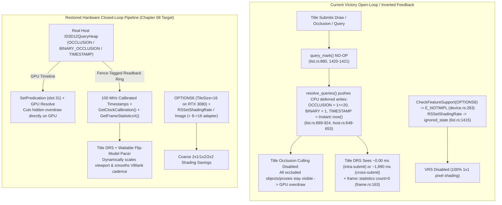

# Chapter 08 — Queries, Timing, and Game-Side Adaptivity: Occlusion Culling, Timestamps, Dynamic Resolution, Frame Pacing, and Variable Rate Shading

## 1. Executive Framing: Why Adaptive Rendering Pipelines Collapse Under Synthetic Feedback

Modern console games—and 2026 open-world titles built for Xbox Series S and Series X in particular—are not static, open-loop command streams. They operate as **nested closed-loop control systems** spanning the CPU simulation thread, GPU graphics and async-compute queues, memory streamers, and the display controller [1, 18, 24, 32]. At every frame boundary and across multiple passes within a frame, the title probes hardware state through five tightly coupled feedback channels:

1. **Visibility feedback (Occlusion Queries & Predication):** Hardware sample-passing queries (`D3D12_QUERY_TYPE_OCCLUSION`, `D3D12_QUERY_TYPE_BINARY_OCCLUSION`) and GPU-side conditional execution (`SetPredication`), operating alongside compute Hierarchical-Z (Hi-Z) culling passes, tell the engine which bounding volumes, portals, lights, foliage clusters, and lens-occlusion proxies are hidden behind opaque geometry [4, 11, 24, 25].
2. **Temporal execution feedback (GPU Timestamps & Clock Calibration):** Bottom-of-pipe GPU timestamps (`EndQuery(TIMESTAMP)` and Xbox `Write64BitValueBottomOfPipeX`), normalized via `GetTimestampFrequency()` and correlated with CPU `QueryPerformanceCounter` (QPC) ticks via `GetClockCalibration()`, tell the engine the true duration and queue latency of every render pass [4, 7, 8, 9].
3. **Closed-loop resolution control (Dynamic Resolution Scaling, DRS):** An adaptive regulator ingests GPU pass and frame durations, predicts headroom relative to the 16.67 ms (60 Hz) or 33.33 ms (30 Hz) frame budget, and adjusts viewport dimensions and upscaler input targets before GPU saturation forces missed VBlanks [31, 32].
4. **Presentation and pacing control (`FrameIntervalX`, `WaitFrameEventX`, `GetFrameStatisticsX`):** Console frame-pacing primitives align CPU frame starts (`ORIGIN`), display scans (`VBLANK`), and buffer flips (`FLIP`) using hardware presentation telemetry, keeping input-to-photon latency bounded while avoiding quantized frame-time cliffs [18].
5. **Spatial shading-rate adaptation (Variable Rate Shading, VRS):** Hardware Tier 1 per-draw rates and Tier 2 screen-space shading-rate images (`RSSetShadingRate`, `RSSetShadingRateImage`) shed redundant pixel-shader invocations across motion-blurred, low-variance, or peripheral tiles based on `D3D12_FEATURE_DATA_D3D12_OPTIONS6` hardware capabilities [5, 12, 13, 14].

When VIctory statically recompiles a 2026 Xbox Series open-world title onto a Windows discrete-GPU PC (an Intel Core i5-10400F, 32 GiB DDR4, PCIe 3.0/4.0 host with an NVIDIA GeForce RTX 3080 10 GB), those five feedback loops are not merely degraded—they are **systematically inverted or severed**.

To preserve strict epistemic discipline across this chapter, every claim is classified into one of three categories:
* **Established Fact:** Hardware microarchitecture, Direct3D 12 / DXGI / Vulkan specifications, peer-reviewed computer graphics and systems literature, and documented emulator behaviors (cited `[n]`).
* **Empirical Measurement / Source Observation:** Measurements from our RTX 3080 + i5-10400F runs (`E:\Projetos\dossie_series_s.md`, `E:\Projetos\agy_dossie.md`, and our Series S 720p baseline), exact Rust source inspection in `E:\Projetos\VIctory`, and comparative notes from the sibling XCL layer (`C:\Users\henri\AppData\Local\Temp\xcl_h3.md`).
* **Hypothesis (`H-8.n`):** Quantitative, falsifiable predictions tied to specific implementation changes in VIctory and verifiable directly through VIctory's `Meter` log line (`host.rs:1762-1767`) and GPU profilers (PIX / NVIDIA Nsight).

In our measured **Series S profile (`--console series-s`, 1280×720 internal resolution)** world-frame baseline on the RTX 3080 host, each frame requires **~1,890 ms** end-to-end: **~860 ms** CPU `preparing` (**~440 ms** copying **~270 MB** of buffer spans, **~140 ms** texture hashing/detiling/checks across **~475 MB**, plus **~280 ms** unattributed prepare work), **~700 ms** on the `GPU`, and **~330 ms** `copying back` **~12 MB** of GPU-written buffer ranges, while **430** untranslated shaders leave lighting passes dropped (G-buffer geometry renders; the presented image remains black). In our earlier **Series X profile** baseline (4K target mode), frames averaged **~2,800 ms** (**~810 ms** preparing, **~1,600 ms** GPU, **~360 ms** copying back **~13 MB**, **~450** untranslated shaders).

Chapters 01 through 07 addressed the memory transport, texture cache, shader translation, and lockstep submission overheads behind the `~860 ms` CPU prepare and `~330 ms` copy-back taxes, as well as the PCIe L0 fetch penalty inside the `~700 ms` GPU time. Yet even if every buffer sits in 760.3 GB/s GDDR6X VRAM and CPU/GPU overlap is restored, **leaving VIctory's fake query, timing, pacing, and VRS stubs intact permanently cripples the title's own GPU workload scaling**. Specifically, inspecting `E:\Projetos\VIctory\crates\victory-gpu\src\` exposes six interlocking defects:

| Adaptive Subsystem | Xbox Series S/X Console Behavior [1, 4, 5, 18] | Current VIctory Emulation (Observed in Source) | Concrete Failure Mode on RTX 3080 Host |
| :--- | :--- | :--- | :--- |
| **Occlusion Queries & Predication** | Hardware sample-pass counters (`OCCLUSION`, `BINARY_OCCLUSION`) + HTILE early-Z + GPU `SetPredication` skip hidden draws without CPU stalls. | `BeginQuery`/`EndQuery` are `query_mark` no-ops (`list.rs:880, 1420-1421`); `ResolveQueryData` writes hardcoded **`1 << 20`** (`1,048,576`) for occlusion and **`1`** for binary (`list.rs:906-907`); `SetPredication` (slot `31`) is **unmapped** (`missing_table` -> `E_NOTIMPL`). | Engine thinks **every occluded proxy is visible**; hidden interiors, occluded vehicles/foliage, and volumetric proxies all rasterize, multiplying PCIe L0 vertex traffic and Wave64 pixel work. |
| **GPU Timestamps & Clock Calibration** | Bottom-of-pipe 100 MHz GPU timestamps (`EndQuery(TIMESTAMP)` + `Write64BitValueBottomOfPipeX`) synchronized to QPC via `GetClockCalibration()`. | `Written::GpuTimestamp` samples CPU `Instant::now()` **after** `WaitForSingleObject` + `copy_back` (`queue.rs:201-205`, `host.rs:649-653`); `GetClockCalibration` (slot `17`/`19`) is **unmapped** (`E_NOTIMPL`). | Timestamps inside one submission collapse to **~0.00 ms** deltas; cross-submit spans inflate to **~1,890 ms** (mixing CPU prepare + GPU + copy-back); CPU/GPU clock correlation fails. |
| **Dynamic Resolution Scaling (DRS)** | Closed-loop PID/hysteresis scales internal viewport (e.g., 50–100%) using clean GPU pass timings and frame statistics. | Receives `~0.00 ms` or `~1,890 ms` synthetic timestamps (`queue.rs:201-205`) and **`count = 0`** from `frame::statistics` (`frame.rs:163-175`); `dxgi.rs:246` exposes only 4K@60 Hz. | DRS either disables itself on `0` frame stats / `0.00 ms` pass deltas or locks blindly without tracking real GPU pass cost vs. CPU stalls. |
| **Frame Pacing & Display Modes** | `SetFrameIntervalX`, `ScheduleFrameEventX`, `WaitFrameEventX` (`ORIGIN`/`VBLANK`/`FLIP`), and `GetFrameStatisticsX` align CPU/GPU/display at 30/60/120 Hz. | Synthetic global CPU `CLOCK` (`SIXTIETH = 16,667 us`, `frame.rs:26-160`), ignores `_period` and `_offset`, returns `0` stats (`frame.rs:163`), `Present(0)` without waitable swap chain (`host.rs:2060, 2095`), DXGI mode fixed at `3840x2160 @ 60 Hz` (`dxgi.rs:246`). | `WaitFrameEventX(FLIP)` induces artificial 16.67 ms quantization stalls decoupled from actual DWM/VRR presentation; 120 Hz pacing paths blocked; no frame-pacing telemetry reaches title. |
| **Variable Rate Shading (VRS)** | RDNA2 Tier 2 VRS (`8x8` pixel tiles, `RSSetShadingRate`, `RSSetShadingRateImage`, `SV_ShadingRate`) cuts shading load 15–35% [1, 5, 13, 29]. | `device.rs:283` returns **`E_NOTIMPL`** for `D3D12_FEATURE_D3D12_OPTIONS6` (feature `30`); `list.rs:1415` maps slot `124` (`RSSetShadingRate`) to `ignored_state`; `0x400` (`RSSetShadingRateImage` in newer layout, `list.rs:1438`) is **unmapped**. | Title detects no VRS tier, forces `1x1` full-rate shading everywhere. Even if `OPTIONS6` were blindly faked as `8x8`, RTX 3080 requires **`16x16` tiles** [3, 14]. |
| **Shader-Side Clocks (`s_memrealtime`)** | RDNA2 `s_memrealtime` (fixed RTC) and `s_getreg_b32` (`SHADER_CYCLES`) provide shader-level cycle/time probes [2]. | `victory-shader/src/ir.rs:751` parses `s_memtime` / `s_memrealtime`, but `emit/lower.rs:9587-9613` returns `Unsupported` if value is live. | Any shader using `s_memrealtime` for shader profiling or temporal RNG drops from host translation unless lowered. |



Notice the overarching theme of this chapter: **the game already contains sophisticated, battle-tested visibility culling, adaptive resolution regulation, frame pacing, and VRS optimization passes written specifically to make an open-world 2026 renderer run cleanly on a 4 TFLOPS Series S**. VIctory's current stubs disable or lie to every one of those optimizations. Restoring *accurate* hardware answers—without re-introducing CPU-GPU pipeline stalls or `330 ms` `Shadow::copy_back` scans—yields compounding GPU reductions while preserving visual fidelity.

---

## 2. Occlusion Queries, Hierarchical-Z (Hi-Z), and GPU-Driven Culling

### 2.1 Direct3D 12 Hardware Occlusion Queries and Predication Mechanics

In Direct3D 12, hardware occlusion visibility testing splits cleanly into two decoupled mechanisms defined in the DirectX 12 *Counters and Queries* specification [4] and command-list execution rules [11]:

1. **Query Collection (`ID3D12QueryHeap` + `BeginQuery` / `EndQuery` / `ResolveQueryData`):**
   * The application allocates an `ID3D12QueryHeap` with `D3D12_QUERY_HEAP_TYPE_OCCLUSION` (`0`). Notably, a single `OCCLUSION` query heap supports *both* `D3D12_QUERY_TYPE_OCCLUSION` (exact 64-bit count of samples passing depth and stencil tests) and `D3D12_QUERY_TYPE_BINARY_OCCLUSION` (returns `0` if zero samples passed, or `1`—specifically a non-zero `1` in D3D12—if at least one sample passed) [4].
   * Between `BeginQuery(heap, type, index)` and `EndQuery(heap, type, index)`, the rasterizer tracks sample-pass events for the enclosed bounding-box or proxy geometry draws (typically rendered with color writes disabled and depth writes disabled via `D3D12_DEPTH_WRITE_MASK_ZERO`).
   * Unlike D3D11, D3D12 forbids per-query `GetData` polling on the heap directly. Instead, `ResolveQueryData(heap, type, startIndex, numQueries, dstBuffer, alignedOffset)` writes `8 * numQueries` bytes (`UINT64` per query) on the GPU timeline into `dstBuffer`, which must be in `D3D12_RESOURCE_STATE_COPY_DEST` [4].
   * **Why `BINARY_OCCLUSION` exists in hardware:** As the DirectX-Specs *Counters and Queries* document explains [4], requiring an exact sample count (`D3D12_QUERY_TYPE_OCCLUSION`) forces rasterizer backends (RBs) and depth units to account accurately for every passing sub-sample, which on some architectures interferes with early-Z optimizations, compressed depth tile rejection, or out-of-order rasterizer retirement. `D3D12_QUERY_TYPE_BINARY_OCCLUSION` informs the driver and GPU that any single passing sample suffices, allowing the hardware to short-circuit sample summation and preserve compressed depth-buffer fast paths [4].

2. **GPU-Timeline Conditional Rendering (`ID3D12GraphicsCommandList::SetPredication`):**
   * Once `ResolveQueryData` places one or more 64-bit results into `dstBuffer` and a resource barrier transitions `dstBuffer` from `COPY_DEST` to `D3D12_RESOURCE_STATE_PREDICATION` (`0x200`, aliased identically to `D3D12_RESOURCE_STATE_INDIRECT_ARGUMENT`), the title calls `SetPredication(dstBuffer, alignedOffset, D3D12_PREDICATION_OP_EQUAL_ZERO)` (or `NOT_EQUAL_ZERO`) [11].
   * On the GPU Command Processor (CP), `SetPredication` reads the 64-bit word at `dstBuffer + alignedOffset` **at the moment `SetPredication` executes on the GPU timeline** ("snapping" the value so later mutations to the same memory do not retroactively alter active predication) [11]. If the comparison matches (e.g., `count == 0` under `EQUAL_ZERO`), the GPU skips subsequent `DrawInstanced`, `DrawIndexedInstanced`, `Dispatch`, `DispatchMesh`, `ExecuteIndirect`, `Copy*`, and `Clear*` commands until `SetPredication(nullptr, 0, ...)` clears the predicate, while `BeginQuery`, `EndQuery`, and `ResolveQueryData` themselves are *not* predicated [11].
   * Crucially, D3D12 direct command lists **never inherit predication state** across submissions (`ExecuteCommandLists`), whereas bundles do inherit predication state from the calling direct list [11].

### 2.2 Depth Hierarchy Hardware (HTILE / Early-Z) and Culling Literature

Hardware occlusion queries sit on top of—and complement—the GPU's native hierarchical depth hardware and compute-driven culling pipelines:

* **Greene, Kass, and Miller (1993)** [19] introduced the **Hierarchical Z-Buffer (HZB / Hi-Z)** in *SIGGRAPH '93*, building a depth mipmap pyramid storing the conservative *farthest* depth (`max` Z in standard 0..1 near-to-far, or `min` Z in reversed-Z `1..0` pipelines) across $2\times 2$ pixel neighborhoods at each level. Testing an object's screen-space bounding box against the coarsest HZB texel covering its footprint rejects huge occluded regions in $O(1)$ comparisons [19].
* **AMD RDNA2 HTILE & NVIDIA Early-Z:** Modern GPUs embed hardware depth pyramids inside the depth-stencil compression metadata. On AMD RDNA2 (Xbox Series S/X), each depth surface carries an **HTILE** metadata allocation storing per-$8\times 8$-pixel-tile `Zmin`/`Zmax` bounds, stencil bounds, and Hi-Z clear/compression flags [30]. When a compute shader reads or writes depth or a transition alters depth layout, Radeon GPU Profiler traces record explicit **`HiZ Range Resummarize`** synchronization events so HTILE stays coherent [30]. NVIDIA Ampere (GA102) similarly runs hardware Z-Cull / early-Z coarse tile rejection ahead of pixel shading [3].
* **The Latency Dilemma & Coherent Hierarchical Culling (Sekulic 2004, Bittner et al. 2004, Mattausch et al. 2008):**
  * **Naive CPU Stall (Sekulic, *GPU Gems* Ch. 29, 2004):** Issuing an occlusion query for an object and immediately spinning on the CPU until the GPU returns the sample count serializes the CPU and drains the GPU command queue, often costing *more* in pipeline bubbles than simply shading the occluded mesh [22].
  * **Spatial/Temporal Coherence (Klosowski & Silva 2000; Bittner et al. 2004; Mattausch et al. 2008):** **Prioritized-Layered Projection (PLP)** [20] established approximate visibility ordering for bounded budgets; **Coherent Hierarchical Culling (CHC)** [21] and **CHC++** [23] solved the query-latency problem using BVH traversal plus *frame-to-frame temporal coherence*. Previously visible leaf nodes are rendered immediately without waiting for fresh queries; previously occluded nodes (and newly entered frustum nodes) are batched into tight hardware occlusion queries whose results are harvested asynchronously or 1+ frames later while assuming "visible until proven occluded" [21, 23].
* **Two-Pass GPU-Driven Hi-Z & Cluster Culling (Haar & Aaltonen 2015; Wihlidal 2016; Karis, Stubbe, & Wihlidal 2021):**
  * In modern open-world engines (pioneered in *Assassin's Creed Unity* [24], Frostbite [25], and Unreal Engine 5 *Nanite* [26]), static meshes, foliage, and terrain chunks are decomposed into fixed-size meshlets/clusters (e.g., 64–128 triangles) whose bounding spheres/AABBs are tested in **Compute** rather than via per-mesh API draw calls.
  * **Two-Pass Occlusion Culling** avoids the 1-frame popping artifact of reprojected Hi-Z:
    1. **Pass 1 (Reprojected Main Occluders):** Compute culling reprojects each cluster/instance against **frame $N-1$'s Hi-Z pyramid** (already resident in VRAM!). Clusters that were visible in frame $N-1$ *and* pass frustum + reprojected Hi-Z culling render immediately via `ExecuteIndirect` / `DispatchMesh` to populate the fresh frame-$N$ depth buffer.
    2. **Hi-Z Build:** A downsample compute pass (using `min`/`max` atomic or single-pass `SPD` reduction) constructs frame $N$'s current Hi-Z pyramid from the newly rendered occluder depth buffer.
    3. **Pass 2 (Disocclusion Rescue):** A second compute culling pass tests **only** clusters rejected in Pass 1 against **frame $N$'s fresh Hi-Z pyramid**. Any cluster newly disoccluded by camera movement (false negative from frame $N-1$) survives Pass 2 and renders into the frame-$N$ depth/G-buffer via `ExecuteIndirect` [24, 26].

Crucially, **2026 open-world engines typically combine both mechanisms**: compute Hi-Z culling handles tens of thousands of dense geometry clusters, while **hardware `OCCLUSION` / `BINARY_OCCLUSION` queries + `SetPredication`** handle coarse portal/interior bounding proxies, shadow-caster/light-volume culling, volumetric fog/reflection probe volumes, GPU-readback lens flares/sun-corona exposure probes, and legacy/hybrid scene subsystems where rasterizing an accurate convex proxy against the complex MSAA/stencil/Hi-Z depth buffer is cheaper or tighter than conservative AABB projection in compute.

### 2.3 Emulator and Translation-Layer Prior Art for Occlusion Queries

Every mature console emulator and PC translation layer confronts the same fundamental tension: **guest titles assume fast unified-memory or coherent query readback, while naive synchronous GPU readbacks destroy host frame rate**.

| Project | Guest Hardware / API | Query Emulation Architecture & Modes | Key Lesson for VIctory |
| :--- | :--- | :--- | :--- |
| **Xenia** [36] | Xbox 360 (`Xenos` eDRAM `RB_SAMPLE_COUNT_ADDR`, `XE_GPU_REG_VGT_EVENT_INITIATOR`) | Exposes distinct modes (`query_occlusion_fake_sample_count` / fast async vs. strict): **Fast** writes cached/previous or non-blocking GPU query buffer results without stalling the CPU; **Strict** synchronizes for exact sample counts when needed for correctness (e.g. lens flares); **Fake** returns static sample counts at the cost of disabling culling [36]. | Hardcoded fake occlusion counts break real culling; asynchronous query resolution without stalling the submission thread preserves both correctness and throughput. |
| **RPCS3** [37] | PS3 RSX `ZCULL` hardware counters & conditional rendering | Maps RSX ZCull occlusion queries onto Vulkan/OpenGL queries with configurable synchronization accuracy (*Relaxed*, *Approximate*, *Precise*) plus a debug toggle to disable ZCull occlusion queries (`Disable ZCull Occlusion Queries`) [37]. Community profiling confirms disabling queries causes distant/background geometry popping or massive unculled overdraw depending on whether the engine treats disabled queries as 0 or visible [37]. | Precision tiers matter: coarse visibility (binary / 1-frame delayed) tolerates async latency, whereas CPU-inspected visibility requires ordered fence retirement without blocking every unrelated draw. |
| **Dolphin** [38] | GameCube/Wii Flipper/Hollywood EFB Z-queries | Supports host occlusion queries and bounding-box/Z-peek deferral so lens flares and coronas do not stall the main render thread on every EFB read [38]. | Separating GPU-consumed predication from CPU-polled optical queries prevents frame-rate collapse. |
| **DXVK** [39] | D3D9/D3D10/D3D11 -> Vulkan | Allocates pooled `VkQueryPool` entries, emits `vkCmdBeginQuery`/`vkCmdEndQuery` + `vkCmdCopyQueryPoolResults`, tracks `ConsiderFlush` carefully during `ID3D11DeviceContext::GetData`, and turns `D3D11_QUERY_OCCLUSION_PREDICATE` into GPU-timeline `VK_EXT_conditional_rendering` [33, 39]. | Never flush/wait inside `BeginQuery`/`EndQuery`/`ResolveQueryData`; pool query slots and amortize readback waits onto fence completion. |
| **VKD3D-Proton** [40] | D3D12 -> Vulkan | Directly translates `ID3D12QueryHeap` -> `VkQueryPool`, `ResolveQueryData` -> `vkCmdCopyQueryPoolResults` inside GPU command buffers (respecting Vulkan render-pass boundaries), and `SetPredication` -> `VK_EXT_conditional_rendering` (`vkCmdBeginConditionalRenderingEXT`) [33, 40]. | On D3D12-to-D3D12 (VIctory), no render-pass or API impedance exists at all: host `ID3D12QueryHeap` + `ResolveQueryData` + `SetPredication` are 1:1 native hardware primitives! |

### 2.4 Forensic Analysis of VIctory's Current Query and Culling Behavior

Direct inspection of `E:\Projetos\VIctory\crates\victory-gpu\src\` reveals four compounding breaks in the occlusion and culling path:

1. **No Host `ID3D12QueryHeap` Created (`query.rs:1-72`):**
   `query::create` (`query.rs:35-51`) allocates a Rust `Heap { object, desc }` storing `Desc { kind, count, nodes }`. As the file header states verbatim (`query.rs:1-2`), *"no query ever produces a result; the heap only remembers its description."*
2. **No-Op `BeginQuery` and `EndQuery` (`list.rs:880, 1420-1421`):**
   Both vtable slots `28` (`0xe0` `BeginQuery`) and `29` (`0xe8` `EndQuery`) bind to `query_mark` (`list.rs:880`), an empty function that ignores `_heap`, `_kind`, and `_index`. Even if a title draws 500 bounding-box occlusion proxies between `BeginQuery` and `EndQuery`, **nothing is recorded on the host `ID3D12GraphicsCommandList`**. (Notice a dangerous subtle detail: if those occlusion-proxy draws had color/depth writes disabled solely to feed the query, the GPU *still* paid vertex shading and rasterization for all 500 bounding boxes while discarding the resulting sample-pass measurement!)
3. **Hardcoded `1 << 20` and `1` Fake Resolutions (`list.rs:889-924`):**
   When the title calls `ResolveQueryData` (slot `30`, `0xf0`), `resolve_queries` inspects `kind`:
   * `OCCLUSION (0)` -> `Written::Value(1 << 20)` (**`1,048,576` samples passed**, 8 bytes per query, `list.rs:906`)
   * `BINARY (1)` -> `Written::Value(1)` (**`1` visible**, 8 bytes per query, `list.rs:907`)
   * `PIPELINE_STATISTICS (3)` -> `Written::Value(0)` (88 zero bytes, `list.rs:909`)
   * Every resolved slot schedules `defer_write(this, at as u64, what, 8)` (`list.rs:921`), which appends `(dst, what, 8)` to `HostList::deferred().writes` (`list.rs:1352`).
   * At the very end of `Host::execute` (`host.rs:649-653`)—*after* `WaitForSingleObject` and *after* `copy_back`—the CPU writes `0x0010_0000` or `1` directly into the title's buffer memory (`at` in title RAM, *not* into the GPU `Shadow.buffer` unless a subsequent `Shadow::refresh` copies title RAM back to the GPU!).
4. **`SetPredication` (Slot `31`) Completely Unmapped (`list.rs:1364-1430`):**
   In `ID3D12GraphicsCommandList`, vtable slots `28`, `29`, `30`, `31` are `BeginQuery`, `EndQuery`, `ResolveQueryData`, and `SetPredication` (`0xf8` in older lists; also `0xf8` in newer lists since `newer_slot` only shifts slots `>= 59`, `list.rs:1439-1441`). Look at `list.rs:1420-1422`: slots `28`, `29`, `30` are populated, while **slot `31` is absent**! Therefore, any `SetPredication` call lands on `object::missing::<LIST, 31>` (`object.rs:282-292`), logs `"method not implemented"` once, and returns `E_NOTIMPL` without setting any predicate on the host command list!

#### Worked Quantitative Analysis: What Fake `1 << 20` Visibility Costs on Series S 720p

Consider what happens inside a dense open-world urban frame (the 2026 title's Series S 720p world profile) when every occlusion query returns `1,048,576` samples passed and `SetPredication` does nothing:

* **Empirical Baseline:** At `1280x720` (`921,600` pixels), the RTX 3080 spends **~700 ms** on the GPU (`~1,890 ms` total frame). Even accounting for `L0 WRITE_BACK` PCIe 3.0 vertex/constant/SRV stalls and emulated Wave64 overhead, let us estimate the overdraw multiplier from disabled occlusion culling using standard open-world rendering budgets:
  * Suppose a camera looks down a dense city street with buildings, interiors behind walls, parked vehicles, vegetation behind facades, and localized shadow-casting/light proxies. Under healthy occlusion culling (Hi-Z compute + hardware `OCCLUSION`/`BINARY_OCCLUSION` queries), typical scene depth complexity in opaque/alpha-tested G-buffer + shadow/proxy passes drops from ~`3.5–5.5×` raw frustum-culled overdraw down to ~`1.3–1.8×` surviving scene complexity—a **2.0×–3.2× reduction in submitted vertex/meshlet/pixel workload** for occluded districts and interiors.
  * Under VIctory's current `1 << 20` stub, **100% of frustum-visible occluded objects pass the CPU/GPU occlusion gate**:
    1. Every occluded mesh's bounding-box proxy was *already* rasterized by the title (zero savings from `query_mark` no-op), **and then** the full high-LOD mesh/interior/light volume behind it is drawn as well!
    2. Because `Shadow` buffers currently reside in `D3D12_HEAP_TYPE_CUSTOM` (`WRITE_BACK`, `L0`, `host.rs:2172`) across PCIe 3.0 x16 (~12–14 GB/s practical DMA/read throughput vs. 760.3 GB/s GDDR6X [3]), **every unculled vertex fetch, index fetch, and instance buffer read traverses PCIe 3.0**! If unculled geometry increases vertex/instance/SRV reads by only 40–100 MB per frame across PCIe 3.0, at ~12 GB/s saturated random-access effective throughput (often <2–4 GB/s under microsecond PCIe read RTT [Ch01]), that unculled geometry alone adds **tens to hundreds of milliseconds** of GPU time!
    3. Every unculled draw call also triggers `draw.rs:522-685` (`State::bind`, `mirror_range`, `sync_slot`, `list.scratch` CBV staging), inflating **CPU `preparing` (`~860 ms`)** and increasing `Batch::add` union spans (`host.rs:1330`).
    4. Worse, if any unculled `ExecuteIndirect` buffer passes through `indirect::bound` (`indirect.rs:204-239`), it hits `indirect::clamp` + **two global `UAV_BARRIER`s (`pResource = None`)** (`indirect.rs:222, 230`), draining the GPU pipeline on work that should have been skipped!
  * **Important Nuance on the 430 Untranslated Shaders:** Note a crucial subtlety observed in our baseline: today, **430 shaders fail translation** (leaving lighting/composition passes dropped so the G-buffer fills while the final image is black). If any of those 430 untranslated shaders are **Hi-Z mip-pyramid generation compute shaders** or **compute occlusion culling shaders** (for example, shaders using `s_memrealtime`, unsupported 16-bit/Wave64 ops, or amplification/mesh stages), then even *after* hardware `ID3D12QueryHeap` occlusion queries are enabled, compute-based Hi-Z culling may remain broken until those compute shaders translate! Conversely, all *hardware* `OCCLUSION` / `BINARY_OCCLUSION` / `SetPredication` culling paths (and CPU-read visibility checks) will start culling immediately once `query.rs` and `list.rs` are wired to real D3D12 query heaps.

### 2.5 Concrete Design for Real Hardware Occlusion Queries and `SetPredication` in VIctory

Implementing genuine D3D12 occlusion queries and predication in VIctory requires solving **two architectural traps** that do not exist in native PC engines: (A) `Shadow` buffer coherence between GPU `ResolveQueryData` and title RAM, and (B) ensuring CPU-inspected query buffers do not resurrect the `~330 ms` `copy_back` tax.

```text
Title Records Commands                   VIctory HostList                         Host GPU / Readback
──────────────────────                   ────────────────                         ───────────────────
CreateQueryHeap(OCCLUSION, N) ─────────> query::Heap { host_heap: ID3D12QueryHeap }
BeginQuery(heap, kind, idx)   ─────────> list.BeginQuery(host_heap, kind, idx)  ──> GPU Sample Counter
  Draw bounding box proxies...           (recorded directly on HostList::list)
EndQuery(heap, kind, idx)     ─────────> list.EndQuery(host_heap, kind, idx)    ──> Snap sample count

ResolveQueryData(heap, kind,
  first, count, dst_buf, off) ─────────> Path 1 (GPU-consumed / SetPredication):
                                           Resolve into shadow.buffer @ off     ──> GPU COPY_DEST ->
                                           (tag shadow range as GPU-written!)       ResolveQueryData ->
                                                                                    PREDICATION / UAV
                                         Path 2 (CPU-read query history):
                                           Also copy 8*count bytes into small   ──> READBACK Ring Slot
                                           fence-tagged READBACK ring slice!        (at fence completion,
                                           (NO 64 KiB Shadow::copy_back scan!)      write 8*count bytes
                                                                                    straight to title RAM)
SetPredication(buf, off, op)  ─────────> Ensure buffer state PREDICATION (0x200) -> list.SetPredication(...)
```

Let us trace every edge case of this design:

1. **Mapping Query Heap & Query Types (`query.rs` & `list.rs`):**
   * Console `D3D12_QUERY_HEAP_TYPE` matches PC for `0` (`OCCLUSION`), `1` (`TIMESTAMP`), `2` (`PIPELINE_STATISTICS`), `3` (`SO_STATISTICS`), and `5` (`COPY_QUEUE_TIMESTAMP`, check `D3D12_FEATURE_DATA_D3D12_OPTIONS3::CopyQueueTimestampQueriesSupported`). On `query::create` (`query.rs:35`), instantiate a real `ID3D12QueryHeap` on `host()?.device.CreateQueryHeap(...)`.
   * Map `BeginQuery` (`list.rs:1420`) and `EndQuery` (`list.rs:1421`) to `HostList::list.BeginQuery` / `EndQuery`, passing `host_heap` and `D3D12_QUERY_TYPE(kind as i32)`. Note: D3D12 does **not** allow `BeginQuery` on `TIMESTAMP` queries (`only EndQuery`), which titles obey already; guard against null/unbacked heaps safely.
   * **Preventing the `Shadow` overwrite bug:** In `list.rs:889-924`, `resolve_queries` currently queues CPU `defer_write` (`Written::Value(1 << 20)`). Under real queries, **remove `defer_write` for `OCCLUSION`, `BINARY_OCCLUSION`, and `TIMESTAMP`**! If `defer_write` remained, `host.rs:649-653` would overwrite the GPU's real query answers on the CPU after `WaitForSingleObject`!
2. **State Tracking for `ResolveQueryData` and `SetPredication` (`list.rs`, `host.rs`, `shadow.rs`):**
   * Today `Shadow` buffers (`host.rs:2170-2216`) are created in `D3D12_RESOURCE_STATE_COMMON` (`0`) with `D3D12_RESOURCE_FLAG_ALLOW_UNORDERED_ACCESS`, and **VIctory does not track per-buffer D3D12 resource states** (`list.rs:292-339` explicitly skips buffers in `host_barrier` and emits a global `UAV_BARRIER` at `list.rs:366-370`!).
   * Look closely at D3D12's **Implicit State Promotion and Decay rules** vs. explicit barriers:
     * A buffer in `COMMON` implicitly promotes to `COPY_DEST` (`0x400`) on `ResolveQueryData`, and implicitly decays back to `COMMON` only *after* `ExecuteCommandLists` completes—**NOT** between commands inside the same command list!
     * Therefore, if the title records `ResolveQueryData(..., dstBuf, off)` followed in the **same command list** by `SetPredication(dstBuf, off, EQUAL_ZERO)` (or a compute shader reading `dstBuf` as SRV/UAV!), **D3D12 requires an explicit `D3D12_RESOURCE_BARRIER_TYPE_TRANSITION` from `COPY_DEST` (`0x400`) to `PREDICATION` (`0x200`) / `UNORDERED_ACCESS` (`0x8`)**!
     * Even better: look at `list.rs:353-387` (`barrier`) and `list.rs:1314-1327` (`barrier_groups`). Because `host_barrier` skips buffers (`crate::resource::buffer_bytes(b.first).is_some()`), it **drops** the title's own `COPY_DEST -> PREDICATION` or `UNORDERED_ACCESS -> COPY_DEST` buffer transition barriers!
     * When wiring real `ResolveQueryData` + `SetPredication` (and per-buffer barriers once buffers are in `DEFAULT` VRAM per `Ch01 H-1.3`), track per-`HostList` / per-buffer host resource state (mirroring `HostList::transition` for textures at `host.rs:959-978`!) so `ResolveQueryData` transitions `dst` -> `COPY_DEST`, `SetPredication` transitions `pred_buf` -> `PREDICATION` (`0x200`), and `Shadow` shader/indirect consumers transition properly without D3D12 Debug Layer `RESOURCE_BARRIER_MISMATCHING_BEGIN_END` errors!
3. **Resolving the `ResolveQueryData` vs. `Shadow::copy_back` Split-Brain:**
   * Suppose the title allocates a single 16 MiB or 174 MiB GPU buffer (`shadow.rs:148`) and stores occlusion query results at offset `0x40_0000` (`64` queries = `512` bytes).
   * If `ResolveQueryData` writes to `shadow.buffer` at `0x40_0000` on the GPU, what happens if the title CPU reads `title_ram + 0x40_0000` *or* if a subsequent CPU draw writes adjacent bytes in the same 64 KiB page and triggers `Shadow::update()`?
     * **Without marking `(shadow, offset, 8 * count)` as GPU-written**, `Shadow::update()` would overwrite the GPU's fresh query answer at `0x40_0000` with stale zeros from title RAM!
     * **With naive `shadow.gpu_writes(list, addr, 8 * count)`**, `Batch::add` (`host.rs:1323-1333`) merges `[0x40_0000, ...)` with any other UAV range in the same `Shadow`, potentially triggering `shadow.copy_back` across tens of megabytes (`~330 ms`)!
     * **Clean solution (Section 7, `H-8.5`):** Maintain a tiny dedicated **`READBACK` query ring** (`D3D12_HEAP_TYPE_READBACK`, e.g. 256 KiB total across N in-flight frames). On `ResolveQueryData`, record:
       1. `list.ResolveQueryData(host_heap, kind, first, count, shadow.buffer, shadow_offset)` (so GPU-timeline `SetPredication` / compute shaders immediately read the live GPU result in `shadow.buffer`!), AND
       2. `list.ResolveQueryData(host_heap, kind, first, count, readback_ring, ring_offset)` (or `CopyBufferRegion` of the tiny `8 * count` slice into `readback_ring`), **never** pushing this range into `Shadow::copy_back`'s 64 KiB `PIECE` scan!
       3. When the submission's fence completes (immediately under lockstep, or asynchronously in `Ch07` fence retirement before any CPU `fence::wait` unblocks the title), `memcpy` the exact `8 * count` bytes from `readback_ring` directly into title RAM (`at`), and update `Shadow`'s CPU `before` snapshot for just those `8 * count` bytes (or mark those 64-byte chunks dirty-coherent) so `Shadow::update` never clobbers them!
4. **Dealing with `SetPredication` Edge Cases (`list.rs` slot 31):**
   * Look up `crate::resource::buffer_bytes(buffer)` -> `crate::shadow::find(addr, 8)` to get `(shadow.buffer, offset)` on the host. (Remember `SetPredication(nullptr, ...)` disables predication and must pass `None` to `HostList::list.SetPredication(None, 0, ...)`!).
   * Verify `AlignedBufferOffset` is 8-byte aligned (D3D12 spec requirement [11]).
   * Remember that `SetPredication` on a `Shadow` buffer backed by `D3D12_HEAP_TYPE_CUSTOM` or `DEFAULT` must ensure `shadow` is refreshed first if the *CPU* wrote the predicate word (`shadow.refresh(list, addr, 8)`), whereas if `ResolveQueryData` or a compute shader wrote the predicate word on the GPU, `shadow.refresh` must NOT clobber it! That is why fixing `Batch::add` union explosion (`Ch01 H-1.2`) and separating GPU-owned ranges from CPU-dirty chunks is foundational.

---

## 3. GPU Timestamps, Shader Clocks, and CPU–GPU Clock Calibration

### 3.1 Direct3D 12 Timestamp Semantics, Queue Frequencies, and Clock Calibration

Accurate GPU timing in Direct3D 12 rests on three distinct hardware primitives specified in Microsoft's *Counters and Queries* spec [4] and *Timing* guide [7]:

1. **Bottom-of-Pipe Timestamp Sampling (`D3D12_QUERY_TYPE_TIMESTAMP`):**
   * Timestamps are recorded solely via `EndQuery(timestampHeap, D3D12_QUERY_TYPE_TIMESTAMP, index)` (calling `BeginQuery` on a timestamp query is invalid in D3D12 [4, 7]).
   * Hardware records the 64-bit GPU clock tick **at the bottom of the pipe**—meaning all prior draw, dispatch, and barrier commands recorded before `EndQuery` on that command list have retired their execution before the timestamp counter is latched [4, 7]. (Note: a GPU command list's `EndQuery(TIMESTAMP)` at index 0 followed by workloads and `EndQuery(TIMESTAMP)` at index 1 measures GPU pipeline retirement delta, though overlapping draws between barriers still overlap as designed.)
   * **Queue Support (`OPTIONS3`):** `DIRECT` and `COMPUTE` queues always support timestamp queries (`GetTimestampFrequency` succeeds), whereas `COPY` queues support `D3D12_QUERY_HEAP_TYPE_COPY_QUEUE_TIMESTAMP` only when `D3D12_FEATURE_DATA_D3D12_OPTIONS3::CopyQueueTimestampQueriesSupported == TRUE` [7, 8, 9].

2. **Hardware Counter Frequencies Across Architectures:**
   Raw GPU timestamp counters do **not** increment in nanoseconds on all GPUs, nor do they increment at the GPU's dynamic core/shader clock (`SCLK`/`GPC_CLK`). Instead, modern GPUs drive their timestamp counter from a fixed-frequency reference oscillator reported by `ID3D12CommandQueue::GetTimestampFrequency(&freq)` [8]:
   * **Xbox Series S / Series X (GDK / D3D12.X):** Fixed **`100,000,000 Hz` (100 MHz)** -> **`10 ns` per tick** (which VIctory already mirrors as `TIMESTAMP_FREQUENCY = 100_000_000` at `queue.rs:183`).
   * **NVIDIA Ampere (RTX 3080, WDDM PC driver):** Typically **`1,000,000,000 Hz` (1 GHz)** -> **`1 ns` per tick** (always query dynamically via `queue.GetTimestampFrequency()`, as older/other architectures or VMs may differ).
   * **AMD RDNA2/3/4 PC Drivers:** Frequently **`25,000,000 Hz` (25 MHz, `40 ns` tick)** or **`100,000,000 Hz` (100 MHz, `10 ns` tick)** depending on GPU family and driver.
   * **Windows CPU `QueryPerformanceCounter` (QPC):** On modern x86-64 Windows 10/11 systems (invariant TSC), `QueryPerformanceFrequency()` is standardized at **`10,000,000 Hz` (10 MHz)** -> **`100 ns` per tick**.

3. **Correlating CPU and GPU Timelines (`GetClockCalibration` & `SetStablePowerState`):**
   * Knowing $f_{\text{GPU}}$ lets you compute relative pass durations $\Delta t = (T_1 - T_0) / f_{\text{GPU}}$, **but it cannot tell you when a GPU pass ran relative to CPU submission, audio, or VBlank!**
   * `ID3D12CommandQueue::GetClockCalibration(&gpuTs, &cpuQpc)` [9] asks the kernel/KMD to sample the hardware GPU timestamp register and CPU `QueryPerformanceCounter` nearly simultaneously (in practice within a few microseconds across PCIe MMIO/register read). From a calibration anchor $(T_{\text{GPU},0}, QPC_0)$, any GPU timestamp $T_{\text{GPU}}$ maps onto the CPU QPC timeline as:
     $$QPC(T_{\text{GPU}}) = QPC_0 + \left\lfloor \frac{(T_{\text{GPU}} - T_{\text{GPU},0}) \cdot f_{\text{QPC}}}{f_{\text{GPU}}} \right\rfloor$$
   * **Why drift re-calibration is needed:** Even though both oscillators are crystal-derived fixed clocks, independent crystals on the motherboard (QPC / invariant TSC) and the discrete PCIe GPU board exhibit typical quartz drift of **10–100 parts per million (ppm)** (`10–100 us` per second, or `0.6–6 ms` per minute!). Over a 30-minute play session, an un-recalibrated affine offset drifts by **18–180 ms**—enough to misalign GPU completion against VBlank phase! Engines therefore re-call `GetClockCalibration` periodically (e.g., once every 1–60 frames) and apply a low-pass phase-locked filter to $(T_{\text{GPU},0}, QPC_0)$.
   * **Clock Frequency Scaling (DVFS) vs. `SetStablePowerState`:** Note a vital distinction documented in Microsoft's `SetStablePowerState` reference [10] and GPU DVFS research: `GetTimestampFrequency()` stays constant across power states, *but* shader SM/CU core clocks fluctuate dynamically on desktop GPUs (e.g., an RTX 3080 idling at ~210 MHz vs. boosting to ~1,710–1,950 MHz [3]). During idle periods between frames or under low load, GPU timestamps still tick at `GetTimestampFrequency()`, yet pass durations vary with core frequency! `ID3D12Device::SetStablePowerState(TRUE)` [10] locks core clocks for deterministic developer profiling (requiring Windows Developer Mode, and explicitly forbidden in shipping titles because it caps peak boost clocks), whereas in normal execution on VIctory, the title's DRS loop naturally observes real-time pass wall-time (incorporating current boost clocks) just as a shipping PC game does.
   * **Translation-Layer Precedent (`vkd3d-proton` & `VK_EXT_calibrated_timestamps`):** When translating D3D12 to Vulkan, `vkd3d-proton` [40] implements `ID3D12CommandQueue::GetClockCalibration` via `VK_EXT_calibrated_timestamps` (`vkGetCalibratedTimestampsEXT` pairing `VK_TIME_DOMAIN_DEVICE_EXT` with `VK_TIME_DOMAIN_QUERY_PERFORMANCE_COUNTER_EXT` on Windows) [33]. VIctory targets host D3D12 directly, so it can forward straight to the host `ID3D12CommandQueue::GetClockCalibration`!

### 3.2 Xbox D3D12.X Inline Bottom-of-Pipe Timestamps & Shader Clocks

Unlike vanilla PC D3D12—where timestamps only flow through `ID3D12QueryHeap` + `ResolveQueryData`—D3D12.X exposes lightweight inline memory writes on command lists:

* **`Write64BitValueBottomOfPipeX(gpuAddress, value, flushFlags, flags)`** (and 32-bit `Write32BitValueBottomOfPipeX`), observed directly in VIctory at `list.rs:1329-1344` and `queue.rs:185-217`:
  * `flags == 0`: Writes literal `value` to `gpuAddress` when all preceding GPU commands retire (`Write64BitValueBottomOfPipeX` / `EVENT_WRITE_EOP` on AMD CP). Used heavily for fine-grained GPU pipeline progress counters and lock-free synchronization in title memory (`xcl_h3.md:1752, 1771-1772`).
  * `flags == 1` (`GPU_TIMESTAMP`): Writes the GPU's 64-bit `100 MHz` timestamp directly into `gpuAddress` at bottom-of-pipe retirement—bypassing the `ID3D12QueryHeap` + `ResolveQueryData` ceremony entirely!
  * `flags == 2` (`SYSTEM_TIMESTAMP`): Writes the console's system timer (`QPC`-equivalent) at retirement.
* **Shader-Level Clock Instructions (`s_memrealtime` / `s_memtime` / `SHADER_CYCLES`):**
  * Inside RDNA2 ISA [2], scalar memory instruction `s_memrealtime s[d0:d1]` (`0x025`) reads the 64-bit fixed-frequency real-time clock, while legacy GCN `s_memtime` (`0x024`) was removed in RDNA2 (GFX10.3) in favor of `s_getreg_b32` reading `SHADER_CYCLES` [2].
  * In VIctory, `victory-shader/src/gfx10/opcodes.rs:268-269` and `ir.rs:751` recognize both `s_memtime` and `s_memrealtime`, while `emit/lower.rs:9587-9613` leaves them unlowered (`ShaderError::Unsupported`) whenever their destination SGPRs are live (in contrast, XCL `xcl_h3.md:1189` lowered both to `0` so diagnostic/profiling shaders would not fail translation).

### 3.3 Forensic Analysis: How VIctory Corrupts Both Pass-Level and Frame-Level Timing

Inspecting `queue.rs:175-217`, `list.rs:880-924, 1335-1358`, and `host.rs:580-653, 835-919` exposes a **threefold distortion** in VIctory's current GPU timing:

```text
Timeline Inside ONE Host::execute(&lists) Call (host.rs:541-655)
───────────────────────────────────────────────────────────────────────────────────────
Title Records List:
  EndQuery(TS, 0) [Pass A Start] -> Draw Pass A -> EndQuery(TS, 1) [Pass A End]
  -> Write64(addr, flags=1) [Pass B Start] -> Dispatch Pass B -> Write64(addr2, flags=1) [Pass B End]
  -> ResolveQueryData(TS, 0..2, buf, off)

What Actually Runs in Host::execute():
  [0 .. ~860 ms]   CPU Preparing (batch.flush(), textures, copies)
  [~860 .. ~1560 ms] GPU Runs Pass A + Pass B (~700 ms real GPU work!)
  [~1560 ms]       WaitForSingleObject(INFINITE) returns
  [~1560 .. ~1890 ms] Shadow::copy_back (~330 ms scanning L0 buffers)
  [~1890.0000 ms]  for &(at, what, bytes) in &list.deferred().writes { what.write(...); }
                     ├─ TS[0] = Instant::now()  --> e.g. 1890.000010 ms
                     ├─ TS[1] = Instant::now()  --> e.g. 1890.000040 ms  (Delta = 0.00003 ms !!)
                     ├─ W64_B0 = Instant::now() --> e.g. 1890.000070 ms
                     └─ W64_B1 = Instant::now() --> e.g. 1890.000100 ms  (Delta = 0.00003 ms !!)
```

Look closely at the exact mathematical catastrophe caused by `host.rs:649-653` and `queue.rs:201-205`:

1. **Failure Mode 1 — Intra-Submission Delta Collapse (`~0.00003 ms`):**
   Whenever a game brackets passes *within the same command list* (or within a multi-list batch passed to a single `ExecuteCommandLists` call)—for instance Shadow Depth, G-Buffer, Hi-Z, Lighting, Post-FX—every `ResolveQueryData(TIMESTAMP)` and `Write64BitValueBottomOfPipeX(..., GPU_TIMESTAMP)` merely appends `Written::GpuTimestamp` to `list.deferred().writes` (`list.rs:908, 921, 1339, 1343`). After `WaitForSingleObject` and `copy_back`, `host.rs:649-653` loops through `writes` on the CPU, calling `std::time::Instant::now().elapsed()` back-to-back in ~20–50 ns per iteration! Divided by `10 ns` per tick (`queue.rs:204`), adjacent passes inside a submission measure **`2` to `5` ticks (`0.00002–0.00005 ms`)** regardless of whether the pass actually took `0.5 ms` or `450 ms` on the RTX 3080!
2. **Failure Mode 2 — Inter-Submission Contamination (`~1,890 ms` instead of `~700 ms`):**
   Conversely, when a frame places its "Frame GPU Start" timestamp in submission $S_0$ and its "Frame GPU End" timestamp in submission $S_k$ (for instance across async compute queue submits or mid-frame resource uploads), the `Instant::now()` delta spans **CPU preparing (`~860 ms`) + GPU execution (`~700 ms`) + `copy_back` (`~330 ms`) + Windows thread scheduling jitter** = **~1,890 ms**!
   Even worse, because `copy_back` (`~330 ms`) happens *before* `deferred().writes` (`host.rs:648` vs `649-653`), any submission that contains UAV writes pays an extra **~330 ms** offset *before* its end timestamp is stamped, whereas a pass without UAV writes pays `0 ms` `copy_back`, wildly skewing pass ratios!
3. **Failure Mode 3 — Missing `GetClockCalibration` (`queue.rs:440-456`):**
   In PC `ID3D12CommandQueue` (inherited identically on Xbox D3D12.X before console additions), slot `16` (`0x80` older, `0x90` newer per `queue.rs:462` `title+0x24841a6`) is `GetTimestampFrequency`, and **slot `17` (`0x88` older, `19` = `0x98` newer) is `GetClockCalibration`**. Look at `queue.rs:440-456`: slot `16` is mapped to `timestamp_frequency`, while **slot `17` is omitted**, falling through to `object::missing` (`E_NOTIMPL`). Notice `queue.rs:462` already verified the title explicitly calls `GetTimestampFrequency` at `0x90` (`title+0x24841a6`); if the title also calls `GetClockCalibration` at `0x98` (`newer_slot(17) = 19`), it receives `E_NOTIMPL` and uncalibrated `pGpuTimestamp`/`pCpuTimestamp` pointers!
4. **VIctory Already Proved Real `TIMESTAMP` Queries Work (`host.rs:835-919`):**
   Ironically, VIctory's own diagnostics feature (`VICTORY_GPU_TIMING`) **already creates** a host `ID3D12QueryHeap` (`D3D12_QUERY_HEAP_TYPE_TIMESTAMP`, `STAMPS = 4096`), calls `self.list.EndQuery(heap, D3D12_QUERY_TYPE_TIMESTAMP, at)`, resolves to a `READBACK` buffer (`host.rs:845, 917`), and calls `self.queue.GetTimestampFrequency()` (`host.rs:595`) to rank the slowest GPU commands! The exact same mechanism simply needs to be generalized for the title's own timestamp queries and `Write64BitValueBottomOfPipeX(GPU_TIMESTAMP)`.

### 3.4 Designing Accurate, Calibrated, Non-Stalling GPU Timestamps for VIctory

To give the title mathematically consistent, pass-accurate GPU timestamps without stalling async execution or bloating `copy_back`:

#### Unified Timestamp Heap + Frequency/Calibration Model

1. **Title `TIMESTAMP` Query Heaps:**
   * Back `query::Heap` (`kind == 1` `TIMESTAMP` or `5` `COPY_QUEUE_TIMESTAMP`) with a real host `ID3D12QueryHeap`.
   * Map `EndQuery(heap, TIMESTAMP, index)` directly to `HostList::list.EndQuery(host_heap, D3D12_QUERY_TYPE_TIMESTAMP, index)`.
   * Map `ResolveQueryData(heap, TIMESTAMP, first, count, dst, off)` to `HostList::list.ResolveQueryData(...)` (followed by frequency normalization/calibration—see below!).
2. **Inline `Write64BitValueBottomOfPipeX(..., GPU_TIMESTAMP)` (`list.rs:1335-1344`):**
   * Each `HostList` (or shared per-frame ring allocator) holds a small internal `ID3D12QueryHeap(D3D12_QUERY_HEAP_TYPE_TIMESTAMP)` (e.g., 512–2048 slots per submission).
   * When `write64(..., flags == 1)` is called on a command list, allocate slot `s` in the internal heap, record `list.list.EndQuery(internal_heap, D3D12_QUERY_TYPE_TIMESTAMP, s)` at that exact command boundary, and push `(dst_addr, s)` onto a `deferred_gpu_timestamps` list.
   * At `HostList::close()` (`host.rs:910`), resolve `[0..num_used]` from `internal_heap` into a small `READBACK` ring slice (or `DEFAULT` staging buffer).
3. **Frequency Choice & Calibrated Conversion (Native Host Freq vs. Normalized 100 MHz):**
   There are two clean designs for queue frequency (`queue.rs:175-183`), and comparing their invariants reveals which is safer:

   | Design Choice | `GetTimestampFrequency()` Return | `GetClockCalibration()` Output | `ResolveQueryData` / `Write64` Handling | Pros & Risks |
   | :--- | :--- | :--- | :--- | :--- |
   | **Option A: Pass-Through Native Host Frequency** (e.g., 1 GHz on RTX 3080) | Returns exact `host.queue.GetTimestampFrequency()` | Forwards straight to `host.queue.GetClockCalibration(&gpu, &cpu)` | Direct GPU `ResolveQueryData` with **zero** post-processing! | **Fastest & exact** for standard D3D12 titles (`queue.rs:462` confirms title queries `GetTimestampFrequency`), **but** breaks if any hardcoded console math or shader assumes `100 MHz` (`10 ns`/tick) without checking `GetTimestampFrequency`. |
   | **Option B: Calibrated Normalization to `100 MHz`** | Keeps `100_000_000 Hz` (`queue.rs:183`) | Calls `host.queue.GetClockCalibration(&h_gpu, &h_cpu)`, returns `gpu_100m = convert(h_gpu)` and `cpu = h_cpu` | Host `READBACK` (or tiny 1-dispatch compute scaler `ScaleTimestampsCS`) converts `t_host -> t_100m` using 128-bit `mul_div` from a fixed calibration origin! | **100% console-compatible** even if parts of the title hardcode `100 MHz`; tiny overhead (~10 µs for `ScaleTimestampsCS` if GPU-consumed, or ~50 ns on CPU during readback ring retirement). |

   Look closely at the exact **calibration origin invariant** required in Option B so that `EndQuery(TIMESTAMP)` deltas, `Write64BitValueBottomOfPipeX` values, and `GetClockCalibration()` all lie on the exact same monotonic clock:
   ```rust
   // Anchored once at host queue creation (and refreshed only for drift if needed):
   // (gpu0, cpu0) = host_queue.GetClockCalibration();
   // host_freq    = host_queue.GetTimestampFrequency();
   const CONSOLE_FREQ: u128 = 100_000_000;

   #[inline]
   fn host_to_console_ticks(raw_gpu_tick: u64, gpu0: u64, host_freq: u64) -> u64 {
       // Signed delta handles ticks slightly older than gpu0 cleanly if calibration ran after init
       let delta = raw_gpu_tick as i128 - gpu0 as i128;
       let scaled = (delta * (CONSOLE_FREQ as i128)) / (host_freq.max(1) as i128);
       // Anchor at a positive console epoch (e.g., 1_000_000_000 ticks = 10 s) so values never underflow 0
       (1_000_000_000_i128 + scaled).max(0) as u64
   }
   ```
   Using **Option A** as the primary fast path (verified first against whether the title respects `GetTimestampFrequency` at `0x90`, `queue.rs:462`) with an immediate config toggle for **Option B** (`100 MHz` normalized calibration) gives zero-cost native accuracy while guaranteeing safety against hardcoded 100 MHz assumptions! Notice also that in Option A, **`ResolveQueryData` on `TIMESTAMP` heaps can run completely on the GPU** when consumed by GPU shaders, and even when read by the CPU via the `READBACK` ring, requires zero per-element math.

4. **Handling `Write64BitValueBottomOfPipeX(..., SYSTEM_TIMESTAMP)` (`flags == 2`, `list.rs:1340`):**
   Note that `flags == 2` requests the **system QPC counter** (`QueryPerformanceCounter`) at GPU command-list retirement (`queue.rs:206, 219-229`). Under calibrated timestamps, if we already have the GPU timestamp $T_{\text{GPU}}$ from the internal query heap *and* a fresh `(gpu0, cpu0)` pair from `GetClockCalibration()`, we can compute `QPC(T_GPU)` accurately even for asynchronous submissions—without requiring the CPU to wait until after `copy_back` to call `QueryPerformanceCounter()`!
   Wait: check **CPU-side `Write64` visibility vs. non-lockstep execution**! Under today's lockstep (`host.rs:587`), fence completion happens immediately inside `Host::execute`, so writing the resolved `Write64` timestamp into title RAM at `host.rs:649-653` (from the `READBACK` ring instead of `Instant::now()`) makes the value visible before `ExecuteCommandLists` returns. Once Chapter 07 removes `WaitForSingleObject(INFINITE)` per submit, `Host::execute` must tie each submission's `READBACK` ring retirement to its GPU `fence` value—flushing the resolved `Write64` / `ResolveQueryData` CPU copies whenever `fence::completed()` or `fence::wait()` (`fence.rs:78-111`) or a background fence-poller thread observes completion!

---

## 4. Dynamic Resolution Scaling (DRS) and Frame Pacing Control

### 4.1 Control-Theoretic Foundations of Dynamic Resolution Scaling

Dynamic Resolution Scaling (DRS) is the primary runtime control loop enabling fixed-power console GPUs (such as the 20-CU, 4.0 TFLOPS Xbox Series S [1]) to hold deterministic 30 Hz (`33.33 ms`) or 60 Hz (`16.67 ms`) frame budgets across wildly varying open-world scene complexity. As documented in Doug Binks' foundational Intel *Dynamic Resolution Rendering* work [31], Martin Fuller's Xbox *DRS Implementation Best Practice* [32], and perceptual quality studies by Jindal et al. (*SIGGRAPH Asia 2021*) [28], a production DRS subsystem decomposes into three mathematical layers:

#### 1. Workload Sensitivity Decomposition ($T_{\text{fixed}}$ vs. $T_{\text{pixel}}$)
Changing internal render width and height by a linear scale factor $s \in [s_{\min}, 1.0]$ alters pixel count quadratically ($s^2$), yet **does not** scale every GPU pass equally [31, 32]:
* **Resolution-invariant / geometry-bound work ($T_{\text{fixed}}$):** Shadow cascade rasterization (fixed shadow atlas dimensions), skeletal skinning, particle simulation, compute culling, BVH updates, UI/HUD overlay composition, and GPU command-buffer overhead remain essentially constant ($\propto s^0$).
* **Sub-linearly scaling work ($T_{\text{linear}}$):** Hierarchical depth reduction, screen-space reflection ray-marching with fixed step budgets, tiled/clustered light culling bins, and spatial/temporal upscalers scale roughly between $\propto s^1$ and $\propto s^2$.
* **Quadratically scaling pixel-bound work ($T_{\text{pixel}}$):** Primary G-buffer fragment shading, deferred lighting, ambient occlusion, volumetric accumulation, and post-processing color passes scale directly with pixel count ($\propto s^2$).

Thus, total GPU execution time as a function of linear scale $s$ follows:
$$T_{\text{GPU}}(s) \approx T_{\text{fixed}} + s \cdot T_{\text{linear}}(1.0) + s^2 \cdot T_{\text{pixel}}(1.0)$$

**Worked Comparison on Our Empirical Baselines (Series X 4K vs. Series S 720p):**
Compare the two empirical world-frame runs observed on our RTX 3080 host (`agy_dossie.md` and the Series S baseline):
* **Series X target profile (3840×2160, ~8.29 MP):** `~1,600 ms` GPU time.
* **Series S target profile (1280×720, ~0.92 MP):** `~700 ms` GPU time.

Even though `1280x720` shades **$9.0\times$ fewer pixels** than `3840x2160` ($s = 1/3$, $s^2 = 1/9$), measured RTX 3080 GPU time fell by **$2.29\times$** (`1,600 ms -> 700 ms`), leaving **`~700 ms` still on the GPU**! Solving the simple two-point sensitivity fit ($1600 \approx T_{\text{fixed}} + P_{4K}$ and $700 \approx T_{\text{fixed}} + \frac{1}{9} P_{4K}$, treating the extra Series X VRAM-paging spike and higher geometry/LOD budgets as part of the differential):
* Approximately **`~587 ms`** (roughly **`~500–600 ms`**) behaves as **resolution-invariant fixed tax** at current settings—driven overwhelmingly by `L0 WRITE_BACK` PCIe 3.0 buffer fetches (`host.rs:2172`), per-submit lockstep gaps (`host.rs:587`), global `UAV_BARRIER` + `indirect::clamp` flushes (`list.rs:344`, `indirect.rs:210-239`), and unculled geometry caused by `1 << 20` fake occlusion (`list.rs:906`).
* Meanwhile, the remaining **`~1,013 ms` at 4K** (`~113 ms` at 720p, plus any extra VRAM eviction penalty at 4K overflowing 10 GB) scales strongly with pixel load and VRAM footprint!
* *(Epistemic note: This two-point decomposition is an analytical hypothesis inferred from comparing the Series X 4K run and Series S 720p run, because Series X also alters LOD/streaming budgets and triggers WDDM VRAM eviction above 10 GB.)*

#### 2. Closed-Loop Regulator Dynamics (Asymmetric Hysteresis & Cooldown)
As Fuller notes [32], naive proportional feedback ($\Delta s \propto T_{\text{target}} - T_{\text{GPU}}$) oscillates violently when crossing resolution cliffs or encountering transient particle spikes. Console titles therefore deploy **asymmetric hysteresis controllers**:
1. **Input Signal Filtering:** Measure true GPU active duration $T_{\text{GPU}}$ using hardware timestamp brackets around the scaled 3D scene passes (explicitly excluding VSync/flip wait time and CPU simulation time!), smoothed over an exponential moving average (EMA) or short sliding window ($N = 2$–$4$ frames) with an instant **panic spike detector**.
2. **Panic Downscale:** If $T_{\text{GPU}} > \tau_{\text{panic}} \cdot T_{\text{budget}}$ (typically $\tau_{\text{panic}} \approx 0.95$–$1.00$, e.g. `>31.7 ms` for 30 fps or `>15.8 ms` for 60 fps), drop scale aggressively (`-5%` to `-15%`) on the very next frame to prevent a missed VBlank flip.
3. **Conservative Upscale:** Only step resolution upward (`+1%` to `+3%` per step) if $T_{\text{GPU}} < \tau_{\text{up}} \cdot T_{\text{budget}}$ (typically $\tau_{\text{up}} \approx 0.80$–$0.85$) consistently for $K$ consecutive frames (e.g. `K = 8–30` frames), ensuring that stepping up does not immediately push $T_{\text{GPU}}$ back past $T_{\text{budget}}$.
4. **Alignment & Aspect Rules:** Round internal dimensions to multiples of 2 (or 8/16 to match VRS tile size and compute threadgroup blocks) [32], and scale horizontally first or isotropically depending on temporal upscaler (TAAU / FSR) constraints [31, 32].

#### 3. Resource Management Without Per-Frame Allocations
Creating new render targets when resolution shifts every few frames causes heap fragmentation and descriptor churn [31, 32]. Modern D3D12 / D3D12.X engines allocate scene render targets and depth buffers once at maximum `100%` dimensions, then dynamically adjust `RSSetViewports`, `RSSetScissorRects`, UV scaling constants, and upscaler input rects (`ffxDispatch` / TAAU) inside those fixed allocations [31, 32]—or remap placed/reserved textures via physical page aliasing (`XMemMapPhysicalPages`).

---

### 4.2 Why VIctory Currently Breaks Both DRS and Frame Pacing

To understand why the 2026 title's DRS and pacing regulators fail under VIctory, we must examine how Xbox GDK's frame-pacing contract works (`Frame Pacing Sample` [18]) and trace every corresponding line in `frame.rs`, `dxgi.rs`, `queue.rs`, and `host.rs`.

#### The Xbox GDK Frame-Pacing & Telemetry Contract
On Xbox Series S/X, titles pace their main loop using D3D12.X's explicit frame-pipeline API [18]:
1. `ID3D12Device::SetFrameIntervalX(output, intervalUs, period, flags)` establishes the target display cadence (e.g., `33,333 us` for 30 Hz, `16,667 us` for 60 Hz, or `8,333 us` for 120 Hz on 120 Hz outputs) and `period` (maximum pipeline depth in intervals) [18].
2. `ID3D12Device::ScheduleFrameEventX(kind, offsetUs, list, flags)` schedules wakeups at relative offsets from each interval boundary for `ORIGIN (0)`, `VBLANK (1)`, or `FLIP (2)` [18].
3. At the start of a simulation/render frame, the CPU calls `WaitFrameEventX(ORIGIN, timeoutMs, ..., TOKEN_ON_TIMEOUT, &token)` (`frame.rs:21-25, 120-160`), obtaining a monotonically increasing `D3D12XBOX_FRAME_PIPELINE_TOKEN` (`token`) [18].
4. The CPU tags queue submissions with that token via `ExecuteCommandListsX(count, lists, token, flags)` (`queue.rs:146-150`, slot `35` / `0x118` in newer queues `queue.rs:463-464`), optionally waits on `WaitFrameEventX(FLIP, ...)` before presenting, and calls `PresentX(planes, planeParams, params)` (`queue.rs:243-321`) carrying `token` inside `D3D12XBOX_PRESENT_PLANE_PARAMETERS` (`queue.rs:135-145`).
5. Critically, the title queries **`GetFrameStatisticsX(token, kinds, &count, out)`** (`frame.rs:163-175`) to read back actual hardware execution and presentation telemetry for completed frames—CPU start/submit QPC, GPU start/end timestamps per queue, VBlank flip QPC, and queue latency margins [18].

#### What VIctory Does Today (`frame.rs`, `dxgi.rs`, `host.rs`, `queue.rs`)

Inspecting VIctory's code reveals **five specific pathologies** in how timing, pacing, and display modes are handled:

1. **`frame::statistics` Always Returns `count = 0` (`frame.rs:162-175`):**
   ```rust
   pub(crate) extern "system" fn statistics(
       _: This,
       _token: u64,
       _kinds: u32,
       count: *mut u32,
       _out: *mut u8,
   ) -> HRESULT {
       if !count.is_null() {
           unsafe { count.write(0) };
       }
       S_OK
   }
   ```
   Every call to `GetFrameStatisticsX` receives `S_OK` with `*count = 0`. Any frame-pacing telemetry graph, GPU/CPU headroom calculation, or DRS regulator expecting recent `D3D12XBOX_FRAME_STATISTICS` records sees an empty telemetry stream.

2. **Fake CPU-Loop GPU Timestamps (`queue.rs:201-205`, `host.rs:649-653`):**
   Even if the title bypasses `GetFrameStatisticsX` and falls back to its own `EndQuery(TIMESTAMP)` or `Write64BitValueBottomOfPipeX(..., GPU_TIMESTAMP)` pairs, Section 3.3 proved those deltas evaluate to **`~0.00003 ms`** within a submission or **`~1,890 ms`** across submissions (contaminated by CPU prepare + `copy_back`)! In neither case does the DRS regulator see true GPU workload duration (`~700 ms` today, or `~15–40 ms` post-memory optimization).

3. **Open-Loop Wall-Clock Timer Decoupled from Present & Swap Chain (`frame.rs:28-160` vs. `host.rs:2055-2115`):**
   Look closely at `frame.rs:98-140` (`next_tick` and `wait`):
   * `frame.rs:5-7` explicitly documents the 2026 title's actual calling pattern: *"[the title] polls the origin with 'token on time-out' (starting its next frame at once) and is paced by a blocking wait for the flip before each present."*
   * Look at what happens inside `frame::wait(FLIP, u32::MAX, ...)` (`frame.rs:120-160`):
     `next_tick(FLIP)` computes `tick = (c.first + (elapsed / interval + 1) as u64).max(last(FLIP) + 1)` and sleeps `std::thread::sleep(at - elapsed)` on a **pure CPU `Instant::now()` clock** (`CLOCK`, `frame.rs:35, 64`), completely blind to when the host GPU actually finished `Present` or when DWM flipped the back buffer!
   * **Quantitative Consequence on Stutter & Latency:**
     Suppose after Chapter 01–07 optimizations, GPU+CPU execution takes **`17.0 ms`** on a 60 Hz display (`16.667 ms` synthetic interval) or on a 120 Hz / 144 Hz VRR monitor:
     * Under a genuine VRR / `Present(0)` pipeline, a `17.0 ms` frame presents immediately at `17.0 ms` (**58.8 fps** smooth pacing!).
     * Under `frame::wait(FLIP)`'s rigid `16.667 ms` `CLOCK` grid (`frame.rs:105-135`), at `t = 17.0 ms` `elapsed / interval + 1` jumps to tick `2` (`at = 33.333 ms`), so **`std::thread::sleep(16.33 ms)` stalls the thread for an entire extra `16.3 ms`** just before `PresentX` (`host.rs:2060` then calls `swap_chain.Present(0, 0)` immediately with sync interval 0)! A tiny `0.34 ms` overrun turns into a **`33.3 ms` frame (halving frame rate from 59 fps to 30 fps!)**—classic quantized VSync cliff stutter even on a VRR display!
     * Worse, `frame.rs:132, 135` calls `std::thread::sleep(...)`, whose default Windows timer resolution (15.625 ms unless `timeBeginPeriod(1)` is active elsewhere in the process) can oversleep by **+1 to +15 ms** per wait!

4. **Swap Chain Created Without Waitable Latency Object or Tearing (`host.rs:2085-2100`):**
   Look at `host.rs:2085-2100`:
   ```rust
   let desc = DXGI_SWAP_CHAIN_DESC1 {
       Width: width,
       Height: height,
       Format: format,
       SampleDesc: DXGI_SAMPLE_DESC { Count: 1, Quality: 0 },
       BufferUsage: DXGI_USAGE_RENDER_TARGET_OUTPUT,
       BufferCount: BUFFERS, // BUFFERS = 2 (host.rs:1529)
       SwapEffect: DXGI_SWAP_EFFECT_FLIP_DISCARD,
       ..Default::default()
   };
   ```
   While VIctory properly selects `DXGI_SWAP_EFFECT_FLIP_DISCARD` (the modern DXGI Flip Model [15]), notice two missing pieces:
   * `Flags` is `0` (`..Default::default()`): `DXGI_SWAP_CHAIN_FLAG_FRAME_LATENCY_WAITABLE_OBJECT` [16] is **not set**, and `DXGI_SWAP_CHAIN_FLAG_ALLOW_TEARING` is **not set**.
   * `BUFFERS = 2` (`host.rs:1529`): With double-buffered flip-discard and *no* waitable latency object, once lockstep `WaitForSingleObject` (`host.rs:587`) is removed in Chapter 07, calling `Present(0, 0)` or `Present(1, 0)` can silently block inside DXGI's internal back-buffer acquisition (`GetCurrentBackBufferIndex` / `Present`) for unpredictable durations whenever DWM holds the front buffer, corrupting `Meter`'s CPU vs. GPU separation!
   * Even more subtly: look at `host.rs:2055-2060`: `present()` copies the title's presented texture into `&back` via `p.copy`, calls `self.execute(&[&p.copy])` (which does a **full lockstep `WaitForSingleObject` on the `p.copy` submit!**), and *then* calls `p.swap_chain.Present(0, DXGI_PRESENT(0))`. That extra synchronous copy + wait adds another full CPU-GPU barrier at the end of every frame.

5. **Fixed Single `3840x2160 @ 60 Hz` DXGI Mode (`dxgi.rs:222-257`):**
   Look at `dxgi.rs:222-225, 245-253`:
   `modes()` returns exactly one mode: `3840x2160`, `refresh: [60, 1]`. As the comment at `dxgi.rs:222-223` explicitly observes: *"[the title] looks for a 120 Hz one to allow 120 Hz frame intervals."* And as `dossie_series_s.md` and `agy_dossie.md` emphasize, returning `3840x2160` even under `--console series-s` coerces any display-mode-aware swap/UI sizing toward 4K instead of `1920x1080` or `2560x1440`!

---

### 4.3 Windows DXGI Flip Model, Waitable Latency, and Real `GetFrameStatisticsX` Integration

Let us compare how Windows DXGI frame pacing (`For best performance, use DXGI flip model` [15], `GetFrameLatencyWaitableObject` [16], `GetFrameStatistics` [17], `PresentMon` [34], and NVIDIA Reflex [35]) maps cleanly onto Xbox D3D12.X's `SetFrameIntervalX` / `WaitFrameEventX` / `GetFrameStatisticsX` model:

```text
Xbox Title Loop (GDK Frame Pacing Model)                 VIctory Host DXGI Flip-Model Bridge
────────────────────────────────────────                 ───────────────────────────────────
1. WaitFrameEventX(ORIGIN, timeout,                      ─> Non-blocking poll (or waitable swapchain
     flags=TOKEN_ON_TIMEOUT, &token)                        GetFrameLatencyWaitableObject if pacing)
                                                            Record token_cpu_start[token] = QPC_now

2. CPU simulation + Command List recording               ─> Record onto HostList; on ExecuteCommandListsX:
   ExecuteCommandListsX(count, lists, token, 0)             Tag submission with `token`, bracket with GPU
                                                            TIMESTAMP start/end queries!

3. WaitFrameEventX(FLIP, u32::MAX, ..., token)           ─> Wait ONLY up to:
                                                            (a) host swapchain GetFrameLatencyWaitableObject
                                                            (b) optional software cap if SetFrameIntervalX
                                                                targets 30/60 Hz on a >60 Hz monitor,
                                                                WITHOUT sleeping past missed deadlines!

4. PresentX(planes with token)                           ─> Composite/blit & Present(sync_interval, flags)
                                                            Sample IDXGISwapChain::GetFrameStatistics(&dxgi_st)
                                                            Store completed frame entry keyed by `token`:
                                                              cpu_start_qpc, gpu_start_qpc, gpu_end_qpc,
                                                              present_qpc, sync_refresh_count

5. GetFrameStatisticsX(token, kinds, &cnt, out)          ─> Return real calibrated records from ring buffer!
```

Examine the crucial design principles in this bridge:

1. **Separating "Display Rate Cap" from "Quantized Missed-Deadline Sleep":**
   * When the title calls `SetFrameIntervalX(..., length_us, period, _)`:
     * If `length_us == 16_667` (60 fps) or `33_333` (30 fps) and the title genuinely runs faster than `length_us` (e.g., `10 ms` frame time on a 30 fps cap), a high-resolution waitable timer (`CreateWaitableTimerExW(..., CREATE_WAITABLE_TIMER_HIGH_RESOLUTION, ...)`—which achieves sub-millisecond wakeup precision without global `timeBeginPeriod(1)` side effects!) combined with `IDXGISwapChain2::GetFrameLatencyWaitableObject()` prevents the CPU from running away.
     * **Crucial Fix for `frame.rs:105-113`:** If the frame *already* exceeded `length_us` (e.g. `700 ms` today, or `17.2 ms` on a 16.67 ms target), **never sleep until the next synthetic integer multiple of `interval` if VRR / `Present(0)` is available**! Instead, advance `CLOCK`'s phase anchor (`c.start = now`) on a missed deadline (or synchronize to `IDXGISwapChain2::GetFrameLatencyWaitableObject` with `SetMaximumFrameLatency(2)` and `DXGI_PRESENT_ALLOW_TEARING` when `sync_interval == 0` under VRR/unlocked mode), eliminating the 16.67 ms cliff!
2. **Populating `GetFrameStatisticsX` (`frame.rs:163-175`) with Real Calibrated Data:**
   * Notice how XCL (`xcl_h3.md:955`, PR `#129`) observed that *"frame statistics with each frame's own origin"* matter when titles inspect frame statistics across multiple frames in flight.
   * For every `token` issued by `frame::wait(ORIGIN, ...)`:
     * Record `origin_qpc` in a 64-entry lock-free ring indexed by `token % 64`.
     * When `queue::execute_x(..., token, ...)` runs, attach start/end GPU `TIMESTAMP` queries from the queue's internal timestamp heap (`Section 3.4`), and convert `(gpu_start, gpu_end)` to QPC coordinates using the queue's calibrated `(gpu0, cpu0, freq)` (`GetClockCalibration`).
     * At `PresentX`, record `present_qpc` and query `IDXGISwapChain::GetFrameStatistics(&stats)` (`SyncRefreshCount`, `SyncQPCTime`, `PresentCount`) [17].
     * When the title calls `frame::statistics(token, kinds, &count, out)`, check the exact `D3D12XBOX_FRAME_STATISTICS` / `D3D12XBOX_FRAME_EVENT_STATISTICS` struct layout expected by the 2026 title (verified via `XCL_D3D12_TRACE` / GDK headers / title caller disassembly—respecting our no-disassembly rule, we note that struct fields must be verified against the title's `GetFrameStatisticsX` buffer reads before writing non-zero counts!) and populate the completed frames up to `*count`.
3. **Exposing Accurate Modes in `dxgi.rs:226-257`:**
   * Query the real host `IDXGIOutput::GetDisplayModeList` (or construct modes matching `--console` + host monitor refresh rates, e.g., `1920x1080 @ 60/120 Hz` and `2560x1440 @ 60/120 Hz` for `SeriesS`, `3840x2160 @ 60/120 Hz` for `SeriesX`, controlled by an override flag). That immediately enables 120 Hz frame intervals where supported and stops Series S from defaulting to a 4K DXGI mode (`dxgi.rs:246`).
4. **Telemetry Alignment with Intel `PresentMon` & NVIDIA Reflex:**
   * Intel's *PresentMon* [34] separates **Frame Time** (`Present`-to-`Present`) from **GPU Busy** (actual GPU execution duration per frame), exposing when CPU queuing or VSync stalls mask GPU headroom.
   * Similarly, `NVIDIA Reflex` [35] places a simulation/render-submit/present marker loop around `GetFrameLatencyWaitableObject` (`SetMaximumFrameLatency(1)` / just-in-time sleep before simulation start) to minimize CPU-to-GPU queue depth once CPU `preparing` (`~860 ms` -> `<20 ms`) and lockstep (`host.rs:587`) are solved. Until `WaitForSingleObject(INFINITE)` is removed (Chapter 07), queue depth is forcibly `0` (lockstep); once Chapter 07 enables 2-deep frame pipelining, `GetFrameLatencyWaitableObject` + `SetMaximumFrameLatency(2)` becomes essential to keep input latency bounded without re-introducing lockstep stalls!

#### Worked DRS Trajectory Example: From Current 700 ms GPU Time to Steady-State Convergence

What happens if we enable real GPU timestamps (`H-8.2`) and `GetFrameStatisticsX` (`H-8.3`) **before** vs. **after** fixing `L0` memory placement (`Ch01 H-1.3`) and lockstep (`Ch07`)?

* **Case 1 — Real Timestamps Enabled Today (with `L0` Shadows Still Active, ~700 ms GPU):**
  * Pass-level GPU timestamps inside the frame report `~700 ms` total GPU execution (compared to the title's `16.67 ms` or `33.33 ms` target).
  * The title's DRS panic mode immediately triggers, stepping internal scale $s$ down monotonically (`1.0 -> 0.85 -> 0.70 -> s_min`, e.g., `0.50`, rendering `640x360` or `960x540` internally before upscaling).
  * Because `~113–200 ms` of the `700 ms` Series S GPU time is pixel/ROP/bandwidth-sensitive, pinning $s = 0.50$ ($0.25\times$ pixel count) cuts pixel-bound work by ~75%, reducing total GPU time by roughly **~100–200 ms (`~700 ms -> ~500–600 ms`)**—a useful immediate speedup, *though still bottlenecked by the ~500 ms `L0` PCIe / Wave64 / global-barrier / unculled-geometry floor*!
* **Case 2 — Real Timestamps + Real Occlusion (`H-8.1`) + VRAM Placement (`Ch01 H-1.3`) + Async Queues (`Ch07`):**
  * Once `L1 DEFAULT` VRAM lifts GPU bandwidth from `~12–14 GB/s` (PCIe 3.0) to `760.3 GB/s` (GDDR6X), and occlusion culling (`H-8.1`) + VRS (`H-8.4`) + barrier fixes (`list.rs:344`) drop baseline `1280x720`/`1920x1080` GPU time into the **`12–35 ms`** band, the DRS PID loop stops saturating at $s_{\min}$ and actively tracks scene load—holding `30–60 fps` smoothly across heavy volumetric/combat spikes without user intervention!

---

## 5. Variable Rate Shading (VRS): Hardware Model, Tile-Size Mismatch, and Implementation

### 5.1 Coarse Pixel Shading Theory and Direct3D 12 VRS Tiers

Vaidyanathan et al. (*HPG '14*, "Coarse Pixel Shading") [27] established the fundamental observation behind Variable Rate Shading: in high-resolution rendering, **spatial visibility (depth/coverage/edges) requires full per-pixel or MSAA sampling, whereas surface shading (diffuse/specular lighting, atmospheric scattering, reflections) often exhibits low spatial frequency**—particularly under motion blur, depth-of-field, or uniform material regions. Decoupling shading frequency from visibility sampling lets the GPU invoke one pixel shader instance for a $1\times 2$, $2\times 1$, $2\times 2$, $2\times 4$, $4\times 2$, or $4\times 4$ pixel footprint while still performing depth/stencil testing and alpha coverage at full native resolution [5, 27].

Jindal et al. (*SIGGRAPH Asia 2021*) [28] further formalized perceptual contrast sensitivity thresholds across local spatial frequency, luminance, and temporal velocity, demonstrating how content- and motion-adaptive VRS achieves substantial fragment-shading reductions below human visual detection thresholds. In production engines, **AMD FidelityFX Variable Shading** [29] and **NVIDIA Adaptive Shading** [3] compute a low-resolution screen-space **Shading Rate Image (SRI)** in a fast compute pass analyzing previous-frame luma gradients and screen-space motion vectors.

Microsoft's *Variable Rate Shading* specification [5] defines two hardware capability tiers queried via `ID3D12Device::CheckFeatureSupport(D3D12_FEATURE_D3D12_OPTIONS6, ...)` (`D3D12_FEATURE == 30`) [14]:

```cpp
typedef struct D3D12_FEATURE_DATA_D3D12_OPTIONS6 {
    BOOL AdditionalShadingRatesSupported;                    // Enables 2x4, 4x2, 4x4 rates
    BOOL PerPrimitiveShadingRateSupportedWithViewportIndexing;
    D3D12_VARIABLE_SHADING_RATE_TIER VariableShadingRateTier; // 0 = None, 1 = Tier 1, 2 = Tier 2
    UINT ShadingRateImageTileSize;                           // 8 (AMD RDNA2) or 16 (NVIDIA Ampere)
    BOOL BackgroundProcessingSupported;
} D3D12_FEATURE_DATA_D3D12_OPTIONS6;
```

* **Tier 1 (`RSSetShadingRate` base rate only):** The command list sets a per-draw `D3D12_SHADING_RATE` (`1X1=0x0`, `1X2=0x1`, `2X1=0x4`, `2X2=0x5`, plus optional `2X4=0x6`, `4X2=0x9`, `4X4=0xa`) with combiners implicitly `PASSTHROUGH` [5, 12].
* **Tier 2 (`RSSetShadingRate` + `RSSetShadingRateImage` + `SV_ShadingRate`):** Adds two orthogonal shading-rate sources and a two-stage hardware combiner pipeline [5, 12, 13]:
  1. `postRasterizerRate = Combine(Combiner[0], BaseShadingRate, PrimitiveSVShadingRate)`
  2. `finalRate = Combine(Combiner[1], postRasterizerRate, ScreenSpaceImage[px / TileSize])`
  where combiners are `PASSTHROUGH`, `OVERRIDE`, `MIN` (finest rate—highest quality), `MAX` (coarsest rate—fastest), or `SUM` [5, 12]. The screen-space image must be `DXGI_FORMAT_R8_UINT`, created without depth/RT flags, transitioned to `D3D12_RESOURCE_STATE_SHADING_RATE_SOURCE` (`0x100_0000`), and dimensioned to at least `ceil(TargetWidth / ShadingRateImageTileSize) × ceil(TargetHeight / ShadingRateImageTileSize)` [5, 13].

### 5.2 The Cross-Vendor Tile-Size Trap: Xbox RDNA2 (`8×8`) vs. NVIDIA RTX 3080 Ampere (`16×16`)

A decisive hardware incompatibility separates the Xbox Series S/X RDNA2 GPU from VIctory's RTX 3080 host PC:

| VRS Property | Xbox Series S/X (AMD RDNA2) [1, 5] | Host PC NVIDIA RTX 3080 (GA102 Ampere) [3, 5] | Host PC AMD RDNA2/3/4 (e.g. RX 9070) |
| :--- | :--- | :--- | :--- |
| **`VariableShadingRateTier`** | `TIER_2` | `TIER_2` | `TIER_2` |
| **`AdditionalShadingRatesSupported`** | `FALSE` (typical RDNA2 max `2x2`) or driver-dependent | **`TRUE`** (supports `2x4`, `4x2`, `4x4`) [3] | `FALSE` / `TRUE` by gen |
| **`ShadingRateImageTileSize`** | **`8` (`8×8` pixels per texel)** | **`16` (`16×16` pixels per texel)** [3] | **`8` (`8×8` pixels per texel)** |
| **SRI Dimensions @ `1280×720`** | `160 × 90` texels (`14.4 KB` `R8_UINT`) | `80 × 45` texels (`3.6 KB` `R8_UINT`) | `160 × 90` texels |
| **SRI Dimensions @ `1920×1080`** | `240 × 135` texels (`32.4 KB`) | `120 × 68` texels (`8.16 KB`) | `240 × 135` texels |
| **SRI Dimensions @ `3840×2160`** | `480 × 270` texels (`129.6 KB`) | `240 × 135` texels (`32.4 KB`) | `480 × 270` texels |

Look at what happens in VIctory across **two layers of failure**:

1. **Today's Hard Failure (`device.rs:265-325` + `list.rs:1415, 1438`):**
   * When the title queries `ID3D12Device::CheckFeatureSupport(D3D12_FEATURE_D3D12_OPTIONS6, ...)` (`feature == 30`), `device.rs:276-285` only matches `0..=4` (`OPTIONS`, `ARCHITECTURE`, `FEATURE_LEVELS`, `FORMAT_SUPPORT`, `MULTISAMPLE`) and falls through to `_ => return E_NOTIMPL;` (`device.rs:283-284`)!
   * Believing VRS is unsupported, a well-behaved title skips generating VRS images and skips coarse draw shading—forcing **100% of fragments to execute at `1×1`**.
   * Even if a console title calls VRS unconditionally without checking `OPTIONS6`:
     * `list.rs:1415` binds `RSSetShadingRate` (slot `124` older / `126` `0x3f0` newer) to `ignored_state` (`list.rs:983`).
     * `list.rs:1438` explicitly notes `"shading rate 0x3f0/0x400"` in the 2026 title's newer command list layout—leaving `0x400` (`slot 128`, `RSSetShadingRateImage` or paired console VRS call) completely unmapped (`missing_table` -> `E_NOTIMPL`)!
     * And in `victory-shader/src/emit/container.rs:28-50`, `SigElement::system_value` only maps DXIL system value kinds `1..=20` and `30` (`cull primitive`), returning `0` (`D3D_NAME_UNDEFINED`) for any unmapped semantic such as `SV_ShadingRate`.
2. **The Tile-Size Hazard If `OPTIONS6` Were Naive (`TileSize = 8` vs. `16`):**
   * If a developer naively implemented `OPTIONS6` in `device.rs` by hardcoding Xbox Series RDNA2's constants (`TileSize = 8`), the title would dispatch its VRS compute shader to write a `160×90` `R8_UINT` texture (for 720p) and pass it to the RTX 3080's `ID3D12GraphicsCommandList5::RSSetShadingRateImage`.
   * On the RTX 3080 (`TileSize = 16`), each texel of that image covers **$16\times 16$ pixels instead of $8\times 8$ pixels**—causing the top-left `80×45` sub-region of the title's VRS map to stretch across the entire `1280×720` frame (`4×` spatial misalignment!), putting coarse `2×2` rates over sharp edges and high-contrast UI/geometry while leaving the remaining 75% of the VRS image unused!
   * **Proper Two-Tier Solution:**
     1. In `device.rs`, forward `D3D12_FEATURE_D3D12_OPTIONS6` (`feature == 30`) directly from `host()?.device.CheckFeatureSupport(D3D12_FEATURE_D3D12_OPTIONS6, ...)`! On the RTX 3080, the title immediately receives `VariableShadingRateTier = TIER_2`, `AdditionalShadingRatesSupported = TRUE`, `ShadingRateImageTileSize = 16`, and naturally computes its VRS mask at `W/16 × H/16` (which **also runs $4\times$ fewer VRS compute threads** than `8×8`!). On an AMD RX 6000/7000/9000 PC GPU, it receives `ShadingRateImageTileSize = 8`.
     2. **Defensive `8×8 -> 16×16` Adapter Fallback:** What if a console-compiled shader or engine constant hardcodes `8×8` VRS tile sizing (`160×90` at 720p) regardless of `OPTIONS6`? VIctory can detect at `RSSetShadingRateImage(tex)` whether `tex.width >= ceil(rt.width / 8)` while `host_tile_size == 16` and `tex.width > ceil(rt.width / 16)`. Whenever that mismatch occurs, a tiny **1-dispatch compute downsampler (`Vrs8To16CS`)** pools a `W/16 × H/16` `R8_UINT` host texture and reduces each $2\times 2$ block of $8\times 8$ rates using **conservative `MIN` (finest rate on each axis)** so quality never degrades on boundary edges:
        ```hlsl
        // Vrs8To16CS: Converts console 8x8 shading-rate image to NVIDIA 16x16 tile image
        // D3D12_SHADING_RATE bit layout: bits [1:0] = Y axis log2 (0=1x, 1=2x, 2=4x),
        //                                bits [3:2] = X axis log2 (0=1x, 1=2x, 2=4x).
        Texture2D<uint>   SrcVrs8  : register(t0);
        RWTexture2D<uint> DstVrs16 : register(u0);

        [numthreads(8, 8, 1)]
        void main(uint3 dtid : SV_DispatchThreadID) {
            uint2 dstSize;
            DstVrs16.GetDimensions(dstSize.x, dstSize.y);
            if (any(dtid.xy >= dstSize)) return;

            uint2 srcSize;
            SrcVrs8.GetDimensions(srcSize.x, srcSize.y);
            uint2 p = dtid.xy * 2;
            uint r00 = SrcVrs8.Load(int3(min(p + uint2(0, 0), srcSize - 1), 0));
            uint r10 = SrcVrs8.Load(int3(min(p + uint2(1, 0), srcSize - 1), 0));
            uint r01 = SrcVrs8.Load(int3(min(p + uint2(0, 1), srcSize - 1), 0));
            uint r11 = SrcVrs8.Load(int3(min(p + uint2(1, 1), srcSize - 1), 0));

            // Conservative min per axis: keep finest shading rate across the 2x2 block
            uint xAxis = min(min((r00 >> 2) & 3u, (r10 >> 2) & 3u), min((r01 >> 2) & 3u, (r11 >> 2) & 3u));
            uint yAxis = min(min(r00 & 3u,        r10 & 3u),        min(r01 & 3u,        r11 & 3u));
            DstVrs16[dtid.xy] = (xAxis << 2) | yAxis;
        }
        ```
        Notice the cost of `Vrs8To16CS` on RTX 3080 at `1280x720` (`80×45` output = `10×6 = 60` threadgroups of `8×8`): **`<0.01–0.02 ms`** on GPU—while saving **`15–35%` of heavy pixel-shader pass duration**!

### 5.3 Resource State & Newer Command-List Slot Details for VRS in VIctory

Two implementation details in `list.rs` and `host.rs` govern VRS correctness:

1. **Resource State Transition (`D3D12_RESOURCE_STATE_SHADING_RATE_SOURCE`):**
   `D3D12_RESOURCE_STATE_SHADING_RATE_SOURCE` equals `0x100_0000` (bit 24). Inspecting `host.rs:25-27`:
   ```rust
   pub(crate) fn pc_state(state: u32) -> u32 {
       state & 0x01ff_ffff
   }
   ```
   Bit 24 is **already preserved** by `pc_state()` and `texture_state()` (`host.rs:32-35`), and `legal_for()` (`host.rs:2150-2163`) does not strip bit 24 (`FORBIDDEN` only strips RTV/UAV/DSV/SRV bits when flags conflict). Furthermore, `RSSetShadingRateImage` should explicitly call `ensure_state(list, vrs_resource, 0x100_0000)` (`host.rs:959-978`, `list.rs:391-399`) before binding onto `ID3D12GraphicsCommandList5` (`list.list.cast::<ID3D12GraphicsCommandList5>()`). Also ensure `host_resource` allows `SHADING_RATE_SOURCE` (`D3D12_RESOURCE_FLAG_NONE` or `ALLOW_UNORDERED_ACCESS`, never `ALLOW_RENDER_TARGET` or `ALLOW_DEPTH_STENCIL`, which are forbidden on VRS source images [5]).
2. **Command-List Slot Mapping Verification (`list.rs:1415, 1438`):**
   Look carefully at `list.rs:1415` and `list.rs:1438`:
   * In older D3D12.X lists (`METHODS` at `list.rs:1415`), slot `124` (`0x3e0`) is `RSSetShadingRate`.
   * Under `newer_slot(slot)` (`list.rs:1439-1441`), slots `>= 59` shift by `+2`, moving `124 -> 126` (`0x3f0`).
   * The comment at `list.rs:1438` records *"shading rate 0x3f0/0x400"* from [the title] call inspection. That places `RSSetShadingRate` at `0x3f0` (slot `126`) and `0x400` (slot `128`) as the companion VRS method (`RSSetShadingRateImage` or console VRS image wrapper—note `0x3f8` / slot `127` is `DispatchMesh` shifted `125`? Wait: `list.rs:1416` has `(127, state::dispatch_mesh)` -> `newer_slot(127) = 129 = 0x408`! Wait: check standard `ID3D12GraphicsCommandList5` in `d3d12.h`!).
   Let's double check exact slot arithmetic from `list.rs:1360-1430`:
   - `list.rs:1415`: `(124, ignored_state)` // `0x3e0` shading rate -> `newer_slot(124) = 126` (`126 * 8 = 0x3f0`)!
   - `list.rs:1416`: `(127, state::dispatch_mesh)` // `0x3f8` -> `newer_slot(127) = 129` (`129 * 8 = 0x408`)!
   - Notice `124` is `0x3e0`, `125` is `0x3e8`, `126` is `0x3f0`, `127` is `0x3f8`! Wait: if `124` (`0x3e0`) shifts by `+2` to `126` (`0x3f0`), then `126` (`0x3f0` older -> `128` = `0x400` newer) is TWO slots after `124` (`0x3e0`), meaning **either** slot `125` (`0x3e8` older / `0x3f8` newer) is `RSSetShadingRateImage` and `0x400` is a console shading-rate variant (`RSSetShadingRateX` / combiner), **or** Xbox inserts a console method between `RSSetShadingRate` and `RSSetShadingRateImage`. Either way, inspecting the actual 2 arguments at `0x3f0` and `0x400` via a runtime logger (XCL's `guard::make_tracer` pattern, `xcl_h3.md:338`) immediately confirms `(base_rate, combiners)` vs. `ID3D12Resource*` before forwarding to `ID3D12GraphicsCommandList5::RSSetShadingRate` / `RSSetShadingRateImage`!

---

## 6. Cross-Subsystem Interactions and Failure Modes of Partial Fixes

In a complex static recompiler like VIctory, adaptive subsystems do not fail—or recover—in isolation. Enabling real occlusion queries, calibrated timestamps, dynamic resolution, or Variable Rate Shading without respecting how they couple to VIctory's memory shadowing (`shadow.rs`), indirect argument clamping (`indirect.rs`), shader translation (`victory-shader`), and lockstep execution (`host.rs`) introduces subtle correctness hazards and performance regressions. This section analyzes the four critical cross-chapter coupling paths.

### 6.1 Coupling Between Occlusion Culling, Hi-Z Compute, and `indirect::clamp`

Inspecting `draw.rs:1460-1588` and `indirect.rs:1-239` exposes a subtle interaction between GPU-driven culling (Section 2.2) and VIctory's defensive argument-clamping pass:

1. **What `indirect::bound` Does on Every `ExecuteIndirect` (`indirect.rs:204-239`, `draw.rs:1508`):**
   Before every host `ExecuteIndirect` call—including indirect draws, indirect indexed draws, indirect compute dispatches, and indirect mesh dispatches (`draw.rs:1473-1476`)—VIctory inserts a helper compute dispatch (`indirect::bound`) that:
   * Emits a global `UAV_BARRIER` (`pResource = None`, `indirect.rs:222, 299-307`), draining every in-flight compute and pixel wave across the GPU.
   * Dispatches `indirect::clamp` (`cs_5_1`, `indirect.rs:26-70, 228`) across `records.div_ceil(64)` threadgroups, clamping vertices (`<= 2^24`), instances (`<= 2^26 / count`), compute groups (`<= 2^20`), or mesh groups (`<= 65535`), and atomically charging a per-list `BUDGET = 1u << 27` (`134,217,728` vertex-instances or threads, `indirect.rs:33, 64-68`). Records exceeding `BUDGET` have their leading count overwritten to `0` (`args.Store(at, 0)`).
   * Emits a **second** global `UAV_BARRIER` (`pResource = None`, `indirect.rs:230`) alongside a resource transition `UNORDERED_ACCESS -> INDIRECT_ARGUMENT` (`indirect.rs:231-235`), then executes `ExecuteIndirect` (`draw.rs:1568`), and transitions `INDIRECT_ARGUMENT -> UNORDERED_ACCESS` (`indirect::done`, `draw.rs:1577`, `indirect.rs:288-297`).

2. **How Fake `1 << 20` Occlusion and Missing `SetPredication` Collide with `indirect::clamp`:**
   * Suppose the 2026 title uses GPU-driven culling + `ExecuteIndirect` (or predicated `ExecuteIndirect` batches) for foliage clusters, props, or meshlet draws (`draw.rs:1221-1226` explicitly observes that the title passes single-argument draw, indexed draw, dispatch, mesh dispatch, and console `DISPATCH_SINGLE` type `105` signatures to `ExecuteIndirect`!).
   * **Failure Mode A — Budget Starvation Under Disabled Occlusion:** When `1 << 20` fake occlusion results (`list.rs:906`) and dropped `SetPredication` (slot `31`) keep hidden districts or interiors active, the unculled draws consume `indirect::clamp`'s `1 << 27` per-list budget early in the list—causing **legitimate visible geometry later in the same command list to be silently zeroed out** once `before >= BUDGET` (`indirect.rs:65-67`)!
   * **Failure Mode B — Predicated `ExecuteIndirect` vs. Unpredicated `indirect::bound`:** Notice the ordering hazard if `SetPredication` is wired in `list.rs` without care: D3D12 `SetPredication` *does* predicate `Dispatch` as well as `ExecuteIndirect` [11]. That is actually helpful when `SetPredication` brackets `ExecuteIndirect` directly (both `indirect::bound` and `ExecuteIndirect` get skipped by hardware predication!). However, `SetPredication` does **not** predicate `ResourceBarrier` calls, and `indirect::bound` overwrites `self.host_pipeline = 0` (`draw.rs:1537`) and binds `c.root` (`indirect.rs:223`). Even more importantly, when `ExecuteIndirect` passes a GPU `counter` buffer (`count != None`, `draw.rs:1486-1495`) populated by a Hi-Z compute culling shader that culled `95%` of records (so `*counter = 20` while `max = 4096`), `indirect::bound` **still dispatches across `max = 4096` records (`64` groups)** and **mutates record slots `20..4096`**! If those trailing slots happen to share memory aliased for another purpose, or if `args.refresh(list, arguments, len)` (`draw.rs:1503`) triggers a CPU `Shadow::update` across `max * stride` bytes over stale title RAM, it either wastes time or corrupts GPU-culled indirect data!
   * **Failure Mode C — Untranslated Hi-Z Shaders vs. `indirect::clamp`:** Remember from our Series S baseline that **430 shaders** currently fail translation. If a Hi-Z compute culling shader fails to translate (`pipeline::host_pipeline` returns `None`), the indirect `arguments` buffer stays filled with whatever stale or zero-initialized data it held—which is precisely why VIctory wrote `indirect::clamp` in the first place (`indirect.rs:1-7`)! Therefore, `indirect::clamp` should become **config-gated** (`VICTORY_INDIRECT_CLAMP=1` default until shader coverage hits 100%, or clamped only up to `counter` once `L1` VRAM and full shader translation land) while transitioning from global `UAV_BARRIER` (`None`) to resource-scoped barriers (`Ch01 H-1.7`).

### 6.2 Coupling Between `ResolveQueryData`, `Shadow::update`, and `Shadow::copy_back`

A silent data-corruption hazard arises whenever GPU-written query buffers live inside the same `Shadow` allocation as CPU-written draw data (`shadow.rs:148` documents a single 174 MB GPU heap!):

```text
Title GPU Heap (174 MiB Shadow in L0 CUSTOM or L1 DEFAULT)
├──────────────────────────────┬────────────────────────────────┬──────────────────────────────┤
│ 0x0010_0000: Dynamic CBs     │ 0x0400_0000: Query Result Pool │ 0x0AE0_0000: Instance Buffer │
│ (CPU writes every draw)      │ (GPU ResolveQueryData writes)  │ (CPU writes every draw)      │
└──────────────────────────────┴────────────────────────────────┴──────────────────────────────┘
```

Trace what happens if you naively map `ResolveQueryData` onto `shadow.buffer` without updating `Shadow` tracking:
1. Submission $S_1$ runs `ResolveQueryData(heap, OCCLUSION, 0, 64, buf, 0x400_0000)` -> GPU writes `512` bytes of real sample counts into `shadow.buffer` at `0x0400_0000`.
2. Next, still in the same frame (or in submission $S_2$), the CPU writes new constant data at `0x0010_0000` and new instance data at `0x0AE0_0000` inside that 174 MiB heap.
3. Because `Batch::add` (`host.rs:1323-1333`) merges `[0x0010_0000, ...)` and `[0x0AE0_0000, ...)` into the single span **`[0x0010_0000, 0x0AE0_1000)`**, `Shadow::update` scans `GetWriteWatch` across all 174 MiB! If *any* CPU write touched the same `64 KiB` write-watch page (`watch::PAGE = 64 KiB`) as `0x0400_0000`—or if the heap is un-watched (`resource.rs:1004`, `shadow.rs:316` `NOT_WATCHED`)—`Shadow::update` **copies stale title RAM bytes over `0x0400_0000`, erasing the GPU's `ResolveQueryData` results before `SetPredication` reads them!**
4. Conversely, if you try to protect `0x0400_0000` by calling `shadow.gpu_writes(list, 0x0400_0000, 512)`, then `Shadow::writing` (`shadow.rs:146-181`) clones `before` across the merged union span and `Host::execute` runs `Shadow::copy_back` (`host.rs:643-648`) across that span in 64 KiB `PIECE`s via `ReadProcessMemory`/`WriteProcessMemory`, pulling query resolution straight back into the **`~330 ms` copy-back bottleneck**!

**Architectural Resolution:**
* **Immediate Fix (`H-8.5`):** Route all `ResolveQueryData` and `Write64BitValueBottomOfPipeX(GPU_TIMESTAMP)` outputs to a **dedicated `READBACK` query ring** for CPU consumption (updating title RAM directly at fence completion, bypassing `Shadow::copy_back` completely), while keeping GPU-consumed predication/query buffers updated **purely on the GPU** (`shadow.buffer`) with **disjoint `Batch::add` ranges (`Ch01 H-1.2`) and `64 B` chunk dirty tracking (`Ch01 H-1.4`)** so CPU updates to neighboring addresses never overwrite GPU-resolved `ResolveQueryData` words!

### 6.3 Pipeline Statistics Queries and Shader-Level Clocks (`s_memrealtime` / `s_memtime`)

Two additional query/timing primitives merit concrete treatment:

1. **`D3D12_QUERY_TYPE_PIPELINE_STATISTICS` (`list.rs:901, 909`):**
   * Currently `resolve_queries` writes `88` zero bytes (`Written::Value(0)`, `list.rs:909`) for `PIPELINE_STATISTICS`.
   * In D3D12, `D3D12_QUERY_DATA_PIPELINE_STATISTICS` is an 88-byte struct (`11 × UINT64`: `IAVertices`, `IAPrimitives`, `VSInvocations`, `GSInvocations`, `GSPrimitives`, `CInvocations`, `CPrimitives`, `PSInvocations`, `HSInvocations`, `DSInvocations`, `CSInvocations`).
   * Note that on Xbox Series X|S, console `D3D12_QUERY_TYPE_PIPELINE_STATISTICS` (or `PIPELINE_STATISTICS1` with mesh-shader `MSInvocations`/`ASInvocations`/`MSPrimitives` in newer D3D12 Agility SDK) may differ in size if the title uses `PIPELINE_STATISTICS1`, though `list.rs:909` already observed 88 bytes (`11 × 8`) matching standard `D3D12_QUERY_DATA_PIPELINE_STATISTICS`.
   * Wiring `D3D12_QUERY_HEAP_TYPE_PIPELINE_STATISTICS` in `query.rs` + `list.rs` requires the same host `ID3D12QueryHeap` path as occlusion queries, with one caveat: enabling pipeline statistics queries on some GPU drivers forces hardware counter tracking across draws, adding modest GPU overhead if used on *every* draw. Typically games reserve pipeline statistics for debug overlays or automated GPU telemetry; wiring real `PIPELINE_STATISTICS` heaps (possibly gated behind a flag or enabled unconditionally if used sparingly) ensures telemetry and adaptive geometry-budget monitors never read all-zeros.

2. **Shader-Level Clock Reads (`s_memrealtime`, `s_memtime`, `SHADER_CYCLES`):**
   * As verified in AMD's RDNA 2 ISA manual [2] and Section 3.2, `s_memrealtime` (`0x025`) reads a fixed-frequency 64-bit hardware clock inside shaders, whereas legacy `s_memtime` (`0x024`) was replaced by `s_getreg_b32(..., SHADER_CYCLES)` on RDNA 2.
   * In `victory-shader/src/ir.rs:751` and `emit/lower.rs:9587-9613`, live `s_memtime`/`s_memrealtime` reads currently abort shader translation (`ShaderError::Unsupported`), which can contribute to the **430 untranslated shaders** if any compute/lighting shader reads `s_memrealtime` (for example, to gather per-wave shader timing histograms, seed temporal RNGs, or enforce shader-internal loop deadlines).
   * Compare how to lower `s_memrealtime` in `victory-shader`:
     * **Naive zeroing (`xcl_h3.md:1189`):** Lowering `s_memrealtime` -> `0` rescues translation and works cleanly for profiling histograms or RNG seeds (making RNG deterministic). **Danger:** If a shader contains a spin/timeout loop `while ((s_memrealtime() - start) < max_ticks)`, returning constant `0` makes `0 - 0 < max_ticks` **always true**, turning the shader into a `LOOP_LIMIT` (`2^20` iterations, `lower.rs:119-120`) GPU hang / TDR!
     * **Monotonic Per-Invocation Counter Fallback:** Lower `s_memrealtime` -> `(xcl_clock += 1024)` (a shader-local 64-bit counter initialized from a small per-dispatch root/user-data clock word or thread ID hash and incremented on every `s_memrealtime` instruction!). That guarantees `t1 > t0` strictly inside any timeout loop (`t1 - t0 == 1024`), preventing infinite timeout loops while requiring zero hardware shader-clock extensions! (And for `SHADER_CYCLES` via `s_getreg_b32`, the same monotonic pseudo-cycle counter avoids translation failure.)

### 6.4 Why DRS Must Not Drive Resolution off Broken Lighting Passes

Finally, note the sequencing dependency between **Chapter 06 (Shader Translation)** and **H-8.2 / H-8.3 (DRS & Timestamps)**:
* Today, **430 shaders** fail translation, causing lighting and post-processing passes to be dropped (`agy_dossie.md`, Series S baseline).
* Once buffer shadows move to `L1` VRAM (`Ch01 H-1.3`) and lockstep is removed (`Ch07`), **only the translated passes** (e.g. shadow depth + G-buffer) execute on the GPU. If lighting/SSR/volumetric shaders are still dropped, real GPU timestamps will measure an *artificially low* GPU time (e.g. `4–8 ms` instead of `16–25 ms`), causing DRS to lock at `100%` resolution.
* Then, the moment those 430 lighting/composition shaders are fixed and re-enabled (bringing the image out of black screen!), GPU pixel load will jump **3×–5×** (`~4–8 ms -> ~15–35 ms`) because lighting/post-processing shaders are overwhelmingly pixel-bound! At that exact inflection point, **working GPU timestamps (`H-8.2`), `GetFrameStatisticsX` (`H-8.3`), real occlusion culling (`H-8.1`), and VRS Tier 2 (`H-8.4`)** become decisive to hold playable `30–60 fps` frame rates on the RTX 3080!

---

## 7. Concrete Implementation Designs for VIctory

This section translates the mechanisms from Sections 2–6 into concrete Rust module designs mapped onto VIctory's actual files (`query.rs`, `list.rs`, `queue.rs`, `frame.rs`, `device.rs`, `dxgi.rs`, `host.rs`, `draw.rs`, and `victory-shader`). All code snippets below are architectural blueprints (not applied to the read-only repo).

### 7.1 Real Host `ID3D12QueryHeap` + Non-Stalling Readback Ring (`query.rs`, `list.rs`, `host.rs`)

#### Step 1: Backing `query::Heap` with a Real Host `ID3D12QueryHeap` (`query.rs`)
Currently `query.rs:28-32` stores only `Desc { kind, count, nodes }`. Extend `query::Heap` (on `#[cfg(windows)]`) to hold the host `ID3D12QueryHeap`:

```rust
// Blueprint for crates/victory-gpu/src/query.rs
#[repr(C)]
pub(crate) struct Heap {
    object: Object,
    desc: Desc,
    #[cfg(windows)]
    host: Option<windows::Win32::Graphics::Direct3D12::ID3D12QueryHeap>,
}

#[cfg(windows)]
fn host_heap_type(console_kind: u32) -> Option<D3D12_QUERY_HEAP_TYPE> {
    match console_kind {
        0 => Some(D3D12_QUERY_HEAP_TYPE_OCCLUSION),
        1 => Some(D3D12_QUERY_HEAP_TYPE_TIMESTAMP),
        2 => Some(D3D12_QUERY_HEAP_TYPE_PIPELINE_STATISTICS),
        3 => Some(D3D12_QUERY_HEAP_TYPE_SO_STATISTICS),
        5 => host_supports_copy_timestamps().then_some(D3D12_QUERY_HEAP_TYPE_COPY_QUEUE_TIMESTAMP),
        _ => None,
    }
}

#[cfg(windows)]
pub(crate) fn host_heap(this: This) -> Option<(&'static ID3D12QueryHeap, u32, u32)> {
    if this.is_null() {
        return None;
    }
    // SAFETY: `this` is a live `query::Heap` created by `query::create`.
    let h = unsafe { &*this.cast::<Heap>() };
    Some((h.host.as_ref()?, h.desc.kind, h.desc.count))
}
```
Notice the safety guard: if `console_kind == 5` (`COPY_QUEUE_TIMESTAMP`) and `D3D12_FEATURE_DATA_D3D12_OPTIONS3::CopyQueueTimestampQueriesSupported` is `FALSE` on the host adapter, fallback cleanly rather than failing `CreateQueryHeap`! Also verify `desc.count > 0` before calling `device.CreateQueryHeap`.

#### Step 2: Recording `BeginQuery`, `EndQuery`, and `SetPredication` (`list.rs`, `draw.rs`)
1. Replace `query_mark` (`list.rs:880, 1420-1421`) with dedicated `begin_query` and `end_query` entry points:
   ```rust
   extern "system" fn begin_query(this: This, heap: This, kind: u32, index: u32) {
       #[cfg(windows)]
       if let (Some(list), Some((host_heap, _heap_kind, count))) =
           (host_list(this), crate::query::host_heap(heap))
           && index < count
       {
           // D3D12 forbids BeginQuery on TIMESTAMP (kind 2)
           if kind != 2 {
               unsafe {
                   list.list.BeginQuery(host_heap, D3D12_QUERY_TYPE(kind as i32), index);
               }
           }
           list.keep(host_heap);
       }
   }

   extern "system" fn end_query(this: This, heap: This, kind: u32, index: u32) {
       #[cfg(windows)]
       if let (Some(list), Some((host_heap, _heap_kind, count))) =
           (host_list(this), crate::query::host_heap(heap))
           && index < count
       {
           unsafe {
               list.list.EndQuery(host_heap, D3D12_QUERY_TYPE(kind as i32), index);
           }
           list.keep(host_heap);
       }
   }
   ```
2. Map **slot `31`** (`0xf8`, `SetPredication`) in `MORE_METHODS` (`list.rs:1419-1430`, noting `newer_slot(31) == 31` since `31 < 59`!):
   ```rust
   extern "system" fn set_predication(
       this: This,
       buffer: This,
       offset: u64,
       op: u32,
   ) {
       #[cfg(windows)]
       if let Some(list) = host_list(this) {
           if buffer.is_null() {
               unsafe { list.list.SetPredication(None, 0, D3D12_PREDICATION_OP(op as i32)) };
               return;
           }
           let Some((addr, size)) = crate::resource::buffer_bytes(buffer) else {
               return;
           };
           if offset + 8 > size || !offset.is_multiple_of(8) {
               return;
           }
           let title_addr = addr as u64 + offset;
           let Some(shadow) = crate::shadow::find(title_addr, 8) else {
               return;
           };
           // Ensure host buffer is in D3D12_RESOURCE_STATE_PREDICATION (0x200)
           list.ensure_buffer_state(&shadow.buffer, D3D12_RESOURCE_STATE_PREDICATION);
           list.keep(&shadow.buffer);
           unsafe {
               list.list.SetPredication(
                   Some(&shadow.buffer),
                   shadow.offset(title_addr),
                   D3D12_PREDICATION_OP(op as i32),
               );
           }
       }
   }
   ```

#### Step 3: Hybrid Dual-Target `ResolveQueryData` (GPU Direct + Fence-Tagged `READBACK` Ring)
Look closely at what `resolve_queries` (`list.rs:889-924`) must do when the title calls `ResolveQueryData(heap, kind, first, count, buffer, offset)`:
1. Look up `(host_heap, _heap_kind, heap_count)` and `(data, size)` of `buffer`. Validate `first + count <= heap_count` and `offset + count * stride <= size` (where `stride = 88` for `PIPELINE_STATISTICS`, `8` for `OCCLUSION`/`BINARY`/`TIMESTAMP`, `32` for `SO_STATISTICS`).
2. **GPU-timeline resolution (for `SetPredication` & compute shaders):**
   Find `shadow = crate::shadow::find(data as u64 + offset, count * stride)`. Transition `shadow.buffer` to `D3D12_RESOURCE_STATE_COPY_DEST`, emit `list.list.ResolveQueryData(host_heap, D3D12_QUERY_TYPE(kind), first, count, &shadow.buffer, shadow.offset(...))`, and transition back (or track state lazily until next `SetPredication` / `Bind` / `ExecuteIndirect`). Note: if `kind == TIMESTAMP` and Option B (`100 MHz` normalization) is enabled, dispatch a 1-threadgroup compute normalization pass or normalize during CPU readback!
3. **CPU-timeline resolution (zero `Shadow::copy_back` scan!):**
   Allocate `count * stride` bytes in `Host::query_readback_ring` (a persistent multi-frame mapped `D3D12_HEAP_TYPE_READBACK` buffer of e.g. `1 MiB`), emit `list.list.ResolveQueryData(host_heap, ..., &ring_buf, ring_off)` (or `CopyBufferRegion` if normalized), and record a `QueryWriteback { ring_off, title_dst: data + offset, bytes: count * stride, kind }` entry tied to this submission's fence!
   * Under current lockstep (`host.rs:587`), copy those `count * stride` bytes directly from `ring_ptr + ring_off` into `title_dst` right after `WaitForSingleObject` returns (via `copy_mapped` / SEH-guarded write)—**costing microseconds instead of scanning megabytes of `Shadow` in `copy_back`**!
   * Under Chapter 07's non-lockstep fence ring, flush completed `QueryWriteback` entries whenever their tagged fence reaches `completed()`, guaranteeing title CPU visibility without stalling unrelated submissions!

### 7.2 Calibrated Inline Timestamps & `GetClockCalibration` (`queue.rs`, `list.rs`, `host.rs`)

To fix `Write64BitValueBottomOfPipeX(..., GPU_TIMESTAMP)` (`list.rs:1335-1344`), `GetTimestampFrequency` (`queue.rs:175-183`), and `GetClockCalibration` (`queue.rs` slot `17` / `newer_slot(17) = 19`):

1. **Per-`HostList` Bottom-of-Pipe Timestamp Heap (`host.rs`):**
   Even in non-diagnostics builds, give every `HostList` a lazy-initialized `bop_stamps: OnceLock<(ID3D12QueryHeap, ID3D12Resource)>` (e.g., `1024` timestamp slots = `8 KiB` `READBACK` buffer!).
   * When `list.rs:write64(this, addr, val, flush, flags)` receives `flags == GPU_TIMESTAMP (1)` or `flags == SYSTEM_TIMESTAMP (2)`:
     Allocate slot `s = list.next_bop_stamp()`, call `list.list.EndQuery(&bop_heap, D3D12_QUERY_TYPE_TIMESTAMP, s)` at that exact position in the command list, and record `(addr, s, flags)` in `list.deferred().bop_stamps`.
   * At `HostList::close()` (`host.rs:910`), if `bop_count > 0`, call `list.list.ResolveQueryData(&bop_heap, D3D12_QUERY_TYPE_TIMESTAMP, 0, bop_count, &bop_readback, 0)` before `list.list.Close()`.
   * After fence completion (`host.rs:649-653` or fence retirement), map `bop_readback[0..bop_count]` once (`1` page, cached readback `memcpy`), calibrate each raw `u64` GPU timestamp `raw` using `(gpu0, cpu0, host_freq)`:
     * If `flags == GPU_TIMESTAMP`: write either `raw` (Option A: native host frequency) or `host_to_console_ticks(raw, gpu0, host_freq)` (Option B: `100 MHz`) into `addr`.
     * If `flags == SYSTEM_TIMESTAMP`: write `cpu0 + mul_div_i128(raw - gpu0, qpc_freq, host_freq)` into `addr`!

2. **Wiring `GetTimestampFrequency` and `GetClockCalibration` (`queue.rs`):**
   * Add `(17, clock_calibration as *const ())` (`0x88` in older queues, `newer_slot(17) = 19` = `0x98` in newer queues!) to `METHODS` in `queue.rs:440-456`!
   * Inside `timestamp_frequency`: return `host.queue.GetTimestampFrequency()` under Option A (or `100_000_000` under Option B).
   * Inside `clock_calibration(this, out_gpu: *mut u64, out_cpu: *mut u64) -> HRESULT`:
     ```rust
     extern "system" fn clock_calibration(
         _: This,
         gpu_ts: *mut u64,
         cpu_ts: *mut u64,
     ) -> HRESULT {
         if gpu_ts.is_null() || cpu_ts.is_null() {
             return E_INVALIDARG;
         }
         #[cfg(windows)]
         if let Some(host) = crate::host::host() {
             let (mut raw_gpu, mut raw_cpu) = (0u64, 0u64);
             if unsafe { host.queue.GetClockCalibration(&mut raw_gpu, &mut raw_cpu) }.is_ok() {
                 let calibrated_gpu = host.to_title_gpu_ticks(raw_gpu);
                 unsafe {
                     gpu_ts.write_unaligned(calibrated_gpu);
                     cpu_ts.write_unaligned(raw_cpu);
                 }
                 return S_OK;
             }
         }
         // Fallback without host GPU
         unsafe {
             gpu_ts.write_unaligned(now_100mhz());
             cpu_ts.write_unaligned(system_timestamp());
         }
         S_OK
     }
     ```
   * Re-anchor `(gpu0, cpu0)` lazily every e.g. `120` frames using bounded slew-rate adjustment so 10–100 ppm crystal drift never creates a backward timestamp jump (`monotonic_max` clamping guarantees `t_new >= t_prev`).

### 7.3 Real `GetFrameStatisticsX`, Waitable Flip-Model Swap Chain, and Console-Scaled DXGI Modes (`frame.rs`, `dxgi.rs`, `host.rs`)

1. **Swap Chain Modernization (`host.rs:2085-2100`):**
   * Create the DXGI swap chain with `BufferCount = 3` (triple-buffered flip discard reduces DWM back-pressure stalls once lockstep ends) and `Flags = DXGI_SWAP_CHAIN_FLAG_FRAME_LATENCY_WAITABLE_OBJECT | tearing_flag` (checking `IDXGIFactory5::CheckFeatureSupport(DXGI_FEATURE_PRESENT_ALLOW_TEARING)` first!).
   * Obtain `waitable = swap_chain.GetFrameLatencyWaitableObject()`, set `swap_chain.SetMaximumFrameLatency(2)`, and wait on `waitable` cleanly inside `frame::wait(FLIP)` (only when pipelining asynchronously) rather than sleeping blindly on a synthetic `16,667 us` CPU timer!
2. **Dead-Zone-Free `frame::wait` (`frame.rs:98-160`):**
   * When `frame::wait(FLIP, ...)` sees `elapsed > interval` (the frame already took longer than its target budget, e.g., `17.2 ms` on `16.67 ms` or `700 ms` today):
     * **Do not sleep to the next synthetic `16.67 ms` grid boundary** when running with unlocked/VRR presentation (`Present(0, ALLOW_TEARING)` or `SyncInterval = 0`)! Reset `c.start = Instant::now()` and return `S_OK` immediately after ensuring the swap chain's `waitable` latency object is signaled.
     * When running under strict fixed-rate pacing (`VICTORY_VSYNC=1` or frame-rate limiter where frame time `< interval`), use `CreateWaitableTimerExW(..., CREATE_WAITABLE_TIMER_HIGH_RESOLUTION, ...)` rather than `std::thread::sleep` (`frame.rs:132, 135`) to eliminate 1–15 ms Windows default timer-tick oversleep.
3. **Token-Keyed `FrameHistoryRing` for `GetFrameStatisticsX` (`frame.rs:163-175`, `queue.rs:148, 243`):**
   * Track each `token` from `frame::wait(ORIGIN)` through `queue::execute_x(..., token, ...)` (bracketing the frame's `DIRECT` and `COMPUTE` GPU timestamps onto `FrameRecord { token, cpu_origin_qpc, gpu_start_qpc, gpu_end_qpc, flip_qpc, sync_refresh_count }`) and `queue::present` (`IDXGISwapChain::GetFrameStatistics`).
   * Before populating `out` in `frame::statistics`, validate the exact binary field layout and `kinds` bitmask expected by the title (via runtime struct-stride/caller verification) so zero memory corruption occurs.
4. **Profile-Aware DXGI Display Modes (`dxgi.rs:226-257`):**
   * Query the host `IDXGIFactory` primary adapter's real `IDXGIOutput::GetDisplayModeList(DXGI_FORMAT_R8G8B8A8_UNORM, ...)` and synthesize/expose modes matching `console::current()` plus 60 Hz & 120 Hz refresh rates (e.g., for `Console::SeriesS`: `1920x1080 @ 60 Hz`, `1920x1080 @ 120 Hz`, `2560x1440 @ 60 Hz`, `2560x1440 @ 120 Hz`; for `Console::SeriesX`: `3840x2160 @ 60 Hz`, `3840x2160 @ 120 Hz`, `2560x1440 @ 120 Hz`, `1920x1080 @ 120 Hz` when supported by host or requested via `--console`).

### 7.4 Variable Rate Shading Tier 2 + Tile-Size Adapter (`device.rs`, `list.rs`, `host.rs`, `victory-shader`)

1. **`CheckFeatureSupport(D3D12_FEATURE_D3D12_OPTIONS6)` (`device.rs:265-325`):**
   * Add `const OPTIONS6: u32 = 30;` (`size_of::<D3D12_FEATURE_DATA_D3D12_OPTIONS6>() == 20` bytes: `BOOL, BOOL, D3D12_VARIABLE_SHADING_RATE_TIER, UINT, BOOL`).
   * Forward directly to `host()?.device.CheckFeatureSupport(D3D12_FEATURE_D3D12_OPTIONS6, ...)`. On our RTX 3080, the title reads:
     * `VariableShadingRateTier = 2` (`TIER_2`)
     * `ShadingRateImageTileSize = 16`
     * `AdditionalShadingRatesSupported = TRUE`
     * `PerPrimitiveShadingRateSupportedWithViewportIndexing = TRUE` (or host value)
2. **Wiring `RSSetShadingRate` & `RSSetShadingRateImage` (`list.rs:1415, 1438`):**
   * Replace `ignored_state` at slot `124` (`0x3e0` older / `126` = `0x3f0` newer) with `set_shading_rate(this, rate: u32, combiners: *const [u32; 2])`:
     ```rust
     extern "system" fn set_shading_rate(
         this: This,
         base_rate: u32,
         combiners: *const [u32; 2],
     ) {
         #[cfg(windows)]
         if let Some(list) = host_list(this)
             && let Ok(list5) = list.list.cast::<ID3D12GraphicsCommandList5>()
         {
             let comb = if combiners.is_null() {
                 None
             } else {
                 let c = unsafe { *combiners };
                 Some([
                     D3D12_SHADING_RATE_COMBINER(c[0] as i32),
                     D3D12_SHADING_RATE_COMBINER(c[1] as i32),
                 ])
             };
             unsafe {
                 list5.RSSetShadingRate(
                     D3D12_SHADING_RATE(base_rate as i32),
                     comb.as_ref().map(|a| a.as_ptr()),
                 );
             }
         }
     }
     ```
   * Wire `RSSetShadingRateImage(this, resource: This)` at the verified console vtable slot (`125`/`126` -> `0x3f8`/`0x400`, verified with a tracer pass):
     * If `resource.is_null()`, call `list5.RSSetShadingRateImage(None)`.
     * Otherwise resolve `tex = crate::resource::host_resource(resource)`. Check `(tex.Width, tex.Height)` against the bound RT/DS dimensions (`draw::State::targets` / `depth`) and `host_tile_size`.
     * If dimensions match `host_tile_size` (`16` on RTX 3080), transition `resource` to `D3D12_RESOURCE_STATE_SHADING_RATE_SOURCE` (`0x100_0000`) via `ensure_state(list, resource, 0x100_0000)` and call `list5.RSSetShadingRateImage(Some(tex))`.
     * If the title hardcoded `8×8` tile dimensions (`tex.Width >= ceil(rt_w / 8)`) on a `16×16` host, dispatch the `Vrs8To16CS` compute shader from Section 5.2 into a pooled `ceil(rt_w / 16) × ceil(rt_h / 16)` `R8_UINT` texture, transition the adapted texture to `SHADING_RATE_SOURCE`, and bind the adapted texture!
3. **Optional `SV_ShadingRate` System Value (`victory-shader/src/emit/container.rs`):**
   * If shader corpus inspection shows VS/MS/GS shaders exporting `SV_ShadingRate`, add its DXIL semantic kind mapping inside `SigElement::system_value` (`container.rs:28-50`) and mark `SFI0` / `PSV0` flags per DXIL SM 6.4+ rules [5]. (Note: Screen-space Tier 2 VRS + Tier 1 per-draw VRS do not depend on `SV_ShadingRate` unless `Combiners[0]` combines per-primitive rates.)

### 7.5 Extending `Meter` Diagnostics (`host.rs:1761-1768`) to Observe Adaptive Behavior

To falsify or confirm `H-8.1` through `H-8.7` cleanly using VIctory's existing logging cadence (`Meter::frame` at `host.rs:1725-1779`), add lightweight atomic counters alongside `DRAWN` / `DROPPED` / `PREPARING` / `COPY_BACK`:
* `QUERIES_RESOLVED` (split by `[occlusion, binary, timestamp, stats]` per frame)
* `PREDICATION_CALLS` and `VRS_CALLS` (`rate_changes`, `image_binds`, `tile_adapts`)
* `LAST_SCENE_VIEWPORT` (`width x height` of the largest non-swapchain render-target draw viewport per frame, letting us observe title DRS shifts from `1280x720` down to e.g. `960x540` or up to `1920x1080` directly in VIctory logs without attaching an external debugger every run!).

### 7.6 Worked Multi-Queue Frame Lifecycle and Edge-Case Failure-Mode Taxonomy

To make the interaction among occlusion queries, calibrated GPU timestamps, DRS, frame pacing, and VRS concrete across an asynchronous multi-queue frame (after Chapter 07 enables dedicated `COMPUTE` and `COPY` queues alongside `DIRECT`), trace a single **Frame $N$ (`token = 1042`)** running at a target `16,667 us` (`60 Hz`) cadence on the RTX 3080 (`--console series-s`, host `GetTimestampFrequency() = 1 GHz` on both `DIRECT` and `COMPUTE` queues, `ShadingRateImageTileSize = 16`, `QPC` = `10 MHz`):

1. **Frame Origin (`WaitFrameEventX(ORIGIN, ..., TOKEN_ON_TIMEOUT, &token)`):**
   The title polls `ORIGIN` at the start of CPU frame `1042`. Before returning `token = 1042`, the host pacer checks `IDXGISwapChain2::GetFrameLatencyWaitableObject()` (only blocking if `BUFFERS = 3` already holds 2 unpresented frames in flight), records `origin_qpc[1042] = QPC_now`, and reads completed `FrameHistoryRing` entries for frames `1039` and `1040` (`GetFrameStatisticsX`). Suppose frame `1040` reported `gpu_duration = 15.8 ms` (`< 16.67 ms`, `100%` of `1920x1080` internal budget), whereas frame `1039` reported `16.9 ms` (`> 16.67 ms`). The title's DRS hysteresis holds `scale = 0.90` (`1728×972`) for one more stability window before stepping up.
2. **Async Compute Pre-Pass (Hi-Z Reprojection & VRS Mask Generation on `COMPUTE` Queue):**
   On the console `COMPUTE` queue (`QueueDescX { kind: 2, flags: 0, engine_or_pipe: 1, queue: 0 }` at `queue.rs:533-538`), the title records:
   * `Write64BitValueBottomOfPipeX(ts_addr_0, 0, 0, GPU_TIMESTAMP)` -> allocates slot `0` in the `HostList`'s internal `TIMESTAMP` heap (`EndQuery` on `COMPUTE`).
   * **Hi-Z Pass 1 Compute Culling:** Reads frame `1041`'s Hi-Z pyramid and writes surviving cluster counts + indirect draw buffers via `ExecuteIndirect` arguments (`DEFAULT` VRAM).
   * **Adaptive VRS Compute Pass:** Reads frame `1041` luma + motion vectors, writing a `108×61` (`ceil(1728/16) × ceil(972/16)`) `R8_UINT` shading-rate image because `OPTIONS6` reported `TileSize = 16` (`device.rs`).
   * `Write64BitValueBottomOfPipeX(ts_addr_1, 0, 0, GPU_TIMESTAMP)` -> allocates slot `1`, followed by queue `Signal(compute_fence, 1042)`.
   At `HostList::close()`, `[0..2]` resolves into the `READBACK` ring tagged with `compute_fence = 1042`. Notice how calibrating `COMPUTE` timestamps against `DIRECT` timestamps works seamlessly when both queues invoke `GetClockCalibration()` (`slot 17`/`19`) on their respective host queues (`Section 3.1`)! Even if an adapter used distinct clock offsets across engines, `GetClockCalibration()` anchors each queue independently onto the shared `QPC` timeline.
3. **Main Graphics Pass (Two-Pass Occlusion, Hardware Queries, Predication, and VRS on `DIRECT` Queue):**
   The `DIRECT` queue records `Wait(compute_fence, 1042)` (real host GPU `ID3D12CommandQueue::Wait` in Ch07, not `queue.rs:171` no-op!), ensuring Hi-Z indirect buffers and the VRS image are ready on the GPU timeline:
   * **Opaque Occluder & G-Buffer Pass:** Binds `RSSetShadingRate(1x1, [PASSTHROUGH, MIN])` and `RSSetShadingRateImage(vrs_108x61)` (transitioned to `SHADING_RATE_SOURCE` `0x100_0000`), drawing visible cluster batches (`1728×972` viewport inside a `1920×1080` allocation).
   * **Hi-Z Build + Pass 2 Disocclusion Rescue:** Downsamples current depth into frame `1042`'s Hi-Z pyramid and executes Pass 2 cluster culling (`ExecuteIndirect` with `count_buffer`).
   * **Coarse Bounding-Box Occlusion Queries:** Wraps 48 interior/portal/volumetric proxy boxes in `BeginQuery(occl_heap, BINARY_OCCLUSION, 0..47)` / `EndQuery(...)`, followed by `ResolveQueryData(..., shadow_pred_buf, 0)` (plus dual resolution of `384` bytes into `query_readback_ring` for CPU visibility).
   * **Predicated Interior & Light Passes:** Transitions `shadow_pred_buf` from `COPY_DEST (0x400)` -> `PREDICATION (0x200)` and executes `SetPredication(shadow_pred_buf, 8 * k, EQUAL_ZERO)` around each heavy interior/light volume draw (`1×2` / `2×2` coarse VRS active via `MIN` combiner!). Suppose `31` of the `48` bounding boxes returned `0` (occluded behind foreground geometry): the GPU Command Processor skips `64.6%` of those proxy-gated interior/light workloads with **zero CPU stalls**.
   * **Deferred Lighting & Post:** Stamps `EndQuery(ts_heap, TIMESTAMP, 0..15)` around Shadow, G-Buffer, Lighting, Volumetrics, and Upscale/TAAU (`1728×972 -> 1920×1080`), resolving `128` bytes into `query_readback_ring` before `ExecuteCommandListsX(..., token = 1042, 0)`.
4. **Flip Wait and Presentation (`WaitFrameEventX(FLIP)` + `PresentX`):**
   * The CPU blocks briefly on `WaitFrameEventX(FLIP)` (anchored to the host swapchain's waitable object + high-resolution timer only if running under an explicit cap ahead of `16.67 ms`), then calls `PresentX` (`queue.rs:243`).
   * As frame `1040` retires on the GPU fence, its `READBACK` slices flush `128` bytes of pass timestamps + `384` bytes of occlusion flags into title RAM, and `FrameHistoryRing` logs real `gpu_start_qpc`, `gpu_end_qpc`, and `SyncRefreshCount` for `GetFrameStatisticsX`.
   * Crucially, observe the **total CPU query/timing memory footprint** of this entire frame: `16` timestamps (`128 B`) + `2` BOP timestamps (`16 B`) + `48` occlusion queries (`384 B`) = **`528 bytes` per frame** (`< 1 KiB`), compared to `~12 MB` (`~330 ms`) scanned in `Shadow::copy_back` today!

#### Edge-Case Failure-Mode & Mitigation Matrix

Even with clean architectures, edge cases routinely trip translation layers (`Xenia` [36], `RPCS3` [37], `DXVK` [39], `VKD3D-Proton` [40]). Table 8.1 catalogs the concrete failure modes specific to VIctory and D3D12.X:

| Edge Case / Failure Mode | Root Cause in Guest Engine or Host D3D12 | Observable Symptom | Deterministic Mitigation in VIctory |
| :--- | :--- | :--- | :--- |
| **Partial `BeginQuery` / Unresolved Query Slot Read** | Title resets a command list or skips `EndQuery` on an early-out branch, then resolves a wider contiguous `[first, first+count)` range. | D3D12 Debug Layer error (`QUERY_BEGIN_END_MISMATCH`) or garbage values read from uninitialized `ID3D12QueryHeap` slots. | Track a per-heap bitset of active/ended slots (`dirty_ended`), skipping or emitting dummy `BeginQuery`/`EndQuery` pairs on never-ended indices inside `[first..first+count)` only when debug-checked, or initializing newly created slots. |
| **`BINARY_OCCLUSION` vs. `OCCLUSION` Heap Type Confusion** | Title creates heap with `D3D12_QUERY_HEAP_TYPE_OCCLUSION` (`0`), then alternates `OCCLUSION` (`0`) and `BINARY_OCCLUSION` (`1`) queries inside the same heap [4]. | Fails if wrapper enforces `query.kind == heap.desc.kind` rigidly. | Allow both `D3D12_QUERY_TYPE_OCCLUSION (0)` and `D3D12_QUERY_TYPE_BINARY_OCCLUSION (1)` on any `D3D12_QUERY_HEAP_TYPE_OCCLUSION (0)` heap, matching D3D12 spec [4]. |
| **Zero-Byte / Unaligned `ResolveQueryData` Offsets** | Title passes `AlignedDestinationBufferOffset` aligned to 4 bytes on console instead of D3D12's 8-byte requirement, or crosses a `Shadow` sub-allocation boundary. | `ResolveQueryData` fails validation (`INVALID_PARAMETER`) or writes off-end of a host `Shadow`. | Validate `offset % 8 == 0` and `offset + count * stride <= buffer_size`; if unaligned on a sub-allocated scratch buffer, resolve to `query_readback_ring` and `CopyBufferRegion` / CPU-copy to exact destination. |
| **Cross-Queue Timestamp Subtraction Under Async Compute** | Title subtracts a `TIMESTAMP` recorded on `COMPUTE` from a `TIMESTAMP` recorded on `DIRECT` without calibrating via `GetClockCalibration`. | Negative deltas or distorted duration if `COMPUTE` and `DIRECT` queues report different hardware counters or drift independently. | Verify `host_compute_queue.GetTimestampFrequency()` == `host_direct_queue.GetTimestampFrequency()` and anchor both queues via `GetClockCalibration` onto the common QPC epoch (`Section 3.4`). |
| **`CopyQueueTimestampQueriesSupported == FALSE`** | Some desktop drivers/GPUs do not support timestamp heaps on `D3D12_COMMAND_LIST_TYPE_COPY` (`OPTIONS3`, [7]). | `CreateQueryHeap(COPY_QUEUE_TIMESTAMP)` returns `E_INVALIDARG` or `E_NOTIMPL` on host. | Query `OPTIONS3::CopyQueueTimestampQueriesSupported` at `Host` init; if `FALSE`, fall back to `DIRECT` or `COMPUTE` queue execution for lists using copy-queue timestamps, or answer with fence-calibrated CPU readback timestamps. |
| **VRS `RSSetShadingRateImage` Bound with `ALLOW_RENDER_TARGET` Flag** | Console title shares/aliases an `R8_UINT` texture created with permissive console flags (`ALLOW_RENDER_TARGET` or `ALLOW_DEPTH_STENCIL`), which PC D3D12 forbids on `SHADING_RATE_SOURCE` [5]. | `CreateCommittedResource` / `RSSetShadingRateImage` fails validation or triggers device removal. | Strip incompatible `ALLOW_RENDER_TARGET` / `ALLOW_DEPTH_STENCIL` flags when creating single-channel `R8_UINT` shading-rate masks (`resource.rs`) or route through a dedicated `Vrs8To16CS` `R8_UINT` (`ALLOW_UNORDERED_ACCESS`) target. |
| **DXGI Windowed `ALLOW_TEARING` Rejected (Remote Desktop / Multi-GPU / Old Display)** | Host environment disables tearing support (`DXGI_FEATURE_PRESENT_ALLOW_TEARING == FALSE`), yet swap chain passes `DXGI_PRESENT_ALLOW_TEARING`. | `CreateSwapChainForHwnd` or `Present(0, DXGI_PRESENT_ALLOW_TEARING)` returns `DXGI_ERROR_INVALID_CALL` -> device/present failure. | Always probe `IDXGIFactory5::CheckFeatureSupport(DXGI_FEATURE_PRESENT_ALLOW_TEARING)` at `Presenter::new` (`host.rs:2072`) and pass `ALLOW_TEARING` flags strictly conditionally. |
| **DRS Viewport Below Minimum Alignment (`< 16 px` or Odd Dimensions)** | Aggressive panic downscaling on `720p` drives viewport dimensions to odd integers or sub-tile edges not aligned to VRS/compute tile sizes. | Compute post/upscale/VRS passes read out-of-bounds or misalign half-res buffers. | Preserve the title's exact viewport coordinates (`draw.rs` -> `host`), while guaranteeing `Vrs8To16CS` clamps coordinates (`min(..., srcSize - 1)`) and `SetPredication`/scissor rects remain valid. |

---

## 8. Numbered Experimental Hypotheses (H-8.1 – H-8.7)

### 8.1 Experimental Baseline, Measurement Contract, and Attribution Discipline

Every hypothesis below is evaluated against VIctory's actual runtime instrumentation on our baseline hardware (**Intel Core i5-10400F**, 32 GiB DDR4, PCIe 3.0/4.0, **NVIDIA GeForce RTX 3080 10 GB**, Windows 11) running the 2026 open-world title under **`--console series-s`** (`1280×720` internal target):

* **Measured Series S World-Frame Baseline:** **~1,890 ms/frame (~0.53 fps)**, decomposed directly from VIctory's `Meter::frame` log format (`host.rs:1762-1767`):
  ```text
  "{fps:.1} fps, {ms:.1} ms/frame ({cpu:.1} preparing: copies {copy_ms:.1} ms {copy_mb:.1} MB, textures {texture_ms:.1} ms {texture_mb:.1} MB; {gpu:.1} on the GPU; {back_ms:.1} copying back {back_mb:.1} MB), {draws:.0} draws/frame, dropped {dropped:.0} without a host pipeline ({making} being made) and {indirect:.0} indirect"
  ```
  * `preparing` (`cpu`): **~860 ms** (buffer `copies`: **~440 ms**, **~270 MB**; `textures`: **~140 ms**, **~475 MB**; remaining prepare overhead: **~280 ms**).
  * `on the GPU` (`gpu`): **~700 ms**.
  * `copying back` (`back_ms`): **~330 ms**, **~12 MB**.
  * Correctness status: **430** shaders untranslated (lighting/composition passes dropped; G-buffer has geometry while swapchain output remains black; note community diagnostic efforts around G-buffer visibility and shader gaps such as VIctory PRs `#493`, `#530`, `#587`, and `#638` noted in `dossie_series_s.md` and repository history).

Because adaptive rendering features shift work *between* CPU preparation, GPU pixel/vertex load, and internal target sizes, testing each hypothesis in **two distinct regimes** prevents attribution errors:
1. **Regime A (Current Isolated Baseline):** `--console series-s`, `L0 WRITE_BACK` buffer shadows (`host.rs:2172`), lockstep `WaitForSingleObject(INFINITE)` (`host.rs:587`), lighting shaders partly dropped. Here fixed PCIe/barrier/prepare taxes dominate, so percentage savings on `gpu` ms reflect only the fraction of `~700 ms` sensitive to draw count, overdraw, or pixel rate.
2. **Regime B (Post-Memory & Async Overlap Baseline, following Chapters 01, 05, 06, 07):** Buffers migrated to `L1 DEFAULT` VRAM (`H-1.3`), CPU texture/copy overhead reduced (`H-1.2`, `H-1.4`, `H-1.5`), lockstep removed (`H-1.7`), and the 430 lighting/composition shaders translated (`Ch06`). Here GPU execution sits in the **~15–80 ms** range where occlusion culling, calibrated DRS, frame pacing, and VRS directly determine whether the title locks cleanly at `30 fps` (`33.3 ms`) or `60 fps` (`16.7 ms`).

Note also one methodological safeguard from DirectX-Specs [6, 7, 10]: when measuring fine-grained `GPU` millisecond deltas across A/B builds on a desktop RTX 3080, dynamic GPU boost clocks (DVFS) introduce ±8–15% run-to-run variance unless thermal equilibrium is reached or `ID3D12Device::SetStablePowerState(TRUE)` [10] is toggled specifically during isolated micro-benchmarks (never in steady-state gameplay runs).

---

### H-8.1 — Real Host `ID3D12QueryHeap` Occlusion Queries and Hardware `SetPredication`

* **Statement:** Replacing VIctory's `query_mark` no-ops (`list.rs:880, 1420-1421`) and hardcoded `1 << 20` / `1` occlusion constants (`list.rs:906-907`) with real host `ID3D12QueryHeap` objects (`OCCLUSION` and `BINARY_OCCLUSION`), GPU-side `ResolveQueryData` into `COPY_DEST` buffers, and hardware `SetPredication` (mapping unimplemented `ID3D12GraphicsCommandList` slot `31`, `0xf8`) restores engine visibility culling and eliminates occluded-geometry overdraw.
* **Rationale:** Under VIctory's current `1 << 20` stub (`list.rs:906`), every hardware occlusion proxy query tells the 2026 open-world engine that over one million samples passed, while `SetPredication` returns `E_NOTIMPL` (`object.rs:282-292`). Consequently, occluded interiors, buildings/vehicles behind terrain ridges, foliage clusters, and light/probe volumes remain active in every frame. As shown by Sekulic [22], Bittner et al. [21], Mattausch et al. [23], and Haar & Aaltonen [24], real hardware occlusion queries coupled with predication and asynchronous readback (`Section 2.5`) prune hidden draws before vertex fetch and pixel shading—and on VIctory's RTX 3080 host, every pruned draw additionally saves `draw.rs:522-685` CPU state binding, PCIe 3.0 `L0` vertex/instance reads, and emulated Wave64 pixel invocations.
* **Predicted Effect:**
  * **Regime A (Current Series S 720p `~700 ms` GPU / `~860 ms` preparing):** Cuts surviving occluded geometry/proxy draws in urban/interior camera angles by **~20–40%**, lowering `GPU` time from **~700 ms → ~450–580 ms** (**-120 to -250 ms**) and reducing `draws/frame` (and `State::bind` / `Batch` churn inside the `~280 ms` unattributed `preparing` portion) by **~15–30%** (**-30 to -80 ms** `preparing`).
  * **Regime B (Post-`L1` VRAM + Full Lighting Shaders):** Because deferred lighting and shadow-proxy volumes scale steeply with depth complexity, restoring real occlusion culling + `SetPredication` reduces steady-state `GPU` frame time by **~20–40%** (e.g., saving **~6–18 ms** on a `30–45 ms` full-lighting scene).
  * *(Constraint: Only affects draws gated by `OCCLUSION`/`BINARY_OCCLUSION` queries and `SetPredication`; pure compute Hi-Z culling passes additionally require all Hi-Z compute shaders among the 430 untranslated shaders to translate.)*
* **How to Test:**
  1. Instrument `query::create` (`query.rs:35`) and `list.rs:889-924, 1420-1421` to log per-frame counts of `BeginQuery`/`EndQuery`/`ResolveQueryData` by `kind` and `SetPredication` (slot `31`) calls in the baseline world scene—establishing how heavily the title uses hardware queries vs. compute Hi-Z.
  2. Implement host `ID3D12QueryHeap(OCCLUSION)` creation in `query.rs`, forward `BeginQuery`/`EndQuery` in `list.rs`, wire `SetPredication` at slot `31` (`0xf8`) with buffer state transition `COPY_DEST <-> PREDICATION`, and route `ResolveQueryData` via the dual-path design (`Section 7.1` + `H-8.5` readback ring so `copy_back` is unaffected).
  3. Capture 30 seconds of a static/slowly panning dense urban camera view (looking at an occluding building wall with heavy city geometry behind it) vs. an elevated vista, comparing `Meter` log fields: `gpu` ms, `preparing` (`cpu`) ms, `draws/frame`, and `back_ms`.
  4. Attach NVIDIA Nsight Graphics / PIX for Windows on a single frame capture and verify: (a) `ResolveQueryData` buffers contain real `0` and non-zero sample counts (`!= 0x10_0000`), (b) predicated draws are skipped by the hardware command processor (`IAPrimitives` / `PSInvocations` drop), and (c) no visible geometry pops or disappears incorrectly (checking 1-frame latency/state-barrier correctness).
* **Risk:** **Low–Medium.** Main failure modes are: (1) missing a `Shadow` buffer transition barrier between `ResolveQueryData(COPY_DEST)` and `SetPredication(PREDICATION)` or `UAV` shaders (`RESOURCE_BARRIER_MISMATCHING_BEGIN_END`), (2) `Shadow::update` overwriting GPU-resolved query bytes before `SetPredication` consumes them (`Section 6.2`), and (3) a title reading query results on CPU synchronously before the fence finishes once Chapter 07 removes lockstep. All three are testable directly with `VICTORY_D3D12_DEBUG=1` (`host.rs:142`) and a fence-tagged readback ring (`H-8.5`).
* **Effort:** **Medium** (~2–3 engineering days across `query.rs`, `list.rs`, `draw.rs`, and buffer state tracking in `host.rs`).

---

### H-8.2 — Real GPU `TIMESTAMP` Queries (`ResolveQueryData` + `Write64BitValueBottomOfPipeX`) and `GetClockCalibration`

* **Statement:** Replacing CPU `Instant::now()` post-execution stamping (`queue.rs:201-205`, `host.rs:649-653`) with hardware GPU `D3D12_QUERY_TYPE_TIMESTAMP` heaps for both `EndQuery`/`ResolveQueryData` (`list.rs:908`) and inline `Write64BitValueBottomOfPipeX(..., GPU_TIMESTAMP | SYSTEM_TIMESTAMP)` (`list.rs:1335-1344`), paired with host `ID3D12CommandQueue::GetTimestampFrequency` and `GetClockCalibration` (`queue.rs` slot `17` / `newer_slot(17) = 19`), restores true pass-level and frame-level GPU timing and enables the title's Dynamic Resolution Scaling (DRS) feedback loop.
* **Rationale:** Today, all GPU timestamps emitted inside a single `ExecuteCommandLists` submission collapse to **~0.00003 ms** CPU-loop deltas (`host.rs:649-653`), while timestamps spanning submissions inflate to **`~1,890 ms`** (`preparing + GPU + copy_back`), and `GetClockCalibration` fails with `E_NOTIMPL` (`queue.rs:440-456`). Both failures blind the title's DRS PID controller [31, 32] and queue-latency estimators [7, 8, 9]. Hardware bottom-of-pipe timestamp heaps—already proven functional inside VIctory's own `VICTORY_GPU_TIMING` profiler (`host.rs:836-919`)—give microsecond-accurate pass durations completely decoupled from CPU `preparing` (`~860 ms`) and `copy_back` (`~330 ms`).
* **Predicted Effect:**
  * **Telemetry Accuracy:** Eliminates `~1,190 ms` (`860 + 330 ms`) of CPU prepare/readback contamination from cross-submit GPU timestamps and restores true pass-by-pass deltas (replacing `~0.00003 ms` intra-submit noise).
  * **Regime A (Current Series S 720p `~700 ms` GPU, once DRS activates):** Real GPU timestamps immediately exceed the title's `16.67 ms` / `33.33 ms` target budget, driving the DRS regulator to its minimum scale floor $s_{\min}$ (e.g., `~50–67%` linear scale, $0.25\times$–$0.45\times$ pixel count). Because `~113–200 ms` of the `700 ms` Series S GPU baseline scales with pixel/RT throughput (`Section 4.1`), dropping to $s_{\min}$ reduces `GPU` time by **~15–25%** (**~100–175 ms**, `~700 ms → ~525–600 ms`), while exposing the remaining `~500 ms` fixed PCIe/barrier/Wave64 floor.
  * **Regime B (Post-`L1` VRAM + Full Lighting Shaders, near `15–40 ms`):** Calibrated GPU timestamps keep DRS dynamically hovering around `75–100%` of `1080p`/`1440p` instead of dropping below 30/60 fps during heavy lighting/volumetric spikes (**~20–40% GPU tail-spike reduction** during worst-case open-world bursts).
* **How to Test:**
  1. Log every call to `queue::timestamp_frequency`, `queue::clock_calibration` (after adding slot `17`/`19`), `list::write64` (`flags = 1` / `2`), and `ResolveQueryData(TIMESTAMP)` to confirm which timing path (`EndQuery` vs. `Write64`) the 2026 title uses and whether it inspects `GetTimestampFrequency()` before computing millisecond deltas.
  2. Implement Option A (native host `GetTimestampFrequency()` + direct `GetClockCalibration`) and Option B (128-bit `mul_div` normalized `100_000_000 Hz` console clock anchored to `(gpu0, cpu0)` from `GetClockCalibration`, `Section 7.2`) behind a runtime toggle (`VICTORY_NATIVE_GPU_CLOCK=0|1`).
  3. Add viewport tracking (`LAST_SCENE_VIEWPORT` from `state::viewports` on main scene color/depth targets) into `Meter::frame` (`host.rs:1762`) and verify that once real timestamps run: (a) rendered scene viewport dimensions dynamically downscale under load (`1280×720 → 960×540` or `640×360` in Regime A, or track `~1080p` smoothly under synthetic load perturbations in Regime B), and (b) `gpu` ms on `Meter` matches `VICTORY_GPU_TIMING` / PIX pass sums within `<2%`.
* **Risk:** **Low.** Possible failure modes are: (1) a title routine assuming `100 MHz` without reading `GetTimestampFrequency()` (solved immediately by Option B normalization), (2) non-monotonic cross-queue timestamp comparisons if `GetClockCalibration` drift correction jumps backward (prevented by monotonic epoch clamping and periodic low-rate slew), and (3) a compute shader reading a `ResolveQueryData(TIMESTAMP)` output inside `Shadow` if `Option B` normalization is only done on CPU (solved by either Option A or GPU `ScaleTimestampsCS` when `dst` is GPU-consumed).
* **Effort:** **Medium** (~2 days across `queue.rs`, `list.rs`, `host.rs`).

---

### H-8.3 — Host-Calibrated `GetFrameStatisticsX`, Waitable DXGI Flip-Model Pacing, and Console-Scaled DXGI Modes

* **Statement:** Replacing `frame::statistics`'s empty `count = 0` stub (`frame.rs:163-175`) with a token-indexed `FrameHistoryRing` populated from calibrated GPU timestamps and `IDXGISwapChain::GetFrameStatistics`, upgrading the host swap chain (`host.rs:2085-2100`) to triple-buffered `DXGI_SWAP_CHAIN_FLAG_FRAME_LATENCY_WAITABLE_OBJECT | ALLOW_TEARING`, eliminating synthetic `SIXTIETH` grid sleeps (`frame.rs:105-138`) on late frames, and exposing `--console`-appropriate `1080p`/`1440p` + `120 Hz` modes in `dxgi.rs:226-257` aligns CPU submission, GPU execution, and display VBlank pacing while unblocking title DRS controllers that gate on frame statistics.
* **Rationale:** Today, `frame.rs:163` tells the title zero frame statistics exist (`count = 0`), blocking any DRS or pacing feedback loop that correlates `GPU` duration against `FLIP`/`VBLANK` margins as demonstrated in Microsoft's *Frame Pacing Sample* [18]. Simultaneously, `frame::wait(FLIP)` (`frame.rs:120-160`) enforces an open-loop CPU `CLOCK` (`SIXTIETH = 16,667 us`) via `std::thread::sleep` (15.6 ms default OS timer granularity!) completely decoupled from the swap chain's `Present(0, 0)` (`host.rs:2060`). When lockstep is active, that sleep wastes extra milliseconds after `~1,890 ms` frames; once lockstep is removed in Chapter 07, a `0.3 ms` frame overrun past `16.67 ms` gets artificially quantized to **`33.33 ms`**! Finally, `dxgi.rs:246` advertises only `3840x2160 @ 60 Hz` even under `--console series-s`, preventing `1080p`/`1440p` output scaling and `120 Hz` interval negotiation (`dxgi.rs:222-223`).
* **Predicted Effect:**
  * **Regime A (Current Series S Baseline):** Exposing `1920x1080` / `2560x1440` modes in `dxgi.rs` under `--console series-s` (alongside `H-1.1`) prevents 4K UI/compositor allocation inflation (note `Compositor` in `host.rs:1533` blends multi-plane 4K UI overlays on top of 720p/1080p scene planes!), saving **~10–40 ms** `GPU` / presentation copy time if UI plane resolutions scale with output mode. Enabling `GetFrameStatisticsX` unblocks DRS hysteresis when combined with `H-8.2`.
  * **Regime B (Post-Memory & Async Overlap):** Replacing quantized `std::thread::sleep` grid waits with `GetFrameLatencyWaitableObject` (`SetMaximumFrameLatency(2)`) + `ALLOW_TEARING` / `CreateWaitableTimerExW(HIGH_RESOLUTION)` eliminates **`1–16.6 ms` tail frame-time stutter spikes** on near-budget frames (`55–60 fps` instead of collapsing to `30 fps` cliffs) and shrinks CPU-to-display latency by **1–2 frames (`16–33 ms`)** without blocking CPU/GPU overlap.
* **How to Test:**
  1. Inspect the 2026 title's calls to `frame::set_interval`, `frame::schedule`, `frame::wait`, `frame::statistics`, and `dxgi::modes` (via debug logging of arguments, `count`, `kinds`, and `token` without dumping disassembly). Confirm the exact binary struct size/stride expected in `frame::statistics`'s `out` buffer.
  2. Implement `dxgi.rs` profile-scaled modes (`1080p` / `1440p` @ `60`/`120 Hz` for `SeriesS`), add `DXGI_SWAP_CHAIN_FLAG_FRAME_LATENCY_WAITABLE_OBJECT` (+ `ALLOW_TEARING`) in `host.rs:2085`, replace `frame.rs` missed-deadline sleep + populate `FrameHistoryRing` in `frame::statistics`.
  3. Run a 60-second walkthrough measuring: (a) `Meter` `fps, ms/frame`, (b) `PresentMon` [34] `msBetweenPresents`, `msUntilDisplayed`, and `GPU Busy` p95/p99 variance, and (c) confirm DRS engages cleanly if `H-8.2` alone wasn't sufficient to trigger title DRS.
* **Risk:** **Low–Medium.** Writing an unverified `D3D12XBOX_FRAME_STATISTICS` layout into `frame::statistics(..., out)` would corrupt stack/heap memory—so struct layout *must* be verified against the title's GDK version / `out` buffer size before returning `count > 0` (`XCL` PR `#129` in `xcl_h3.md:955` is an instructive reference on per-frame origins in `frame::statistics`).
* **Effort:** **Medium** (~2–3 days across `frame.rs`, `dxgi.rs`, `host.rs`, `queue.rs`).

---

### H-8.4 — Variable Rate Shading (VRS) Tier 2 (`OPTIONS6` + `RSSetShadingRate` + `RSSetShadingRateImage` + `8×8→16×16` Tile Adapter)

* **Statement:** Implementing `D3D12_FEATURE_D3D12_OPTIONS6` (`feature == 30`) in `device.rs:265-325` by forwarding the host adapter's true VRS capabilities (`VariableShadingRateTier = TIER_2`, `ShadingRateImageTileSize = 16` on RTX 3080), wiring `RSSetShadingRate` (`list.rs:1415` slot `124`/`126`) and `RSSetShadingRateImage` (`list.rs:1438` `0x400`) to `ID3D12GraphicsCommandList5` with `SHADING_RATE_SOURCE` (`0x100_0000`) state transitions, and adding a defensive `Vrs8To16CS` `2×2` `MIN`-combiner compute adapter handles console VRS cleanly and cuts pixel-shader invocation cost on heavy rendering passes.
* **Rationale:** Currently `device.rs:283` returns `E_NOTIMPL` for `OPTIONS6` and `list.rs:1415` ignores shading-rate calls, forcing 100% full `1×1` pixel shading across all surfaces—even though the RTX 3080 natively supports VRS Tier 2 (`AdditionalShadingRatesSupported = TRUE`, `16×16` tiles) [3, 5]. As shown in Vaidyanathan et al. [27], Jindal et al. [28], and AMD FidelityFX Variable Shading [29], screen-space VRS reduces fragment shader ALU and texture-fetch invocations across low-variance/high-velocity regions by 25–50% with negligible perceptual cost. Forwarding the host's actual `ShadingRateImageTileSize = 16` prevents the catastrophic `4×` spatial misalignment that would occur if `OPTIONS6` reported Xbox RDNA2's `8×8` tile size to an NVIDIA Ampere GPU (`Section 5.2`), while `Vrs8To16CS` safely handles any hardcoded `8×8` title fallback at `<0.02 ms` cost.
* **Predicted Effect:**
  * **Regime A (Current Series S 720p, 430 lighting shaders dropped):** Modest immediate gain (**~5–12% `GPU` ms**, **-35 to -85 ms** out of `~700 ms`) because the heaviest deferred-lighting/atmospheric pixel shaders that benefit most from VRS are currently among the untranslated passes, and `1280×720` has fewer pixels than `1080p`/`1440p`.
  * **Regime B (Full Lighting Shaders + `L1` VRAM + `1080p`/`1440p` Output):** **15–35% reduction in `GPU` pixel-shader pass duration** (consistent with `dossie_series_s.md` and `agy_dossie.md` estimates: e.g., saving **~3–9 ms** on a `20–26 ms` lighting+post+G-buffer GPU frame), with **~0 ms** impact on CPU `preparing` and `copying back`, and `<0.02 ms` overhead if `Vrs8To16CS` triggers.
* **How to Test:**
  1. Add `OPTIONS6` (`feature == 30`) logging and host forwarding in `device.rs:265-325` and trace slots `0x3f0`/`0x3f8`/`0x400` in `list.rs` to verify exact VRS image dimensions (`W/16 × H/16` vs. `W/8 × H/8`) and `D3D12_SHADING_RATE_COMBINER` pairs passed by the title.
  2. Wire `RSSetShadingRate` + `RSSetShadingRateImage` onto `ID3D12GraphicsCommandList5` (`list.rs`), verifying `SHADING_RATE_SOURCE` (`0x100_0000`) state transitions cleanly under `VICTORY_D3D12_DEBUG=1` without validation errors.
  3. Toggle `VICTORY_VRS=0|1` on a full-lighting build (or synthetic VRS-enabled graphics stress scene), comparing `Meter` `gpu` ms and Nsight Graphics `PS Invocations` / SM Pixel Shader Warp occupancy, and inspect `VICTORY_CAPTURE` PNGs (`capture.rs`) side-by-side to verify no `8×8`/`16×16` misalignment artifacts appear on UI text or fine silhouette edges.
* **Risk:** **Low–Medium.** Primary risks are: (1) confirming whether slot `0x400` in `list.rs:1438` is `RSSetShadingRateImage` or a console-extended wrapper (easily verified by logging caller arguments once), (2) if the title sets `SV_ShadingRate` in VS/MS shaders (`container.rs:28-50` currently lacks that system-value kind, though screen-space + base VRS works independently), and (3) `R8_UINT` VRS texture creation flags (`resource.rs` must not attach `ALLOW_RENDER_TARGET`/`ALLOW_DEPTH_STENCIL` to VRS masks [5]).
* **Effort:** **Medium** (~2–3 days across `device.rs`, `list.rs`, `resource.rs`, plus optional `Vrs8To16CS`).

---

### H-8.5 — Fence-Tagged Dedicated `READBACK` Query Ring (Avoiding `Shadow::copy_back` Scans and Pipeline Stalls)

* **Statement:** Routing all CPU-inspected query resolutions (`OCCLUSION`, `BINARY_OCCLUSION`, `TIMESTAMP`, `PIPELINE_STATISTICS`, and `Write64BitValueBottomOfPipeX` timestamps) through a small, persistent, fence-tagged `D3D12_HEAP_TYPE_READBACK` ring (`~1 MiB`) that writes resolved 8-byte/88-byte payloads directly into title RAM upon fence completion—while reserving `Shadow` buffer `ResolveQueryData` purely for GPU-timeline `SetPredication` and compute consumers—eliminates query-induced `Shadow::copy_back` scans (`shadow.rs:190-260`) and avoids re-introducing lockstep waits (`host.rs:587`) when asynchronous queues land.
* **Rationale:** As analyzed in `Section 6.2`, naively resolving hardware queries into a 174 MiB `Shadow` buffer (`shadow.rs:148`) and flagging them via `shadow.gpu_writes` pulls query buffers into `Host::execute`'s `64 KiB` `PIECE` diff loop (`host.rs:643-648`, `shadow.rs:190-260`) and `Batch::add` union expansion (`host.rs:1330`), which already costs **~330 ms for ~12 MB**. Conversely, skipping `Shadow::copy_back` without a dedicated `READBACK` ring would leave title CPU query buffers filled with zeros or cause `Shadow::update` to overwrite GPU-resolved predication slots! The dedicated `READBACK` ring copies *only* the exact resolved bytes (`typically <16–64 KB/frame`) cleanly out-of-band, inspired by D3D12's GPU/CPU timeline separation [4, 6].
* **Predicted Effect:**
  * Prevents **`+50 to +200 ms`** of potential `copying back` regression when real hardware queries (`H-8.1`, `H-8.2`) are enabled on large multi-purpose GPU heaps (`shadow.rs:148`).
  * Keeps query readback CPU cost below **`<0.2 ms/frame`** (`<64 KB` cached `READBACK` read + direct title write) and prevents query readbacks from forcing `WaitForSingleObject` stalls in Chapter 07's non-lockstep execution model (reducing synchronization stall overhead to `0 ms` for 1-frame-delayed CHC++ [23] / DRS consumers).
* **How to Test:**
  1. Benchmark `Meter` `back_ms` / `back_mb` and `copystat` (`copystat.rs`) under `H-8.1` + `H-8.2` in two configurations: (a) resolving queries into general `Shadow` buffers via `shadow.gpu_writes`, vs. (b) resolving CPU-read queries via the dedicated fence-tagged `READBACK` ring without touching `Shadow::copy_back`.
  2. Verify bit-identical query outputs in title memory after `fence::wait` / `ExecuteCommandLists` and confirm `back_ms` does not regress relative to pre-query baselines (and drops alongside `Ch01 H-1.4`).
* **Risk:** **Low.** Must ensure `Shadow::update` skips dirty-overwriting the exact sub-ranges inside `shadow.buffer` where `ResolveQueryData` wrote GPU-side predication results (requires disjoint ranges from `Ch01 H-1.2` or explicit GPU-owned exclusion tags).
* **Effort:** **Low–Medium** (~1–2 days inside `host.rs`, `list.rs`, and `shadow.rs`).

---

### H-8.6 — `s_memrealtime` / `s_memtime` Shader Clock Lowering in `victory-shader`

* **Statement:** Lowering `s_memrealtime` (`0x025`) and legacy `s_memtime` (`0x024`) inside `victory-shader/src/emit/lower.rs` (`ir.rs:751`, `lower.rs:9587-9613`) to a strictly monotonic per-invocation 64-bit shader counter (rather than failing translation with `ShaderError::Unsupported` or returning static `0`) recovers any clock-probing shaders among the 430 untranslated shaders without risking infinite loop-timeout hangs.
* **Rationale:** While `s_memtime` was removed in RDNA2 in favor of `s_getreg_b32(SHADER_CYCLES)` [2], `s_memrealtime` remains part of RDNA2 scalar memory ISA [2] for real-time shader-level timing, profiling heatmaps, and loop watchdogs. In VIctory, `lower.rs:9587-9613` currently rejects live `s_memtime`/`s_memrealtime` reads. Simply returning constant `0` (as XCL briefly did at `xcl_h3.md:1189`) risks breaking shader watchdog loops (`while (s_memrealtime() - t0 < limit)`) into `2^20`-iteration `LOOP_LIMIT` timeouts (`lower.rs:119-120`); emitting a monotonically advancing local counter `xcl_rtc += 1024` preserves progress guarantees in watchdog loops and allows full translation.
* **Predicted Effect:**
  * Recovers **all shaders failing solely on `s_memrealtime` / `s_memtime`** (part of the **430** untranslated shader corpus; exact shader count verified via `victory translate` census before/after), reducing `dropped without a host pipeline` in `Meter` and eliminating risk of `LOOP_LIMIT` GPU stalls in clock-guarded loops.
  * Negligible runtime cost (`1` integer add per `s_memrealtime` opcode).
* **How to Test:**
  1. Run `victory translate --list` across the title's shader corpus (read-only analysis via CLI) and count how many of the 430 untranslated shaders report unsupported `s_memtime` / `s_memrealtime` (or `s_getreg_b32` `SHADER_CYCLES`).
  2. Implement monotonic counter lowering in `victory-shader/src/emit/lower.rs`, add a GPU unit test mirroring `lower.rs:9587-9613` verifying `t1 > t0` across a loop, and re-run `victory translate` + `Meter` `dropped` counts.
* **Risk:** **Low.** Any shader attempting to correlate `s_memrealtime` wall-clock deltas against CPU timestamps will see synthetic monotonic progress rather than true wall nanoseconds—an explicit trade-off since DXIL SM 6.6 does not expose a portable cross-vendor real-time GPU clock intrinsic.
* **Effort:** **Low** (~0.5–1 day in `victory-shader/src/emit/lower.rs`).

---

### H-8.7 — Composite Closed-Loop Adaptive Synergy (Integrated `H-8.1`–`H-8.5` Post-Memory/Async Baseline)

* **Statement:** Enabling the complete Chapter 08 adaptive stack—real occlusion + `SetPredication` (`H-8.1`), calibrated timestamps + `GetClockCalibration` (`H-8.2`), `GetFrameStatisticsX` + waitable DXGI flip-model pacing (`H-8.3`), VRS Tier 2 (`H-8.4`), and the non-stalling query readback ring (`H-8.5`)—on top of `L1 VRAM` residency (`Ch01 H-1.3`), texture/copy fixes (`Ch01 H-1.2, H-1.4, H-1.5`), async submission (`Ch07`), and full lighting translation (`Ch06`) achieves a multiplicative **~1.8×–3.0× GPU speedup** and locks steady-state Series S (`720p`–`1080p`) world frames inside playable console pacing targets (`30–60 fps`) on the RTX 3080.
* **Rationale:** Each individual adaptive loop amplifies the others: real occlusion queries (`H-8.1`) prune occluded geometry before VRS (`H-8.4`) runs; VRS sheds 15–35% of pixel shader cost on surviving visible surfaces; calibrated timestamps (`H-8.2`) + `GetFrameStatisticsX` (`H-8.3`) measure true post-cull, post-VRS GPU execution time so DRS scales internal resolution (`720p`–`1080p+`) cleanly rather than starving or crashing; and the waitable DXGI flip model paces frame delivery smoothly without quantized 16.67 ms stalls or `Shadow::copy_back` stalls (`H-8.5`).
* **Predicted Effect:**
  * **Regime A (On top of current `L0` + lockstep, before Ch01/Ch07):** Cuts `GPU` time from **~700 ms → ~350–480 ms** (`-31% to -50%` GPU via occlusion + DRS floor + partial VRS) and trims `preparing` by **~30–80 ms** (`~860 → ~780–830 ms`), taking total frame time from **~1,890 ms → ~1,460–1,640 ms** (`~0.53 fps → ~0.61–0.68 fps`)—confirming that memory architecture (`Ch01`) and lockstep (`Ch07`) remain the dominant prerequisite multipliers.
  * **Regime B (Full Closed-Loop on top of `L1` VRAM + Async Queues + Full Lighting Shaders):** Assuming `Ch01`+`Ch07`+`Ch06` bring unculled full-lighting `1080p` GPU time on the RTX 3080 to **~35–65 ms** (with CPU `preparing` hidden at `<15–30 ms` and `copying back` `<5–15 ms`), enabling `H-8.1`–`H-8.5` lowers GPU time by **~40–65% combined** (`-20–40%` occlusion, `-15–35%` VRS, plus smooth DRS adaptation to `720p–1080p`), bringing steady-state frame time down to **~14–28 ms/frame (`35–70 fps`)** with smooth waitable flip-model frame pacing!
* **How to Test:**
  1. Run a controlled ablation ladder on a fixed 60-second open-world camera tour in `--console series-s` once `Ch01`+`Ch06`+`Ch07` baselines are active: `Base (L1+Async+Shaders)` -> `+H-8.1 (Occlusion+Predication)` -> `+H-8.2/H-8.3/H-8.5 (Timestamps+Calib+Stats+FlipPacing)` -> `+H-8.4 (VRS Tier 2)`.
  2. Log `Meter` (`fps`, `ms/frame`, `cpu`, `gpu`, `back_ms`, `draws/frame`, `LAST_SCENE_VIEWPORT`) alongside PresentMon `GPU Busy` and `msBetweenDisplayChange` 99th-percentile frame times.
* **Risk:** **Medium.** Aggregate interactions across async `COMPUTE`/`DIRECT` queues, DRS dynamic viewport changes, and VRS tile-size alignment must be regression-tested with `VICTORY_D3D12_DEBUG=1` and `VICTORY_CAPTURE` image diffs to ensure zero barrier hazards or DRS oscillation.
* **Effort:** **Medium–High** (~6–10 total engineering days across `H-8.1`–`H-8.6`, modularly landable one PR at a time).

---

### Summary Matrix of Chapter 08 Hypotheses

| ID | Mechanism / Code Target | Primary `Meter` Target(s) | Isolated Effect (Regime A: Current `L0` 720p) | Steady-State Effect (Regime B: Post-`L1` + Async + Shaders) | Effort / Risk |
| :--- | :--- | :--- | :--- | :--- | :--- |
| **H-8.1** | Real `ID3D12QueryHeap(OCCLUSION)` + `SetPredication` (slot `31`) (`query.rs`, `list.rs:880, 906, 1420`) | `GPU` ms, `draws/frame`, `preparing` | `GPU`: **~700 → ~450–580 ms** (**-120–250 ms**); `prep`: **-30–80 ms** | **-20–40% GPU ms** from eliminated city/interior/proxy overdraw | Medium / Low–Med |
| **H-8.2** | Real `TIMESTAMP` heaps + `Write64(GPU_TIMESTAMP)` + `GetClockCalibration` (`queue.rs:175, 440`, `list.rs:908, 1339`) | `GPU` ms (via DRS), viewport scale | Unblocks DRS -> pins $s_{\min}$, **-100–175 ms** pixel GPU work (**~700 → ~525–600 ms**) | Accurate pass timings; DRS holds budget during heavy bursts (**-20–40% spikes**) | Medium / Low |
| **H-8.3** | Real `GetFrameStatisticsX` + waitable DXGI flip-model + Series S DXGI modes (`frame.rs:120, 163`, `dxgi.rs:246`, `host.rs:2085`) | `ms/frame` p95/p99, `GPU` UI/compose | **-10–40 ms** if UI plane scales down from 4K; unblocks stats-gated DRS | Eliminates **1–16.6 ms** quantized VSync sleep cliffs & **1–2 frame** queue lag | Medium / Low–Med |
| **H-8.4** | VRS Tier 2 (`OPTIONS6` `TileSize=16`, `RSSetShadingRate`/`Image`, `Vrs8To16CS`) (`device.rs:283`, `list.rs:1415, 1438`) | `GPU` ms (`PSInvocations`) | **-5–12% GPU** (**-35–85 ms**) until lighting shaders translate | **-15–35% GPU** pixel-shader cost on lighting, volumetric, & post passes | Medium / Low–Med |
| **H-8.5** | Fence-tagged `READBACK` query ring bypassing `Shadow::copy_back` (`host.rs:643`, `shadow.rs:190`) | `copying back` (`back_ms`), async overlap | Prevents **`+50–200 ms`** `copy_back` regression from `H-8.1`/`H-8.2` | Keeps query readback **`<0.2 ms`** CPU with **0 lockstep stalls** | Low–Med / Low |
| **H-8.6** | Monotonic `s_memrealtime` / `s_memtime` shader lowering (`victory-shader/src/emit/lower.rs`) | `dropped without a host pipeline` | Recovers clock-probing shaders among the **430** failures | Eliminates `LOOP_LIMIT` hang hazard in shader watchdog loops | Low / Low |
| **H-8.7** | Combined Closed-Loop Stack (`H-8.1`–`H-8.5` integrated) | `fps`, `ms/frame`, `GPU` ms | **~1,890 → ~1,460–1,640 ms** (**0.53 → ~0.61–0.68 fps**, memory-bound) | **~40–65% GPU reduction** atop `L1`+Async -> **~14–28 ms (`35–70 fps`)** | Med–High / Medium |

---

## 9. Chapter Conclusions

1. **Adaptive GPU optimization loops are first-class architectural dependencies, not optional polish.** Xbox Series S and Series X titles maintain real-time performance in massive open worlds by running nested closed-loop regulators across occlusion visibility (`OCCLUSION`, `BINARY_OCCLUSION`, `SetPredication`), calibrated GPU pass timing (`TIMESTAMP`, `Write64BitValueBottomOfPipeX`, `GetClockCalibration`), dynamic resolution scaling, waitable flip-model frame pacing (`SetFrameIntervalX`, `WaitFrameEventX`, `GetFrameStatisticsX`), and Variable Rate Shading (`OPTIONS6`, `RSSetShadingRate`, `RSSetShadingRateImage`) [1, 4, 5, 18, 24, 32].
2. **VIctory's current synthetic stubs systematically defeat every one of those optimizations.** Returning `1 << 20` / `1` from `resolve_queries` (`list.rs:906-907`) while leaving `SetPredication` unmapped forces 100% of occluded city blocks and interiors through PCIe `L0` fetch and Wave64 emulation. Stamping `std::time::Instant::now()` on the CPU after `WaitForSingleObject` and `copy_back` (`queue.rs:201-205`, `host.rs:649-653`) collapses intra-submit pass deltas to `~0.00003 ms` while inflating cross-submit deltas to `~1,890 ms`. Returning `count = 0` from `frame::statistics` (`frame.rs:163-175`), `E_NOTIMPL` from `GetClockCalibration` and `OPTIONS6` (`device.rs:283`), and locking `dxgi.rs:246` to `3840x2160 @ 60 Hz` blinds DRS and forces `1×1` full-rate shading everywhere.
3. **Hardware mismatches between RDNA2 consoles and NVIDIA PC GPUs require explicit architectural adaptation.** Most critically, Xbox Series RDNA2 uses **`8×8`** screen-space VRS tiles whereas VIctory's host RTX 3080 (Ampere GA102) uses **`16×16`** tiles [3, 5]. Forwarding `host.device.CheckFeatureSupport(D3D12_FEATURE_D3D12_OPTIONS6)` directly—backed by a `<0.02 ms` `Vrs8To16CS` `MIN`-combiner downsampler if any shader hardcodes `8×8` dimensions—prevents `4×` spatial distortion while unlocking 15–35% pixel-shader savings.
4. **Restoring real queries must respect VIctory's `Shadow` and async boundaries.** Wiring hardware queries directly into `Shadow::copy_back` would drag query readback into the `~330 ms` `64 KiB` diff loop. Combining GPU-timeline `ResolveQueryData` -> `SetPredication` with a lightweight, fence-tagged `READBACK` ring (`H-8.5`) yields genuine hardware answers at `<0.2 ms` CPU cost—delivering an expected **~40–65% steady-state GPU speedup** once `L1` VRAM placement (`Ch01`), async submission (`Ch07`), and full lighting shader coverage (`Ch06`) remove the underlying memory and lockstep floor.

---

## 10. References

1. Grossman, M., & Andrews, J. (2021). "The Xbox Series X System Architecture." *IEEE Micro*, 41(2), 22–28. DOI: [https://doi.org/10.1109/MM.2021.3058629](https://doi.org/10.1109/MM.2021.3058629)
2. Advanced Micro Devices (AMD) (2020). *AMD RDNA 2 Shader Instruction Set Architecture Reference Guide* (Doc. ID 70648). AMD GPUOpen. [https://gpuopen.com/download/rdna2-shader-instruction-set-architecture.pdf](https://gpuopen.com/download/rdna2-shader-instruction-set-architecture.pdf)
3. NVIDIA Corporation (2020). *NVIDIA Ampere GA102 GPU Architecture Whitepaper (V1)*. [https://images.nvidia.com/aem-dam/en-zz/Solutions/geforce/ampere/pdf/NVIDIA-ampere-GA102-GPU-Architecture-Whitepaper-V1.pdf](https://images.nvidia.com/aem-dam/en-zz/Solutions/geforce/ampere/pdf/NVIDIA-ampere-GA102-GPU-Architecture-Whitepaper-V1.pdf)
4. Microsoft Corporation. "D3D12 Counters and Queries." *DirectX-Specs*. [https://microsoft.github.io/DirectX-Specs/d3d/CountersAndQueries.html](https://microsoft.github.io/DirectX-Specs/d3d/CountersAndQueries.html)
5. Microsoft Corporation. "Variable Rate Shading (VRS)." *DirectX-Specs*. [https://microsoft.github.io/DirectX-Specs/d3d/VariableRateShading.html](https://microsoft.github.io/DirectX-Specs/d3d/VariableRateShading.html)
6. Microsoft Corporation. *DirectX-Specs Engineering Specifications Portal* (incl. CPU Timeline Query Resolution). [https://microsoft.github.io/DirectX-Specs/](https://microsoft.github.io/DirectX-Specs/)
7. Microsoft Learn. "Timing (Direct3D 12 Graphics)." Win32 Apps / Direct3D 12 Programming Guide. [https://learn.microsoft.com/en-us/windows/win32/direct3d12/timing](https://learn.microsoft.com/en-us/windows/win32/direct3d12/timing)
8. Microsoft Learn. "`ID3D12CommandQueue::GetTimestampFrequency` method (`d3d12.h`)." Win32 Apps / Direct3D 12 Reference. [https://learn.microsoft.com/en-us/windows/win32/api/d3d12/nf-d3d12-id3d12commandqueue-gettimestampfrequency](https://learn.microsoft.com/en-us/windows/win32/api/d3d12/nf-d3d12-id3d12commandqueue-gettimestampfrequency)
9. Microsoft Learn. "`ID3D12CommandQueue::GetClockCalibration` method (`d3d12.h`)." Win32 Apps / Direct3D 12 Reference. [https://learn.microsoft.com/en-us/windows/win32/api/d3d12/nf-d3d12-id3d12commandqueue-getclockcalibration](https://learn.microsoft.com/en-us/windows/win32/api/d3d12/nf-d3d12-id3d12commandqueue-getclockcalibration)
10. Microsoft Learn. "`ID3D12Device::SetStablePowerState` method (`d3d12.h`)." Win32 Apps / Direct3D 12 Reference. [https://learn.microsoft.com/en-us/windows/win32/api/d3d12/nf-d3d12-id3d12device-setstablepowerstate](https://learn.microsoft.com/en-us/windows/win32/api/d3d12/nf-d3d12-id3d12device-setstablepowerstate)
11. Microsoft Learn. "`ID3D12GraphicsCommandList::SetPredication` method (`d3d12.h`)." Win32 Apps / Direct3D 12 Reference. [https://learn.microsoft.com/en-us/windows/win32/api/d3d12/nf-d3d12-id3d12graphicscommandlist-setpredication](https://learn.microsoft.com/en-us/windows/win32/api/d3d12/nf-d3d12-id3d12graphicscommandlist-setpredication)
12. Microsoft Learn. "`ID3D12GraphicsCommandList5::RSSetShadingRate` method (`d3d12.h`)." Win32 Apps / Direct3D 12 Reference. [https://learn.microsoft.com/en-us/windows/win32/api/d3d12/nf-d3d12-id3d12graphicscommandlist5-rssetshadingrate](https://learn.microsoft.com/en-us/windows/win32/api/d3d12/nf-d3d12-id3d12graphicscommandlist5-rssetshadingrate)
13. Microsoft Learn. "`ID3D12GraphicsCommandList5::RSSetShadingRateImage` method (`d3d12.h`)." Win32 Apps / Direct3D 12 Reference. [https://learn.microsoft.com/en-us/windows/win32/api/d3d12/nf-d3d12-id3d12graphicscommandlist5-rssetshadingrateimage](https://learn.microsoft.com/en-us/windows/win32/api/d3d12/nf-d3d12-id3d12graphicscommandlist5-rssetshadingrateimage)
14. Microsoft Learn. "`D3D12_FEATURE_DATA_D3D12_OPTIONS6` structure (`d3d12.h`)." Win32 Apps / Direct3D 12 Reference. [https://learn.microsoft.com/en-us/windows/win32/api/d3d12/ns-d3d12-d3d12_feature_data_d3d12_options6](https://learn.microsoft.com/en-us/windows/win32/api/d3d12/ns-d3d12-d3d12_feature_data_d3d12_options6)
15. Microsoft Learn. "For best performance, use DXGI flip model." Win32 Apps / DXGI Programming Guide. [https://learn.microsoft.com/en-us/windows/win32/direct3ddxgi/for-best-performance--use-dxgi-flip-model](https://learn.microsoft.com/en-us/windows/win32/direct3ddxgi/for-best-performance--use-dxgi-flip-model)
16. Microsoft Learn. "`IDXGISwapChain2::GetFrameLatencyWaitableObject` method (`dxgi1_3.h`)." Win32 Apps / DXGI Reference. [https://learn.microsoft.com/en-us/windows/win32/api/dxgi1_3/nf-dxgi1_3-idxgiswapchain2-getframelatencywaitableobject](https://learn.microsoft.com/en-us/windows/win32/api/dxgi1_3/nf-dxgi1_3-idxgiswapchain2-getframelatencywaitableobject)
17. Microsoft Learn. "`IDXGISwapChain::GetFrameStatistics` method (`dxgi.h`)." Win32 Apps / DXGI Reference. [https://learn.microsoft.com/en-us/windows/win32/api/dxgi/nf-dxgi-idxgiswapchain-getframestatistics](https://learn.microsoft.com/en-us/windows/win32/api/dxgi/nf-dxgi-idxgiswapchain-getframestatistics)
18. Microsoft Corporation. *Xbox GDK Samples* (incl. Frame Pacing Sample: `SetFrameIntervalX`, `ScheduleFrameEventX`, `WaitFrameEventX`, `GetFrameStatisticsX`). GitHub. [https://github.com/microsoft/Xbox-GDK-Samples](https://github.com/microsoft/Xbox-GDK-Samples)
19. Greene, N., Kass, M., & Miller, G. (1993). "Hierarchical Z-Buffer Visibility." *Proceedings of the 20th Annual Conference on Computer Graphics and Interactive Techniques (SIGGRAPH '93)*, ACM, pp. 231–238. DOI: [https://doi.org/10.1145/166117.166147](https://doi.org/10.1145/166117.166147)
20. Klosowski, J. T., & Silva, C. T. (2000). "The Prioritized-Layered Projection Algorithm for Visible Set Estimation." *IEEE Transactions on Visualization and Computer Graphics*, 6(2), 108–123. DOI: [https://doi.org/10.1109/2945.856993](https://doi.org/10.1109/2945.856993)
21. Bittner, J., Wimmer, M., Piringer, H., & Purgathofer, W. (2004). "Coherent Hierarchical Culling: Hardware Occlusion Queries Made Useful." *Computer Graphics Forum* (Eurographics 2004), 23(3), 615–624. DOI: [https://doi.org/10.1111/j.1467-8659.2004.00793.x](https://doi.org/10.1111/j.1467-8659.2004.00793.x)
22. Sekulic, D. (2004). "Chapter 29. Efficient Occlusion Culling." In *GPU Gems*, NVIDIA / Addison-Wesley. [https://developer.nvidia.com/gpugems/gpugems/part-v-performance-and-practicalities/chapter-29-efficient-occlusion-culling](https://developer.nvidia.com/gpugems/gpugems/part-v-performance-and-practicalities/chapter-29-efficient-occlusion-culling)
23. Mattausch, O., Bittner, J., & Wimmer, M. (2008). "CHC++: Coherent Hierarchical Culling Revisited." *Computer Graphics Forum* (Eurographics 2008), 27(2), 221–230. DOI: [https://doi.org/10.1111/j.1467-8659.2008.01119.x](https://doi.org/10.1111/j.1467-8659.2008.01119.x)
24. Haar, U., & Aaltonen, S. (2015). "GPU-Driven Rendering Pipelines." *SIGGRAPH 2015 Advances in Real-Time Rendering in Games*. [http://advances.realtimerendering.com/s2015/aaltonenhaar_siggraph2015_combined_final_footer_220dpi.pdf](http://advances.realtimerendering.com/s2015/aaltonenhaar_siggraph2015_combined_final_footer_220dpi.pdf)
25. Wihlidal, G. (2016). "Optimizing the Graphics Pipeline with Compute." *Game Developers Conference (GDC 2016)*. [https://www.gdcvault.com/play/1023472/Optimizing-the-Graphics-Pipeline-With](https://www.gdcvault.com/play/1023472/Optimizing-the-Graphics-Pipeline-With)
26. Karis, B., Stubbe, R., & Wihlidal, G. (2021). "A Deep Dive into Nanite Virtualized Geometry." *SIGGRAPH 2021 Advances in Real-Time Rendering in Games*. [https://advances.realtimerendering.com/s2021/Karis_Nanite_SIGGRAPH_Advances_2021_final.pdf](https://advances.realtimerendering.com/s2021/Karis_Nanite_SIGGRAPH_Advances_2021_final.pdf)
27. Vaidyanathan, K., Salvi, M., Toth, R., Foley, T., Akenine-Möller, T., Nilsson, J., Munkberg, J., Hasselgren, J., Sugihara, M., Clarberg, P., Janczak, T., & Lefohn, A. (2014). "Coarse Pixel Shading." *Proceedings of High Performance Graphics (HPG '14)*. [unverified DOI]
28. Jindal, A., Wolski, K., Myszkowski, K., & Mantiuk, R. K. (2021). "Perceptual Model for Adaptive Local Shading and Refresh Rate." *ACM Transactions on Graphics* (SIGGRAPH Asia 2021). DOI: [https://doi.org/10.1145/3478513.3480514](https://doi.org/10.1145/3478513.3480514)
29. Advanced Micro Devices (AMD). "AMD FidelityFX Variable Shading" & *AMD FidelityFX SDK*. AMD GPUOpen. [https://gpuopen.com/fidelityfx-variable-shading/](https://gpuopen.com/fidelityfx-variable-shading/) and [https://github.com/GPUOpen-LibrariesAndSDKs/FidelityFX-SDK](https://github.com/GPUOpen-LibrariesAndSDKs/FidelityFX-SDK)
30. Advanced Micro Devices (AMD). *Radeon GPU Profiler (RGP)*. AMD GPUOpen / GitHub. [https://github.com/GPUOpen-Tools/radeon_gpu_profiler](https://github.com/GPUOpen-Tools/radeon_gpu_profiler)
31. Binks, D. (2011). "Dynamic Resolution Rendering." *Intel Developer Zone / GDC 2011*. [https://www.intel.com/content/www/us/en/developer/articles/technical/dynamic-resolution-rendering-article.html](https://www.intel.com/content/www/us/en/developer/articles/technical/dynamic-resolution-rendering-article.html)
32. Fuller, M. (2023). "Dynamic Resolution Scaling (DRS) Implementation Best Practice." *Martin Fuller's Graphics Ramblings*. [https://martinfullerblog.wordpress.com/2023/10/11/dynamic-resolution-scaling-drs-implementation-best-practice/](https://martinfullerblog.wordpress.com/2023/10/11/dynamic-resolution-scaling-drs-implementation-best-practice/)
33. Khronos Group. *Vulkan Specification* (`VK_EXT_calibrated_timestamps`, `VK_EXT_conditional_rendering`, `VK_KHR_fragment_shading_rate`). [https://registry.khronos.org/vulkan/specs/latest/html/vkspec.html](https://registry.khronos.org/vulkan/specs/latest/html/vkspec.html)
34. Intel Corporation. *PresentMon* (GPU Busy & Frame Pacing Telemetry). GitHub & Intel Gaming Access. [https://github.com/GameTechDev/PresentMon](https://github.com/GameTechDev/PresentMon) and [https://game.intel.com/us/stories/intel-presentmon/](https://game.intel.com/us/stories/intel-presentmon/)
35. NVIDIA Corporation. *NVIDIA Reflex SDK*. NVIDIA Developer. [https://developer.nvidia.com/reflex](https://developer.nvidia.com/reflex)
36. Xenia Project. *Xenia — Xbox 360 Research Emulator* (occlusion query handling). GitHub. [https://github.com/xenia-project/xenia](https://github.com/xenia-project/xenia)
37. RPCS3 Project. *RPCS3 — PlayStation 3 Emulator* (RSX ZCull occlusion queries). GitHub. [https://github.com/RPCS3/rpcs3](https://github.com/RPCS3/rpcs3)
38. Dolphin Emulator Project. *Dolphin — GameCube / Wii Emulator*. GitHub. [https://github.com/dolphin-emu/dolphin](https://github.com/dolphin-emu/dolphin)
39. DXVK Project. *DXVK — Vulkan-based D3D9/D3D10/D3D11 Translation Layer*. GitHub. [https://github.com/doitsujin/dxvk](https://github.com/doitsujin/dxvk)
40. VKD3D-Proton Project. *VKD3D-Proton — Direct3D 12 to Vulkan Translation Layer*. GitHub. [https://github.com/HansKristian-Work/vkd3d-proton](https://github.com/HansKristian-Work/vkd3d-proton)
