# Chapter 09 — Beyond Xbox and Discrete PCs: Unified-Memory APUs, CXL, ReBAR, Linux/Proton, Multi-Adapter, Cloud, and Platform Recommendations

## 9.1 Executive Framing: Escaping the Split-Memory Discrete PC Assumption

Chapters 01 through 08 analyzed the static recompilation of an Xbox Series open-world title through **VIctory** (`E:\Projetos\VIctory`) under a single, deliberately held-constant hardware and operating-system assumption: **a Windows 10/11 desktop workstation combining an Intel Core i5-10400F (6 cores / 12 threads, 32 GiB DDR4-2666, PCIe 3.0 x16) with a discrete NVIDIA GeForce RTX 3080 (10 GiB GDDR6X, 68 Ampere SMs, fixed 32-lane warps)**. Within that baseline, our empirical Series S world-frame measurements (`--console series-s`, 1280×720 internal resolution) recorded **~1,890 ms/frame (~0.53 fps)** on VIctory's `Meter` log line (`host.rs:1762-1766`):

* **CPU `preparing`: `~860 ms`** — broken down into **`~440 ms`** copying **`~270 MB`** of buffer spans, **`~140 ms`** hashing/checking/detiling **`~475 MB`** of textures, and **`~280 ms`** of unattributed submission-thread overhead (twin snapshot cloning, `VirtualQuery` walks, descriptor mirroring, command recording, and mutex contention);
* **`on the GPU`: `~700 ms`** — executing on a 29.77 TFLOPS RTX 3080 at 720p while starving over PCIe 3.0 from `D3D12_HEAP_TYPE_CUSTOM` (`WRITE_BACK`, `L0`) system-memory shadow buffers (`host.rs:2170-2216`), stalling on global `UAV_BARRIER`s and `indirect::clamp`, running emulated Wave64-in-Wave32 shaders (`lower.rs:1851-1925`), and missing early occlusion culling (`1 << 20` fake counts at `list.rs:906-907`);
* **`copying back`: `~330 ms`** for **`~12 MB`** of GPU-written outputs via 64 KiB `PIECE` scans and `WriteProcessMemory` (`shadow.rs:190-260`, `host.rs:1435-1455`);
* **Correctness/coverage gap:** **`430` shaders** remain untranslated, dropping lighting and composition passes so the G-buffer renders geometry while the presented swapchain output stays black.

An earlier Series X profile run on the same hardware (`agy_dossie.md`, 4K mode in `dxgi.rs:246` and 13.5 GiB title budget in `console.rs:24`) measured **`~2,800 ms/frame`** (`~810 ms` preparing [`~380 ms / ~170 MB` copies, `~170 ms / ~540 MB` textures, `~260 ms` unattributed], `~1,600 ms` GPU, `~360 ms / ~13 MB` copy-back, `~450` untranslated shaders), demonstrating how overflowing the RTX 3080's 10 GiB VRAM into WDDM host paging doubles GPU frame time.

To maintain strict epistemic hygiene across this chapter, every claim falls into one of three explicit categories:
1. **Established Fact:** Hardware microarchitecture, vendor specifications, Direct3D 12 / Vulkan / Metal / CXL / Linux kernel documentation, and peer-reviewed systems or graphics literature (cited `[n]`).
2. **Empirical Measurement / Source Observation:** Measurements from our Series S (`~1,890 ms`) and Series X (`~2,800 ms`) runs (`E:\Projetos\dossie_series_s.md`, `E:\Projetos\agy_dossie.md`), direct source-code inspection in `E:\Projetos\VIctory`, and documented observations in the sibling XCL compatibility layer (`C:\Users\henri\AppData\Local\Temp\xcl_h3.md`).
3. **Hypothesis (`H-x.y`):** Falsifiable predictions—both our new Chapter 09 platform hypotheses (`H-9.1`–`H-9.8`) and systematic re-evaluations of Chapters 01–08 (`H-1.x` through `H-8.x`) under changed hardware and OS substrates.

Now we relax that fixed-platform assumption and ask two foundational engineering questions:
1. **What changes physically and structurally when we move VIctory off an i5-10400F + PCIe 3.0 + RTX 3080 Windows PC onto fundamentally different memory, bus, GPU, and OS architectures?** Specifically: monolithic unified-memory APUs (**AMD Strix Halo / Ryzen AI Max+ 395**, consoles, **Apple Silicon UMA**, **Intel Lunar Lake / Xe2 iGPUs**), **CXL 2.0/3.x coherent memory**, **Smart Access Memory / Resizable BAR (`GPU_UPLOAD`)**, **Linux / Proton (`dma-buf`, `HMM`, `userfaultfd`, `PAGEMAP_SCAN`, `VKD3D-Proton`)**, **hybrid iGPU + dGPU multi-adapter rigs**, and **cloud/streaming VMs**.
2. **How does each platform reshape the 60+ hypotheses (`H-1.x`–`H-8.x`) established earlier—and which hardware/OS combination is actually optimal for running a unified-memory console title?**

As Table 9.1 illustrates, the design space spans three orders of magnitude in CPU-to-GPU interconnect bandwidth, coherence granularity, shader SIMD width, and virtual memory page geometry:

| Platform / Architecture | CPU Complex | GPU Complex & Native Wave Width | Memory Pool(s) & Peak Bandwidth | CPU↔GPU Link & Hardware Coherence | OS / API Stack & Page Size | `Standard` `B5G5R5A1`/VRS Tile Fit |
| :--- | :--- | :--- | :--- | :--- | :--- | :--- |
| **Xbox Series S** *(Target Console)* [1, 2] | 8C/16T Zen 2 @ 3.4–3.6 GHz (8 MiB L3) | **20 CU RDNA2** @ 1.565 GHz (`4.0 TFLOPS`), **Wave64** | **10 GiB GDDR6 UMA** (`8 GiB @ 224 GB/s` + `2 GiB @ 56 GB/s`; `~7.6–8 GiB` title) | On-die AMD SDF; hardware-coherent; explicit GDK cache ops | GDK / D3D12.X; **64 KiB** / 2 MiB GPU pages | Native `_X` tiling, **8×8 VRS**, native packed-16 |
| **Xbox Series X** *(Flagship Console)* [1] | 8C/16T Zen 2 @ 3.6–3.8 GHz (8 MiB L3) | **52 CU RDNA2** @ 1.825 GHz (`12.15 TFLOPS`), **Wave64** | **16 GiB GDDR6 UMA** (`10 GiB @ 560 GB/s` + `6 GiB @ 336 GB/s`; `13.5 GiB` title) | On-die AMD SDF; hardware-coherent | GDK / D3D12.X; **64 KiB** / 2 MiB GPU pages | Native `_X` tiling, **8×8 VRS**, native packed-16 |
| **Sony PS5 / PS5 Pro** *(Console Reference)* [17] | 8C/16T Zen 2 @ 3.5–3.85 GHz | **36 CU RDNA2** (`448 GB/s`) / **60 CU** (`576 GB/s`), **Wave64** | **16 GiB GDDR6 UMA** (`256-bit` bus, `448–576 GB/s`) | On-die AMD coherent fabric | Custom Orbis/Prospero GNM/AGC | Reference UMA benchmark only (no D3D12) |
| **AMD Ryzen AI Max+ 395 ("Strix Halo")** [4] | **16C/32T Zen 5** (2 CCDs, 64 MiB L3; `clwb`/`clzero`) | **40 CU RDNA 3.5** (`Radeon 8060S` @ 2.9 GHz, ~29.7 TFLOPS dual-issue / 14.85 base), **Wave64** | **Up to 128 GiB LPDDR5X-8000 UMA** (`256-bit`, **256 GB/s**) + **32 MiB MALL** | On-package Infinity Fabric; Windows `UMA=TRUE` (`CacheCoherentUMA=FALSE` typical [8]); Linux HMM/SVM | Win11 D3D12 (`VGM` carve-out up to 96 GB) or Linux Vulkan/RADV; **4 KiB** OS / **64 KiB** GPU | Native **Wave64**, native packed-16, **8×8 VRS** |
| **Valve Steam Deck ("Van Gogh")** [18] | 4C/8T Zen 2 @ 2.4–3.5 GHz | **8 CU RDNA2** @ 1.0–1.6 GHz (`1.6 TFLOPS`), **Wave64** | **16 GiB LPDDR5 UMA** (`128-bit`, **88 GB/s**) | On-die AMD coherent fabric; Linux `amdgpu` | SteamOS Linux (`Proton` + `VKD3D-Proton` + `RADV`); **4 KiB** OS | Native **Wave64**, **8×8 VRS**; bandwidth starved |
| **Intel Core Ultra 200V ("Lunar Lake")** [16] | 4P (Lion Cove) + 4E (Skymont) | **8 Xe2-LPG cores** (`Battlemage`-class), **SIMD16/SIMD32** | **16–32 GiB on-package LPDDR5X-8533** (**136 GB/s**) + **8 MiB Memory Side Cache** | On-package SoC fabric; `UMA=TRUE` (`CacheCoherentUMA` driver-dependent) | Win11 D3D12 or Linux `xe` DRM; **4 KiB** OS | **No Wave64** (emulated across SIMD32/16) |
| **Apple M4 Max** [19, 20, 21, 22, 47] | 12P+4E ARM64 (Apple TSO mode under Rosetta 2) | **40-core Apple GPU (TBDR)**, **32-wide SIMD** | **Up to 128 GiB LPDDR5X-8533 UMA** (**546 GB/s**) | Monolithic SoC hardware-coherent UMA | macOS Metal (`MTLStorageModeShared`/`.private`/`.memoryless`); **16 KiB** OS pages! | **No D3D12 native** (`D3DMetal`); TBDR; **no Wave64** |
| **Baseline Testbed (`i5-10400F` + `RTX 3080`)** | 6C/12T Comet Lake (no `clwb`/`clzero`) | **68 Ampere SMs** (`29.77 TFLOPS`), **Wave32** | **32 GiB DDR4-2666** (`41.6 GB/s`) + **10 GiB GDDR6X** (**760.3 GB/s**) | **PCIe 3.0 x16** (`~12–14 GB/s` DMA, ~1 µs RTT); no hardware coherence | Win10/11 D3D12 WDDM; **4 KiB** OS | Emulated Wave64; **16×16 VRS**; no packed-16 UAV |
| **Modern AMD dGPU PC (`RX 9070` + ReBAR)** *(XCL rig)* | 8C–16C Zen 4/5 (`64 GiB DDR5`) | **RDNA4** (`Wave64` native) | DDR5 (`~90 GB/s`) + **16 GiB GDDR6** (**~640+ GB/s**) | **PCIe 4.0/5.0 x16 + Full ReBAR (`GPU_UPLOAD`)** (~24–48 GB/s CPU WC write) | Win11 D3D12 or Linux `RADV`; **4 KiB** OS | Native **Wave64**, **8×8 VRS**, native packed-16 |
| **CXL Type-2 Coherent Host** *(Emerging)* [26, 27] | Server x86-64 (Sapphire/Granite Rapids or EPYC) | Hypothetical CXL 3.x GPU with HDM | DDR5 + Device GDDR6/HBM + Pooled CXL DRAM | **PCIe 5.0/6.0 CXL.cache + CXL.mem (`BISnp`)**: `~64–128 GB/s/dir`, `~150–400 ns` | Linux `HMM` / `CXL` kernel; **4 KiB** / **2 MiB** | Hardware cache coherence; still 4×–10× slower than GDDR6 |
| **Cloud Gaming VM** *(e.g. AWS `g5`/`g6`, Azure, V620)* | 4–16 vCPUs (shared host socket/NUMA) | NVIDIA L4/A10G (`Wave32`) or AMD V620 SR-IOV (`Wave64`, `32 GiB`) | Shared host DDR4/DDR5 + **24–48 GiB** VRAM | PCIe 4.0 x16 (often across virtualized IOMMU / NUMA hops) | Windows Server / Linux VM + **NVENC/VCN** video stream | Plenty of VRAM; **encoded streaming latency tax** |

Table 9.1 already reveals a decisive insight that overturns several intuition-driven assumptions: **there is no single "free lunch" button across platforms.** Running unmodified VIctory on an AMD Strix Halo APU still burns milliseconds copying shadows across the *same* physical LPDDR5X chips; running unmodified VIctory on Apple Silicon runs into 16 KiB pages, Rosetta 2, `D3DMetal`, and TBDR memoryless constraints; running on CXL Type-3 memory still fails 720p shader bandwidth; and running on Linux/Proton adds `VKD3D-Proton` double translation unless VIctory adapts its memory and synchronization strategy to the platform underneath it.

```mermaid
flowchart TB
    subgraph M1["Regime A: Monolithic UMA APU (Series S / Strix Halo)"]
        direction LR
        A_CPU["CPU Cores"] <-->|"On-Die Fabric (~100 ns)"| A_CACHE["Shared Cache / 32 MiB MALL"]
        A_GPU["GPU CUs (Wave64)"] <--> A_CACHE
        A_CACHE <-->|"224–256 GB/s Unified LPDDR5X/GDDR6"| A_DRAM["Single Physical DRAM Pool"]
    end

    subgraph M2["Regime B: Discrete PC + ReBAR (RTX 3080 / RX 9070)"]
        direction LR
        B_CPU["CPU Cores"] <-->|"~41–90 GB/s"| B_RAM["Host DDR4/DDR5"]
        B_CPU -->|"PCIe 3.0/4.0 WC Writes (ReBAR GPU_UPLOAD)"| B_VRAM["Local GDDR6/6X (640–760 GB/s)"]
        B_GPU["Discrete GPU"] <--> B_VRAM
        B_GPU <-.->|"Avoid! PCIe L0 Snoop (~12 GB/s)"| B_RAM
    end

    subgraph M3["Regime C: CXL 3.0/3.1 Type-2 Coherent Fabric"]
        direction LR
        C_CPU["Host CPU + LLC"] <-->|"CXL.cache / CXL.mem + BISnp (150–400 ns)"| C_SW["CXL Root / Switch"]
        C_SW <-->|"~64–128 GB/s/dir"| C_DEV["Type-2 Accelerator + DCOH"]
        C_DEV <-->|"Local HBM/GDDR"| C_HDM["Device HDM"]
        C_SW <--> C_POOL["Type-3 CXL Memory Pool"]
    end

    subgraph M4["Regime D: Linux / Proton Stack"]
        direction LR
        D_GAME["Recompiled Title + VIctory"] -->|"Wine ntdll (UFFD_WP_ASYNC + PAGEMAP_SCAN)"| D_HOST["Linux Kernel (HMM / dma-buf / amdgpu)"]
        D_GAME -->|"Host D3D12 Calls"| D_VKD["VKD3D-Proton (dxil-spirv + ReBAR HVV)"]
        D_VKD -->|"Vulkan (VK_EXT_external_memory_host)"| D_DRV["RADV / NV Vulkan"]
        D_DRV --> D_HOST
    end
```



---

## 9.2 Unified-Memory APUs: Consoles, AMD Strix Halo, Apple Silicon, and Intel iGPUs

### 9.2.1 The Silicon and Bandwidth Physics of Unified Memory

A unified memory architecture (UMA) eliminates the PCIe bus between CPU and GPU by placing both processor complexes behind a shared memory controller subsystem on a single package or monolithic die. Yet **unified addressing does not automatically guarantee console-class rendering speed**. Two physical metrics govern whether a 2026 open-world renderer runs smoothly on a UMA system:

1. **Aggregate Peak and Sustained DRAM Bandwidth ($\text{BW}_{\text{dram}}$):**
   Open-world deferred renderers execute deep G-buffer fills (4–5 render targets totaling 16–32 bytes/pixel plus 4–8 bytes/pixel depth+HTILE), shadow cascade rasterization, screen-space ambient occlusion / reflections, clustered tiled lighting over dozens of local lights, volumetric fog raymarching, temporal upscaling (TAA/FSR), and bloom/tonemapping. Let us construct a conservative working-set bandwidth estimate for our **1280×720 Series S open-world frame** (`921,600` pixels):
   - **G-Buffer pass** (with 2× overdraw after real occlusion culling `H-8.1`, or ~4× overdraw today under fake `1 << 20` visibility): `921,600 × 2.0 × (24 B write + 8 B Z read/write) ≈ 59 MB` (rising to `~118 MB` without culling), plus texture fetches (`~150–300 MB` raw texels filtered through L1/L2 caches).
   - **Shadow maps + Virtual Shadow / RT BVH passes:** `~100–250 MB` of depth/BVH node traversal traffic (`xcl_h3.md:275-286` shows `128 B` box32 + `64 B` triangle pair nodes traversed per ray!).
   - **Clustered deferred lighting + reflections + volumetrics + post-processing + upscaling:** `~250–450 MB` of full-screen UAV/render-target passes.
   - **CPU simulation + DirectStorage/BCPack streaming + audio mixing sharing the same memory controllers:** `~15–40 GB/s` sustained background read/write pressure on the unified bus.

   Even after L1/L2/MALL/DCC compression reduces external DRAM traffic by `~2.0×–3.0×`, sustaining **60 fps (`16.67 ms`)** at 720p–1080p internal resolution demands roughly **120–200 GB/s** of aggregate memory bandwidth across CPU + GPU, and **30 fps (`33.33 ms`)** demands **60–110 GB/s**. Notice why consoles pack wide **GDDR6** buses (**224 GB/s** on 128-bit Series S; **560 GB/s** on 320-bit Series X; **448–576 GB/s** on 256-bit PS5/PS5 Pro [1, 17]) while standard **dual-channel DDR5-5600 desktop iGPUs** top out at just **89.6 GB/s** shared across CPU and GPU—hitting an immediate bandwidth wall!

2. **CPU↔GPU Cache Coherence Semantics (`D3D12_FEATURE_DATA_ARCHITECTURE1`):**
   Direct3D 12 exposes UMA topology to applications through `ID3D12Device::CheckFeatureSupport(D3D12_FEATURE_ARCHITECTURE1, ...)` returning `D3D12_FEATURE_DATA_ARCHITECTURE1` [8]:
   ```cpp
   typedef struct D3D12_FEATURE_DATA_ARCHITECTURE1 {
     UINT NodeIndex;
     BOOL TileBasedRenderer;
     BOOL UMA;
     BOOL CacheCoherentUMA;
     BOOL IsolatedMMU;
   } D3D12_FEATURE_DATA_ARCHITECTURE1;
   ```
   Microsoft Learn documents a subtle, critical rule governing these flags [8]:
   - When `UMA == TRUE` and `CacheCoherentUMA == FALSE` (typical on desktop/mobile x86 Windows AMD APUs and standard Intel iGPUs), **CPU and GPU share the same physical RAM, but `D3D12_HEAP_TYPE_UPLOAD` heaps still default to `CPU_PAGE_PROPERTY_WRITE_COMBINE` (`WC`)** so the CPU bypasses its coherent L1/L2/L3 caches when streaming data into GPU-visible allocations. Meanwhile, `D3D12_HEAP_TYPE_CUSTOM` with `CPUPageProperty = WRITE_BACK` and `MemoryPoolPreference = L0` maps normal cached CPU RAM directly—which requires the driver/runtime to issue explicit cache-flush/snoop synchronization around GPU submissions (`ExecuteCommandLists`).
   - When `UMA == TRUE` and `CacheCoherentUMA == TRUE`, **`UPLOAD` heaps themselves become `WRITE_BACK` (`WB`) on the CPU** [8], meaning traditional `WC`-tuned streaming idioms can actually incur unexpected cache-line read-for-ownership (RFO) overhead unless non-temporal stores are used, while bidirectional CPU+GPU sharing works with minimal flushing!
   - When `IsolatedMMU == TRUE` (standard on modern WDDM 2.0+ GPUs, both dGPU and APU), the GPU maintains its own isolated page tables (GPUVM) rather than sharing the CPU's CR3 page tables directly—meaning the GPU respects CPU virtual page protections (`MEM_WRITE_WATCH` and `PAGE_READONLY` attributes) inside mapped allocations, though Microsoft warns that coarse shader writes can trigger false-positive write-watch dirty pages [8].

Let us check what **VIctory** currently does with `ARCHITECTURE`! Inspecting `E:\Projetos\VIctory\crates\victory-gpu\src\device.rs:296-305` and `host.rs:187, 236-258, 2170-2216`:
* **To the emulated title**, `device.rs:296-305` unconditionally responds `[0, 1, 1]` (`TileBasedRenderer = FALSE`, `UMA = TRUE`, `CacheCoherentUMA = TRUE`)—telling the game *"you are running on an immediate-mode, cache-coherent UMA Xbox console."*
* **To the host Windows D3D12 driver**, however, **VIctory NEVER queries `D3D12_FEATURE_ARCHITECTURE1` at all!** `Host::new` (`host.rs:187-231`) only queries `D3D12_FEATURE_D3D12_OPTIONS1` (to pick `Wave64Mode` at `host.rs:238-257`), and `Host::shared_buffer` (`host.rs:2170-2216`) blindly creates separate `CUSTOM WRITE_BACK L0` shadow buffers alongside `texture.rs:1163`'s `DEFAULT` texture copies—even if VIctory is running on an APU where `UMA == TRUE`!

---

### 9.2.2 AMD Strix Halo (`Ryzen AI Max+ 395`) and Desktop/Handheld AMD APUs

The **AMD Ryzen AI Max 300 series ("Strix Halo")**—spearheaded by the **Ryzen AI Max+ 395** [4]—is the first mass-market x86-64 Windows/Linux APU whose silicon parameters directly match or exceed the Xbox Series S hardware envelope across *every* architectural axis:

* **CPU Complex:** **16 Zen 5 cores (32 threads)** across two Core Complex Dies (CCDs) with **64 MiB L3 cache** (32 MiB per CCD), supporting AVX-512, `clwb`, `clzero`, `rdpru`, `monitorx`/`mwaitx`, and `rdpid` natively in silicon [4]. Look at `crates/victory-loader/src/crash.rs:137-193`: on our Intel Core i5-10400F Comet Lake testbed, every `clzero` (`0f 01 fc`), `clwb` loop, `monitorx`/`mwaitx`, and SSE4a instruction in the title triggers an `EXCEPTION_ILLEGAL_INSTRUCTION` trap caught by VIctory's vectored exception handler (`emulate_amd_only` at `crash.rs:141`). On Zen 5 Strix Halo, **zero illegal-instruction exceptions occur**—`clwb` and `clzero` execute at hardware cache-line speed without kernel-mode trap overhead!
* **GPU Complex (`Radeon 8060S`):** **40 RDNA 3.5 Compute Units** boosting up to **2.9 GHz** [4] (`~29.7 TFLOPS` peak dual-issue FP32, or `~14.85 TFLOPS` single-issue baseline—**3.7× to 7.4×** the 4.0 TFLOPS of Xbox Series S and surpassing Series X's 12.15 TFLOPS on paper!). Crucially:
  1. **Native Wave64:** RDNA 3.5 supports hardware Wave64 (`WaveLaneCountMax = 64`), so `host.rs:251-252` automatically picks **`Wave64Mode::Native`**. Every LDS ballot/exchange buffer (`lower.rs:1881-1892`), every `lds_barrier()` stall, and every 32 KiB Wave64-in-Wave32 LDS overflow (`lower.rs:2926-2927`) **vanishes immediately**.
  2. **Native Packed 16-Bit Render Targets:** Like all modern RDNA GPUs (`resource.rs:248-251`), RDNA 3.5 natively supports `B5G5R5A1_UNORM` (DXGI `86`) and `B4G4R4A4_UNORM` (DXGI `115`) as both render targets and typed UAVs, eliminating `target_format` widening to `R8G8B8A8_UNORM` (`resource.rs:294-301`) and restoring mixed copies skipped in `list.rs:449, 613, 694` (`agy_dossie.md`).
  3. **Native `8×8` VRS Tiles:** RDNA 3.5 retains `8×8` coarse VRS image tile granularity matching Xbox RDNA2 (`Ch08 Section 5.2`), avoiding the `Vrs8To16CS` downsampling compute shader required on NVIDIA Ampere's `16×16` tiles!
* **Memory Subsystem (`256-bit` LPDDR5X-8000 + `32 MiB MALL` + Variable Graphics Memory):**
  * Strix Halo attaches a **256-bit LPDDR5X-8000** bus delivering **256 GB/s** peak physical bandwidth [4]—**14% higher** than Xbox Series S's fast `224 GB/s` tier (`8 GiB`) and **4.6× higher** than Series S's `56 GB/s` tier (`2 GiB`), backed by up to **128 GiB** of unified LPDDR5X!
  * Crucially, the I/O Die (IOD) integrates a **32 MiB MALL (Memory Access at Last Level / Infinity Cache)** shared coherently on the memory-controller side of the fabric. Because `32 MiB` absorbs working-set color/depth tiles, BVH upper nodes, G-buffer textures, and indirect-draw buffers, effective on-chip bandwidth during 720p/1080p deferred passes frequently reaches `1.5×–2.5×` raw DRAM bandwidth (`~380–640 GB/s` effective!), bridging much of the gap between 256 GB/s LPDDR5X and discrete GDDR6!
  * **Variable Graphics Memory (VGM):** Through BIOS UMA Frame Buffer settings or AMD Adrenalin VGM, up to **96 GiB** (on 128 GiB SKUs) can be carved out as WDDM-reported `DedicatedVideoMemory` (`L1` pool in D3D12), leaving e.g. `32–64 GiB` for Windows system/title memory (`L0`). Even with a minimal `0.5–4 GiB` BIOS carve-out, WDDM automatically exposes half of remaining system RAM (`~62 GiB`) as `SharedSystemMemory` (`L0`), completely eliminating the **10 GiB VRAM cliff** that crippled Series X on the RTX 3080 (`~1,600 ms` GPU).

#### The Strix Halo Trap: Why Unmodified VIctory Still Collapses Without a UMA Fast-Path

A common misconception among contributors is *"if we run VIctory on Strix Halo today, all memory bottlenecks automatically vanish."* Tracing VIctory's actual Rust code proves why **unmodified VIctory still wastes hundreds of milliseconds per frame on Strix Halo—and actually harms iGPU bandwidth**:

1. **`Host::shared_buffer` (`host.rs:2170-2216`) still allocates separate shadow copies!** Even though title memory (`xmem.rs`) and `Shadow.buffer` (`CUSTOM WRITE_BACK L0`) live on the *exact same LPDDR5X modules*, `Shadow::find` (`shadow.rs:403-441`) still creates a second `ID3D12Resource`, `Batch::add` (`host.rs:1323-1333`) still merges disjoint `[min, max)` spans over 174 MiB heaps, `Shadow::writing` (`shadow.rs:151-181`) still clones `before` snapshots into pooled RAM, `ReadProcessMemory` / `WriteProcessMemory` (`host.rs:1424-1455`) still cross the Windows kernel boundary thousands of times per frame, and `Shadow::copy_back` (`shadow.rs:190-260`) still executes 64 KiB `PIECE` byte-by-byte 3-way merges!
2. **Memory-Bus Contention (Self-Inflicted Bandwidth Theft):** On our discrete PC, `ReadProcessMemory` + `before` cloning + `memcpy` burned DDR4 bandwidth (`41.6 GB/s`), orthogonal to the RTX 3080's `760.3 GB/s` GDDR6X. On Strix Halo, **CPU and GPU share the exact same 256 GB/s LPDDR5X bus**. Flooding the Zen 5 CCDs with ~270 MB of shadow reads/writes + ~475 MB of `blake3` texture hashing (`texture.rs:220`) + ~174 MB twin clones *inside the same frame* consumes **~20–35 GB/s** of precious unified LPDDR5X bandwidth and pollutes the 32 MiB MALL!
3. **Lockstep Serialization (`host.rs:587`):** `WaitForSingleObject(INFINITE)` still serializes CPU preparing and GPU execution, and `texture.rs:349-352` still drops `_X` XOR textures and hashes `MEM_MAPPED` views every `Step::Copy`/`Step::Run` (`host.rs:1345`).

#### How Zero-Copy `OpenExistingHeapFromAddress` Unlocks Strix Halo's True Potential

Contrast what happens once VIctory checks `D3D12_FEATURE_DATA_ARCHITECTURE1::UMA == TRUE` (`H-9.1`, building on XCL's `xcl_h3.md:140-148, 1065-1084` window pattern):
* On a discrete RTX 3080, mapping all title memory via `ID3D12Device3::OpenExistingHeapFromAddress` [10] eliminates `440 ms` copies and `330 ms` copy-back, **but leaves GPU shaders reading/writing buffers over `12–14 GB/s` PCIe 3.0**, capping GPU speedup (which is why XCL itself had to migrate sparse windows 1–3 into `vram.rs` / `DEFAULT` pools on RX 9070, `xcl_h3.md:1614-1622, 1787-1794`!).
* **On Strix Halo (`UMA == TRUE`), there is NO PCIe bus between `L0` title RAM and the 40-CU GPU!** When VIctory reserves up to 4 × 4095 MiB 4 GiB-aligned `VirtualAlloc2` title arenas (7.6 GiB Series S needs just **2 windows**; 13.5 GiB Series X fits in **4 windows** out of 64–128 GiB LPDDR5X!) and opens each committed arena via `OpenExistingHeapFromAddress`:
  - **Title CPU pointers and GPU buffer virtual addresses point to the exact same physical LPDDR5X pages (`0` byte copies, `0` `Shadow` objects, `0` `GetWriteWatch` scans on buffers, `0` `before` twin clones, `0` `copy_back` scans)!**
  - **Shader reads and writes hit `256 GB/s` LPDDR5X + `32 MiB MALL` directly**—identical in hardware topology to the Xbox Series S!
  - Only **two** caveats require engineering discipline on Windows APUs:
    1. **Cache Coherence Flushing (`CacheCoherentUMA == FALSE`):** Because WDDM Windows drivers for AMD APUs typically report `UMA = TRUE, CacheCoherentUMA = FALSE` [8] (and `OpenExistingHeapFromAddress` creates a heap whose CPU mapping remains the process's normal `WRITE_BACK` RAM), the host D3D12 command list / `ExecuteCommandLists` boundary must flush/invalidate GPU caches cleanly (via `UAV` / `COMMON` resource state transitions or explicit D3D12 `ExecuteCommandLists` fence barriers) and shaders reading lock-free CPU-written ring buffers may require `globallycoherent` UAV semantics (`xcl_h3.md:447-448`)!
    2. **Tiled Textures Still Cannot Share Zero-Copy Addresses (`StandardSwizzle64KBSupported == 0`):** Even on RDNA 3.5 Strix Halo under Windows WDDM, `StandardSwizzle64KBSupported` remains `0` for Xbox `_D`/`_S`/`_Z`/`_X` layouts (`device.rs:257`, `xcl_h3.md:247`). Therefore, **tiled textures** (`PLACED_TEXTURES` and `MEM_MAPPED` streamed assets) must still go through page-generation tracking (`H-3.1`/`H-5.2`) and `DetileCS` (`H-5.4`) into native host `DEFAULT` (VGM-backed) textures—while render targets and depth surfaces can use `CreateReservedResource` + `UpdateTileMappings` aliasing pools (`H-4.6`/`H-5.5`) inside the 32–96 GiB VGM space!

#### Worked Architectural Design: Windows APU Zero-Copy Arena Layout & MALL Bandwidth Accounting

To see why Strix Halo behaves so differently from both our RTX 3080 and smaller APUs, examine the exact allocation and memory-traffic mechanics on a **64 GiB or 128 GiB Ryzen AI Max+ 395** running Windows 11 with **32 GiB Variable Graphics Memory (VGM)** carved out:

1. **ISA Continuity (`RDNA 2` [2] $\to$ `RDNA 3.5` [3]):**
   Comparing AMD's RDNA 2 Reference Guide [2] against the RDNA 3.5 ISA Reference Guide [3] confirms that RDNA 3.5 preserves native Wave64 scalar/vector execution (`EXEC`, `VCC`, `s_load`, `v_readlane`, `v_readfirstlane`, `ds_swizzle`, `v_permlane16`, `image_bvh_intersect_ray`), while expanding dual-issue FP32 (`VOPD`) instruction encoding that lifts peak theoretical FP32 rate across 40 CUs at 2.9 GHz to ~29.7 TFLOPS without altering Wave64 subgroup semantics. For VIctory, `host.rs:251-252` selects `Wave64Mode::Native` automatically, so every RDNA2 Wave64 shader translates without LDS emulation scratch (`lower.rs:1851-1925`).
2. **Concrete Two-Tier Address Mapping (`OpenExistingHeapFromAddress` + `OpenExistingHeapFromFileMapping`):**
   Because `OpenExistingHeapFromAddress` [10] requires a **fully committed** region under 4 GiB (`≤ 4095 MiB`, `xcl_h3.md:141-142`) and rejects dynamic `MapViewOfFile3` section aliases (`xmem.rs:701-726`), a production Windows APU zero-copy allocator inside `VIctory` (`H-9.1`) divides title memory cleanly:
   - **Static/Heap Windows (Window 0–1, up to `2 × 4095 MiB` for Series S):** `VirtualAlloc2` reserves and commits contiguous `4 GiB`-aligned address ranges (`MemExtendedParameterAddressRequirements`) opened via `ID3D12Device3::OpenExistingHeapFromAddress` [10], hosting title `XMemAlloc` graphics heaps, descriptors (`descriptor.rs`), indirect argument buffers, vertex/index streams, and GPU UAV scratch buffers.
   - **Physical-Page Alias Pool (Window 2+, `VirtualAlloc2` Placeholders):** Dynamic `XMemAllocatePhysicalPages` / `XMemMapPhysicalPages` allocations (`xmem.rs:402`) reserve `MEM_RESERVE_PLACEHOLDER` blocks split into `2 MiB` (or `64 KiB`) `SEC_COMMIT` section chunks mapped with `MapViewOfFile3(MEM_REPLACE_PLACEHOLDER)` and opened per-chunk with `OpenExistingHeapFromFileMapping` (`xcl_h3.md:1642-1656`)—retaining full CPU+GPU pointer coherence across arbitrary physical page remaps!
   - **Coherence Boundary Discipline (`CacheCoherentUMA == FALSE` [8]):**

```rust
// Pseudocode: UMA-aware Host::execute coherence boundary on Windows (H-9.1)
// When D3D12_FEATURE_DATA_ARCHITECTURE1::UMA == TRUE:
//   - No Shadow::update(), no ReadProcessMemory, no Shadow::copy_back()!
//   - Title CPU writes live in normal WRITE_BACK RAM mapped via OpenExistingHeapFromAddress.
fn uma_submit_barrier(list: &ID3D12GraphicsCommandList, uma_windows: &[ID3D12Resource]) {
    // 1. If CacheCoherentUMA == FALSE, transition shared window buffers or rely on
    //    D3D12 ExecuteCommandLists implicit L2 cache flush/invalidate semantics:
    //    explicitly flush prior GPU UAV writes before CPU reads fence/readback slots.
    let barriers: Vec<D3D12_RESOURCE_BARRIER> = uma_windows.iter().map(|res| {
        uav_barrier_for(res) // scoped strictly per active window resource, never pResource = None!
    }).collect();
    if !barriers.is_empty() {
        unsafe { list.ResourceBarrier(&barriers) };
    }
    // 2. Host signal fence -> title waits asynchronously via Fence::wait (H-7.1/H-7.2),
    //    never WaitForSingleObject(INFINITE) on submission!
}
```

3. **Worked DRAM Bus & 32 MiB MALL Traffic Audit (Unmodified vs. `H-9.1` on Strix Halo):**
   Compare external LPDDR5X traffic per 1280×720 Series S frame (`256 GB/s` bus = `4.27 GB/frame` ceiling at 60 fps `16.67 ms`, or `8.53 GB/frame` ceiling at 30 fps `33.33 ms`):
   - *Unmodified VIctory (`host.rs:2172` + `shadow.rs` + `texture.rs`):* `270 MB` buffer copy read + `270 MB` write + `174 MB` `before` twin read/write + `475 MB` `blake3` texture scan + `~200 MB` CPU detile/staging write + `~25 MB` `copy_back` read/merge/write $\approx$ **`~1.6–1.9 GB/frame` of pure CPU coherence overhead** on the shared LPDDR5X bus *before* the GPU even draws a pixel!
   - *Zero-Copy `H-9.1` + `PageGen` + `DetileCS` (`H-5.2`/`H-5.4`):* `0 MB` buffer copies, `0 MB` `before` twin clones, `0 MB` `copy_back`, `~10–20 MB` dirty streamed tiles uploaded straight to `DetileCS` + `~0.8–1.4 GB` total GPU render/compute external DRAM traffic (with `32 MiB MALL` filtering repeated G-buffer/depth/BVH fetches by `~1.8×–2.4×`) $\approx$ **`~0.85–1.45 GB/frame` total**—fitting inside **`3.3–5.7 ms`** of raw LPDDR5X bus transfer time at `256 GB/s`, leaving generous headroom for `40–60+ fps`!

*(Side note on smaller AMD APUs such as Ryzen Z1 Extreme / Strix Point / Steam Deck "Van Gogh": Strix Point and Z1 Extreme share the same RDNA 3/3.5 Wave64 advantages, yet are constrained to a **128-bit LPDDR5X-7500** bus [`120 GB/s`] or **128-bit DDR5-5600** [`89.6 GB/s`], while Valve's Steam Deck [`8 CU RDNA2`, `128-bit LPDDR5-5500` = `88 GB/s` [18]] has ~39% of Series S's memory bandwidth and 40% of its CUs. Those platforms confirm the exact same zero-copy architectural rules, but scale down to sub-720p/30 fps due to raw memory bandwidth and CU count.)*

---

### 9.2.3 Apple Silicon UMA (`M1`–`M4 Max`) and the `D3DMetal` / `Rosetta 2` Impedance

Apple Silicon represents the highest-bandwidth consumer UMA hardware currently shipped: the **M4 Max** integrates a **40-core Apple GPU** alongside up to **128 GiB of LPDDR5X-8533** delivering **546 GB/s** of unified memory bandwidth [20, 47]—practically matching Xbox Series X's `560 GB/s` fast tier while remaining fully hardware cache-coherent across CPU and GPU! On paper, `546 GB/s` + 128 GiB coherent UMA looks ideal for an Xbox Series title. In practice, **four deep architectural impedances make Apple Silicon far harder and slower for VIctory than an x86 AMD APU**:

1. **No Native x86-64 or Direct3D 12 Runtime (`Rosetta 2` + `D3DMetal` Double Translation):**
   - Because VIctory statically recompiles Xbox x86-64 machine code into Windows PE/x86-64 instructions calling Win32 + `D3D12`, macOS requires **Rosetta 2** [21] to translate x86-64 instructions to ARM64 (leveraging Apple Silicon's hardware **Total Store Ordering [TSO]** toggle per Rosetta thread so x86-64 lock-free memory ordering remains valid without software fence storms!) *and* **Wine + Apple Game Porting Toolkit (`D3DMetal.framework`)** [22] to translate Win32/D3D12 + DXIL calls into Cocoa/Metal + Apple GPU AIR shaders.
   - Under `D3DMetal`, VIctory cannot rely on Windows kernel primitives like true `GetWriteWatch` or `OpenExistingHeapFromAddress` behaving identically to WDDM; `D3DMetal` intercepts D3D12 `CreateHeap`/`CreateCommittedResource` and maps them onto Metal `MTLStorageModeShared` or `MTLStorageModePrivate` buffers [19, 22].

2. **Tile-Based Deferred Rendering (`TBDR`) vs. Immediate-Mode RDNA2 Rendering:**
   - Apple GPUs are **Tile-Based Deferred Renderers (TBDR)** [20, 23]: geometry is binned in a vertex/tiling pass into parameter buffers, and fragment passes execute per screen tile (e.g., $32\times 32$ pixels) inside fast on-chip **tile memory** (imageblocks), discarding transient depth/G-buffer attachments via `MTLStorageModeMemoryless` [19, 20].
   - By contrast, 2026 Xbox Series open-world engines are **immediate-mode RDNA2** pipelines that interleave mid-frame compute UAV dispatches, `ResolveQueryData`, `ExecuteIndirect`, and G-buffer reads (`MRT` stores followed immediately by compute clustered lighting reads). When `D3DMetal` replays an immediate-mode D3D12 command stream onto a TBDR GPU, frequent render-pass switches and UAV dependencies force Apple's GPU to flush tile memory out to `546 GB/s` LPDDR5X (`StoreActionStore`) and reload it (`LoadActionLoad`), forfeiting TBDR bandwidth savings and introducing binning stalls!

3. **16 KiB OS Virtual Memory Pages vs. 4 KiB / 64 KiB Xbox & Windows Pages:**
   - macOS on Apple Silicon operates natively with **`16 KiB` (`16,384 B`) hardware virtual pages** rather than x86-64's `4 KiB` pages.
   - When Wine/Rosetta 2 emulates Windows `4 KiB` `VirtualProtect`, `MEM_RESERVE_PLACEHOLDER` (`xmem.rs:20-23`), or `VirtualAlloc(MEM_WRITE_WATCH)` on top of `16 KiB` Mach VM pages, any `4 KiB` protection boundary inside a `16 KiB` hardware page either requires sub-page software emulation or rounds protection to `16 KiB`—causing **4× false-sharing amplification** relative to `4 KiB` Linux/Windows guards (and triggering page-alignment failures if title memory views assume `4 KiB` sub-page independence, as noted in `xcl_h3.md:1733` where physical page numbers are `4 KiB` frames!).

4. **32-Wide SIMD vs. Wave64 + Missing DX12 Ultimate Semantics:**
   - As Alyssa Rosenzweig documented in her reverse-engineering of the Apple M1 GPU [23], Apple GPUs execute **32-lane SIMD groups** (`simdgroup`), lacking hardware Wave64. Consequently, VIctory must compile in **`Wave64Mode::Wave32`** (`host.rs:254`) with LDS ballot/exchange overhead (`lower.rs:1851-1925`), which is then re-compiled by `D3DMetal`'s DXIL-to-AIR compiler into Metal threadgroup memory—compounding register pressure and compiler time. Furthermore, Apple Silicon lacks native **D3D12 Amplification/Mesh Shaders** (`D3DMetal` must emulate or drop mesh shader pipelines via compute/vertex fallback if unsupported in Metal translation paths) and lacks **console `B5G5R5A1` UAVs** or **D3D12 Enhanced Barriers** natively.

**Verdict on Apple Silicon:** Even though an M4 Max possesses Xbox Series X-class bandwidth (`546 GB/s`) and unified memory, the **Rosetta 2 + Wine + D3DMetal + 16 KiB page + TBDR + Wave32** tax renders it a curiosity/end-user wrapper rather than a high-velocity platform for VIctory development.

---

### 9.2.4 Intel Integrated Graphics (`Meteor Lake`, `Lunar Lake Xe2`, and Desktop iGPUs)

Intel's modern integrated GPU lineup splits cleanly into two sharply contrasting memory tiers:

1. **Conventional Desktop & Mobile DDR5 iGPUs (`Raptor Lake`, `Meteor Lake`, `Arrow Lake`):**
   - Dual-channel DDR5-5600/6400 provides just **89.6–102.4 GB/s** total shared bandwidth—less than half of Xbox Series S's `224 GB/s` fast tier (`8 GiB`) and roughly `13%` of an RTX 3080's `760.3 GB/s`. Even with zero-copy `UMA`, deferred 720p/1080p lighting + RT shadows on an open-world 2026 title bottleneck catastrophically on DRAM bandwidth and small 4–8 Xe-core ALU budgets.
2. **On-Package LPDDR5X (`Lunar Lake` / `Core Ultra 200V`, `Xe2-LPG`):**
   - As Bonen et al. describe in *IEEE Micro* (2025) [16], **Lunar Lake** brings two **on-package LPDDR5X-8533** DRAM dies directly beside the compute tile (delivering **~136 GB/s** aggregate bandwidth while cutting PHY energy by ~40%), buffered by an **8 MiB physical Memory Side Cache** intercepting GPU, media, and I/O traffic before DRAM, paired with **8 Xe2 ("Battlemage") cores**.
   - **Why Lunar Lake Still Diverges from Xbox RDNA2:**
     * **SIMD16 Native Execution:** Intel `Xe2` transitions the vector engine to native **SIMD16** execution (supporting SIMD16 and SIMD32 subgroup modes) [16]. `ID3D12Device::CheckFeatureSupport(OPTIONS1)` reports `WaveLaneCountMin = 8 or 16` and `WaveLaneCountMax = 32`. Look at `host.rs:251-255`: `opts.WaveLaneCountMin <= 32 && opts.WaveLaneCountMax >= 32` causes VIctory to choose **`Wave64Mode::Wave32`**, assuming a 32-lane warp—yet if the Intel driver compiles a shader at SIMD16 when register pressure rises (unless explicit SM 6.6 `[WaveSize(32)]` is stamped in DXIL!), `Wave32` LDS exchanges (`lower.rs:1881-1925`) silently mis-index lanes `16..31`! (Note: VIctory must check `WaveLaneCountMin` and stamp `[WaveSize(32)]` on Intel when `WaveLaneCountMax == 32`!)
     * **Capacity Ceiling (16–32 GiB Total RAM):** On-package LPDDR5X caps Lunar Lake at **32 GiB total** (`~24–26 GiB` shared across OS, Windows WDDM commit, title working set, and GPU textures). Remember XCL's measured commit peak of `28.7 GB` (cut to `~15–19 GB` only after `vram.rs` + `lazy.rs`, `xcl_h3.md:1740, 1783`) and our Series S title asking for `~7.6–8 GiB` plus host shadows/DXIL compilation: 16 GiB Lunar Lake SKUs OOM immediately (`ERROR_COMMITMENT_LIMIT`, `xmem.rs:745`), and 32 GiB leaves narrow headroom for shader JIT (`dxc`/`dxil`).
     * **`CacheCoherentUMA` Flag & `OpenExistingHeapFromAddress`:** Under Windows WDDM, Intel iGPUs report `UMA = TRUE` (historically `CacheCoherentUMA = FALSE` across standard driver profiles, though newer SoCs increasingly expose coherent LLC paths [8]); either way, `136 GB/s` + 8 MiB Memory Side Cache places Lunar Lake roughly at **60% of Xbox Series S memory bandwidth**, viable for 720p/30 fps portable testing once zero-copy (`H-9.1`) and `DetileCS` (`H-5.4`) land, but outclassed by Strix Halo (`256 GB/s`, `40 CUs`, up to `128 GiB` RAM, native Wave64).

#### Worked Subgroup & Page-Granularity Pitfalls Across UMA Families (`Xe2` SIMD16 vs. Apple `16 KiB` Pages vs. RDNA Wave64)

Two concrete microarchitectural examples illustrate why "unified memory" hides distinct software hazards across vendors:

1. **Worked Example — Intel `Xe2` `SIMD16` Down-Selection Trap (`host.rs:251-255`):**
   Look at `recommended_wave64_mode` in `crates/victory-gpu/src/host.rs:251-255`:
   ```rust
   if opts.WaveLaneCountMin <= 64 && opts.WaveLaneCountMax >= 64 {
       Wave64Mode::Native
   } else if opts.WaveLaneCountMin <= 32 && opts.WaveLaneCountMax >= 32 {
       Wave64Mode::Wave32
   }
   ```
   On NVIDIA Ampere (`RTX 3080`), `WaveLaneCountMin == WaveLaneCountMax == 32`—every warp is deterministically 32 lanes wide. On Intel `Xe2` (`Lunar Lake` [16]), hardware execution is natively **`SIMD16`**, while supporting **`SIMD32`** (`WaveLaneCountMin = 16`, `WaveLaneCountMax = 32`). If `victory-shader` emits DXIL `WaveReadLaneAt` / `WaveGetLaneIndex` under `Wave64Mode::Wave32` *without* forcing Shader Model 6.6 `[WaveSize(32)]`, the Intel graphics compiler can legally fall back to `SIMD16` on high-VGPR compute shaders (for example, our title's 15,000-instruction clustered lighting or ray-tracing shaders)! When that happens, `WaveGetLaneIndex()` returns `0..15` on *both* `SIMD16` halves, `exchange_dwords` (`lower.rs:1881-1892`) collides at offsets `0..15`, and cross-lane ballots drop lanes `16..31` silently. **Fix required for Intel Xe/Xe2:** always emit explicit DXIL `[WaveSize(32)]` (SM 6.6) whenever `WaveLaneCountMin < 32` and `WaveLaneCountMax == 32`!
2. **Worked Example — Apple Silicon `16 KiB` Page Amplification (`MTLStorageModeShared` [19] & `TBDR` [20]):**
   On Xbox Series S/X [1, 2], `XMemMapPhysicalPages` maps `64 KiB` graphics pages (`4 KiB` frames per `xcl_h3.md:1733`), and Windows/Linux x86 `VirtualProtect` traps operate at `4 KiB` OS page boundaries. On Apple M4 Max (`546 GB/s` unified LPDDR5X-8533 [47]), macOS ARM64 exposes **`16 KiB` virtual pages**, while `D3DMetal` [22] maps D3D12 buffers onto Metal `MTLStorageModeShared` or `.private` allocations [19] and replays immediate-mode draw passes onto a **TBDR** pipeline [20]. Consider a 1280×720 G-buffer (`4` RGBA8/16F MRTs + depth = `~28 bytes/pixel × 921,600 = 25.8 MB`) rendered and immediately read by compute lighting passes: on immediate-mode RDNA2/3.5 (`Series S` / `Strix Halo`), G-buffer tiles stay hot inside `L2`/`32 MiB MALL`; under `D3DMetal` on TBDR, breaking render passes across mid-frame `UAV` dispatches and `ResolveQueryData` flushes tile memory out to `MTLStorageModeShared`/`.private` DRAM and reloads it on the next encoder, forfeiting `MTLStorageModeMemoryless` [19, 20] and magnifying synchronization barriers across Rosetta 2 [21]!

---

## 9.3 CXL and Coherent Peripheral Memory: Promise vs. 3D Graphics Reality

### 9.3.1 CXL Protocols (`CXL.io`, `CXL.cache`, `CXL.mem`) and Device Taxonomy

**Compute Express Link (CXL)**—standardized through **CXL 3.0 (2022)** and **CXL 3.1 (2023)** [26]—layers hardware cache coherence and byte-addressable load/store memory semantics onto the PCIe physical and electrical SerDes link (`PCIe 5.0` at 32 GT/s, `PCIe 6.0` PAM4 at 64 GT/s):

* **`CXL.io`:** Standard PCIe-equivalent discovery, configuration, DMA, and interrupts.
* **`CXL.mem`:** Host-to-device (and fabric-to-device) load/store protocol allowing the CPU to access **Host-Managed Device Memory (HDM)** directly as cacheable physical DRAM addresses without PCIe MMIO BAR size constraints or `WC` semantics.
* **`CXL.cache`:** Enables an attached accelerator to cache and snoop host processor DRAM coherently at 64-byte cache-line granularity!
* **CXL 3.0/3.1 Back-Invalidation (`BISnp` / `HDM-DB`):** In CXL 1.1/2.0, strict host bias or device bias limited symmetric sharing; CXL 3.0 introduces **Back-Invalidate Snoops (`BISnp`)** over 256-byte flits, allowing a **Type-2 device** (an accelerator with both `CXL.cache` and local `HDM` via `CXL.mem`) or a **Type-3 expander** (`HDM-DB`) to maintain an inclusive snoop filter and directly invalidate stale cache lines in the host CPU's L1/L2/L3 caches [26, 27]!

Recent peer-reviewed systems literature characterizes both the promise and the hard physical bounds of real CXL hardware:
* **DirectCXL** (Gouk et al., *USENIX ATC '22*) [29] demonstrated true load/store byte-addressable CXL memory access without software page-fault/RDMA traps, achieving sub-microsecond remote access latencies when bypassing OS page-migration software stacks.
* **Pond** (Li et al., *ASPLOS '23*) [28] measured CXL memory pooling at cloud scale across 8–16 sockets, documenting an additional **~70–100+ ns** latency penalty across a single CXL retimer/switch hop over local DDR5 (~80–100 ns local $\to$ **~170–250+ ns** CXL), requiring ML-driven placement so latency-sensitive threads stay on local NUMA DRAM while cold pages spill cleanly to CXL pools.
* **Demystifying a CXL Type-2 Device** (Ji et al., *MICRO '24*, `DOI: 10.1109/MICRO61859.2024.00110`) [27] provides empirical hardware measurements on a real **CXL Type-2 accelerator** (Intel Agilex 7 FPGA with local HDM + coherent device cache engine `DCOH`):
  - Maintaining hardware coherence (`DCOH` snoop filter) adds only up to **~6% latency overhead** on Type-2 host/device accesses compared to non-coherent Type-3 expansion;
  - When CPU and accelerator cooperatively mutate fine-grained shared kernel data structures (`zswap`, `KSM`), replacing PCIe DMA/synchronization with hardware-coherent Type-2 load/store sharing completely **eliminated a 4.5×–10.3× tail-latency amplification** seen under traditional PCIe DMA [27]!

### 9.3.2 Why CXL Still Cannot Replace Local GDDR6/VRAM for Real-Time Rendering

That MICRO '24 Type-2 result sounds tantalizing for VIctory—after all, eliminating a `4.5×–10.3×` DMA tail-latency spike is conceptually the exact problem behind VIctory's `~440 ms` copies and `~330 ms` copy-back! Yet applying hardware link arithmetic exposes why **CXL is NOT a drop-in replacement for Xbox Series GDDR6 or RTX 3080 GDDR6X**:

1. **Link Bandwidth Ceiling (`~64–128 GB/s` vs. `224–760 GB/s`):**
   - Over a **PCIe 5.0 x16** physical slot running CXL 2.0/3.0, raw lane signaling is $16 \times 32\text{ GT/s} \times \frac{128}{130} \approx 63.0\text{ GB/s}$ per direction (effective payload **~50–55 GB/s** after flit/protocol headers). Even **PCIe 6.0 / CXL 3.1 x16** peaks at **~128 GB/s** unidirectional (**~100–110 GB/s** effective).
   - That is **4×–7× slower than Xbox Series S's 224 GB/s** and **7×–14× slower than an RTX 3080's 760.3 GB/s GDDR6X**! Any G-buffer, shadow map, or texture sampled repeatedly in pixel shaders over a CXL link would still run 4×–10× slower than local GDDR6/GDDR6X!
2. **Latency Penalty (`150–400 ns` vs. `~80–100 ns` On-Die Fabric):**
   - A Type-2 CXL transaction traversing Root Complex + SerDes PHY + DCOH snoop filter takes **~150–400 ns** (still `3×–6×` faster than a ~1,000 ns PCIe MMIO round-trip + OS DMA syscall, yet `2×–4×` slower than monolithic SoC DRAM).
3. **Zero Consumer GPU Silicon Support:**
   - As of 2026, **zero consumer discrete GPUs** (NVIDIA GeForce RTX 30/40/50, AMD Radeon RX 7000/9000, Intel Arc B-series) expose `CXL.cache` or CXL Type-2 `BISnp` hardware!
4. **Contrast with True High-Bandwidth Coherent Links (`MI300A` & `Grace Hopper`):**
   - When hardware *does* couple coherent CPU+GPU memory at real GPU bandwidth, it uses wide on-package/custom fabrics rather than PCIe/CXL: **AMD's Instinct MI300A** APU unifies Zen 4 CCDs and CDNA 3 XCDs over Infinity Fabric across **128 GiB of shared HBM3** (~5.3 TB/s aggregate; analyzed in Wahlgren et al. *IISWC '25* [24] and Tandon et al. *ISC '24* [25]), while **NVIDIA's Grace Hopper Superchip** links Grace LPDDR5X and Hopper HBM3 coherently across **900 GB/s bidirectional NVLink-C2C** [14]. On an MI300A-class topology (without display engines, of course—it is an HPC APU), CPU pointers *are* GPU pointers at HBM3 speed; on consumer CXL, only CPU↔GPU control metadata (`<10 GB/s`), descriptors, command rings, and fence/query readbacks would truly benefit!

### 9.3.3 Where CXL *Does* Help VIctory: Type-3 Commit & Control-Plane Expansion

Even without Type-2 GPUs, a **CXL Type-3 memory expander** (`CXL.mem`) changes two specific constraints observed in VIctory and XCL:
* **Eliminating Commit-Limit Crashes (`ERROR_COMMITMENT_LIMIT`):** In `xmem.rs:402-403`, VIctory notes that the title requests **6.1 GiB of physical pages at once** via `XMemAllocatePhysicalPages`, while `xcl_h3.md:1740, 1783` measured **28.7 GB peak process commit** on a 32 GB workstation before sparse/lazy allocation brought it down to ~15–19 GB. Adding a 64–128 GiB CXL Type-3 pool (on server/workstation platforms) absorbs huge `VirtualAlloc` physical-page reservoirs, `OpenExistingHeapFromFileMapping` `SEC_COMMIT` sections, and parallel `DXC` shader compilation peaks (`xcl_h3.md:355-359` exhausted 38 GB commit and killed Windows!) without touching local DDR5 needed by active simulation threads.
* **Future Hypothetical Type-2 GPU Control Ring:** If future workstation/desktop GPUs ship `CXL.cache` Type-2 hardware, `OpenExistingHeapFromAddress` over **only** control/descriptor/readback/fence regions (`H-4.5` ring) becomes hardware cache-coherent without `WC` read stalls or `WriteProcessMemory` copy-back (`~330 ms → ~0 ms`), while hot render targets and textures stay inside the GPU's `HDM` (`L1` GDDR7/HBM)!

#### Worked Protocol Trace: CXL 3.0 `BISnp` Coherence vs. VIctory's `Shadow::copy_back` (`~330 ms` for `~12 MB`)

To quantify why CXL Type-2 transforms *control-plane readback* even though it cannot feed *shader framebuffer bandwidth*, trace the exact hardware sequence for our title's **`~12 MB/frame` GPU-written readback** (`~330 ms` in `Meter`) across three architectures:

1. **Current VIctory (`host.rs:629-653`, `shadow.rs:190-260`) on PCIe 3.0 `L0 WRITE_BACK`:**
   After `WaitForSingleObject(INFINITE)`, the CPU reads hundreds of megabytes of `[min, max)` union spans from `self.data` (`L0` PCIe-snooped RAM), compares against `before`, calls `ReadProcessMemory` on 64 KiB `PIECE`s, runs a scalar byte-by-byte 3-way merge (`*h != *o && *t != *h`), and calls `WriteProcessMemory`—burning **`~330 ms`** (`~36 MB/s` effective).
2. **Hypothetical CXL 3.0 Type-2 GPU (`CXL.cache` + `CXL.mem` + `BISnp` [26, 27]) on a Control Ring (`H-4.5`):**
   Assume GPU compute shaders write `12 MB` (`196,608` 64-byte cache lines) of occlusion counters, `ExecuteIndirect` feedback, and GPU timestamps into `HDM-DB` memory (or cached host RAM via `CXL.cache`):
   - When the GPU writes a 64-byte line cached by the CPU, the CXL Type-2 `DCOH` snoop filter emits a **`BISnp` Back-Invalidate Snoop** across the CXL 3.0 link (`~150–250 ns` [27]), invalidating stale CPU L1/L2 lines cleanly at hardware speed.
   - When the title CPU subsequently reads those `12 MB` directly via normal `MOV`/`AVX2` loads after the fence clears, **no `Shadow` object, no `before` twin, no `ReadProcessMemory`/`WriteProcessMemory`, and no 64 KiB `PIECE` scan executes at all**: reading `12 MB` across a `50 GB/s` effective CXL 3.0 x16 link takes **`~0.24 ms`** (plus microsecond-scale fence/initial cache-miss latency), a **`>1,000×` speedup over `330 ms`**—matching the `4.5×–10.3×` tail-latency collapse documented by Ji et al. [27]!
3. **NVMe DirectStorage (`GDeflate` [12]) vs. CXL Memory Staging:**
   Notice also how Microsoft's **DirectStorage 1.1+ (`GDeflate`)** [12] interacts with CXL vs. PCIe: on discrete Windows PCs, NVMe SSD $\to$ CPU RAM $\to$ PCIe `UPLOAD` $\to$ GPU `GDeflate` compute shader decompresses textures at `5–15+ GB/s` inside local GDDR6/6X. Putting staging rings in slower CXL Type-3 memory (`~170–250 ns` [28]) unnecessarily throttles DMA read throughput compared to local DDR5—confirming that **only cold archival/commit pools (`XMemAllocatePhysicalPages` [xmem.rs:402] and compiler scratch) belong on CXL Type-3 (`H-9.8`)**, never active DirectStorage `UPLOAD` rings!

---

## 9.4 Smart Access Memory (SAM) and Resizable BAR (ReBAR)

### 9.4.1 PCIe BAR Hardware Mechanics: Breaking the 256 MiB Aperture

Historically, PCI Express Base Address Registers (BARs) mapped device VRAM into CPU physical memory address space using a compatibility-constrained **256 MiB (`BAR1`/`BAR2`) window** so 32-bit OSes and legacy BIOSes could fit multiple devices below the `4 GiB` PCI MMIO hole (`PCI-SIG Resizable BAR Extended Capability`, marketed by AMD as **Smart Access Memory [SAM]** [5] and supported across NVIDIA GeForce RTX 30+ [13] and Intel Arc). When **Above 4G Decoding** and **Resizable BAR** are enabled in platform UEFI firmware + VBIOS + WDDM driver:
* The PCIe Root Complex negotiates a 64-bit BAR covering the **entire local VRAM capacity** (e.g. `10 GiB` on our RTX 3080, `16 GiB` on an RX 9070).
* WDDM 2.x/3.x exposes that CPU-accessible VRAM segment directly to Direct3D 12 applications—both invisibly through driver heuristics for `UPLOAD` heaps (and explicitly in `VKD3D-Proton`, Section 9.5) and **explicitly** in Windows via **`D3D12_HEAP_TYPE_GPU_UPLOAD`**!

### 9.4.2 `D3D12_HEAP_TYPE_GPU_UPLOAD` (Agility SDK) and Write-Combining Physics

Introduced in the **DirectX 12 Agility SDK** (documented in Microsoft's *GPU Upload Heaps* DirectX spec [7] and AMD GPUOpen [6]), `D3D12_HEAP_TYPE_GPU_UPLOAD` (`enum value 5`) lets D3D12 applications place buffers and resources **directly inside CPU-mapped, GPU-local VRAM (`L1`)** when `ID3D12Device::CheckFeatureSupport(D3D12_FEATURE_D3D12_OPTIONS16, ...)` returns `GPUUploadHeapSupported == TRUE` [9]:

```cpp
D3D12_FEATURE_DATA_D3D12_OPTIONS16 opts16 = {};
if (SUCCEEDED(device->CheckFeatureSupport(D3D12_FEATURE_D3D12_OPTIONS16, &opts16, sizeof(opts16)))
    && opts16.GPUUploadHeapSupported) {
    // Discrete GPU: ReBAR active & driver exposes full VRAM CPU mapping
    // UMA / iGPU: supported natively over system pool
}
```

Why is `GPU_UPLOAD` such a double-edged weapon for VIctory? Look closely at the CPU page attributes and PCIe physics documented in the DirectX-Specs specification [7] and GPUOpen [6]:

1. **The Huge Win — Zero Copy-Queue Duplication (`12–26 GB/s` write $\to$ `760 GB/s` GPU read):**
   - Without `GPU_UPLOAD`, moving `Shadow` buffers out of `L0` system memory into `760.3 GB/s` GDDR6X (`H-1.3` / `H-4.2`) requires maintaining a **host `UPLOAD` staging ring (`L0`)**, copying CPU bytes there, and recording `CopyBufferRegion` DMA commands onto a `DIRECT` or `COPY` queue to move them into `D3D12_HEAP_TYPE_DEFAULT` (`L1`). That consumes double memory (once in `L0` staging, once in `L1` VRAM) and adds DMA scheduling synchronization!
   - With `GPU_UPLOAD`, the CPU maps the **`L1` VRAM resource directly** (`Resource::Map`), writes dirty `64 B` chunks straight across PCIe into GDDR6X via **Write-Combining (WC) buffers** (~10–14 GB/s on PCIe 3.0 x16, ~22–26 GB/s on PCIe 4.0 x16), and the RTX 3080 shaders read that exact buffer at **760.3 GB/s GDDR6X** with zero intermediate `CopyBufferRegion`!
2. **The Fatal Trap — Write-Combined (`WC`) CPU Reads and Random Uncoalesced Writes:**
   - Every `GPU_UPLOAD` page mapped on a discrete GPU over PCIe **must be `PAGE_WRITECOMBINE` (`WC`)** (uncacheable by CPU L1/L2/L3 caches, buffering sequential stores into 64-byte PCIe Posted Memory Write TLPs).
   - **Never read from `GPU_UPLOAD` on the CPU!** A CPU read from `WC` memory flushes the WC buffers, traverses the PCIe Root Complex as a *Non-Posted Memory Read TLP*, stalls the CPU out-of-order window for **~500–1,200 ns per cache line**, and yields just **~10–50 MB/s** (`1,000×` slower than DDR4!).
   - Look what happens if VIctory naively drops `D3D12_HEAP_TYPE_GPU_UPLOAD` into `Host::shared_buffer` (`host.rs:2170-2216`) without redesigning `shadow.rs`:
     * `Shadow::writing` (`shadow.rs:173-178`) reads `self.data` (`host(start, end)`) to build the `before` snapshot $\to$ **reads `WC` over PCIe!**
     * `Shadow::copy_back` (`shadow.rs:211-224`) reads `self.data` (`host != old`) word by word $\to$ **reads `WC` over PCIe at ~20 MB/s, exploding `copying back` from `330 ms` to several seconds!**
     * Even worse, if the title CPU reads a vertex/constant buffer back after writing it, `WC` reads stall title threads directly!

### 9.4.3 Worked Platform Realities: Our `i5-10400F` + `RTX 3080 10 GB` Testbed vs. Larger VRAM Cards

Crucially, enabling ReBAR and `GPU_UPLOAD` on our exact reference workstation (`Intel Core i5-10400F` + `RTX 3080 10 GB` + `PCIe 3.0`) faces **three concrete hardware limits** that change how `H-4.4` behaves compared to a 16 GB RX 9070 or 24 GB RTX 4090:

1. **Firmware & VBIOS Gating on Comet Lake / Ampere:** NVIDIA introduced Resizable BAR on GeForce RTX 3080 via a **mandatory GPU VBIOS update** paired with motherboard UEFI BIOS support [13]. Many 2020-era B460/H410/Z490 motherboards pairing an i5-10400F ship with ReBAR disabled by default or missing firmware support, leaving `Options16.GPUUploadHeapSupported == FALSE` unless manually flashed and enabled.
2. **The 10 GiB Local VRAM Budget Hazard:** Just as **VKD3D-Proton** discovered empirically when restricting host-visible ReBAR VRAM allocation on cards with **$\le 8\text{ GiB}$ VRAM** (Section 9.5), every byte placed in `GPU_UPLOAD` consumes scarce **local `L1` VRAM** (`~8.5–9.0 GiB` usable after DWM on our 10 GiB RTX 3080!). If VIctory places large CPU-owned or static streaming staging allocations into `GPU_UPLOAD`, it steals precious VRAM from G-buffers and `PLACED_TEXTURES` (`texture.rs`), re-triggering the WDDM paging cliff!
3. **PCIe 3.0 vs. PCIe 4.0 Write Speed:** Even with ReBAR active, the Comet Lake i5-10400F CPU is limited to **PCIe 3.0 x16** (`~12–13 GB/s` sustained WC writes). For **~45–90 MB/frame** of dirty dynamic buffers (after `H-1.2` disjoint interval tracking + `64 B` chunk hashing), PCIe 3.0 WC writes take only **`3.5–7.5 ms`** (virtually identical to `UPLOAD` ring DMA, minus one extra GPU copy step and minus double memory!).

Therefore, **ReBAR + `GPU_UPLOAD` is strictly an architectural *optimizer* for `Class 1` (`UploadOnly` dynamic vertex/constant/instance buffers) atop `H-4.2` (`DEFAULT` VRAM + `DDR4` shadow diffing)—never a substitute for keeping `before` snapshots in normal cached DDR4/DDR5 RAM and keeping `Class 2` (`CpuConsumed`) readbacks in dedicated `READBACK` rings!**

```rust
// Platform-aware buffer placement policy in VIctory (H-9.1 + H-9.3)
enum HostPlacement {
    /// Strix Halo / AMD/Intel APU with UMA == TRUE:
    /// Zero-copy 4095 MiB OpenExistingHeapFromAddress windows; no Shadow copies!
    ZeroCopyUmaWindow,
    /// Discrete GPU with ReBAR + ample local VRAM (>10 GiB usable) + CPU-write-only buffer:
    /// Write dirty 64 B chunks via non-temporal/AVX2 memcpy to WC GPU_UPLOAD (never CPU read!)
    RebarGpuUpload,
    /// Discrete GPU without ReBAR, or 10 GB RTX 3080 near budget, or GPU-written UAV buffers:
    /// Persistent L0 UPLOAD ring -> CopyBufferRegion -> L1 DEFAULT VRAM + cached-RAM 64 B hashes
    VramDefaultPlusUploadRing,
}
```

---

## 9.5 Linux and Proton: `dma-buf`, `HMM`, `userfaultfd`, `Wine`, and `VKD3D-Proton`

### 9.5.1 Why Linux and Proton Already Appear Inside VIctory and XCL

Running a Windows-targeted Xbox Series recompiler under Linux via **Wine** / **Proton** [31] is neither hypothetical nor unsupported. Direct inspection of both codebases shows contributors already hitting—and actively engineering around—Linux/Wine specifics:

* **`xmem.rs:37-48, 409-413, 737` (`on_wine()`):** VIctory probes `ntdll.dll` for `wine_get_version` at startup. When allocating physical-page sections via `CreateFileMappingW` (remember the title asks for `6.1 GiB` at once at `xmem.rs:402-403`), VIctory explicitly switches from `SEC_RESERVE` (on native Windows) to **`SEC_COMMIT` under Wine**, because as the source comment explains verbatim (`xmem.rs:409-413`): *"Under Wine a committed section is a sparse file, free until touched, and committing a reserved one page by page costs a wineserver request each that scans every range committed so far: commit it whole there."*
* **`host.rs:260-280` (`warp_adapter()`):** VIctory specifically notes that under Proton/DXVK/VKD3D-Proton, `EnumWarpAdapter` may return a *hardware* GPU adapter rather than a software WARP rasterizer, prompting an explicit `DXGI_ADAPTER_FLAG_SOFTWARE` guard before running shader-fault diagnostics.
* **`xcl_h3.md:741, 1697`:** In the sibling XCL codebase, contributor `gefydev` validated `XAsync`/`XTaskQueue` PRs (`#53–#60`) directly under Wine, and PR `#93` specifically fixed `PEB.ImageBaseAddress` under Wine so image relocation and guard heuristics stay accurate.

Yet beneath those surface hooks, executing VIctory on Linux through **Wine + VKD3D-Proton** introduces a **deep four-layer translation stack**:

```
Xbox Title (x86-64 + D3D12.X + RDNA2)
   └─▶ VIctory (Win32 HLE + Host D3D12 + DXIL bitcode emitter)
          └─▶ Wine (ntdll virtual.c + wineserver IPC + userfaultfd/PAGEMAP_SCAN)
                 └─▶ VKD3D-Proton (D3D12->Vulkan + dxil-spirv + ReBAR/external_memory_host)
                        └─▶ Linux DRM Kernel Driver (amdgpu/HMM/dma-buf/RADV or NVIDIA Vulkan)
```

Understanding every boundary in that stack reveals both **unexpected speedups** (where Linux 6.7+ memory primitives actually outperform Windows `GetWriteWatch`) and **severe hidden regressions** (where Wine/VKD3D-Proton double translation stalls shaders, exceptions, and `L0` heaps).

---

### 9.5.2 Wine Memory Management, `wineserver`, `userfaultfd`, and `PAGEMAP_SCAN`

In Chapter 03 we documented why VIctory's Windows write-tracking (`watch.rs:27-101`) suffers from two Windows kernel constraints: (1) `GetWriteWatch` resets `4 KiB` dirty bits into `watch::PAGE = 64 KiB` software pages inside a global `JOURNAL` mutex, and (2) `MEM_MAPPED` physical-page views (`MapViewOfFile3`) cannot use `GetWriteWatch` at all, forcing either `PAGE_READONLY` `VirtualProtect` + VEH traps (`watch.rs:106-229`) or whole-texture `blake3` hashing (`texture.rs:220`).

How does Linux + Wine emulate those exact Win32 calls inside `dlls/ntdll/unix/virtual.c` [48]?

1. **Legacy Emulation (`mprotect` + `SIGSEGV` $\to$ `wineserver`):**
   Historically, Wine lacked an atomic hardware dirty-bit query equivalent to `GetWriteWatch`. Early Wine implementations relied on `mprotect(PROT_READ)` and caught `SIGSEGV` signals inside a UNIX signal handler, updating a bitmap and calling `mprotect(PROT_READ | PROT_WRITE)` before returning to user code—OR fell back to `/proc/self/clear_refs` `soft-dirty` PTE scanning, which suffered global `mmap_lock` stalls and cross-library race conditions whenever unrelated allocator code cleared `soft-dirty` bits [39, 40]. Worse, every `VirtualAlloc`, `VirtualProtect`, and `MapViewOfFile3` call modifying Wine's virtual memory map issues synchronous RPCs to **`wineserver`** and splits Linux kernel VMAs (`vm_area_struct`). Because Linux defaults `/proc/sys/vm/max_map_count` to `65,530` on many distributions, heavy `PAGE_READONLY` per-64-KiB block guarding (`watch.rs:104`) or uncoalesced physical-page view remaps (`xmem.rs`) can **literally hit `ENOMEM` from VMA exhaustion**, crashing `VirtualProtect` / `MapViewOfFile3` mid-frame!

2. **Modern Linux 6.7+ Breakthrough (`UFFD_FEATURE_WP_ASYNC` + `PAGEMAP_SCAN`):**
   Driven directly by Wine/Proton gaming workloads (specifically `GetWriteWatch` / `ResetWriteWatch` translation and CRIU, presented at Linux Plumbers Conference 2023 by Andrei Vagin and Muhammad Usama Anjum [40] and covered by Corbet [39]), Linux 6.7 standardized two composable kernel primitives [37, 38, 49]:
   - **`userfaultfd` Asynchronous Write-Protection (`UFFD_FEATURE_WP_ASYNC`):** Registered via `UFFDIO_API` + `UFFDIO_REGISTER_MODE_WP` [37]. Unlike synchronous `userfaultfd` (which pauses the faulting thread and sends an event message to a user-space monitor thread), **`UFFD_FEATURE_WP_ASYNC` handles the write-protection fault completely inside the kernel's page-fault path**: on the title thread's first store to a write-protected `4 KiB` page, the kernel clears the write-protect PTE bit, records the hardware/software dirty marker (`PAGE_IS_WRITTEN`), and immediately resumes the thread **without a single signal delivery, `wineserver` round-trip, or user-space context switch** [37, 39, 40]!
   - **`PAGEMAP_SCAN` `ioctl` on `/proc/self/pagemap`:** Instead of walking `VirtualQuery` or handling user-space fault logs, Wine's `GetWriteWatch` issues a single `PAGEMAP_SCAN` `ioctl` specifying `PM_SCAN_WP_MATCHING | PM_SCAN_CHECK_WPASYNC` and `required_mask = PAGE_IS_WRITTEN` [38, 49]. In one kernel call, Linux scans the PTE leaf array across `[start, end)`, outputs exact `4 KiB`-granular dirty page ranges (`struct page_region`), and **atomically re-arms write-protection** if `WRITE_WATCH_FLAG_RESET` was requested—avoiding VMA splitting entirely because PTE-level `uffd-wp` flags do not split `vm_area_struct` nodes!

Let us quantify what this means for VIctory under Proton on Linux 6.7+ vs. Windows:
* **Write-Watch Granularity & Syscall Latency (`GetWriteWatch`):** Because `PAGEMAP_SCAN` operates on **PTEs inside an existing VMA**, re-arming `GetWriteWatch` does *not* fragment VMAs. On modern kernels, scanning a 174 MiB heap (`44,544` PTEs) takes ~0.15–0.4 ms in kernel space, while `UFFD_FEATURE_WP_ASYNC` fault resolution takes ~0.8–1.5 µs once per written 4 KiB page (comparable to Windows `MEM_WRITE_WATCH` hardware dirty-bit collection, and vastly faster than `SIGSEGV` user-space VEH!).
* **The Dangerous Catch — `VEH` (`watch::guard` and `crash::emulate_amd_only`) Under Wine:**
  - While `GetWriteWatch` uses `UFFD_FEATURE_WP_ASYNC` in modern Proton, VIctory's **fallback `guard()` path (`watch.rs:106-229`)** uses explicit `VirtualProtect(PAGE_READONLY)` + a Win32 **Vectored Exception Handler (`AddVectoredExceptionHandler`)**! Under Wine, every `VirtualProtect` still hits `wineserver` + kernel `mprotect` VMA splits, and every first write raises a real POSIX `SIGSEGV` $\to$ Wine UNIX-to-Win32 `CONTEXT` frame build $\to$ VEH dispatch $\to$ `NtProtectVirtualMemory` $\to$ `sigreturn` (**~8–25 µs per 64 KiB block**, `~5×–15×` slower than native Windows VEH!).
  - Worse, on pre-Ice Lake Intel CPUs under Wine, **`crash.rs:141-188` (`clzero`/`clwb`/`rdpru`)** catches `EXCEPTION_ILLEGAL_INSTRUCTION` (`SIGILL` $\to$ Wine VEH!). On an Intel host running Linux, a `clzero` storm during loading incurs `SIGILL` $\to$ Wine marshaling overhead unless `clwb_loop` (`crash.rs:162`) fires in one trap. (On Zen 2–5 AMD Linux hosts, `clwb`/`clzero` execute natively with zero traps.)
  - Furthermore, note `xmem.rs:413`'s `SEC_COMMIT` workaround: `PAGEMAP_SCAN` with `UFFD_FEATURE_WP_ASYNC` works cleanly on **anonymous private (`MAP_ANONYMOUS`) `VirtualAlloc` pages**, whereas shared file-backed `CreateFileMappingW` sections (`tmpfs`/memfd behind `MapViewOfFile3`) have distinct `uffd` shmem/file constraints and still cannot back `MEM_WRITE_WATCH`—just like Windows!

#### Concrete Linux Implementation Sketch: Direct `UFFD_FEATURE_WP_ASYNC` + `PAGEMAP_SCAN` (`4 KiB`) in `watch.rs` (`H-9.6`)

Why does calling `UFFD_FEATURE_WP_ASYNC` + `PAGEMAP_SCAN` [37, 38, 49] directly from Rust inside a native Linux backend beat running `GetWriteWatch` through Wine (`dlls/ntdll/unix/virtual.c` [48])? Look at the two mismatches VIctory suffers today even under Proton:
1. VIctory's `watch.rs:27` rounds every `4 KiB` dirty page returned by `GetWriteWatch` up to **`watch::PAGE = 64 KiB`** (`16×` granularity amplification!).
2. Wine's `GetWriteWatch` marshals handles, `wineserver` address-range metadata, and output pointer buffers across Win32 ABI boundaries before calling `PAGEMAP_SCAN`.

In a native Linux `watch.rs` implementation (`H-9.6`), VIctory holds a single `userfaultfd` descriptor and `/proc/self/pagemap` file descriptor directly, scanning exact `4 KiB` regions atomically with zero VMA splitting:

```rust
// Conceptual Linux 6.7+ direct dirty-page tracker replacing GetWriteWatch + watch::guard (H-9.6)
// Kernel structs match <linux/userfaultfd.h> [37] and <linux/fs.h> PAGEMAP_SCAN [38, 49].
#[repr(C)]
struct PmScanArg {
    size: u64,
    flags: u64,          // PM_SCAN_WP_MATCHING | PM_SCAN_CHECK_WPASYNC
    start: u64,
    end: u64,
    vec: u64,            // *mut PageRegion
    vec_len: u64,
    max_pages: u64,
    category_inverted: u64,
    category_mask: u64,  // PAGE_IS_WRITTEN
    category_anyof_mask: u64,
    return_mask: u64,    // PAGE_IS_WRITTEN
}

fn linux_scan_and_reset_dirty(
    pagemap_fd: i32,
    start: usize,
    end: usize,
    out_regions: &mut Vec<PageRegion>, // 4 KiB-granular [start, end) runs!
) -> std::io::Result<usize> {
    let mut arg = PmScanArg {
        size: std::mem::size_of::<PmScanArg>() as u64,
        flags: PM_SCAN_WP_MATCHING | PM_SCAN_CHECK_WPASYNC,
        start: (start & !0xFFF) as u64,
        end: ((end + 0xFFF) & !0xFFF) as u64,
        vec: out_regions.as_mut_ptr() as u64,
        vec_len: out_regions.capacity() as u64,
        max_pages: 0,
        category_inverted: 0,
        category_mask: PAGE_IS_WRITTEN,
        category_anyof_mask: 0,
        return_mask: PAGE_IS_WRITTEN,
    };
    // Single ioctl: returns coalesced 4 KiB dirty runs AND atomically re-arms uffd-wp!
    let count = unsafe { libc::ioctl(pagemap_fd, PAGEMAP_SCAN, &mut arg) };
    if count < 0 {
        return Err(std::io::Error::last_os_error());
    }
    Ok(count as usize)
}
```

Notice two transformative properties of that 30-line `ioctl` compared to Windows `GetWriteWatch` (`watch.rs:64`) + `Shadow::update`:
- **`PageRegion` already coalesces contiguous dirty `4 KiB` pages into `[start, end)` intervals** inside the kernel—solving `Batch::add`'s union-range bug (`host.rs:1330`) and shrinking a single 4-byte constant write from a `64 KiB` `watch::PAGE` copy (`16,384×` amplification) down to `4 KiB` (`4×` smaller dirty footprint before 64-byte `XXH3` chunk filtering!).
- **Zero VMA fragmentation:** `PM_SCAN_WP_MATCHING` re-arms `uffd-wp` flags directly in PTEs without touching `vm_area_struct` trees, eliminating `vm.max_map_count` pressure even over hours of open-world streaming!

Furthermore, note how **`DirectStorage` (`dstorage.dll` / `GDeflate` [12])** interacts with Linux/Proton: on Windows, Microsoft's DirectStorage runtime [12] executes `GDeflate` GPU compute decompression shaders natively on D3D12 `COMPUTE` queues; under Proton, `VKD3D-Proton` [30] + `RADV` [33] runs those exact DirectStorage `GDeflate` compute shaders seamlessly on Vulkan compute queues once `dstorage.dll`/`dstoragecore.dll` are loaded in the Wine prefix, whereas `VIctory`'s internal Xbox `dstorage.rs` (`xcrdapi.dll` HLE) runs `miniz_oxide` and `bcpack::decode` on CPU threads (`dstorage.rs:394-432`) and therefore gains no GPU offload on either Windows or Linux until `H-5.7` transcodes or SIMD-accelerates BCPack!

---

### 9.5.3 `VKD3D-Proton` (`D3D12` $\to$ `Vulkan`) Behavior Under VIctory

When VIctory emits host D3D12 calls inside Proton, **VKD3D-Proton** [30] intercepts `d3d12.dll` and translates every D3D12 resource, heap, barrier, query, root signature, command list, and DXIL shader into Vulkan (`RADV` on AMD, or `nvidia-vulkan` on NVIDIA). Inspecting VKD3D-Proton's documented architecture [30] and comparing it against VIctory's exact code exposes **six critical platform shifts**:

1. **`Host::shared_buffer` (`CUSTOM WRITE_BACK L0`, `host.rs:2172`) vs. `VKD3D-Proton` Upload Heaps & ReBAR:**
   - In VKD3D-Proton, standard `D3D12_HEAP_TYPE_UPLOAD` heaps are aggressively backed by **`DEVICE_LOCAL | HOST_VISIBLE` VRAM (ReBAR)** whenever the GPU supports Resizable BAR and exposes **> 8 GiB VRAM** (explicitly gated to protect $\le 8\text{ GiB}$ cards from VRAM OOM, and disableable via `VKD3D_CONFIG=no_upload_hvv` [30]).
   - However, **VIctory's `Host::shared_buffer` (`host.rs:2170-2216`) does NOT use `UPLOAD`—it requests `D3D12_HEAP_TYPE_CUSTOM` with `WRITE_BACK` + `L0`!** VKD3D-Proton maps `CUSTOM WRITE_BACK L0` to **`HOST_VISIBLE | HOST_COHERENT | HOST_CACHED` system RAM** (not `DEVICE_LOCAL` ReBAR VRAM!). Consequently, **on a discrete GPU under Linux/Proton, unmodified VIctory STILL starves shaders over PCIe**, while on a discrete GPU *with* `H-4.2`/`H-4.4` (`DEFAULT` VRAM + `UPLOAD` ring or `GPU_UPLOAD`), VKD3D-Proton automatically promotes `UPLOAD`/`GPU_UPLOAD` onto `DEVICE_LOCAL | HOST_VISIBLE` ReBAR!

2. **`OpenExistingHeapFromAddress` $\to$ `VK_EXT_external_memory_host`:**
   - How does VKD3D-Proton handle `ID3D12Device3::OpenExistingHeapFromAddress` [10] (XCL's zero-copy UMA window model and our `H-9.1`)? It lowers `OpenExistingHeapFromAddress` to Vulkan's **`VK_EXT_external_memory_host`** (`VK_EXTERNAL_MEMORY_HANDLE_TYPE_HOST_ALLOCATION_BIT_EXT`) [30, 32]!
   - Under `VK_EXT_external_memory_host`, the Khronos specification [32] mandates that `VkPhysicalDeviceExternalMemoryHostPropertiesEXT::minImportedHostPointerAlignment` (typically `4 KiB` on RADV/NVIDIA) divides both address and size, and the Vulkan driver pins/maps the host virtual pages directly into the GPU's page tables (`GPUVM`).
   - **Crucial difference between `dGPU` and `APU` under Linux `RADV`:**
     - On a discrete GPU (`RX 9070` or `RTX 3080` on Linux), `VK_EXT_external_memory_host` pins host pages into `GTT` (`PCIe`-traversed system memory), hitting the exact same `12–24 GB/s` PCIe ceiling as Windows `L0`.
     - **On a Strix Halo APU (`RADV` + `amdgpu`), `GTT` and `VRAM` share the exact same 256 GB/s LPDDR5X-8000 DRAM!** Importing a 4095 MiB `VirtualAlloc2` window via `OpenExistingHeapFromAddress` $\to$ `VKD3D-Proton` $\to$ `VK_EXT_external_memory_host` $\to$ `RADV` `AMDGPU_GEM_DOMAIN_GTT` maps the process's `WRITE_BACK` user pages directly into the 40-CU GPU's page tables at full APU memory bandwidth—though care must be taken with **`HOST_COHERENT`** cache invalidation at command-buffer boundaries (`vkCmdPipelineBarrier2`) and `VMA`/GTT size limits in the Linux `amdgpu` kernel driver (`amdgpu.gttsize` / TTM `pages_limit`, which modern Linux kernels default to 50% of system RAM, i.e., **64 GiB** on a 128 GiB Strix Halo!).

3. **Double Shader Compilation (`RDNA2` $\to$ `DXIL` $\to$ `SPIR-V` $\to$ `ACO`/`NV`) & Wave64:**
   - VIctory's `victory-shader` translates console RDNA2 into **DXIL** bitcode (`emit/bitcode.rs`). Under VKD3D-Proton, every DXIL shader is *then* parsed by **`dxil-spirv`**, lowered into **SPIR-V**, and compiled by **Mesa `RADV`'s `ACO` compiler** (or NVIDIA's proprietary Vulkan compiler) into native host GPU ISA [30, 33]!
   - **Good news on AMD Linux (`RADV`):** Mesa `RADV` exposes `VK_EXT_subgroup_size_control` with `maxSubgroupSize = 64`, so VKD3D-Proton reports `WaveLaneCountMax = 64` in `D3D12_FEATURE_D3D12_OPTIONS1`, VIctory (`host.rs:251-252`) selects **`Wave64Mode::Native`**, and `dxil-spirv` + `RADV` `ACO` compile native Wave64 cleanly—even on Compute/Mesh/Pixel stages where `ACO` honors subgroup-size requirements reliably! Furthermore, `RADV` supports `B5G5R5A1_UNORM` / `B4G4R4A4_UNORM`, `VK_EXT_descriptor_buffer` (eliminating descriptor-heap copy overhead in VKD3D-Proton), and `8×8` VRS (`VK_KHR_fragment_shading_rate`)!
   - **Bad news for cold start:** Double translation (`VIctory` + `dxil-spirv` + `ACO`) inflates first-run PSO compilation stalls (remember the title creates `~60,000` PSOs at boot, `pipeline.rs:7`, `library.rs:54`, `make.rs:109`). Fortunately, Steam/Proton's **Fossilize** (`FOSSILIZE_APPLICATION_INFO` / pre-cached Vulkan pipelines) and VKD3D-Proton's persistent SPIR-V/driver caches amortize subsequent boots—provided VIctory preserves deterministic DXIL hashes (`shader_cache.rs`) across runs!

4. **Global `UAV_BARRIER`s (`list.rs:344`) Amplified in Vulkan:**
   - VKD3D-Proton translates D3D12 `UAV_BARRIER(pResource = NULL)` into a conservative `vkCmdPipelineBarrier2` synchronizing *all* shader stages and memory writes (`ALL_GRAPHICS | COMPUTE_SHADER` $\to$ `SHADER_WRITE | SHADER_READ`), draining `RADV` `WGP` caches and defeating `ACO` overlap. Fixing `H-7.4` (resource-scoped barriers / Enhanced Barriers) produces an immediate GPU speedup on `VKD3D-Proton` just as on Windows!

5. **The Long-Term Architectural Prize — Skipping D3D12 + `VKD3D-Proton` Completely:**
   - Notice an astonishing architectural insight: **VIctory is written in Rust (`victory-gpu`, `victory-shader`), and `RDNA2` shaders map far more directly to `SPIR-V` (`VK_KHR_shader_subgroup`, raw `PhysicalStorageBuffer` 64-bit GPU pointers!) than to `DXIL`!** (Indeed, XCL's notes mention `AnyPS5` is a native RDNA $\to$ SPIR-V recompiler, `xcl_h3.md:22-26`!)
   - A native Linux Vulkan backend inside `victory-gpu` (via `ash` + `vk-mem`) removes **both** Wine IPC (`wineserver`) **and** `VKD3D-Proton` (`DXIL` $\to$ `SPIR-V`), enabling direct `UFFD_FEATURE_WP_ASYNC` + `PAGEMAP_SCAN` inside Rust (`watch.rs`), direct `VK_EXT_external_memory_host` / `dma-buf`, native **64-bit `VK_KHR_buffer_device_address`** pointers matching Xbox 40-bit pointers without descriptor-table indirection, and direct RDNA2 $\to$ SPIR-V compilation (`H-9.6`)!

---

### 9.5.4 `dma-buf` and Linux `HMM` / `AMDGPU` GPU Shared Virtual Memory (SVM)

Two core Linux kernel memory subsystems govern zero-copy heterogeneous sharing beneath Vulkan and ROCm/compute:

1. **`dma-buf` (`struct dma_buf`, `dma_fence`, `dma_resv`) [36]:**
   - `dma-buf` is the Linux kernel's standardized buffer-sharing abstraction across independent drivers (`amdgpu`, `i915`/`xe`, `nvme`, `v4l2`, `wayland` compositor) [36]. An exporter allocates backing pages (`sg_table`) and exports an anonymous file descriptor (`fd`); importers attach via `dma_buf_attach()` and map the scatter-gather list into their own IOMMU/GPUVM without copying a single byte.
   - Synchronization rides on **`dma_fence`** objects attached to each buffer's **`dma_resv`** reservation object (implicit kernel fence ordering) or passed explicitly via Vulkan `VK_KHR_external_semaphore_fd` (`sync_file`), while CPU coherence around `mmap` uses `DMA_BUF_IOCTL_SYNC` (`BEGIN`/`END` read/write cache clean/invalidate) [36].
   - **Relevance to VIctory:** On Linux, `dma-buf` solves two problems cleanly: (a) **hybrid iGPU + dGPU** or **display compositor zero-copy presentation** (the rendering GPU exports a `dma-buf` FD straight to Wayland/Xwayland without CPU staging), and (b) **DirectStorage-style NVMe-to-GPU streaming** (`nvme` P2P DMA or user-space `io_uring` directly into a `dma-buf` backed `Vulkan` buffer!).

2. **Linux Heterogeneous Memory Management (`HMM` — `hmm_range_fault()`, `mmu_interval_notifier`, `GPU SVM`) [34, 35]:**
   - Whereas `dma-buf` shares explicit driver-allocated buffers via file descriptors, **Linux `HMM`** (`mm/hmm.c`, `Documentation/vm/hmm.rst` [34]) and the modern DRM **`GPU SVM`** framework (`docs.kernel.org/gpu/gpu-svm.html` [35]) let GPUs share **arbitrary `malloc` / `mmap` / `VirtualAlloc` user virtual addresses** transparently with the CPU!
   - Under `HMM`, the device driver registers an `mmu_interval_notifier` covering a process virtual range. When the GPU accesses a virtual address (or binds a userptr buffer), the driver calls **`hmm_range_fault()`** inside a retry loop (`mmu_interval_read_begin` / `mmu_interval_read_retry`) to snapshot the CPU page tables' PFNs, fault in unpopulated pages if needed, and program the GPU's page tables—automatically invalidating GPU TLBs via notifier callbacks whenever the CPU unmaps or `mprotect`s pages (`UnmapViewOfFile2` / `XMemFreePhysicalPages`) [34, 35]!
   - **Crucial Architectural Contrast — Discrete GPU `HMM` vs. APU `HMM`:**
     * On a **discrete GPU** over PCIe (`ZONE_DEVICE` `MEMORY_DEVICE_PRIVATE` VRAM), `HMM` uses page-fault-driven migration (mirroring CUDA UVM studied in Chapter 03): CPU reads fault pages back across PCIe; GPU reads migrate `4 KiB`/`2 MiB` pages across PCIe. Without strict placement hints, hot dual-accessed pages **thrash across PCIe**!
     * **On an AMD Strix Halo APU (`amdgpu` SVM/HMM), there is NO `MEMORY_DEVICE_PRIVATE` migration!** Both CPU and GPU read and write the **exact same `SYSMEM` LPDDR5X physical PFNs** via `hmm_range_fault()` + hardware IOMMU/ATS (`Address Translation Services`) or `GPUVM` page-table mirroring! On Linux 6.12+ with Strix Halo (`amdgpu`), an entire Xbox Series title's `mmap` address space can be made GPU-accessible via `HMM` SVM with **zero byte copies, zero `Shadow` mirrors, zero `4095 MiB` D3D12 heap cap (`xcl_h3.md:141-142`), and zero placeholder splitting overhead**!

---

## 9.6 Integrated + Discrete GPU (Hybrid and Multi-Adapter Topologies)

Many contributor and user PCs contain **both** an integrated GPU and a discrete GPU—either desktop setups with an iGPU enabled alongside a dGPU (like XCL's workstation with an RX 9070 + integrated GPU, `xcl_h3.md:8`, or Intel i5/i7 CPUs with UHD graphics paired with an RTX 3080) or gaming laptops with **MUXless Hybrid Graphics** (NVIDIA Optimus / AMD SmartShift where the iGPU drives the laptop panel and the dGPU renders off-screen and copies frames across PCIe).

### 9.6.1 Adapter Selection Hazards Inside VIctory (`host.rs:187`)

Look closely at **`crates/victory-gpu/src/host.rs:186-188`**:
```rust
D3D12CreateDevice(None, D3D_FEATURE_LEVEL_12_0, &mut device)?;
```
Passing **`None`** (`pAdapter = nullptr`) to `D3D12CreateDevice` creates the device on **DXGI Adapter `0`**—whichever adapter Windows enumerates first (`IDXGIFactory::EnumAdapters(0)`). On desktop workstations where the monitor plugs into the motherboard HDMI/DisplayPort (or on MUXless laptops if Windows Graphics Settings leaves the executable on *"Let Windows decide"* or *"Power saving"*), **DXGI Adapter `0` is the weak integrated GPU** (e.g., an Intel UHD 630 with 24 EUs or a 2-CU Ryzen 7000 display iGPU)!

When `host.rs:187` accidentally binds to a 2-CU desktop display iGPU instead of the RTX 3080 / RX 9070:
* `recommended_wave64_mode` (`host.rs:236-258`) picks settings for the iGPU (`Wave32` on Intel UHD, `Native` on 2-CU RDNA2—masking NVIDIA Wave64 bugs during testing!).
* `DXGI` queries and `host_lacks_target` (`resource.rs:253`) probe the iGPU's capabilities rather than the dGPU's.
* Every draw executes on 0.4–1.5 TFLOPS of display-only silicon, collapsing GPU time into multi-second TDR hangs (`0x887A0006`)!

Meanwhile, XCL solved this explicitly via `XCL_ADAPTER` (`xcl_h3.md:848`: matching adapter index or model substring like `5070`/`7900` via `IDXGIFactory6::EnumAdapterByGpuPreference(DXGI_GPU_PREFERENCE_HIGH_PERFORMANCE)`). **VIctory currently lacks `EnumAdapterByGpuPreference(HIGH_PERFORMANCE)` and lacks any `VICTORY_ADAPTER` override (`H-9.2`).**

---

### 9.6.2 Direct3D 12 Cross-Adapter Mechanics (`D3D12_HEAP_FLAG_SHARED_CROSS_ADAPTER`)

Microsoft's **Multi-adapter systems** specification [11] defines explicit mechanisms for a single D3D12 process to run both an **integrated adapter (`Node / Device A`)** and a **discrete adapter (`Device B`)** simultaneously:

1. **Explicit Multi-Adapter Heap Creation:**
   Device A (or Device B) creates a heap or committed resource with **`D3D12_HEAP_FLAG_SHARED | D3D12_HEAP_FLAG_SHARED_CROSS_ADAPTER`** (`L0` system memory pool) [11]. Crucially, cross-adapter textures **must use `D3D12_TEXTURE_LAYOUT_ROW_MAJOR`** (disabling vendor-specific `DCC`/`HTILE` lossless compression and tiling!) and support only restricted formats (`R8G8B8A8_UNORM`, `R16G16B16A16_FLOAT`, etc.) [11].
2. **NT Handle Sharing & Cross-Adapter Fences:**
   Device A exports an OS `HANDLE` via `ID3D12Device::CreateSharedHandle`, Device B imports it via `ID3D12Device::OpenSharedHandle`, and both adapters synchronize reads/writes across distinct PCIe/SoC hardware queues via a shared fence created with `D3D12_FENCE_FLAG_SHARED | D3D12_FENCE_FLAG_SHARED_CROSS_ADAPTER` [11].

---

### 9.6.3 Can Split iGPU + dGPU Execution Accelerate a UMA Title? (Quantitative Verdict)

Contributors occasionally propose a clever-sounding hybrid architecture: *"What if we run the title's UMA buffers, descriptors, culling, or G-buffer on the CPU+iGPU (zero copies!), and ship the intermediate results over `SHARED_CROSS_ADAPTER` to the dGPU for heavy lighting/post?"*

Testing this proposal with bandwidth and latency math immediately **refutes** split rendering for 3D scene passes—while uncovering **two narrow, genuinely profitable hybrid offloads**:

1. **Why Split Scene Rendering (iGPU G-buffer $\to$ dGPU Lighting) Loses:**
   - Suppose we render the 1280×720 Series S G-buffer + depth + velocity + shadow masks on the iGPU and share them to the dGPU across `D3D12_HEAP_FLAG_SHARED_CROSS_ADAPTER`:
     * **Loss of `DCC` / `HTILE` & Tiling:** `ROW_MAJOR` disables hardware color/depth compression and 2D texture-cache spatial locality on *both* GPUs!
     * **Double Bus Traversal + Cross-Adapter Fence Bubble:** Every frame, the iGPU writes ~60–100 MB uncompressed `ROW_MAJOR` surfaces into `L0` DDR4/DDR5 RAM, signals a cross-adapter fence (`~10–30 µs` WDDM scheduler hop), and the dGPU pulls ~60–100 MB across PCIe 3.0 x16 (`~5–8 ms` raw transfer + copy bubble) into local VRAM—*on top of* the iGPU having already struggled to rasterize the geometry on 2–12 CUs at ~40–90 GB/s DDR4/DDR5!
     * **Coherence Complexity:** Descriptors, `ExecuteIndirect` arguments, and BVH structures written in iGPU UMA cannot seamlessly cross-bind to dGPU local `DEFAULT` VRAM without maintaining *two* separate D3D12 device resource graphs, PSOs, and barrier trackers.

2. **Two Niche Hybrid Offloads That *Do* Help on Desktop/Laptop Multi-Adapter Rigs:**
   - **Use Case A — DWM / Swapchain / Capture Offload onto the iGPU (Reclaiming Scarce 10 GB VRAM):**
     On our `i5-10400F` + `RTX 3080 10 GB` rig (or a 16 GiB desktop), Windows DWM, browser windows, desktop overlays, and capture encoders routinely reserve **~0.7–1.5 GiB of VRAM** on whichever GPU drives the display. Connecting the primary monitor to the iGPU (or routing final `Present` composition through a single cross-adapter `ROW_MAJOR` back-buffer copy of `1920×1080×4 B = 8.3 MB` taking `< 0.7 ms` via async `COPY` queue!) keeps **100% of the RTX 3080's VRAM** dedicated to the title—giving `H-1.1` / `H-5.5` roughly **+0.8–1.2 GiB** of critical breathing room against the Series S/X WDDM paging cliff!
   - **Use Case B — `DetileCS` or `Bink2`/Media Compute Offload (Wait: Careful!):**
     Could the iGPU execute `DetileCS` directly on `MEM_MAPPED` title memory (`xmem.rs`) and write linear `ROW_MAJOR` texels straight to a cross-adapter staging buffer so the dGPU's `COPY` queue only does `CopyTextureRegion`? Wait—check the numbers! On a `475 MB/frame` uncached baseline (`texture.rs`), cross-adapter copies would choke; once `H-3.1`/`H-5.2` cut streamed dirty textures down to **~5–20 MB/frame**, `DetileCS` on the **RTX 3080** itself takes `< 0.2 ms` (`H-5.4`). Thus, running `DetileCS` on the dGPU is simpler and faster than cross-adapter synchronization! Hybrid multi-adapter only pays off for **DWM/display VRAM isolation** and **video-encode (`VCN`/`QuickSync`) offload during capture/streaming**.

---

## 9.7 Cloud Gaming and Remote Streaming Environments

### 9.7.1 Cloud Hardware Topologies: Console Blades vs. Virtualized PC GPU Instances

Cloud deployment of a unified-memory console title spans two completely different worlds:
1. **Native Cloud Console Blades (`Xbox Cloud Gaming` / xCloud):** Microsoft deploys custom **Xbox Series X server blades** (each housing multiple Series X APUs running unmodified Xbox hypervisor/GDK OS and native hardware UMA + Velocity zlib/BCPack + hardware video encode). Because the title executes natively on Xbox silicon without D3D12.X translation, VIctory is unnecessary on official blades.
2. **Virtualized PC Datacenter Instances (AWS `g5`/`g6`, Azure `NVads`, GCP, Cloud Gaming VMs):** Running VIctory inside a cloud Windows or Linux VM relies on discrete PCIe datacenter GPUs—such as **NVIDIA A10G / L4 (24 GiB GDDR6)** / **L40S (48 GiB GDDR6)** (`Wave32`) or **AMD Radeon PRO V620 (32 GiB GDDR6, 72 RDNA2 CUs, SR-IOV `MxGPU`)** [46] (`Wave64` native!)—exposed either via full VFIO PCIe passthrough, **SR-IOV hardware virtual functions (VFs)** [46], or mediated hypervisor virtualization (*GPUvm* [41], *gVirt* [42]).

As Suzuki et al. demonstrated in **GPUvm** (*USENIX ATC '14*) [41] and Tian et al. established in **gVirt** (*USENIX ATC '14*) [42], full trap-and-emulate hypervisor GPU virtualization collapses under MMIO/shadow-page-table traps (`~10×–100×` slowdowns, reminiscent of VIctory's own `VirtualProtect` + `RPM`/`WPM` traps!), whereas **mediated pass-through (`gVirt`)** and hardware **SR-IOV (`MxGPU`)** map aperture/VRAM and command rings directly to the guest VM while mediating only privileged resource partitioning and scheduling quanta.

---

### 9.7.2 Five Cloud-Specific Performance Shifts for VIctory

Even with SR-IOV or full PCIe passthrough on a 24–48 GiB cloud GPU, running VIctory in a remote streaming VM alters five critical bottlenecks:

1. **VRAM Cliff Eliminated — Series X 4K Profile Becomes Unbound (`24–48 GiB` vs. `10 GiB`):**
   On our local `10 GiB` RTX 3080, running `--console series-x` (`13.5 GiB` budget) triggered mid-frame WDDM VRAM eviction (`~1,600 ms` GPU). On a **24 GiB L4/A10G**, **32 GiB Radeon PRO V620**, or **48 GiB L40S**, the entire Series X memory budget fits comfortably inside local VRAM—re-enabling `Console::SeriesX` (`console.rs:24`) once `L0` shadow buffers (`H-1.3`/`H-4.2`) are moved into VRAM!

2. **NUMA Cross-Socket PCIe & IOMMU Amplification:**
   Multi-socket cloud hosts (dual EPYC/Xeon servers) frequently bind guest vCPUs on **NUMA Node 0** while attaching a fractional/passthrough GPU to **NUMA Node 1**'s PCIe root complex (or adding nested IOMMU translation layers). Every `L0 WRITE_BACK` cache-snoop (`host.rs:2172`) or `OpenExistingHeapFromAddress` access across an inter-socket UPI/xGMI fabric incurs **+100–250 ns extra round-trip latency** and slices effective PCIe DMA throughput by `20%–40%`. Similarly, nested EPT/NPT hypervisor page walks multiply `VirtualProtect` (`watch.rs`) and `ReadProcessMemory` (`host.rs:1425`) syscall costs!

3. **vCPU Contention (`dstorage.rs` + `pso_async`) & Mandatory Pre-Warmed PSO Caches:**
   Cloud VMs typically allocate **4–8 vCPUs** (hyperthreaded slices sharing physical cores with noisy-neighbor tenants). In VIctory today, `dstorage.rs:394-432` spawns `available_parallelism()` CPU workers performing `miniz_oxide` zlib inflate and software `BCPack` decode, competing against title gameplay threads, `Host::execute` preparing, and background shader/PSO JIT workers (`make.rs:109`, `library.rs:54`)! Worse, stateless/ephemeral cloud gaming containers reset `%LOCALAPPDATA%` on reboot—meaning **if a VM image ships without a pre-compiled DXIL/driver PSO cache (`H-6.5` / XCL `--precompile`), every session endures minutes of stutter and black screens while compiling `~60,000` PSOs on 4–8 vCPUs**!

4. **`NVENC` / `VCN` Hardware Video Encoding & Capture Memory Contention:**
   Cloud streaming captures every presented backbuffer (via DXGI Desktop Duplication, `NVFBC`, or Vulkan `dma-buf` [36]) and feeds it into **NVENC** (NVIDIA Video Codec SDK `ULTRA_LOW_LATENCY` / `LOW_LATENCY` presets [15]) or AMD **VCN** hardware encoders. Under NVENC ultra-low-latency streaming (zero B-frames, single-pass CBR, intra-refresh), encoding 1080p60/1440p60 adds **~2–6 ms** of encoder latency and steals **~5–15 GB/s** of local GPU memory bandwidth—competing directly with pixel shaders if the VM uses a fractional vGPU slice (e.g. 1/2 or 1/4 L4/V620).

5. **End-to-End Motion-to-Photon Budget Compression (`Outatime`, `Kahawai`, `Furion`):**
   Peer-reviewed cloud-gaming systems quantify why local queue-depth tolerance vanishes over a network:
   - **Outatime** (Lee et al., *MobiSys '15*) [43] measured that mobile/cloud streaming networks routinely add **30–80+ ms RTT**, requiring speculative client-side rendering / view warping whenever server-to-client round-trips exceed ~40–60 ms.
   - **Kahawai** (Cuervo et al., *MobiSys '15*) [44] and **Furion** (Lai et al., *MobiCom '17*) [45] demonstrated collaborative client-server rendering splits to bound interactive frame times inside strict `< 16–33 ms` perceptual budgets.
   - **Direct Impact on VIctory's `H-7.10` & `H-8.3`:** On a local monitor, Chapter 07 (`H-7.10`) and Chapter 08 (`H-8.3`) recommended a **triple-buffered waitable swap chain (`BufferCount = 3`, `SetMaximumFrameLatency(2)`)** to maximize CPU/GPU overlap while capping queue depth to 2 frames (`~33 ms` at 60 Hz). Over a cloud stream already paying `25–50 ms` network RTT + `5–12 ms` encode/decode latency, **2–3 frames of swapchain buffering (`+33–50 ms`) pushes total input-to-photon lag past `100 ms`**, breaking playable feel! Therefore, cloud streaming deployments **must tighten `SetMaximumFrameLatency(1)` (`H-9.7`)**, bypass DWM queuing (`ALLOW_TEARING` or headless offscreen render-target handoff directly to `NVENC`/`dma-buf`), and strictly prioritize **AMD SR-IOV (`Radeon PRO V620`)** over NVIDIA when available to avoid Wave64 emulation latency spikes!

---

## 9.8 How Each Platform Changes the Hypotheses of Chapters 01–08

Every architectural lever proposed in Chapters 01 through 08 (`H-1.1` through `H-8.7`) was formulated against our baseline **Intel Core i5-10400F + PCIe 3.0 + NVIDIA RTX 3080 10 GB Windows 11** workstation. Changing the underlying silicon, memory bus, cache coherence model, or OS translation layer does **not** merely scale those speedups uniformly—it **flips, deprecates, amplifies, or inverts** specific hypotheses across the entire optimization stack.

Table 9.2 provides the master cross-platform sensitivity map before we dissect each hypothesis cluster mechanism-by-mechanism.

| Hypothesis Cluster (Chapters 01–08) | Baseline (`i5-10400F` + `RTX 3080 10 GB` Win) | **AMD Strix Halo** (`Ryzen AI Max+ 395` Win UMA) | **AMD dGPU + ReBAR** (`RX 9070 16 GB` Win) | **Intel Lunar Lake** (`Core Ultra` `Xe2` iGPU) | **Apple Silicon** (`M4 Max` via `D3DMetal`) | **Linux / Proton** (`VKD3D-Proton` + `RADV` APU/dGPU) | **Hybrid iGPU+dGPU** / **Cloud VM** (`L4`/`V620`) |
| :--- | :--- | :--- | :--- | :--- | :--- | :--- | :--- |
| **`H-1.1` / `H-2.6` / `H-5.6`** (`--console series-s`, 1080p/1440p DXGI, `QueryVideoMemoryInfo`) | **Mandatory** (`13.5 GiB` Series X overflows 10 GB VRAM) | **Relaxed** (`32–96 GiB` VGM easily runs Series X or S) | **Relaxed** (16 GB handles Series X; S still faster fps) | **Mandatory** (32 GiB shared ceiling forces Series S) | **Mandatory** (TBDR & `D3DMetal` favor Series S budgets) | **Same as GPU VRAM** (`>8 GB` ReBAR threshold) | **Hybrid:** +1 GiB freed; **Cloud (24–48 GB):** Series X fits! |
| **`H-1.2` / `H-3.2`–`H-3.4` / `H-4.1`** (Disjoint `Batch::add`, SEH copy, `64 B` chunk hashes) | **Critical** (`~440 ms` copies, `~280 ms` twin) | **Obsolete for Buffers** if `H-9.1` (`UMA` zero-copy) active | **Critical** (cuts upload staging & hash scans to `<5 ms`) | **Obsolete for Buffers** if `UMA` zero-copy active | **Modified** (`D3DMetal` `.shared` buffer semantics) | **Modified** (`PAGEMAP_SCAN` `4 KiB` vs `64 KiB` folding) | **Cloud:** **Critical** + NUMA/IOMMU amplified |
| **`H-1.3` / `H-2.5` / `H-3.7` / `H-4.2` / `H-4.4`** (`DEFAULT` VRAM vs `GPU_UPLOAD` ReBAR) | **`DEFAULT`+Ring Primary** (`GPU_UPLOAD` risks 10 GB OOM) | **Inverted/Obsolete:** `OpenExistingHeap` wins! | **Amplified:** `GPU_UPLOAD` (`ReBAR` PCIe 4/5 + 16 GB) excels | **Obsolete for Buffers** (all RAM is unified `L0`/`L1`) | **Inverted** (use `MTLStorageModeShared` / `.private`) | **Modified:** `VKD3D-Proton` uses `HVV` ReBAR (`>8 GB`) | **Cloud:** `DEFAULT`+Ring (vGPU ReBAR often restricted) |
| **`H-1.4` / `H-2.3` / `H-3.5` / `H-4.3` / `H-7.6`–`H-7.8`** (Lazy/selective `copy_back`) | **Critical** (`~330 ms` $\to$ `<15 ms`) | **Obsolete** under zero-copy `OpenExistingHeap` (`0 ms`) | **Critical** (essential over PCIe `READBACK` ring) | **Obsolete** under `UMA` zero-copy (`0 ms`) | **Modified** (`D3DMetal` sync fences replace `copy_back`) | **Critical** on dGPU; **Obsolete** on Linux APU (`HMM`) | **Cloud:** **Critical** (PCIe/NUMA stalls worse!) |
| **`H-2.4` / `H-4.5`** (`OpenExistingHeapFromAddress` everywhere vs coherent ring) | **Mixed/Harmful globally** (12.5 GB/s PCIe stall) | **FLIPS TO OPTIMAL (`H-9.1`):** 0 copy at **256 GB/s**! | **Control Ring Only** (`16 GB` dGPU still needs VRAM) | **FLIPS TO OPTIMAL:** 0 copy at **136 GB/s** | **Mapped to Metal `.shared`** (via `D3DMetal` limits) | **Amplified via `VK_EXT_external_memory_host` / `HMM`** | **Harmful** on Cloud NUMA dGPU; control ring only |
| **`H-3.1` / `H-5.1`–`H-5.4`** (`PageGen`, remove `textures.clear()`, `DetileCS`, `_X` XOR) | **Critical** (`~475 MB / ~140 ms` $\to$ `<10 ms`) | **Still Mandatory** (`StandardSwizzle=0`; `DetileCS` on APU) | **Critical** (`DetileCS` at >640 GB/s) | **Still Mandatory** (`DetileCS` + avoid CPU bandwidth theft) | **Still Mandatory** (`DetileCS` avoids CPU tile churn) | **Amplified:** `PAGEMAP_SCAN` + `DetileCS` in `RADV` | **Critical** (eliminates single-thread CPU detile bottleneck) |
| **`H-4.6` / `H-5.5`** (`CreateReservedResource` + `UpdateTileMappings` aliasing) | **Mandatory** (prevents `15 GB` $\to$ `3.2 GB` VRAM OOM) | **Correctness Only** (aliasing still needed; capacity relaxed) | **High Value** (keeps Series X well inside `16 GB`) | **High Value** (32 GiB total shared pool cap) | **Risky/Modified** (`16 KiB` page / `D3DMetal` sparse quirks) | **Modified:** `RADV` sparse tile pools (`vkQueueBindSparse`) | **Correctness Only** (`24–48 GB` Cloud VRAM has slack) |
| **`H-5.7` / `H-5.8`** (`BCPack` SIMD/GDeflate + `SamplerFeedback`) | **Medium** (12 threads compete on i5-10400F) | **Relaxed CPU** (16 Zen 5 cores absorb `BCPack`); **SFS native** | **Relaxed CPU** on Zen 4/5; **SFS native** | **Important** (8 cores / power-limited mobile TDP) | **Modified** (Rosetta 2 SIMD penalty; no D3D12 SFS) | **Same CPU** + **Missing DirectStorage WinRT/GDeflate** | **Amplified (`H-5.7`):** 4–8 vCPU Cloud VMs choke on `BCPack`! |
| **`H-6.1`–`H-6.3`, `H-6.12`** (Wave64 masks, intra-half ops, native Wave64 ref) | **Critical** (`RTX 3080` is fixed **Wave32**) | **Obsolete (`Wave64Mode::Native`)** (`40 CU RDNA3.5`) | **Obsolete (`Wave64Mode::Native`)** (`RDNA4`) | **Modified/Harder:** `Xe2` is **`SIMD16`/32**! | **Critical** (32-wide Apple SIMD + DXIL$\to$AIR tax) | **Obsolete on AMD `RADV`**; **Critical on NVIDIA** | **AMD V620:** Native Wave64! **NVIDIA L4/A10G:** Critical! |
| **`H-6.4`–`H-6.11`** (PR `#704`, waterfall, flat `mem`, dropped producers, mesh) | **Critical** (430 dropped shaders $\to$ black screen) | **Critical** (producers + PR `#704` + flat `mem` still needed!) | **Critical** (same compiler coverage gaps) | **Critical** (+ verify `SIMD16` hazard rules) | **Harder** (Mesh Shaders via `D3DMetal` fallback risk) | **Amplified compile cost:** double JIT (`DXIL`$\to$`SPIR-V`) | **Cloud:** Pre-warmed PSO cache (`H-6.5`) **mandatory**! |
| **`H-7.1`–`H-7.5`, `H-7.9`** (Break lockstep, real fences, async queues, scoped barriers) | **Critical** (`1,890 ms` additive lockstep) | **Critical** (CPU/GPU overlap still dead without `H-7.1`) | **Critical** (massive overlap + async compute) | **Critical** (overlapping CPU + `Xe2` queues) | **Critical** (`MTLCommandBuffer` triple buffering) | **Amplified (`H-7.4`):** global UAV $\to$ `ALL_COMMANDS` Vulkan stall | **Critical** (zero tolerance for lockstep bubbles) |
| **`H-7.10` / `H-8.3`** (Waitable swapchain, `GetFrameStatisticsX`, DXGI modes) | **Triple-buffer (`MaxLatency=2`)** | **Unchanged** (`MaxLatency=2`, VRR/120 Hz clean) | **Unchanged** (`MaxLatency=2`, VRR/120 Hz) | **Unchanged** (mobile VRR panel eDP sync) | **Modified** (`CAMetalLayer` presentation pacing) | **Modified** (Proton `Gamescope`/Wayland WSI frame pacing) | **INVERTED (`H-9.7`):** Tighten to **`MaxLatency=1`** + `ALLOW_TEARING`! |
| **`H-8.1` / `H-8.2` / `H-8.5` / `H-8.6`** (Occlusion, timestamps, query ring, `s_memrealtime`) | **Critical** (kills `1 << 20` overdraw & fixes DRS) | **Critical** (`H-8.5` simplified on UMA; `H-8.1`/`H-8.2` vital) | **Critical** (real `OCCLUSION` + `TIMESTAMP` + `READBACK` ring) | **Critical** (saves scarce 136 GB/s bandwidth!) | **Modified** (`Metal` visibility buffers/timestamps via `D3DMetal`) | **Critical** (`VKD3D-Proton` maps `VkQueryPool` 1:1) | **Critical** (DRS bounds encode stalls; occlusion cuts bandwidth) |
| **`H-8.4`** (VRS Tier 2 + `Vrs8To16CS` `8×8`$\to$`16×16` adapter) | **Complex:** Needs **`Vrs8To16CS`** (`16×16` Ampere) | **SIMPLIFIED:** Native **`8×8`** VRS (zero adapter CS!) | **SIMPLIFIED:** Native **`8×8`** VRS! | **Check TileSize** (`OPTIONS6`: `8` or `16` on `Xe2`) | **Obsolete/Unsupported** (`D3DMetal` omits DX12 Tier 2 VRS) | **AMD `RADV`:** Native **`8×8`**; **NVIDIA:** Needs `Vrs8To16CS` | **AMD V620:** Native `8×8`; **NVIDIA L4:** Needs `16×16` adapter |

Let us examine the five most dramatic **architectural reversals** hidden inside Table 9.2—because misunderstanding any one of them causes engineers to apply the wrong optimization on the wrong machine:

### 9.8.1 Reversal 1: `H-4.5` (`OpenExistingHeapFromAddress`) Flips From Harmful to Optimal on UMA APUs (`Strix Halo` / `Lunar Lake` / Linux `HMM`)

In Chapter 04, we proved why **`H-4.5` (opening all title memory via `ID3D12Device3::OpenExistingHeapFromAddress` without VRAM mirrors)** is an architectural trap on our discrete RTX 3080 (`H-1.3` / `H-4.2`): shaders end up reading/writing vertex, index, structured, and UAV buffers at `~12–14 GB/s` over PCIe 3.0 instead of `760.3 GB/s` local GDDR6X. That is precisely why XCL had to retreat from pure `OpenExistingHeapFromAddress` to VRAM sparse windows on its discrete RX 9070 (`xcl_h3.md:1614-1622`).

**The exact moment `D3D12_FEATURE_DATA_ARCHITECTURE1::UMA == TRUE` (Strix Halo, Intel Lunar Lake, or Linux `amdgpu` `HMM`), that trade-off reverses completely:**
- Every buffer allocated in title RAM (`xmem.rs`) already resides in the **highest-bandwidth DRAM pool the GPU can physically touch** (`256 GB/s` on Strix Halo, `136 GB/s` on Lunar Lake).
- Creating a `Shadow` copy in another D3D12 heap—even a `DEFAULT` heap carved out of VGM!—merely copies bytes from `LPDDR5X` to `LPDDR5X` while burning CPU cycles, polluting the 32 MiB MALL, and stealing DRAM bandwidth from the 40-CU GPU!
- Therefore, on `UMA == TRUE` systems, **`H-9.1` replaces `H-1.2`, `H-1.3`, `H-1.4`, `H-3.2`–`H-3.8` (for buffers), `H-4.1`–`H-4.4`, and `H-7.6`–`H-7.8` in one stroke!** The CPU `copies` (`~440 ms`), twin-snapshot `unattributed` (`~280 ms`), and `copying back` (`~330 ms`) budgets collapse directly toward **`0 ms`** with zero loss of GPU shader bandwidth!

### 9.8.2 Reversal 2: `H-6.1`–`H-6.3` and `H-6.12` (Wave64 Complexity) Vanish on RDNA Hosts—Including Strix Halo, Steam Deck, RX 9070, and Cloud `V620`

On our baseline NVIDIA RTX 3080 (and on Apple Silicon or Intel `Xe2`), every hardware warp is capped at $\le 32$ lanes. Consequently, VIctory (`lower.rs:1851-1925`) allocates LDS ballot/exchange scratch, inserts `lds_barrier()` barriers, loses occupancy, and **refuses shaders** whose cross-half divergent ops (`lower.rs:2427`), untracked `EXEC` masks (`lower.rs:6420-6426`), or Wave64-in-Wave32 LDS sizes (`> 32 KiB`, `lower.rs:2926-2927`) exceed host Wave32 guarantees—and requires XCL-style backward liveness (`x64_masks.rs`) and `upper_lanes.rs` passes (`Ch06 H-6.1–H-6.3`).

**On ANY AMD RDNA2/3/3.5/4 host (Windows D3D12 or Linux `RADV`):**
- `host.rs:251-252` detects `WaveLaneCountMax >= 64` and compiles directly in **`Wave64Mode::Native`**.
- **Zero LDS ballot/exchange overhead (`0` extra barriers, `1.00×` wave occupancy)**—eliminating the `~1.04–1.68×` Wave64 mask penalty measured on RTX 3090 (`xcl_h3.md:1691-1693`) and preventing LDS `>32 KiB` translation drops!
- Note one subtle caveat discovered during XCL's bring-up on RX 9070 (`xcl_h3.md:773-776`): AMD PC drivers lay out 2D/3D compute threadgroups (`8×8`) in `2×2` quad order rather than linear scanline order, whereas Xbox console shaders assume linear lane order (`SV_GroupIndex`). So even on native Wave64 RDNA hosts, VIctory's thread-ID mapping (`local_invocation_index`) must match Xbox linear group lane ordering on 2D/3D dispatches, and graphics stages (`VS`/`PS`) must respect driver wave-width selection (`WaveSize` heuristics vs explicit 64-lane guarantees).

### 9.8.3 Reversal 3: `H-5.1`–`H-5.4` (Texture Cache + `DetileCS`) Stay Universal, While `H-5.7` (BCPack) Shifts Severity Dramatically

Because **not even AMD's own PC Windows or Linux `RADV` drivers expose Xbox's `_D`/`_S`/`_Z`/`_X` pipe/bank XOR swizzle layouts** (`device.rs:257`, `xcl_h3.md:247`: `StandardSwizzle64KBSupported = 0` on RX 9070 too!), **`H-3.1` and `H-5.1`–`H-5.4` (`PageGen` cache + removing `self.textures.clear()` at `host.rs:1345` + GPU compute `DetileCS` + `_X` pipe XOR support) remain 100% mandatory on EVERY platform**—including Strix Halo and Linux `VKD3D-Proton`!

Conversely, **`H-5.7` (CPU `BCPack` SIMD acceleration / DirectStorage offload)** varies wildly by CPU and OS:
- On a **16-core Zen 5 Strix Halo** or **16-core M4 Max**, 32 threads absorb `miniz_oxide` + `BCPack` CPU decoding smoothly without starving the single submission thread (`Host::execute`).
- On a **4-core Steam Deck** or a **4–8 vCPU Cloud VM**, `dstorage.rs:394-432` spawning `available_parallelism()` workers saturates all CPU cores during world traversal, causing multi-second streaming hitches unless `H-5.7` caps worker count (`cores - 2`) and deploys lane-split AVX2 `BCPack` decoding!
- Meanwhile, on **Linux/Proton**, Microsoft's native WinRT/GPU `DirectStorage 1.1+` `GDeflate` compute shader path works cleanly inside VKD3D-Proton (`dstorage.dll` $\to$ D3D12 compute), whereas **Apple Silicon `D3DMetal`** and low-RAM **iGPUs** lose GPU DirectStorage compute decompression wins if staging pools compete for unified RAM.

### 9.8.4 Reversal 4: `H-8.4` (`VRS 8×8→16×16` Adapter) Simplifies on AMD, While `H-7.10` (Frame Latency) Inverts Under Cloud Streaming

1. **VRS Tile Granularity (`H-8.4`):** Xbox Series S/X RDNA2 exposes **`8×8` VRS shading-rate image tiles**. NVIDIA Ampere (`RTX 3080`, `A10G`, `L4`) supports Tier 2 VRS only at **`16×16` tiles**, forcing VIctory to run a `Vrs8To16CS` `2×2` reduction compute shader (`Ch08 Section 5.2`). **AMD RDNA 2/3/3.5/4 (`Strix Halo`, `RX 9070`, `Steam Deck`, `Radeon PRO V620`) natively supports `8×8` Tier 2 VRS tiles (`ShadingRateImageTileSize = 8`)**, allowing `RSSetShadingRateImage` (`list.rs:1438`) to bind the title's VRS texture **zero-copy and zero-compute-adapter**!
2. **Swapchain Latency (`H-7.10` / `H-8.3`):** On a local 120 Hz VRR display, `BufferCount = 3` + `SetMaximumFrameLatency(2)` smooths CPU/GPU jitter cleanly. On a **Cloud Streaming VM** already burdened by `30–60 ms` network RTT + `NVENC`/`VCN` encode time, `SetMaximumFrameLatency(2)` adds `+33 ms` of unwanted buffer latency; `H-9.7` therefore **tightens `H-7.10` to `SetMaximumFrameLatency(1)` (`ALLOW_TEARING` / immediate encoder handoff)**.

### 9.8.5 Projected End-to-End Steady-State Performance Across Five Reference Platforms

To make these platform trade-offs concrete, Table 9.3 models projected steady-state `Meter` metrics for the **1280×720 Series S open-world frame** (and **Series X 1440p/4K** where supported) **after** applying both the universal fixes (`H-5.1`–`H-5.4` texture cache + `DetileCS`, `H-6.1`–`H-6.7` full 430 lighting shaders recovered, `H-7.1`–`H-7.5` async non-lockstep execution + scoped barriers, `H-8.1`–`H-8.4` real queries + VRS) *and* each platform's optimal memory path (`H-9.1`–`H-9.7`):

> *Note: All rows below except Row 1 are **engineering projections (`Hypothesis`)** computed from measured hardware bandwidth/CU specs and Chapter 01–08 models—not measured runs—since lighting shaders are currently untranslated (`430` failures) and lockstep (`host.rs:587`) is currently active.*

| Hardware & Software Stack | Memory & Execution Path | Projected `Meter` `preparing` (CPU) | Projected `Meter` `on the GPU` | Projected `Meter` `copying back` | Projected Wall-Clock (`max(CPU, GPU)`) & FPS | Limiting Bottleneck |
| :--- | :--- | :--- | :--- | :--- | :--- | :--- |
| **1. Current Baseline *(Measured)*:** `i5-10400F` + `RTX 3080 10 GB` (Win11, `--console series-s`, unmodified `VIctory`) | `L0` Shadow (`RPM`/`WPM`), `blake3` `475 MB`, Lockstep, 430 dropped shaders | **`~860 ms`** (`copies ~440 ms`, `tex ~140 ms`, `~280 ms` other) | **`~700 ms`** *(incomplete, black screen)* | **`~330 ms`** (`~12 MB`) | **`~1,890 ms` (`~0.53 fps`)** | Lockstep + `L0` PCIe + `RPM`/`WPM` + `blake3` + Wave64 |
| **2. Optimized Baseline Rig *(Projected `H-4.2`+`H-7.1`+`H-8.7`)*:** `i5-10400F` + `RTX 3080 10 GB` (Win11, Series S) | `DEFAULT` VRAM + `UPLOAD` ring (`64 B` AVX2 hash), `DetileCS`, `x64_masks`, Async Ring | **`~6–14 ms`** (`copies ~3–7 ms`, `tex ~1–3 ms`) | **`~18–28 ms`** *(all lighting active, `16×16` VRS)* | **`~1–4 ms`** (`Lazy READBACK` ring) | **`~20–30 ms` (`~33–50 fps`)** | Wave64-in-Wave32 tax + `i5-10400F` `6C` CPU recording + 10 GB VRAM margin |
| **3. Upgraded AMD dGPU PC *(Projected `H-9.3`+`H-9.4`)*:** `Zen 4/5 8C` + `RX 9070 16 GB` (Win11, PCIe 4/5 + ReBAR, Series S / Series X) | `GPU_UPLOAD` (`Options16` ReBAR) + `DEFAULT` VRAM, **Native Wave64**, **`8×8` VRS** | **`~3–7 ms`** (direct `WC` chunk write + `PageGen`) | **`~9–16 ms`** *(Series S 720p/1080p)*; **`~18–30 ms`** *(Series X 1440p/4K)* | **`~0.5–2 ms`** | **`~10–17 ms` (`~60–100 fps` S)**; **`~20–32 ms` (`~31–50 fps` X)** | DXIL shader translation cache warmup + PCIe `DetileCS` bursts |
| **4. AMD Strix Halo APU *(Projected `H-9.1`+`H-9.4`)*:** `Ryzen AI Max+ 395` (`40 CU`, `64–128 GB` LPDDR5X-8000, Win11 `UMA` fast-path) | **`OpenExistingHeapFromAddress` 0-copy buffers** (`256 GB/s` + `32 MB MALL`), `DetileCS` tex, **Native Wave64**, **`8×8` VRS** | **`~1.5–4 ms`** (`copies ~0 ms`, `tex ~1–2 ms`, zero `Shadow`) | **`~15–24 ms`** *(Series S 720p/1080p)*; **`~28–42 ms`** *(Series X 1440p)* | **`~0 ms`** *(direct coherent RAM)* | **`~16–25 ms` (`~40–62 fps` S)**; **`~30–45 ms` (`~22–33 fps` X)** | `256 GB/s` LPDDR5X DRAM bandwidth ceiling at >1080p |
| **5. Strix Halo Linux Native Vulkan *(Projected `H-9.5`+`H-9.6`)*:** `Ryzen AI Max+ 395` on Linux 6.12+ (`RADV` + `HMM`/`PAGEMAP_SCAN`) | Native `ash` Vulkan + **`AMDGPU` HMM/SVM** + `PAGEMAP_SCAN` (`4 KiB`) + direct `RDNA2`$\to$`SPIR-V` (`ACO`) | **`~0.8–2.5 ms`** (no `wineserver`, no `DXIL` wrapper) | **`~13–21 ms`** (`ACO` native Wave64 + `PhysicalStorageBuffer`) | **`~0 ms`** | **`~14–22 ms` (`~45–70 fps` S)** | `256 GB/s` shared bus (approaches native console efficiency!) |

*(Compare Row 2 vs. Row 4 carefully: an RTX 3080 has `760.3 GB/s` local GDDR6X—nearly `3×` the raw DRAM bandwidth of Strix Halo's `256 GB/s` LPDDR5X—so once fully optimized (`H-4.2`+`H-7.1`), a discrete RTX 3080 / RX 9070 will beat Strix Halo on raw pixel/ray-tracing throughput at higher resolutions, **whereas Strix Halo eliminates the entire CPU shadow/copy-back/Wave64 engineering complexity and runs Series X memory pools effortlessly inside 64–128 GB unified RAM**!)*

---

## 9.9 Hardware and Platform Recommendation for Running a UMA Title

Synthesizing all hardware specs, kernel mechanisms, VIctory/XCL empirical findings, and hypothesis shifts yields a concrete, tiered hardware and software recommendation tailored to each goal:

### Tier 1 — Best Architectural Fit & Development Platform: **AMD Strix Halo (`Ryzen AI Max+ 395`, 64–128 GiB LPDDR5X-8000)**
* **Recommended Configuration:** **Ryzen AI Max+ 395** (16 Zen 5 cores, 40 RDNA 3.5 CUs, `256 GB/s` LPDDR5X-8000 + `32 MiB MALL`), **64 GiB or 128 GiB unified RAM** (`VGM` carved to `32–48 GiB`), running **Windows 11** (paired with VIctory `H-9.1` `UMA == TRUE` `OpenExistingHeapFromAddress` fast-path) or **Linux 6.12+** (if pursuing the native Vulkan/`HMM`/`PAGEMAP_SCAN` backend in `H-9.6`).
* **Why It Wins for a UMA Title:**
  1. **Zero Shadow Copies & Zero Copy-Back (`H-9.1`):** `OpenExistingHeapFromAddress` maps title virtual memory straight to the 40-CU GPU at `256 GB/s` + `32 MiB MALL`—exceeding Xbox Series S (`224 GB/s`, `20 CUs`) in both bandwidth and compute!
  2. **Zero Wave64 Translation Bugs or Overhead (`H-9.4`):** Native hardware `Wave64`, native `B5G5R5A1`/`B4G4R4A4` RTV+UAV, native `8×8` VRS tiles, and native Zen 5 `clwb`/`clzero`/`rdpru` eliminate entire failure categories (`crash.rs`, `lower.rs`, `resource.rs:248`) simultaneously.
  3. **Zero VRAM Cliff:** 64–128 GiB unified RAM absorbs both Series S (`7.6 GiB`) and Series X (`13.5 GiB`) working sets alongside `DXC`/PSO compiler memory peaks (`38 GB` commit spikes noted in `xcl_h3.md:356`) without WDDM paging.

### Tier 2 — Best High-FPS Desktop Discrete Rig (Series X 1440p/4K Target): **AMD Radeon RX 9070 / RX 7800 XT+ (`≥ 16 GiB VRAM`) + Zen 4/5 CPU (`≥ 64 GiB DDR5`)**
* **Recommended Configuration:** 8–16 core Zen 4/5 CPU (native `clwb`/`clzero`, PCIe 4.0/5.0 x16), **64 GiB DDR5** (prevents `ERROR_COMMITMENT_LIMIT` on 6.1 GiB `XMemAllocatePhysicalPages` + `DXC`), **AMD RDNA 3/4 16 GiB+ GPU** (e.g., **RX 9070**, as independently validated by XCL's `100%` retail shader & menu bring-up in `xcl_h3.md:8, 1782`), **Resizable BAR / Smart Access Memory enabled** in BIOS.
* **Why AMD dGPU Beats NVIDIA dGPU for VIctory:** While an RTX 4080/4090/5080 has huge raw TFLOPS, AMD RDNA3/4 gives **native Wave64**, **native packed-16 targets**, **native `8×8` VRS**, and **16+ GiB VRAM at lower cost**—delivering `~600+ GB/s` GDDR6 bandwidth for 1440p/4K Series X scaling once `H-4.2`/`H-9.3` (`DEFAULT` + `GPU_UPLOAD` ReBAR) and `H-7.1` (non-lockstep) are active.

### Tier 3 — Getting Playable Results on the Existing Testbed (`i5-10400F` + `RTX 3080 10 GB` + `32 GiB DDR4`)
* You do **not** need new hardware to move our test rig from `0.53 fps` (`~1,890 ms`) to **`~35–50+ fps`** once software fixes land—provided you obey four strict hardware guardrails:
  1. **Lock `--console series-s`** (`H-1.1`, `console.rs:25`, plus `1080p`/`1440p` DXGI modes in `dxgi.rs:246`): never run Series X (`13.5 GiB`) on a `10 GiB` card.
  2. **Use `DEFAULT` VRAM + `UPLOAD` ring (`H-4.2`) rather than `OpenExistingHeapFromAddress` globally (`H-4.5`)**—and enable BIOS **Resizable BAR** (via RTX 3080 VBIOS update [13] if supported by your Comet Lake motherboard) only selectively for `UploadOnly` buffers (`H-9.3`) while keeping `before` 64 B chunk hashes in DDR4!
  3. **Implement `x64_masks` / `H-6.1`–`H-6.7` + `16×16` `Vrs8To16CS` (`H-8.4`):** Mandatory on Ampere GA102 to overcome fixed Wave32 warps, recover the 430 lighting shaders, and prevent `LOOP_LIMIT` TDR hangs (`ch06`).
  4. **Expand Windows pagefile commit limit (`≥ 48–64 GiB` pagefile on NVMe alongside `32 GiB` DDR4)** or adopt XCL's `lazy.rs` / `vram.rs` 64 KiB reserved pools (`H-4.6`/`H-4.7`) so `6.1 GiB` physical-page reservations (`xmem.rs:402`) never trigger `ERROR_COMMITMENT_LIMIT`!

### Hardware & Platforms to Avoid for Active VIctory Bring-Up
* **8–10 GiB NVIDIA dGPUs running Series X (`4K`) mode:** Guaranteed WDDM VRAM thrashing (`~1,600 ms` GPU).
* **Thin-and-light laptops with 16–32 GiB DDR5 (`< 100 GB/s`) or 16 GiB Lunar Lake:** Memory-bandwidth starved (`2.2×–2.6×` slower than Series S) and prone to commit-limit OOM.
* **Apple Silicon (`M1`–`M4`):** Double translation (`Rosetta 2` + `D3DMetal`), `16 KiB` Mach pages, TBDR flush penalties, and Wave32 emulation add prohibitive friction without solving native D3D12 bugs.
* **Stateless Cloud VMs with `< 8` vCPUs before PSO precompilation:** `dstorage.rs` + cold `DXIL`/`PSO` compiles bottleneck fatally on few vCPUs and inflate network streaming latency if `SetMaximumFrameLatency > 1`.

### Platform Configuration & OS Tuning Checklist

| Target Persona / Host Class | Recommended OS & Runtime Stack | Essential BIOS / OS / Driver Settings | Mandatory `VIctory` Profile & Flags (`H-1.x`–`H-9.x`) |
| :--- | :--- | :--- | :--- |
| **1. UMA Contributor / Bring-Up Rig** *(AMD Strix Halo `Ryzen AI Max+ 395`, `64–128 GiB`)* | **Windows 11 24H2+** (immediate) or **Linux 6.12+ (`RADV` + `HMM`)** (long-term `H-9.6`) | BIOS **VGM / UMA Frame Buffer = `32–48 GiB`** (leaves `32–80 GiB` system RAM for title + DXIL/PSO compilation); enable `Above 4G` | `--console series-s` (or `series-x`), **`VICTORY_UMA_ZERO_COPY=1` (`H-9.1`)**, `DetileCS` (`H-5.4`), async fence ring (`H-7.1`), native Wave64 + native `8×8` VRS (`H-9.4`) |
| **2. High-FPS Discrete Desktop** *(Zen 4/5 `≥ 8C`, `≥ 64 GiB DDR5`, `RX 9070 16 GB`)* | **Windows 11 + Agility SDK** (or **Linux 6.8+ + `VKD3D-Proton` + `RADV`**) | BIOS **Resizable BAR / SAM = Enabled**, `Above 4G Decoding = Enabled`, `PCIe 4.0/5.0 x16` | `--console series-x` (1440p/4K) or `series-s`, `DEFAULT` VRAM + `GPU_UPLOAD` (`H-4.2`, `H-9.3`), `DetileCS`, native Wave64 + `8×8` VRS (`H-9.4`) |
| **3. Existing Testbed Optimization** *(`i5-10400F`, `32 GiB DDR4`, `RTX 3080 10 GB`)* | **Windows 10/11 + Agility SDK** (native `D3D12`, avoid `DWM` bloat via iGPU offload `H-9.2` if available) | Update RTX 3080 VBIOS + BIOS **ReBAR** if board supports it [13]; set **NVMe Pagefile `≥ 48–64 GiB`** (avoids `xmem.rs:402` commit crash) | **Mandatory `--console series-s`** (`H-1.1`), `DEFAULT` VRAM + `UPLOAD` ring (`H-4.2`), **`x64_masks`/`upper_lanes`** (`Ch06`), `Vrs8To16CS` (`H-8.4`), optional `GPU_UPLOAD` capped to `64 MiB` (`H-9.3`) |
| **4. Linux / Proton Workstation** *(Kernel `6.7+`, `Proton Experimental`, `RADV`/`NV`)* | **Linux Kernel `≥ 6.8`** (`UFFD_FEATURE_WP_ASYNC` + `PAGEMAP_SCAN` [38, 40]) + **`VKD3D-Proton`** [30] | Raise **`vm.max_map_count = 1048576`** in `sysctl` (prevents `VirtualProtect` / `MapViewOfFile3` `ENOMEM` splits!); enable `ReBAR` (`VKD3D_CONFIG=no_upload_hvv` only if VRAM $\le 8\text{ GiB}$) | Pre-warmed Fossilize / DXIL caches; avoid `watch::guard()` `VEH` (`H-9.5`); native `RADV` `Wave64` on AMD (`H-9.4`) |
| **5. Cloud / Remote Streaming VM** *(AWS `g5`/`g6`, Azure, AMD `V620` SR-IOV)* | **Windows Server / Linux** with VFIO passthrough or **SR-IOV `MxGPU`** (`V620` preferred for Wave64) | Pin vCPUs + GPU on **identical NUMA socket**; bake **pre-compiled PSO/DXIL image** (`H-6.5`) before scaling instances | **`--profile cloud` (`H-9.7`)**: `SetMaximumFrameLatency(1)`, `ALLOW_TEARING`, `dstorage` worker cap (`<= 4`), `NUMA`-pinned allocations (`H-9.8`) |

---

## 9.10 Numbered Engineering Hypotheses (`H-9.1` – `H-9.8`)

All hypotheses below follow the dossier's falsifiability standard against VIctory's `Meter` log output (`host.rs:1761-1768`: `"{fps:.1} fps, {ms:.1} ms/frame ({cpu:.1} preparing: copies {copy_ms:.1} ms {copy_mb:.1} MB, textures {texture_ms:.1} ms {texture_mb:.1} MB; {gpu:.1} on the GPU; {back_ms:.1} copying back {back_mb:.1} MB)"`), measured on the Series S 1280×720 world scene unless explicitly testing multi-platform targets.

---

### `H-9.1` — `D3D12_FEATURE_DATA_ARCHITECTURE1::UMA` Auto-Dispatch to `OpenExistingHeapFromAddress` Zero-Copy Windows (`host.rs:2170`, `shadow.rs:421`)

* **Statement:** Querying `D3D12_FEATURE_DATA_ARCHITECTURE1::UMA` (`host.rs`) at host device creation and—when `UMA == TRUE` (e.g., AMD Strix Halo, Ryzen APU, Intel Lunar Lake)—allocating title graphics arenas inside 4 GiB-aligned `VirtualAlloc2` windows (`≤ 4095 MiB` each) wrapped directly via `ID3D12Device3::OpenExistingHeapFromAddress` [10] eliminates `Shadow` buffer allocations, `ReadProcessMemory`/`WriteProcessMemory` copies, twin snapshots, and buffer `copy_back` without degrading GPU shader bandwidth.
* **Rationale:** On our discrete RTX 3080 (`UMA == FALSE`), `OpenExistingHeapFromAddress` traps shaders onto `~12–14 GB/s` PCIe 3.0 (`H-4.5`). On an APU (`UMA == TRUE`), title RAM and GPU memory share the exact same physical LPDDR5X/DDR5 DRAM (`256 GB/s` + `32 MiB MALL` on Strix Halo [4]). Today, `Host::shared_buffer` (`host.rs:2170-2216`) blindly duplicates buffers inside `CUSTOM WRITE_BACK L0` shadows even on APUs, burning CPU cycles *and* stealing ~20–35 GB/s of shared LPDDR5X bandwidth from the iGPU. Wrapping title buffer windows via `OpenExistingHeapFromAddress` (paired with `ExecuteCommandLists` fence barriers when `CacheCoherentUMA == FALSE` [8] and retaining `PageGen` + `DetileCS` for swizzled textures since `StandardSwizzle64KBSupported == 0` at `device.rs:257`) achieves true console zero-copy.
* **Predicted Effect *(Hypothesis)*:** On an AMD Strix Halo APU (`Ryzen AI Max+ 395`, Series S 720p world frame):
  - `copies` drops **`~440 ms / ~270 MB` $\to$ `~0 ms / 0 MB`**;
  - `copying back` drops **`~330 ms / ~12 MB` $\to$ `~0 ms / 0 MB`**;
  - `preparing` unattributed overhead (`~280 ms` twin cloning/VirtualQuery) drops by **`~180–240 ms`**;
  - GPU shader execution improves by **`~15%–30%`** due to eliminated CPU shadow traffic on the shared 256 GB/s LPDDR5X bus (and drops into **`~15–24 ms`** once paired with `H-5.1`–`H-5.4` + `H-7.1`).
* **How to Test:**
  1. Add `D3D12_FEATURE_DATA_ARCHITECTURE1` probing in `Host::new` (`host.rs:213`), logging `uma`, `cache_coherent_uma`, and `isolated_mmu`.
  2. Implement a `VICTORY_UMA_ZERO_COPY=auto|0|1` mode enabling 2 × `4095 MiB` `OpenExistingHeapFromAddress` arenas (`xmem.rs` + `shadow.rs`) when `UMA == TRUE` (keeping textures routed through `texture.rs` / `DetileCS`).
  3. On a Windows 11 AMD APU (Strix Halo or Ryzen 7000/8000 APU), run identical 60-second Series S world-scene benchmarks toggling `VICTORY_UMA_ZERO_COPY=0` vs `1`, recording `Meter` (`fps, ms/frame (preparing: copies, textures; GPU; copying back)`), Windows Task Manager shared GPU memory usage, and Radeon GPU Profiler (RGP) DRAM bandwidth utilization.
* **Risk:** **Medium.** When `CacheCoherentUMA == FALSE` [8], stale CPU or GPU L2 cache lines across `ExecuteCommandLists` can cause torn reads unless UAV/COMMON barriers or `globallycoherent` shader views (`xcl_h3.md:447`) are enforced around CPU-polled fence/command buffers; also requires placeholder/section splitting (`OpenExistingHeapFromFileMapping`, `xcl_h3.md:1642-1656`) for `MEM_MAPPED` `MapViewOfFile3` buffer views since `OpenExistingHeapFromAddress` rejects partially committed regions [10].
* **Effort:** **Medium–High** (~600–900 lines across `xmem.rs`, `host.rs`, `shadow.rs`, and `resource.rs`).

---

### `H-9.2` — Explicit DXGI Adapter Selection (`VICTORY_ADAPTER`) + Cross-Adapter DWM Display Isolation (`host.rs:187`, `dxgi.rs`)

* **Statement:** Replacing `D3D12CreateDevice(None, ...)` (`host.rs:187`) with `IDXGIFactory6::EnumAdapterByGpuPreference(DXGI_GPU_PREFERENCE_HIGH_PERFORMANCE)` plus an explicit `VICTORY_ADAPTER` selector prevents accidental execution on low-power display iGPUs in hybrid multi-adapter PCs, while an optional `VICTORY_IGPU_PRESENT=1` cross-adapter swapchain offload reclaims `~0.7–1.2 GiB` of scarce VRAM on 10 GB dGPUs like the RTX 3080.
* **Rationale:** On hybrid laptops and desktops with an active iGPU + dGPU (`xcl_h3.md:8`), passing `None` at `host.rs:187` selects DXGI Adapter `0`, which can silently bind VIctory onto a 2-CU display iGPU (distorting `recommended_wave64_mode` at `host.rs:236`, `host_lacks_target` at `resource.rs:253`, and `GPU` timings). Conversely, when a host *does* have both an iGPU and a 10 GB RTX 3080, offloading final swapchain presentation onto the iGPU via a single `D3D12_HEAP_FLAG_SHARED_CROSS_ADAPTER` `ROW_MAJOR` buffer [11] keeps DWM/desktop compositor allocations off the RTX 3080's 10 GiB VRAM.
* **Predicted Effect *(Hypothesis)*:**
  - On hybrid systems defaulting to iGPU: restores **`5×–20×` `GPU` speedup** by pinning execution onto the discrete GPU (or explicitly selecting an iGPU for APU testing via `VICTORY_ADAPTER`).
  - On `iGPU + RTX 3080 10 GB` with `VICTORY_IGPU_PRESENT=1`: adds **`~0.4–0.9 ms`** cross-adapter `CopyTextureRegion` latency (`8.3 MB` 1080p frame over PCIe 3.0) while freeing **`~700–1,200 MiB`** of `LOCAL` DXGI VRAM budget (`QueryVideoMemoryInfo`), preventing WDDM paging spikes during world traversal (`Meter` p99 `GPU` ms stabilizes with zero `>50 ms` eviction hitches).
* **How to Test:**
  1. Add `select_adapter()` (`IDXGIFactory6` + `VICTORY_ADAPTER` index/substring matching) in `host.rs:187` and log the selected `DXGI_ADAPTER_DESC1` (`Description`, `VendorId`, `DedicatedVideoMemory`).
  2. Prototype `VICTORY_IGPU_PRESENT=1` using `CreateSharedHandle` (`D3D12_HEAP_FLAG_SHARED_CROSS_ADAPTER`) [11] for the single presented backbuffer when the monitor connects to the motherboard iGPU.
  3. Run a 120-second Series S traversal while logging `Meter` (`fps, ms/frame, GPU`) and `IDXGIAdapter3::QueryVideoMemoryInfo(LOCAL)` (`Budget`, `CurrentUsage`) with vs. without iGPU DWM offload.
* **Risk:** **Low** for `VICTORY_ADAPTER` selection; **Low–Medium** for cross-adapter `Present` (must honor `D3D12_FENCE_FLAG_SHARED_CROSS_ADAPTER` synchronization before swapchain flip).
* **Effort:** **Low** (`~60` lines for adapter selection); **Medium** (`~250` lines for cross-adapter present).

---

### `H-9.3` — Capability- and Budget-Gated `D3D12_HEAP_TYPE_GPU_UPLOAD` (`Options16` ReBAR) for `UploadOnly` Buffers (`host.rs:2170`, `shadow.rs`)

* **Statement:** Dynamically routing **strictly `UploadOnly` (CPU-written, never CPU-read)** buffers into `D3D12_HEAP_TYPE_GPU_UPLOAD` (via DirectX 12 Agility SDK) *only* when `OPTIONS16::GPUUploadHeapSupported == TRUE` [7, 9] **and** `LocalBudget > 10 GiB` (while falling back to `DEFAULT` VRAM + `UPLOAD` ring on non-ReBAR or $\le 10\text{ GiB}$ hosts) eliminates `CopyBufferRegion` duplication on ReBAR PCs without triggering Write-Combining CPU read traps or 10 GB VRAM exhaustion.
* **Rationale:** Section 9.4 proved two hard physical facts: (1) CPU reads from `GPU_UPLOAD` (`WC` memory over PCIe) collapse to `~10–50 MB/s` (`~1,000×` slower than DDR4), and (2) VKD3D-Proton empirically restricts host-visible ReBAR allocations on $\le 8\text{ GiB}$ GPUs because ReBAR upload buffers compete directly against render targets and textures for scarce local VRAM [30]. On our `i5-10400F` + `RTX 3080 10 GB` (`PCIe 3.0`), blindly replacing `Host::shared_buffer` (`host.rs:2172`) with `GPU_UPLOAD` causes `Shadow::writing` (`shadow.rs:173`) and `Shadow::copy_back` (`shadow.rs:211`) to read `WC` over PCIe and threatens VRAM eviction—whereas gating `GPU_UPLOAD` strictly to `UploadOnly` buffers with cached-DDR4 64 B hash arrays (on 16+ GB ReBAR GPUs like RX 9070 or carefully capped `64–128 MiB` rings on 10 GB RTX 3080) harvests zero-copy PCIe writes directly into GDDR6/GDDR6X!
* **Predicted Effect *(Hypothesis)*:**
  - On a **ReBAR-enabled 16 GB GPU (e.g., RX 9070 PCIe 4/5)** running atop `H-4.2`: cuts upload `COPY` queue DMA pass overhead and eliminates `UPLOAD`-ring staging duplication (**`-1.5–4 ms`** `preparing` / `GPU` sync savings, **`-128–256 MiB`** VRAM commit).
  - On our **RTX 3080 10 GB (ReBAR on, Series S)** capped at `64 MiB` `GPU_UPLOAD` for dynamic vertex/CBV rings: saves **`~1–2 ms`** per frame vs `L0` ring + `CopyBufferRegion`, while avoiding the **`+2,000 ms` `WC` CPU-read catastrophe** measured if `shadow.rs` reads `WC` directly!
* **How to Test:**
  1. Integrate Agility SDK (`D3D12SDKVersion` + `ID3D12SDKConfiguration1`) in `host.rs` and log `Options16.GPUUploadHeapSupported` and `QueryVideoMemoryInfo(LOCAL).Budget`.
  2. Implement an A/B toggle `VICTORY_GPU_UPLOAD=off|upload_only|naive_all` (the latter deliberately illustrating the `WC` read failure if `shadow.rs` is left unmodified) atop `H-4.2`.
  3. Compare `Meter` (`fps, ms/frame (preparing: copies, textures; GPU; copying back)`) and PIX/Nsight `CopyBufferRegion` DMA bars across `[off, upload_only, naive_all]`.
* **Risk:** **Low–Medium** (safe when strictly guarded against CPU reads from mapped `GPU_UPLOAD` pointers and capped against `LocalBudget`).
* **Effort:** **Medium** (~300–450 lines in `host.rs` + `shadow.rs` + Agility SDK loader).

---

### `H-9.4` — Cross-Vendor Hardware Parity Test: Native AMD RDNA (`Wave64` + Packed-16 + `8×8` VRS) vs. NVIDIA Wave32 Baseline (`host.rs:251`, `resource.rs:248`)

* **Statement:** Executing an identical VIctory build (`test15` + `H-6.7` producer fixes) side-by-side on an **AMD RDNA 2/3/3.5/4 GPU** (`Wave64Mode::Native`, native `B5G5R5A1`/`B4G4R4A4`, native `8×8` VRS) and our **NVIDIA RTX 3080** (`Wave64Mode::Wave32`, `RGBA8` widening, `16×16` VRS) isolates and quantifies the exact GPU-ms and shader-coverage tax paid for running Xbox RDNA2 code on NVIDIA 32-lane silicon.
* **Rationale:** Three separate VIctory subsystems branch on AMD vs. NVIDIA hardware today: (1) `recommended_wave64_mode` (`host.rs:251-254`) disables Wave64-in-Wave32 LDS emulation (`lower.rs:1851-1925`) on AMD, (2) `host_lacks_target` (`resource.rs:253-281`) skips widening 16-bit UI render targets on AMD, and (3) `OPTIONS6` VRS tiles match `8×8` on AMD vs `16×16` on NVIDIA (`Ch08 H-8.4`). Yet no controlled `Meter` measurement on this title has isolated how much of our `~700 ms` GPU time (and how many of the `430` untranslated shaders) stems purely from NVIDIA's Wave32 architecture versus PCIe `L0` memory and global `UAV_BARRIER`s (`list.rs:344`).
* **Predicted Effect *(Hypothesis)*:**
  - **Shader coverage:** Running `victory translate` / `Host` with `Wave64Mode::Native` eliminates **`~60–140`** of the `430` shader translation drops immediately (all `cross-lane wave operation in divergent control flow` and `>32 KiB` Wave64-in-Wave32 LDS overflow cases, `Ch06 Section 5.3`).
  - **GPU throughput (`on the GPU` ms):** Once normalized for raw TFLOPS/bandwidth (and especially once `L1 DEFAULT` VRAM or `UMA` removes the PCIe ceiling), **native Wave64 + native packed-16 + native `8×8` VRS saves `~15%–35%` GPU ms** on heavy compute/cluster-lighting shaders relative to unoptimized Wave64-in-Wave32 on Ampere!
* **How to Test:**
  1. Run `victory translate --validate` toggling `Wave64Mode::Native` vs `Wave64Mode::Wave32` to record the exact drop count across the `430` failures per refusal class.
  2. Run an identical 60-second Series S world save (`--console series-s`) on an AMD RDNA3/4 (or Strix Halo) system and the RTX 3080 using the exact same `VIctory` commit (recording `Meter` `GPU` ms, `dropped`, and `capture.rs` render-target checksums), both before and after `H-4.2`/`H-9.1` VRAM/UMA fixes so PCIe latency does not mask compute savings.
* **Risk:** **Low** (diagnostic parity test; watch for 2D/3D compute threadgroup quad ordering differences on AMD PC drivers noted in `xcl_h3.md:773-776`!).
* **Effort:** **Low** (~50–100 lines of diagnostics / CLI flag + controlled cross-GPU run).

---

### `H-9.5` — Linux/Proton Optimization: Kernel `PAGEMAP_SCAN` (`4 KiB`) Write-Watching, `VKD3D_CONFIG`, and `VEH` Avoidance (`xmem.rs:38`, `watch.rs`, `crash.rs`)

* **Statement:** Under **Linux 6.7+ + Wine/Proton + VKD3D-Proton**, replacing VIctory's `watch::PAGE = 64 KiB` fallback `VirtualProtect` (`guard` VEH) traps with `GetWriteWatch` backed by Linux **`UFFD_FEATURE_WP_ASYNC` + `PAGEMAP_SCAN`** (`4 KiB` PTE dirty scanning without VMA splitting [37, 38, 40]) and gating `VKD3D_CONFIG=no_upload_hvv` vs ReBAR HVV [30] reduces Wine/Linux `preparing` syscall and signal-marshaling overhead while avoiding `vm.max_map_count` OOMs.
* **Rationale:** On Linux/Proton, VIctory's `watch::guard()` (`watch.rs:106-229`) and `crash.rs` (`emulate_amd_only`) raise POSIX `SIGSEGV`/`SIGILL` signals marshaled through Wine's UNIX-to-Win32 VEH dispatcher (`~8–25 µs` per fault + `wineserver` IPC + `mprotect` VMA splitting). Meanwhile, Proton/Wine (`virtual.c` [48]) now translates `GetWriteWatch` onto in-kernel **`UFFD_FEATURE_WP_ASYNC` + `PAGEMAP_SCAN`** [39, 40], which resolves first writes inside the Linux kernel (`~1 µs`, zero `wineserver` IPC, zero VMA splitting) at `4 KiB` granularity! Furthermore, `xmem.rs:409-413` already proves how dramatically `wineserver` IPC shapes VIctory memory behavior (`SEC_COMMIT` vs `SEC_RESERVE`), and `VKD3D-Proton` promotes `UPLOAD` heaps to `DEVICE_LOCAL` ReBAR VRAM only when `>8 GiB` and `no_upload_hvv` is unset [30].
* **Predicted Effect *(Hypothesis)*:**
  - Eliminating `guard()` `VirtualProtect` traps on Linux/Proton in favor of `MEM_WRITE_WATCH` (`PAGEMAP_SCAN`) + `PageGen` (`H-5.2`) prevents **`vm.max_map_count` (`65,530`) crashes** during world traversal and slashes Wine `WatchUs` / `GuardFaults` prepare latency by **`5×–15×` (`~40–120 ms` saved)** on Linux runs.
  - Testing `VKD3D_CONFIG=""` vs `no_upload_hvv` atop `H-4.2` quantifies VKD3D-Proton ReBAR upload impact (`~10%–25%` `GPU` ms relief on >12 GB ReBAR cards vs avoiding VRAM eviction on 8–10 GB cards).
* **How to Test:**
  1. Benchmark VIctory (`on_wine() == true`) on Linux `6.8+` (`Proton Experimental`) vs Linux `6.1` (pre-`PAGEMAP_SCAN`) on identical hardware, logging `Meter` (`preparing`, `copies`, `textures`, `GPU`) and `wc -l /proc/<pid>/maps` VMA counts.
  2. Toggle `watch.rs` `guarded` fallback vs `PageGen` + `MEM_WRITE_WATCH` and compare `VKD3D_CONFIG=no_upload_hvv` vs default on both an 8–10 GB GPU and a 16+ GB AMD `RADV` GPU.
* **Risk:** **Low–Medium** (must verify `MapViewOfFile3` section backing interactions with `UFFD_FEATURE_WP_UNPOPULATED` in the running Proton kernel build).
* **Effort:** **Low–Medium** (~100–250 lines of `on_wine()` tuning + `/proc/self/maps` diagnostics).

---

### `H-9.6` — Native Linux Vulkan Backend (`VK_EXT_external_memory_host` + `AMDGPU` HMM/SVM + Direct `PAGEMAP_SCAN`, Bypassing `VKD3D-Proton`)

* **Statement:** Implementing a native Linux `victory-gpu` Vulkan backend (using `ash` on Linux rather than Windows D3D12 $\to$ Wine $\to$ `VKD3D-Proton`) combined with direct **`PAGEMAP_SCAN` + `UFFD_FEATURE_WP_ASYNC`** inside `watch.rs` [38], **`VK_EXT_external_memory_host` / `AMDGPU` HMM/SVM** [32, 34, 35], **`dma-buf`** presentation [36], and **RDNA2 $\to$ SPIR-V** emission removes the entire Wine/`VKD3D-Proton` translation tax on Linux APUs (Strix Halo, Steam Deck) and AMD `RADV` desktops.
* **Rationale:** Routing an Xbox RDNA2 title through `VIctory (DXIL)` $\to$ `Wine` $\to$ `VKD3D-Proton (dxil-spirv)` $\to$ `RADV (ACO)` forces four impedance layers: (1) Win32/Wine IPC (`wineserver`), (2) `GetWriteWatch` rounded back to `64 KiB` (`watch.rs:27`) instead of directly reading Linux's native `4 KiB` `PAGEMAP_SCAN` regions, (3) `4095 MiB` D3D12 heap size limits (`xcl_h3.md:141`) instead of full `HMM` SVM / 64-bit `VK_KHR_buffer_device_address`, and (4) `RDNA2` $\to$ `DXIL` $\to$ `SPIR-V` double shader compilation. Emitting SPIR-V directly into `RADV` (the architectural path used by XCL's `AnyPS5` reference [xcl_h3.md:22-26]) unlocks native 64-bit GPU pointers, native Wave64 subgroups, and zero-copy APU `HMM` sharing (`docs.kernel.org/gpu/gpu-svm.html` [35]).
* **Predicted Effect *(Hypothesis)*:** On a **Strix Halo Linux 6.12+ (`RADV`)** host (Series S 720p world frame, post-shader coverage):
  - Cuts shader/PSO compilation latency by **`~30%–55%`** (eliminating DXIL validation and `dxil-spirv` passes);
  - Cuts remaining CPU `preparing` + submission overhead (`~280 ms` baseline / `~4–8 ms` post-`H-7.9` under Wine+VKD3D) down to **`~0.8–2.5 ms`** (`2×–4×` faster submit loop);
  - Achieves **`~14–22 ms/frame` (`~45–70 fps`)** on Strix Halo with `0 ms` buffer copies and `0 ms` copy-back.
* **How to Test:**
  1. Prototype a minimal compute/render pass harness in `crates/victory-gpu` behind `#[cfg(target_os = "linux")]` calling `UFFD_FEATURE_WP_ASYNC` + `PAGEMAP_SCAN` directly in `watch.rs` and `VK_EXT_external_memory_host` on `RADV` (`amdgpu`).
  2. Measure `Meter` (`fps, ms/frame (preparing: copies, textures; GPU; copying back)`) and Tracy/Perf submission latencies on Strix Halo / AMD `RADV` Linux comparing (A) `Wine + VKD3D-Proton` vs (B) native Linux Vulkan backend on identical test scenes.
* **Risk:** **High** (substantial engineering effort: requires porting D3D12 HLE mappings in `victory-gpu` and replacing/augmenting `victory-shader`'s DXIL emitter with SPIR-V emission).
* **Effort:** **High** (multi-month architectural backend + shader backend initiative; scoped as long-term strategic Phase 3+).

---

### `H-9.7` — Cloud / Streaming Execution Profile (`SetMaximumFrameLatency(1)` + Pre-Warmed PSO Image + Bounded `dstorage` Workers)

* **Statement:** Configuring a dedicated `--profile cloud` mode that (a) caps `dstorage.rs:394-432` decompression workers and `pso_async` threads to `min(vcpus / 2, 4)` with a mandatory pre-compiled DXIL/PSO disk cache (`H-6.5`), (b) tightens waitable swapchain latency (`H-7.10` / `H-8.3`) to **`SetMaximumFrameLatency(1)` + `ALLOW_TEARING`** (or direct `dma-buf` / `NVENC` texture handoff), and (c) enforces NUMA-node pinning on `VirtualAlloc2` title memory minimizes encode/network streaming tail latency and CPU contention inside 4–8 vCPU cloud VMs.
* **Rationale:** As Section 9.7 showed from *Outatime* [43], *Kahawai* [44], and NVIDIA Video Codec SDK low-latency guidelines [15], cloud streaming already incurs `25–50 ms` RTT plus `2–6 ms` hardware encode delay. Leaving `SetMaximumFrameLatency(2)` (`H-7.10`) adds `+16.7–33.3 ms` of avoidable frame queue lag, while `dstorage.rs:394` spawning `available_parallelism()` CPU workers on 4–8 shared vCPUs alongside cold PSO compiles starves the submission thread (`preparing`). Furthermore, multi-socket cloud VMs risk placing title `L0`/staging RAM on a remote NUMA socket relative to the passthrough/SR-IOV GPU (`L4`, `A10G`, `V620` [46]).
* **Predicted Effect *(Hypothesis)*:** On a cloud GPU VM (`8 vCPUs`, `L4`/`A10G` or `AMD V620` SR-IOV, Series S/X post-`H-4.2`+`H-7.1` baseline):
  - Pre-warmed PSO cache + worker cap eliminates **`~90%` of cold-start streaming hitches** and trims `preparing` p99 spikes by **`~35%–60%`**;
  - `SetMaximumFrameLatency(1)` + `ALLOW_TEARING` reduces **end-to-end click-to-encode tail latency by `~16–33 ms`** at 60 fps (`1–2` queued frames saved);
  - Local-socket `VirtualAllocExNuma` pinning lifts PCIe `UPLOAD`/`READBACK` throughput by **`~15%–35%`** on multi-socket cloud hosts.
* **How to Test:**
  1. Run a simulated streaming benchmark (local `NVENC` / `VCN` ultra-low-latency encode active alongside VIctory on an 8-thread affinity-constrained setup via `SetProcessAffinityMask`) comparing `SetMaximumFrameLatency(2)` vs `(1)` and uncapped `dstorage` workers vs capped workers.
  2. Measure `Meter` (`fps`, average and p99 `ms/frame`, `preparing`) alongside PresentMon `DisplayLatency` / `MsUntilDisplayed` and `NVENC` frame-encode timestamps.
* **Risk:** **Low–Medium** (`SetMaximumFrameLatency(1)` trades ~5–10% peak average fps throughput on variable frames for sharply lower input latency—desirable in cloud streaming, configurable via `--profile cloud`).
* **Effort:** **Low–Medium** (~150–250 lines across `dstorage.rs`, `host.rs`, `frame.rs`, `xmem.rs`).

---

### `H-9.8` — CXL Type-3 / NUMA-Tiered Memory Placement Policy (`xmem.rs:402`, `shadow.rs`, `make.rs`)

* **Statement:** Partitioning VIctory's virtual allocations by access temperature—pinning hot host `Shadow` 64 B chunk hash arrays, `UPLOAD`/`READBACK` rings, and active title simulation heaps onto **socket-local low-latency DDR5 (`~80–100 ns`)**, while spilling cold `6.1 GiB` `XMemAllocatePhysicalPages` backing stores (`xmem.rs:402`), `SEC_COMMIT` section pools, and `DXC`/PSO compiler scratch (`xcl_h3.md:356`) onto **CXL Type-3 memory expanders (`~170–250 ns`) or far NUMA nodes**—eliminates `ERROR_COMMITMENT_LIMIT` OOM crashes without exposing latency-critical rendering threads to CXL latency penalties.
* **Rationale:** Academic CXL studies (*DirectCXL* [29], *Pond* [28], and *Demystifying a CXL Type-2 Device* [27]) prove that CXL memory excels at cheap high-capacity pooling but incurs `~150–400 ns` latency and `~50–110 GB/s` bus bounds—making it fatal if used naively for hot GPU vertex/texture streaming or `Shadow` hash scans, yet **ideal** for absorbing the massive `15–29 GB` commit spikes (`xcl_h3.md:1740, 1783`) and `6.1 GiB` physical-page reservations (`xmem.rs:402`) that crash 32 GiB Windows systems!
* **Predicted Effect *(Hypothesis)*:** On a multi-tier workstation/server (`32 GiB` local DDR5 + `64–128 GiB` CXL Type-3 or second-socket NUMA tier):
  - **Zero `ERROR_COMMITMENT_LIMIT` failures** even under concurrent Series X `13.5 GiB` allocation + parallel `DXC` shader compilation;
  - Keeping hot `UPLOAD` rings + `64 B` chunk hash arrays (`H-3.4`/`H-4.2`) pinned to local NUMA node `0` avoids the **`~15%–30%` `preparing` slowdown** (`+1–4 ms` per frame) that naive OS round-robin interleaving onto CXL/far-NUMA pages would otherwise induce!
* **How to Test:**
  1. On a dual-NUMA or CXL-equipped host (`Windows` `VirtualAllocExNuma` / `Linux` `mbind` `MPOL_BIND`), benchmark `Meter` (`fps`, `preparing`, `copies`, `GPU`) across three policies: (A) all allocations interleaved across NUMA0+NUMA1/CXL, (B) cold physical pools (`xmem.rs:402`) + compiler caches on far/CXL tier while `Shadow` mirrors/rings pin to local Node 0 (`GPU`-adjacent), and (C) all local (measuring OOM threshold under Series X).
  2. Log `K32GetPerformanceInfo` (`CommitTotal`) and Windows Performance Counter / `numastat` remote-node page hits alongside `Meter`.
* **Risk:** **Low** (purely placement/NUMA policy optimization; falls back transparently on single-socket consumer PCs).
* **Effort:** **Low–Medium** (~150–200 lines using `VirtualAllocExNuma` / Linux `numa` bindings inside `xmem.rs` and `host.rs`).

---

### Summary Matrix of Chapter 09 Hypotheses (`H-9.1`–`H-9.8`)

| ID | Platform / Mechanism | Target VIctory Files | Predicted Steady-State Effect (`Meter`) | Effort / Risk | Key Precondition |
| :--- | :--- | :--- | :--- | :--- | :--- |
| **`H-9.1`** | `ARCHITECTURE1::UMA` $\to$ `OpenExistingHeapFromAddress` 0-copy | `host.rs:213, 2170`, `xmem.rs`, `shadow.rs` | On Strix Halo: **`copies` `~440`$\to$`0 ms`, `back` `~330`$\to$`0 ms`**, **+15–30% GPU** | Med–High / Med | Windows APU (`UMA=TRUE`); keep `DetileCS` for textures |
| **`H-9.2`** | `HIGH_PERFORMANCE` adapter select + iGPU DWM cross-adapter offload | `host.rs:187`, `dxgi.rs` | Fixes accidental iGPU bind (`5×–20×`); frees **`~0.7–1.2 GiB`** VRAM on RTX 3080 (`+0.4–0.9 ms` copy) | Low–Med / Low | Hybrid iGPU + dGPU rig |
| **`H-9.3`** | Gated `GPU_UPLOAD` (`Options16` ReBAR) strictly for `UploadOnly` | `host.rs:2170`, `shadow.rs`, Agility SDK | **`-1.5–4 ms`** `prep`/`GPU` sync & **`-128–256 MiB`** staging on 16 GB ReBAR; prevents `WC` read stall | Medium / Low–Med | ReBAR BIOS + `Budget > 10 GiB` (capped on 10 GB) |
| **`H-9.4`** | AMD RDNA (`Wave64` + packed-16 + `8×8` VRS) vs NVIDIA Wave32 parity | `host.rs:251`, `resource.rs:248`, `lower.rs` | Eliminates **`~60–140`** Wave32 shader drops; **`-15%–35%` GPU ms** on compute/lighting | Low / Low | AMD RDNA2/3/3.5/4 test device |
| **`H-9.5`** | Linux/Proton: `PAGEMAP_SCAN`/`UFFD_WP_ASYNC`, `VKD3D_CONFIG`, no `guard()` | `xmem.rs:38, 413`, `watch.rs`, `crash.rs` | **`5×–15×` (`~40–120 ms`)** lower Linux trap overhead; stops `max_map_count` OOM | Low–Med / Low–Med | Linux 6.7+ + Proton |
| **`H-9.6`** | Native Linux Vulkan backend (`HMM`/SVM + `dma-buf` + direct SPIR-V) | New Linux backend in `victory-gpu`/`victory-shader` | **`~0.8–2.5 ms` `preparing`**, **`-30%–55%` JIT time**, **`~45–70 fps`** on Strix Halo Linux | High / High | Long-term Phase 3 Linux architecture |
| **`H-9.7`** | Cloud VM profile (`MaxLatency=1`, pre-warmed PSOs, capped `dstorage`) | `dstorage.rs:394`, `frame.rs`, `host.rs`, `make.rs` | **`-16–33 ms` stream lag**, **`-35%–60%` p99** spikes on 4–8 vCPUs | Low–Med / Low–Med | Cloud streaming VM (`NVENC`/`VCN`) |
| **`H-9.8`** | CXL Type-3 / NUMA-tiered commit pools vs local hot `Shadow` rings | `xmem.rs:402`, `shadow.rs`, `make.rs` | Prevents `ERROR_COMMITMENT_LIMIT` OOM while avoiding **`15–30%`** remote-NUMA `prep` tax | Low–Med / Low | Multi-socket / CXL server host |

---

## 9.11 Chapter Conclusions

1. **Unified-memory hardware alone does not rescue VIctory; software architecture must adapt to `D3D12_FEATURE_DATA_ARCHITECTURE1`.** Running unmodified VIctory on a 256 GB/s AMD Strix Halo APU still triggers `Host::shared_buffer` shadows (`host.rs:2172`), `[min, max]` union snapshots (`host.rs:1330`), `ReadProcessMemory`/`WriteProcessMemory` syscalls (`host.rs:1424-1455`), `475 MB/frame` `blake3` texture polling (`texture.rs:220`), and `WaitForSingleObject` lockstep (`host.rs:587`)—and forces CPU shadow copies to steal bandwidth from the GPU on the shared LPDDR5X bus. Only when VIctory branches on `UMA == TRUE` (`H-9.1`) to open title memory zero-copy via `OpenExistingHeapFromAddress` (while keeping swizzled textures on `PageGen` + `DetileCS`) do `~440 ms` copies and `~330 ms` copy-back collapse cleanly toward `0 ms`.
2. **Platforms fundamentally reshape Chapters 01–08's optimization hierarchy.** Moving to **AMD Strix Halo (`Ryzen AI Max+ 395`)** flips `H-4.5` (`OpenExistingHeapFromAddress`) from harmful to optimal, deprecates `H-1.2`/`H-1.3`/`H-1.4`/`H-4.2`/`H-4.3` buffer shadow work, deletes Wave64 emulation overhead (`H-6.12`) and `8×8→16×16` VRS downsampling (`H-8.4`), and removes the 10 GB VRAM cliff (`H-1.1`)—while leaving **texture caching + `DetileCS` (`H-5.1`–`H-5.4`), missing producer shaders (`H-6.7`), non-lockstep async queues (`H-7.1`–`H-7.5`), and real occlusion/timestamp queries (`H-8.1`–`H-8.2`)** universally mandatory.
3. **CXL, ReBAR, Hybrid iGPU+dGPU, Apple Silicon, and Cloud VMs solve narrow problems—never the full UMA bottleneck.** CXL Type-2/Type-3 links (`~64–128 GB/s`, `150–400 ns`) are `4×–10×` too slow to act as primary shader framebuffer memory [27, 28]; ReBAR `GPU_UPLOAD` accelerates only `UploadOnly` streams and collapses if read by the CPU (`WC` trap) or over-allocated on 10 GB cards [6, 7, 30]; hybrid iGPU+dGPU splitting loses `DCC`/`HTILE` over cross-adapter PCIe copies (paying off only for DWM VRAM isolation, `H-9.2`); Apple Silicon (`M4 Max`) suffers Rosetta 2 + `D3DMetal` + `16 KiB` pages + TBDR + Wave32 impedance; and Cloud VMs trade infinite VRAM (`24–48 GiB`) for strict `SetMaximumFrameLatency(1)` streaming latency budgets (`H-9.7`).
4. **Linux 6.7+ (`UFFD_FEATURE_WP_ASYNC` + `PAGEMAP_SCAN` + `HMM` + `RADV`) is uniquely positioned as a long-term host.** Even under Wine/`VKD3D-Proton`, `PAGEMAP_SCAN` eliminates `wineserver` IPC and VMA fragmentation for `GetWriteWatch` [38, 40] (while `guard()` `VEH` traps must be avoided, `H-9.5`), and a future native Linux Vulkan backend (`H-9.6`) on Strix Halo `amdgpu` `HMM`/SVM achieves the closest software architecture to native Xbox console memory semantics outside Xbox silicon itself.
5. **Clear Platform Verdict:** For **contributor development and maximum console fidelity**, an **AMD Ryzen AI Max+ 395 ("Strix Halo", 64–128 GiB LPDDR5X-8000)** running Windows 11 (`H-9.1`) or Linux (`H-9.6`) is the premier UMA target; for **maximum raw desktop FPS on Series X 1440p/4K**, a **16 GiB+ AMD RDNA 3/4 dGPU (e.g., RX 9070) + ReBAR + ≥64 GiB DDR5** (`H-9.3`, `H-9.4`) beats NVIDIA dGPUs by native Wave64 and 16-bit target parity; and on our **existing `i5-10400F` + `RTX 3080 10 GB` testbed**, strictly enforcing `--console series-s`, `DEFAULT` VRAM + `UPLOAD` ring (`H-4.2`), `DetileCS` (`H-5.4`), `x64_masks`/producer fixes (`H-6.1`–`H-6.7`), non-lockstep async queues (`H-7.1`–`H-7.5`), and `16×16` VRS + real queries (`H-8.1`–`H-8.4`) suffices to unlock playable `35–50+ fps` without hardware replacement.

---

## References

[1] Mark Grossman and Jeffrey Andrews, *"The Xbox Series X System Architecture"*, *IEEE Micro*, Vol. 41, No. 2, pp. 22–28, 2021, DOI: [10.1109/MM.2021.3058629](https://doi.org/10.1109/MM.2021.3058629).

[2] AMD, *"AMD RDNA 2 Instruction Set Architecture: Reference Guide"*, AMD Technical Documentation, 2020, [https://www.amd.com/content/dam/amd/en/documents/radeon-tech-docs/instruction-set-architectures/rdna2-shader-instruction-set-architecture.pdf](https://www.amd.com/content/dam/amd/en/documents/radeon-tech-docs/instruction-set-architectures/rdna2-shader-instruction-set-architecture.pdf).

[3] AMD, *"AMD RDNA 3.5 Instruction Set Architecture: Reference Guide"*, AMD GPUOpen, 2024, [https://gpuopen.com/download/rdna35_instruction_set_architecture.pdf](https://gpuopen.com/download/rdna35_instruction_set_architecture.pdf).

[4] AMD, *"AMD Ryzen AI Max+ 395 Product Specifications"*, AMD, 2025, [https://www.amd.com/en/products/processors/laptop/ryzen/ai-300-series/amd-ryzen-ai-max-plus-395.html](https://www.amd.com/en/products/processors/laptop/ryzen/ai-300-series/amd-ryzen-ai-max-plus-395.html).

[5] AMD, *"AMD Smart Access Memory"*, AMD Technologies, [https://www.amd.com/en/technologies/smart-access-memory](https://www.amd.com/en/technologies/smart-access-memory).

[6] AMD GPUOpen, *"GPU Upload Heaps"*, GPUOpen, 2023, [https://gpuopen.com/learn/using-d3d12-heap-type-gpu-upload/](https://gpuopen.com/learn/using-d3d12-heap-type-gpu-upload/).

[7] Microsoft Corporation, *"DirectX 12 GPU Upload Heaps Specification"*, DirectX-Specs, 2023, [https://github.com/microsoft/DirectX-Specs/blob/master/d3d/D3D12GPUUploadHeaps.md](https://github.com/microsoft/DirectX-Specs/blob/master/d3d/D3D12GPUUploadHeaps.md).

[8] Microsoft Learn, *"D3D12_FEATURE_DATA_ARCHITECTURE1 structure (d3d12.h)"*, Microsoft Learn Win32 API Reference, [https://learn.microsoft.com/en-us/windows/win32/api/d3d12/ns-d3d12-d3d12_feature_data_architecture1](https://learn.microsoft.com/en-us/windows/win32/api/d3d12/ns-d3d12-d3d12_feature_data_architecture1).

[9] Microsoft Learn, *"D3D12_FEATURE_DATA_D3D12_OPTIONS16 structure (d3d12.h)"*, Microsoft Learn Win32 API Reference, [https://github.com/microsoft/DirectX-Specs/blob/master/d3d/D3D12GPUUploadHeaps.md](https://github.com/microsoft/DirectX-Specs/blob/master/d3d/D3D12GPUUploadHeaps.md).

[10] Microsoft Learn, *"ID3D12Device3::OpenExistingHeapFromAddress method (d3d12.h)"*, Microsoft Learn Win32 API Reference, [https://learn.microsoft.com/en-us/windows/win32/api/d3d12/nf-d3d12-id3d12device3-openexistingheapfromaddress](https://learn.microsoft.com/en-us/windows/win32/api/d3d12/nf-d3d12-id3d12device3-openexistingheapfromaddress).

[11] Microsoft Learn, *"Multi-adapter systems (Direct3D 12)"*, Microsoft Learn Win32 API Reference, [https://learn.microsoft.com/en-us/windows/win32/direct3d12/multi-adapter-systems [unverified: page no longer available, no archived copy]](https://learn.microsoft.com/en-us/windows/win32/direct3d12/multi-adapter-systems [unverified: page no longer available, no archived copy]).

[12] Microsoft Learn, *"DirectStorage Overview"*, Microsoft Learn Win32 API Reference, [https://github.com/microsoft/DirectStorage](https://github.com/microsoft/DirectStorage).

[13] NVIDIA Corporation, *"GeForce RTX 30 Series Resizable BAR Support"*, NVIDIA GeForce News, 2021, [https://www.nvidia.com/en-us/geforce/news/geforce-rtx-30-series-resizable-bar-support/](https://www.nvidia.com/en-us/geforce/news/geforce-rtx-30-series-resizable-bar-support/).

[14] NVIDIA Developer, *"NVIDIA Grace Hopper Superchip Architecture In-Depth"*, NVIDIA Technical Blog, 2023, [https://developer.nvidia.com/blog/nvidia-grace-hopper-superchip-architecture-in-depth/](https://developer.nvidia.com/blog/nvidia-grace-hopper-superchip-architecture-in-depth/).

[15] NVIDIA Developer, *"NVIDIA NVENC Video Encoder API Programming Guide"*, Video Codec SDK Documentation, [https://docs.nvidia.com/video-technologies/video-codec-sdk/13.0/nvenc-video-encoder-api-prog-guide/index.html](https://docs.nvidia.com/video-technologies/video-codec-sdk/13.0/nvenc-video-encoder-api-prog-guide/index.html).

[16] Nadav Bonen, Arik Gihon, Leon Polishuk, Yoni Aizik, Yulia Okunev, Tsvika Kurts, and Nithiyanandan Bashyam, *"Lunar Lake an Intel Mobile Processor: SoC Architecture Overview (2024)"*, *IEEE Micro*, Vol. 45, No. 3, pp. 15–21, May–June 2025, DOI: [10.1109/MM.2025.3558407](https://doi.org/10.1109/MM.2025.3558407).

[17] Sony Interactive Entertainment, *"PS5 Pro technical seminar reveals new in-depth details on console"*, PlayStation Blog, December 18, 2024, [https://blog.playstation.com/2024/12/18/ps5-pro-technical-seminar-reveals-new-in-depth-details-on-console/](https://blog.playstation.com/2024/12/18/ps5-pro-technical-seminar-reveals-new-in-depth-details-on-console/).

[18] Valve Corporation, *"Steam Deck Tech Specs"*, Steam Deck Official Documentation, [https://www.steamdeck.com/en/tech](https://www.steamdeck.com/en/tech).

[19] Apple Inc., *"Choosing a Resource Storage Mode for Apple GPUs"*, Apple Developer Documentation, [https://developer.apple.com/documentation/metal/choosing-a-resource-storage-mode-for-apple-gpus](https://developer.apple.com/documentation/metal/choosing-a-resource-storage-mode-for-apple-gpus).

[20] Apple Inc., *"Tailor Your Apps for Apple GPUs and Tile-Based Deferred Rendering"*, Apple Developer Documentation, [https://developer.apple.com/documentation/metal/tailor_your_apps_for_apple_gpus_and_tile-based_deferred_rendering](https://developer.apple.com/documentation/metal/tailor_your_apps_for_apple_gpus_and_tile-based_deferred_rendering).

[21] Apple Inc., *"About the Rosetta Translation Environment"*, Apple Developer Documentation, [https://developer.apple.com/documentation/apple-silicon/about-the-rosetta-translation-environment](https://developer.apple.com/documentation/apple-silicon/about-the-rosetta-translation-environment).

[22] Apple Inc., *"Game Porting Toolkit"*, Apple Developer, [https://developer.apple.com/games/game-porting-toolkit/](https://developer.apple.com/games/game-porting-toolkit/).

[23] Alyssa Rosenzweig, *"Dissecting the Apple M1 GPU, the end"*, `rosenzweig.io`, 2021, [https://alyssarosenzweig.ca/blog/asahi-gpu-part-1.html](https://alyssarosenzweig.ca/blog/asahi-gpu-part-1.html).

[24] Jacob Wahlgren, Gabin Schieffer, Ruimin Shi, Edgar Leon, Roger Pearce, Maya Gokhale, and Ivy Peng, *"Dissecting CPU-GPU Unified Physical Memory on AMD MI300A APUs"*, *IEEE International Symposium on Workload Characterization (IISWC)*, 2025, DOI: [10.1109/IISWC66894.2025.00038](https://doi.org/10.1109/IISWC66894.2025.00038).

[25] Suyash Tandon, Leopold Grinberg, Gheorghe-Teodor Bercea, Carlo Bertolli, Mark Olesen, Simone Bnà, and Nicholas Malaya, *"Porting HPC Applications to AMD Instinct MI300A Using Unified Memory and OpenMP"*, *ISC High Performance*, 2024, DOI: [10.23919/ISC.2024.10528925](https://doi.org/10.23919/ISC.2024.10528925).

[26] Compute Express Link (CXL) Consortium, *"Compute Express Link (CXL) Specification 3.0 & 3.1"*, CXL Consortium, 2022–2023, [https://www.computeexpresslink.org/download-the-specification](https://www.computeexpresslink.org/download-the-specification).

[27] Houxiang Ji, Srikar Vanavasam, Yang Zhou, Qirong Xia, Jinghan Huang, Yifan Yuan, Ren Wang, Pekon Gupta, Bhushan Chitlur, Ipoom Jeong, and Nam Sung Kim, *"Demystifying a CXL Type-2 Device: A Heterogeneous Cooperative Computing Perspective"*, *57th IEEE/ACM International Symposium on Microarchitecture (MICRO '24)*, 2024, DOI: [10.1109/MICRO61859.2024.00110](https://doi.org/10.1109/MICRO61859.2024.00110).

[28] Huaicheng Li, Daniel S. Berger, Lisa Hsu, Daniel Ernst, Pantea Zardoshti, Stanko Novakovic, Monish Shah, Samir Rajadnya, Scott Lee, Ishwar Agarwal, Mark D. Hill, Marcus Fontoura, and Ricardo Bianchini, *"Pond: CXL-Based Memory Pooling Systems for Cloud Platforms"*, *Proceedings of the 28th ACM International Conference on Architectural Support for Programming Languages and Operating Systems (ASPLOS '23)*, 2023, DOI: [10.1145/3575693.3578835](https://doi.org/10.1145/3575693.3578835).

[29] Donghyun Gouk, Sangwon Lee, Miryeong Kwon, and Myoungsoo Jung, *"Direct Access, High-Performance Memory Disaggregation with DirectCXL"*, *USENIX Annual Technical Conference (USENIX ATC '22)*, 2022, [https://www.usenix.org/conference/atc22/presentation/gouk](https://www.usenix.org/conference/atc22/presentation/gouk).

[30] Hans-Kristian Arntzen et al., *"VKD3D-Proton"*, GitHub Repository, [https://github.com/HansKristian-Work/vkd3d-proton](https://github.com/HansKristian-Work/vkd3d-proton).

[31] Valve Corporation and CodeWeavers, *"Proton"*, GitHub Repository, [https://github.com/ValveSoftware/Proton](https://github.com/ValveSoftware/Proton).

[32] Khronos Group, *"Vulkan Specification — VK_EXT_external_memory_host"*, Khronos Registry, [https://registry.khronos.org/vulkan/specs/latest/html/vkspec.html#VK_EXT_external_memory_host](https://registry.khronos.org/vulkan/specs/latest/html/vkspec.html#VK_EXT_external_memory_host).

[33] Mesa 3D Graphics Library, *"RADV — Radeon Vulkan Driver"*, Mesa Documentation, [https://docs.mesa3d.org/drivers/radv.html](https://docs.mesa3d.org/drivers/radv.html).

[34] Linux Kernel Documentation, *"Heterogeneous Memory Management (HMM)"*, `docs.kernel.org`, [https://docs.kernel.org/mm/hmm.html](https://docs.kernel.org/mm/hmm.html).

[35] Linux Kernel Documentation, *"GPU SVM (Shared Virtual Memory)"*, `docs.kernel.org`, [https://docs.kernel.org/gpu/gpu-svm.html [unverified: page no longer available, no archived copy]](https://docs.kernel.org/gpu/gpu-svm.html [unverified: page no longer available, no archived copy]).

[36] Linux Kernel Documentation, *"Buffer Sharing and Synchronization (dma-buf)"*, `docs.kernel.org`, [https://docs.kernel.org/driver-api/dma-buf.html](https://docs.kernel.org/driver-api/dma-buf.html).

[37] Linux Kernel Documentation, *"Userfaultfd"*, `docs.kernel.org`, [https://docs.kernel.org/admin-guide/mm/userfaultfd.html](https://docs.kernel.org/admin-guide/mm/userfaultfd.html).

[38] Linux Man-Pages Project, *"PAGEMAP_SCAN(2const)"*, `man7.org`, [https://www.man7.org/linux/man-pages/man2/PAGEMAP_SCAN.2const.html](https://www.man7.org/linux/man-pages/man2/PAGEMAP_SCAN.2const.html).

[39] Jonathan Corbet, *"An ioctl() call to detect memory writes"*, *LWN.net*, 2023, [https://lwn.net/Articles/942369/](https://lwn.net/Articles/942369/).

[40] Andrei Vagin and Muhammad Usama Anjum, *"Introducing PAGEMAP_SCAN IOCTL for Windows syscalls translation and CRIU"*, *Linux Plumbers Conference*, 2023, [https://lpc.events/event/17/contributions/1429/](https://lpc.events/event/17/contributions/1429/).

[41] Yusuke Suzuki, Shinpei Kato, Hiroshi Yamada, and Kenji Kono, *"GPUvm: Why Not Virtualizing GPUs at the Hypervisor?"*, *USENIX Annual Technical Conference (USENIX ATC '14)*, 2014, [https://www.usenix.org/conference/atc14/technical-sessions/presentation/suzuki](https://www.usenix.org/conference/atc14/technical-sessions/presentation/suzuki).

[42] Kun Tian, Yaozu Dong, and David Cowperthwaite, *"A Full GPU Virtualization Solution with Mediated Pass-Through"*, *USENIX Annual Technical Conference (USENIX ATC '14)*, 2014, [https://www.usenix.org/conference/atc14/technical-sessions/presentation/tian](https://www.usenix.org/conference/atc14/technical-sessions/presentation/tian).

[43] Kyungmin Lee, David Chu, Eduardo Cuervo, Johannes Kopf, Yury Degtyarev, Sergey Grizan, Alec Wolman, and Jason Flinn, *"Outatime: Using Speculation to Enable Low-Latency Continuous Interaction for Mobile Cloud Gaming"*, *Proceedings of the 13th Annual International Conference on Mobile Systems, Applications, and Services (MobiSys '15)*, 2015, DOI: [10.1145/2742647.2742656](https://doi.org/10.1145/2742647.2742656).

[44] Eduardo Cuervo, Alec Wolman, Landon P. Cox, Karl Lebeck, Ali Razeen, Stefan Saroiu, and Madan Musuvathi, *"Kahawai: High-Quality Mobile Gaming Using GPU Offload"*, *Proceedings of the 13th Annual International Conference on Mobile Systems, Applications, and Services (MobiSys '15)*, 2015, DOI: [10.1145/2742647.2742657](https://doi.org/10.1145/2742647.2742657).

[45] Zeqi Lai, Yuanming Hu, Yong Cui, Linhui Sun, and Ningwei Dai, *"Furion: Engineering High-Quality Immersive Virtual Reality on Today's Mobile Devices"*, *Proceedings of the 23rd Annual International Conference on Mobile Computing and Networking (MobiCom '17)*, 2017, DOI: [10.1145/3117811.3117815](https://doi.org/10.1145/3117811.3117815).

[46] AMD, *"AMD Radeon PRO V-Series Accelerators"*, AMD Professional Graphics, [https://www.amd.com/en/products/professional-graphics/radeon-pro-v-series [unverified: page no longer available, no archived copy]](https://www.amd.com/en/products/professional-graphics/radeon-pro-v-series [unverified: page no longer available, no archived copy]).

[47] Apple Inc., *"Apple introduces M4 Pro and M4 Max"*, Apple Newsroom, October 2024, [https://www.apple.com/newsroom/2024/10/apple-introduces-m4-pro-and-m4-max/](https://www.apple.com/newsroom/2024/10/apple-introduces-m4-pro-and-m4-max/).

[48] WineHQ, *"Wine `dlls/ntdll/unix/virtual.c`"*, Wine GitLab Repository, [https://gitlab.winehq.org/wine/wine/-/blob/master/dlls/ntdll/unix/virtual.c](https://gitlab.winehq.org/wine/wine/-/blob/master/dlls/ntdll/unix/virtual.c).

[49] Linux Kernel Documentation, *"Examining Process Page Tables"*, `docs.kernel.org`, [https://www.kernel.org/doc/html/latest/admin-guide/mm/pagemap.html](https://www.kernel.org/doc/html/latest/admin-guide/mm/pagemap.html).
